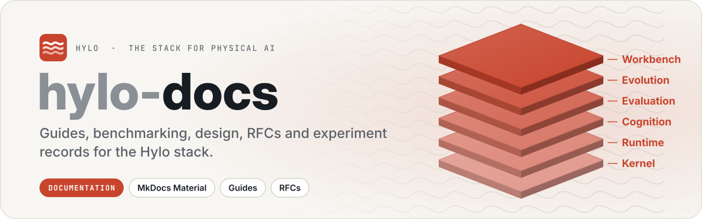

<p align="center">
  <picture>
    <source media="(prefers-color-scheme: dark)" srcset=".github/assets/banner-dark.svg">
    
  </picture>
</p>

<p align="center">
  <a href="LICENSE"></a>
  
  <a href="https://hyloai.github.io/hylo-docs/"></a>
</p>

<p align="center">
  <a href="https://hyloai.github.io/"><b>Website</b></a> ·
  <a href="https://hyloai.github.io/hylo-docs/"><b>Docs</b></a> ·
  <a href="https://hyloai.github.io/hylo-docs/getting-started/quickstart/"><b>Quickstart</b></a> ·
  <a href="https://github.com/HyloAI"><b>All repositories</b></a>
</p>

Documentation for [Hylo](https://hyloai.github.io/), the stack for physical AI: user guide, benchmarking, developer
guide, design and RFCs, research notes and experiment records, API and CLI reference. Built with MkDocs Material.

The product concepts are [Physical RSI](docs/physical-rsi.md), [Worlds](docs/user-guide/worlds/overview.md),
[Agents](docs/user-guide/agents.md), [Memory](docs/user-guide/memory/index.md) and [Skills](docs/user-guide/skills.md).
Physical RSI connects agents acting in worlds with accumulated memory and reusable skills. Home introduces the
concepts; task guides explain execution, evaluation, learning, campaigns and deployment. Skills have their own
navigation entry even though the library is implemented in the memory package. Architecture describes the
implementation; historical designs are grouped under the internal archive.
The public navigation has five sections: **Get started, User Guides, Examples and results, Developers,
and Reference**. Home is the entry page. **User Guides** groups concept explanations and practical guides under
**Physical RSI, Worlds, Agents, Memory and Skills**, followed by deployment and operations.
The full site adds **Internal** for current direction, decisions,
research, experiments and historical records. `mkdocs.yml` owns the navigation; the public build inherits it
and filters internal/excluded entries with `mkdocs/public_hook.py`.

Recorded case introductions live in `docs/showcase/`; detailed result pages are generated from repository example
READMEs. Edit those sources to change measured results. API package indexes link to generated module pages;
the CLI index links to generated command-family pages. New packages need entries in the generator's package list
and the shared navigation. Keep implemented, measured and unrun capabilities distinct.

```bash
# from the development workspace (the repositories side by side; hylo-harness: dev/bootstrap.sh)
uv sync --group docs
uv run mkdocs serve -f docs/mkdocs.yml          # http://127.0.0.1:8000, reloads on edits
uv run mkdocs build -f docs/mkdocs.yml --strict
uv run mkdocs build -f docs/mkdocs.public.yml --strict
uv run python docs/mkdocs/check_site.py docs/site
uv run python docs/mkdocs/check_site.py docs/site-public --url-prefix /hylo-docs/
```

| Path | What |
|---|---|
| `docs/` | the pages (Markdown) and `assets/` (diagrams, figures, stylesheet) |
| `mkdocs.yml` | site configuration and navigation |
| `mkdocs/check_site.py` | checks built article links, fragments, resources and missing generated content |
| `mkdocs/gen_pages.py` | pages generated at build time from the code repositories: harness reference docs, CLI reference, plugin catalogue, examples, formats |
| `mkdocs/figures/` | scripts that regenerate the figures from recorded runs, and the README art of every repository (`readme_art.py`) |
| `references/` | third-party sources studied in the research notes (read-only, gitignored; `MANIFEST.md` records URL, commit and licence) |

**Public site:** https://hyloai.github.io/hylo-docs/ (product docs only: no research notes, strategy summary, RFCs
or internal design documents; see `mkdocs.public.yml`). To publish it again, from this directory in the workspace:

```bash
uv run mkdocs gh-deploy -f mkdocs.public.yml --force --no-history
```

Generated pages need the code repositories checked out next to this one; without them the build still succeeds and
those pages say what is missing.

**README art:** the banners, stack maps and diagrams in each repository's `.github/assets/` (light and dark) come from
one script; edit it, not the SVGs:

```bash
uv run --no-project --with fonttools --with uharfbuzz --with pillow python docs/mkdocs/figures/readme_art.py
```

## License

Apache License 2.0 (see [LICENSE](LICENSE)). Copyright 2026 Hylo AI.
