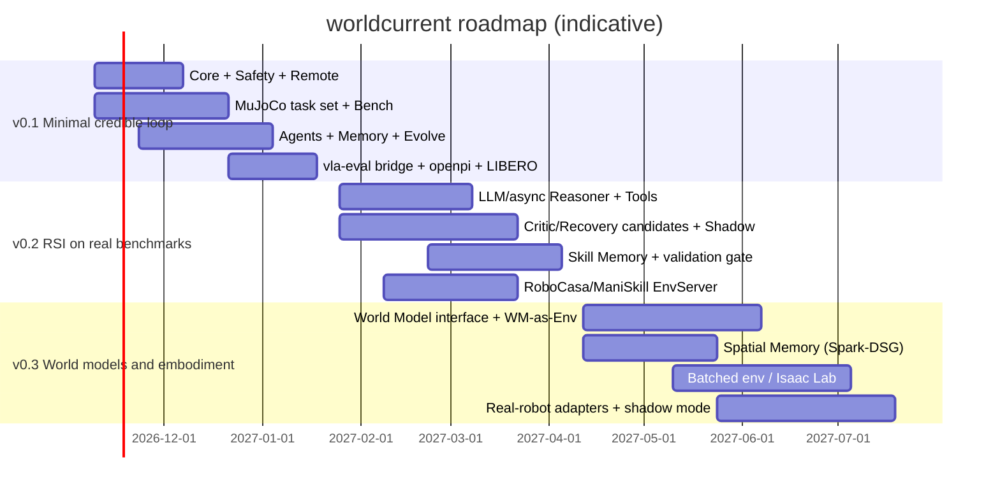

# Roadmap: From Minimal Loop to Full System

> See `roadmap/v0.1-plan.md` for the detailed weekly plan. Timelines are estimated for 3 engineers; each version ends with an internal technical report.

## v0.1 — Minimal credible loop (~10–11 weeks)

See `mvp-v0.1.md`. **Exit criteria**: Execute→…→Promote/Rollback runs end to end on the in-house MuJoCo task set + one external benchmark (LIBERO via vla-eval); the four protocol versions are frozen.

## v0.2 — RSI on real benchmarks (~3 months)

| Area | Content |
|---|---|
| Reasoning | Async dual-frequency Agent; LLM/VLM Reasoner (multi-vendor); RPent-style Tool layer (constrained by SafetyShield); LangGraph adapter |
| Evolution | Extended candidate types: Critic rules (Zetta DSL style), Recovery rules, Prompt (DSPy GEPA generator); Shadow replay; LLM multi-hypothesis diagnosis; cross-benchmark regression set |
| Memory | Skill Memory (ASPIRE-style proposer→verifier→promote, reusing the Evolution gate); vector retrieval; memory usefulness scoring |
| Benchmark | LIBERO direct adaptation (disturbance injection, recovery research); RoboCasa, ManiSkill EnvServer; Grader (VLM judge) |
| Infra | Sharded evaluation (SQLite queue → multi-machine); Trace → LeRobot v3 training-data pipeline |
| **Exit** | On LIBERO, frozen VLA + evolvable critic/recovery/prompt achieves a significant improvement selected on validation and reported on held-out; no privileged information is used in validation |

## v0.3 — World models and embodiment (~4 months)

| Area | Content |
|---|---|
| World Model | `WorldModel` protocol implementation; `WorldModelEnvironment` (runs the same Kernel/Scorer inside the model); sim-vs-model consistency evaluation; planner uses the WM to evaluate candidate action sequences |
| Memory | Production backend for spatial memory (Spark-DSG + ConceptGraphs association rules); bi-temporal fact layer for episodic memory (Graphiti style) |
| Environment | Batched env (ManiSkill GPU / Isaac Lab / mujoco.batch); Isaac Lab adapter |
| Robot | Real-robot adapters (`real_robot=True` enforces abort-style guards); real-robot **shadow mode** for RSI candidates (propose only, do not execute; record the difference from actual execution) |
| **Exit** | Long-horizon task evaluation of a memory + reasoning + VLA composed Agent on one real-robot or high-fidelity simulation scenario; quantitative evidence that world-model pre-screening lowers RSI validation cost |

## v1.0 — Research platform (~4–6 months after v0.3)

- Multi-benchmark, multi-embodiment RSI campaign management (resumable state machine, budgets, approval flow).
- Policy weight-level improvement: candidate = reference to a checkpoint produced by an external training job (LeRobot/openpi/verl), going through the same gate and registry.
- Distributed evaluation and GPU batching (borrowing vla-eval's cross-shard batching design).
- External release assessment: contract stability, license audit, documentation, public conformance kit.

## Research questions each phase must answer

| Version | Questions |
|---|---|
| v0.1 | Can a unified contract carry MuJoCo, LIBERO and real VLAs without loss? What is the engineering cost of the loop? |
| v0.2 | With the VLA frozen, which candidate types (critic/recovery/prompt/skill) yield transferable improvements? How large is the validation/held-out gap? |
| v0.3 | How can the contribution of physical memory in long-horizon tasks be measured? Can world models reliably pre-screen candidates? |
| v1.0 | Can recursive improvement maintain held-out gains over many generations without degradation (no reward hacking, no safety regressions)? |
