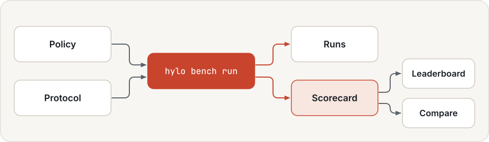
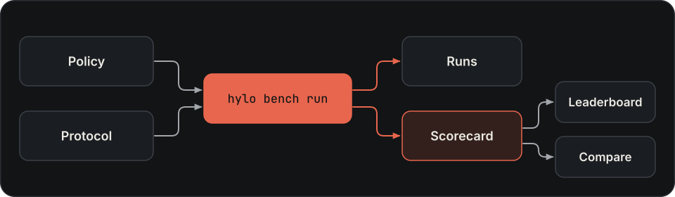

# Benchmarking

Benchmarking provides validation evidence for the [robot-skill lifecycle](../user-guide/skills.md). Protocols score
the agent or policy implementing a task capability under fixed conditions. Keep the task, robot, observations and
implementation version with each result; a scorecard alone does not create a verified skill-library record.

To compare agents fairly, score each under the same **evaluation protocol**: a frozen, versioned experiment that
fixes everything except the agent being scored (the agent usually wraps a policy). Each run writes a **scorecard**.
The scorecards of one protocol form a **leaderboard**, and any two can be compared episode by episode.

{ .hylo-diagram .only-light }
{ .hylo-diagram .only-dark }

The agent is passed as `--policy`. Despite the flag's name, it takes an agent spec.

## Design

**Only the agent may differ.** A comparison means something only when everything except the agent was the same: the
tasks and their initial states, the environment, the safety settings, the timing, the scorers. A protocol fixes all
of these and leaves the agent as its single free input. It is versioned and digested, and changing anything in it
makes a new protocol rather than a different result under the old name.

**Scorers read traces, never agents.** A scorer sees what happened in an episode, recorded in its trace, and nothing
of the agent's internals. A vision-language-action model, a language-model agent and a hand-written program are
therefore scored in exactly the same way, and a score can be recomputed later from the stored traces. Privileged
simulator state goes into the trace for scoring and is never shown to the agent.

**Pair, do not pool.** Two agents are compared on the same tasks with the same seeds, episode by episode. Which
situations happened to be hard then cancels out, and only the pairs where exactly one agent succeeded carry
information. That is why two agents whose intervals overlap can still differ clearly, and why the same paired test
decides promotion in campaigns.

**Honest intervals at the edges.** Success rates are reported with Wilson intervals, which stay inside 0 to 1 and do
not collapse to a point at 100 of 100.

**What is measured, not where.** The digest covers what defines the measurement and leaves out where it ran
(machine paths, interpreters, worker counts), so the same protocol has the same identity on every machine. Code
versions are recorded beside each scorecard rather than inside the digest. Scorecards from different protocol
digests are refused, not compared.

**Timing is part of the measurement.** A policy that waits for the world (`sync`) and one that runs while the world
moves (`realtime`) are different measurements. A protocol can score what a robot would run, with a fixed latency;
never with a measured one, which would depend on the machine and its load.

## Scoring

Commands on this page run from `bench/`.

```bash
cd bench
uv run hylo bench list                     # built-in protocols, their versions and digests
uv run hylo bench show mujoco-reach        # one protocol, with its digest
```

Score a baseline and a candidate under the same protocol:

```bash
uv run hylo bench run mujoco-reach --name ik-0.02 \
    --policy '{"type": "baseline.planar_ik", "params": {"kp": 0.02}}'
uv run hylo bench run mujoco-reach --name ik-0.3 \
    --policy '{"type": "baseline.planar_ik", "params": {"kp": 0.3}}'
```

```json title="Output of the second run"
{
  "scorecard": "scorecards/mujoco-reach/ik-0.3.json",
  "success_mean": 1.0,
  "success_ci95": [0.963, 1.0],
  "n": 100
}
```

`hylo bench run` writes the run to `OUT/runs/` and the scorecard to `OUT/scorecards/<protocol>/<name>.json`.
`--out` sets `OUT`; the default is the working directory. All options are in the
[CLI reference](../cli/index.md#hylo-bench).

## Statistics

```bash
uv run hylo bench compare scorecards/mujoco-reach/ik-0.3.json scorecards/mujoco-reach/ik-0.02.json
```

```json title="Output"
{
  "candidate": "ik-0.3",
  "baseline": "ik-0.02",
  "n_pairs": 100,
  "candidate_wins": 59,
  "parent_wins": 0,
  "p_value": 1.734723475976807e-18
}
```

`hylo bench compare CANDIDATE BASELINE` pairs the episodes both scorecards share by task and seed (`n_pairs`; an
episode either side abstained on is dropped). A one-sided exact McNemar test on the pairs where exactly one agent
succeeded (`candidate_wins`, `parent_wins`) asks whether the candidate wins more often. Two agents whose
intervals overlap can still differ clearly this way
([example](leaderboard.md#the-reference-policy-leaderboard)). Scorecards with different protocol digests are refused.

The success interval is the 95% Wilson score interval, which stays inside [0, 1]: 100 successes in 100 episodes give
[96.3%, 100%].

## Scorecards

A scorecard is a self-contained JSON file:

| Field | Content |
|---|---|
| `protocol`, `protocol_version`, `protocol_digest` | what was measured |
| `policy`, `agent` | the name given with `--name`, and the agent spec that ran |
| `metrics` | `success_mean`, `steps_mean`, `safety_interventions_mean`, `n_episodes`, `n_scored`, ... |
| `success_ci95` | the 95% Wilson score interval on the success rate |
| `per_task` | success and episode count per task |
| `episodes` | per-episode success keyed `task#seed`, which `compare` pairs on |
| `run_dir`, `config_digest`, `code` | the run it came from on this machine, its config digest, and the git commit and package versions that ran |
| `notes`, `created_at` | free text (`--notes`), and when it was written |

## Protocols vs experiments

An [experiment config](../user-guide/experiments.md) says what to run: benchmark and split, environment, agent,
safety, trace, timing. A protocol is an experiment with the agent left out:

| | Experiment config | Evaluation protocol |
|---|---|---|
| Agent | part of the config | the only free input (`--policy`) |
| Who writes it | anyone, for any run | built in, or your own YAML; a change is a new version |
| Identity | config digest | protocol name, version and digest |
| Result | a run (`evallog.json`, traces) | a run plus a scorecard |
| Comparable with | runs with the same config digest and code versions | scorecards with the same protocol digest |

The protocol digest does not cover package versions. Each scorecard records them under `code`
([the digest](protocols.md#the-digest)).

## Next

- The built-in [protocols](protocols.md), and how to write your own.
- Put several agents on a [leaderboard](leaderboard.md).
- Improve an agent with a [campaign](../user-guide/campaigns.md), whose gate uses the same paired test by default.
