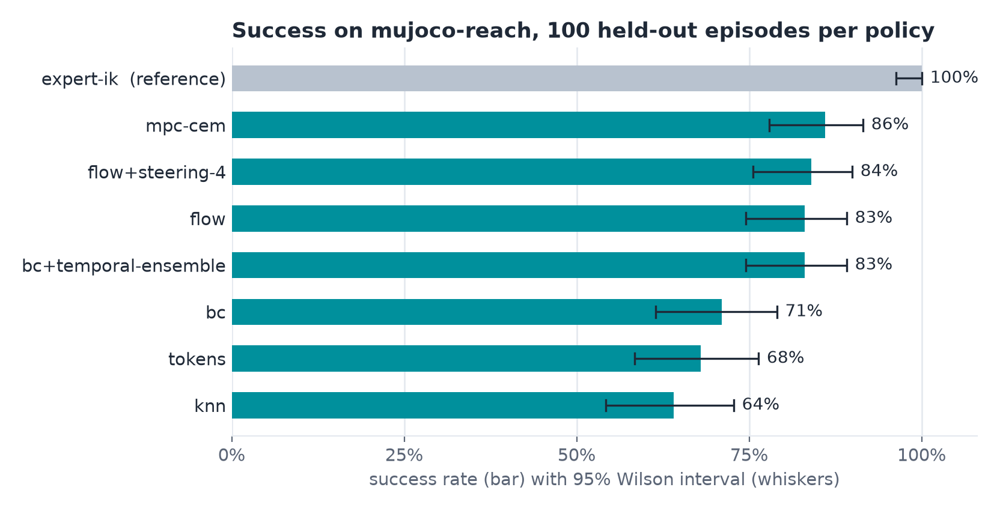

# Leaderboards

A leaderboard is every scorecard of one evaluation protocol (name, version and digest), ranked by success. There is
no server: scorecards are JSON files, and `hylo bench leaderboard` collects them from directories.

## Running policies

Commands on this page run from `bench/`. `--policy` takes an agent spec, in one of three forms: JSON, an experiment
config YAML (its agent is used), or a plugin name.

=== "Agent spec"

    ```bash
    uv run hylo bench run mujoco-reach --name ik-0.3 \
        --policy '{"type": "baseline.planar_ik", "params": {"kp": 0.3}}'
    ```

=== "Experiment config"

    ```bash
    uv run hylo bench run libero-10-heldout --name smolvla-steered \
        --policy examples/configs/libero10_steered.yaml --workers 12
    ```

=== "Plugin name"

    ```bash
    uv run hylo bench run mujoco-reach --name random --policy baseline.random
    ```

| Option | Meaning |
|---|---|
| `--name` | the agent's name on the leaderboard; the scorecard file is the name with other characters than `A-Za-z0-9_.-` replaced by `-`, and a name that maps to an existing file overwrites it |
| `--out DIR` | runs go to `DIR/runs`, scorecards to `DIR/scorecards` (default: the working directory) |
| `--workers N` | parallel episodes |
| `--set KEY=VALUE` | execution settings only ([which keys](protocols.md#the-digest)) |
| `--notes TEXT` | stored in the scorecard |

Use digest-pinned [store ids](../user-guide/store.md) for artifacts so the scorecard names the exact weights.

## Ranking and comparing

```bash
uv run hylo bench leaderboard                          # ./scorecards
uv run hylo bench leaderboard runs/policies/scorecards --json
uv run hylo bench compare scorecards/mujoco-reach/flow-steering-4.json scorecards/mujoco-reach/bc.json
```

The leaderboard prints one Markdown table per protocol digest: rank, agent name, success %, 95% interval, scored
episodes, mean steps. `compare` prints the paired result:

```json
{
  "candidate": "flow+steering-4",
  "baseline": "bc",
  "n_pairs": 100,
  "candidate_wins": 18,
  "parent_wins": 5,
  "p_value": 0.005311012268066406
}
```

`candidate_wins` and `parent_wins` count episodes only the candidate or only the baseline solved (the key name is
shared with campaigns). The test is explained in [compare two scorecards](index.md#statistics).

## The reference-policy leaderboard

`examples/policies/compare.py` records demonstrations from the IK controller and random-action runs on the campaign
`search` and `search_val` seeds (30000–30059, disjoint from the protocol's 20000–20049). It trains one
[learner](../user-guide/learning.md) per policy family on the demonstrations, plus a world model on both kinds of data
for MPC. It scores each under `mujoco-reach` with the `policy`, `temporal_ensemble` or `steered`
[agent](../user-guide/policies.md) (steered: four seeded samples, the medoid executed), and the IK controller itself
as the demonstrator.

```bash
uv run python examples/policies/compare.py --out runs/policies
uv run hylo bench leaderboard runs/policies/scorecards
```

{ .hylo-figure }

These scorecards were recorded under mujoco-reach v1 with protocol digest `5e0c57ef414a0b21`. The current digest of
mujoco-reach v1 is `a76c7037efb84660` (`hylo bench list`). Scorecards you write now form a separate board and cannot
be compared with these.

| # | Name | Agent | Success % | 95% CI | Mean steps |
|---|---|---|---|---|---|
| 1 | expert-ik | `baseline.planar_ik` (the demonstrator) | 100.0 | 96.3–100.0 | 36 |
| 2 | mpc-cem | `policy` with `policy.mpc` (CEM in the learned world model) | 86.0 | 77.9–91.5 | 60 |
| 3 | flow+steering-4 | `steered` with `policy.flow` | 84.0 | 75.6–89.9 | 54 |
| 4 | bc+temporal-ensemble | `temporal_ensemble` with `policy.bc` | 83.0 | 74.5–89.1 | 56 |
| 5 | flow | `policy` with `policy.flow` | 83.0 | 74.5–89.1 | 56 |
| 6 | bc | `policy` with `policy.bc` | 71.0 | 61.5–79.0 | 68 |
| 7 | tokens | `policy` with `policy.tokens` | 68.0 | 58.3–76.3 | 74 |
| 8 | knn | `policy` with `policy.knn` | 64.0 | 54.2–72.7 | 76 |

Paired, flow + steering beats plain BC 18 to 5 (p = 0.005), although their intervals overlap. This is one small
reach benchmark, not a ranking of policy families.

## Publishing results

- A scorecard is the unit to share.
- `run_dir` is a path on your machine. To share the traces too, keep the run in the
  [store](../user-guide/store.md) and copy it to the other side with `hylo store push`.
- Report held-out protocols for anything a campaign improved (`libero-10-heldout`, not `libero-10`).

## Next

- Train artifacts from runs: [learning](../user-guide/learning.md).
- Improve an agent with a [campaign](../user-guide/campaigns.md).
