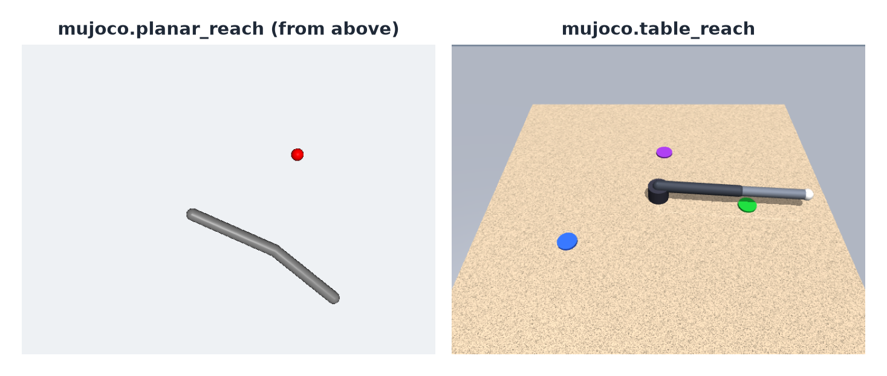

# Protocols

An evaluation protocol is a YAML file that fixes everything except the agent being scored (the agent usually wraps a
policy). hylo-bench ships four, named by file name. You can also pass the path of your own (`hylo bench run path/to/protocol.yaml ...`).

## Built-in protocols

| Protocol | Scores | Episodes | Timing | Requires |
|---|---|---|---|---|
| `mujoco-reach` | MuJoCo planar reach, standard held-out seeds 20000–20049 | 100: a fixed and a random target | sync | hylo-env-mujoco |
| `libero-10` | LIBERO-10, all 50 stored init states per task | 500 | sync | hylo-env-libero, `envs/libero/setup.sh` |
| `libero-10-heldout` | LIBERO-10, init states 40–49 | 100 | sync | as above |
| `libero-10-heldout-realtime` | as `libero-10-heldout` | 100 | realtime, virtual clock, 0.5 s per chunk | as above |

```bash
cd bench
uv run hylo bench list        # names, versions and current digests
```

**mujoco-reach.** A planar two-link arm reaching a fixed and a random target, 50 seeds each. It takes a few seconds
per agent on a CPU and is deterministic. Campaigns never use these seeds
([two held-out sets](../user-guide/campaigns.md#two-held-out-sets)).

{ .hylo-figure }

**libero-10.** The standard LIBERO-10 evaluation: all 50 stored init states of each of the 10 long-horizon tasks.
Campaigns tune on init states 0–39, so for a policy a campaign improved, report `libero-10-heldout` instead.

**libero-10-heldout.** Only init states 40–49, the campaigns' held-out split
([splits](../user-guide/campaigns.md#splits)).

**libero-10-heldout-realtime.** The same 100 episodes in [realtime timing](../user-guide/experiments.md#sync-and-realtime-timing)
with a fixed 0.5 s latency on a virtual clock, so the score does not depend on the machine. The gap to
`libero-10-heldout` shows what that delay costs a policy.

The LIBERO protocols need the `libero-sim` runtime
([installation](../getting-started/installation.md#optional-libero-and-lerobot)).

## What a protocol contains

| Field | In digest | Meaning |
|---|---|---|
| `schema_version` | yes | the protocol format version |
| `name`, `version` | yes | the identity shown on leaderboards |
| `benchmark` | yes | `{type, split, params}`: the benchmark plugin, the split that is scored, its parameters |
| `env` | yes, except `env.remote` | `{type, params}` of the environment plugin; `remote` says where the simulator runs |
| `safety` | yes | the safety shield config: `max_delta`, `guards: [{type, params}]` ([safety](../user-guide/safety.md)) |
| `trace` | yes | `record_privileged`, `image_every` |
| `timing` | yes, unless it is the default | `sync` (default) or `realtime`, with its clock, latency and refill settings |
| `seed` | yes | base seed of the run |
| `description` | no | what the protocol is for |
| `workers` | no | parallel episodes: how fast, not what |
| `requires` | no | what must be installed or set up, for people |

To change anything in the digest, write a new protocol version.

## The digest

`hylo bench show NAME` prints the protocol and its current digest: the first 16 hex characters of a sha256 over the
fields marked "yes" above. Renaming a protocol or changing its version changes it. `env.remote` (where the simulator
runs) is placement, not measurement, and is left out entirely. The digest does not cover code or package versions;
each scorecard records those under `code`.

A scorecard keeps the digest it was written with, and leaderboards group scorecards by name, version and digest. A
protocol edited without a new version therefore starts a new board instead of mixing incomparable numbers.

`hylo bench run --set` accepts only keys outside the digest: `env.remote.*`, `workers` and `output_dir`. Anything
else is refused, because the scorecard would no longer belong to the protocol.

<a id="writing-a-protocol"></a>

## Write your own

Copy a built-in protocol and change what you measure:

```yaml title="protocols/mujoco-table.yaml"
schema_version: hylo.protocol/v0.1
name: mujoco-table
version: "1"
description: |
  MuJoCo table reach: held-out seeds of every table task.
benchmark: {type: mujoco/table-v0, split: heldout}
env: {type: mujoco.table_reach}
safety: {max_delta: 0.5}
trace: {record_privileged: true, image_every: 0}
workers: 8
requires: [hylo-env-mujoco]
```

```bash
uv run hylo bench show protocols/mujoco-table.yaml          # check the digest
uv run hylo bench run protocols/mujoco-table.yaml --policy composable.object_reach --name object-reach
```

- If campaign-improved agents will be scored, use a split that no campaign learns from or gates on. The standard
  `heldout` split of a MuJoCo benchmark is disjoint from the campaign seeds.
- Bump `version` for any change to a field in the digest, and say what changed in `description`.

To ship a protocol with hylo-bench, add the YAML file to `bench/packages/hylo-bench/src/hylo/bench/protocols/`.

## Next

- Put agents on a [leaderboard](leaderboard.md).
- Improve an agent with a [campaign](../user-guide/campaigns.md), then score it on a held-out protocol.
