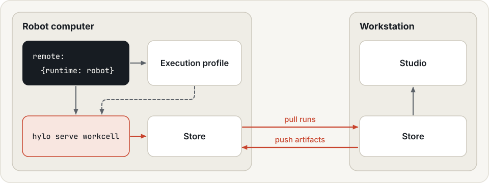
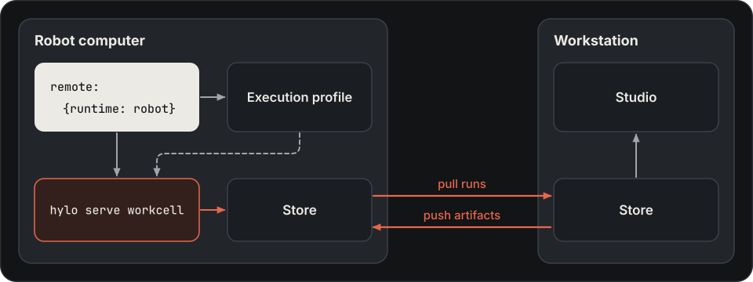

# Deployments repository

A lab's robot setup (robot names, network addresses, joint limits, safety limits) belongs to the lab. Keep it in a
private `<lab>-deployments` repository created from the deployments template. The repository holds YAML only; every
environment, agent and guard it names comes from an installed Hylo package.

{ .hylo-diagram .only-light }
{ .hylo-diagram .only-dark }

## Setup

```bash
git clone https://github.com/HyloAI/hylo-deployments-template.git mylab-deployments
cd mylab-deployments
git remote set-url origin <your lab's private repository>
```

```text
<lab>-deployments/
├── README.md
└── workcells/
    ├── sim_arm.yaml          a simulated arm, no hardware: bring-up and operator flow
    ├── so101.yaml            an SO-101 arm through LeRobot's Robot interface
    └── libero10_sim.yaml     LIBERO-10 in simulation, with the realtime runner
```

Add one workcell file per robot or simulator. Set up the robot computer first
([deployment, step 2](../user-guide/deployment.md#2-the-robot-computer)).

## Workcell { #a-workcell-config }

Copy a template for your robot and set its port, identity, cameras, action limits and home pose.
See [Workcell configuration](workcells.md) for the YAML example, field defaults and safety-limit settings.

## Safety limits

Review changes to robot action limits and safety settings before starting a workcell.
See [workcell safety fields](workcells.md#safety-limits) and [Safety](../user-guide/safety.md).

## Machine settings { #machine-specific-settings }

| Keep out of the repository | Put it here instead |
|---|---|
| tokens, including a policy endpoint's `token` | an environment variable or a secret store, passed when the workcell or the episode starts |
| interpreter paths, environment variables | the robot computer's [execution profile](profiles.md) |
| motor calibration | LeRobot's calibration files on the robot computer |

## Start a workcell { #starting-a-workcell }

From the deployments repository:

```bash
uv run hylo serve workcell --config workcells/sim_arm.yaml --port 8102
uv run hylo serve workcell --config workcells/so101.yaml --host 0.0.0.0 --port 8100 --token "$HYLO_TOKEN"
```

A workcell listens on `127.0.0.1:8100` by default. Bind it to `0.0.0.0` only on a robot network, and always with
`--token` ([security](../user-guide/security.md)). The workcell takes the token only as `--token VALUE`, so it is
visible in the robot computer's process list.
