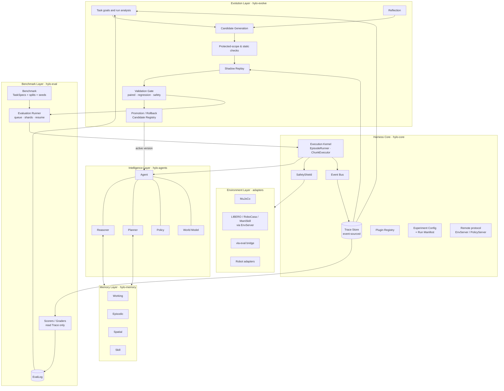

# Hylo Architecture Design

> Product framing: the [robot-skill lifecycle](../user-guide/skills.md) connects development, validation,
> deployment, reuse and improvement. The packages and contracts below implement those activities; they do not
> introduce a universal skill abstraction around every policy. See [Architecture overview](overview.md) for the current mapping.

> Current implementation update (2026-11-02): strategy development is a supported path into the existing stack.
> `core.robot` and `core.scene` define cross-repository data; `hylo-manip` implements robot tools; `hylo-code-agents`
> implements program agents, research and experimental authoring workflows; `hylo-tools` isolates model dependencies
> in workers. New-task development checks task requirements, while campaigns compare revisions with a baseline.
> The original prototype sections below retain their historical annotations; the current workflow is described
> in [Architecture overview](overview.md) and [Developing robot skills](../user-guide/developing-strategies.md).

> Status: Draft v0.1 (2026-10-30) | Related: `rfcs/RFC-0001.md`, `../research/comparisons/technology-gap-analysis.md`
> The interfaces have been validated as runnable code in an interface prototype (38 tests passing; superseded by the packages and removed on 2026-10-31, still in the git history); every part marked **[Validated in prototype]** has a corresponding implementation and tests.

## 1. Design goals and constraints

| Goal | Design response |
|---|---|
| Lightweight Harness core | `hylo-core` depends only on numpy + pydantic + pyyaml; core is about 1.3k lines |
| No mandatory dependency on any Simulator | Environment is a protocol; MuJoCo and others are provided as adapter packages, lazily imported; environments with heavy dependencies run out-of-process via EnvServer |
| Not tied to any LLM or VLA | The Kernel only knows `Agent`; Reasoner/Policy/WorldModel are internal components of the Agent |
| Reasoning, Memory and RSI independently replaceable | Each is a separate package + protocol; they interact with each other only through core contracts and the Trace |
| Benchmark scoring independent of the Agent | Scorer **reads Trace only** **[Validated in prototype]** |
| Testable without a simulator | a test double (`hylo.testing`, `testing.*` plugins) for unit and conformance tests only; every example, protocol and campaign runs on a real simulator (MuJoCo, LIBERO) |
| Versioned experiment config, reproducible | `ExperimentConfig` (schema_version + digest) + RunManifest + Benchmark digest + seed partitioning **[Validated in prototype]** |
| Compatible with existing open-source interfaces | openpi WS protocol, vla-eval protocol, LeRobotDataset v3, inspect-style EvalLog |

**Three non-negotiable principles**

1. **Single checkpoint**: every action - whether from a VLA, an LLM, a recovery skill or an RSI candidate - must pass through the `SafetyShield` inside the Kernel before it reaches the Environment.
2. **Everything is replayable**: all facts of an Episode are written to the Trace as an event stream; scoring, diagnostics and shadow replay read only the Trace.
3. **Improvements must be reversible**: every active improvement is an immutable version in the Registry that can be promoted and also rolled back.

## 2. Overall layering

## 2.1 Repositories and packages (2026-10-31)

The code lives in five repositories (design/repository-structure.md): the **harness** is the base, and
**bench**, **serve**, **studio** and **plugins** are leaves on top of it that never import each other. Package
layering inside and across them is enforced by `harness/dev/test_boundaries.py`: imports and string references
("pkg.mod:attr", "-m pkg.mod") both count, and so do declared dependencies.

| Repository | Package | Role | May depend on |
|---|---|---|---|
| harness | hylo-core | contracts (incl. the policy contract `core.policy`), kernel, SafetyShield, trace, registry, remote protocols and wire codec, artifact provenance + split guard, conformance kit, every cross-repository format (active version, scorecard, workcell API), the `hylo` dispatcher | - |
| harness | hylo-eval | evaluation engine: benchmark contract, splits and seeds, evaluation runner, scorers, paired statistics and gate tests | core |
| harness | hylo-agents | decision-making only: steering, memory / critic / noise steering, skills, planner, shadow agent, baselines | core (instruments, reasoners as optional extras) |
| harness | hylo-instruments | models that measure or predict, never act: success judges, chunk value models, world models (and the world-model environment) | core |
| harness | hylo-reasoners | rule-based reasoners and choosers (`hylo.reasoners.rules`; the LLM ones are in the reasoner-llm adapter) | core |
| harness | hylo-memory | action / noise banks, skill library, lesson book | core |
| harness | hylo-policies | reference policies, one per family (kNN, BC, flow matching, tokens, MPC) and their learners | core, instruments |
| harness | hylo-learn | offline: learner jobs, calibration and labelling, external-data ingestion, learners for runtime components | core, eval, instruments |
| harness | hylo-evolve | improvement protocol (cascade, gate, registry, campaigns, active.json, prescreen, shadow config) and rule / learning proposers | core, eval, learn |
| harness | hylo-catalog | read-only query API over runs, episodes, comparisons, campaigns, artifacts, skills, lessons, memories | core, eval |
| harness | hylo-cli | the harness's `hylo` subcommands (run, evolve, learn, calibrate, ...) | core, eval, agents, instruments, reasoners, memory, evolve, learn |
| harness | hylo-manip | perception, robot kinematics, grasping and planning tools over RobotSpec; MuJoCo backend | core |
| harness | hylo-code-agents | program agents, research, code candidates, program skills; scene, replay and motion workflows | core, agents, manip, eval, evolve, memory, reasoner-llm, tools |
| harness | hylo-tools | model tool adapters with independent worker environments; optional manip integration | manip (optional) |
| harness | adapters | policy-lerobot, policy-openpi, reasoner-llm (runtime LLM / VLM), proposer-llm (evolve-time LLM proposer and reflector), data-video | core and the layer they plug into |
| bench | hylo-bench | protocols, scorecards, leaderboards, pairwise comparison (`hylo bench`) | core, eval |
| bench | env-libero, env-mujoco | benchmark suites and robot-contract environments, including Panda, ALOHA and fixed-base G1 | core |
| bench | hylo-robosuite-contract | shared mapping for robosuite-based robot environments | core |
| bench | env-robosuite, env-robocasa | separate simulator runtimes; task success-rate evaluation pending | core, robosuite-contract |
| serve | hylo-serve | policy server (/wc + openpi protocols), real-time runner, workcell service (`hylo serve`) | core |
| serve | env-lerobot-robot | real robots through LeRobot's Robot interface, a simulated arm | core |
| studio | hylo-playground | web backend and control plane (`hylo playground`); React front end in `web/` | core, eval, catalog |
| plugins | hylo-plugin-examples | a guard, gate tests and an online learner, written as a third party would | core, eval, learn |

Cross-package component references are registered plugin names (resolved in whichever venv runs the component),
never hard-coded module paths. Across repositories, components meet only through formats defined in hylo-core.

## 3. Responsibilities and boundaries of each layer

### 3.1 Harness Core (`hylo-core`)

| Module | Responsibility | Prototype location |
|---|---|---|
| Contracts | `Observation`, `Action`, `ActionChunk`, `StepResult`, `EnvSpec`, `ActionSemantics`, `TaskSpec`/`TaskInstance`, `AgentSpec` | `core/types.py`, `core/task.py`, `core/agent.py` |
| Execution Kernel | Episode loop, clock, chunk execution, error classification, timeouts | `core/kernel.py` |
| SafetyShield | Enforced guardrail chain (Finite → configured guardrails → Bounds); in real-robot mode any modification aborts | `core/safety.py` |
| Compat | Bind-time compatibility checks (control mode/rotation/dimension = error) | `core/compat.py` |
| Event Bus | Typed events, subscriber fault isolation, critical subscribers (Trace) | `core/events.py` |
| Trace Store | JSONL event stream + content-addressed blobs; append-only; replayable | `core/trace.py` |
| Plugin Registry | Explicit registration, lazy `module:attr`, entry points, auto-loading can be disabled | `core/registry.py` |
| Config & Manifest | Schema version, digest, dot-path overrides, run manifest | `core/config.py` |
| Remote | EnvServer protocol (JSON lines + pickle-free codec); PolicyServer (openpi-compatible) | `remote/` (Env implemented; Policy is v0.1 P1) |

**Core does not contain**: any simulator, any model, any memory backend, any scoring policy, any improvement algorithm.

### 3.2 Environment Layer

Environment = Simulator + Task logic. Three run locations:

| Location | Use | Mechanism |
|---|---|---|
| In-process | MuJoCo, lightweight-dependency environments (and the test double) | Implement the protocol directly |
| Out-of-process (EnvServer) | Benchmarks with mutually exclusive dependencies (LIBERO py3.8, RoboCasa py3.11) | `RemoteEnvironment` ↔ `env_server` (separate venv/container) **[Validated in prototype: remote and local results match step by step]** |
| Driven externally (Served mode) | vla-eval's 20 benchmark containers | The Agent is wrapped as a vla-eval ModelServer |

Privileged state (ground-truth poses, etc.) enters only the Trace via `PrivilegedStateSource` for use by the Scorer/diagnostics, and is **never passed to the Agent** **[Validated in prototype]**.

### 3.3 Benchmark Layer (`hylo-eval`)

Benchmark (versioned TaskSpec set + protocol) → EvaluationRunner → Kernel → Trace → Scorer → EvalLog.
The `train / validation / heldout` three-way split is a first-class concept, and seeds must not be reused across splits (checked at construction) **[Validated in prototype]**.

### 3.4 Intelligence Layer (`hylo-agents`, `hylo-instruments`, `hylo-reasoners`)

Decision-making agents are in hylo-agents, which installs with hylo-core alone (what a robot computer needs). Models
that measure or predict but never act (success judges, chunk value models, world models) are in hylo-instruments;
rule-based reasoners and choosers in hylo-reasoners. An agent that consults one of them (the critic-steered agent, the
composable agents) imports it only when it is built: extras `hylo-agents[critic]` and `hylo-agents[rules]`.

The Kernel only calls `Agent.reset/act/on_step/on_episode_end`. The reference implementation `ComposableAgent` composes:
- **Reasoner** (slow, event-triggered) → `Decision` (subgoal/skill/abort)
- **Policy** (every control step) → `ActionChunk`
- **World Model** (optional, a tool for the Planner; can also be wrapped as an Environment for "imagined evaluation")
- **Memory** (injected via the `MemoryStore` protocol)

Decisions and Memory retrievals enter the Trace via `ctx.emit()` **[Validated in prototype]**.

### 3.5 Memory Layer (`hylo-memory`)

A unified `MemoryItem` (time intervals and poses with frame_id as first-class fields; bi-temporal invalidation semantics) + the `MemoryStore` protocol (write/query/forget/snapshot).
Prototype implementation: bounded WorkingMemory + SQLite episodic/spatial store (radius queries, `as_of` time travel, key invalidation, dedup) **[Validated in prototype]**.
Production backends (Spark-DSG, mem0, Graphiti) plug in through adapter packages.

### 3.6 Evolution Layer (`hylo-evolve`)

Offline loop: Execute(train) → Diagnose → Generate → Protected-scope check → (Shadow replay) → Validate(validation, paired McNemar + regression + safety) → Held-out(report only) → Promote(requires approval) / Rollback.
**[Validated in prototype]**: an adversarial candidate (attempting to loosen `safety.max_delta`) is rejected; a gain candidate passes validation and is promoted; held-out is marked `used_for_selection=false`; rollback restores the parent version and writes to the ledger.

### 3.7 Learning pipeline and derived artifacts (RFC-0004)

The trace store is the single source of truth; everything learned from it (action memory, critics, value models,
fine-tuned weights, datasets, judges) is a sealed **derived artifact**: a directory with an `artifact.json` manifest
(kind, role, content digest, provenance: which runs and splits, which builder). Learners (`learners` plugin group)
run anywhere hylo-learn is installed (`python -m hylo.learn.jobs job.json`) and seal their output.
Artifacts have one of three roles with separate trust paths:

| Role | Changes | Trusted through |
|---|---|---|
| behaviour (memory, critic, noise policy, weights, skills) | what the robot does | the RSI gate only |
| instrument (success judge, progress model, world model) | labels and measurements | calibration against ground truth; never a gate verdict |
| proposal (lessons, skill index) | what gets proposed | outcome votes |

Split integrity is enforced twice: one guard for every builder (gate / held-out data are never read), and stage 0 of
the gate re-verifies the digest and provenance of every artifact a candidate references. **[Implemented: A1-A3, W1-W4]**

Around this core: external data enters as runs under split `external:<name>` (with origin, licence, label
provenance and a contamination check against gate / held-out init states); a learned world model can host
state-based agents and pre-screen candidates (opt-in; its rollouts never become training data); a frozen flow VLA can
be steered in noise space from its own successes; and a candidate can ride along in shadow mode, computing actions
that are compared with, but never replace, the active agent's.

### 3.8 Serving and real robots (2026-10-31)

Three roles that can run on one laptop or on three machines:

| Role | Runs | Owns | Talks |
|---|---|---|---|
| policy server (`hylo serve policy`) | GPU machine | any agent, or a campaign's active version (rebuilt between sessions after promotion / rollback) | `/hylo` (Hylo agent protocol; incompatible env refused at reset) and `/openpi` (openpi msgpack protocol, so DROID / RoboArena / openpi clients can run our agents); one session at a time |
| workcell (`hylo serve workcell`) | next to the robot | the environment (simulator or robot adapter), SafetyShield, real-time runner, trace | HTTP `/status`, `/episodes`, `/operator`; WS `/events` |
| control plane (`hylo-playground --workcell ... --policy ...`) | anywhere | nothing that moves: starts episodes, relays operator events and live streams, roles (viewer / operator / approver) | browser and CLI |

The real-time runner (core's episode loop in `realtime` timing, RFC-0005; the same loop benchmarks run) keeps the
robot moving while the policy computes: an action queue with aligned merge (actions
that went stale during inference are dropped), an adaptive refill threshold, a hold action when the queue is
empty (measured pose for absolute control, zero motion for delta control), a watchdog, and operator events (reset
confirmation, verdict, stop, an e-stop latched until cleared). Safety runs in the workcell process, so a network
fault cannot bypass it. A virtual clock replays inference latency deterministically in simulation; the wall clock
runs the policy in a worker thread on hardware. Robot episodes never claim success: the operator's verdict (or a
calibrated judge) labels them, recorded as `operator:<name>`.

Real robots enter through LeRobot's Robot interface (SO-100/101, Koch, LeKiwi, OpenArm, ROS 2 robots through
LeRobot plugins). The SafetyShield is a software layer, not a certified safety function: the robot's own limits
and a hardware e-stop stay in place.

## 4. Cross-layer data flow: what one episode produces

| Event type | Producer | Purpose |
|---|---|---|
| `episode.start` | Kernel | task digest, seed, split, agent component versions, guardrail list |
| `observation` | Kernel | Replay, training data export |
| `agent.chunk` | Kernel | policy output + latency + provenance |
| `agent.decision` | Agent (Reasoner) | Reasoning observability, failure diagnosis |
| `memory.retrieval` / `memory.write` | Agent (Memory) | Evidence for diagnosing whether memory misled the agent |
| `safety.review` | Kernel (Shield) | proposed vs approved, reason for modification |
| `action` | Kernel | The action actually executed |
| `step.result` | Kernel | reward/terminated/truncated/success/info |
| `privileged.state` | Kernel (Env) | Visible only to Scorer/diagnostics |
| `error` | Kernel | Error classification with phase |
| `episode.end` | Kernel | status ∈ {success, failure, error, safety_abort, infra_invalid} |

## 5. Key design decisions (summary)

For full rationale and alternatives, see `rfcs/RFC-0001.md`.

| # | Decision | Main rationale | Controversy |
|---|---|---|---|
| D1 | The Kernel owns the loop (Driven), while also supporting Served mode | Safety and observability require a single checkpoint; Served mode preserves the vla-eval ecosystem | Medium |
| D2 | Agent is the only Kernel-level intelligence abstraction; Reasoner/Policy are its internal components | Not tied to a paradigm; both end-to-end VLAs and LLM+skills can be expressed | Medium |
| D3 | In-house event-sourced Trace; inspect_ai log / OTel / LeRobotDataset are not used directly as primary storage | No existing format covers reasoning/memory/safety and is replayable at the same time; the others all serve as export targets | Medium |
| D4 | LangGraph is not used as the loop engine; LangGraph/DSPy are optional adapters only | Superstep overhead does not match control frequency; transitive dependency on langchain-core | Low |
| D5 | RSI candidates are declarative by default (config patch / rules); code candidates require an isolated runtime | The only route that delivers safety at the source-code level (Zetta) | Medium |
| D6 | Three-way split + held-out report-only + Rollback as first-class | Fixes Zetta's lack of validation and rollback | Low |
| D7 | Single repository (`dyna-harness`) with multiple packages; split into separate repositories later (**amended at review**) | Interfaces change fast early on; atomic cross-package changes are cheap; packages already isolated by contracts + entry points | Resolved |
| D8 | Remote protocols: openpi-compatible on the Policy side, vla-eval-compatible on the Benchmark side, own protocol on the Env side | Maximize reuse of existing servers/images | Low |
| D9 | Contracts are pydantic v2 models (frozen, `extra="forbid"`, JSON Schema) + `Protocol` for behaviour (**amended at review**) | Loud validation, schema export, one serialization path; measured cost +5 µs/step | Resolved |
