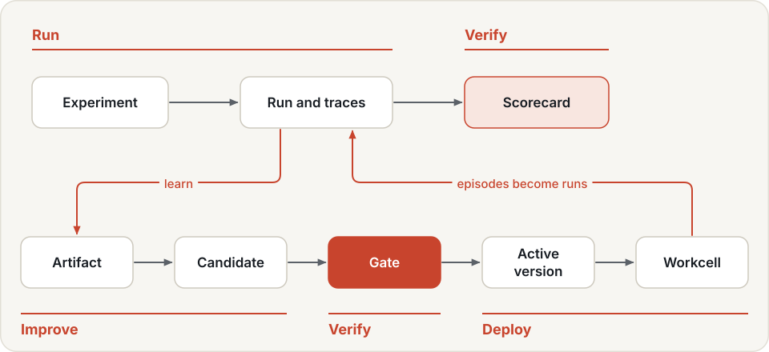
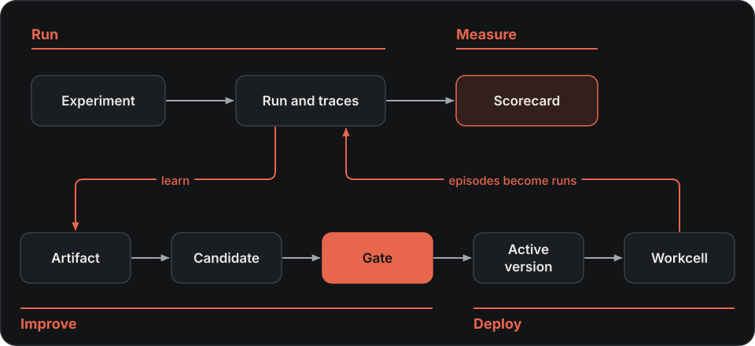
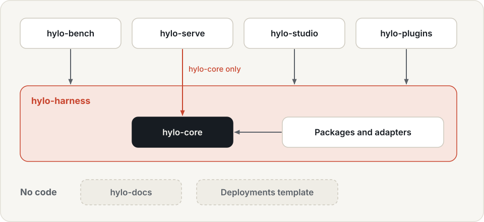
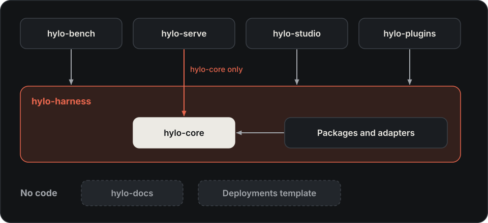

# Architecture overview

This page shows how Run → Measure → Improve → Deploy connect inside Hylo, and what checks each hand-off.
[Concepts](../getting-started/concepts.md) defines the terms.

## From runs to deployed versions

{ .hylo-diagram .only-light }
{ .hylo-diagram .only-dark }

*Run, Measure, Improve and Deploy as one loop: the workcell's episodes become new runs.*

1. **Run.** An [experiment](../user-guide/experiments.md) runs one split of a benchmark. It records one trace per
   episode and the results, and the store files the run under an id.
2. **Measure.** An evaluation protocol fixes everything except the agent being scored, and writes a
   [scorecard](../benchmarking/index.md). A leaderboard ranks the scorecards of one protocol.
3. **Improve: artifacts.** [Learners](../user-guide/learning.md) build artifacts from runs: memories, critics, judges, world
   models, policy weights. Each is sealed with a content digest and its source runs
   ([artifact roles](../user-guide/learning.md#artifact-roles)).
4. **Improve: candidates.** Generators propose candidates as config patches, each with a hypothesis. Besides the
   development splits, they can read the campaign archive, including past candidates' gate results
   ([who reads which split](../user-guide/campaigns.md#splits)).
5. **Improve: the gate.** A [campaign](../user-guide/campaigns.md)'s stage-0 checks reject candidates that touch
   protected settings. The rest are screened against the current version on `search_val`, and the best is tested
   by the gate on the `gate` split. The gate never reads `heldout`.
6. **Improve: promotion.** A candidate that passes becomes the campaign's active version (`active.json`), which a policy
   server can follow. By default this is automatic. Use `approval: manual` for anything that runs on hardware, so a
   person approves first. `hylo evolve rollback` undoes a promotion.
7. **Deploy.** Promotion alone changes nothing on a robot. A policy server must follow the campaign's
   `active.json`, and a [workcell](../user-guide/deployment.md) must connect to that server. The workcell runs the
   active version through the same episode loop, and its episodes are recorded as runs that flow back through the
   store to step 1.

## One episode loop

One episode loop runs every episode: in evaluation, in Studio's live sandbox and in a workcell next to a robot. It
passes every action through the safety shield, and every step emits events that a trace store writes per episode.
Replay, scoring, judges, learners and Studio all read these traces. Timing (`sync` by default, or `realtime`) is
part of what an experiment measures ([timing](../user-guide/experiments.md#timing-sync-and-realtime)). Realtime
uses a deterministic virtual clock by default; on hardware, set `clock: wall`
([deployment](../user-guide/deployment.md)).

## Three rules

1. **The episode loop only knows contracts.** It runs an agent against an environment. Policies, memories,
   reasoners and world models live inside agents. Any simulator, robot or policy stack plugs in as a plugin.
2. **Every action passes the safety shield.** Agents cannot bypass it, and campaign candidates may not change the
   safety settings. Overrides you write into a campaign config yourself are not checked
   ([what is protected](../user-guide/safety.md#safety-in-campaigns)).
3. **Scoring reads traces only.** A scorer sees what happened, never the agent's internals.

## Measurement vs placement

An experiment's identity is what it measures. Configs name runtimes and store ids, never paths, and each machine
resolves them ([profiles](../configuration/profiles.md), [store](../user-guide/store.md)). So an experiment has the
same digest on every machine; the one placement detail that is hashed is a `remote.ws` URL. The digest does not
cover code versions or unpinned artifacts
([when two runs are comparable](../user-guide/experiments.md#what-is-measured-the-digest)). A result in simulation
does not by itself predict the result on a robot.

## Packages and repositories

{ .hylo-diagram .only-light }
{ .hylo-diagram .only-dark }

*The harness is the base, and the leaf repositories depend on it only.*

| Repository | Package | What it holds |
|---|---|---|
| **hylo-harness** | `hylo-core` | contracts, episode loop, safety shield, traces, plugin registry, store, `hylo` command |
| | `hylo-eval` | benchmarks, splits, runner, scorers, paired statistics, gate tests |
| | `hylo-agents` | agents that run a policy: plain, ensembled, steered; baselines |
| | `hylo-policies` | reference policies, one per family, trained from your runs |
| | `hylo-memory` | action memory, lessons, skills |
| | `hylo-reasoners` | rule-based reasoners and choosers |
| | `hylo-instruments` | success judges, value models, world models: they never act |
| | `hylo-learn` | learner jobs, judge calibration and labelling, external data |
| | `hylo-evolve` | campaigns: generators, the cascade, the gate, approvals, active versions |
| | `hylo-catalog` | read-only queries over runs, campaigns and artifacts |
| | `hylo-cli` | the harness's `hylo` subcommands |
| | adapters | `hylo-policy-lerobot`, `hylo-policy-openpi`, `hylo-reasoner-llm`, `hylo-proposer-llm`, `hylo-data-video` |
| **hylo-bench** | `hylo-bench` | evaluation protocols, scorecards, leaderboards, paired comparison |
| | adapters | `hylo-env-mujoco`, `hylo-env-libero` |
| **hylo-serve** | `hylo-serve` | the policy server and the workcell |
| | adapters | `hylo-env-lerobot-robot`: LeRobot robots and a simulated arm |
| **hylo-studio** | `hylo-playground` | Studio: web UI and workcell control plane |
| **hylo-plugins** | `hylo-plugin-examples` | example plugins, written as a third party would |
| **hylo-docs** | (no code) | this site |
| **hylo-deployments-template** | (no code) | a template for a lab's private workcell configs and safety limits |

Leaves never import each other, and serve's packages depend on `hylo-core` alone. Leaves cooperate only through
[formats](../api/formats.md) defined in `hylo-core`: traces, artifact manifests, store ids, scorecards, `active.json`
and the workcell API. A boundary lint enforces this ([contributing](../developer-guide/contributing.md)).

## Key decisions

| Decision | Why |
|---|---|
| A light core with contracts and plugins; heavy stacks out of process | No simulator, LLM or VLA is mandatory. Components with conflicting dependencies run in their own venvs. |
| Improvement is a gated experiment | A change is kept only if a paired test on unseen initial states agrees. |
| Experience as memory and skills, not only weights | Retrieved successes, lessons and skills steer a frozen policy and are cheap to roll back. |
| Everything learned is a sealed artifact with a role | Each role earns trust its own way, and provenance travels with the artifact. |
| Measurement separated from placement; one episode loop; store ids | The same identity on every machine, and the loop a robot runs. |
| One base repository and leaves | Changes to the base are atomic, the leaves stay independent, and the robot side stays small. |

## Current limits

- Campaigns run in the foreground of the shell that started them. Studio starts jobs as local subprocesses; it does
  not queue them.
- The robot path has run with a simulated arm. No physical robot has been connected.
