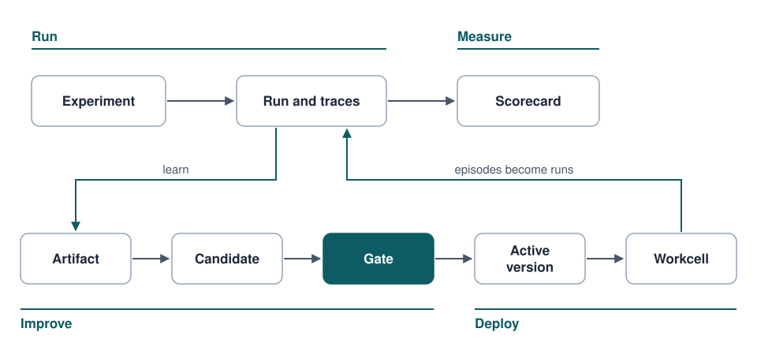
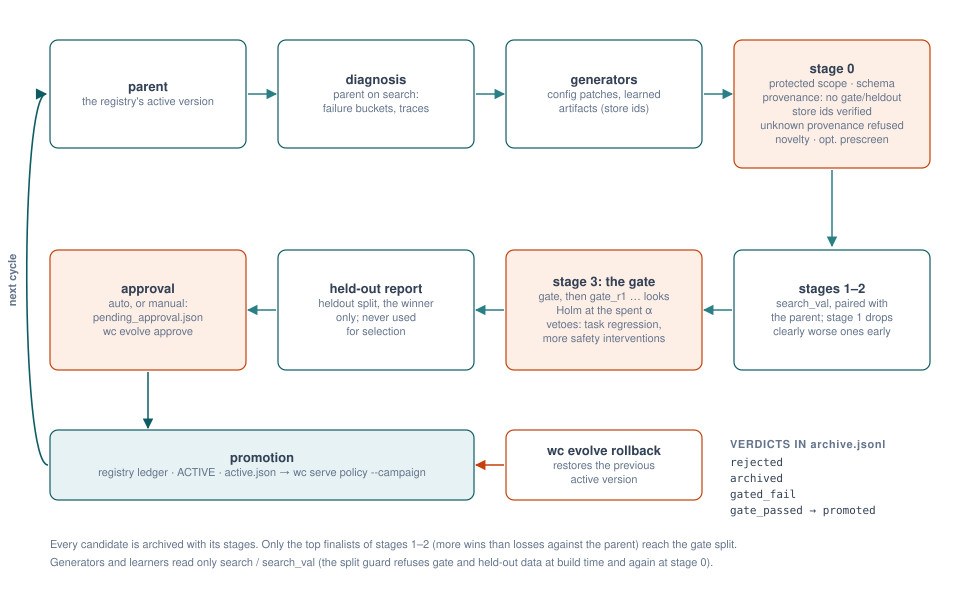
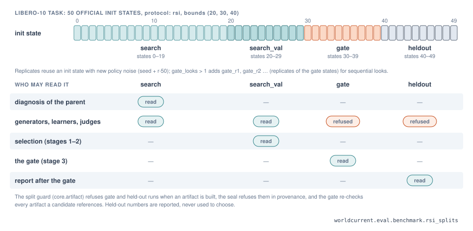
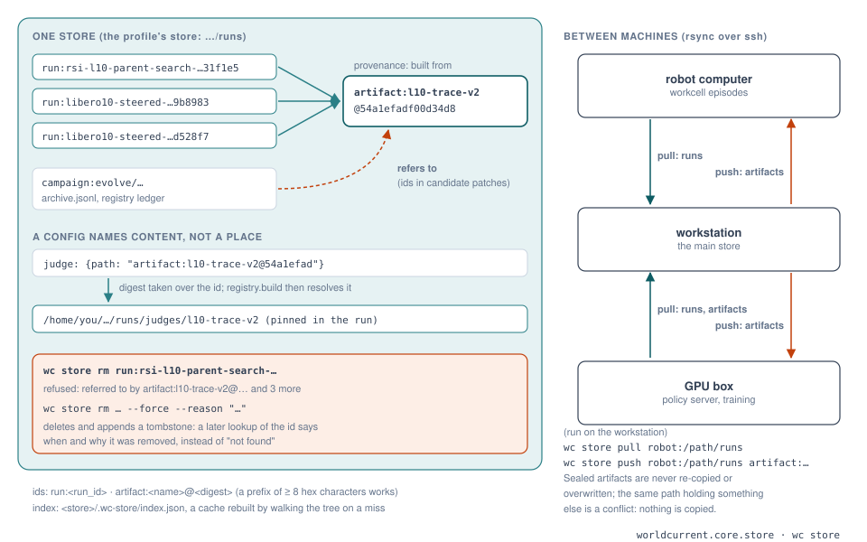
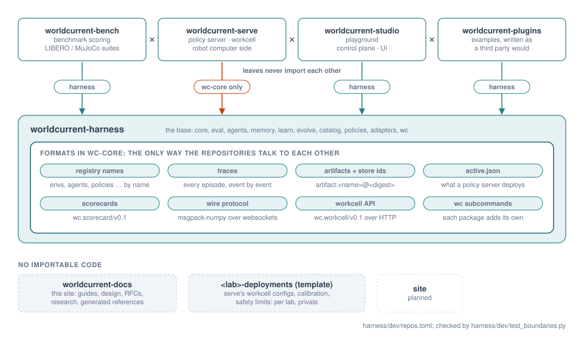

# Architecture overview

Hylo evaluates robot policies, learns from what they did, improves them under a statistical gate and deploys
them to robots, behind one set of contracts. This page is the map: the layers, the one episode loop, how data flows
from runs to deployed versions, and the decisions behind them. The full design is in
[architecture](architecture.md); the decisions are recorded in the [RFCs](../rfcs/index.md).

{ .hylo-figure }

*The harness is the base: hylo-core defines the contracts and runs every episode; the other harness packages build on
it; bench, serve, studio and plugins are leaves that use it.*

## Layers

| Layer | Packages | Role |
|---|---|---|
| Contracts and kernel | `hylo-core` | data contracts (EnvSpec, Observation, ActionChunk, TaskSpec, ...), behavioural contracts (Environment, Agent, ChunkPolicy, Guard, Learner, ...), the episode loop, the SafetyShield, events and traces, the plugin registry, experiment configs, store, formats |
| Evaluation | `hylo-eval` | benchmarks and splits, the runner, scorers, paired statistics and gate tests |
| Decision-making | `hylo-agents`, `hylo-policies`, `hylo-memory` | agents that run any policy (plain, temporal ensemble, steered), reference policies, memories, reasoners, instruments |
| Learning | `hylo-learn` | learner jobs, sealed artifacts, judge calibration and labelling, external data |
| Improvement | `hylo-evolve` | campaigns: generators, the cascade, the sequential gate, approvals, active versions |
| Catalog and CLI | `hylo-catalog`, `hylo-cli` | read-only queries over runs and campaigns; the harness's `hylo` commands |
| Adapters | `hylo-policy-lerobot`, `hylo-policy-openpi`, `hylo-reasoner-llm`, `hylo-proposer-llm`, `hylo-data-video` | third-party stacks behind the contracts |
| Leaves | bench, serve, studio, plugins | benchmarking, deployment, the playground, example plugins |

Three rules hold the layers together:

1. **The kernel only knows contracts.** It runs an `Agent` against an `Environment`; reasoners, policies, memories
   and world models are inside agents. Any simulator, robot or policy stack plugs in as a plugin.
2. **Every action passes the SafetyShield.** Agents never construct it and campaigns cannot change its config.
3. **Scoring reads traces only.** A scorer sees what happened, never the agent's internals.

## One episode loop

`core.kernel.EpisodeRunner` runs every episode: in evaluation, in the playground's live sandbox and in a workcell
next to a robot ([RFC-0005 part 3](../rfcs/RFC-0005-architecture-measurement-and-placement.md)). Its `timing` is
part of what an experiment measures:

- **sync**: the world waits for every policy call; a chunk executes `execution_steps` actions;
- **realtime**: the next chunk is requested while the current one executes; actions that went stale during
  inference are dropped, gaps are held, a watchdog aborts after too many holds; on a virtual clock (deterministic,
  for benchmarks) or the wall clock (a real control loop).

{ .hylo-figure }

*The same loop in both modes. A benchmark in realtime timing measures what a robot will run: on LIBERO-10 the
first reading was 0.20 success in sync and 0.05 in realtime for the same policy and episodes (20 episodes; not yet
conclusive).*

Every step emits events (observation, agent chunk, safety review, action, step result) to an event bus; a trace
store writes them per episode, with images every `image_every` steps and privileged simulator state when asked.
Replay, scoring, judges, learners and the catalog all read these traces.

## From runs to deployed versions

{ .hylo-figure }

1. **Runs.** An experiment ([config](../user-guide/experiments.md)) runs a benchmark split and records traces and an
   `evallog.json`. A protocol fixes everything but the policy and writes a [scorecard](../benchmarking/index.md).
2. **Artifacts.** Learners build artifacts from runs: action memories, critics, judges, world models, policy
   weights ([learning](../user-guide/learning.md), [RFC-0004](../rfcs/RFC-0004-learning-pipeline.md)). Each is
   sealed with a content digest and its provenance, and has one of three roles: behaviour (changes what the robot
   does; only the gate activates it), instrument (measures; trusted only after calibration), proposal (changes what
   gets proposed).
3. **Candidates.** Generators propose candidates as config patches (a steering rule, a learned critic, new weights),
   each with a hypothesis.
4. **The gate.** A campaign screens candidates on development splits and tests the survivors on a gate split with a
   group-sequential paired test, regression and safety vetoes; the held-out split is reported, never used to decide
   ([campaigns](../user-guide/campaigns.md), [RFC-0002](../rfcs/RFC-0002-physical-rsi.md)).
5. **Promotion.** A candidate that passes becomes the campaign's active version (`active.json`), which a policy
   server can follow. With `approval: manual` (the setting for anything that runs on hardware; the default is
   `auto`) it first waits for a person's approval. Rollback is one command.
6. **Deployment.** A workcell runs the active version on the robot through the same loop; its episodes are recorded
   as runs and flow back through the store ([deployment](../user-guide/deployment.md)).

{ .hylo-figure }

*The split guard: learners and generators read development splits only; the gate decides on its own split; held-out
data is never read by anything that is gated on it. Builders refuse forbidden splits, and the gate re-checks the
provenance of every artifact a candidate references.*

## Measurement vs placement

An experiment's identity is what it measures: benchmark and split, environment, agent, safety, trace, timing. Where
components run is not part of it ([RFC-0005 part 1](../rfcs/RFC-0005-architecture-measurement-and-placement.md)):

- configs name **runtimes** (`remote: {runtime: libero-sim}`), resolved by each machine's
  [execution profile](../configuration/profiles.md);
- configs name **artifacts by store id** (`artifact:l10-trace-v2@54a1efadf00d34d8`), resolved to a path on the
  machine that builds the component ([store](../user-guide/store.md));
- the digest is taken over the ids and names, so the same experiment has the same digest on the workstation, the
  GPU machine and the robot computer.

{ .hylo-figure }

## Repositories

{ .hylo-figure }

| Repository | Holds | Depends on |
|---|---|---|
| hylo-harness | the layers above, the `hylo` dispatcher, the reference docs | - |
| hylo-bench | protocols, scorecards, leaderboards, LIBERO and MuJoCo suites and their setup | harness |
| hylo-serve | policy server, workcell, robot adapters | hylo-core only |
| hylo-studio | the playground and control plane | harness |
| hylo-plugins | example plugins written as a third party would | harness |
| hylo-docs | this site, RFCs, research | - |
| `<lab>`-deployments | a lab's workcell configs and safety limits | (configuration only) |

Leaves never import each other: they cooperate through formats in hylo-core ([formats](../api/formats.md)): traces,
artifact manifests, store ids, scorecards, `active.json`, the workcell API. A boundary lint enforces the rules
([contributing](../developer-guide/contributing.md#repository-and-package-rules), [repository structure](repository-structure.md)).

## Key decisions

| Decision | Why | Where |
|---|---|---|
| A light core with protocols and plugins; heavy stacks out of process | no simulator, LLM or VLA is mandatory; components with conflicting dependencies run in their own venvs | [RFC-0001](../rfcs/RFC-0001.md) |
| Improvement is a gated experiment, frozen policy first | a change is kept only if a paired test on unseen init states says so; weights change only once the loop is trustworthy | [RFC-0002](../rfcs/RFC-0002-physical-rsi.md) |
| Experience as memory and skills, not only weights | retrieved successes, lessons and skills steer a frozen policy and are cheap to roll back | [RFC-0003](../rfcs/RFC-0003-experience-memory-skills.md) |
| Everything learned is a sealed artifact with a role | behaviour, instrument and proposal artifacts get different trust paths; the split guard is checked twice | [RFC-0004](../rfcs/RFC-0004-learning-pipeline.md) |
| Measurement separated from placement; one episode loop; store ids; versioned contracts | results transfer between machines and from simulation to the robot | [RFC-0005](../rfcs/RFC-0005-architecture-measurement-and-placement.md) |
| One base repository and leaves | atomic changes in the base, independent leaves, a robot installs only hylo-core | [repository structure](repository-structure.md) |

## Not yet

- No job layer: campaigns run in a foreground process, studio jobs are bare subprocesses (RFC-0005 part 6).
- Every plugin contract is in hylo-core, one group per role; the hylo-agents package itself still holds decision-making
  agents, instruments and rule-based reasoners together (RFC-0005 part 5).
- No real robot has been connected; the robot path has run with a simulated arm.
- Weight-level learning on LIBERO (self-training, RL fine-tuning) waits for a GPU.
