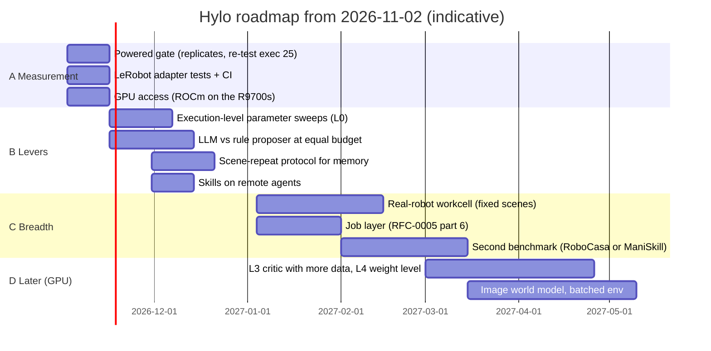

# Roadmap: From Minimal Loop to Full System

## Strategy development update (2026-11-02)

The user-facing roadmap follows the [robot-skill lifecycle](../user-guide/skills.md). The implementation results
below cover particular development, validation and reuse paths; broad skill transfer and unified skill management
remain unestablished.

Task-program development now complements execution, evaluation, improvement and deployment. Its purpose is to
reduce the programming and integration needed to turn a task requirement into an executable strategy; it includes
new-task development, scene adaptation and optimisation of existing programs.

- **Implemented with recorded runs:** robot contract, manipulation tools, Panda/ALOHA/fixed-base G1 tasks,
  code agents, a parent-program stacking improvement through the gate and held-out, program skill reuse, and
  Studio research record views.
- **Implemented, formal evaluation pending:** free-scene and motion-free showcases; robosuite/RoboCasa task programs.
- **Known limits:** from-scratch local-model research is unsuccessful; external replay and physical motion stability
  have failures; three primary tool models use fallback backends. See [Showcase](../showcase/tool-agents.md).
- **Next:** validate the unrun workflows, tighten code/artifact checks and execution isolation, and measure development
  cost and generalisation under stated observation conditions.

This does not satisfy the LIBERO frozen-VLA exit below: the stacking result is on a different task and baseline.
The 2026-11-01 status table and schedule below are retained as a dated snapshot, not a current feature inventory.

> Updated 2026-11-01. The original plan (2026-10-30) put v0.1 at 2026-11-09 to 2027-01-22 and the later versions
> after it. Most of v0.1 and parts of v0.2 and v0.3 were built in the first days, so this page now starts from what
> exists and plans by what the experiments say is missing. Timelines are indicative for 3 engineers; each phase ends
> with an internal technical report. The original weekly plan is kept in `roadmap/v0.1-plan.md`.

## Where we are (2026-11-01)

Status per item of the original plan. "Done" means implemented and run end to end with recorded runs (the plugin
maturity rule of RFC-0005); "partial" means some of it is.

| Version | Item | Status | Evidence / what is missing |
|---|---|---|---|
| v0.1 | Core contracts, kernel, SafetyShield (Approver chain), trace, EnvServer (stdio + WebSocket) | done | hylo-core; contract versions v0.1 declared by every plugin distribution |
| v0.1 | MuJoCo task set | partial | planar reach and table reach (language, occlusion memory, disturbances); no object-pushing or other contact task |
| v0.1 | hylo-eval: splits, scorers, resume, paired statistics | done | RFC-0002 splits (search / search_val / gate / heldout), McNemar, sign, permutation gate tests |
| v0.1 | Agents, memory, evolve (gate, registry, promote / rollback) | done | campaigns with approval and rollback; first promotions on MuJoCo |
| v0.1 | LIBERO | done | direct EnvServer adapter (own venv, CPU); SmolVLA agrees with `lerobot-eval` on libero_spatial |
| v0.1 | openpi remote policy | partial | client implemented; never run against an openpi server (no checkpoint here) |
| v0.1 | vla-eval bridge (Served mode) | not started | the direct LIBERO adapter made it unnecessary for v0.1 |
| v0.1 | LeRobot v3 export; Rerun export | partial | LeRobot v3 export and ingestion done; no Rerun export |
| v0.1 | CI | not started | tests run locally only (292 pass) |
| v0.1 | Technical report | partial | experiment records in `research/experiments/`; no consolidated report |
| v0.2 | LLM / VLM reasoner, chooser, planner | done | `planner.llm` ran on LIBERO-10; `chooser.llm` / `chooser.vlm` |
| v0.2 | Critic / recovery / prompt candidates, shadow replay | partial | rule and LLM steering proposers, chunk critic (offline accuracy 0.54), shadow mode; no prompt (GEPA) candidates |
| v0.2 | Skill memory with a validation gate | done | RFC-0003 M3: promoted candidate -> verified skill -> applied by the skills agent |
| v0.2 | VLM success judge | partial | calibrated on LIBERO-10 (AUC 0.61); not ready to label. The trace judge is (AUC 0.93) |
| v0.2 | RoboCasa / ManiSkill EnvServer | not started | |
| v0.2 | Sharded evaluation | partial | parallel workers on one machine; no queue or multi-machine (RFC-0005 part 6) |
| v0.2 | **Exit**: significant held-out gain on LIBERO, VLA frozen | **not met** | `execution_steps 25` was +8 to +12 points on three disjoint sets, but the gate refused it (p = 0.068): underpowered |
| v0.3 | World model interface and WM-as-environment | partial | state world model, campaign pre-screen; no image model (needs a GPU) |
| v0.3 | Spatial memory (Spark-DSG), bi-temporal facts | not started | SQLite spatial memory only |
| v0.3 | Batched env / Isaac Lab | not started | |
| v0.3 | Real-robot adapter and shadow mode | partial | LeRobot robot adapter and workcell run with a simulated arm; shadow mode done |
| v1.0 | Campaign management (resumable, budgets, approval) | done | `hylo evolve`; studio campaigns |
| v1.0 | Weight-level candidates (`policy_ref`) | partial | self-training smoke run only (GPU) |
| v1.0 | Distributed evaluation, GPU batching | not started | |

What the experiments say (details in `research/experiments/`):

1. **Power is the binding constraint.** Effects of about 10 points need about 60 discordant pairs; one 100-episode
   gate split gives about 30. Every shipped LIBERO config uses `replicates: 1`.
2. **Hand-written levers rarely change outcomes.** Rule triggers changed 0 to 3 of 100 episodes. Action memory and
   noise steering were null at unseen init states (memory is scene recall: +8 on revisited scenes, -8 on new ones).
   The one lever that moved success consistently is how often the policy replans.
3. **Learned levers are data- and compute-starved.** The chunk critic has about 120 same-state contrast pairs, and
   weight-level learning (L4) and image world models wait for a GPU.

## Plan

### Phase A: measurement you can trust (2 weeks)

- Gate splits with noise replicates (`replicates: 2-3`, alpha spending across looks), sized for a 10-point effect
  at 80% power; re-test `execution_steps 25` on fresh gate states.
- Tests for `hylo-policy-lerobot` (it has none, and every LIBERO experiment runs through it) and CI for the five
  code repositories.
- GPU access requested and set up; it gates phase D.
- **Exit**: a powered gate decision on `execution_steps 25` (promoted or refuted), reported on held-out.

### Phase B: levers that change outcomes (6 weeks)

- L0 sweeps over execution-level parameters (chunk length, replanning interval, temporal ensembling, gripper
  thresholds): the cheapest candidates and the only kind with a consistent effect so far.
- LLM proposer reading failure traces vs the rule proposer at equal budget (RFC-0002 step 3); either result is a
  finding.
- A scene-repeat protocol (a fixed workcell revisiting scenes) next to the generalisation gate, so memory is
  measured where it can help instead of being correctly refused by a gate on unseen init states.
- Skills on remote agents: skill derivation only recognises the remote steering path, while the skills agent looks
  for the steered agent in its own process. Make one path work for both layouts.
- **Exit**: at least one promoted, held-out-confirmed improvement on LIBERO-10 with the VLA frozen (the old v0.2
  exit).

### Phase C: breadth (2027 Q1)

- The real-robot workcell with the LeRobot adapter, starting with fixed scenes (where memory helped), candidates in
  shadow mode before they act.
- The job layer (RFC-0005 part 6) once the GPU box and the robot computer are in regular use.
- A second simulated benchmark (RoboCasa or ManiSkill EnvServer), only after phase B's exit, to test whether
  promoted improvements transfer.
- **Exit**: a promoted candidate re-validated on a second benchmark or on the robot.

### Phase D: learned levers (from 2027 Q2, needs a GPU)

- The chunk critic with enough contrast data, DSRL-style noise policies, weight-level candidates (GRPO / RECAP /
  expert iteration) through the same gate.
- Image world models for pre-screening VLA candidates; batched environments (ManiSkill GPU, Isaac Lab).
- v1.0 platform items: distributed evaluation, contract stability, licence audit, public conformance kit.

## Research questions each phase must answer

| Phase | Questions | Status |
|---|---|---|
| v0.1 (asked 2026-10-30) | Can a unified contract carry MuJoCo, LIBERO and real VLAs without loss? What does the loop cost? | Yes for MuJoCo, LIBERO and SmolVLA (0.70 vs `lerobot-eval` 0.64 on the same 50 episodes, not significant); about 1 hour per LIBERO-10 cycle on CPU |
| A | How many episodes does a credible gate decision need, and what does it cost? | open |
| B | With the VLA frozen, which candidate types give held-out gains? Does an LLM proposer beat rules at equal budget? | open; rules mostly null |
| B | Where does memory help: new layouts or repeated scenes? | supported, not significant: repeated scenes |
| C | Do promoted improvements transfer to a second benchmark or the robot? | open |
| D | Can world models reliably pre-screen candidates? Can recursive improvement keep held-out gains over many generations without reward hacking or safety regressions? | a state model ranked controller gains correctly on the test environment; the rest open |
