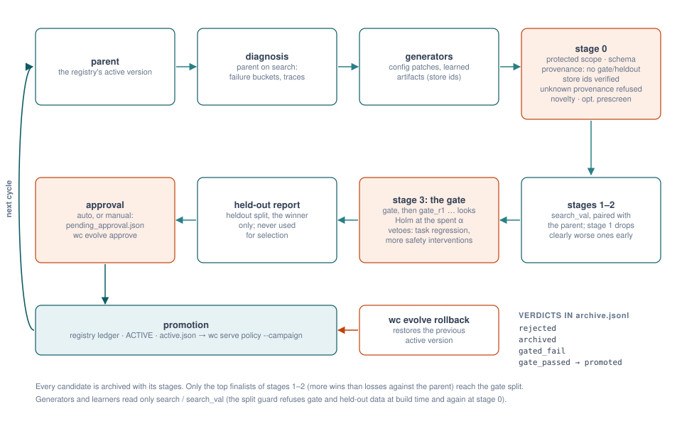

# Adding a learner

This tutorial covers the four ways to make Hylo learn, from a plugin package to a gated, promoted result:

| You want to | Write | Contract | Reference implementations |
|---|---|---|---|
| build a model from recorded runs | an offline **learner** | `Learner.fit(job) -> sealed artifact` | `policy.bc` / `flow` / `knn` / `tokens` (hylo-policies), `critic.chunk_value`, `world_model.state`, `judge.trace` (hylo-learn) |
| learn by acting | an online **learner** | `OnlineLearner`: `start / policies / update / finished / seal` | `examples.cem` (hylo-plugins) |
| measure or label episodes | an **instrument** (success judge) | `SuccessJudge.judge(trace) -> Judgement` | `judge.trace` (hylo-agents), `judge.vlm` |
| propose improvements | a candidate **generator** | `propose(diagnosis, cfg, parent_id, archive) -> [(Candidate, hypothesis)]` | `rule.gain`, `rule.steering`, `learn` (hylo-evolve), `llm.steering` |

The steps were run while writing this page, in a scratch directory with its own store; the outputs are real. The
background is in [learning](../user-guide/learning.md) and [campaigns](../user-guide/campaigns.md).

{ .hylo-figure }

## The rules every learner follows

- **Development data only.** A learner reads runs of the `search` and `search_val` splits, never `gate` or
  `heldout`. `development_runs(job.inputs, job.splits)` finds the runs and skips the others;
  `check_splits` refuses a job that asks for gate or held-out data; `write_manifest` refuses to seal an artifact
  whose sources include such a run; the gate checks the provenance a third time. See
  [the split guard](../user-guide/learning.md#the-split-guard).
- **One sealed directory out.** The learner writes its files into `job.out` and calls `write_manifest` last. The
  manifest records the kind, the role, a content digest over every file, the builder, and every source run. Changing
  a file afterwards makes the artifact fail verification.
- **A role decides who may trust it.** `behaviour` artifacts change what the robot does (policies, critics,
  memories) and only the gate activates them; `instrument` artifacts measure (judges, world models) and are trusted
  only after calibration; `proposal` artifacts only change what gets proposed; `data` is ingested data.
- **Jobs are resumable.** A `TrainJob`'s digest covers everything but `out`. When `out` already holds a sealed
  artifact with the same job digest, the job is not run again.

## 1. An offline learner

```bash
uv run hylo plugin new learner my-recap --dir plugins
```

The generated learner summarises the success rate of development runs into one sealed file. Replace the middle with
your model:

```python title="plugins/hylo-plugin-my-recap/src/hylo_my_recap/plugin.py"
class MyRecapLearner:
    name = "my-recap@0.1"

    def fit(self, job) -> ArtifactManifest:
        sources = development_runs(job.inputs, job.splits)           # gate / held-out are refused or skipped
        episodes = [s for rd, _ in sources for s in json.loads((rd / "evallog.json").read_text())["samples"]]
        out = Path(job.out)
        out.mkdir(parents=True, exist_ok=True)
        rate = sum(s["status"] == "success" for s in episodes) / max(1, len(episodes))
        (out / "model.json").write_text(json.dumps({"success_rate": rate}))   # your model here
        return write_manifest(out, kind="other", role="behaviour", metrics={"episodes": len(episodes), "success_rate": rate},
                              provenance=Provenance(builder=self.name, sources=[r for _, r in sources], params=dict(job.params)))
```

`development_runs` returns `(run_dir, SourceRef)` pairs. Read episodes from each run's `evallog.json` and their
step-by-step events with `core.trace.TraceStore(run_dir).read(episode_id)`; `hylo.policies.reference.base.load_demos`
shows how the reference policies turn traces into `(observation, next T actions)` pairs.

`kind` is one of `dataset`, `action_memory`, `value_model`, `noise_policy`, `policy_weights`, `policy_params`,
`success_judge`, `progress_model`, `world_model`, `lesson_book`, `skill_library`, `other`.

Register it (the template does) and check it:

```toml title="pyproject.toml"
[project.entry-points."hylo.learners"]
"my-recap" = "hylo_my_recap.plugin:MyRecapLearner"
```

```bash
uv run hylo plugin check learner my-recap
```

```text
learner hylo_my_recap.plugin:MyRecapLearner: PASS
  [  ok] runs and seals a verifiable artifact: other / behaviour, digest 740f272a4d5caa2c
  [  ok] provenance lists development data only: splits ['search', 'search_val']
  [  ok] refuses gate / held-out splits
  [  ok] an identical job reuses the artifact
```

### Run a job

A job names the learner, the runs to read (directories, roots to search, or store ids such as `run:<id>`), where to
seal, the splits (default `search`, `search_val`) and the learner's parameters:

```json title="recap.json"
{"learner": "my-recap", "inputs": ["runs/demos"], "out": "runs/artifacts/recap"}
```

```bash
uv run hylo learn recap.json                                       # in this process
uv run hylo learn recap.json --python /path/to/other/venv/bin/python   # with another venv's interpreter
```

```json
{"out": "runs/artifacts/recap", "kind": "other", "role": "behaviour", "digest": "740f272a4d5caa2c",
 "splits": ["search"], "metrics": {"episodes": 80, "success_rate": 1.0}}
```

A job that asks for gate data is refused before anything is read:

```json title="leak.json"
{"learner": "my-recap", "inputs": ["runs/demos"], "out": "runs/artifacts/x", "splits": ["search", "gate"]}
```

```text
hylo.core.artifact.SplitLeak: gate / heldout data must never be used to build anything that is gated on it: ['gate']
```

Then reference the artifact by its store id (`uv run hylo store ref runs/artifacts/recap`) in the component that
loads it, as in [adding a policy](adding-a-policy.md#6-a-learned-policy-weights-from-a-sealed-artifact).

!!! tip "Learners with heavy dependencies"
    A learner that needs torch (the LeRobot ones) runs in that venv: `hylo learn job.json --python ...`, or `python:`
    / `python_path:` in the `learn` generator below. hylo-learn is light (hylo-core and hylo-agents), so install it into
    the model's venv.

## 2. An online learner

An online learner learns by acting. Each iteration it proposes agent specs; the runner evaluates each on a
development split (ordinary runs, recorded under `<out>/rollouts/iter-NNN/`); the learner updates from the results;
at the end it seals an artifact whose provenance lists every rollout run.

```python
class OnlineLearner(Protocol):
    name: str
    def start(self, job: TrainJob, agent: dict[str, Any]) -> None: ...          # the base agent spec
    def policies(self) -> list[dict[str, Any]]: ...                              # agent specs for this iteration
    def update(self, results: list[dict[str, Any]]) -> dict[str, Any]: ...      # one per policy: agent, run_dir, metrics, samples
    def finished(self) -> bool: ...
    def seal(self, out: str, sources: list[Any]) -> ArtifactManifest: ...
```

The job carries the experiment to roll out in as `params.experiment`, plus `iterations` (default 3) and `split`
(default the job's first split, `search`). `examples.cem` (hylo-plugins, `hylo_examples/online.py`) is the
cross-entropy method over numeric agent parameters: `policies()` samples a population from a Gaussian, `update()`
scores each rollout by `success_mean - step_penalty * mean steps` and refits the Gaussian to the elites, `seal()`
writes `best.json`. The same contract fits on-policy RL: `policies()` returns the current policy, `update()` reads the
rollouts' traces from `run_dir` and takes a gradient step, `seal()` writes the weights.

`hylo plugin new online_learner NAME` scaffolds one (random search over one parameter), and `hylo plugin check
online_learner NAME` checks it. Online learners are usually run by the `learn` generator, below.

## 3. A success judge (instrument)

A success judge labels episodes the simulator cannot label: robot episodes, external videos. It reads only what a
real robot records (observations and actions, no privileged state) and returns `Judgement(p_success, progress, info)`:

```python
class SuccessJudge(Protocol):
    name: str
    def judge(self, episode: EpisodeTrace) -> Judgement: ...
```

`hylo plugin new judge NAME` scaffolds one; `hylo plugin check judge NAME` checks it. A judge that is learned has a
learner too: `judge.trace` (hylo-learn) trains a classifier on the last frames of development episodes, labelled with
the simulator outcome, and seals a `success_judge` artifact with role `instrument`.

An instrument is trusted only after calibration against ground truth, on runs it was not built from:

```bash
uv run hylo calibrate --judge '{"type": "judge.trace", "params": {"path": "artifact:l10-trace-v2@54a1efad"}}' \
    --runs runs/... --artifact artifact:l10-trace-v2@54a1efad --target-precision 0.95 --out calibration.json
```

The report gives AUC, Brier score, calibration error, and the lowest threshold that reaches the target precision.
It is `ready` when it has at least 50 episodes, reaches the target precision, and keeps a recall of at least 0.3.
`--artifact` excludes the judge's own training runs and stores the report in the artifact. Only a `ready` judge may
label (`hylo label RUN --judge ID`), and only at or above its calibrated threshold; episodes below it stay
unlabeled. The LIBERO-10 trace judge reached AUC 0.92 on 600 episodes
([experiment record](../research/experiments/2026-10-31-success-judges-libero10.md)).

## 4. A candidate generator

A generator proposes improvements to a campaign's current best configuration (the parent). It gets the parent's
diagnosis on the `search` split and returns candidates, each a **config patch** with a hypothesis:

```python
class Proposer(Protocol):
    name: str
    def propose(self, diagnosis: Mapping[str, Any], cfg: ExperimentConfig, parent_id: str | None,
                archive: list[ArchiveEntry]) -> list[tuple[Candidate, str]]: ...   # (candidate, hypothesis)
```

- `diagnosis` holds `n_episodes`, `n_failures`, `success`, failure `buckets` and `bucket_rate`, `per_task`,
  example episode ids and the parent's `run_dir` (so a generator can read the traces).
- `cfg` is the parent's experiment config; `archive` is every candidate tried so far, with its stages and verdict.
- A `Candidate` is `patch` (dotted config paths to new values), `rationale`, `parent_id`, `generator`, and
  `evidence`.

The scaffold scales one numeric path, like the built-in `rule.gain`:

```bash
uv run hylo plugin new generator my-gain --dir plugins
```

```python title="plugins/hylo-plugin-my-gain/src/hylo_my_gain/plugin.py"
class MyGainProposer:
    name = "my-gain@0.1"

    def __init__(self, path: str = "agent.params.kp", factors: tuple[float, ...] = (1.5,)) -> None:
        self.path, self.factors = path, factors

    def propose(self, diagnosis, cfg, parent_id, archive):
        node = cfg.model_dump(mode="json")
        for k in self.path.split("."):
            node = node[k]
        return [(Candidate(patch={self.path: float(node) * f}, rationale=f"scale by {f}", parent_id=parent_id,
                           generator=self.name), f"scaling {self.path} by {f} reduces the failures in the diagnosis")
                for f in self.factors]
```

```bash
uv run hylo plugin check generator my-gain
```

```text
generator my-gain@0.1: PASS
  [  ok] proposes (Candidate, hypothesis) pairs: 1 candidates
  [  ok] candidates stay outside protected scopes and apply to the config
  [  ok] candidates name their generator
```

Register it under `hylo.generators` and use it in a campaign as `proposer: {type: my-gain, params: {...}}`.

### What a candidate must pass before it costs an evaluation

Stage 0 of the cascade rejects a candidate without running it when:

| Check | Rule |
|---|---|
| kind | only `config_patch` candidates are enabled; model-generated code is not executed |
| protected scope | the patch may not touch `safety`, `benchmark`, `trace`, `scorers`, `evolution`, `schema_version` or `env` |
| artifacts | every artifact the patch references (by store id or path) is sealed, unmodified, has the referenced digest, and was built without gate or held-out data |
| provenance | a `behaviour` artifact adopted without known sources is refused |
| novelty | a patch identical to an archived one is a duplicate |
| prescreen (optional) | with `prescreen` configured, a world model must not predict the candidate much worse than the parent |

Survivors are evaluated on `search_val` (stages 1-2), the best go to the sequential gate (stage 3), and only the
winner is reported on `heldout`. See [the cascade and the gate](../user-guide/campaigns.md#the-cascade-and-the-gate).

## 5. A learner inside a campaign: the `learn` generator

The `learn` generator connects a learner to the gate. Each cycle it trains an artifact from the cycle's development
runs (plus `data_roots`), checks offline metrics against `require`, and proposes candidates that use the artifact.
Placeholders in the patch are filled in: `{artifact}` with the artifact's store id (its path if it is outside the
store) and `{metrics.a.b}` with values from the manifest's metrics.

```yaml title="plugins/examples/evolve/mujoco_online_cem.yaml"
schema_version: hylo.evolve/v0.1
name: mujoco-online-cem
experiment: ../configs/mujoco_reach.yaml
experiment_overrides: {benchmark.params: {protocol: rsi}, agent.params.kp: 0.02}
proposer:
  type: learn
  params:
    learner: examples.cem
    online: true
    out_root: runs/evolve/mujoco-online-cem/learned
    params: {space: {kp: {path: params.kp, low: 0.01, high: 1.0, init: 0.05}}, population: 5, iterations: 3}
    patch: {agent.params.kp: "{metrics.best.kp}"}
    hypothesis: "a gain of {metrics.best.kp} found by CEM on the search split reaches more targets in time"
cycles: 1
out_dir: runs/evolve/mujoco-online-cem
```

```bash
uv run hylo evolve run plugins/examples/evolve/mujoco_online_cem.yaml          # about 30 s
```

```text
[cycle 1] parent-search                      search     success=0.450 n=80 (4s)
[cycle 1] parent-search_val                  search_val success=0.400 n=40 (2s)
[cycle 1] cand-0f8d15de67-search_val         search_val success=1.000 n=40 (0s)
[cycle 1] parent-gate                        gate       success=0.350 n=40 (2s)
[cycle 1] cand-0f8d15de67-gate               gate       success=1.000 n=40 (0s)
[cycle 1] cand-0f8d15de67-heldout            heldout    success=1.000 n=40 (0s)
[cycle 1] parent-heldout                     heldout    success=0.400 n=40 (1s)
[cycle 1] done: promoted=cand-0f8d15de67 heldout={"candidate_success": 1.0, "parent_success": 0.4,
          "paired": {"n_pairs": 40, "candidate_wins": 24, "parent_wins": 0, "p_value": 5.96e-08}, "used_for_selection": false}
```

The archive entry shows the chain from learner to verdict: the patch `{"agent.params.kp": 0.2279}`, the generator
`learn.examples.cem@0.1`, the sealed artifact (`kind: policy_params`, `role: behaviour`, `splits: ["search"]`) and
the verdict `promoted`. The CEM search saw only `search` init states; the gate and the held-out report used init
states it never saw.

The `learn` generator's parameters:

| Parameter | Meaning |
|---|---|
| `learner` | the learners plugin (name or `module:attr`) |
| `params` | the learner's parameters |
| `patch` | the config patch to propose, with `{artifact}` and `{metrics.…}` placeholders |
| `variants` | extra patches merged into `patch`, one candidate each (e.g. several `beta` values) |
| `require` | `{metric.path: floor}`: propose nothing when the offline metrics fall short |
| `data_roots` | more run roots to learn from, besides this cycle's runs |
| `splits` | the development splits to read (default `search`, `search_val`) |
| `online` | `true` for an online learner (rolls out in the parent's experiment config) |
| `out_root` | where artifacts go (default `runs/learned`) |
| `python` / `python_path` / `env_path` | the interpreter to train with, directly or read from the parent config |
| `hypothesis`, `unit`, `timeout_s` | the hypothesis template, the improvement unit, a time limit |

`critic.chunk_value` and `selftrain.expert_iteration` are two earlier, specialised forms of the same pattern. Their
maturity is `unverified`: they have not yet run in a campaign here ([plugin catalogue](plugin-catalogue.md)).

## Next

- Declare and version what you wrote: [versioning](versioning.md), [plugin catalogue](plugin-catalogue.md).
- Test it: [testing](testing.md); when something fails: [troubleshooting](troubleshooting.md).
- APIs: [hylo-learn](../api/packages/hylo-learn.md), [hylo-evolve](../api/packages/hylo-evolve.md),
  [hylo-policies](../api/packages/hylo-policies.md), [contracts](../api/contracts.md); commands:
  [`hylo learn`](../cli/index.md#hylo-learn), [`hylo calibrate`](../cli/index.md#hylo-calibrate),
  [`hylo evolve`](../cli/index.md#hylo-evolve), [`hylo plugin`](../cli/index.md#hylo-plugin).
- The learning pipeline's design: [RFC-0004](../rfcs/RFC-0004-learning-pipeline.md).
