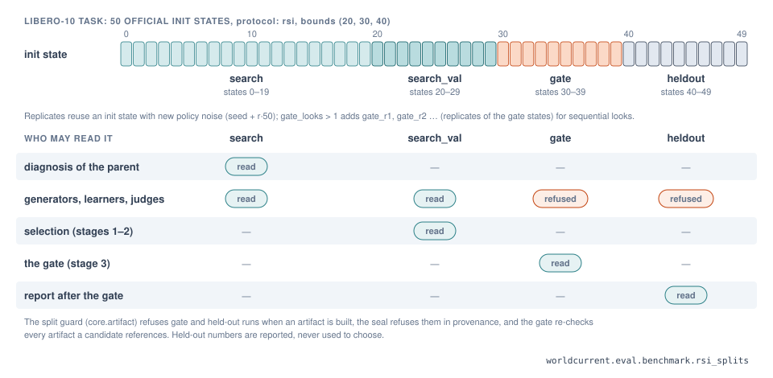

# Adding an environment

This tutorial adds a new simulator to Hylo, step by step: the environment, its tasks and benchmark, a
conformance check, an experiment, an out-of-process run, and a protocol with a scorecard. The example is
deliberately small: a point on a rail that must stop on a goal, about 80 lines. It was written and run while this
page was written, and the outputs shown are real. The two environments in hylo-bench are the full
references:

- **`hylo-env-mujoco`**: `mujoco.planar_reach` and `mujoco.table_reach`, in process, MuJoCo as a library;
- **`hylo-env-libero`**: `libero`, with stored init states and a BDDL success predicate, run in its own venv.

The last section covers what a real robot adds. Background:
[interfaces: environment](../harness/interfaces/environment.md), [execution lifecycle](../harness/execution-lifecycle.md).

## 1. The contract

An environment is the simulator **plus** the task logic, behind four methods (`core.env.Environment`,
[API](../api/contracts.md)):

```python
class Environment(Protocol):
    def spec(self) -> EnvSpec: ...                       # must be cheap: no simulator construction
    def reset(self, task: TaskInstance) -> Observation: ...
    def step(self, action: Action) -> StepResult: ...
    def close(self) -> None: ...
```

The environment decides success. The agent never does, and a scorer reads it from the trace. Optional
capabilities are declared in `EnvSpec.capabilities` and provided as separate methods:

| Capability | Method | Used for |
|---|---|---|
| `snapshot` | `snapshot() -> bytes`, `restore(bytes)` | replay, conformance check of determinism |
| `privileged_state` | `privileged_state() -> dict` | ground truth in the trace for scorers and diagnosis; never given to the agent |
| `real_robot` | (flag) | any SafetyShield modification aborts the episode; clipping has no tolerance |
| `self_paced` | (flag) | the environment keeps its own wall-clock pace (robots) |

## 2. Write the environment

```python title="src/hylo_env_slider/env.py"
"""A point on a rail that must stop inside a goal interval: the smallest useful Environment."""

from __future__ import annotations

import numpy as np

from hylo.core.task import TaskInstance, TaskSpec
from hylo.core.types import (Action, ActionSemantics, BoxSpace, EnvCapabilities, EnvSpec, Observation,
                                     ObservationSpec, StepResult)

MAX_STEP = 0.02           # metres per control step at |action| = 1


class SliderEnv:
    def __init__(self, control_hz: float = 20.0) -> None:
        self.control_hz = control_hz
        self.pos = self.goal = 0.0
        self.task: TaskInstance | None = None

    def spec(self) -> EnvSpec:                 # cheap: no simulator work here
        return EnvSpec(
            name="slider", version="0.1",
            observation=ObservationSpec(state={"pos": (1,), "goal": (1,)}, units={"pos": "m", "goal": "m"}),
            action=BoxSpace(shape=(1,), low=(-1.0,), high=(1.0,),
                            semantics=ActionSemantics(control_mode="eef_delta_pos", frame="base", dim_labels=("x",),
                                                      max_step=(MAX_STEP,))),
            control_hz=self.control_hz,
            capabilities=EnvCapabilities(seedable=True))

    def reset(self, task: TaskInstance) -> Observation:
        rng = np.random.default_rng(task.seed)            # everything random comes from the seed
        self.task = task
        self.pos = float(rng.uniform(-0.5, 0.5))
        self.goal = float(task.spec.params.get("goal", rng.uniform(-0.5, 0.5)))
        return self._observe()

    def _observe(self) -> Observation:
        return Observation(state={"pos": np.array([self.pos]), "goal": np.array([self.goal])},
                           instruction=self.task.spec.instruction)

    def step(self, action: Action) -> StepResult:
        self.pos += float(np.asarray(action.data).reshape(-1)[0]) * MAX_STEP
        if not np.isfinite(self.pos):                     # an infrastructure fault, not a policy failure
            return StepResult(observation=self._observe(), reward=None, terminated=False, truncated=True,
                              info={"sim_error": "position is not finite"})
        if abs(self.pos) > 1.0:
            return StepResult(observation=self._observe(), reward=None, terminated=True, truncated=False,
                              success=False, info={"fail_reason": "left the rail"})
        success = abs(self.pos - self.goal) < 0.01
        return StepResult(observation=self._observe(), reward=-abs(self.pos - self.goal), terminated=success,
                          truncated=False, success=success)

    def close(self) -> None:
        pass
```

The rules this follows:

`spec()` is cheap and complete
:   No simulator construction: `spec()` is called before anything runs, also across a process boundary, and it
    must survive JSON. It declares every state key with its shape and units, the cameras as `(H, W, 3)` uint8, the
    action box with its **semantics** (`control_mode`: one of `joint_pos`, `joint_delta`, `joint_vel`,
    `eef_delta_pos`, `eef_delta_pose`, `eef_abs_pose`, `planar_vel`; frame, rotation representation, gripper
    convention, per-dimension labels and `max_step`) and the control rate. The kernel compares this with each
    agent's `AgentSpec` before the first step.

`reset()` depends on the seed only
:   Everything random is drawn from `task.seed`, so a seed is an init state, splits are sets of seeds, and a
    candidate and its parent face the same situations. MuJoCo planar reach draws the joint angles and the target
    from the seed. LIBERO loads stored init state number `seed % 50` and runs 10 no-op steps.

`step()` separates success from ending
:   `success` is the task predicate. `terminated` means the episode is over for task reasons (reached, or failed
    for good, with an `info["fail_reason"]` such as table reach's "touched the red pad"). `truncated` means it
    stopped for other reasons. `success: None` means the environment cannot judge; a robot never claims success.

Simulator faults are not policy failures
:   Return `truncated=True` with `info["sim_error"]` (MuJoCo planar reach does this when MuJoCo silently resets on
    divergence), or raise `core.errors.EnvironmentFault`. The episode is then `infra_invalid`, which scoring and
    the gate keep apart from failures.

How the kernel turns the last step into an episode status:

| Last step | Status | `reason` |
|---|---|---|
| `terminated`, `success: True` | `success` | `terminated` |
| `terminated` or `truncated`, `success: False` | `failure` | `terminated` / `truncated` |
| `max_steps` reached | `failure` | `max_steps` |
| `info["sim_error"]`, or `EnvironmentFault` raised | `infra_invalid` | the message |
| SafetyShield abort | `safety_abort` | the guard's reason |
| `success: None` in realtime mode | `unlabeled` | the operator or a calibrated judge labels it |

## 3. Tasks and a benchmark

A `TaskSpec` describes one task: `id` (globally unique), `version`, `instruction`, how init states are chosen
(`init`), the success predicate (`success`, descriptive), `max_steps`, environment-specific `params` and `tags`. A
`Benchmark` is tasks plus **splits**: named sets of seeds, disjoint across splits, each run on every task.

```python title="src/hylo_env_slider/env.py (continued)"
def slider_benchmark(protocol: str = "rsi", n_states: int = 50):
    from hylo.core.benchmark import Benchmark, rsi_splits

    tasks = (TaskSpec(id="slider/reach", version="1", instruction="stop on the goal", max_steps=100, tags=("slider",)),)
    splits = rsi_splits(n_states, (20, 30, 40)) if protocol == "rsi" else {"validation": tuple(range(1000, 1020))}
    return Benchmark(id="slider-v0", version="0.1", tasks=tasks, splits=splits)
```

`rsi_splits(n_states, (a, b, c))` is the RFC-0002 partition that improvement campaigns need: `search` (0..a-1, for
diagnosis and learning), `search_val` (a..b-1, selection), `gate` (b..c-1, the paired test) and `heldout`
(c..n-1, reported only). `replicates` adds noise replicates of every init state, and `gate_looks > 1` adds
`gate_r1`, `gate_r2`, ... for the sequential gate. See [splits](../user-guide/campaigns.md#splits).

{ .hylo-figure }

How the references do it:

=== "MuJoCo planar reach"

    Two tasks, a fixed target (`params: {target: [0.35, 0.2]}`) and a random one, 150 steps each.
    `mujoco_benchmark(protocol=...)` offers `standard` splits (train / validation / heldout) and `rsi` splits over
    `rsi_states` seeds (40 / 20 / 20 / 20 percent), offset by 30000 so they never overlap the standard ones.

=== "LIBERO"

    Ten tasks per suite, read from a task index. Init states are stored: `init=InitStateRef(uri="libero://libero_10/<task>",
    count=50)`, and seed `s` loads state `s % 50`. Success is LIBERO's BDDL goal (`Predicate(kind="expr",
    name="bddl_goal", expr=...)`), evaluated inside the environment. `protocol: rsi` with
    `rsi_bounds: [20, 30, 40]` gives the RFC-0002 splits over the 50 states.

## 4. Register it

Environments and benchmarks are found by name through entry points; declare the contract versions too:

```toml title="pyproject.toml"
[project]
name = "hylo-env-slider"
dependencies = ["hylo-core", "hylo-eval", "numpy>=1.24"]
license = "Apache-2.0"

[project.entry-points."hylo.envs"]
"slider" = "hylo_env_slider.env:SliderEnv"

[project.entry-points."hylo.benchmarks"]
"slider-v0" = "hylo_env_slider.env:slider_benchmark"

[project.entry-points."hylo.meta"]
"hylo-env-slider" = "hylo_env_slider:META"
```

```python title="src/hylo_env_slider/__init__.py"
META = {"contracts": {"envs": "hylo.env/v0.1", "benchmarks": "hylo.benchmark/v0.1"}, "maturity": "unverified"}
```

`hylo-env-mujoco` registers `mujoco.planar_reach`, `mujoco.table_reach`, `mujoco/reach-v0` and `mujoco/table-v0`
exactly this way. Before installing, use `module:attr` names in configs (below, with the package on `PYTHONPATH`).
There is no `hylo plugin new env` template; copy this page's file or hylo-env-mujoco's.

## 5. Check conformance

A config with the environment and a simple agent. Any policy that reads `pos` and `goal` will do; this one is a
proportional controller written as a [`ChunkPolicy`](adding-a-policy.md) in the same file:

```yaml title="slider.yaml"
schema_version: hylo.experiment/v0.1
name: slider-p
benchmark: {type: "hylo_env_slider.env:slider_benchmark", split: search_val}
env: {type: "hylo_env_slider.env:SliderEnv"}
agent: {type: policy, params: {policy: {type: "hylo_env_slider.env:SliderPolicy"}}}
output_dir: runs
```

```bash
uv run hylo conformance slider.yaml --agent
```

```text
environment SliderEnv: PASS
  [  ok] spec() is cheap and typed: 0.1 ms
  [  ok] spec survives JSON (wire format)
  [  ok] reset returns an Observation matching the spec: instruction='stop on the goal'
  [  ok] reset is deterministic in the seed
  [  ok] step returns StepResult with separate success/terminated/truncated: 5 steps
  [skip] snapshot/restore reproduces the trajectory
  [  ok] close() works
agent PolicyAgent: PASS
  [  ok] spec is compatible with the environment: slider.p
  [  ok] act returns finite chunks of the env's action shape
  [  ok] reset leaves no state behind (same seed, same episode)
```

The snapshot check is skipped because the environment does not declare `snapshot`; MuJoCo planar reach passes it.
`--nondeterministic` skips the same-seed check for simulators that cannot be made deterministic, and
`--spec-budget` allows a slower `spec()` for remote environments. The first error here costs seconds; the same
error in a 500-episode run costs an afternoon.

## 6. Run it

```bash
uv run hylo run slider.yaml
```

```json
{
  "run_dir": "runs/slider-p-search_val-136ee3ee3eb1807b-3941c1",
  "config_digest": "136ee3ee3eb1807b",
  "success_mean": 1.0,
  "safety_interventions_mean": 0.0,
  "steps_mean": 10.2,
  "n_episodes": 10,
  "n_scored": 10
}
```

Every step is in the run's trace: `observation`, the agent's `agent.chunk`, the `safety.review` (proposed and
approved action), the `action` actually sent, `step.result`, and `episode.start` / `episode.end`
([experiments](../user-guide/experiments.md#runs-and-traces)).

## 7. Out of process, in its own venv

A simulator with conflicting dependencies (LIBERO needs robosuite 1.4 and its own numpy) runs in a subprocess
started from another interpreter. Nothing in the environment changes; the config says where it runs:

=== "Subprocess, another venv"

    ```yaml
    env:
      type: libero
      remote: {runtime: libero-sim}          # interpreter and env vars from this machine's profile
    ```

    `remote: {}` uses the current interpreter. The slider run with `--set 'env.remote={}'` gives the same
    results and the same `config_digest` (`136ee3ee3eb1807b`): where a component runs is never part of what is
    measured. Register the runtime once per machine:

    ```bash
    uv run hylo profile set-runtime my-sim --python /path/to/sim-venv/bin/python --env MUJOCO_GL=osmesa
    ```

    Install hylo-core and your package into that venv. bench's `envs/libero/setup.sh` does exactly this for LIBERO
    ([profiles](../configuration/profiles.md)).

=== "WebSocket, another machine"

    ```bash
    uv run hylo serve env slider --port 8799          # in the simulator's venv; --host 0.0.0.0 to expose it
    ```

    ```yaml
    env: {type: remote.ws, params: {url: "ws://sim-box:8799"}}
    ```

    Each connection gets its own environment instance, so parallel workers become parallel connections. Use
    `--token-env` for a shared token and an SSH tunnel or `wss://` across untrusted networks.

!!! note "A WebSocket environment changes the digest"
    The `remote.ws` form names the transport and its URL as the environment, so its runs have a different
    `config_digest` from the local or subprocess form (`761f19c6d3e1b367` for the slider instead of
    `136ee3ee3eb1807b`). Use `remote: {runtime: ...}` when results must compare by digest.

## 8. Actions and safety

The SafetyShield checks every action against the environment's declared action box before it reaches `step()`:
non-finite actions are refused, and values outside the bounds are clipped (a clip within `clip_tolerance`, default
0.05, is bookkeeping; a larger one counts as an intervention). An environment can contribute an always-on workspace
guard through `EnvSpec.workspace` (`WorkspaceLimit(state_key, low, high, action_dims)`): delta motions that would push
the controlled point further outside the box are zeroed. Experiments add guards with `safety:` (`max_delta`, or
`guards: [{type: keep_out, params: {...}}]`). See [safety](../user-guide/safety.md).

Declare `max_step` in the action semantics: it is what the units mean at `|action| = 1`, and it is how a policy
trained on one environment can be checked against another.

## 9. A protocol in bench

To make the environment a benchmark others can score against, write a protocol: it fixes the benchmark, the split
that is scored, the environment, the trace options and the timing, and its digest covers exactly what is measured
([protocols](../benchmarking/protocols.md#writing-a-protocol)).

```yaml title="slider-v1.yaml"
schema_version: hylo.protocol/v0.1
name: slider-reach
version: "1"
description: |
  The slider stops on its goal: the 10 held-out init states of the RFC-0002 split (40-49).
benchmark: {type: "hylo_env_slider.env:slider_benchmark", split: heldout, params: {protocol: rsi}}
env: {type: "hylo_env_slider.env:SliderEnv"}
trace: {record_privileged: false, image_every: 0}
workers: 4
requires: [hylo-env-slider]
```

```bash
uv run hylo bench show slider-v1.yaml          # digest: 13026fb9ab2bee26
uv run hylo bench run slider-v1.yaml --name p-0.5 \
    --policy '{"type": "policy", "params": {"policy": {"type": "hylo_env_slider.env:SliderPolicy"}}}'
```

```text
"success_mean": 1.0, "success_ci95": [0.7225, 1.0], "n": 10
```

Ten episodes give a wide interval; the built-in protocols use 100 (MuJoCo reach) and 500 (LIBERO-10). A protocol
that ships with hylo-bench goes in `packages/hylo-bench/src/hylo/bench/protocols/`.

## 10. A robot

A real robot is an environment like any other; `hylo-env-lerobot-robot` (`lerobot.robot`) wraps LeRobot's `Robot`
interface (SO-100/101, Koch, LeKiwi, ROS 2 robots through LeRobot plugins, and `sim_arm` for bring-up without
hardware). What it adds to the contract:

- `real_robot=True`: any SafetyShield modification aborts the episode, and clipping has no tolerance;
- an action box with explicit limits (`action_low`, `action_high`) in the robot's units and `joint_pos` semantics;
- `reset`: connect, move to `home` by interpolation in `home_steps` small steps within the shield's limits; the
  scene is the operator's job, and the workcell waits for the operator's "reset done";
- `success` is always `None`: the operator's verdict or a calibrated judge labels the episode (`unlabeled` until
  then);
- `hold_action(last)`: the measured position, executed when the policy is late; `stop()`: hold now (the e-stop
  path, in addition to the robot's hardware e-stop).

The kernel uses `hold_action` and `stop` when an environment provides them; without them, it holds delta and
velocity control at zero motion and refuses to guess a hold for absolute control.

A robot runs in a **workcell** (hylo-serve), not in an experiment: the workcell config adds the policy
endpoint, the realtime runner settings, safety limits and where runs are recorded:

```yaml title="workcells/sim_arm.yaml (deployments-template)"
name: sim-arm
env:
  type: lerobot.robot
  params:
    robot: {type: sim_arm, params: {image_size: 128, max_relative_target: 10}}
    cameras: {front: agentview}
    action_low: [-120, -120, -120, -120, -170, 0]
    action_high: [120, 120, 120, 120, 170, 100]
    home: [0, -30, 60, 0, 0, 20]
    control_hz: 30
policy: {url: "ws://127.0.0.1:8002/hylo", protocol: hylo}
runtime: {clock: wall, refill_steps: 5, max_hold_steps: 60, require_reset_confirm: true, verdict_timeout_s: 120}
safety: {max_delta: 12.0}
image_every: 5
max_steps: 300
output_dir: runs/workcell
```

`lerobot.robot` is listed as `needs-hardware` in the [plugin catalogue](plugin-catalogue.md): it has run with the
simulated arm only. See [deployment](../user-guide/deployment.md) and
[the deployments repository](../configuration/deployments-repo.md).

## Next

- Score policies on it: [benchmarking](../benchmarking/index.md), [adding a policy](adding-a-policy.md).
- Improve a policy on it with a campaign: [campaigns](../user-guide/campaigns.md).
- API: [hylo-env-mujoco](../api/packages/hylo-env-mujoco.md), [hylo-env-libero](../api/packages/hylo-env-libero.md),
  [hylo-eval](../api/packages/hylo-eval.md); commands: [`hylo conformance`](../cli/index.md#hylo-conformance),
  [`hylo serve`](../cli/index.md#hylo-serve), [`hylo bench`](../cli/index.md#hylo-bench).
