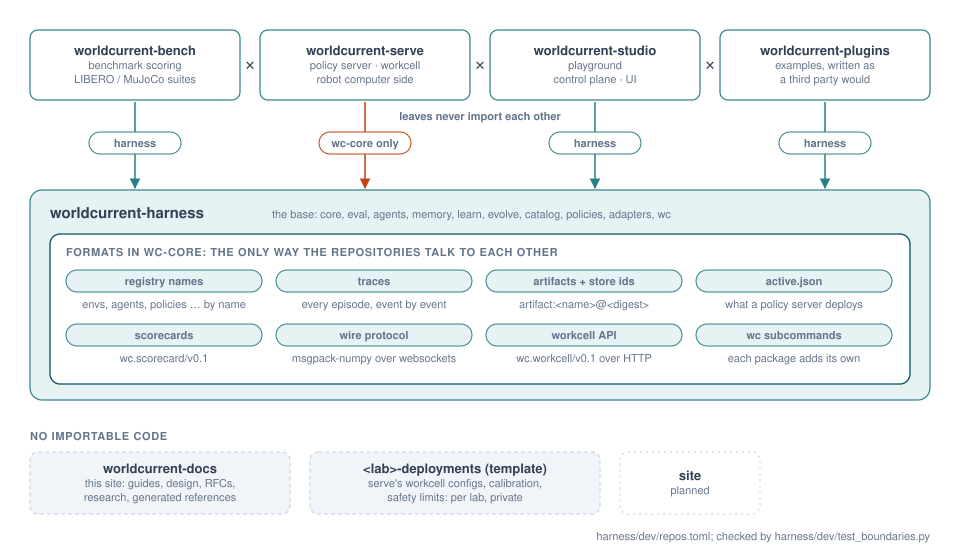

# Contributing

Hylo is several repositories developed together: the harness (the base) and the leaves on top of it
(bench, serve, studio, plugins), plus this documentation and the deployments template
([repository structure](../design/repository-structure.md)). This page is how to work on them.

{ .wc-figure }

## The development workspace

Check the repositories out side by side in one directory, under their short names, and bootstrap:

```bash
mkdir Hylo && cd Hylo
git clone <base>/hylo-harness.git harness            # and bench, serve, studio, plugins, docs as needed
harness/dev/bootstrap.sh                                      # or: HYLO_GIT_BASE=<base> harness/dev/bootstrap.sh
```

`bootstrap.sh` clones missing repositories when `HYLO_GIT_BASE` is set (`$HYLO_GIT_BASE/hylo-<name>.git`),
writes `pyproject.toml` in the directory (`harness/dev/workspace.py`: every package of every present repository is
a workspace member) and runs `uv sync`, which installs every package editable into one venv. The workspace
directory is not a repository: its `pyproject.toml`, `uv.lock` and `.venv` are generated. A subset works: the
harness alone, or the harness with one leaf.

After adding or removing a package, rerun `python harness/dev/workspace.py .` and `uv sync`; the boundary lint
fails while the workspace file is stale.

## Tests

```bash
uv run pytest                                   # every present repository, plus the boundary lint
uv run pytest harness                           # one repository
uv run pytest harness/packages/hylo-core          # one package
uv run pytest harness/dev                       # the boundary lint only
```

Every package keeps its own tests next to it (`<package>/tests/`). Some tests need more than the venv and skip
themselves with the reason when it is missing:

| Test | Needs |
|---|---|
| LIBERO end to end (`bench/adapters/hylo-env-libero`) | the `libero-sim` runtime (`bench/envs/libero/setup.sh`) and user-space OSMesa |
| MuJoCo rendering (`hylo-env-mujoco`, table vision) | `MUJOCO_GL=osmesa` or `egl` |
| LLM reasoners (`hylo-reasoner-llm`) | `HYLO_TEST_LLM=1` and a local Ollama server |
| scaffold templates (`hylo-cli`) | hylo-bench's MuJoCo environments |
| real workcell in the control-plane test (`hylo-playground`) | hylo-serve |

### Test doubles

Unit and conformance tests that need an environment use the test double shipped with core
(`hylo.testing`: `testing.point_reach` and other `testing.*` plugins). It is a test double, not an
evaluation environment: examples, protocols, campaigns and published numbers use real simulators (MuJoCo,
LIBERO). `hylo plugins` hides `testing.*` unless `--all`.

## Repository and package rules

`harness/dev/repos.toml` lists the repositories and what each may depend on; `harness/dev/test_boundaries.py`
enforces it:

1. **Package layering.** Every `Hylo.*` import (and every `module:attr` or `-m module` string) in a package's
   `src/` must target a package allowed for it in the lint's `ALLOWED` map ([package layering](../harness/dependency-graph.md)).
   Heavy dependencies (torch, jax, mujoco, ...) are allowed only in the packages that wrap them.
2. **Repositories.** A package may import or declare only packages of its own repository and of the repositories
   it depends on. The leaves depend on the harness only and never import each other; the harness imports no
   leaf. Leaves cooperate through formats defined in hylo-core ([formats](../api/formats.md)).
3. **Robot side.** serve's packages declare no Hylo dependency but `hylo-core`, so a robot computer installs
   nothing else.
4. **No reaching across by path.** No code or config file uses a `../<repo>/` path. Exempt: deployment configs and
   install scripts, which find a sibling checkout through an environment variable with a side-by-side default
   (`HYLO_HARNESS`).
5. **The workspace file is current.**

## Adding a package

1. Create it under `packages/` (a core part of the repository) or `adapters/` (a wrapper around a third-party stack)
   of the right repository, with its own `pyproject.toml` (hatchling, `src/` layout, a `license`), `src/` and
   `tests/`.
2. Register its plugins under the `Hylo.<group>` entry-point groups, and declare their contract versions
   and maturity under `hylo.meta` ([plugin system](../harness/plugin-system.md),
   [catalogue](plugin-catalogue.md)).
3. Add its module prefix to `OWNER` and its allowed dependencies to `ALLOWED` in `harness/dev/test_boundaries.py`.
4. Regenerate the workspace (`python harness/dev/workspace.py .`, `uv sync`) and run the tests.

A plugin outside the Hylo repositories is a package of its own: `uv run hylo plugin new <group> <name>`
scaffolds one that passes its conformance check as generated ([extending](../harness/extending.md)).

## Conformance kits

Every contract has a check that a plugin's own tests call, and the CLI runs on any registered plugin:

| Contract | Check | From the CLI |
|---|---|---|
| environment | `hylo.testing.conformance.check_environment` | `hylo conformance CONFIG` |
| agent | `check_agent` | `hylo conformance CONFIG --agent`, `hylo plugin check agent NAME` |
| policy | `check_policy` | `hylo plugin check policy NAME` |
| guard | `check_guard` | `hylo plugin check guard NAME` |
| memory store | `check_memory_store` | |
| scorer | `check_scorer` | |
| gate test | `hylo.eval.conformance.check_gate_test` | `hylo plugin check gate_test NAME` |
| learner, online learner | `hylo.learn.conformance.check_learner` | `hylo plugin check learner NAME` |
| data source | `check_datasource` | `hylo plugin check datasource NAME` |
| success judge | `check_judge` | `hylo plugin check judge NAME` |
| generator | `hylo.evolve.conformance.check_generator` | `hylo plugin check generator NAME` |

`hylo plugin check` builds the plugin (`--params` JSON) and runs environment-dependent checks on `--experiment`, else
MuJoCo planar reach when installed, else the test double. It also warns when the plugin's declaration (contract
version, maturity, licence) is missing.

## Commits

- One repository per commit, one logical change per commit. Commit in the repository you changed.
- A summary line that says what changed in plain words; a body that says why, and what was checked (which tests,
  which real runs).
- Tests and the boundary lint pass before a commit.
- Changes to a contract, a format or what an experiment measures come with an RFC or an RFC update in this
  repository ([RFCs](../rfcs/index.md)), and with a version bump of the format when it is not backward compatible.
- Third-party code is never copied into the packages without its source, commit and licence recorded
  ([research rules](../research/index.md#rules)).

## Documentation

Reference docs for a repository's own packages live in that repository's `docs/` (the harness's are rendered here
under Developer Guide); everything that spans repositories lives here. See [docs](docs.md).
