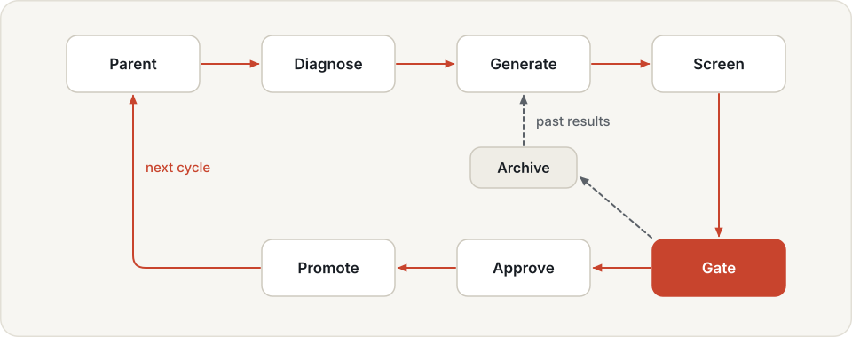
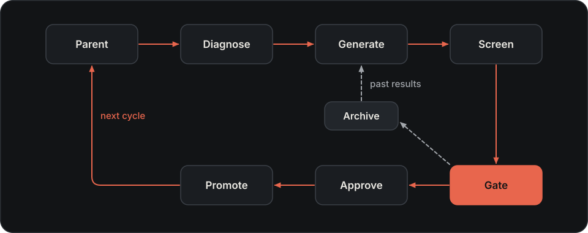

# Docs

How to build this site and how to write its pages. The reader is whoever maintains hylo-docs.

## Building

From the development workspace (the repositories side by side, see
[installation](../getting-started/installation.md)):

```bash
uv sync --group docs
uv run mkdocs serve -f docs/mkdocs.yml                    # http://127.0.0.1:8000, rebuilt on change
uv run mkdocs build -f docs/mkdocs.yml --strict           # the full site; any warning fails the build
uv run mkdocs build -f docs/mkdocs.public.yml --strict    # the public site
```

Build with `--strict` before every commit: broken links, missing images and API references that do not resolve are
errors. The hylo-docs README says how to publish the public site.

A repository that is not checked out does not fail the build. Each page generated from it shows a "Not built"
warning instead, and `--strict` still passes. Before publishing, check that no page carries it:

```bash
grep -rl 'admonition-title">Not built' docs/site-public/ || echo "all generated pages built"
```

## Generated pages

The navigation is explicit in `mkdocs.yml`: a page appears only once it is listed there.

| Page | Source | Edit |
|---|---|---|
| User Guide, Benchmarking, Configuration, most of Developer Guide | `docs/` in hylo-docs | the Markdown file |
| Developer Guide > Extending, Interfaces, Internals; the experiment config schema | `harness/docs/`, copied at build time | the file in hylo-harness |
| [CLI Reference](../cli/index.md) | every `hylo` subcommand's `--help` | the argparse help in the code |
| [Plugin catalogue](plugin-catalogue.md) | every installed plugin's contract, maturity and licence | the package's `hylo.meta` declaration |
| [Examples](../getting-started/examples.md) | the header comment of each config in `bench/examples/` and `plugins/examples/` | the config file |
| [Formats and schemas](../api/formats.md) | the format table and `hylo schema` | the code |
| API Reference: the core pages | a short hand-written intro in `docs/api/`, then the docstrings | the intro here, the rest in the code |
| API Reference > Packages | the docstrings of every package | the code |

`mkdocs/gen_pages.py` writes the generated pages. API pages are short hand-written intros; mkdocstrings fills them
from the code's docstrings, which therefore appear on the public site verbatim. Docstrings follow the same writing
rules as pages.

## Public and internal site

`mkdocs.yml` builds everything. `mkdocs.public.yml` builds the public site: it leaves out `rfcs/`, `research/`, the
strategy summary and `design/` except `design/overview.md`.

The public hook (`mkdocs/public_hook.py`) turns links to the left-out pages into plain text. It does not remove the
words around them. "See RFC-0005" stays on the public page, pointing at nothing. So user pages never cite RFCs,
research notes or internal design pages, linked or not.

## Images

- `docs/assets/diagrams/<name>-{light,dark}.svg`: architecture and flow diagrams, each in a light and a dark
  version, in the same style as the README figures. Edit `mkdocs/figures/diagrams.py`, not the SVGs, and regenerate
  them from the workspace with
  `uv run --no-project --with fonttools --with uharfbuzz --with pillow python docs/mkdocs/figures/diagrams.py`.
  Reference both versions; the page shows the one for the current colour scheme:

```markdown
{ .hylo-diagram .only-light }
{ .hylo-diagram .only-dark }

*One campaign cycle: diagnose, propose, screen, gate, approve.*
```

- `docs/assets/figures/*.png`: charts made from recorded runs (`mkdocs/figures/make_figures.py`) and Studio
  screenshots (`mkdocs/figures/screenshots.py`). The public site leaves out the Studio screenshots. Reference them
  with the `hylo-figure` class, which gives them a light card in dark mode.

Small flows that change often can be Mermaid diagrams in a `mermaid` code block instead.

## Style

### The spine

Every page belongs to one step of Run → Measure → Improve → Deploy, and says which in its first lines.

| Step | What the reader does | Pages |
|---|---|---|
| Start | installs, runs one full loop, learns the nouns | Home, Installation, Quickstart, Concepts |
| Run | writes a config, runs an experiment, picks an agent and a policy | Experiments, Policies, Store |
| Measure | scores under a fixed protocol, compares | Benchmarking, Protocols, Leaderboard |
| Improve | learns artifacts from runs, passes a campaign's gate | Learning, Campaigns |
| Deploy | puts a promoted version on a workcell and runs it safely | Deployment, Safety, Security, Studio |
| Extend and reference | adds plugins, looks up settings | tutorials, Configuration, API, Troubleshooting |

### Page order

Each page follows the same order:

1. **Purpose**: one or two sentences on what the page lets the reader do.
2. **Do**: commands and their expected output, ready to copy.
3. **Explain**: what just happened, and why it works this way.
4. **Options**: the two or three most used; link the rest to the reference.
5. **Limits**: current limits, stated as current behaviour.
6. **Next**: a link to the next page on the spine.

### Nouns

Nine core nouns. Introduce any other term on the page that needs it.

| Noun | Meaning |
|---|---|
| experiment | a config file: which environment, which agent, which split |
| environment | what the agent observes and acts on: a simulator or a robot |
| agent | the logic that decides actions; may wrap a policy and add memory, guidance or a critic |
| policy | the model or controller that maps an observation to actions |
| run | the record of one execution: the traces of its episodes and the results |
| evaluation protocol | rules that fix everything except the agent being scored; its result is a scorecard |
| artifact | something learned from runs and sealed, with a record of what it was built from |
| campaign | the loop that proposes changes, evaluates them, gates them and promotes them |
| workcell | the process next to a robot that runs a promoted version with the same episode loop and takes operator commands |

Do not use: RSI, evolution or improvement loop (say campaign, except in the `hylo evolve` command), cognition,
workbench (say Studio), kernel (say episode loop), runtime layer, numbered layers.

Some words have several meanings. Say which one on first use:

- **protocol** in prose means the evaluation protocol. The YAML keys `benchmark.params.protocol` (the split scheme),
  a campaign's top-level `protocol:` (its gate settings) and `protocol: hylo` (a policy wire protocol) are other
  things.
- **runtime**: a named runtime in a profile, or the `runtime:` timing block of a workcell config.
- **registry**: the plugin registry, or a campaign's promotion ledger.
- **generator**: prose says generator; the YAML key is `proposer`.
- **gate**: only the campaign's confirmatory test on the `gate` split (stage 3). The earlier checks are the stage-0
  checks; never write "the gate refuses" for a stage-0 or store check.

### One fact, one home

Each fact lives on one page. Other pages give one sentence and a link.

| Fact | Home |
|---|---|
| the splits, and who reads which | Campaigns |
| sync and realtime timing | Experiments |
| digest and placement | Concepts defines them, Experiments gives the rules |
| the roles of artifacts | Learning |
| leaderboard numbers | Leaderboard |
| what campaigns may not change, safety guarantees | Safety |
| Studio roles and tokens | Security |
| the repository table and the architecture diagram | Architecture |
| store lookup order, named runtimes | Execution profiles |
| workspace setup | Installation |
| test commands, skips, conformance checks | Testing |
| repository and package rules | Contributing |
| plugin maturity | the generated plugin catalogue |

### Sentences

- Lead with what the reader does, not with a taxonomy.
- One idea per sentence. No chains of semicolons, no stacked parentheses.
- Say what something does in plain words. Class paths and schema version strings belong in the reference and in
  code blocks, not in running prose.
- Give a guarantee with its conditions: say when it holds.
- State current behaviour, including limits; do not describe plans or history. "Studio starts jobs as local
  subprocesses. It does not queue them." not "There is no scheduler yet."
- English, British spelling (licence, behaviour). No marketing.
- Every option, default, path and number comes from the code or from a recorded result.
- Link with relative paths (`../user-guide/store.md`); the strict build checks them.
- User-facing commands run from `bench/`, where Installation registers the store. A page that runs commands
  elsewhere (the workspace directory, a deployments repository) says so before its first command block.
- Every page in Getting started, the User Guide and Benchmarking ends with a short `## Next`.

### Not in user pages

- RFC numbers and internal work-item names;
- dated experiment records, "first reading", "not yet conclusive";
- roadmap pointers: "not yet", "planned", "waits for a GPU";
- rename history and digest-change history (the "Older data" section of [versioning](versioning.md) is the one
  place for what still matters);
- internal run ids, artifact ids and directory names;
- links to `rfcs/`, `research/` or `design/` pages other than `design/overview.md`.

Keep current limitations: write them as current behaviour.
