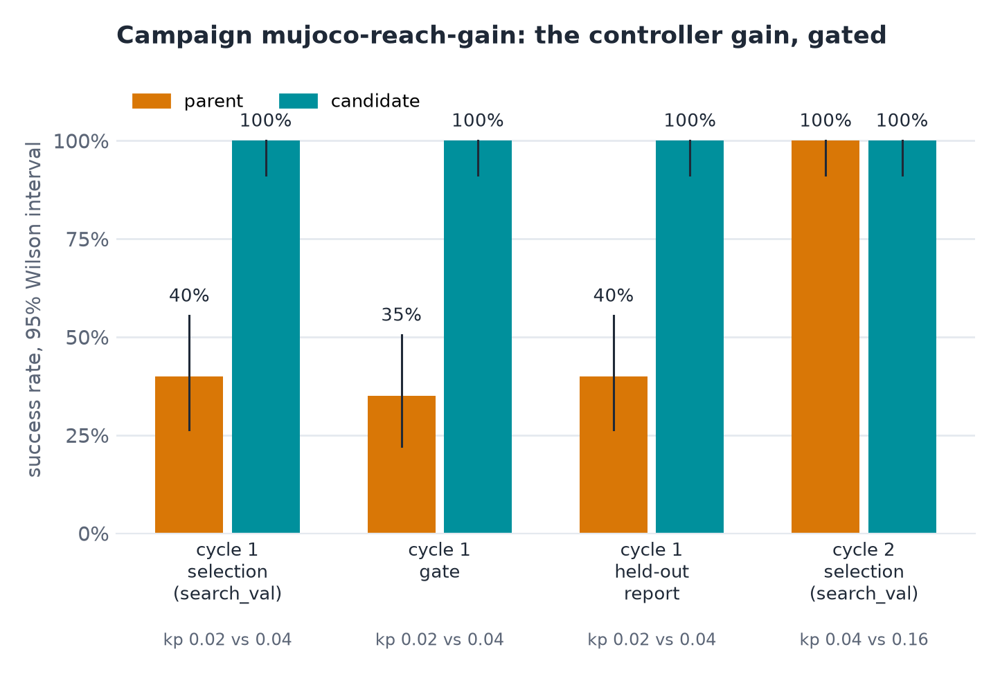

# Capability results

Recorded measurements previously embedded in the usage guides. These are observations under the conditions
below, not expected output for a new run. The [reproduction records](records.md) link to the source scripts
and full experiments; [Research](https://hyloai.github.io/research/) provides the analysis.

## Spatial memory

On the MuJoCo table with targets visible for only the first 5 steps, `composable.object_reach` went from 0.00 to
0.75 success with spatial memory (300 pairs, p = 4e-68); per task, 0.99 on direct and push instructions and 0.27 on
indirect ones ("the colour of a ripe tomato"), which the rule-based chooser cannot resolve with or without memory.
With targets always visible, memory changed nothing (0.75 both ways). In a single traced episode, the recalled
positions matched the true ones exactly and the agent switched from seen to remembered objects at step 5.

```bash
uv run python examples/memory/01_spatial_memory_occlusion.py      # in the harness repository
uv run python examples/memory/02_observable_retrieval.py          # one episode's writes and retrievals
```

[Usage guide](../../user-guide/memory/spatial.md) · [Source records](memory.md)

## Action memory

| Setting | Result |
|---|---|
| MuJoCo planar reach, revisited scenes | 0.75 → 0.81 (p = 0.29) |
| MuJoCo planar reach, new scenes | 0.69 → 0.75 (p = 0.24) |
| Six sessions on the same workcell, each extending the bank | +4, +5, +7, +11, +1 points in sessions 2–6; pooled +5.6 |
| LIBERO-10, SmolVLA, bank from other start states | 0.54 → 0.46 |
| LIBERO-10, same scenes, fixed `t0` 0.2 | 0.54 → 0.62 (p = 0.10) |

On MuJoCo the key is the policy's 8-dimensional state, so a neighbour from another scene is still informative. On
LIBERO the key is pooled image features, which carry no information about the outcome on an unseen layout. Looser
retrieval (`k` 10, floor 0.95) with a well-tuned policy made results worse on MuJoCo in a development run. Treat
action memory as an experiment to measure on your task, not a default.

```bash
uv run python examples/memory/03_action_memory_scene_recall.py    # in the harness repository
uv run python examples/memory/05_memory_across_sessions.py
```

[Usage guide](../../user-guide/memory/action.md) · [Source records](memory.md)

## Lessons

Two experience campaigns on MuJoCo planar reach wrote, read and credited a lesson book with `llm.reflector` on a
local model. The effect of lessons on promotion has not been measured separately: it needs a language model in the
loop and enough rounds to compare with and without lessons.

[Usage guide](../../user-guide/memory/lessons.md) · [Source records](memory.md)

## Skill library

On MuJoCo planar reach, a campaign proposed four noise-scale changes. One passed its gate (+0.42, p = 3e-12) and
became a verified skill; three stayed proposed. The `skills` agent then applied it on fresh scenes, disjoint from
every campaign split: 0.47 → 0.86 (200 pairs, p = 6e-19), with `skill.applied` in all 200 episodes.

On LIBERO-10, the library built from two campaigns holds eight skills, none verified: the two most promising
(+8 and +9 points on the gate) were not significant and are recorded as proposed.

```bash
uv run python examples/memory/04_skill_library.py      # in the harness repository
```

[Usage guide](../../user-guide/memory/skills.md) · [Source records](memory.md)

## Skill record example

??? example "The verified skill from the MuJoCo memory example (its rationale omitted)"

    ```json
    {
      "name": "skill-290658004a",
      "version": "1",
      "description": "sampling noise 3.0 is too wide for this policy; 0.99 keeps samples near the data",
      "trigger": {"instruction_pattern": null, "task_tags": ["reach"], "env": "mujoco.planar_reach"},
      "kind": "steering",
      "body": {"steering": {"n_samples": 1, "noise_scale": 0.99}},
      "status": "verified",
      "verdicts": {},
      "evidence": {
        "verdict": "promoted", "candidate": "cand-290658004a", "digest": "4c9a55f25df13988",
        "generator": "examples.noise_scale@0.1",
        "effect": 0.42, "p_value": 2.56e-12, "n_pairs": 100, "gate_split": "gate", "wins": 43, "losses": 1
      }
    }
    ```

    The evidence ties the skill to the campaign candidate it came from (by id and content digest) and to the gate
    result that verified it: 43 wins and 1 loss over 100 paired episodes.

## Spatial trace

From a recorded `touch the yellow pad` episode (abridged): three objects written at the start, then, once the pads
are hidden, the same target chosen from memory.

??? example "A recorded episode's memory events"

    ```json
    {"type": "memory.write", "seq": 3,
     "payload": {"op": "write", "n": 3, "events": [["ADD", "048a922f…"], ["ADD", "877e2628…"], ["ADD", "8a394917…"]]}}
    {"type": "agent.decision", "seq": 4,
     "payload": {"kind": "subgoal", "trigger": "episode_start", "rationale": "instruction names 'yellow'; closest colour is obj_1",
                 "inputs": {"target": "obj_1", "object_source": "seen", "n_objects": 3}}}
    {"type": "memory.retrieval", "seq": 35,
     "payload": {"query": {"kind": "spatial", "scope": "episode"}, "n_hits": 3, "hits": ["obj_0", "obj_1", "obj_2"]}}
    {"type": "agent.decision", "seq": 36,
     "payload": {"kind": "subgoal", "trigger": "perception_change", "rationale": "instruction names 'yellow'; closest colour is obj_1",
                 "inputs": {"target": "obj_1", "object_source": "remembered", "n_objects": 3}}}
    ```

## Action-memory diagnostics

SmolVLA's velocity field pulls hard towards its own action: on LIBERO, a prior almost one standard deviation away
moves the result about 40% of the way at `t0 = 0.1` and hardly at all from `t0 = 0.4`. Useful guidance therefore
lives at small `t0`.

The noise-memory variant on unseen LIBERO start states scored 0.55 and 0.54 against a 0.54 baseline.

Each decision emits `memory.retrieval`. From a recorded MuJoCo episode: five candidates above the floor, four kept,
started at a fixed `t0` of 0.3, with the source episode, step and similarity of each kept segment.

??? example "A recorded retrieval"

    ```json
    {"type": "memory.retrieval", "seq": 3,
     "payload": {"chunk_index": 0, "step": 0, "used_prior": true, "candidates": 5, "kept": 4,
                 "mean_sim": 0.99958, "dispersion": 0.0536, "confidence": 0.8609, "t0": 0.3,
                 "hits": [["mujoco.planar_reach_fixed-s30141-c701ae45", 0, 1.00002],
                          ["mujoco.planar_reach_fixed-s30141-14b63ae5", 0, 1.00002],
                          ["mujoco.planar_reach_fixed-s30147-9924dbb2", 0, 0.99914],
                          ["mujoco.planar_reach_fixed-s30147-52489dc1", 0, 0.99914]]}}
    ```

??? example "A bank's bank.json"

    ```json
    {"schema": "hylo.action_bank/v0.1", "digest": "b6f269909aabce26", "n": 5623, "key_dim": 8,
     "segments": [{"task_id": "mujoco/planar_reach_fixed", "step": 0, "progress": 0.0,
                   "source": {"run_id": "control-search_val", "episode_id": "mujoco.planar_reach_fixed-s30100-41fd994e",
                              "split": "search_val", "judge": "sim"}}]}
    ```

    The bank after six sessions (first of 5,623 segments shown): 8-dimensional keys, each segment traced to the
    episode it came from and to who judged that episode a success.

## Skill application trace

??? example "A skill.applied event"

    ```json
    {"type": "skill.applied", "seq": 3,
     "payload": {"skill": "skill-290658004a@1", "kind": "steering", "bindings": {},
                 "description": "sampling noise 3.0 is too wide for this policy; 0.99 keeps samples near the data"}}
    ```

## Controller campaign

{ .hylo-figure }

*Example output. In cycle 1, `kp: 0.04` passes the gate at the first look (26 wins, 0 losses, p = 1.5e-8). Cycle 2
finds nothing better and the campaign stops.*


[Source records](evolution.md).

## Tool-agent trace

Abridged payloads from the recorded tool-agent episode.

??? example "The first model call in the trace (abridged)"

    ```json
    {"type": "agent.tool.turn", "seq": 4,
     "payload": {"call": 1, "images": 2, "model": "qwen3.5:35b-a3b", "backend": "ollama",
                 "tool_calls": [{"id": "call_ay5zhb6m", "name": "locate", "arguments": {"text": "purple block"}},
                                {"id": "call_53rblsls", "name": "locate", "arguments": {"text": "green block"}}],
                 "tokens_in": 5873, "tokens_out": 132, "cached_tokens": 5408, "latency_s": 17.5, "stop_reason": "tool_calls"},
     "prev": "a46a5428…", "h": "37…"}
    ```

??? example "A proposal and its receipt (abridged)"

    ```json
    {"type": "agent.tool.proposal", "seq": 10,
     "payload": {"action_id": "a6", "tool": "grasp", "arguments": {"option": "g3"}, "observation_step": 0}}
    {"type": "agent.tool.receipt", "seq": 349,
     "payload": {"action_id": "a6", "tool": "grasp", "status": "arrived", "steps": 84, "counted_as_decision": true,
                 "stages": [{"stage": "approach and close", "steps": 69, "tcp_error_mm": 0.6, "rotation_error_deg": 0.1,
                             "holding_after_close": true},
                            {"stage": "lift", "steps": 15, "tcp_error_mm": 4.0, "rotation_error_deg": 0.0}],
                 "holding": true, "holding_after_lift": true, "verdict": "holding the object"}}
    ```

??? example "The episode's summary"

    ```json
    {"type": "agent.tool.summary", "seq": 531,
     "payload": {"calls": 5, "decisions": 2, "refused": 0, "stopped": "episode ended", "operator_messages": 0,
                 "human_assisted": false, "steps": 127, "context": {"stored": 2, "summaries": 0, "reopened": 0},
                 "usage": {"tokens_in": 34965, "tokens_out": 678, "cost_usd": 0.0, "latency_s": 83.92}, "wall_s": 92.6}}
    ```

## World motion

The receipts behind the quadruped video: one `walk` forward, then one with a turn, for all four robots in the same
steps.

| Robot | Forward | Turned | Upright | Base height |
|---|---|---|---|---|
| Go2 | 0.78 m, then 0.30 m | −0.6°, then 49.9° | yes | 0.252 m |
| Go1 | 1.27 m, then 0.37 m | −0.8°, then 79.2° | yes | 0.261 m |
| A1 | 1.22 m, then 0.43 m | −0.6°, then 75.0° | yes | 0.249 m |
| Spot | 1.31 m, then 0.50 m | −1.1°, then 36.9° | yes | 0.422 m |


[Full world records](tool-agents.md#worlds).
