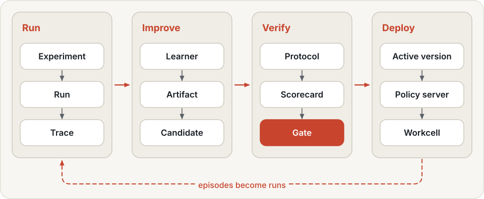
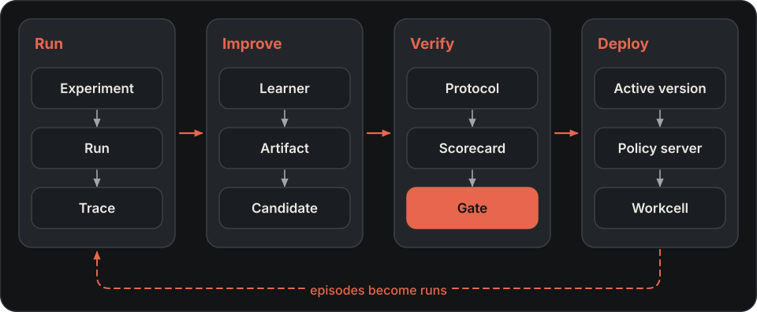
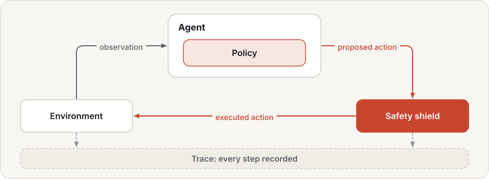
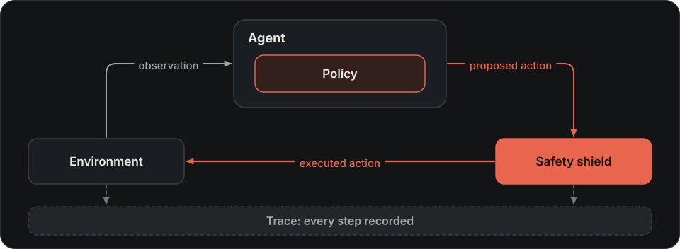
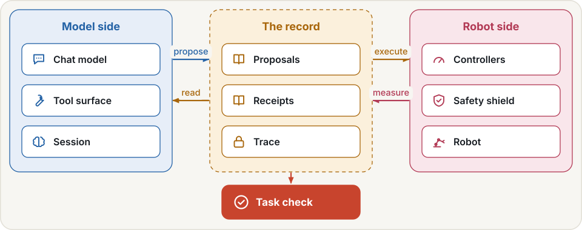
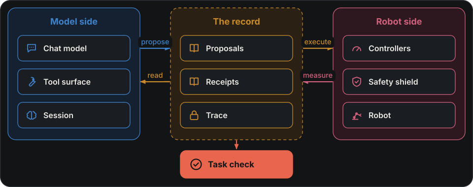

# Concepts

The user-facing thread is the lifecycle of robot skills: development, execution, validation, deployment, reuse
and improvement. The terms below map those activities to the mechanisms of the [Physical RSI](../physical-rsi.md)
loop: Build, Run, Improve, Verify and Deploy. Start with [Robot skills and their lifecycle](../user-guide/skills.md)
for the complete picture.

An **experiment** names an **environment** and an **agent**. The agent decides what to do, usually by asking a
**policy** for actions. Running the experiment gives a **run**: one recorded trace per episode, plus results. An
**evaluation protocol** fixes everything except the agent being scored, so it scores every agent the same way. Learners turn runs into
**artifacts**. A **campaign** proposes changes that use them, tests each change against the current version, and
promotes one only if it passes the gate. A **workcell** runs the promoted version next to a robot.

{ .hylo-diagram .only-light }
{ .hylo-diagram .only-dark }

## Skills and development

Robot skill { #robot-skill }
:   A reusable ability to perform tasks under stated robot, scene and observation conditions. Describe its task,
    applicability, executable implementation, validation evidence, version and dependencies. Programs, policies
    and controllers can implement task capabilities; current skill-library records cover specific reuse paths.

Task strategy { #task-strategy }
:   The logic for carrying out a task. It can be implemented by a model, controller or program. Development constructs
    and checks that logic; improvement compares a change with an existing baseline. It is the executable approach
    used to implement a skill; the skill description also states applicability and validation evidence.

Robot contract and tools { #robot-tools }
:   `RobotSpec` describes arms, hands, cameras, frames and actions. Manipulation tools use it for perception, grasping,
    planning and execution. The agent submits tool-generated actions to the same kernel and SafetyShield.

Program agent { #program-agent }
:   `code.program` executes a Python `solve(robot)` strategy; `code.llm` writes code one turn at a time. See
    [Developing robot skills](../user-guide/developing-strategies.md).

Research session { #research-session }
:   A model develops and submits programs using development cases. A qualifying submission is frozen as a program
    artifact; freezing alone does not promote it or establish independent task success.

Program skill { #program-skill }
:   A reusable reference to a promoted program, with version, provenance and gate evidence. A code agent can retrieve
    and call it. See [Skill research, validation and reuse](../user-guide/research-and-skills.md).

Coding-agent skill { #coding-agent-skill }
:   A `SKILL.md` instruction file teaching a software agent to operate Hylo commands. These instruction files are
    separate from the robot's task capabilities and from `Skill` records in the skill library.

## Run

Experiment { #experiment }
:   What you want to measure: a benchmark split, an environment, an agent, and optional safety limits, timing and
    seed. You write it as a YAML config and run it with `hylo run`; every execution gives a new run. See
    [experiments](../user-guide/experiments.md).

Environment { #environment }
:   What the agent observes and acts on: a simulator or a robot. It declares its observations, actions and control
    rate.

Agent { #agent }
:   The logic that decides each action. An agent usually wraps a policy, and can add memory, steering, a planner or
    a critic around it. A program agent instead executes task code using robot tools.

Policy { #policy }
:   The model or controller that turns an observation into actions. See [policies](../user-guide/policies.md).

Run { #run }
:   The record of one execution of an experiment: per-episode results, a manifest (config, digest, package
    versions) and one trace per episode.

Supporting terms:

Episode { #episode }
:   One attempt at one task from one initial state, from reset until success, failure or timeout.

Trace { #trace }
:   The event log of one episode: observations, the actions the agent proposed, the safety shield's decisions, the
    executed actions and the outcome. Scores are computed from traces only.

Safety shield { #safety-shield }
:   The checkpoint every action passes between agent and environment. See [safety](../user-guide/safety.md).

Timing { #timing }
:   Whether the world waits for the policy (`sync`, the default) or keeps moving while it computes (`realtime`).
    See [timing](../user-guide/experiments.md#timing-sync-and-realtime).

Digest { #digest }
:   A short hash of what an experiment measures. Where results go and where components run are left out, except a
    `remote.ws` URL, which is hashed. Code versions are not in it. See
    [when two runs are comparable](../user-guide/experiments.md#what-is-measured-the-digest).

{ .hylo-diagram .only-light }
{ .hylo-diagram .only-dark }

When a language model drives the robot, it and the robot meet only through the record. The model proposes actions
and reads receipts; controllers and the safety shield execute them and measure what happened; the task's own check,
which the model never sees, decides success. See [tool-calling agents](../user-guide/tool-agents.md) and
[worlds](../user-guide/worlds.md).

{ .hylo-diagram .only-light }
{ .hylo-diagram .only-dark }

## Improve

Artifact { #artifact }
:   A derived result, such as a memory, a critic, a success judge, policy weights or a task program. It is sealed with a
    content digest and the runs it was built from. Its role (behaviour, instrument, proposal or data)
    decides how it earns trust. See [learning](../user-guide/learning.md).

Campaign { #campaign }
:   The loop that improves an experiment. Each cycle asks a generator for candidate changes, evaluates them, and
    promotes at most one that passes the gate. See
    [campaigns](../user-guide/campaigns.md).

Supporting terms:

Learner { #learner }
:   A plugin that turns runs into one sealed artifact (`hylo learn`). By default, learners read only the development
    splits, `search` and `search_val`. They never read gate or held-out runs.

Judge { #judge }
:   An instrument that labels episodes as success or failure without ground truth, once calibrated on runs whose
    outcome is known.

Generator, candidate { #generator }
:   A generator proposes candidates: config changes, each with a hypothesis. It is configured under the `proposer`
    key of the campaign YAML. Candidates may not change the protected settings listed in
    [safety](../user-guide/safety.md).

Split { #split }
:   A named set of initial states. A campaign uses four disjoint splits: `search`, `search_val`, `gate` and
    `heldout`. [Campaigns](../user-guide/campaigns.md#splits) says who reads which.

Gate { #gate }
:   The test that decides promotion: a paired comparison with the current version on the `gate` split, with vetoes
    for task regressions and extra safety interventions.

Active version { #active-version }
:   The campaign's current version, written to `active.json`. By default a candidate that passes the
    gate becomes active at once; with `approval: manual` it waits for `hylo evolve approve`. This record alone does
    not mean a workcell is running it.

## Verify

Evaluation protocol { #evaluation-protocol }
:   Fixes everything except the agent being scored: episodes, seeds, timing and scoring. The agent usually wraps
    a policy. Scoring an agent under a protocol gives a **scorecard**: the success rate with a 95% confidence
    interval, and every episode. A **leaderboard** ranks the scorecards of one protocol. See
    [benchmarking](../benchmarking/index.md).

## Deploy

Workcell { #workcell }
:   The process next to a robot or simulator. It runs the active version with the same episode loop the benchmark
    used, records every episode as a run, and takes operator commands such as stop and reset. See
    [deployment](../user-guide/deployment.md).

Policy server { #policy-server }
:   Serves an agent over the network, usually from a GPU machine (`hylo serve policy`). With `--campaign` it
    follows the active version. A workcell asks it for actions.

## Placement and storage

Store id { #store-id }
:   The name of a run or artifact in the store: `run:<run_id>` or `artifact:<name>@<digest>`. Each machine
    resolves ids to local paths. See [store](../user-guide/store.md).

Runtime, execution profile { #runtime }
:   A runtime is a named Python interpreter plus environment variables, for example `libero-sim`. The machine's
    execution profile lists its runtimes and store location. Configs name runtimes, never paths. See [profiles](../configuration/profiles.md).

## Extending

Plugin { #plugin }
:   Every environment, agent, policy, learner or generator is a plugin, found by name through a `hylo.<group>`
    entry point. See [extending](../harness/extending.md) and the
    [plugin catalogue](../developer-guide/plugin-catalogue.md).

## Next

- [Experiments](../user-guide/experiments.md): write and run your own experiment.
- [Architecture](../design/overview.md): how the four steps connect inside Hylo.
