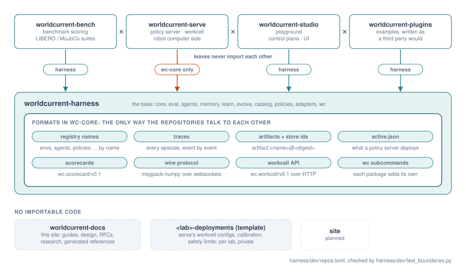

# Installation

Hylo is several git repositories, developed side by side and installed into one Python environment. The
harness is the base; bench, serve, studio and plugins are leaves on top of it (see
[repository structure](../design/repository-structure.md)). You need:

- Linux (the LIBERO setup assumes Ubuntu 24.04 for its user-space OSMesa install);
- Python 3.10 or newer;
- [uv](https://docs.astral.sh/uv/);
- no GPU: everything here runs on CPU.

{ .hylo-figure }

*The harness is the only base. Leaves never import each other; they cooperate through formats defined in hylo-core.*

## The development workspace

Check the repositories out next to each other in one directory, then run the harness's bootstrap script there:

```bash
mkdir hylo && cd hylo
git clone https://github.com/HyloAI/hylo-harness.git harness
HYLO_GIT_BASE=https://github.com/HyloAI harness/dev/bootstrap.sh
# clones bench, serve, studio, plugins and docs next to it, writes ./pyproject.toml (a uv workspace), runs `uv sync`
```

`bootstrap.sh [DIR]` does three things:

1. For each repository listed in `harness/dev/repos.toml` that is missing in `DIR`, it clones
   `$HYLO_GIT_BASE/hylo-<name>.git` when `HYLO_GIT_BASE` is set, and skips the repository otherwise.
2. It writes `DIR/pyproject.toml` with `harness/dev/workspace.py`. That file makes every package of every present
   code repository (`<repo>/packages/*`, `<repo>/adapters/*`) a workspace member.
3. It runs `uv sync`, which installs all of them editable into `DIR/.venv`.

The workspace directory is not a repository: its `pyproject.toml`, `uv.lock` and `.venv` are generated. Rerun
`python harness/dev/workspace.py .` after adding or removing a repository; the boundary lint fails while the file is
stale.

The workspace has optional dependency groups:

| Group | Installs | For |
|---|---|---|
| `dev` (default) | pytest, httpx | the tests |
| `demo` | imageio, matplotlib, pillow | videos and figures from examples |
| `docs` | mkdocs-material, mkdocstrings, mkdocs-gen-files, mkdocs-glightbox | building this site |

```bash
uv sync --group demo --group docs
```

### A subset of the repositories

The workspace covers whatever repositories are present, so you can work on the harness alone, or on the harness
and one leaf. Tests that need another repository skip themselves; for example, the plugin scaffold test needs bench's
MuJoCo environments.

| Checkout | What you can run |
|---|---|
| `harness` | contracts, kernel, learners, campaigns and conformance on the test double (`testing.*` plugins) |
| `harness` + `bench` | MuJoCo and LIBERO experiments, protocols, scorecards, leaderboards, the examples |
| `harness` + `serve` | policy servers and workcells (a robot computer installs only `hylo-core` and serve) |
| `harness` + `studio` | the playground and the control plane (rebuilding the web front end needs Node) |
| `harness` + `plugins` | the example plugins, written the way a third party would |

## MuJoCo

MuJoCo comes with `hylo-env-mujoco` (in bench) and needs nothing else for experiments. Camera rendering (the
table-reach vision variant, figures) needs an OpenGL backend. On a GPU machine set `MUJOCO_GL=egl`; otherwise install
user-space OSMesa (next section) and set `MUJOCO_GL=osmesa`.

## LIBERO and LeRobot policies

LIBERO's dependencies (robosuite, its pinned MuJoCo, LeRobot with SmolVLA) conflict with the workspace. They live
in a separate venv inside bench, and experiments reach them as out-of-process runtimes.

=== "1. OSMesa (no root)"

    ```bash
    bench/scripts/install-osmesa-user.sh
    ```

    The script downloads Ubuntu 24.04's `libosmesa6` (and `libllvm20` if it is missing) with `apt-get download`
    and unpacks the packages into `~/.local/mesa`; no root needed. Rendering then uses `MUJOCO_GL=osmesa`,
    `PYOPENGL_PLATFORM=osmesa` and `LD_LIBRARY_PATH=~/.local/mesa/root/usr/lib/x86_64-linux-gnu`.

=== "2. The LIBERO venv"

    ```bash
    bench/envs/libero/setup.sh
    ```

    The script:

    - builds `bench/envs/libero/.venv` (Python 3.12, CPU) and installs LIBERO and `lerobot[smolvla]`;
    - installs the harness packages it needs, editable, from the harness checkout next to bench (`HYLO_HARNESS`,
      default `../harness`);
    - downloads the LIBERO assets (`lerobot/libero-assets`, research use only) and writes a non-interactive LIBERO
      config.

=== "3. Runtimes"

    At the end, `setup.sh` registers two runtimes in this machine's
    [execution profile](../configuration/profiles.md):

    | Runtime | What runs there | Environment |
    |---|---|---|
    | `libero-sim` | the LIBERO simulator (`env.remote: {runtime: libero-sim}`) | OSMesa variables, `LIBERO_CONFIG_PATH`, thread limits |
    | `lerobot` | LeRobot policies (`agent: {type: remote, params: {runtime: lerobot}}`) | `HF_HOME=bench/envs/hf-home`, `HF_HUB_OFFLINE=1` |

    ```bash
    uv run hylo profile show
    ```

Experiment configs name these runtimes, never paths. So LIBERO experiments run from any directory, and where the venv
lives never changes an experiment's digest
([RFC-0005](../rfcs/RFC-0005-architecture-measurement-and-placement.md)).

!!! note "Model weights"
    The `lerobot` runtime sets `HF_HUB_OFFLINE=1`: policies load weights only from `bench/envs/hf-home`, and
    `setup.sh` does not download any. Put a checkpoint into that cache once (for example `lerobot/smolvla_libero`,
    with `HF_HOME=bench/envs/hf-home huggingface-cli download ...`) before running LIBERO configs. Weight licences
    differ from the code's; see the [plugin catalogue](../developer-guide/plugin-catalogue.md).

## The run and artifact store

Runs and learned artifacts are found by id through this machine's store (see [store](../user-guide/store.md)).
Register the directory your runs go to once:

```bash
uv run hylo store init bench/runs      # recorded as `store:` in ~/.config/hylo/profile.yaml
uv run hylo store ls
```

Without a registered store, `$HYLO_STORE` is used if it is set, and `./runs` relative to the working directory
otherwise.

## Check the installation

```bash
uv run hylo --help              # subcommands contributed by the installed packages
uv run hylo plugins             # every plugin: contract version, maturity, licence
uv run pytest                 # every present repository, plus the boundary lint (harness/dev)
```

`hylo --help` lists only the commands of installed packages: `hylo bench` comes from bench, `hylo serve` from serve and
`hylo playground` from studio. Next: the [quickstart](quickstart.md).
