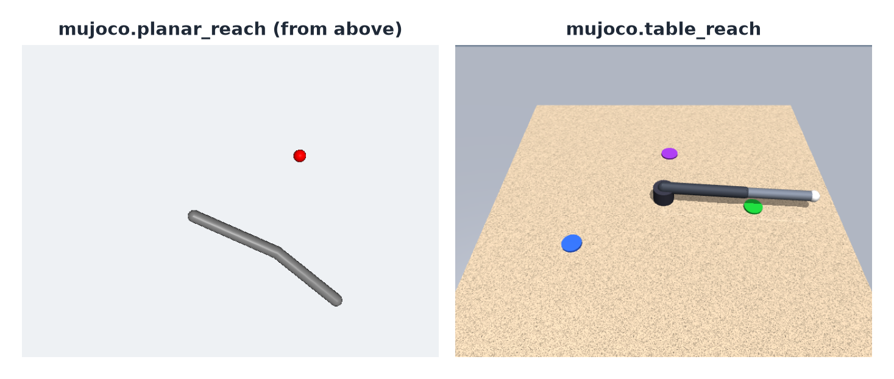
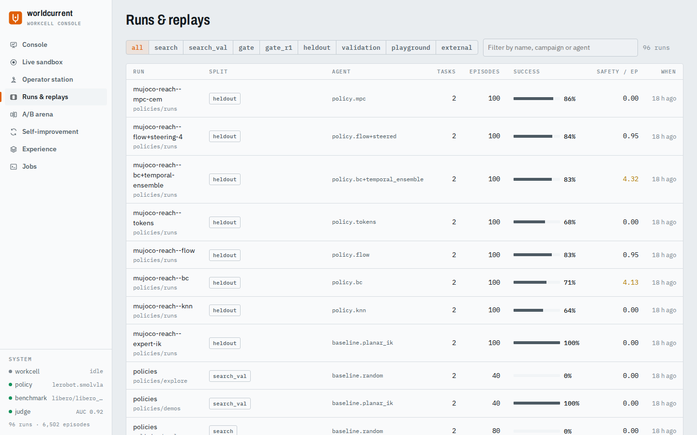

# Quickstart

This page runs one experiment, reads its traces, scores a policy under a protocol, and lets a campaign improve a
weak controller through the gate. Everything is MuJoCo planar reach: a two-link arm moves its fingertip to a
target. It needs [the development workspace](installation.md) with harness and bench; nothing here needs LIBERO, a
GPU or downloaded weights.

{ .wc-figure }

*The MuJoCo environments in bench: planar reach (left) and table reach.*

## 1. Run an experiment

An experiment config names a benchmark split, an environment and an agent:

```yaml title="bench/examples/configs/mujoco_reach.yaml"
schema_version: wc.experiment/v0.1
name: mujoco-reach
benchmark: {type: mujoco/reach-v0, split: validation}
env: {type: mujoco.planar_reach}
agent: {type: baseline.planar_ik, params: {kp: 0.3}}
output_dir: runs
```

```bash
uv run wc run bench/examples/configs/mujoco_reach.yaml
```

Each finished episode is printed as it ends (`[20] mujoco/planar_reach_random seed=10009 success (32 steps)`), then
the run's metrics:

```json
{
  "run_dir": "runs/mujoco-reach-validation-c26fef49863a7b7a-399b55",
  "config_digest": "c26fef49863a7b7a",
  "success_mean": 1.0,
  "safety_interventions_mean": 0.0,
  "steps_mean": 35.25,
  "n_episodes": 20,
  "n_scored": 20
}
```

`config_digest` identifies what was measured. It is the same on every machine and in every directory, because
where components run and where results go are not part of it (see [experiments](../user-guide/experiments.md)).
Change any measured value and the digest changes:

```bash
uv run wc run bench/examples/configs/mujoco_reach.yaml --set agent.params.kp=0.02 --set workers=8
```

## 2. Read the traces

A run directory holds `evallog.json` (per-episode results and scores), `manifest.json` (the config, its digest,
package versions, the store ids it used) and one event trace per episode under `episodes/`.

```bash
uv run wc trace runs/mujoco-reach-validation-c26fef49863a7b7a-399b55            # results and episode ids
uv run wc trace runs/mujoco-reach-validation-c26fef49863a7b7a-399b55 \
    mujoco.planar_reach_fixed-s10000-1fac203d                                     # one episode
```

For one episode, `wc trace` counts the events and prints the episode's end record:

```text
Counter({'observation': 31, 'agent.chunk': 30, 'safety.review': 30, 'action': 30, 'step.result': 30,
         'privileged.state': 30, 'episode.start': 1, 'episode.end': 1})
{"status": "success", "success": true, "steps": 30, "termination_reason": "terminated", "safety_interventions": 0}
```

Every action the agent proposed and what the safety shield approved are in the trace (`agent.chunk`,
`safety.review`, `action`), so any episode can be replayed, scored again or compared step by step.

## 3. Score a policy under a protocol

A protocol fixes everything about an evaluation except the policy. `mujoco-reach` is 100 held-out episodes: a fixed
and a random target, 50 seeds each, never used for learning.

```bash
uv run wc bench list
uv run wc bench run mujoco-reach --name ik-0.3 \
    --policy '{"type": "baseline.planar_ik", "params": {"kp": 0.3}}'
```

```json
{"scorecard": "scorecards/mujoco-reach/ik-0.3.json", "success_mean": 1.0, "success_ci95": [0.963, 1.0], "n": 100}
```

The scorecard records the protocol digest, the policy, the success rate with a 95% Wilson interval and every
episode. Score a second policy, then rank and compare:

```bash
uv run wc bench run mujoco-reach --name ik-0.05 \
    --policy '{"type": "baseline.planar_ik", "params": {"kp": 0.05}}'
uv run wc bench leaderboard                     # every scorecard under scorecards/, per protocol, best first
uv run wc bench compare scorecards/mujoco-reach/ik-0.05.json scorecards/mujoco-reach/ik-0.3.json
```

```text
| # | policy | success % | 95% CI | episodes | mean steps |
|---|---|---|---|---|---|
| 1 | ik-0.05 | 100.0 | 96.3–100.0 | 100 | 68 |
| 2 | ik-0.3 | 100.0 | 96.3–100.0 | 100 | 36 |
```

`compare` pairs the two scorecards episode by episode (same seed, same target) and reports wins, losses and an exact
McNemar p-value. Here both always succeed, so there are no discordant pairs and p = 1.0. More in
[benchmarking](../benchmarking/index.md).

## 4. Improve a policy with a gated campaign

A campaign proposes changes to a config, selects among them on one split, confirms on another and reports on a
held-out split it never selected on. This one starts the IK controller with a weak gain (`kp: 0.02`), and a rule
generator proposes larger gains:

```bash
uv run wc evolve run bench/examples/evolve/mujoco_reach_gain.yaml    # writes runs/evolve/mujoco-reach-gain here
```

```text
[cycle 1] parent = base config
[cycle 1] parent-search                      search     success=0.450 n=80 (3s)
[cycle 1] parent-search_val                  search_val success=0.400 n=40 (2s)
[cycle 1] cand-9147236d7d-search_val         search_val success=1.000 n=40 (1s)
[cycle 1] cand-e38bf803fe-search_val         search_val success=1.000 n=40 (1s)
[cycle 1] parent-gate                        gate       success=0.350 n=40 (2s)
[cycle 1] cand-9147236d7d-gate               gate       success=1.000 n=40 (1s)
[cycle 1] cand-9147236d7d-heldout            heldout    success=1.000 n=40 (1s)
[cycle 1] parent-heldout                     heldout    success=0.400 n=40 (2s)
[cycle 1] done: promoted=cand-9147236d7d heldout={... "candidate_success": 1.0, "parent_success": 0.4,
          "paired": {"n_pairs": 40, "candidate_wins": 24, "parent_wins": 0, "p_value": 5.96e-08}, ...}
[cycle 2] parent = cand-9147236d7d
...
[cycle 2] done: promoted=None heldout=null
```

On the held-out split, success went from 0.40 to 1.00: 24 wins, no losses, over 40 paired episodes. The campaign
stops after one cycle without a promotion. Inspect it, or roll back the promotion:

```bash
uv run wc evolve status bench/examples/evolve/mujoco_reach_gain.yaml
uv run wc evolve rollback bench/examples/evolve/mujoco_reach_gain.yaml --reason "trying again"
```

The campaign directory (`runs/evolve/mujoco-reach-gain/`) keeps every candidate with its hypothesis and evidence
(`archive.jsonl`), the promotion ledger (`registry/`), each cycle's runs and report, and `active.json`: the version a
policy server would deploy. See [campaigns](../user-guide/campaigns.md).

## 5. Look at it in studio

With studio checked out, the playground shows runs, episodes frame by frame, comparisons and campaigns:

```bash
uv run wc playground --repo bench          # http://127.0.0.1:8765
```

`--repo` is the directory whose `runs/`, `examples/configs` and `examples/evolve` the UI shows and runs jobs in.
See [studio](../user-guide/studio.md).

{ .wc-figure }

## Next

- [Concepts](concepts.md): the vocabulary used everywhere else.
- [Policies](../user-guide/policies.md): train the reference policies and put them on the leaderboard.
- [Examples](examples.md): every shipped config, including LIBERO-10 with SmolVLA.
