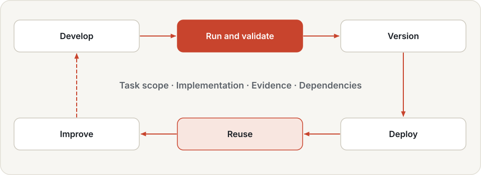
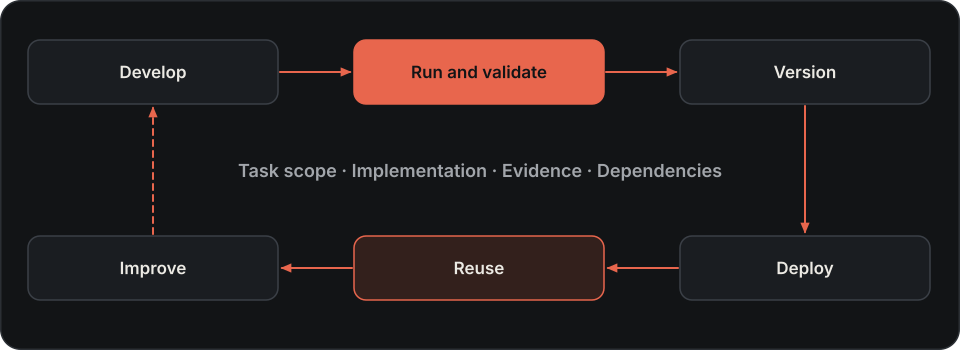
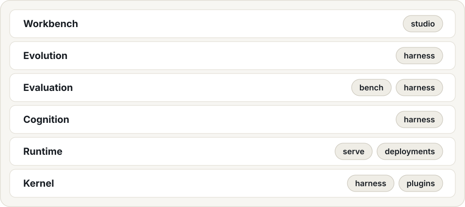
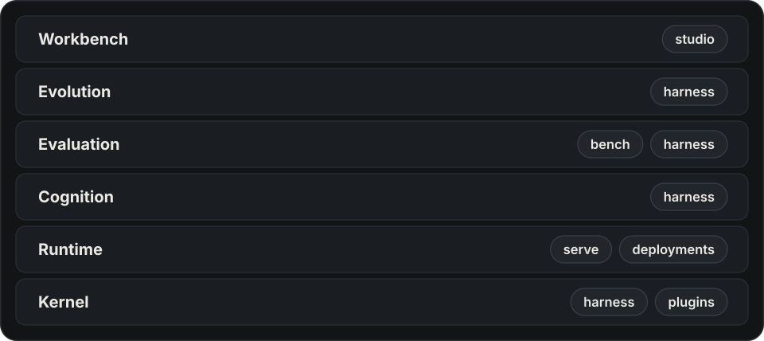

---
hide:
  - navigation
  - toc
---

# The stack for physical AI

Develop, validate, deploy and accumulate robot skills with Hylo. Combine robot tools,
programs and existing policies on one execution kernel, with recorded evidence for each tested implementation.

[Get started](getting-started/installation.md){ .md-button .md-button--primary }
[Quickstart](getting-started/quickstart.md){ .md-button }
[Concepts](getting-started/concepts.md){ .md-button }

## Build robot skills through experiments

A robot skill is a reusable ability to carry out tasks under stated conditions. Developing it takes programming,
tool integration and experiments; using it requires reliable execution, validation and deployment. Hylo connects
these activities so that working task capabilities can be inspected, reused and improved.

[Skills and their lifecycle →](user-guide/skills.md)

{ .hylo-diagram .only-light }
{ .hylo-diagram .only-dark }

-   **Develop skills**

    ---

    Build and debug task programs using perception, grasping and motion-planning tools. A model can write code
    interactively or develop a frozen program on development cases. Start with a new task or an existing program.

    A model can also operate the robot one checked tool call at a time, or build a world with other robots to try
    a task in.

    [Develop a skill →](user-guide/developing-strategies.md) · [Skill research →](user-guide/research-and-skills.md) ·
    [Tool-calling agents →](user-guide/tool-agents.md) · [Worlds →](user-guide/worlds.md)

-   **Run implementations**

    ---

    An experiment config names an environment, an agent and a set of episodes. Run it, and every episode is
    recorded as a trace you can replay step by step.

    [Experiments →](user-guide/experiments.md) · [Policies →](user-guide/policies.md)

-   **Validate skills**

    ---

    An evaluation protocol fixes everything except the agent being scored: episodes, seeds and timing. Each result
    is a scorecard, and a leaderboard ranks the scorecards of one protocol.

    [Benchmarking →](benchmarking/index.md) · [Leaderboard →](benchmarking/leaderboard.md)

-   **Improve versions**

    ---

    Learners turn runs into sealed artifacts. A campaign proposes changes, tests them against the current version
    on episodes it did not choose them on, and promotes a change only if it passes the gate.

    [Learning →](user-guide/learning.md) · [Campaigns →](user-guide/campaigns.md)

-   **Deploy and operate**

    ---

    A workcell runs the promoted version on a robot with the same episode loop the benchmark used, behind the
    safety shield and an operator's stop button.

    [Deployment →](user-guide/deployment.md) · [Safety →](user-guide/safety.md)

-   **Reuse and accumulate**

    ---

    Derive a verified program skill from a promoted candidate and make it available to later code agents.
    Keep its applicability, program version and validation evidence attached; revalidate when conditions change.

    [Skill reuse →](user-guide/research-and-skills.md#reuse-a-promoted-program) · [Memory →](user-guide/memory/index.md) · [Skill lifecycle →](user-guide/skills.md)

[Studio](user-guide/studio.md) shows research sessions, code and development outcomes alongside runs, replays,
comparisons, campaigns and workcell controls, and its World page builds and runs stages with a chat model. Start it with `hylo playground`.

## Choose a starting point

- **Bring an existing policy:** follow the [CPU quickstart](getting-started/quickstart.md), then [connect your policy](user-guide/policies.md).
- **Develop a robot skill:** use the [robot tools and code agents](user-guide/developing-strategies.md), then inspect the recorded results.
- **Try robots in a scene:** describe a [world](user-guide/worlds.md) with any of 24 robot packs, run it by hand or
  with `hylo world chat`, and record camera data.
- **Let a model operate the robot:** run [`tools.llm`](user-guide/tool-agents.md) on a benchmark task, watch it with
  `hylo watch`, and seal the run.
- **Improve or reuse a skill:** run a [research session](user-guide/research-and-skills.md), compare with a baseline through a campaign, or retrieve a verified program skill.

New-task development starts with execution and task validation. A claim of improvement uses a separate comparison
with a baseline and, for campaign promotion, the gate. The [showcase](showcase/tool-agents.md) reports the conditions,
measured results and current limits of the new workflows.

## The stack

Six layers, from the kernel at the base to the workbench on top, and the repositories that implement them.

{ .hylo-diagram .only-light }
{ .hylo-diagram .only-dark }

## Where next

- [Architecture](design/overview.md): how development, execution, evaluation and deployment connect.
- [Extending](harness/extending.md): add your own environment, policy, learner or generator.
- [CLI reference](cli/index.md): every `hylo` command and its options.
- [Plugin catalogue](developer-guide/plugin-catalogue.md): every plugin, with what it has been run on.
