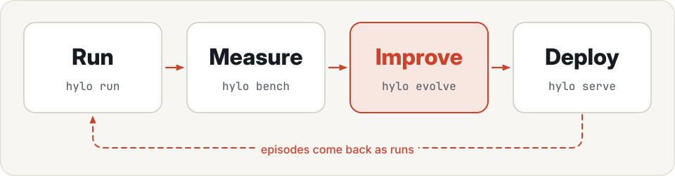
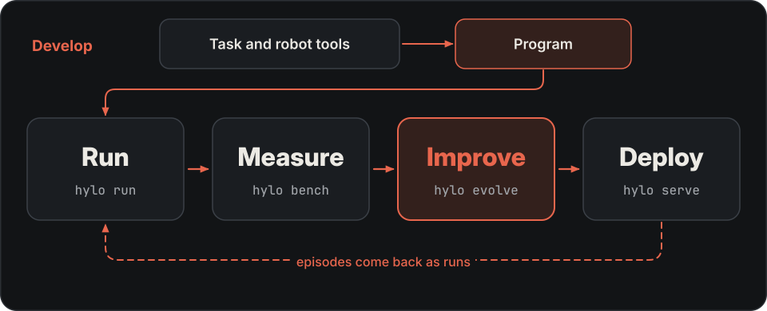

---
hide:
  - navigation
  - toc
---

# The stack for physical AI

Hylo connects robot strategy development, execution, evaluation, improvement and deployment.
Build task programs with robot tools, or bring an existing policy; run both through one execution kernel and use
recorded experiments to decide what to keep.

[Get started](getting-started/installation.md){ .md-button .md-button--primary }
[Quickstart](getting-started/quickstart.md){ .md-button }
[Concepts](getting-started/concepts.md){ .md-button }

## What you do with Hylo

Turning a task requirement into an executable strategy takes programming, tool integration and repeated experiments.
Hylo's manipulation tools and code agents reduce that work. The same stack also addresses execution safety,
comparable evaluation and reversible deployment. Strategy development is one part of this wider workflow.

{ .hylo-diagram .only-light }
{ .hylo-diagram .only-dark }

-   **Develop**

    ---

    Build and debug task programs using perception, grasping and motion-planning tools. A model can write code
    interactively or develop a frozen program on development cases. Start with a new task or an existing program.

    [Develop a strategy →](user-guide/developing-strategies.md) · [Research and skills →](user-guide/research-and-skills.md)

-   **Run**

    ---

    An experiment config names an environment, an agent and a set of episodes. Run it, and every episode is
    recorded as a trace you can replay step by step.

    [Experiments →](user-guide/experiments.md) · [Policies →](user-guide/policies.md)

-   **Measure**

    ---

    An evaluation protocol fixes everything except the agent being scored: episodes, seeds and timing. Each result
    is a scorecard, and a leaderboard ranks the scorecards of one protocol.

    [Benchmarking →](benchmarking/index.md) · [Leaderboard →](benchmarking/leaderboard.md)

-   **Improve**

    ---

    Learners turn runs into sealed artifacts. A campaign proposes changes, tests them against the current version
    on episodes it did not choose them on, and promotes a change only if it passes the gate.

    [Learning →](user-guide/learning.md) · [Campaigns →](user-guide/campaigns.md)

-   **Deploy**

    ---

    A workcell runs the promoted version on a robot with the same episode loop the benchmark used, behind the
    safety shield and an operator's stop button.

    [Deployment →](user-guide/deployment.md) · [Safety →](user-guide/safety.md)

[Studio](user-guide/studio.md) shows research sessions, code and development outcomes alongside runs, replays,
comparisons, campaigns and workcell controls. Start it with `hylo playground`.

## Choose a starting point

- **Bring an existing policy:** follow the [CPU quickstart](getting-started/quickstart.md), then [connect your policy](user-guide/policies.md).
- **Develop a task strategy:** use the [robot tools and code agents](user-guide/developing-strategies.md), then inspect the recorded results.
- **Improve an existing strategy:** run a [research session](user-guide/research-and-skills.md) or a [campaign](user-guide/campaigns.md) against a baseline.

New-task development starts with execution and task validation. A claim of improvement uses a separate comparison
with a baseline and, for campaign promotion, the gate. The [showcase](showcase/tool-agents.md) reports the conditions,
measured results and current limits of the new workflows.

## The stack

Six layers, from the kernel at the base to the workbench on top, and the repositories that implement them.

{ .hylo-diagram .only-light }
{ .hylo-diagram .only-dark }

## Where next

- [Architecture](design/overview.md): how development, execution, evaluation and deployment connect.
- [Extending](harness/extending.md): add your own environment, policy, learner or generator.
- [CLI reference](cli/index.md): every `hylo` command and its options.
- [Plugin catalogue](developer-guide/plugin-catalogue.md): every plugin, with what it has been run on.
