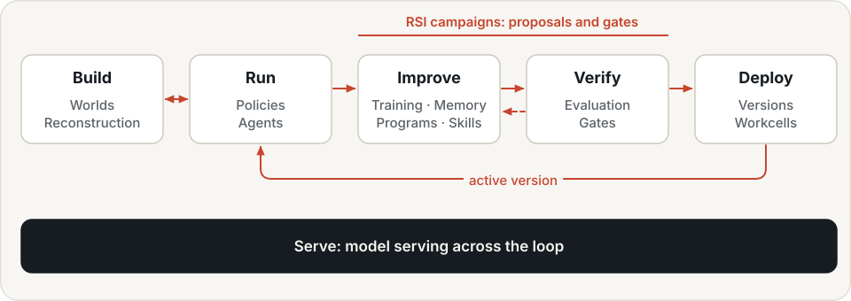
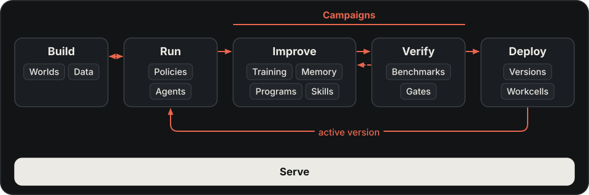

---
hide:
  - navigation
  - toc
---

# Physical RSI: robots that build on their own progress

Agents act in worlds, learn from experience and reuse verified skills.
Hylo connects those capabilities through a measured improvement loop.

[Get started](getting-started/installation.md){ .md-button .md-button--primary }
[Quickstart](getting-started/quickstart.md){ .md-button }
[See results](showcase/index.md){ .md-button }

## Physical RSI

Physical recursive self-improvement uses task outcomes to propose changes, test them and carry useful changes
into later rounds. People define the goals, evaluation conditions and boundaries. Hylo's campaigns compare
candidates with the current version before promotion; hardware deployment needs human review and target validation.

{ .hylo-diagram .only-light }
{ .hylo-diagram .only-dark }

[Physical RSI →](physical-rsi.md)

-   **Worlds**

    ---

    Build scenes with robots, objects and people. Run actions and check goals against physical outcomes.

    [Worlds →](user-guide/worlds.md)

-   **Agents**

    ---

    Run a policy, execute a task program or let a model call robot tools. Choose the approach that fits the task.

    [Agents →](user-guide/agents.md)

-   **Memory**

    ---

    Recall spatial observations, retrieve successful actions and use lessons from earlier attempts.

    [Memory →](user-guide/memory/index.md)

-   **Skills**

    ---

    Keep reusable task capabilities with their applicability and evidence. Retrieve verified programs, recipes
    and other supported skill kinds for later tasks.

    [Skills →](user-guide/skills.md)

## Start using Hylo

- [Run the CPU quickstart](getting-started/quickstart.md): execute, evaluate, improve and serve a controller.
- [Build a world](user-guide/worlds.md): try robots and goals in a scene.
- [Choose an agent](user-guide/agents.md): bring a policy, write a program or use a chat model.
- [Inspect results in Studio](user-guide/studio.md): worlds, sessions, runs, campaigns and workcell controls.

The [Showcase](showcase/index.md) records measured results, observation conditions, failures and unrun paths.
A result on one simulated task does not establish general skill acquisition or readiness on hardware.

## Go deeper

[Concepts](getting-started/concepts.md) explains how the five themes connect.
[Architecture](design/overview.md) maps them to components and interfaces.
[Deployment](user-guide/deployment.md) covers policy servers and workcells;
[API](api/index.md) and [CLI](cli/index.md) provide the reference.
