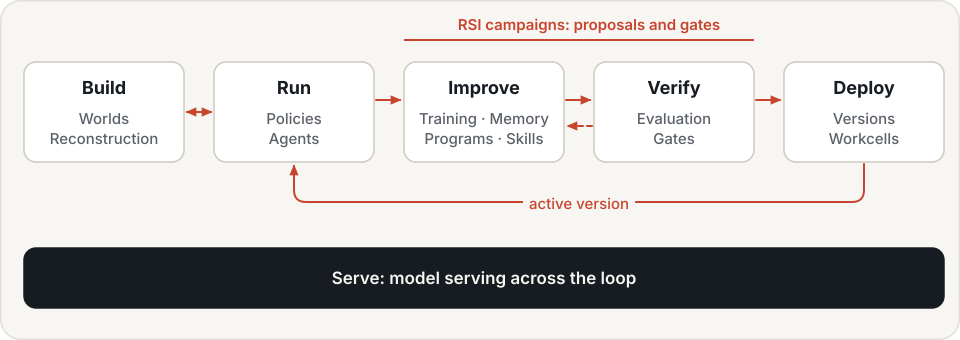
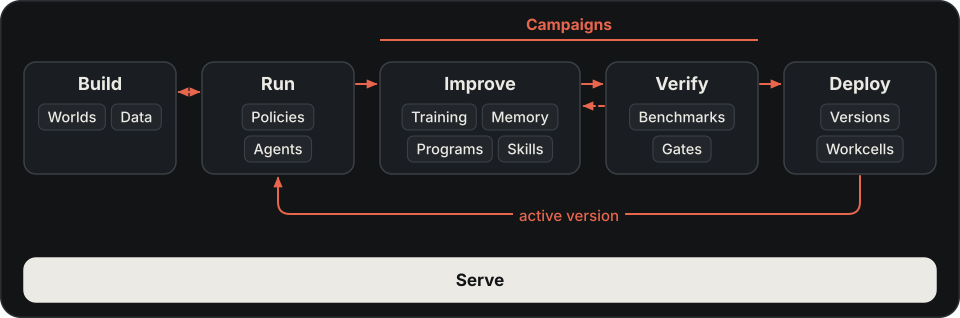

# Physical RSI

AI systems have started to improve themselves. Software agents rewrite their own code, tune their own prompts and
build their own skill libraries; recursive self-improvement (RSI) has become the next frontier of AI. That wave has
not yet reached the physical world. Hylo is built to bring it there: **an engine for Physical RSI, in which robots
drive their own improvement from their own physical experience.**

{ .hylo-diagram .only-light }
{ .hylo-diagram .only-dark }

## The bottleneck

Robots do get better. Policies are fine-tuned, fleets send data home and new versions ship over the air. But
people drive every turn of that loop:

- people collect the data and teleoperate the demonstrations;
- people read the failures and work out their causes;
- people retrain the model or rewrite the integration code;
- people evaluate the new version and decide whether to ship it.

**A robot improves only as fast as the team working on it.** And there is essentially one way to improve it: more
data and another training run. That route is heavy, slow and prone to fixing one task while breaking another. A
trick a robot discovered on site has nowhere to go except into the next dataset.

Surveys of self-evolving agents describe the same picture from the other side: the field has moved from static
models towards agents that keep improving after deployment, yet almost all of that work is on software agents, and
embodied systems are still largely trained offline and then frozen until the next release [1, 2, 3].

## Grounding

The recognised limit of RSI is grounding. A system that grades its own work drifts: it learns to satisfy its own
judge rather than the goal. How far self-improvement goes tracks how trustworthy its evaluation signal is, from
formal verifiers at the strong end to self-assessment at the weak end [4].

For RSI, the physical world is the best possible teacher. Whether the cup was lifted or the tower stands is
settled by physics, not by the model's opinion of its own work. Simulation makes that answer cheap enough to ask
for thousands of times. So robots are not the hardest place for RSI; **they may be the first place where it
genuinely works**, because they have the firmest ground truth. What has been missing is a system that lets the
loop turn by itself.

## The loop

Hylo turns "people improve the robot" into "the robot improves itself". The loop follows the way people learn a
craft:

| Stage | How people learn a craft | In Hylo |
|---|---|---|
| **Practise** | rehearse in a training ground | [Worlds](user-guide/worlds.md): scenes described in words, any of two dozen robots, people and disturbances |
| **Act** | do the work with tools | [Tool-calling agents](user-guide/tool-agents.md) and [program agents](user-guide/developing-strategies.md): a model acts through robot tools, one checked action at a time, or writes a program |
| **Remember** | remember what worked and what went wrong | [Memory](user-guide/memory/index.md): spatial memory, action memory, lessons |
| **Improve** | practise deliberately and refine the method | [Learning](user-guide/learning.md) and [campaigns](user-guide/campaigns.md): diagnose failures, propose changes, build learned components |
| **Verify** | pass the exam before taking the job | [Experiments](user-guide/experiments.md), [benchmarking](benchmarking/index.md) and the gate: tested on cases the change was not developed on, and reversible |
| **Share** | write the craft down so others can use it | [Skills](user-guide/skills.md): verified programs and recipes in a library any agent can retrieve |
| **Deploy** | do the job and bring back new experience | [Deployment](user-guide/deployment.md): the same episode loop on a workcell, behind the [safety shield](user-guide/safety.md) |

Every action goes through one kernel and one safety shield, and every step is recorded as a trace that can be
replayed and verified afterwards. [Studio](user-guide/studio.md) shows the loop as it turns.

## Recursion

The loop is recursive because what each turn produces becomes material for the next. Hylo's improvement works at
three levels:

| Level | What improves | What it means |
|---|---|---|
| **Behaviour** | how the robot does a task | the same task, done better each round |
| **Learning** | the skills and experience the robot draws on | verified skills become building blocks for the next task, so new tasks are learned faster |
| **Practice** | what the robot practises | failures are recorded with their reasons, and those reasons point to what to practise and which skill to reach for |

Stacked, the three levels compound. A robot that only reflects on its last task improves its behaviour; a robot
that improves its learning and its practice gets better at getting better.

## Levers

Retraining is one lever among many. A behaviour can change through runtime settings, recovery rules, prompts,
programs, skills, memory, learned components or the policy weights themselves. Hylo orders them by
[cost and risk](user-guide/campaigns.md) and holds every one to the same verification, so improvement happens at the
cheapest layer that works. A trick discovered on site becomes a skill today instead of waiting for the next
training run.

## What you bring

You bring a starting point and a goal:

- **a robot**, described to Hylo by its arms, hands, cameras and action layout;
- **a task**, and the check that decides whether it succeeded;
- **anything you already have**, optionally: a vision-language-action model or other policy, task programs,
  demonstrations, videos, logs from other robots. The more you bring, the higher the loop starts.

You take away a capability that keeps growing:

- a stronger version you can deploy and roll back;
- skills that any later task and agent can reuse;
- experience that makes the next round faster;
- the evidence for every step of the improvement.

What one round produces is the input to the next. The second time you come back, the skills and the experience
are already there.

## Control

The danger of self-improvement is self-deception: a system that grades itself and drifts. In Hylo the task's own
check decides success, never the model; every change is tested on cases it was not developed on; every run is
sealed and can be checked afterwards; and every promotion can be rolled back. The loop can be left to turn on its
own because every step is verifiable and reversible.

## Why now

Until recently each stage of the loop needed a person, because only people could read a failure, write the code
and build the scene. Language and vision models can now understand a task, plan, write programs and call tools,
and a simulator can build a world from a sentence. For the first time the loop can turn without a person at every
step: people set the goals and approve what ships.

## Direction

From one robot improving to all robots improving. Skills move between tasks and between robots; what one robot
learns, every robot can use. Robot capability stops being bounded by engineering hours and grows with compute and
experience.

Robots never had an internet to learn from. Physical RSI lets them grow one of their own.

## Further reading

1. Nguyen et al., [Self-Evolving AI for Humanoids: Mechanisms, Safety, and Evaluation of Post-Deployment
   Self-Improvement](https://arxiv.org/abs/2609.13236), 2026.
2. Gao et al., [A Survey of Self-Evolving Agents: What, When, How, and Where to Evolve on the Path to Artificial
   Super Intelligence](https://arxiv.org/abs/2507.21046), TMLR 2026.
3. Fang et al., [A Comprehensive Survey of Self-Evolving AI Agents: A New Paradigm Bridging Foundation Models and
   Lifelong Agentic Systems](https://arxiv.org/abs/2508.07407), 2025.
4. Chen et al., [Recursive Self-Improvement in AI: From Bounded Self-Refinement to Autonomous Research
   Loops](https://arxiv.org/abs/2607.07663), 2026.
5. Li, [Dynamic Agent Skills: A Lifecycle Survey and Taxonomy of Evolving Skill
   Libraries](https://arxiv.org/abs/2607.10113), TMLR 2026.
6. Wei et al., [A Survey of Agentic Reasoning for Large Language Models: Towards Recursively Self-Improving and
   Collective Agents](https://arxiv.org/abs/2601.12538), TMLR 2026.
7. [A Comprehensive Survey on World Models for Embodied AI](https://arxiv.org/abs/2510.16732), 2025.
