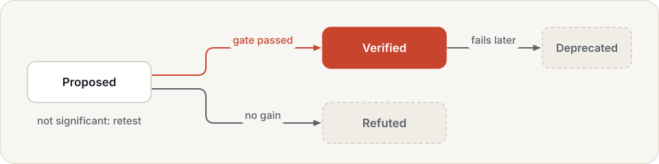
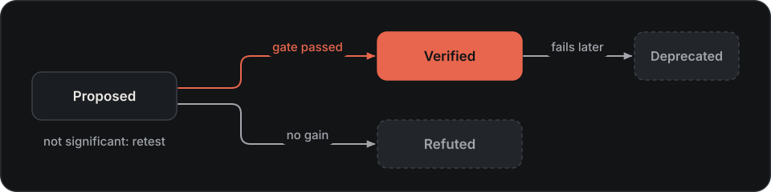

# Memory reference

Fields, queries and storage rules for memory backends and skill libraries.
For setup and examples, start with [Use memory](../user-guide/using-memory.md).

## Spatial memory

### Items

Every fact is a memory item:

| Field | Meaning |
|---|---|
| `kind` | `spatial`, `episodic`, `semantic`, `working` or `skill` |
| `content` | a short text description |
| `key` | the identity of the thing described, for example `<episode>:obj_0`; a newer item with the same kind and key replaces it |
| `pose` | a position (and optional orientation) in a named frame, such as `table` |
| `event_time` | when it was observed: a start, an optional end, and the clock (`sim` or `wall`) |
| `payload` | structured data, for example `{"rgb": [0.85, 0.1, 0.1]}` |
| `entities`, `scope` | the entities it is about; the task, robot or episode it belongs to |
| `confidence`, `source` | how sure the writer was; which component wrote it |

### Writes and invalidation

Time is kept twice: when the fact was true in the world, and when it was recorded. Writing an item has one of
three effects, reported back to the writer and in the `memory.write` trace event:

- `ADD`: a new fact.
- `INVALIDATE`: an earlier fact with the same kind, key, exact scope and clock stops being valid from the new item's time. It is not
  deleted: a query "as of" an earlier time still finds it.
- `SKIP_DUP`: the same typed evidence is already stored and valid. Scope, event time, pose orientation and provenance
  participate in its identity, so repeated-looking observations are not automatically duplicates.

`forget` marks matching items as expired (for example, a remembered location that turned out to be empty). Nothing
is ever removed from the file.
Forgetting applies all query filters, including scope, entity and exact spatial radius;
`k` limits retrieval, not how many matching records expire. Backdated keyed replacements
are rejected atomically. Append late evidence without a key instead of rewriting history.

### Queries

| Query field | Effect |
|---|---|
| `kinds`, `key` | restrict to these kinds or this identity |
| `text` | items whose content contains the text |
| `entities`, `scope` | any of these entities; all of these scope values |
| `near` | within a radius of a pose (same frame); closer items score higher |
| `time_range` | observed during this interval |
| `as_of` | what was valid at that time, including facts that were invalidated later |
| `clock` | restrict to `sim` or `wall`; select it when interpreting numeric time filters |
| `include_invalidated` | also return replaced facts |
| `k` | at most this many hits (default 10) |

Each hit has a score (confidence and, for spatial queries, closeness) and the time it stopped being valid, if it
did.

??? info "How it is stored"

    One table, `items`, with an index on kind and key, one on frame and position, and one on content hash. Each row
    keeps both time axes:

    | Columns | Holds |
    |---|---|
    | `t_start`, `t_end`, `t_clock` | when the fact was observed and its clock domain |
    | `valid_from`, `valid_to` | when it was true; `valid_to` is set when a newer item with the same key arrives |
    | `recorded_at`, `expired_at` | when it was written; when `forget` expired it |
    | `frame_id`, `px`, `py`, `pz`, `orientation` | frame and pose; position supports the prefilter and exact radius check |
    | `content_hash` | for duplicate detection |

    `snapshot()` uses the `hylo.sqlite/v2` digest over all rows, including expired records,
    complete intervals and provenance. It is not comparable to the earlier snapshot algorithm.
    Opening a legacy store adds clock/orientation columns and rehashes its records; unknown
    historical orientations cannot be recovered.

## Action memory

### Retrieval settings

| Setting | Default | Meaning |
|---|---|---|
| `k` | 10 | segments retrieved |
| `same_task` | true | retrieve only from the same task |
| `sim_floor` | 0.9 | minimum cosine similarity; calibrate it against the bank's build report |
| `temperature` | 0.05 | softmax temperature over similarity when weighting segments |
| `dtw_mad` | 2.0 | how far from the others a segment may be before it is dropped |
| `compare_steps` | the execution steps | prefix length compared between segments |
| `t0_min`, `t0_max` | 0.1, 0.7 | the range of start times; smaller is a stronger bias |
| `fixed_t0` | none | ignore confidence and always start here (for ablations) |
| `dispersion_scale` | 0.5 | disagreement at which confidence roughly halves |
| `gripper_dim` | −1 | the action dimension treated as the gripper |

[Configure action memory](../user-guide/memory/action.md).

## Lessons

### Operations

The book is never rewritten as a whole. A reflector model proposes operations, and the book applies them by fixed
rules:

| Operation | Effect |
|---|---|
| `ADD` | a new lesson; if an active lesson in the same scope has a near-identical title, it is upvoted instead |
| `UPVOTE`, `DOWNVOTE` | one more helpful or harmful count, with the episodes as evidence |
| `EDIT` | new content; the counts are kept |
| `RETIRE` | removed from retrieval, kept in the file |

A lesson whose harmful count reaches its helpful count plus two retires itself. Invalid operations are reported, not
applied. Every applied operation is appended to the log with its time and source.

??? example "What the reflector sends (the format)"

    ```json
    [{"op": "ADD", "scope": "global", "kind": "pitfall", "title": "Closing before the fingers surround the block",
      "content": "Failed episodes close the gripper above the block and lift nothing; successes descend until the block is between the fingers.",
      "evidence": ["<episode id>"]},
     {"op": "UPVOTE", "id": "L3f2a9c1d", "evidence": ["<episode id>"]}]
    ```

??? example "What the book logs (the format; ids are content hashes of scope and title)"

    ```json
    {"t": 1793560000.0, "source": "reflect:<run>", "op": "ADD", "id": "L5b07e2aa"}
    {"t": 1793560000.0, "source": "reflect:<run>", "op": "UPVOTE", "id": "L3f2a9c1d"}
    {"t": 1793563600.0, "source": "credit:cand-1c3f4ceacb", "op": "DOWNVOTE", "id": "L3f2a9c1d"}
    ```

A vote that retires a lesson carries `"retired": true`. The `source` keeps the book idempotent: a reflection or a
credit already in the log is not applied again when a campaign resumes.

### A lesson

| Field | Meaning |
|---|---|
| `kind` | `strategy` (what successful episodes did) or `pitfall` (a failure pattern to avoid) |
| `scope` | `global`, or `task:<id>` for one task |
| `title`, `content` | at most 12 words; at most 60 words |
| `helpful`, `harmful` | votes: from the reflector when new episodes confirm or contradict it, and from the outcomes of candidates that relied on it |
| `evidence` | the episodes it was drawn from or confirmed by (the last 20) |
| `status` | `active` or `retired` |

## Skill library

### Skill kinds

| Kind | Body | Applied by |
|---|---|---|
| `steering` | a partial steering configuration (samples, noise scale, execution steps, ...) | the `skills` agent, merged into the steered agent it wraps |
| `recovery` | trigger rules for the steered agent (what to do when progress stalls) | the `skills` agent, appended to the agent's rules |
| `plan` | subgoal templates with slots, such as `pick up the {a}` | the `skills` agent, through a subgoal planner |
| `weights` | a configuration patch that points to other weights | an improvement campaign, as a candidate configuration |
| `program` | a sealed `solve(robot)` program: path, digest and entry point | `code.llm`, as `skills.<name>(robot)` |
| `recipe` | the tool calls that solved a world task, by surface | role campaigns, offered when a goal fails for the same reasons |

Every skill also has a name, a version, a description (what a language model reads first), a trigger, a status,
usage verdicts and its evidence.

### Triggers

A trigger says when a skill applies. All parts that are set must fit.

| Part | Fits when |
|---|---|
| `instruction_pattern` | a regular expression matches the whole normalised instruction; named groups become slots, for example `put both the (?P<a>.+) and the (?P<b>.+) in the basket` |
| `task_tags` | the task has all of these tags |
| `env` | the environment has this name |
| `reason_codes` | a goal check failed with all of these reason codes (`NOT_LIFTED`, `DISTANCE_NOT_MET`, ...) |

Only verified skills match. When several fit, the most specific comes first (a pattern before tags before the
environment alone), then the one with more useful than misleading verdicts. Program skills have no pattern; they are
ranked by how close the instruction is to the skill's description and to the instructions it was developed on.

### Status

{ .hylo-diagram .only-light }
{ .hylo-diagram .only-dark }

New skills start as `proposed`. Only evidence moves them on, and no other transition is allowed:

| Evidence | Status |
|---|---|
| a campaign promoted the candidate (it passed the gate) | `verified`, with the gate's effect, p-value and pairs |
| the gate failed with no gain, or the candidate was rejected early | `refuted` |
| the gate failed with a gain that was not significant, or the candidate was archived | stays `proposed`, with its numbers attached (worth retesting with more episodes) |
| a promoted program fails revalidation later | `deprecated` |
| a recipe's model-free replay achieves the goal | `verified` |

Refuted skills stay in the library, so a proposer can see what was tried and failed. Separately, each use can be
marked `useful`, `misleading` or `not_applicable`; these verdicts accumulate per version and break ties.
