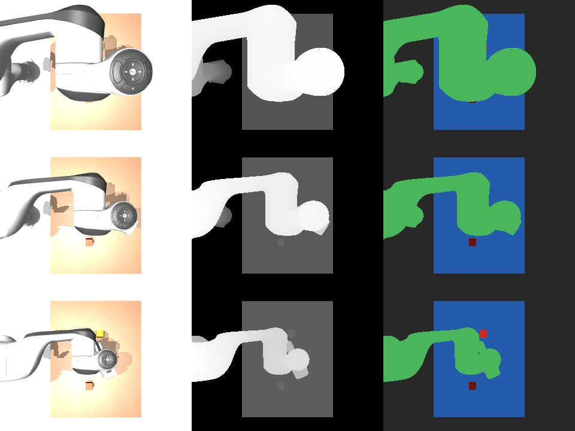

# Worlds & tools

Stage fields, robot packs, controls and goal checks. Start with [Create and run a world](../user-guide/worlds.md)
for a complete example. [Worlds](../user-guide/worlds/overview.md) explains the concepts.

| Look up | Section |
|---|---|
| Entity fields, revisions and storage | [Stages](#stages) |
| Supported robots and controls | [Robot packs](#robot-packs) |
| Actions, receipts and generation checks | [Actions](#running-a-world) |
| Goal predicates and failure reasons | [Goal checks](#checking-goals) |
| Images, depth, segmentation and export | [Cameras and data](#cameras-and-data) |
| Human entities and routes | [People](#people) |

## Stages

A stage is a list of entities, each with a pose and one kind of content:

| Content | Fields |
|---|---|
| `shape` | `box`, `sphere`, `cylinder`, `capsule` or `plane`, size (half extents for boxes), colour |
| `mesh` | an obj or stl file and a scale; collision geometry from `collision` |
| `body` | for shapes and meshes: `dynamic: true` makes it movable, mass or density, friction |
| `robot` | a pack name, base `fixed` or `free`, `mount` onto another entity's body, start joints |
| `camera` | field of view and image size; it looks along its own −z axis (`look_at` builds a pose) |
| `light`, `human` | a light; a walking person with a route, speed and height |

??? example "Two stored stage entities"

    ```json
    {"id": "panda", "parent": null, "pose": {"pos": [0.0, 0.0, 0.4], "quat": [1.0, 0.0, 0.0, 0.0]}, "locked": false,
     "robot": {"pack": "panda", "base": "fixed", "mount": null, "joints": {}}}
    {"id": "cube", "parent": null, "pose": {"pos": [0.5, -0.15, 0.42], "quat": [1.0, 0.0, 0.0, 0.0]}, "locked": false,
     "shape": {"type": "box", "size": [0.02, 0.02, 0.02], "rgba": [0.85, 0.15, 0.12, 1.0]},
     "body": {"dynamic": true, "mass": 0.05, "density": 500.0, "friction": 1.0}}
    ```

Every change is a patch against the revision you read (add, remove, update, reparent). A patch written against an
older revision is refused, so two editors cannot overwrite each other; a `locked` entity refuses changes. Every
revision is kept and any one can be restored.

??? info "Where a stage lives on disk"

    ```text
    runs/stages/lab/
      current.json        the newest revision (schema hylo.stage/v0.1)
      history/            every revision: rev-00000.json, rev-00001.json, ...
      log.jsonl           one line per revision: {"revision": 1, "digest": "027d6619eba572c8", "author": "model", "entities": 8, ...}
    ```

```bash
uv run hylo stage new lab                       # in runs/stages (or $HYLO_STAGES)
uv run hylo stage patch lab patch.json          # {"expected_revision": 0, "ops": [{"op": "add", "entity": {...}}]}
uv run hylo stage history lab
uv run hylo stage restore lab 3
```

A shape or mesh without `body: {dynamic: true}` is fixed in place. Free-base robots (quadrupeds, humanoids, drones)
take x, y and yaw from their pose and their height from the pack.


## Robot packs

| Family | Packs | Actions |
|---|---|---|
| Arms | `panda`, `ur5e`, `ur10e`, `iiwa14`, `xarm7`, `so101`, `vx300s`, `aloha` | joints, gripper, tool pose |
| Gripper and hands | `robotiq_2f85` (mount it on an arm), `leap`, `allegro`, `shadow` | gripper, joints |
| Quadrupeds | `go2`, `go1`, `a1`, `spot` | joints, walk |
| Humanoids | `g1`, `h1`, `t1`; `g1_legs`, `h1_legs` with walking policies | joints; policy |
| Drones | `crazyflie`, `x2` | fly |
| Mobile manipulator | `tidybot` | base, joints, gripper, tool pose |

Robot models come from MuJoCo Menagerie (and the two policy leg models from Unitree's training repository), fetched
at a pinned commit on first use and checked file by file against recorded digests; nothing is vendored. The `packs`
tool lists each pack's controls and status.


## Running a world

Build the newest revision with `world_build`; it reports the robots with their controls, the cameras, which
entities are fixed in place, and any parts that overlap at the start. Then act:

| Action | What it does | The receipt measures |
|---|---|---|
| `joints` | moves joints (or actuators) to targets over a duration | the largest joint error |
| `gripper` | open, close, or a fraction | opening, and `holding` when the fingers stop on something |
| `tcp` | moves an arm's tool point to a position (and orientation; by default it keeps the current one) | joint error at the end |
| `walk` | a quadruped trot, forward speed and turn in −1..1 | distance, turn, whether it stayed upright |
| `policy` | a pretrained walking policy with a velocity command | distance, speed, turn, upright |
| `fly` | a drone to a position and heading | distance from the target |
| `base` | a mobile base to x, y, yaw | joint error |
| `hold` | keeps still (drones hover) | — |

Every action names the world generation it was decided on; after a rebuild or reset an old action is refused as
stale. Actions for different robots in one call run in the same simulation steps. Time passes only during actions
and `advance`. `act` and `advance` can record a video.

Pretrained policies are read from their files as tensors and run with numpy; nothing in a weights file is executed.
Before running one, the world compares what the policy expects (robot, joints, drive, timestep) with the robot and
refuses on any difference. `policies` lists them and reports such differences.


## Checking goals

`check` evaluates a goal on the world without stepping it. Atoms: `in_box`, `near`, `apart`, `above`, `contact`,
`no_contact`, `joint_range`, `settled`, `upright`, `lifted`, `reachable`, `no_penetration`; combined with `all`,
`any` and `not`.

```json
{"op": "all", "terms": [{"op": "lifted", "entity": "cube", "min_z": 0.5},
                        {"op": "near", "a": "cube", "b": "arm", "max_m": 0.05}]}
```

A failed atom returns what was expected, what was measured and a reason code (`NOT_LIFTED`, `DISTANCE_NOT_MET`,
`CONTACT_MISSING`, ...). From a chat session, where the cube had not been lifted high enough:

```json
{"ok": true, "satisfied": false,
 "failures": [{"atom": {"op": "above", "a": "cube", "b": "table", "min_m": 0.09}, "reason": "NOT_ABOVE",
               "expected": "height difference >= 0.09", "measured": 0.075}],
 "reasons": ["NOT_ABOVE"], "step": 6950, "generation": 2}
```

The `reasons` list is the failure signature that recipe skills are keyed by. `gate` checks a goal before work starts: it refuses goals naming missing entities and flags
goals that already hold.


## Cameras and data

- `capture`: images from camera entities, all from the same step, with depth and segmentation by entity kept for
  `pixel_to_world` (a pixel as a world point and the entity it shows).
- `view`: a picture from any viewpoint, without a camera entity.
- `lidar`: a grid of rays over a camera's field of view or a horizontal ring; hits per entity.
- `camera_fit`: a camera's pose from six or more world points and the pixels they appear at.
- `export`: frames over time while actions run: `samples.jsonl` (step, camera pose and world state per frame),
  RGB png, depth npy in metres, segmentation png, and a calibration file.



*Three exported frames of a top camera while the Panda moves: RGB, depth (nearer is brighter) and segmentation by
entity.*

For meshes, `hylo tool physicalize MESH` writes collision geometry the stage can use: one box, the convex hull,
convex parts or voxel boxes, chosen from the mesh's shape, with its mass from volume and density.


## People

A `human` entity walks its route (looping or not, with a pause at each waypoint), plans around the footprints of
everything else, and stops for anything in front of it. The `people` tool sends a person somewhere, stops them or
lets them walk on.
