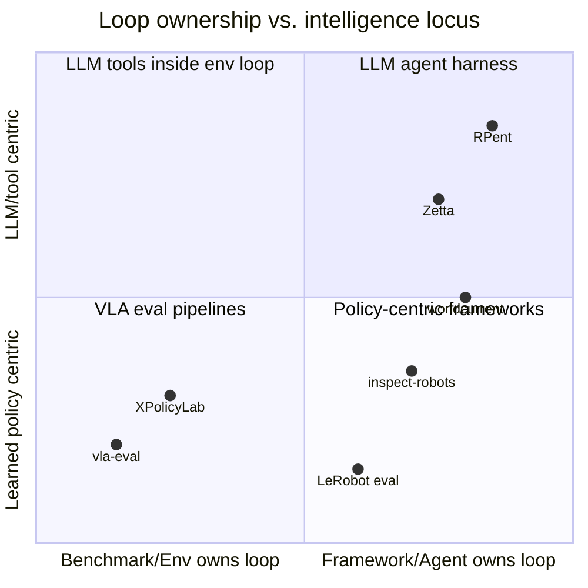

# Cross-Project Concept Map

> The same concept goes by different names in different projects. This table is a "translation table" for reading the source reports and design documents; the worldcurrent column is our naming.

| worldcurrent | vla-eval | inspect-robots | RPent / Zetta | XPolicyLab | LeRobot | openpi | ManiSkill | LIBERO | RoboCasa |
|---|---|---|---|---|---|---|---|---|---|
| `Environment` | `Benchmark` / `StepBenchmark` | `Embodiment` | env RPC facade / `EnvExecutionCore` | (RoboDojo, external) | gym env (`lerobot.envs`) | example `Environment` (openpi-client runtime) | `BaseEnv` | `OffScreenRenderEnv` | `Kitchen` + gym wrapper |
| `EnvSpec.capabilities` | `render_backends`, metadata | `EmbodimentInfo.capabilities` | `EnvFamilyCapability` | — | — | — | — | — | — |
| `TaskSpec` | `Task = Dict` | `Scene` (+ `Task`) | robot task prompt | — | `task` string | `prompt` | env id + `_initialize_episode` | BDDL file | `Kitchen` subclass |
| `TaskInstance.key` | (task, episode idx) | (scene id, epoch) | seed | — | — | — | (env_id, seed) | (task, init idx) | (task, seed) |
| `Benchmark` (suite + splits) | benchmark config YAML | `Task` + `eval_set` | campaign protocol (train/validation/heldout) | — | — | — | — | `Benchmark` subclass / task suite | `TASK_SET_REGISTRY` × split |
| `Agent` | ModelServer (passive) | `Policy` | `Planner` + Toolkit | `ModelTemplate` + `deploy.py` | `PreTrainedPolicy` | `BasePolicy` | — | lifelong algo | — |
| `ActionChunk` | `{"actions": (T,A)}` | `ActionChunk` | tool call | list[dict] | `[B,T,A]` + `ActionChunk` contract | `{"actions": [H,A]}` | — | — | — |
| `ChunkExecutor` | `PredictModelServer` chunk/ensemble | `Controller` | — | each deploy separately | `select_action` queue | `ActionChunkBroker` | — | — | — |
| `ActionSemantics` | `DimSpec.format` | `ActionSemantics` | `box_action_spec` | README convention | `FeatureSpec.semantics` | — | control mode | OSC_POSE | composite controller |
| `SafetyShield` | — | `Approver` chain | (`joint_limit_shield` not implemented) | — | `max_relative_target` (driver level) | — | — | — | — |
| `Reasoner` / `Decision` | — | agent plugin (hidden inside `act()`) | LLM SDK turn loop | `GPT_6_Astra` | — | — | — | — | — |
| `MemoryStore` | — | `learnings.md` | `MemoryManager` (files) / task parameter blocks | `Mem_0` policy | — | — | — | — | — |
| Trace | SQLite recording | JSON EvalLog + actions JSONL | `EnvState`/`StepRecord`; Zetta trajectory | — | LeRobotDataset | — | `RecordEpisode` | hdf5 demos | hdf5 / LeRobot |
| `Scorer` / `Grader` | `get_metric_keys` | `Scorer` / `Grader` | `toolkit.solved()`; Zetta gate | (RoboDojo) | eval script | — | `evaluate()` | `_check_success` | `_check_success` |
| `Candidate` | — | — | `CandidateBundle` (Zetta) | physicalRSI | — | — | — | — | — |
| `CandidateRegistry` | — | — | `CampaignStore` (Zetta) | — | — | — | — | — | — |
| `EnvServer` / remote | Docker benchmark container + WS | — | RPC subprocess | WS model server | Zenoh remote inference | WS policy server | — | — | — |

## Architectural paradigm classification

worldcurrent's position: the Kernel owns the loop (right side), with the intelligence axis centered — it can host either pure VLA or LLM + skills, depending on how the `Agent` is composed.
