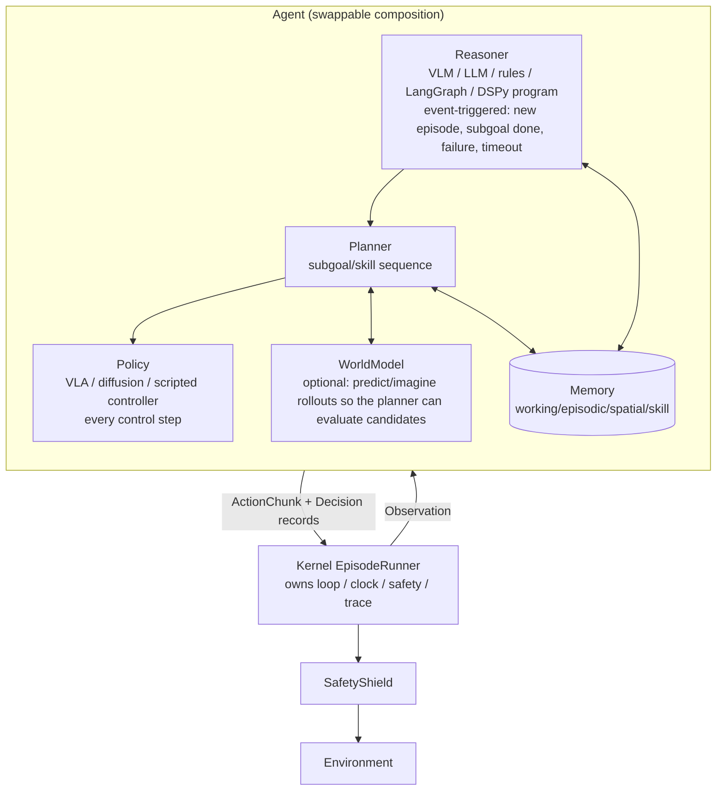

# Agent / Policy / Reasoning Comparison

> Question answered: how do we plug in our own Reasoning Model, Planner, VLM, World Model and VLA Policy?
> Sources: `research/projects/{lerobot,openpi,langgraph,dspy,rpent,inspect-robots,vla-evaluation-harness,xpolicylab}.md`.

## 1. Policy interface comparison (fast system, 5–50 Hz)

| | Interface | State | Chunk handling | Normalization | Remote serving |
|---|---|---|---|---|---|
| **LeRobot** | `select_action(batch)` (single step, internal queue/ensembling) + `predict_action_chunk(batch) → [B,T,A]` + `reset()` + `drop_queued_actions()` `pretrained.py:237-261,389-429` | Stateful (queue, processor anchor) | `ChunkPolicySpec`: prediction steps ≠ execution steps `policies/chunk.py:29-86` | processor pipeline, stats travel with the checkpoint | Zenoh + versioned msgpack envelope `remote_inference/protocol.py:23-189` |
| **openpi** | `Policy.infer(obs) → {"actions": [H,A], timing}` | **Stateless** (client `reset()` is a no-op) | Client-side `ActionChunkBroker` open-loop truncation (LIBERO `replan_steps=5`) | Normalize→model transforms; output Unnormalize→robot transforms `policy_config.py:75-94`; quantile by default | WS + msgpack-numpy, metadata in the first frame, no versioning/no authentication |
| **vla-eval** | `ModelServer.on_observation(obs, ctx)` push; `PredictModelServer.predict` | Has session/episode ctx | chunk_size + ensemble (**does not actually take effect**, `predict.py:293-296`) | Defined by each server | Own WS protocol |
| **inspect-robots** | `Policy.reset(scene)`, `act(obs) → ActionChunk(actions, control_hz, latency)` | Optional hooks | `Controller` middleware (including EnsemblingController) | None (policy's responsibility) | Same process (XPolicyLab adapter is remote) |
| **XPolicyLab** | `update_obs` → `get_action` → list[dict] chunk | Stateful | Defined by each policy's deploy.py | Defined by each policy | WS, RPC for any public method |

**Unified conclusions**:
- Adopt **chunks as first-class citizens**: `Policy.act(obs) → ActionChunk`, with a Kernel-side `ChunkExecutor` responsible for execution steps, replanning and ensembling (openpi/vla-eval/XPolicyLab all scatter this across client or env code). Policies that must be single-step use a `StepwisePolicyAdapter` that returns a chunk of length 1.
- `reset(episode_ctx)` must also reset the processor (LeRobot lesson `scripts/lerobot_eval.py:229-231`); add `invalidate()`: when the instruction changes mid-episode, discard the queue but keep memory.
- **ActionChunk carries provenance** (LeRobot `ActionProvenance`): the raw model output vs. the denormalized action vs. the action modified by SafetyShield — all three go into the Trace.
- Remote: the simple backend is **compatible with the openpi wire protocol**; the rich backend follows the LeRobot envelope (version/session/request_id). openpi must always run in a separate process (it pins `lerobot.common.datasets`, which has been removed from current LeRobot).

## 2. Reasoning / Planning interface comparison (slow system, 0.1–2 Hz)

| | Role | Loop ownership | Composability | Optimization mechanism | Dependencies |
|---|---|---|---|---|---|
| **LangGraph** | State-graph runtime + checkpointer + Store | Pregel superstep (pure Python, `pregel/main.py:3055-3079`) | Subgraphs, interrupt, time travel | None (execution only) | **Hard dependency on langchain-core** |
| **DSPy** | Declarative LM programs (Signature/Module) | Caller | Module composition | **GEPA/MIPROv2/BootstrapFinetune** optimize instructions/examples/weights; programs saved as JSON | openai SDK, diskcache, cloudpickle, gepa; litellm optional |
| **RPent** | `Planner.solve(system_prompt, user_message, toolkit, max_turns)` | LLM SDK (Claude Agent SDK / Codex / pydantic-ai) | Tool layer | prompt + file merging | Each SDK |
| **inspect-robots agent plugin** | The entire LLM inner loop is hidden inside `policy.act()` | Plugin | None | learnings.md injected back | Multi-vendor wire |

**Assessment**
- **LangGraph is not suitable as the control loop**: each superstep incurs task planning + callbacks + write merging + checkpoint serialization overhead; the default checkpoint fully copies state every step and the base `prune` is not implemented; `interrupt()` reruns the entire node on resume (physical actions would need to be idempotent). **Suitable for**: slow deliberative planners, human-in-the-loop interrupts, planner-level replay. → Optional `hylo-reasoner-langgraph` adapter package.
- **DSPy is suitable as an "optimizable Reasoner" and an RSI candidate generator**: the metric can directly be "run a set of simulation rollouts and return success + textual feedback" (GEPA supports textual feedback and multiple objectives, `gepa.py:34`, `gepa_utils.py:70-80`); however DSPy parallelizes with threads, so simulation must be wrapped in a process pool; GEPA is marked `@experimental`. → Install it only in the offline Improvement worker; the online runtime only reads the exported JSON prompt state.
- **RPent's tool layer is portable**: `@tool` single-source schema + validation, read/write-separated scheduling, cancel waits for a safe point, automatic env-state capture after non-read-only tools — exactly what "LLM invoking physical skills" needs. But its practice of "handing the planner to an external coding-agent SDK and giving it Bash/Write" is not acceptable.

## 3. Agent layering in Hylo

Interface principles:
1. **The Kernel only knows `Agent`**: `reset(ctx)`, `act(obs) → AgentStep(chunk, decisions)`, `on_step_result(result)`, `close()`. Reasoner/Planner/Policy/WorldModel/Memory are **internal components** of the Agent, assembled via the `ComposableAgent` reference implementation, not Kernel concepts. This guarantees we are "not bound to any particular LLM or VLA", and also lets an end-to-end VLA implement `Agent` directly.
2. **Dual frequency**: the Reasoner is event-triggered (`ReasoningTrigger`: episode start, chunk exhausted, subgoal judged complete, low Policy confidence, failure signal), while the Policy runs at every control step. The Reasoner may run asynchronously and the Kernel does not block waiting on it (required on real robots); the MVP implements the synchronous version first.
3. **Observable decisions**: the Reasoner produces `Decision(kind, inputs_ref, output, rationale, model_id, latency)`, Memory retrieval produces `RetrievalRecord`, and both are written into the Trace by the Agent via `ctx.emit()`; the Kernel does not need to understand their content.
4. **WorldModel is a tool of the Planner**, not an Environment: `WorldModel.predict(state_or_obs, action_seq) → predicted_obs/latent + uncertainty`. It can be wrapped as an `Environment` for "imagined rollout" evaluation (the same Kernel can run episodes inside the world model), which is a differentiator between us and existing projects.
5. **Skills as tools** (ported from RPent): a Policy can also be a tool of the Planner (`run_vla(instruction, max_steps)`), thereby supporting both the "end-to-end VLA" and "LLM orchestrates skills" paradigms.

## 4. Summary of integration recommendations

| Component | Approach | Package |
|---|---|---|
| LeRobot policies | Adapter (in-process or remote), `spec()` generated from `chunk_inference_spec()` | `hylo-policy-lerobot` (optional) |
| openpi | Remote (openpi WS protocol) | Built-in `OpenPIRemotePolicy` in `hylo-core` (depends only on msgpack + websockets) |
| vla-eval's 17 model servers | Remote (vla-eval protocol) | `hylo-bridge-vlaeval` |
| LangGraph | Reasoner adapter + optional checkpointer/Store backend | `hylo-reasoner-langgraph` (optional) |
| DSPy | Offline CandidateGenerator; online reads JSON only | `hylo-evolve-dspy` (optional) |
| Any LLM/VLM | `Reasoner` implementation, via vendor SDK or an OpenAI-compatible endpoint | `hylo-reasoner-llm` (optional) |
