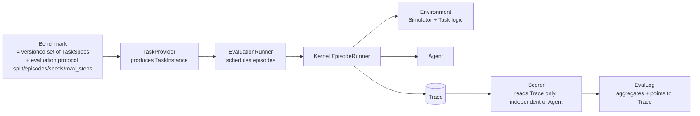

# Benchmark / Task / Evaluator Comparison

> Question answered: how should Benchmark, Simulator, Task and Evaluator be separated?
> Sources: `research/projects/{libero,robocasa,maniskill,vla-evaluation-harness,inspect-robots,zetta-embodiment}.md`.

## 1. How each project expresses "task" and "scoring"

| Project | Task representation | Initial state | Instruction | Success judgment | Evaluation protocol (episode count, steps, aggregation) |
|---|---|---|---|---|---|
| LIBERO | **Declarative** `.bddl` files (130, across 5 suites) `bddl_utils.py:87-172` | Fixed init-state files, 50×79 MuJoCo states `benchmark/__init__.py:158-165` | Static (BDDL `:language`) | Conjunction of BDDL predicates (In/On/Open/Close/TurnOn/TurnOff)| 50 runs per task, suite-dependent max_steps, 5-step warmup; external script |
| RoboCasa | **Imperative** `Kitchen` subclasses, auto-registered via metaclass `kitchen.py:47-77` | seed or `{ep_meta, xml, states}` snapshot | **Dynamically generated per episode** (`get_ep_meta()["lang"]`) | `_check_success()` (Python)| **No** eval script in the repo (described in docs) |
| ManiSkill | `BaseEnv` subclass + `register_env` | `_initialize_episode` (seed; some use the global torch RNG) | Mostly none | `evaluate()` → success/fail | `success_once`/`success_at_end`/`ignore_terminations` semantics `vector/wrappers/gymnasium.py:127-185` |
| vla-eval | `Task = Dict` (name, suite, arbitrary objects) | Defined by the benchmark | `task_description` | `EpisodeResult["success"]` | `get_metric_keys()` aggregation (mean), SQLite sharding |
| inspect-robots | `Task(scenes, scorer, max_steps\|max_seconds, epochs)`; `Scene(id, instruction, target, init_seed, setup)` | `init_seed` + `derive_seed` | Static (Scene) | **Scorer reads TrialRecord** (read-only) + Grader captures judgments + abstention | epochs + reducer (inspect semantics) |
| Zetta | Rollout seeds within a campaign (train/validation/heldout split) | seed | From env | env + critic | Paired on the same seed, one-sided McNemar test, infra_invalid not scored |

## 2. Two poles and unification

LIBERO (**declarative files + fixed init**) and RoboCasa (**code classes + seed/snapshot + dynamic instructions**) form two poles. A unified `TaskSpec` must accommodate both:

- `init`: `InitStateRef(file, index)` | `SeedInit(seed)` | `SnapshotInit(blob_uri)`
- `success`: `Predicate(kind="bddl"|"expr", expr)` | `Predicate(kind="callable", ref="pkg.mod:Class.method")`
- `instruction`: a static string **or** a template; the actual instruction is produced by `Environment.reset()` and written into Observation/Trace.

## 3. Recommended four-layer separation

| Layer | What it owns | What it does not own |
|---|---|---|
| **Benchmark** | Task list (with version/hash), split (train/validation/heldout), episodes per task, seed table, max_steps, metric definitions, required capabilities (e.g. `privileged_success`) | Physics, Agent |
| **Task** (TaskSpec / TaskInstance) | init distribution, instruction, success/fail predicates, optional reward | Score aggregation |
| **Simulator / Environment** | Physics and rendering; executes the Task's init and predicates | Scoring, Agent internal state |
| **Evaluator** (Scorer + Reducer + Grader) | Reads evidence from Trace to compute Score; aggregates across epochs/seeds; statistical tests | Does not call the Agent; does not modify the Trace |

**Key principles**

1. **The Scorer only reads the Trace** (inspect-robots' Scorer/Grader separation + our replayable Trace), so we can swap Scorers, add scoring after the fact, and do shadow replay without rerunning the simulation.
2. **Privileged success signals are invisible to the Agent**. Zetta exposes privileged simulation evidence to the critic by default (`robots/libero/evolution_defaults.py:10`), making its results non-transferable to real robots; in EnvSpec we make `privileged_state` a capability accessible only to Task/Scorer, and annotate in the EvalLog "whether this run used privileged information".
3. **Infra failures do not count toward scores** (Zetta `infra_invalid`, inspect-robots "errored trials are never scored"). Score allows `None` (abstention).
4. **A Benchmark is a versioned artifact**: `benchmark_id@version` + content hash (TaskSpec list + seed table + protocol parameters). For external benchmarks (LIBERO/RoboCasa), record the upstream commit and asset hashes.
5. **Split is a first-class concept**: `train` (for RSI diagnosis), `validation` (participates in candidate selection), `heldout` (reported only, not used for selection). This is a correction to Zetta's design (see `rsi-comparison.md`).

## 4. Metric semantics (unified)

| Metric | Definition | Source |
|---|---|---|
| `success_at_end` | success at the end of the episode | ManiSkill |
| `success_once` | success at any moment | ManiSkill |
| `success_rate` | `mean(success)`, excluding `infra_invalid` | LIBERO / vla-eval |
| `paired_delta` + `mcnemar_p` | Paired comparison of two agent versions on the same seeds | Zetta `gating.py:12-23` |
| `safety_events` | Number of actions modified/rejected by SafetyShield | inspect-robots approvals |
| `steps_to_success`, `latency_p50/p95` | Efficiency and real-time performance | — |

## 5. External Benchmark integration priority

1. **vla-eval bridge (P1)**: the cheapest way to get LIBERO, SimplerEnv, CALVIN, etc., for baseline alignment and VLA regression.
2. **Direct LIBERO adaptation (P1/P2)**: build it only when step-level control or RSI scenarios (perturbation, recovery) are needed; BDDL is the first "declarative TaskSpec" exemplar.
3. **RoboCasa (P2)**: represents "dynamic task generation", validating the other pole of TaskSpec.
4. **ManiSkill (P2)**: validates batched Environment and GPU parallelism.
5. **inspect-robots as a runner backend (optional)**: when real-robot or Isaac evaluation is needed, write a thin `Hylo.Agent → inspect_robots.Policy` adapter.
