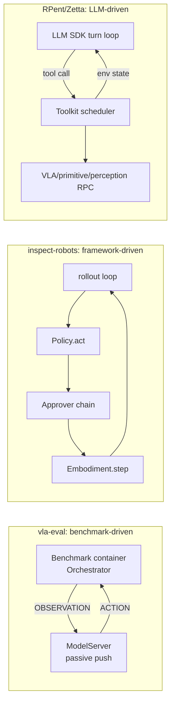

# Harness Architecture Comparison

> Scope: vla-evaluation-harness (AI2), inspect-robots (robocurve), RPent (RLinf), XPolicyLab, Zetta-Embodiment, plus agent-lightning as a "training-side harness" reference point.
> Basis: the source-level reports in `research/projects/*.md`; all line numbers refer to the commits recorded in the MANIFEST under `references/`.
> Tags: \[Implemented\] traceable code exists; \[Docs/Interface only\]; \[Unverified\] code exists but we have not run it; \[Needs model/hardware\].

## 1. One-line positioning

| Project | Essence | Who owns the control loop | Strongest part | Weakest part |
|---|---|---|---|---|
| vla-evaluation-harness | **Batch VLA evaluation pipeline**: benchmark container × model server | **Benchmark side** (in-container Orchestrator → `conn.act`) `src/vla_eval/runners/sync_runner.py:55-64` | Dockerized 20 benchmarks, msgpack protocol, SQLite dynamic sharding/resume, cross-shard GPU batching | `Dict[str, Any]` contract, spec validation only warns, no reasoning/memory hooks, action ensemble does not actually take effect |
| inspect-robots | **Robot evaluation framework with inspect_ai semantics** (self-written, zero dependencies, does not import inspect_ai) | **Framework** (`rollout.py:327-531` synchronous loop) | Typed Observation/Action/ActionSemantics, Approver safety chain, error classification, Grader/Scorer separation, entry-point registry | Logs cannot replay a trial; no process isolation; no timeouts/retry (stub) |
| RPent | **LLM coding agent invoking physical tools** (VLA, motion primitives, perception models are all tools) | **LLM SDK** owns the turn loop; RPent owns tool execution `planner/base.py:128-164` | `@tool` single-source schema + validation, read/write-separated scheduler, one process per model RPC | Planner has full Bash/Write permissions; socket RPC uses pickle; evaluation reads the seed-0 successful trajectory of the same task (not zero-shot) |
| XPolicyLab | **Policy-side adaptation layer + collection of 76 VLAs**; sim/scoring live in external RoboDojo | **Each policy's `deploy.py`** (in the env process) | WebSocket transport: replay deduplication, server-restart detection, timeout is fatal | No registry (directory name is the policy), single lock single model, 47/76 deploys deviate from the template, many subdirectories with no license/NC |
| Zetta-Embodiment | **RPent derivative + offline RSI state machine** (evolves a Critic+Recovery bundle, VLA frozen) | **Python actor** owns each episode `robots/libero/run_evolution_rollout.py:761-797` | Declarative critic DSL, shadow replay, paired McNemar gate, resumable campaign state machine, AST layering guard | Privileged simulation evidence by default; no independent validation split before promotion; no rollback; Codex defaults to full-access |
| agent-lightning (v1.0.2) | **LLM agent RL training harness** (reverse-proxy collection → verl GRPO) | The agent itself; the framework only proxies LLM calls | Minimal agent contract (HTTP + reward events), rollout state machine, K8s/Local reconciler | Only applies to vLLM-served LLMs; no persistent trace; no versioning/promotion/rollback |

## 2. Item-by-item comparison across six dimensions

### 2.1 Agent Loop and Execution Lifecycle

| Dimension | vla-eval | inspect-robots | RPent | Zetta | XPolicyLab |
|---|---|---|---|---|---|
| Lifecycle hooks | EPISODE_START/OBS/END messages + `on_episode_start/end` | `reset(scene)`, `on_trial_start/end`, `bind`/`bind_task` (duck-typed, optional) | Single `Planner.solve()` call | Campaign phase state machine + episode actor | `update_obs`/`get_action`/`reset` |
| Termination | `is_done()` + max_steps | terminated/truncated + max_steps/max_seconds | `finish` tool only stops the planner; success judged by env | env + critic | Defined by deploy.py |
| Timeout | watchdog `os._exit(124)` \[Implemented\] | **None** (`self_paced` is the embodiment's responsibility) | SDK-level max_turns | Gate-level budget | Timeout is fatal |
| Error handling | `EpisodeError.phase` classification (env_start/env_step/model_act) \[Implemented\] | `PolicyError`/`EmbodimentFault`/`SafetyAbort` + `exc.record` preserves partial records \[Implemented\] | Errors returned to the LLM as data | infra_invalid not scored \[Implemented\] | Not unified |
| Retry | Queue-level rerun | `retry_attempts` is a stub \[Docs/Interface only\] | No retry | Gate rerun | Deduplicated replay |

**Conclusion**: Each of the three loop ownership models has its own domain of applicability: batch VLA evaluation suits benchmark-driven (performance, isolation); safety and observability require framework-driven (every action passes through the same checkpoint); long-horizon tasks require LLM-driven (skills as tools). **In Hylo the Kernel should own the loop**, while also offering a "Served mode" (see §4), and treat the LLM-turn loop as one Reasoner implementation inside the Agent rather than as the harness itself.

### 2.2 Simulator / Benchmark plugin architecture

| | Mechanism | Discovery | Isolation |
|---|---|---|---|
| vla-eval | YAML `module:Class` string + lazy import | No entry points | One Docker image per benchmark, `--network host` |
| inspect-robots | `importlib.metadata` entry points + autoload that can be turned off `registry.py:47-146` | Package-level plugins (`plugins/inspect-robots-*`) | None (same process) |
| RPent | `robots/<name>/` directory + CLI flag | Directory convention | One RPC subprocess per env/model, exits when the parent process dies |
| XPolicyLab | `policy/<Name>/` directory | Directory name | One conda/uv env + server process per policy |
| Zetta | `EnvFamilyCapability` + `EXTENSION_CALL` allowlist | Registration in code | Inherited from RPent |

**Conclusion**: Take both entry points (inspect-robots) and `module:Class` references (vla-eval); process isolation must be a first-class citizen, because dependency conflicts are the norm (LIBERO py3.8/robosuite1.4 vs RoboCasa py3.11/robosuite≥1.5.2, see `benchmark-comparison.md`).

### 2.3 Observation / Action / Policy contract

| | Observation | Action | Semantic description | Validation strength |
|---|---|---|---|---|
| vla-eval | `Dict[str, Any]` (keys not unified: LIBERO uses `states`) | `{"actions": (A,) or (T,A)}` | `DimSpec.format` vocabulary (`delta_xyz`, `axis_angle`, `binary_close_positive`...) `specs.py:143-191` | Warning only |
| inspect-robots | frozen dataclass: `images/state/instruction/*_times/extra` `types.py:25-46` | `Action(data, meta)`, `ActionChunk(actions, control_hz, latency)` | `ActionSemantics(control_mode, rotation_repr, gripper, frame, dim_labels, max_step)` `spaces.py:24-84` | error/warning levels at bind time |
| RPent | env state dict + tool results | tool parameters (pydantic validation) | `box_action_spec` generates tools from the action space | Strict (pydantic) |
| XPolicyLab | Multi-camera dict | chunk = list[dict] | README convention | None (and has a key-inconsistency bug) |
| LeRobot (reference) | `observation.images.*`/`observation.state` | `[B, chunk, A]` | `FeatureSpec(semantics)`, `ChunkPolicySpec`, `ActionProvenance` | Typed |

**Conclusion**: Adopt the inspect-robots dataclass structure + ActionSemantics field names + the vla-eval format vocabulary + LeRobot's `ChunkPolicySpec` (separating predicted steps from executed steps), and upgrade validation to **mandatory at bind time**.

### 2.4 Model Serving and process isolation

| | Protocol | Versioning | Security | Batching |
|---|---|---|---|---|
| vla-eval | WS + msgpack, 6 message types, numpy dtype allowlist | `PROTOCOL_VERSION` exchanged but not checked | Rejects object dtype | Cross-shard GPU batching \[Implemented\] |
| openpi (reference) | WS + msgpack-numpy, no message types, request = obs dict | None | No authentication (Api-Key not validated) | None |
| XPolicyLab | WS, RPC for any public method, result replay deduplication | Server-restart detection | Single global lock | None |
| RPent | HTTP / socket(pickle) RPC | meta validation | **pickle = RCE risk** | None |
| LeRobot (reference) | Zenoh + msgpack envelope `{version, message_type, session_id, request_id, ...}` | Yes | — | — |

**Conclusion**: The simple remote backend is compatible with the **openpi wire protocol** (widest ecosystem); the benchmark side is compatible with the **vla-eval protocol**; the internal rich protocol uses a LeRobot-style envelope with `version/request_id/session_id`. **pickle is forbidden**.

### 2.5 Experiment Orchestration

- vla-eval: SQLite work queue (dynamic sharding, checkpoint resume, step-level json_patch) `recording.py:228-266` — multi-process/multi-container without needing Ray, **the most worth borrowing**.
- inspect-robots: `eval_set` semantics + `derive_seed` deterministic derivation; resume is a stub.
- RPent/XPolicyLab: CLI flags + env vars, no sweep, weak reproducibility.
- Zetta: campaign state machine + append-only ledger, resumable and auditable.

### 2.6 Logging / Tracing / Evaluation

| | Persistence | Replayable | Scoring model |
|---|---|---|---|
| vla-eval | SQLite recording + video | Partial (step fields) | `get_metric_keys` aggregation |
| inspect-robots | JSON EvalLog + actions JSONL + optional npy/Rerun | **No** (no state/reward/info) | inspect-style Score/epochs/reducer/abstention; Grader separated from Scorer |
| RPent | Atomic per-step artifact writes | Yes (EnvState) | env `solved()` |
| Zetta | Immutable trajectory + ledger | Yes (shadow replay depends on it) | Paired McNemar gate |
| agent-lightning | In-memory dict, deleted after read | No | Final-step reward |

**Conclusion**: **Layer Trace (event-sourced episode store) separately from EvalLog (aggregates + pointers)**; Trace must be replayable (a prerequisite for shadow replay and RSI).

## 3. List of directly reusable components

| Component | Source | Approach | License |
|---|---|---|---|
| WS+msgpack protocol & numpy/image codec | vla-eval `protocol/` | **Protocol-compatible** (own implementation) | Apache-2.0 |
| benchmark Docker images + 17 model servers | vla-eval | **Run as external dependency**, do not copy | Apache-2.0 (image contents vary) |
| SQLite work queue pattern | vla-eval `recording.py` | Borrow design and rewrite | Apache-2.0 |
| ActionSemantics / compat rules / Approver chain | inspect-robots `spaces.py`, `compat.py`, `approver.py` | **Port** (zero dependencies, ~600 lines), retain the MIT notice | MIT |
| Error classification + partial-record preservation | inspect-robots `errors.py` | Copy the semantics as is | MIT |
| entry-point registry | inspect-robots `registry.py` | Borrow design (~160 lines) | MIT |
| `@tool` + Toolkit read/write scheduler | RPent `tools/base.py`, `tools/toolkit.py` | **Port** (Reasoner tool layer) | Apache-2.0 |
| One process per model RPC (HTTP version) | RPent `utils/rpc/` | Borrow design, drop pickle | Apache-2.0 |
| WS replay deduplication + restart detection | XPolicyLab `client_server/ws/` | Borrow design | Apache-2.0 (framework layer only) |
| Critic DSL / shadow replay / McNemar gate / campaign state machine | Zetta `zetta/evolution/` | Borrow schema, rewrite implementation | Apache-2.0 (must retain RPent/RLinf attribution) |
| rollout state machine + idempotent enqueue | agent-lightning | Borrow pattern | MIT |

## 4. Key judgment: loop ownership in Hylo

**Decision: the Kernel owns the loop (Driven mode), while also supporting Served mode.**

- **Driven mode (default)**: `EpisodeRunner` calls `env.reset → agent.act → SafetyShield → env.step`. The environment can be in-process (MuJoCo, or the test double in unit tests) or a remote `EnvServer` (LIBERO, RoboCasa each in their own venv). Every action passes through the same safety checkpoint and the same trace write point.
- **Served mode (compatibility)**: Wrap the Hylo `Agent` as a **vla-eval ModelServer**, with vla-eval's benchmark containers driving the loop. The cost is losing step-level env control (cannot inject perturbations, cannot read privileged state), but we **get its 20 benchmarks at zero cost**. Trace is still recorded at the agent boundary, and SafetyShield still runs at the agent output.

This design means we do not have to choose between "reusing the ecosystem" and "owning control". See `design/execution-lifecycle.md` for details.

## 5. Things we do not recommend

- Do not use inspect_ai or LangGraph as the loop engine (the former is built around LLM messages, the latter's superstep overhead is unsuitable for 5–50 Hz, see `agent-policy-comparison.md`).
- Do not vendor any code under XPolicyLab `policy/` (a mix of NC/MPL/no license).
- Do not copy RPent/Zetta's practice of "giving the LLM planner full Bash/Write permissions".
- Do not treat the LIBERO success rates published by RPent/Zetta as zero-shot or transferable evidence (the former reads seed-0 successful trajectories, the latter uses privileged simulation state by default).
