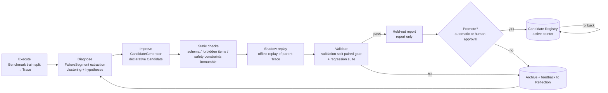

# RSI / Self-Improvement Comparison

> Question answered: how do we complete the Execute → Diagnose → Improve → Validate → Promote closed loop inside the Harness?
> Sources: `research/projects/{zetta-embodiment,agent-lightning,dspy,rpent,inspect-robots,xpolicylab,memory-landscape}.md`.

## 1. Capability matrix (source code is authoritative)

| RSI stage | Zetta-Embodiment | agent-lightning v1.0.2 | DSPy | RPent | inspect-robots | ASPIRE (skills) |
|---|---|---|---|---|---|---|
| Failure Diagnosis | **\[Implemented\][Needs model]** deterministic signals→FailureSegment→clustering→LLM multimodal review→`CausalDiagnosis` (≥2 competing hypotheses, falsifier) `trajectory.py:247-473` | None | None (metric returns textual feedback) | Prompt-driven | None | Verifier reproduction |
| Reflection | **\[Implemented\]** paired results of rejected gates injected into the next round; "two rounds with zero rescues force a change of hypothesis" | None | GEPA reads traces to reflect | Prompt-driven notes | summarize→learnings.md→`prior_learnings` | Usage ratings |
| Candidate Generation | **\[Implemented\]** `CandidateBundle` JSON (Critic DSL + RecoveryRule), **code plugins disabled** `stages.py:2065-2069` | GRPO updates LLM weights (needs vLLM)| **\[Implemented\]** instructions/examples (GEPA, MIPROv2), weights (BootstrapFinetune)| None | None | Skill code proposals |
| Recovery Skills | Parameterization of 19 **human-written** LIBERO primitives; no new skills learned | None | None | None | None | — |
| Shadow Evaluation | **\[Implemented\]** offline replay of the new critic on the parent's immutable trajectories, computing recall/FP `shadow_replay.py:38-187` | None | None | None | None | — |
| Regression Testing | **\[Implemented\]** all-seed pairing, requires ≥ parent and no increase in safety events; **skipped by default for LIBERO** | Periodic aggregate validation | `Evaluate` | None | None | Rerun |
| Held-out Benchmark | **\[Implemented\]** pre-registered seeds, paired McNemar α=0.025; `test` mode only reports (intentional design) | None | devset | None | None | — |
| Promotion / Rollback | Promotion **\[Implemented\]** (digest, parent==current, gate passed, ledger); **no Rollback** | No versioning (`Model.version` always 0) | Program JSON can be archived (manually) | Confidence promotion | sha256 record of injected files | Content-hash versions |
| Safety gate for self-generated content | DSL, in-catalog tools, validator; **no physical shield**; Codex defaults to full-access | — | cloudpickle loading = RCE | Full Bash/Write permissions | CaP-X `exec` not sandboxed | AST validation + sandbox (partly a prompt protocol) |

Also: XPolicyLab's `physicalRSI` has a complete recursive self-improvement design, but **has no license file**, so it can only be read, not borrowed as code.

## 2. Key lessons

1. **The unit of improvement determines the safety ceiling**. Zetta restricts candidates to **declarative bundles** (critic rules + parameterization of frozen tools) and does not execute generated code — currently the only design that delivers "safe self-improvement" at the source-code level. Hylo uses **declarative candidates** by default; code-type candidates must execute in an isolated runtime (Zetta itself states "disabled until an isolated executable runtime is available").
2. **Statistical gating is a reusable hard asset**: paired same-seed comparison + one-sided exact McNemar (`gating.py:12-23`, a dozen or so lines) + separate accounting for infra failures.
3. **Validation and held-out must be separate**: in `test` mode Zetta's held-out only reports (avoiding contamination, reasonable), but before promotion it lacks a **validation split independent of the training failure seeds**, leaving only the gate "pass_rate≥0.5 on training failure seeds", which risks overfitting. We require a three-way split: train (for diagnosis) / validation (for selection) / heldout (reported only).
4. **Rollback must be a first-class operation**: all projects only move forward. We implement it with "registry pointer + immutable versions": promote = move the `active` pointer; rollback = point back to the parent version; both write to the ledger.
5. **A replayable Trace is a prerequisite for shadow evaluation**: agent-lightning deletes after read and inspect-robots logs have no state, so neither can do offline replay.
6. **Privileged information must be isolated and labeled**: Zetta defaults to privileged simulation evidence, making its improvements non-transferable. Candidates may read privileged diagnostic information during generation, but **the validation stage must run under deployment-equivalent observation conditions**.
7. **LLM-driven stages need idempotency and evidence traceability**: Zetta's attempt directories + input sha + validator re-verification reuse are worth copying as is.

## 3. The RSI closed loop in Hylo

| Stage | MVP (v0.1) | Later |
|---|---|---|
| Candidate types | `ConfigPatch` (Agent component parameters, e.g. control gains, chunk execution steps, Reasoner prompt text) | Critic/Recovery rules (Zetta-style), Skill (ASPIRE-style), Memory entries, Policy checkpoint references (weight training done externally)|
| Generator | Rule/grid perturbation; human-provided | LLM (structured output), DSPy GEPA, external training jobs |
| Diagnose | Rules: bucket by Scorer failure reason and step-level signals | Clustering + LLM multi-hypothesis diagnosis |
| Shadow | Offline replay for replayable candidates (Critic type) | Same |
| Validate | Paired same-seed + McNemar + no increase in safety events + regression suite | Multiple benchmarks, multiple embodiments |
| Promote | Local registry (JSON + content hash + parent), **human confirmation switch** | Remote registry, canary rollout (real-robot shadow mode: candidates only "propose", do not execute)|

## 4. Non-bypassable constraints (Evolution layer boundary)

- Candidates **cannot modify**: SafetyShield configuration, Scorer, Benchmark/split definitions, the Evolution layer's own code. These are declared by `ProtectedScope` and rejected by static checks.
- Candidates can only take effect through the Registry; the online Agent reads only the `active` version and records the version into the run manifest at startup.
- Real robots: promotion requires human approval (`require_human_approval=True` cannot be turned off by a candidate).

See `design/interfaces/improvement.md` for details.
