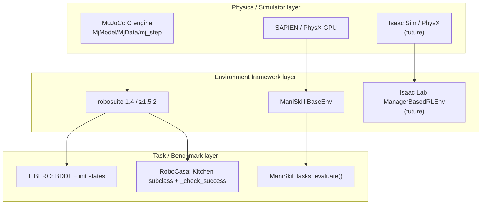

# Simulator Comparison and Unified Environment Interface

> Scope: MuJoCo (physics engine), ManiSkill (SAPIEN, GPU-parallel), LIBERO and RoboCasa (both built on robosuite + MuJoCo), with a slot reserved for Isaac Lab.
> Source reports: `research/projects/{mujoco,maniskill,libero,robocasa}.md`.

## 1. Layered facts: which layer does each project sit in?



| Project | Layer | Env API | Task/success | Seed | Parallelism | Rendering dependency |
|---|---|---|---|---|---|---|
| **MuJoCo** | Pure Simulator (no Env/Task/reward/RNG) | `mj_step(m,d,nstep)` (releases the GIL `python/mujoco/functions.cc:163-176`), `mj_resetDataKeyframe`, `mj_get/setState` | None | None (engine is deterministic; noise must be implemented yourself) | `mujoco.batch.Batch` (CPU multithreaded, `batch.py:116-373`) \[Unverified\]; MJX (JAX/GPU) \[Needs model/hardware\] | `MUJOCO_GL=egl/osmesa/glfw` fixed at import time `gl_context.py:24-56`; one `Renderer` per thread |
| **ManiSkill** | Env+Task+Evaluator combined (`BaseEnv`) | gymnasium `reset(seed, options)`/`step` → 5-tuple | `evaluate()` returns success/fail, drives reward and `terminated=success\|fail` `sapien_env.py:1058-1069,1143-1165` | `seed`, but some tasks use global `torch.rand` (`pick_cube.py:112-129`) | GPU batch (`num_envs`) \[Needs model/hardware\] | Vulkan; blocks on `input()` when assets are missing `registration.py:70-78` |
| **LIBERO** | Task/Benchmark (built on robosuite 1.4) | `OffScreenRenderEnv.reset/step` → 4-tuple (old gym) | Conjunction of BDDL goal predicates; `done = success` `bddl_base_domain.py:807` | Fixed init-state files (50 MuJoCo states per task) | None (single env; SubprocVectorEnv external) | EGL; Python 3.8 |
| **RoboCasa** | Task/Benchmark (built on robosuite ≥1.5.2) | robosuite + gym wrapper | `_check_success()` imperative; success does not end the episode (`truncated=False` constant, `gym_wrapper.py:381`) | `env.rng` seed or `{ep_meta, xml, states}` snapshot | None | EGL; Python 3.11; ~10GB assets |

**Key observations**

1. **Only MuJoCo is a "clean Simulator"**. The other three couple Simulator, Environment, Task and Evaluator together to varying degrees: ManiSkill uses `evaluate()` to drive reward/termination/metrics simultaneously; LIBERO equates success with done; RoboCasa separates success detection from termination but never terminates at all.
2. **terminated / truncated / success must be kept separate**. The four projects give four different semantics; our `StepResult` must explicitly carry `success` (judged by the Task), while `terminated`/`truncated` only describe episode state. Sim numerical errors (MuJoCo **silently resets** on qacc NaN and only counts `warning[mjWARN_BADQACC]`, `engine_forward.c:97-112`) must be mapped to `truncated=True, info.sim_error`.
3. **Spec access must be lazy**: ManiSkill performs a real reset in its constructor to derive the observation space (`sapien_env.py:325-380`); accessing the spec must not trigger heavyweight initialization.
4. **Dependency conflicts are irreconcilable**: LIBERO (py3.8, numpy 1.22.4, robosuite 1.4) and RoboCasa (py3.11, numpy 2.2.5, mujoco 3.3.1, robosuite≥1.5.2, with strict validation at import `robocasa/__init__.py:1003-1027`) cannot share a process or even a venv. → **Env must be able to run in a separate process**.
5. **Isaac Lab** (not cloned, a future target) \[Docs/Interface only\]: `ManagerBasedRLEnv` is a GPU-batched torch tensor API, isomorphic to ManiSkill's GPU mode. The unified interface must natively support a batch dimension, rather than relying only on an outer VectorEnv.

## 2. Unified Environment interface: design conclusions

Split "Environment" into three orthogonal roles; adapters combine them according to each project's actual situation:

| Role | Responsibility | MuJoCo | ManiSkill | LIBERO | RoboCasa | Isaac Lab |
|---|---|---|---|---|---|---|
| `Simulator` | Physical state, stepping, state snapshots, rendering | Native | SAPIEN (not exposed separately) | robosuite (not exposed separately) | Same as left | Isaac Sim |
| `Environment` | Wraps Simulator+Task into `reset/step` + spec | **We implement** | Wrap `BaseEnv` | Wrap `OffScreenRenderEnv` | Wrap gym wrapper | Wrap `ManagerBasedRLEnv` |
| `Task` | Initialization distribution, instruction, success/fail predicates, reward | **We implement** | Embedded in env subclass; adapter extracts `evaluate()` | BDDL (declarative)| Class methods (callable) | `TerminationManager`/`RewardManager` |

worldcurrent's Environment contract (full definition in `design/interfaces/environment.md`):

```python
class Environment(Protocol):
    def spec(self) -> EnvSpec                         # lazy; observation/action spec + capabilities
    def reset(self, *, task: TaskInstance, seed: int) -> Observation   # instruction goes into Observation
    def step(self, action: Action) -> StepResult      # obs, reward, terminated, truncated, info
    def close(self) -> None
# Optional capabilities (declared via EnvSpec.capabilities, not duck-typing):
#   snapshot()/restore()   —— MuJoCo mj_get/setState, RoboCasa snapshot, LIBERO set_init_state
#   render(camera)         —— evaluation rendering decoupled from obs
#   privileged_state()     —— readable only by Task/Scorer, not by Agent (isolate privileged information, see the Zetta lesson)
#   batch_size > 1         —— ManiSkill GPU / Isaac Lab / mujoco.batch
```

**The Task judges success, not the Environment**: in the `info` returned by `Environment.step`, `success`/`fail` are written by the Task; the Scorer then reads them from the Trace, without relying on the Agent's self-report (consistent with RPent's "env judges success, not the agent", `rpent/tools/toolkit.py:359-366`).

## 3. Adapter implementation roadmap

| Adapter | Where it runs | Difficulty | Priority | Notes |
|---|---|---|---|---|
| test double (`worldcurrent.testing`) | In-process | Low | **P0** | Pure Python, deterministic; the basis for unit and interface tests, never for evaluation |
| `wc-env-mujoco` | In-process | Low-medium | **P0** | Uses MuJoCo Python bindings directly + own MJCF + own Task; catches BADQACC |
| `wc-env-vlaeval` (bridge) | External container | Medium | **P1** | Connects to its LIBERO/SimplerEnv/CALVIN images via the vla-eval protocol (Served mode) |
| `wc-env-libero` | Separate py3.8 venv + EnvServer | Medium | P1 | Only build it if step-level control (perturbations/privileged state) is needed; otherwise use the bridge |
| `wc-env-maniskill` | Separate venv + EnvServer | Medium | P2 | Requires Vulkan; assets under NC license |
| `wc-env-robocasa` | Separate py3.11 venv + EnvServer | Medium-high | P2 | Actions must be mapped by key (three inconsistent flat orderings)|
| `wc-env-isaaclab` | Separate container + EnvServer | High | P3 | Requires NVIDIA GPU + Isaac Sim |

## 4. Not worth redeveloping

- Physics engines, renderers, GPU-parallel simulation (MuJoCo/MJX/SAPIEN/Isaac).
- LIBERO's BDDL parsing and predicate implementations, RoboCasa's kitchen scene generation and asset pipeline, ManiSkill's controllers (pd_ee_delta_pose, etc.).
- The benchmark Docker images vla-eval has already built (including the rendering-configuration pitfalls).

We only write a **thin adaptation layer + a unified Task/Scorer representation + a process-isolated EnvServer**.
