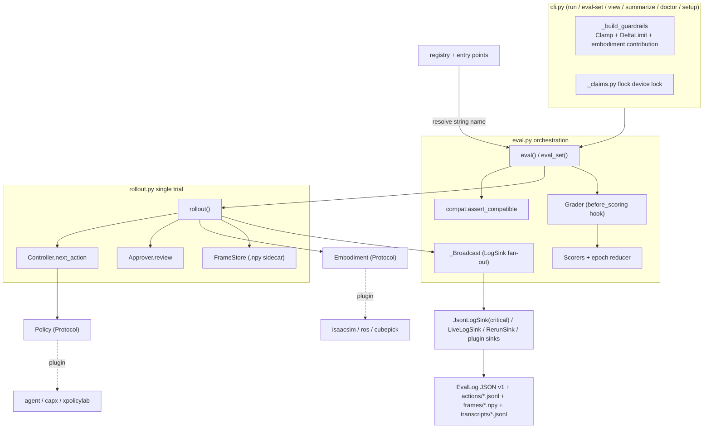

# inspect-robots Source-Level Architecture Study

> Subject: `references/harness/inspect-robots` (robocurve/inspect-robots @ `c8a821ba7bd44c042c95ab8f6a83d1e776cfb4a3`, 2026-10-28, MIT)
> Method: purely static analysis (read / grep / AST); **nothing was installed, no code was run, no simulator was started, no weights were downloaded**.
> UKGovernmentBEIS/inspect_ai was not cloned, for the reason given in §1.2: this repo does not depend on it, and the code does not import it. Comparisons with inspect_ai in this document are based on this repo's own design documents (`plans/0001-foundation-design.md:588-626`) and general knowledge of inspect_ai's public API, **and have not been checked against any specific inspect_ai commit**.
>
> Tag conventions: **\[Implemented\]** code exists and the call chain is traceable (most have unit tests, but we did not run them); **\[Docs/Interface only\]** only docs, reserved parameters or abstract stubs; **\[Unverified\]** code exists, but its correctness depends on external protocols or runtime behavior we cannot check statically; **\[Needs model/hardware\]** requires weights, GPU, simulation assets, a real robot or a paid API.

---

## 1. Positioning and Core Capabilities

### 1.1 Positioning

inspect-robots describes itself as "the Inspect AI for robotics" (`src/inspect_robots/__init__.py:1`); it is an **evaluation framework** for VLA / robot policies (not a training framework, and not a simulator). Its core architectural promise is "**two interchangeable inputs**": `Policy` (the brain) and `Embodiment` (body + world, real robot or simulation), with the benchmark `Task` defined independently of both (`plans/0001-foundation-design.md:43-62`). The design assumes **real-robot evaluation is primary**, with simulation as "a stricter special case" (`plans/0001-foundation-design.md:96-99`).

### 1.2 Relationship to inspect_ai (key conclusion)

- **Not a dependency, but a clean-room conceptual mirror.** The core package's only runtime dependency is `numpy>=1.24` (`pyproject.toml:34`); `uv.lock` has no `inspect-ai` package (only inspect-robots and its 6 plugins, `uv.lock:583-792`); none of the `.py` files under `src/` and `plugins/` contain `import inspect_ai`. Even `.env` auto-loading was rewritten to "stay zero-dependency" (`src/inspect_robots/_dotenv.py:1`).
- **Mirrored concepts** (each module's docstring states "Mirrors Inspect AI's ..."):
  - `Sample` → `Scene` (`src/inspect_robots/scene.py:1-10`)
  - `Task = dataset + solver + scorer + epochs` → `Task = scenes + scorer + horizon + epochs` (`src/inspect_robots/task.py:1-6`)
  - `Solver` chain → `Controller` middleware (`src/inspect_robots/controller.py:1`)
  - `@scorer` + reducer → `Scorer` + epoch reducer (`src/inspect_robots/scorer.py:1-10`)
  - `ApprovalPolicy` → `Approver` (`src/inspect_robots/approver.py:1-7`)
  - Signature semantics of `eval()/eval_set()/EvalLog/fail_on_error/Epochs` (`src/inspect_robots/eval.py:1-5`, `src/inspect_robots/log.py:1-6`)
  - Decorator registry (`src/inspect_robots/registry.py:1-8`)
  - Transcript event stream (`src/inspect_robots/transcript.py:1-7`)
- **Parts not mirrored**: the `TaskState`/`generate()`/`Model` abstractions (replaced here by the two inputs `Policy` and `Embodiment`); `sandbox`/`files` (the design doc explicitly calls them "LLM-sandbox-specific", `plans/0001-foundation-design.md:616-620`); inspect_ai's `.eval` log format and log viewer (replaced here by its own JSON schema v1 plus in-house HTML/Rerun); the async concurrency model (here a synchronous single-threaded loop).
- **Semantics intentionally added relative to inspect_ai**: `EmbodimentFault`/`SafetyAbort` ignore `fail_on_error` and always halt; when all trials error, `status="error"` is forced (`plans/0001-foundation-design.md:598-606`, implemented in `src/inspect_robots/eval.py:735-743, 941-946`).

### 1.3 Core capabilities at a glance

| Capability | Status |
|---|---|
| Synchronous closed-loop rollout with open-loop action chunk execution | \[Implemented\] `src/inspect_robots/rollout.py:248-545` |
| Controller middleware (Default / Smoothing / ACT-style temporal ensembling) | \[Implemented\] `src/inspect_robots/controller.py:296-448` |
| Semantics-aware safety gates (Clamp / DeltaLimit / Chain) | \[Implemented\] `src/inspect_robots/approver.py:132-409` |
| Pre-run policy↔embodiment compatibility check (dims / control_mode / rotation / keys / duration) | \[Implemented\] `src/inspect_robots/compat.py:147-186` |
| Error classification (continue or halt) | \[Implemented\] `src/inspect_robots/errors.py:25-66` |
| Immutable EvalLog (schema v1) + atomic writes | \[Implemented\] `src/inspect_robots/log.py:53-235`, `src/inspect_robots/logging/json_log.py:161-215` |
| Registry + entry-point plugin discovery | \[Implemented\] `src/inspect_robots/registry.py:47-162` |
| Human / VLM judging (Grader) + abstention semantics | \[Implemented\] / \[Needs model/hardware\] `src/inspect_robots/grader.py:31-360` |
| LLM agent policy (tool calling drives the arm) | \[Implemented\] / \[Needs model/hardware\] `plugins/inspect-robots-agent/src/inspect_robots_agent/policy.py:315-1220` |
| Isaac Lab / ROS (rosbridge) / XPolicyLab / CaP-X adapters | \[Needs model/hardware\] / \[Unverified\] |
| Parallel eval_set (threads, sim only) | \[Implemented\] `src/inspect_robots/eval.py:1167-1241`, `src/inspect_robots/_parallel.py:70-93` |
| eval_set resume and retry (`retry_attempts`) | \[Docs/Interface only\] `src/inspect_robots/eval.py:1110, 1155-1157` |
| Runtime obs key remap | \[Docs/Interface only\]: only participates in validation, no renaming, see §8 |

---

## 2. Directory Layout and Architecture

```
inspect-robots/
├── src/inspect_robots/            # core (numpy-only, 100% coverage threshold)
│   ├── types.py spaces.py         # Observation/Action/ActionChunk/StepResult; Box/ActionSemantics
│   ├── policy.py embodiment.py    # two Protocols + ABC + Info
│   ├── scene.py task.py scorer.py # analogues of Sample/Task/Scorer
│   ├── controller.py approver.py  # middleware layer + safety gates
│   ├── rollout.py eval.py         # single-trial closed loop + orchestration
│   ├── log.py transcript.py frames.py logging/  # EvalLog, events, frame sidecar, Sink
│   ├── grader.py taskgen.py _chatwire.py        # judgment capture / automatic task generation / zero-dependency OpenAI-compatible HTTP
│   ├── registry.py _builtins.py   # registry
│   ├── session.py console.py      # operator TTY session (Esc to end, verdict prompt)
│   ├── compat.py conformance.py _claims.py      # compatibility, adapter conformance, device lock
│   ├── cli.py _setup.py _html.py _video.py _summarize.py   # CLI and reporting tools (about 8.5k lines)
│   └── mock/                      # CubePick world + scripted/random/noop policies
├── plugins/                       # uv workspace members, each with its own pyproject + entry point
│   ├── inspect-robots-agent/      # LLM agent policy (OpenAI chat / Responses / Anthropic / Gemini Live / Interactions)
│   ├── inspect-robots-capx/       # CaP-X code-as-policy (exec of model-generated Python)
│   ├── inspect-robots-xpolicylab/ # remote policy server (websocket + msgpack)
│   ├── inspect-robots-isaacsim/   # Isaac Lab gym environment adapter
│   ├── inspect-robots-ros/        # rosbridge websocket adapter
│   └── inspect-robots-voice/      # voice operator input + TTS sink
├── examples/                      # quickstart.py; pi05/serve_pi05_yam.py (openpi server example)
├── plans/                         # about 100 design RFCs (0001 is the foundational design)
├── tests/                         # about 1653 test functions in core; about 755 in plugins
└── tools/issue-bot/               # GitHub issue automation (Cloudflare Worker), unrelated to evaluation
```



---

## 3. Core Interfaces and Key Classes (signatures)

### 3.1 Data contract (`src/inspect_robots/types.py`)

```python
@dataclass(frozen=True, eq=False)
class Observation:                       # types.py:25-46
    images: Mapping[str, NDArray[uint8]]       # (H,W,C) uint8, indexed by camera name
    state: Mapping[str, NDArray[floating]]     # proprioception, using the CANONICAL_STATE_UNITS vocabulary
    instruction: str | None
    image_times: Mapping[str, float]; state_time: float
    extra: Mapping[str, Any]   # reserved keys injected by rollout: env_step / approvals / operator_messages

@dataclass(frozen=True, eq=False)
class Action:        data: NDArray; meta: Mapping[str, Any]          # types.py:49-59
@dataclass(frozen=True, eq=False)
class ActionChunk:   actions: Sequence[Action]; control_hz: float|None # types.py:62-84
                     inference_latency_s: float|None; meta: Mapping
@dataclass(frozen=True, eq=False)
class StepResult:    observation; reward: float|None; terminated; termination_reason: str|None
                     truncated; info: Mapping   # sim's privileged success goes in info   types.py:94-110
```

The **semantics** of actions hang off the action space rather than travelling with each Action (R8): `ActionSemantics(control_mode, rotation_repr, gripper, frame, dim_labels, max_step)`, where `control_mode ∈ {joint_pos, joint_vel, joint_delta, eef_delta_pose, eef_abs_pose, eef_delta_pos}` (`src/inspect_robots/spaces.py:24-84`). `Box(shape, low, high, semantics)` validates the lengths of `dim_labels`/`max_step` (`src/inspect_robots/spaces.py:86-138`). `ObservationSpace(cameras, state_keys, state: StateSpec)` (`src/inspect_robots/spaces.py:218-251`). Canonical state units: `joint_pos: rad`, `eef_pos: m`, `gripper: normalized`, etc., conventionally aligned with LeRobot (`src/inspect_robots/spaces.py:165-173`).

### 3.2 Policy / Embodiment

```python
@runtime_checkable
class Policy(Protocol):                          # policy.py:57-104
    info: PolicyInfo      # name, action_space: Box, observation_space, control_hz, checkpoint
    config: PolicyConfig  # action_horizon, replan_interval, temperature  (≈ GenerateConfig)
    def reset(self, scene: Scene) -> None
    def act(self, observation: Observation) -> ActionChunk
# optional duck-typed hooks (not in the Protocol): bind(embodiment_info), bind_task(envelope),
# on_trial_start(scene_id, epoch, log_dir, run_id), on_trial_end(record, log_dir, run_id),
# transcript(), transcript_delta()                      — policy.py:61-93

@runtime_checkable
class Embodiment(Protocol):                      # embodiment.py:72-150
    info: EmbodimentInfo  # name, action_space, observation_space, control_hz, is_simulated,
                          # capabilities{seedable,resettable,auto_reset,privileged_success,
                          # renderable,self_paced}, supported_setups, supported_target_kinds,
                          # docs(markdown for the LLM), environment_id/revision
    def reset(self, scene: Scene, *, seed: int | None = None) -> Observation
    def step(self, action: Action) -> StepResult
    def close(self) -> None
# optional hooks: bind_task, connect_operator_session, observe_parked, defer_operator_end,
# contribute_guardrails(action_space) -> GuardrailContribution      — embodiment.py:76-133
```

### 3.3 Task / Scene / Scorer / Grader

```python
@dataclass(frozen=True) class Scene: id; instruction; target: Target|None; init_seed; setup; metadata  # scene.py:32-41
@dataclass class Task: name; scenes; scorer: Scorer|str|Sequence; max_steps|max_seconds(one of the two);
                       epochs: int|Epochs; metadata                                     # task.py:121-139
class Scorer(Protocol): name: str; def __call__(self, record: TrialRecord, target: Target|None) -> Score  # scorer.py:58-69
@dataclass(frozen=True) class Score: value: bool|int|float|str|None(=abstain); explanation; metadata          # scorer.py:31-41
class Grader(Protocol): name: str; def grade(self, record: TrialRecord, scene: Scene) -> None            # grader.py:31-56
```

### 3.4 Middleware, safety, Sink

```python
class Controller(Protocol):  def next_action(self, policy, observation, t, store: dict) -> Action   # controller.py:285-293
class Approver(Protocol):    def review(self, action: Action, store: dict) -> Action  # may clamp or raise SafetyAbort  approver.py:89-99
class LogSink(Protocol):     on_eval_start(spec); on_trial_start(scene_id, epoch);
                             log_step(t, obs, action, result); on_trial_end(record); on_eval_end(log)  # logging/sink.py:41-65
class OperatorInput(Protocol): poll() -> ConsolePoll; begin_trial()                     # console.py:55-65
```

### 3.5 Records and logs

- `TrialRecord` (mutable, **in memory only**): `steps: list[StepRecord]`, `events: list[Event]`, `terminated/truncated/termination_reason`, `status ∈ {success,error,cancelled}`, `operator_judgement/note`, `metadata`, `policy_transcript`, `parked_observation` (`src/inspect_robots/rollout.py:85-114`).
- `EvalLog(version, status, eval: EvalSpec, results: EvalResults, stats: EvalStats, samples: tuple[SceneResult], error)` (`src/inspect_robots/log.py:177-229`). `SceneResult` has one entry per scene, containing `reduced`, `epochs` (per-epoch score dicts), and, **strictly parallel** to epochs, `operator_judgements / judgement_sources / operator_notes / operator_messages / trial_metadata / termination_reasons / policy_transcripts` (`src/inspect_robots/log.py:120-157`).

---

## 4. Core Execution Flow

### 4.1 Control ownership

- **The framework owns the control loop**: `rollout()` is the only control-rate loop (`src/inspect_robots/rollout.py:327-531`). The timing of policy inference is decided by the Controller, so chunk buffering, replanning and ensembling all happen inside the Controller (R3, `src/inspect_robots/controller.py:1-12`).
- **The loop itself does no wall-clock pacing**: how fast `step()` is called depends only on how fast the policy, controller and approver can produce actions; embodiments that need real-time behavior sleep inside `step()` themselves and declare `self_paced` (`src/inspect_robots/embodiment.py:12-16`, `src/inspect_robots/rollout.py:276-280`).
- **The LLM agent's loop is nested inside `policy.act()`**: a single `act()` repeatedly calls the LLM until it gets a valid tool call, then converts it into an ActionChunk (`plugins/inspect-robots-agent/src/inspect_robots_agent/policy.py:951-1220`). The framework cannot see the LLM's turn structure; it only receives a side-channel stream via `transcript_delta()` (`src/inspect_robots/rollout.py:390-410`).

### 4.2 Mapping episodes to the inspect_ai model

| inspect_ai | inspect-robots | Notes |
|---|---|---|
| Sample | Scene | One initial condition |
| epoch × sample | trial = (scene, epoch) | trial_id = `"{scene.id}-e{epoch}"` (`src/inspect_robots/rollout.py:284`) |
| TaskState | TrialRecord | The scorer reads the record, not the live env |
| Solver chain | Controller (plus Policy) | Single method, stateful; store is created fresh per trial |
| Scorer(state, target) | Scorer(record, target) | Pure reader; human or VLM judgments are first written into the record by the Grader |
| ApprovalPolicy | Approver | Acts on every step's action, not on tool calls |

### 4.3 Sequence diagram

```mermaid
sequenceDiagram
  participant U as caller / CLI
  participant E as eval()
  participant P as Policy
  participant M as Embodiment
  participant C as Controller
  participant A as Approver
  participant S as Sinks(_Broadcast)
  participant G as Grader
  participant SC as Scorers
  U->>E: eval(task, policy, embodiment, seed, approver, grader...)
  E->>G: preflight() (before resolving components)
  E->>P: bind(embodiment.info) [optional]
  E->>E: assert_compatible() -> CompatibilityError fail fast
  E->>M: bind_task(envelope) / P.bind_task(envelope) [optional]
  E->>S: bind_spaces / bind_frames_dir / bind_scenes / on_eval_start(spec)
  loop each scene × epoch
    E->>E: trial_seed = crc32(f"{seed}:{scene_seed}:{epoch}")
    E->>S: on_trial_start
    E->>P: on_trial_start(scene_id, epoch, log_dir, run_id) [optional]
    E->>P: reset(scene)
    E->>M: reset(scene, seed=trial_seed)
    loop t < max_steps
      E->>E: OperatorInput.poll() (Esc/"/stop" -> operator_end)
      E->>C: next_action(policy, obs+extra, t, store)
      C->>P: act(obs) (when buffer exhausted) -> ActionChunk
      E->>E: dimension check / non-finite check -> PolicyError
      E->>A: review(action, store) -> clamp or SafetyAbort
      E->>E: re-check dimensions / finiteness -> SafetyAbort
      E->>M: step(action) -> StepResult
      E->>S: log_step(t, obs, action, result)
      E->>E: FrameStore.put + StepRecord + step_event
      alt terminated / truncated / action.meta.request_stop
        E->>E: break
      end
    end
    alt trial status == success
      E->>M: observe_parked() [optional, only when a grader is needed]
      E->>G: grade(record, scene) (writes operator_judgement or grading_error)
      E->>SC: scorer(record, target) -> Score
    end
    E->>P: on_trial_end(record, log_dir, run_id) [optional]
    E->>E: _write_action_log -> actions/<run>/<trial>.jsonl
    E->>S: on_trial_end(record)
    E->>E: halted? fail_on_error threshold?
  end
  E->>E: epoch reducer -> SceneResult; metrics take mean
  E->>S: on_eval_end(EvalLog)  (JsonLogSink critical, atomic write)
  E-->>U: [EvalLog]
```

### 4.4 Termination, timeouts, retries, error handling

- **Termination**: the embodiment's `terminated`/`truncated` (`src/inspect_robots/rollout.py:511-518`); the policy requests a stop via `action.meta["request_stop"]`, recorded as truncation, with embodiment termination taking precedence (`src/inspect_robots/rollout.py:435-441, 519-525`); operator Esc or `/stop` is recorded as `operator_end` (`src/inspect_robots/rollout.py:359-373`); exhausting `max_steps` is recorded as `truncated="max_steps"` (`src/inspect_robots/rollout.py:529-531`). \[Implemented\]
- **Duration**: `Task.max_seconds` is converted into a **step count** using `embodiment.control_hz`, with ULP tolerance (`src/inspect_robots/task.py:209-249`); it is **not a wall-clock timeout**. The core layer has no per-step or per-trial wall-clock timeout; timeouts exist only in plugin transport layers, e.g. XPolicyLab `request_timeout_s=120` (`plugins/inspect-robots-xpolicylab/src/inspect_robots_xpolicylab/_client.py:48-49`), rosbridge `request_timeout_s=30` (`plugins/inspect-robots-ros/src/inspect_robots_ros/_client.py:64-65`).
- **Error classification**: ordinary exceptions thrown by the policy are wrapped as `PolicyError` (recorded and continued, governed by `fail_on_error`); embodiment exceptions are wrapped as `EmbodimentFault`, approver crashes as `SafetyAbort`, and both **always halt the whole eval** (`src/inspect_robots/errors.py:1-15`, `src/inspect_robots/rollout.py:297-311, 443-449, 479-485`, `src/inspect_robots/eval.py:735-743`). Every error within a trial attaches the partial `TrialRecord` to `exc.record` (`src/inspect_robots/rollout.py:144-155`). Errored trials are **recorded but not scored** (`src/inspect_robots/eval.py:760-769`). Ctrl-C writes out a log with `status="cancelled"` and then re-raises (`src/inspect_robots/rollout.py:532-536`, `src/inspect_robots/eval.py:1003-1004`). Scorer or reducer failures degrade to error logs rather than crashing the process (`src/inspect_robots/eval.py:820-831, 905-918`). \[Implemented\]
- **Retries**: **there is no retry at either the trial level or the task level**. `retry_attempts` is an inert stub (`src/inspect_robots/eval.py:1110, 1155-1157`) \[Docs/Interface only\]. The LLM HTTP layer has its own retry and backoff (`plugins/inspect-robots-agent/src/inspect_robots_agent/_llm.py:212-245, 338`) \[Unverified\].

---

## 5. Extension Points and Plugin Mechanism

- **Registry**: 7 kinds, namely `task, policy, embodiment, scorer, grader, sink, operator_input` (`src/inspect_robots/registry.py:32-41`). The decorators `@task/@policy/...` register **factories**; `resolve(kind, name, **kwargs)` handles construction (`src/inspect_robots/registry.py:157-162`). \[Implemented\]
- **Entry points**: grouped as `inspect_robots.{tasks,policies,embodiments,scorers,graders,sinks,operator_inputs}` (`src/inspect_robots/registry.py:47-55`). Lazily loaded on the first `registered()`; a single plugin failing to load only emits a warning, without interrupting (`src/inspect_robots/registry.py:119-146`). Autoloading can be disabled with `INSPECT_ROBOTS_DISABLE_PLUGIN_AUTOLOAD` (`src/inspect_robots/registry.py:15-21, 45`). Built-in components are in `src/inspect_robots/_builtins.py:23-59`. \[Implemented\]
- **Plugin examples**: `agent = "inspect_robots_agent.policy:agent_policy"` (`plugins/inspect-robots-agent/pyproject.toml:40-41`), `isaacsim` (`plugins/inspect-robots-isaacsim/pyproject.toml:34-35`), `ros` (`plugins/inspect-robots-ros/pyproject.toml:32-33`), the `voice` operator_input and the `speaker` sink (`plugins/inspect-robots-voice/pyproject.toml:36-40`).
- **Adding a new env / robot**: implement the `Embodiment` Protocol (or subclass `EmbodimentBase`) and fill in `EmbodimentInfo`; device slots can be declared via `DeviceSlot/OptionSlot/NumberSlot` for use by the `setup` wizard and `doctor` (`src/inspect_robots/conformance.py:38-178`); add specific safety gates with `contribute_guardrails` (`src/inspect_robots/embodiment.py:173-175`); finally add an entry point in pyproject. Heavy dependencies (isaaclab, torch) are always lazily imported inside methods, so `list` and compatibility checks can run without a GPU (`plugins/inspect-robots-isaacsim/src/inspect_robots_isaacsim/embodiment.py:7-13`).
- **Adding a new policy**: implement `info/config/reset/act`; to self-adapt to the embodiment implement `bind()`, e.g. the agent generates tool schemas from `EmbodimentInfo` (`plugins/inspect-robots-agent/src/inspect_robots_agent/policy.py:820-840`).
- **Style of the extension mechanism**: heavy use of **duck-typed optional hooks** (`bind`, `bind_task`, `transcript_delta`, `observe_parked`, `connect_operator_session`, `log_policy_messages`, `bind_spaces`...), deliberately kept out of the Protocol so that older implementations continue to conform to it (`src/inspect_robots/policy.py:61-93`, `src/inspect_robots/logging/sink.py:7-28`). The upside is backward compatibility; the downside is that the contract is scattered across docstrings and static type checking cannot cover it.

---

## 6. Dependencies and Runtime Requirements

| Component | Dependencies | Runtime requirements |
|---|---|---|
| Core | `numpy>=1.24`, Python ≥3.11 (`pyproject.toml:9, 34`) | Pure CPU; mock world has no external dependencies \[Implemented\] |
| rerun extra | `rerun-sdk>=0.20, pillow` (`pyproject.toml:37`) | Visualization (optional) |
| agent | `httpx, websockets` (`plugins/inspect-robots-agent/pyproject.toml`) | Needs an LLM API key \[Needs model/hardware\] |
| capx | Depends on agent, plus SAM3 / GraspNet / PyRoki HTTP services (`plugins/inspect-robots-capx/src/inspect_robots_capx/_servers.py:113-299`) | Needs GPU model services \[Needs model/hardware\] |
| xpolicylab | `websockets, msgpack, msgpack-numpy` | External policy server \[Needs model/hardware\] |
| isaacsim | Runtime lazy dependencies `isaaclab/isaacsim/torch/gymnasium` | NVIDIA GPU + Isaac Sim \[Needs model/hardware\] |
| ros | `websockets, pillow`; the evaluation machine does not need ROS installed | Needs rosbridge and a real robot or ROS simulation \[Needs model/hardware\] |
| voice | `faster-whisper, onnx-asr, kokoro-onnx, sounddevice` | Microphone and ASR/TTS weights \[Needs model/hardware\] |

Engineering side: hatchling + hatch-vcs, uv workspace (`pyproject.toml:193`), `mypy --strict`, 100% core coverage threshold (`pyproject.toml:128`); pytest markers `hardware`/`sim`/`slow` are deselected by default in CI (`pyproject.toml:116-121`). The CI matrix is Linux/macOS × py3.11/3.12, with separate runs for the rerun extra and numpy 1.x/2.x (`.github/workflows/ci.yml:58-140`).

---

## 7. License and Reuse Constraints

- The root `LICENSE` is MIT, "Copyright (c) 2026 robocurve" (`LICENSE:1-3`). All plugins' pyproject files declare `license = "MIT"`.
- Third-party protocol mirror: XPolicyLab's wire protocol was hand-copied from upstream commit `fe71eb5…` (`plugins/inspect-robots-xpolicylab/src/inspect_robots_xpolicylab/_protocol.py:1-14`); the upstream protocol has no version field. Before reuse, the upstream license and protocol stability must be confirmed separately.
- `examples/pi05/serve_pi05_yam.py` inlines openpi's transforms (file header `examples/pi05/serve_pi05_yam.py:1-16`), involving code snippets from openpi (Apache-2.0) and the weight license of robocurve/pi0.5-yam; these need to be checked separately before reuse.
- Conclusion: the core can be vendored or used directly as a dependency, only requiring the MIT copyright notice to be kept.

---

## 8. Strengths, Weaknesses and Risks

### Strengths

1. **Two-input factorization plus pre-run compatibility check**: action semantics (control_mode / rotation / gripper / frame) are first-class citizens; problems such as 7-DoF vs 6-DoF mismatches and delta vs absolute mismatches fail before touching hardware (`src/inspect_robots/compat.py:64-124`). \[Implemented\]
2. **Rigorous safety semantics**: DeltaLimit distinguishes absolute and displacement modes, and refuses per-dimension clamping of representations whose identity element is not at the origin, such as quaternion/rot6d (`src/inspect_robots/approver.py:175-260`); non-finite values are checked once before and once after review (`src/inspect_robots/rollout.py:424-477`); a crash of the approver itself is treated as unsafe (`src/inspect_robots/rollout.py:448-449`). \[Implemented\]
3. **"halt vs continue" error classification** plus partial record preservation, suited to unattended overnight real-robot runs (`src/inspect_robots/errors.py:1-15`). \[Implemented\]
4. **Separation of judgment capture and scoring (R6)**: the Grader writes human or VLM judgments into the record before scoring, and the Scorer only reads the record, so offline rescoring is reproducible in principle; there is abstention semantics for "the judge went down", so a reviewer failure is not counted as a robot failure (`src/inspect_robots/scorer.py:281-299`, `src/inspect_robots/eval.py:948-958`). \[Implemented\]
5. **Log robustness**: the canonical sink is marked `critical` and written first; atomic writes plus fsync; strict RFC 8259 (NaN becomes null) (`src/inspect_robots/logging/json_log.py:139-215`, `src/inspect_robots/eval.py:230-318`); the Rerun sink drops frames under pressure rather than blocking the control loop (`src/inspect_robots/logging/rerun_sink.py:17, 503-511`). \[Implemented\]
6. **Provenance fields**: `git_commit`, `inspect_robots_version`, `policy_config`, `environment_id/revision`, `policy_checkpoint`, `grader_config` (credentials not recorded), `seed` (`src/inspect_robots/log.py:56-104`). \[Implemented\]

### Weaknesses / Risks

1. **Incomplete trace**: the canonical `EvalLog` **does not contain per-step observation/state/action/events**. `SceneResult` has no `events` field (`src/inspect_robots/log.py:120-157`), and `JsonLogSink` ignores `log_step`/`on_trial_end` (`src/inspect_robots/logging/json_log.py:188-196`). Action sequences are only written into the `actions/*.jsonl` sidecar (`src/inspect_robots/eval.py:135-187`); images are only written as `.npy` when `store_frames=True` (off by default, `src/inspect_robots/eval.py:399, 621-623`); **proprioceptive state and reward/info are never persisted on the JSON side at all**, and can only be obtained via the RerunSink's `.rrd`. Therefore "scorers can be reproduced from saved logs" holds only in the sense of the in-memory `TrialRecord`; **the on-disk logs are not sufficient to re-run scorers offline** (the design doc also lists offline rescoring as deferred, `plans/0001-foundation-design.md:8-9`).
2. **`remap` validates but has no effect**: `remap` is only passed to `assert_compatible` (`src/inspect_robots/eval.py:574`); there is no renaming logic in `rollout.py`. But the docs say "Inspect Robots remaps if needed" (`plugins/inspect-robots-isaacsim/src/inspect_robots_isaacsim/embodiment.py:161`, `docs/guide/policies-and-embodiments.md:116-122`). The result is that the compatibility check passes, but at runtime the policy still receives the embodiment's original key names. \[Docs/Interface only\]
3. **Safety gates are only on by default in the CLI**: calling `eval()` programmatically defaults to `AutoApprover()`, i.e. allow-all (`src/inspect_robots/eval.py:614`); Clamp + DeltaLimit are only enabled by default on the CLI path (`src/inspect_robots/cli.py:1573-1597`). There are no workspace geometric limits, force or velocity limits, collision checks, heartbeats or watchdogs; e-stop relies on the embodiment implementing it itself.
4. **The policy does not receive the trial seed**: `derive_seed` is only passed to `embodiment.reset` (`src/inspect_robots/rollout.py:306`); `Policy.reset(scene)` has no seed parameter (`src/inspect_robots/policy.py:98`). Stochastic policies can only seed themselves, e.g. the mock uses `base_seed + reset_count` (`src/inspect_robots/mock/policies.py:78-79`), so cross-epoch reproducibility depends on the discipline of policy implementers.
5. **Single execution model**: synchronous, single env (Isaac hard-codes `num_envs=1`, `plugins/inspect-robots-isaacsim/src/inspect_robots_isaacsim/embodiment.py:287`); parallelism is only a task-granularity thread pool, and it requires `is_simulated` (`src/inspect_robots/eval.py:1203-1204`); no vectorized env, and no asynchronous inference/control pipeline (control is blocked during inference).
6. **No process isolation**: CaP-X uses `exec()` to execute model-generated code inside the evaluation process, and the authors explicitly write "not a security sandbox" (`plugins/inspect-robots-capx/src/inspect_robots_capx/_sandbox.py:1-6, 116-127`); the core has no docker or subprocess isolation, policy and embodiment run in the same process, and Isaac additionally requires only one SimulationApp per process (`plugins/inspect-robots-isaacsim/src/inspect_robots_isaacsim/embodiment.py:57-60`).
7. **Design docs and implementation disagree**: the foundational design says EvalLog will mirror inspect_ai's `plan`/`tags`/`metadata`/`reductions`/`EvalError(traceback)` fields, plus "actual control rate" in `EvalStats` (`plans/0001-foundation-design.md:607-615`), but `src/inspect_robots/log.py:56-189` has none of these fields: controller/approver configuration is not persisted, and errors are only recorded as strings. Therefore "aligned with the inspect_ai log format" is only **structurally similar**; the two formats are not interoperable.
8. **CLI and reporting code is heavy**: `cli.py` 2958 lines, `_html.py` 1823 lines, `_setup.py` 1789 lines, `session.py` 743 lines, mainly serving the real-robot TTY operator experience. About 100 plan documents indicate fast iteration (Alpha, `pyproject.toml` classifier); the API may change.

---

## 9. Components Worth Reusing

| Component | Mode | Rationale |
|---|---|---|
| `ActionSemantics` + `Box` + `CANONICAL_STATE_UNITS` (`src/inspect_robots/spaces.py:24-173`) | **Protocol-compatible** (copy field names and values) | Action semantics are the key to cross-VLA and cross-robot compatibility; the field design is mature and aligned with LeRobot |
| `compat.check_compatibility` rule set (`src/inspect_robots/compat.py:64-244`) | Reuse the logic | Sensible error vs warning grading (gripper/frame only warn, control_mode/rotation error) |
| Approver chain + DeltaLimit rules (`src/inspect_robots/approver.py:132-409`) | **Reuse directly or port** | Zero dependencies, handles rotation-representation edge cases well; the `GuardrailContribution` pattern suits letting the embodiment contribute its own safety gates |
| Error classification + `exc.record` preservation (`src/inspect_robots/errors.py:25-66`, `src/inspect_robots/rollout.py:144-155`) | Copy the semantics | Essential for a real-robot harness |
| Controller single-method middleware + EnsemblingController (`src/inspect_robots/controller.py:285-448`) | Reuse the interface shape | Separates chunk execution, ensembling and inference timing from the rollout |
| `Grader` (capture) / `Scorer` (read-only) separation + abstention semantics (`src/inspect_robots/grader.py:31-56`, `src/inspect_robots/scorer.py:31-41, 177-187`) | Copy into our Evaluation layer | With this separation, human, VLM and privileged-oracle sources can coexist, with the judgment source recorded in `judgement_sources` |
| `derive_seed` (`src/inspect_robots/rollout.py:55-64`) + drawing and recording the actual seed when `seed=None` (`src/inspect_robots/eval.py:606-609`) | Copy, and extend to the policy | Simple and correct |
| Sink fan-out: critical first, failure isolation, atomic writes (`src/inspect_robots/eval.py:230-318`, `src/inspect_robots/logging/json_log.py:198-215`) | Reuse the pattern | Reliability design for the Trace layer |
| Entry-point registry + autoload-off switch (`src/inspect_robots/registry.py:47-146`) | Reuse the pattern | About 160 lines, zero dependencies |
| XPolicyLab / rosbridge clients | Reference for adapters as needed | Ready-made implementations of a remote policy server and a ROS bridge \[Unverified\] |
| The summarize → learnings.md → `prior_learnings` loop (`src/inspect_robots/_summarize.py:21-29`, `plugins/inspect-robots-agent/src/inspect_robots_agent/policy.py:295-298, 372-376`) | Borrow the design | A minimal "cross-run self-improvement" loop; the sha256 of the injected file is recorded in policy_config |

**Is inspect_ai's log/scorer model suitable as our Trace/Evaluation layer?** The conclusion is that **the scoring model is worth borrowing, but the log model is not suitable for direct use**:

- Worth borrowing: the semantics of `Task/Sample/epochs/reducer/fail_on_error/eval_set`, `Score(value, explanation, metadata)`, and how metrics handle abstentions. inspect-robots has already shown that these semantics transfer losslessly to robotics; we can make `worldcurrent.Evaluation` **protocol-compatible** with inspect-robots schema v1 at the top-level structure of `EvalLog` (`eval/results/stats/samples`), so that we can reuse its `view`/`summarize` tools \[Unverified\].
- Not suitable for direct use: (a) neither inspect_ai's transcript (centered on messages/tool calls) nor inspect-robots' `SceneResult` **has per-step high-frequency multimodal trajectories**; (b) inspect-robots' JSON has no state, reward, info or event stream; (c) physical memory and world model training need LeRobot/RLDS/MCAP-style episode storage. The suggested layering is: the **Trace layer** uses episode-oriented binary storage (per-step obs/state/action/info/events + frames, directly usable for training), while the **Evaluation layer** uses an inspect-style EvalLog that only stores aggregated results and pointers to the Trace, following the relative-path approach of `trial_metadata["actions"]` (`src/inspect_robots/eval.py:864-872`).
- Using inspect_ai itself as a dependency to carry robot episodes is also unsuitable: its Solver and TaskState revolve around the LLM message stream, and its sandbox targets code-execution containers; it cannot carry a 50 Hz control loop. inspect-robots choosing to mirror rather than depend on it is itself evidence of this.

---

## 10. Capabilities Not Worth Rebuilding

- **Do not rewrite the operator TTY layer** (`session.py`/`console.py`/`_setup.py`, about 3000 lines in total); it is deeply tied to their YAM test bench and POSIX termios. If we need human-in-the-loop judging, reusing the semantics of the `Grader` protocol and `OperatorInput.poll()` is enough.
- **Do not rewrite HTML reporting and video compositing** (`_html.py`, `_video.py`). When needed, use `inspect-robots view/video` directly to read logs in a compatible schema, or switch to Rerun.
- **Do not write another multi-vendor LLM wire layer** (`plugins/inspect-robots-agent/src/inspect_robots_agent/_anthropic.py`, `_responses.py`, `_gemini_live.py`, `_interactions.py`). The reasoning layer should use mature SDKs or gateways; the implementation here exists mainly to keep the core zero-dependency.
- **Can be ignored**: CaP-X's in-process `exec` sandbox (not secure enough; we should go straight to container or subprocess isolation); `tools/issue-bot` (for repo operations, unrelated to evaluation); the voice plugin.
- **Can be used directly as a dependency**: if `worldcurrent` needs to support "running VLA benchmarks on real robots or Isaac", inspect-robots can perfectly well serve as a **benchmark runner backend**. Writing a thin `worldcurrent.Policy → inspect_robots.Policy` adapter is cheaper than rewriting rollout, compat and approver.

---

## 11. Source Index of Key Implementations

| concern | file:line | note |
|---|---|---|
| Zero-dependency declaration | `pyproject.toml:34` | Depends only on `numpy>=1.24`; does not depend on inspect_ai |
| Inspect mapping table | `README.md:464-475` | Official concept mapping |
| Inspect API alignment (binding) | `plans/0001-foundation-design.md:588-626` | eval/eval_set/Epochs/fail_on_error/EvalLog |
| Observation/Action/Chunk/StepResult | `src/inspect_robots/types.py:25-110` | frozen, NumPy-native |
| ActionSemantics/Box | `src/inspect_robots/spaces.py:47-138` | control_mode/rot/gripper/frame/max_step |
| Policy Protocol + optional hooks | `src/inspect_robots/policy.py:57-104` | reset/act + 6 duck-typed hooks |
| Embodiment Protocol + capabilities | `src/inspect_robots/embodiment.py:33-150` | reset/step/close; self_paced etc. |
| Scene/Target | `src/inspect_robots/scene.py:19-41` | Analogue of Sample |
| Task + seconds-to-steps conversion | `src/inspect_robots/task.py:121-249` | Only one of max_steps and max_seconds may be declared |
| Seed derivation | `src/inspect_robots/rollout.py:55-64` | crc32(eval:scene:epoch) |
| rollout main loop | `src/inspect_robots/rollout.py:248-545` | The only control loop |
| request_stop channel | `src/inspect_robots/rollout.py:435-441, 519-525` | Policy ends proactively, recorded as truncation |
| Double finiteness/dimension check | `src/inspect_robots/rollout.py:412-477` | PolicyError before review, SafetyAbort after review |
| Controller middleware | `src/inspect_robots/controller.py:285-448` | Default/Smoothing/Ensembling |
| Approver safety chain | `src/inspect_robots/approver.py:89-409` | Clamp/DeltaLimit/Chain/GuardrailContribution |
| CLI default guardrails | `src/inspect_robots/cli.py:792-856, 1573-1597` | On by default only in the CLI |
| eval() default AutoApprover | `src/inspect_robots/eval.py:613-614` | The programmatic API applies no safety constraints by default |
| Device flock lock | `src/inspect_robots/_claims.py:21-40, 77` | Prevents two processes from grabbing the same robot |
| Error classification | `src/inspect_robots/errors.py:25-66` | halt or continue |
| eval() orchestration | `src/inspect_robots/eval.py:387-535, 537-1005` | Scoring, reduce, log assembly |
| fail_on_error | `src/inspect_robots/eval.py:1008-1020` | Inspect semantics |
| eval_set and parallelism | `src/inspect_robots/eval.py:1093-1293`, `src/inspect_robots/_parallel.py:70-93` | Thread pool, sim only |
| retry/resume stubs | `src/inspect_robots/eval.py:1110, 1155-1157` | Not implemented |
| Sink fan-out | `src/inspect_robots/eval.py:230-366` | Critical first, failure isolation |
| LogSink protocol | `src/inspect_robots/logging/sink.py:41-65` | 5 lifecycle hooks |
| EvalLog schema v1 | `src/inspect_robots/log.py:53-235` | No per-step trajectory or events |
| JSON atomic write | `src/inspect_robots/logging/json_log.py:139-215` | NaN becomes null, fsync |
| actions sidecar | `src/inspect_robots/eval.py:135-187` | JSONL, on by default |
| Frame sidecar | `src/inspect_robots/frames.py:375-401` | `.npy`, off by default |
| Event types | `src/inspect_robots/transcript.py:236-309` | reset/inference/step/approval/operator/error |
| Rerun non-blocking | `src/inspect_robots/logging/rerun_sink.py:190, 503-511` | Drops frames under pressure |
| Live snapshot | `src/inspect_robots/logging/live_log.py:52-75` | Atomic write after throttling |
| Scorer/reducer/pass@k | `src/inspect_robots/scorer.py:31-187` | Has abstention semantics |
| Built-in scorers | `src/inspect_robots/scorer.py:193-310` | success_at_end etc. |
| VLMScorer stub | `src/inspect_robots/scorer.py:313-328` | raise NotImplementedError |
| Grader (operator/vlm) | `src/inspect_robots/grader.py:31-360` | VLM looks at first and last frames plus rubric |
| Compatibility check | `src/inspect_robots/compat.py:64-244` | Dimensions/semantics/keys/duration/realizability |
| remap used only for validation | `src/inspect_robots/eval.py:574`, `src/inspect_robots/compat.py:127-144` | rollout does no renaming |
| Registry/entry points | `src/inspect_robots/registry.py:32-162` | 7 kinds |
| Built-in registration | `src/inspect_robots/_builtins.py:23-59` | cubepick/scripted etc. |
| Agent tool schema | `plugins/inspect-robots-agent/src/inspect_robots_agent/_tools.py:158-300` | move/done/give_up/take_pic |
| Agent act inner loop | `plugins/inspect-robots-agent/src/inspect_robots_agent/policy.py:951-1220` | LLM turns, at most 100 calls |
| Agent transcript persistence | `plugins/inspect-robots-agent/src/inspect_robots_agent/policy.py:898-935` | transcripts/*.jsonl |
| CaP-X exec | `plugins/inspect-robots-capx/src/inspect_robots_capx/_sandbox.py:1-6, 116-127` | Not a security sandbox |
| XPolicyLab protocol | `plugins/inspect-robots-xpolicylab/src/inspect_robots_xpolicylab/_protocol.py:1-40` | ws + msgpack |
| Isaac adapter | `plugins/inspect-robots-isaacsim/src/inspect_robots_isaacsim/embodiment.py:148-435` | num_envs=1, lazy import |
| ROS adapter | `plugins/inspect-robots-ros/src/inspect_robots_ros/embodiment.py:161` | rosbridge, self_paced |
| pi0.5 server example | `examples/pi05/serve_pi05_yam.py:1-16` | HTTP /act, json_numpy |
| learnings loop | `src/inspect_robots/_summarize.py:21-29` | Experience usable by the next attempt |

---

## Verification Status Summary

| Capability / Component | Tag | Evidence |
|---|---|---|
| Core types/spaces/Protocols | \[Implemented\] | `src/inspect_robots/types.py`, `src/inspect_robots/spaces.py`, `src/inspect_robots/policy.py`, `src/inspect_robots/embodiment.py`; covered by `tests/test_types_spaces.py` |
| rollout closed loop, termination, error wrapping | \[Implemented\] | `src/inspect_robots/rollout.py:248-545`; covered by `tests/test_rollout_hardening.py` |
| Controller (including ensembling) | \[Implemented\] | `src/inspect_robots/controller.py`; covered by `tests/test_controller.py`, `tests/test_ensembling.py` |
| Approver safety chain | \[Implemented\] | `src/inspect_robots/approver.py`; covered by `tests/test_approvers.py` |
| Compatibility check | \[Implemented\] | `src/inspect_robots/compat.py`; covered by `tests/test_compat.py` |
| Runtime obs key remap | \[Docs/Interface only\] | Docs claim remapping, rollout has no implementation |
| eval/eval_set/fail_on_error/cancellation | \[Implemented\] | `src/inspect_robots/eval.py`; covered by `tests/test_eval_orchestration.py` |
| Parallel eval_set | \[Implemented\] (thread safety unverified) | `src/inspect_robots/_parallel.py`; covered by `tests/test_eval_parallel.py` |
| retry_attempts / resume / offline rescoring / vectorized env | \[Docs/Interface only\] | `src/inspect_robots/eval.py:1155-1157`, `plans/0001-foundation-design.md:8-9` |
| VLMScorer | \[Docs/Interface only\] | `src/inspect_robots/scorer.py:313-328` (stub) |
| EvalLog JSON / actions sidecar / frame sidecar | \[Implemented\] | `src/inspect_robots/log.py`, `src/inspect_robots/logging/json_log.py`, `src/inspect_robots/eval.py:135-187` |
| RerunSink / LiveLogSink / HTML view / video | \[Implemented\], \[Unverified\] | Depends on runtime behavior of rerun-sdk and ffmpeg |
| Registry + entry points | \[Implemented\] | `src/inspect_robots/registry.py`; covered by `tests/test_registry_cli.py` |
| Operator grader (TTY) | \[Implemented\], \[Needs model/hardware\] | Needs a real TTY and an operator |
| VLM grader / taskgen / summarize (LLM) | \[Needs model/hardware\] | Needs an OpenAI-compatible endpoint and key |
| Agent policy (LLM tool calling) | \[Needs model/hardware\] | Multiple LLM APIs; unit tests use stubs |
| CaP-X | \[Needs model/hardware\] | SAM3/GraspNet/PyRoki services + LLM |
| XPolicyLab remote policy | \[Unverified\], \[Needs model/hardware\] | Protocol hand-copied from upstream, no version field |
| Isaac Sim adapter | \[Needs model/hardware\] | GPU + Isaac Lab |
| ROS adapter | \[Needs model/hardware\] | rosbridge + robot |
| Voice plugin | \[Needs model/hardware\] | Microphone + ASR/TTS weights |
| pi0.5 YAM server example | \[Needs model/hardware\] | openpi + weights; the YAM embodiment plugin is not in this repo |
| CLI default guardrails, device lock | \[Implemented\] | `src/inspect_robots/cli.py:792-856`, `src/inspect_robots/_claims.py` |
