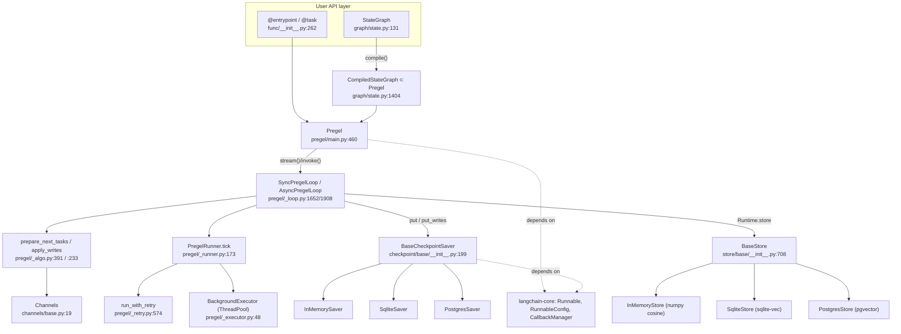
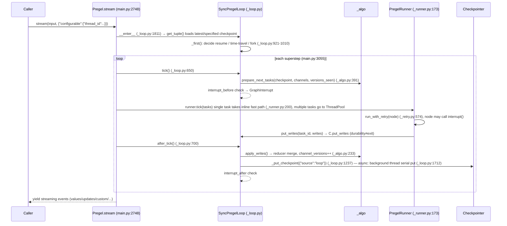

# LangGraph Source-Level Architecture Study (Hylo Reasoning Layer Selection)

- Repository: `references/reasoning/langgraph` (langchain-ai/langgraph @ `6f2df05`, 2026-10-29, MIT, monorepo `libs/`)
- Method: purely static reading (read / grep / `python3 -I` parsing `uv.lock`); **nothing was installed, and no code or benchmark was run**.
- Tag conventions: **\[Implemented\]** code exists and is traceable; **\[Docs/Interface only\]** only documentation or abstract interfaces; **\[Unverified\]** code exists but was not run to verify; **\[Needs model/hardware\]** needs an LLM API key / weights / GPU.
- Path prefix convention: below, `LG/` = `references/reasoning/langgraph/libs/` (the full citation form is `references/reasoning/langgraph/libs/<path>:<line>`).

---

## 1. Positioning and Core Capabilities

LangGraph is a **stateful graph orchestration runtime with the Pregel / BSP (Bulk Synchronous Parallel) model as its execution kernel**, aimed at "long-running, recoverable, human-in-the-loop LLM agent" workflows. Its value lies not in the LLM calls themselves (it provides no models), but in:

| Capability | Description | Status |
|---|---|---|
| StateGraph (Graph API) | Declares the state schema with TypedDict/Pydantic, reducers with `Annotated[T, reducer]`, compiled to Pregel | \[Implemented\] `LG/langgraph/langgraph/graph/state.py:131`, `:1177` |
| Functional API | `@entrypoint` / `@task`, also compiled to Pregel | \[Implemented\] `LG/langgraph/langgraph/func/__init__.py:110`, `:262` |
| Pregel runtime | Three-phase superstep Plan → Execute (parallel) → Update; channel updates become visible only between steps | \[Implemented\] `LG/langgraph/langgraph/pregel/main.py:460-505`, `:3051-3079` |
| Channels / reducers | `LastValue`, `Topic`, `BinaryOperatorAggregate`, `EphemeralValue`, `DeltaChannel` (beta), etc. | \[Implemented\] `LG/langgraph/langgraph/channels/*.py` |
| Checkpointer (short-term memory / durable execution) | Writes a checkpoint after each superstep, addressed by `thread_id` + `checkpoint_ns` + `checkpoint_id` | \[Implemented\] `LG/checkpoint/langgraph/checkpoint/base/__init__.py:199-440` |
| Time travel / fork | Replay or fork from any historical `checkpoint_id` (metadata `source="fork"`) | \[Implemented\][Unverified] `LG/langgraph/langgraph/pregel/_loop.py:921-1010`, `:1108` |
| Interrupt / HITL | `interrupt(value)` raises `GraphInterrupt`, `Command(resume=...)` resumes, the node re-executes from the beginning | \[Implemented\] `LG/langgraph/langgraph/types.py:903-1040`, `:833` |
| Static breakpoints | `interrupt_before/after` | \[Implemented\] `LG/langgraph/langgraph/pregel/_loop.py:676-681`, `:766-773` |
| Store (long-term memory) | Hierarchical namespace KV + optional vector search + TTL | \[Implemented\] `LG/checkpoint/langgraph/store/base/__init__.py:708` |
| Streaming | Multiple modes: `values/updates/checkpoints/tasks/debug/messages/custom` | \[Implemented\] `LG/langgraph/langgraph/types.py:131-139` |
| Subgraphs | Subgraph as a node, `checkpoint_ns` levels separated by `|` | \[Implemented\] `LG/langgraph/langgraph/_internal/_constants.py:90`, `pregel/main.py:1144` |
| Retry / Timeout / Cache policy | Node-level `RetryPolicy`, `TimeoutPolicy`, `CachePolicy` | \[Implemented\] `LG/langgraph/langgraph/types.py:427`, `:461`, `:530` |
| Remote deployment (LangGraph Server) | `sdk-py` is only an HTTP/WS client; the server `langgraph-api` is not in this repository | \[Docs/Interface only\] `LG/cli/pyproject.toml:26` |

One-line verdict: **LangGraph is a "persistable actor-channel state machine", suitable as Hylo's deliberative planner / task-level agent loop, but not suitable for placement inside a 5–50 Hz closed-loop control loop.**

---

## 2. Directory Layout and Architecture

```
libs/
├── langgraph/          # core runtime: graph/ (StateGraph), pregel/ (loop, algo, runner), channels/, func/, types.py
├── checkpoint/         # base interfaces: BaseCheckpointSaver, InMemorySaver, serde (JsonPlus/msgpack), BaseStore, InMemoryStore, BaseCache
├── checkpoint-sqlite/  # SqliteSaver + SqliteStore(sqlite-vec)
├── checkpoint-postgres/# PostgresSaver + PostgresStore(pgvector, hnsw/ivfflat)
├── checkpoint-conformance/ # conformance test suite for third-party savers (directly reusable for a custom saver)
├── prebuilt/           # create_react_agent / ToolNode (depends on langchain-core messages, partly deprecated)
├── sdk-py / sdk-js     # LangGraph Server clients
└── cli/                # deployment CLI (optional dependency langgraph-api)
```



---

## 3. Core Interfaces and Key Classes (signatures)

### 3.1 Graph Construction

```python
# LG/langgraph/langgraph/graph/state.py:131, :216, :376, :928, :982, :1177
class StateGraph(Generic[StateT, ContextT, InputT, OutputT]):
    def __init__(self, state_schema: type[StateT], context_schema: type[ContextT] | None = None, *,
                 input_schema=None, output_schema=None): ...
    def add_node(self, node, action=None, *, defer=False, metadata=None, input_schema=None,
                 retry_policy=None, cache_policy=None, destinations=None, ...) -> Self: ...
    def add_edge(self, start_key: str | list[str], end_key: str) -> Self: ...
    def add_conditional_edges(self, source, path, path_map=None) -> Self: ...
    def compile(self, checkpointer: Checkpointer = None, *, cache: BaseCache | None = None,
                store: BaseStore | None = None, interrupt_before=None, interrupt_after=None,
                debug=False, name=None, transformers=None) -> CompiledStateGraph: ...
```

### 3.2 Execution Entry Points (Pregel)

```python
# LG/langgraph/langgraph/pregel/main.py:2748
def stream(self, input: InputT | Command | None, config: RunnableConfig | None = None, *,
           context: ContextT | None = None, stream_mode=None, print_mode=(), output_keys=None,
           interrupt_before=None, interrupt_after=None, durability: Durability | None = None,
           control: RunControl | None = None, subgraphs: bool = False, debug=None,
           version: Literal["v1","v2"] = "v1") -> Iterator[dict[str, Any] | Any]
# invoke :3926, get_state :1464, get_state_history :1514, update_state :2617, get_subgraphs :1144
Durability = Literal["sync", "async", "exit"]          # LG/langgraph/langgraph/types.py:98
```

### 3.3 Control Primitives

```python
# LG/langgraph/langgraph/types.py
class Command(Generic[N]):   # :833  graph / update / resume / goto
class Send:                  # :738  map-reduce dynamic dispatch
def interrupt(value: Any, *, response_schema=None) -> Any   # :903 → raise GraphInterrupt (:1038)
class RetryPolicy(NamedTuple) # :427
class StateSnapshot(NamedTuple) # :711  values / next / config / metadata / tasks ...
```

### 3.4 Channel Abstraction

```python
# LG/langgraph/langgraph/channels/base.py:19-112
class BaseChannel(Generic[Value, Update, Checkpoint], ABC):
    def update(self, values: Sequence[Update]) -> bool   # reducer entry point
    def get(self) -> Value
    def checkpoint(self) -> Checkpoint | Any
    def from_checkpoint(self, checkpoint) -> Self
    def consume(self) -> bool ; def finish(self) -> bool
```

### 3.5 Checkpointer

```python
# LG/checkpoint/langgraph/checkpoint/base/__init__.py
class Checkpoint(TypedDict):          # :93  v, id (monotonically increasing), ts, channel_values, channel_versions, versions_seen, updated_channels
class CheckpointMetadata(TypedDict):  # :39  source∈{input,loop,update,fork}, step, parents, run_id
class CheckpointTuple(NamedTuple):    # :140 config, checkpoint, metadata, parent_config, pending_writes
class BaseCheckpointSaver(Generic[V]):  # :199
    def get_tuple(self, config: RunnableConfig) -> CheckpointTuple | None          # :262 (NotImplementedError)
    def list(self, config, *, filter=None, before=None, limit=None) -> Iterator[CheckpointTuple]  # :277
    def put(self, config, checkpoint, metadata, new_versions) -> RunnableConfig      # :301
    def put_writes(self, config, writes, task_id, task_path="") -> None              # :324
    def delete_thread(self, thread_id) / copy_thread(src, dst) / prune(thread_ids, strategy)  # :344 / :374 / :398
    def get_next_version(self, current, channel) -> V                                # :721
    # plus the a* async versions :441-600
```

Addressing keys: `config["configurable"] = {"thread_id", "checkpoint_ns", "checkpoint_id"}`; the SQLite primary key is `(thread_id, checkpoint_ns, checkpoint_id)` and `parent_checkpoint_id` is stored (`LG/checkpoint-sqlite/langgraph/checkpoint/sqlite/__init__.py:147-165`).

### 3.6 Store

```python
# LG/checkpoint/langgraph/store/base/__init__.py
class Item:  value: dict, key: str, namespace: tuple[str,...], created_at, updated_at   # :51
class SearchItem(Item): score: float | None                                             # :118
class IndexConfig(TypedDict): dims: int; embed: Embeddings | EmbeddingsFunc | str; fields: list[str]  # :578
class BaseStore(ABC):                                                                   # :708
    @abstractmethod def batch(self, ops: Iterable[Op]) -> list[Result]                  # :733
    @abstractmethod async def abatch(self, ops) -> list[Result]                         # :745
    def get(self, namespace, key, *, refresh_ttl=None) -> Item | None                   # :756
    def search(self, namespace_prefix, /, *, query=None, filter=None, limit=10, offset=0, refresh_ttl=None) -> list[SearchItem]  # :784
    def put(self, namespace, key, value: Mapping, index=None, *, ttl=NOT_PROVIDED)      # :866
    def delete(...) ; def list_namespaces(...)                                          # :952 / :966
```

The filter operators are only `$eq/$gt/$gte/$lt/$lte/$ne` (`LG/checkpoint/langgraph/store/memory/__init__.py:576-592`).

---

## 4. Core Execution Flow



**Superstep overhead (static analysis, \[Unverified\])**: one superstep includes at least: (1) `prepare_next_tasks` iterating over triggered nodes, generating an xxh3_128 task id for each task (`LG/langgraph/langgraph/pregel/_algo.py:33`, `:629`) and constructing a `RunnableConfig` via `patch_config`; (2) each node going through the langchain-core `CallbackManager` (`LG/langgraph/langgraph/pregel/_algo.py` imports `ParentRunManager`) and `run_with_retry`; (3) `apply_writes` sorting + reducers; (4) `create_checkpoint` copying channel values and, when a checkpointer exists, serializing (msgpack/JsonPlus, numpy arrays via ext, `LG/checkpoint/langgraph/checkpoint/serde/jsonplus.py:537`) and writing to the database; (5) the streaming output queue. All of it is pure Python holding the GIL. Our order-of-magnitude estimate is **about 0.1–1 ms/superstep for trivial nodes without a checkpointer, and up to several ms to tens of ms with jitter when there is a SQLite/Postgres checkpointer and the state contains images/point clouds** — this is only an estimate and must be measured on the target machine with the repository's own pyperf benchmarks (`LG/langgraph/bench/__main__.py`, `LG/langgraph/bench/sequential.py`). In addition, the default `recursion_limit` = 10007 (`LG/langgraph/langgraph/_internal/_config.py:42-44`), which is hit after about 200 s at 50 Hz, showing that the design assumption is "one run = an agent task with a finite number of steps", not an infinite control loop.

---

## 5. Extension Points and Plugin Mechanism

| Extension point | Mechanism | Significance for Hylo |
|---|---|---|
| Custom Checkpointer | Subclass `BaseCheckpointSaver`, implement `get_tuple/list/put/put_writes` (+async) \[Docs/Interface only\] `LG/checkpoint/langgraph/checkpoint/base/__init__.py:262-343`; conformance tests in `LG/checkpoint-conformance/` \[Implemented\] | We can write a saver that persists checkpoints to our episode artifact store (e.g. alongside a Zarr/LeRobot dataset) |
| Custom Serializer / encryption | `SerializerProtocol.dumps_typed/loads_typed`, `CipherProtocol` \[Implemented\] `LG/checkpoint/langgraph/checkpoint/serde/base.py:15-51` | Large tensors can be serialized as external references (store only the URI) |
| Custom Store | Subclass `BaseStore`, only `batch/abatch` need to be implemented \[Implemented\] `LG/checkpoint/langgraph/store/base/__init__.py:733-755` | Can bridge to our spatial / skill memory backends |
| Custom Channel / reducer | Subclass `BaseChannel` or `Annotated[T, fn]` \[Implemented\] `LG/langgraph/langgraph/channels/base.py:19` | E.g. incremental fusion of world-model beliefs |
| Any callable as a node | A node can be any Python function (wrapped as `RunnableCallable`) \[Implemented\] | Reasoner nodes can call any model internally, without needing LangChain |
| Runtime context / store injection | `Runtime(context, store, stream_writer, previous, control)` \[Implemented\] `LG/langgraph/langgraph/runtime.py:125-219` | Inject robot handles and sim handles as context |
| Cache | `BaseCache` \[Implemented\] `LG/checkpoint/langgraph/cache/base/__init__.py:15` | Cache expensive VLM calls |
| Callbacks / tracing | Goes through langchain-core callbacks; `graph_callback_manager.on_interrupt/on_resume` \[Implemented\] `LG/langgraph/langgraph/pregel/main.py:2979-2988` | Needs adapting to our own tracing (OpenTelemetry, etc.) |

---

## 6. Dependencies and Runtime Requirements

- `langgraph` 1.2.18 hard dependencies: `langchain-core>=1.4.7,<2`, `langgraph-checkpoint`, `langgraph-sdk`, `langgraph-prebuilt`, `xxhash`, `pydantic` (`LG/langgraph/pyproject.toml:26-32`) \[Implemented\].
- **langchain-core is a hard dependency of the core runtime and cannot be stripped out**: `Pregel` inherits/uses `Runnable`, `RunnableConfig`, `CallbackManager` (imports at the top of `LG/langgraph/langgraph/pregel/main.py`; `LG/langgraph/langgraph/pregel/_algo.py`, `_loop.py`, `_executor.py:58` use `get_executor_for_config`); even the `checkpoint` base package imports `RunnableConfig` (`LG/checkpoint/langgraph/checkpoint/base/__init__.py:16`), `Embeddings` (`LG/checkpoint/langgraph/store/base/__init__.py:25`), `Reviver` (`LG/checkpoint/langgraph/checkpoint/serde/jsonplus.py:31`) \[Implemented\].
- Transitive dependencies (resolved from `LG/langgraph/uv.lock`, \[Implemented\]): langchain-core 1.6.5 → `httpx, jsonpatch, langchain-protocol, langsmith, packaging, pydantic, pyyaml, tenacity, uuid-utils`; langsmith → `requests, requests-toolbelt, orjson, websockets, xxhash, zstandard`; langgraph-sdk → `httpx, orjson, websockets, langchain-core`. **No hard dependency on torch / numpy**; the dependency surface is "medium-to-light but with a long chain", and the main risk is that the langsmith telemetry client gets pulled in.
- Backends: `checkpoint-sqlite` needs `aiosqlite, sqlite-vec`; `checkpoint-postgres` needs `psycopg, psycopg-pool` (+ the pgvector extension for vector search) \[Implemented\]. InMemoryStore vector search optionally uses numpy (`LG/checkpoint/langgraph/store/memory/__init__.py:480-500`).
- Runtime requirements: Python 3.10+; no GPU and no LLM key required (the runtime itself is model-agnostic).

---

## 7. License and Reuse Constraints

- Repository root `LICENSE`: MIT, Copyright (c) 2024 LangChain, Inc.; each sub-package's `pyproject.toml` declares `license = "MIT"` (`LG/langgraph/pyproject.toml:12`, `LG/checkpoint/pyproject.toml:12`) \[Implemented\].
- Free to vendor / modify / use commercially; the copyright notice must be retained.
- Note: the `cli` optional dependency `langgraph-api` (`LG/cli/pyproject.toml:26`) is not in this repository, and its license was not checked this time \[Unverified\]; we should not depend on LangGraph Server / Platform.

---

## 8. Strengths, Weaknesses and Risks

**Strengths**
1. The semantics of BSP supersteps + versioned channels are clear, and writes from parallel nodes are merged deterministically between steps (`apply_writes` sorts by task path, `LG/langgraph/langgraph/pregel/_algo.py:254-255`) \[Implemented\].
2. Durable execution is very complete: the pending-writes mechanism means nodes that already succeeded in a failed superstep need not be re-run (`LG/langgraph/langgraph/pregel/_loop.py:671-674`) \[Implemented\][Unverified].
3. The checkpoint model (parent chain + namespace + fork metadata) naturally supports time travel and forked experiments \[Implemented\].
4. `interrupt()`/`Command(resume)` are mature HITL primitives, directly usable for "safety operator confirmation" and "policy-switch approval" \[Implemented\].
5. Ships with a conformance test suite, so the correctness of a custom saver can be verified \[Implemented\].

**Weaknesses / Risks**
1. **Not real-time**: pure Python, GIL, ThreadPool, callbacks + serialization at every step, no timing guarantees, no deadline scheduling; `step_timeout` is just a timeout, not real-time scheduling \[Implemented\].
2. **Locked to langchain-core**: `RunnableConfig`, callbacks, and Runnable semantics pervade the runtime, violating the "framework" part of the requirement that "the Reasoning layer not be bound to a single LLM framework" (although it is not bound to an LLM vendor) \[Implemented\].
3. Fast API evolution: `DeltaChannel` is beta (`LG/langgraph/langgraph/channels/delta.py:25-36`), `prebuilt` is largely deprecated and points to `langchain.agents` (`LG/prebuilt/langgraph/prebuilt/chat_agent_executor.py:53-101`), and `stream(version="v1"/"v2")` runs on two tracks \[Implemented\].
4. **Checkpoint size**: one checkpoint per superstep; if the state holds images/point clouds, storage grows linearly; `prune` is `NotImplementedError` in the base class and carries a silent data-loss risk with DeltaChannel (`LG/checkpoint/langgraph/checkpoint/base/__init__.py:398-440`) \[Implemented\].
5. The interrupt resume semantics are "the node re-executes from the beginning" (`LG/langgraph/langgraph/types.py:917-918`); if the node has already sent actions to a real robot, the **physical side effects will be executed again** — action execution must be placed in a separate node and designed to be idempotent \[Implemented\].
6. The Store lacks spatial indexing, time-series queries, graph structure, and binary large objects; filters are only simple comparisons \[Implemented\].
7. Serialization security: JsonPlus has an allowlist, with an optional `pickle_fallback` (`LG/checkpoint/langgraph/checkpoint/serde/jsonplus.py:104-141`) that must be kept off \[Implemented\].

---

## 9. Components Worth Reusing

| Component | Reuse approach | Rationale |
|---|---|---|
| `StateGraph` + Pregel runtime | As an **optional adapter** driving the deliberative planner (0.1–2 Hz) | Gains HITL, durability, and time travel at low cost |
| `BaseCheckpointSaver` interface + `SqliteSaver/PostgresSaver` | Planning-layer thread persistence; at the episode level store only the "planning decision trajectory", not high-frequency observations | Mature, with conformance tests |
| Checkpoint data model (thread/ns/id + parent + pending_writes) | **Borrow the design** for Hylo's own `EpisodeCheckpoint` schema | The versioning + fork semantics are worth copying |
| `interrupt()` / `Command(resume)` | Safety operator confirmation, failure recovery, human-robot collaborative demonstration | Off-the-shelf HITL |
| `BaseStore` interface (namespace tuple + batch ops) | As **one backend implementation** of episodic/semantic memory, behind our own `MemoryBackend` protocol | Concise interface; Postgres+pgvector is production-ready |
| `checkpoint-conformance` | If we build our own saver, use it for regression testing | No need to write tests |

## 10. Capabilities Not Worth Rebuilding

- The HITL interrupt/resume state machine, and the pending-writes recovery logic of durable execution (complex, with extensive edge-case handling already in place, see `_loop.py:921-1110`).
- A checkpoint version tree with parent chain and fork, and SQLite/Postgres persistence schemas.
- A KV + vector Store with pgvector/hnsw.
- Multi-mode streaming events (tasks/updates/custom).

Conversely, the following **should not** be handed to LangGraph: high-frequency control loops, sensor streams, trajectory/action chunk storage, spatial memory indexing, skill library version management.

---

## 11. Source Index of Key Implementations

| Topic | Location | Tag |
|---|---|---|
| Pregel class and BSP description | `references/reasoning/langgraph/libs/langgraph/langgraph/pregel/main.py:460-505` | \[Implemented\] |
| `stream()` signature | `references/reasoning/langgraph/libs/langgraph/langgraph/pregel/main.py:2748-2765` | \[Implemented\] |
| Superstep main loop | `references/reasoning/langgraph/libs/langgraph/langgraph/pregel/main.py:3051-3079` | \[Implemented\] |
| `tick()` / `after_tick()` | `references/reasoning/langgraph/libs/langgraph/langgraph/pregel/_loop.py:650-773` | \[Implemented\] |
| Checkpoint writing | `references/reasoning/langgraph/libs/langgraph/langgraph/pregel/_loop.py:1237-1330` | \[Implemented\] |
| Background serial put | `references/reasoning/langgraph/libs/langgraph/langgraph/pregel/_loop.py:1712-1727` | \[Implemented\] |
| resume / time-travel / fork decision | `references/reasoning/langgraph/libs/langgraph/langgraph/pregel/_loop.py:921-1010` | \[Implemented\][Unverified] |
| `prepare_next_tasks` / `apply_writes` | `references/reasoning/langgraph/libs/langgraph/langgraph/pregel/_algo.py:391`, `:233` | \[Implemented\] |
| Runner single-task fast path | `references/reasoning/langgraph/libs/langgraph/langgraph/pregel/_runner.py:197-215` | \[Implemented\] |
| ThreadPool executor | `references/reasoning/langgraph/libs/langgraph/langgraph/pregel/_executor.py:48-60` | \[Implemented\] |
| Durability type / default async | `references/reasoning/langgraph/libs/langgraph/langgraph/types.py:98`; `pregel/main.py:2696` | \[Implemented\] |
| `interrupt()` | `references/reasoning/langgraph/libs/langgraph/langgraph/types.py:903-1040` | \[Implemented\] |
| `Command` / `Send` | `references/reasoning/langgraph/libs/langgraph/langgraph/types.py:833`, `:738` | \[Implemented\] |
| StateGraph / compile | `references/reasoning/langgraph/libs/langgraph/langgraph/graph/state.py:131`, `:1177` | \[Implemented\] |
| BaseChannel | `references/reasoning/langgraph/libs/langgraph/langgraph/channels/base.py:19-112` | \[Implemented\] |
| DeltaChannel (beta) | `references/reasoning/langgraph/libs/langgraph/langgraph/channels/delta.py:25` | \[Implemented\][Unverified] |
| Runtime injection | `references/reasoning/langgraph/libs/langgraph/langgraph/runtime.py:125-219` | \[Implemented\] |
| Checkpoint / Metadata / Saver | `references/reasoning/langgraph/libs/checkpoint/langgraph/checkpoint/base/__init__.py:39`, `:93`, `:199` | \[Implemented\]/\[Docs/Interface only\] |
| prune contract | `references/reasoning/langgraph/libs/checkpoint/langgraph/checkpoint/base/__init__.py:398-440` | \[Docs/Interface only\] |
| SQLite schema | `references/reasoning/langgraph/libs/checkpoint-sqlite/langgraph/checkpoint/sqlite/__init__.py:147-165` | \[Implemented\] |
| Serde (numpy ext, allowlist) | `references/reasoning/langgraph/libs/checkpoint/langgraph/checkpoint/serde/jsonplus.py:104`, `:537` | \[Implemented\] |
| BaseStore | `references/reasoning/langgraph/libs/checkpoint/langgraph/store/base/__init__.py:708-1010` | \[Implemented\] |
| IndexConfig / Embeddings binding | `references/reasoning/langgraph/libs/checkpoint/langgraph/store/base/__init__.py:578`; `store/base/embed.py:17` | \[Implemented\] |
| InMemoryStore filter operators | `references/reasoning/langgraph/libs/checkpoint/langgraph/store/memory/__init__.py:551-592` | \[Implemented\] |
| PostgresStore + pgvector | `references/reasoning/langgraph/libs/checkpoint-postgres/langgraph/store/postgres/base.py:179-237`, `:668` | \[Implemented\][Unverified] |
| Default recursion_limit | `references/reasoning/langgraph/libs/langgraph/langgraph/_internal/_config.py:42-44` | \[Implemented\] |
| Benchmark scripts | `references/reasoning/langgraph/libs/langgraph/bench/__main__.py` | \[Implemented\][Unverified] |

---

## Verification Status Summary

| Capability | Tag | Notes |
|---|---|---|
| StateGraph / Pregel superstep | \[Implemented\] | Code path fully traceable |
| langchain-core is a hard dependency | \[Implemented\] | Confirmed at the import level |
| Checkpointer interface and SQLite/Postgres implementations | \[Implemented\] | Not run |
| Durable recovery / time travel / fork | \[Implemented\][Unverified] | Complex logic, tests not run |
| interrupt / Command resume | \[Implemented\] | |
| Store + vector search | \[Implemented\][Unverified] | Vector search needs an embedding model → \[Needs model/hardware\] |
| Per-superstep overhead figures | \[Unverified\] | Static estimate only; need to run `bench/` |
| Feasibility for 5–50 Hz control | \[Unverified\] | Conclusion based on structural analysis: not recommended |
| LangGraph Server / Platform | \[Docs/Interface only\] | Not in the repository |

---

## 12. Mapping to Hylo Reasoner / Memory / Improvement Interfaces

**(a) Agent Loop frequency positioning**: LangGraph is used only for the **deliberative layer** (task decomposition, subgoal selection, failure recovery, HITL), typically 0.1–2 Hz, with one `invoke`/`stream` per "thinking cycle". The 5–50 Hz VLA / control loop must run in Hylo's own real-time loop (or C++/ROS2 nodes); LangGraph nodes only dispatch "skill call + parameters" and read back execution results via the `custom` stream or the Store. See the superstep overhead in Section 4 and weaknesses 1 and 5 in Section 8 for the reasons.

**(b) Episode checkpoint / replay**: suitable for checkpointing the **planning decision trajectory** (thread_id = episode_id, checkpoint_ns distinguishes planner subgraphs); time travel can be used for "fork and retry from the k-th planning decision". **Not suitable** for storing high-frequency observations/actions: one checkpoint per superstep, with a full (non-Delta) copy of channel values. Recommendation: put only references in the state (`obs_uri`, `traj_chunk_id`), with raw data going into Hylo's episode storage; rolling back sim physical state requires the simulator's own snapshot, while LangGraph's fork only rolls back the "thinking state".

**(c) Store as a memory backend**: suitable for episodic (`("episodic", robot_id, task)`) and semantic (text facts + vector search) memory. Missing: 3D spatial indexing (KD-tree/voxel/scene graph), time-window queries, multimodal embeddings (`IndexConfig.embed` applies only to text fields, `LG/checkpoint/langgraph/store/base/__init__.py:578-600`), versioning and dependencies of skills (code/policy weights), binary large objects. Hylo should define its own `MemoryBackend` protocol, with `LangGraphStoreBackend` being just one implementation of it.

**(f) Integration pattern**: an **optional adapter package** (e.g. `hylo-reasoner-langgraph`), with the core package having zero dependency on langchain-core.

```python
# Hylo core (no LangGraph dependency)
class Reasoner(Protocol):
    def step(self, obs: ObsRef, ctx: ReasonerContext) -> Plan | SkillCall | Interrupt: ...
    def snapshot(self) -> ReasonerState: ...
    def restore(self, state: ReasonerState) -> None: ...

class MemoryBackend(Protocol):
    def put(self, ns: tuple[str, ...], key: str, value: dict, *, embedding: Vec | None = None) -> None: ...
    def search(self, ns_prefix, *, query=None, filter=None, k=10) -> list[MemoryItem]: ...

# adapter package
class LangGraphReasoner(Reasoner):      # wraps CompiledStateGraph; thread_id = episode_id
class LangGraphStoreBackend(MemoryBackend):  # wraps BaseStore.batch
class EpisodeCheckpointSaver(BaseCheckpointSaver):  # persists to the Hylo episode store, validated with checkpoint-conformance
```

**Improvement mapping**: LangGraph itself provides no optimizer; however, the decision trajectories exported by `get_state_history` can serve as training/reflection data for candidate generators such as DSPy/GEPA (see `dspy.md`).
