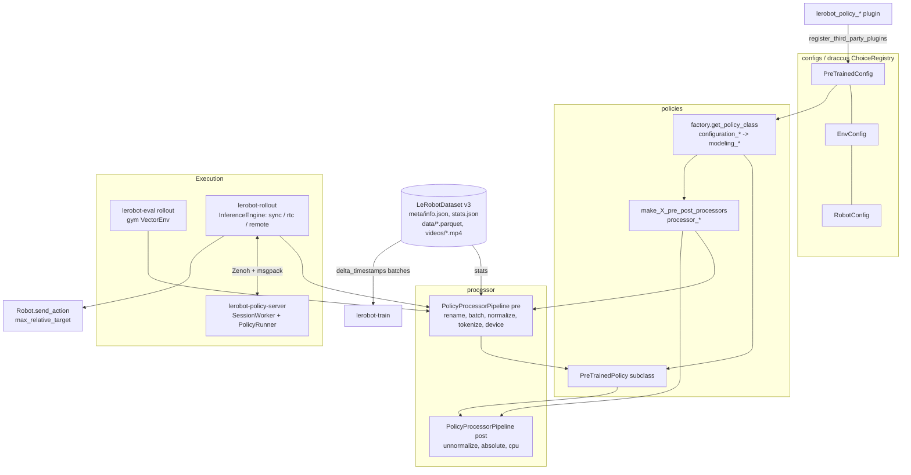
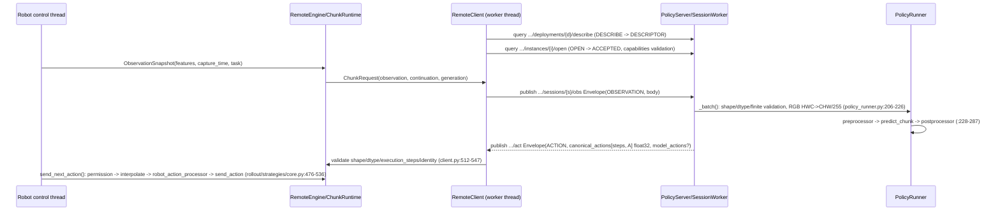

# LeRobot Source-Level Architecture Study (for `Hylo`)

> Repository: `huggingface/lerobot` @ `38b975c` (package version `0.6.2`, `references/policies/lerobot/pyproject.toml:28`); code license Apache-2.0 (`references/policies/lerobot/pyproject.toml:31`).
> Method: purely static reading (read / grep / find); no dependencies installed, no tests run, no weights downloaded.
> Tags: **\[Implemented\]** code exists and is traceable; **\[Docs/Interface only\]** only documentation or an abstract interface; **\[Unverified\]** code exists but was not run in this study; **\[Needs model/hardware\]** requires weights / GPU / a real robot.
> Note: LeRobot at this commit differs significantly from the versions commonly seen in mid-2025: the old gRPC `async_inference` has been removed and replaced by a **Zenoh + MessagePack**-based `remote_inference`; datasets use the **v3.0** format.

---

## 1. Positioning and Core Capabilities

LeRobot is an "end-to-end robot learning framework" in the PyTorch ecosystem: dataset format + recording, policy training and evaluation, simulation benchmark adapters, real-robot Robot/Teleoperator drivers, and a remote inference service. For `Hylo`, its three most valuable assets are: **(a) a Policy base-class contract implemented by 25 policies**, **(b) a serializable processor pipeline (normalization and other pre/post-processing)**, and **(c) the LeRobotDataset v3 data format**, which has become the de facto standard input for third-party VLA training such as openpi.

| Capability | Status | Evidence |
|---|---|---|
| `PreTrainedPolicy` abstract base class (`select_action` / `predict_action_chunk` / `reset` / `forward`) | \[Implemented\] | `references/policies/lerobot/src/lerobot/policies/pretrained.py:72-429` |
| draccus `ChoiceRegistry` registers 25 policies (act, diffusion, pi0, pi05, pi0_fast, smolvla, groot, xvla ...) | \[Implemented\] | `grep register_subclass policies/`; `references/policies/lerobot/src/lerobot/configs/policies.py:43` |
| Automatic third-party plugin discovery (installed distributions with prefixes such as `lerobot_policy_*`) | \[Implemented\] | `references/policies/lerobot/src/lerobot/utils/import_utils.py:246-282` |
| Processor pipeline (Normalizer/Unnormalizer, tokenizer, device, rename, etc.), supports `save_pretrained`/`from_pretrained` | \[Implemented\] | `references/policies/lerobot/src/lerobot/processor/pipeline.py:274-345`, `normalize_processor.py:305-560` |
| Action chunking + ACT temporal ensembling + RTC (Real-Time Chunking) | \[Implemented\][Unverified] | `policies/act/modeling_act.py:96-126,170-224`; `policies/pretrained.py:64-69,308-357` |
| Remote inference (Zenoh pub/sub + query, msgpack envelope, session admission, capability negotiation) | \[Implemented\][Unverified] | `remote_inference/protocol.py:23-189`, `codec.py:147-338`, `server.py:870-993` |
| gRPC: used only for HIL-SERL actor<->learner (not an inference service) | \[Implemented\] | `transport/services.proto`, `rl/learner.py:525-533`, `rl/actor.py:436-469` |
| Simulation benchmark adapters (aloha, pusht, libero, libero_plus, metaworld, robocasa, robotwin, robomme, vlabench, isaaclab_arena ...) + `lerobot-eval` | \[Implemented\][Needs model/hardware] | `envs/configs.py:57-660`, `scripts/lerobot_eval.py:173-420` |
| Real-robot `Robot`/`Teleoperator` abstractions, 17 robot drivers | \[Implemented\][Needs model/hardware] | `robots/robot.py:33-232`, `teleoperators/teleoperator.py:32-225` |
| Safety: `max_relative_target` relative-displacement clamping, `EEBoundsAndSafety`, position hold | \[Implemented\][Needs model/hardware] | `robots/utils.py:93-128`, `robots/so_follower/robot_kinematic_processor.py:193-246`, `rollout/robot_wrapper.py:116-134` |

## 2. Directory Layout and Architecture

```
src/lerobot/
  configs/        draccus config base classes: PreTrainedConfig, FeatureType, NormalizationMode, Train/Eval pipeline config
  policies/       25 policies; each directory follows the configuration_X.py / modeling_X.py / processor_X.py convention
    pretrained.py PreTrainedPolicy base class; chunk.py: FeatureSpec / ChunkPolicySpec / ExecutionMode
    factory.py    get_policy_class / make_policy / make_pre_post_processors (lazy import by naming convention)
    rtc/          Real-Time Chunking (guided / trained)
  processor/      ProcessorStep + DataProcessorPipeline + various steps (normalize, tokenizer, device, relative action ...)
  datasets/       LeRobotDataset v3.0 (parquet + mp4 + meta/), streaming, lance backend, stats
  envs/           EnvConfig(ChoiceRegistry) + gym VectorEnv construction + env processors + EnvHub(remote code)
  inference/      InferenceEngine (sync / rtc), PolicyRunner, contracts (PolicyCapabilities, ActionChunk ...)
  remote_inference/ Zenoh remote inference: protocol / codec / client / server / deployment
  rollout/        real-robot/sim rollout controllers, strategies (episodic, dagger, sentry, highlight), ThreadSafeRobot
  robots/ teleoperators/ motors/ cameras/   hardware abstractions and drivers
  transport/      zenoh.py (remote inference), services.proto (RL gRPC)
  scripts/        lerobot-train / lerobot-eval / lerobot-record / lerobot-rollout / lerobot-policy-server ...
```



## 3. Core Interfaces and Key Classes (signatures)

**Policy base class** \[Implemented\] — `references/policies/lerobot/src/lerobot/policies/pretrained.py`
```python
class PreTrainedPolicy(nn.Module, HubMixin, abc.ABC):            # :72
    config_class: ClassVar[type[PreTrainedConfig]]; name: ClassVar[str]   # subclasses must define these; enforced at :110-115
    _action_queue_attrs = ("_queues", "_action_queue")            # :98
    @abstractmethod def get_optim_params(self) -> OptimizerParams           # :230-235
    @abstractmethod def reset(self)                                         # :237-243 "called on env reset"
    def drop_queued_actions(self) -> None                                   # :245-261 discard the queue when the instruction changes mid-episode
    def count_queued_actions(self) -> int                                   # :263-278
    def supports_rtc(self) -> bool                                          # :280
    def chunk_inference_spec(self) -> ChunkPolicySpec                       # :308-357 remote/async service contract
    def supports_text_generation(self) -> bool; def generate_text(batch)->str  # :359-374
    @abstractmethod def forward(self, batch) -> tuple[Tensor, dict | None]     # :376-387 training loss
    @abstractmethod def predict_action_chunk(self, batch, **kw) -> Tensor | PolicyOutput  # :389-403 [B, chunk, A]
    @abstractmethod def select_action(self, batch, **kw) -> Tensor | PolicyOutput         # :405-429 single step [B, A]
```
`RTCActionSelectKwargs = {inference_delay, prev_chunk_left_over, execution_horizon}` (`pretrained.py:64-69`).

**Chunk service contract** \[Implemented\] — `policies/chunk.py`
```python
class ExecutionMode(StrEnum): CHUNK="chunk"; RTC_GUIDED="rtc_guided"; RTC_TRAINED="rtc_trained"   # :21-26
@dataclass(frozen=True) class FeatureSpec: name; shape; dtype; kind="tensor"|"rgb"; names=(); semantics  # :29-64
    # rgb must be HWC uint8 with 3 channels; semantics is required (units/coordinate conventions)
@dataclass(frozen=True) class ChunkPolicySpec: prediction_steps; execution_steps; modes;
    current_observation_only=True; retains_session_state=True; training_max_delay=0          # :67-86
```

**Configuration and feature types** \[Implemented\] — `configs/policies.py:43-85`, `configs/types.py:20-45`
```python
class PreTrainedConfig(draccus.ChoiceRegistry, HubMixin, abc.ABC):
    n_obs_steps=1; input_features: dict[str, PolicyFeature]; output_features: ...; device; dtype; use_amp; pretrained_path ...
    observation_delta_indices / action_delta_indices (abstract property)   # source of delta_timestamps during training
FeatureType = STATE | VISUAL | ENV | ACTION | REWARD | LANGUAGE
NormalizationMode = MIN_MAX | MEAN_STD | IDENTITY | QUANTILES | QUANTILE10
PolicyFeature(type: FeatureType, shape: tuple)
```

**Processor** \[Implemented\] — `processor/pipeline.py`
```python
class ProcessorStepRegistry: register(name) / get(name)                       # :66-147
class ProcessorStep(ABC): __call__(EnvTransition)->EnvTransition; get_config; state_dict; load_state_dict; reset; transform_features   # :150-241
class DataProcessorPipeline[TIn, TOut](HubMixin): steps; to_transition; to_output; __call__; step_through; save_pretrained/from_pretrained  # :274-860
PolicyProcessorPipeline = RobotProcessorPipeline = DataProcessorPipeline     # :1864-1865
```
`NormalizerProcessorStep` (`normalize_processor.py:428`) / `UnnormalizerProcessorStep` (`:502`), `eps=1e-8` (`:98`).

**Inference/service contract** \[Implemented\] — `inference/contracts.py`
```python
PolicyCapabilities(modes, prediction_steps, execution_steps, action_interval, features, action_feature,
                   language=False, training_max_delay=0, rtc_horizon=0, current_observation_only=True,
                   retains_session_state=True, action_representation="canonical", model_action_dim=None)  # :54-84
ObservationSnapshot(features: Mapping[str, np.ndarray], capture_time, task, task_version=0,
                    observation_id="", action_cursor=None, execution_generation=None)   # :86-113 copied + made read-only on construction
ActionProvenance(capture_time, task, task_version, observation_id, request_id, generation, session_id, server_instance_id, artifact_identity)  # :115-128
ActionChunk(model_actions | None, canonical_actions, provenance, execution_steps, server_durations, prediction=None)  # :130-139
```
`InferenceEngine` (`inference/base.py:124`) abstract methods `start/stop/reset/get_action(obs_frame)` (`:818-830`).

**Hardware** \[Implemented\][Needs model/hardware] — `robots/robot.py:33-232`: `observation_features`, `action_features`, `connect(calibrate)`, `calibrate`, `configure`, `get_observation() -> RobotObservation`, `send_action(action) -> RobotAction` (returns the action *actually sent*, which may have been clipped), `disconnect`. `Teleoperator` (`teleoperators/teleoperator.py:32`) is symmetric: `get_action`, `send_feedback`.

## 4. Core Execution Flow

**4.1 Simulation evaluation (`lerobot-eval`)** — `scripts/lerobot_eval.py:173-420`, \[Implemented\][Needs model/hardware]

```mermaid
sequenceDiagram
  participant Env as gym VectorEnv
  participant EP as env_preprocessor
  participant Pre as policy preprocessor
  participant P as PreTrainedPolicy
  participant Post as postprocessor
  participant EPo as env_postprocessor
  Note over P,Pre: policy.reset(); preprocessor.reset(); postprocessor.reset() (:229-231)
  Env->>Env: reset(seed, options={NEW_ROLLOUT_OPTION}) (:234)
  loop step < max_steps (:295)
    Env->>EP: preprocess_observation(obs) HWC uint8 -> BCHW float[0,1] (:297, envs/utils.py:68)
    Note over EP: obs["task"] = env.call("task_description") (:302-308)
    EP->>Pre: env-specific (e.g. LIBERO) (:312)
    Pre->>P: rename -> batch -> normalize -> tokenize -> device (:314)
    P->>P: select_action(): queue empty? predict_action_chunk()[:, :n_action_steps] (act :120-126)
    P->>Post: action [B, A] (normalized) (:317)
    Post->>EPo: unnormalize -> absolute -> cpu (:321-324)
    EPo->>Env: env.step(action_numpy [B, A]) (:332)
  end
```

Key points: the eval loop **calls `select_action` once per env step**; chunk caching/temporal ensembling is entirely hidden inside the policy (`modeling_act.py:104-126`). ACT's temporal ensembling weights are `w_i = exp(-coeff * i)` (`modeling_act.py:170-224`); when enabled, the full chunk is inferred at every step.

**4.2 Remote inference (`lerobot-rollout` + `lerobot-policy-server`)** — \[Implemented\][Unverified]



## 5. Extension Points and Plugin Mechanism

1. **New policy (in-tree or plugin)** \[Implemented\]: three files + a naming convention. `@PreTrainedConfig.register_subclass("my_policy")` registers the config; `get_policy_class` rewrites the config's module path from `configuration_*` to `modeling_*` and takes the `<Name>Policy` class (`policies/factory.py:62-107`, `:472-483`); processors are looked up by the function name `make_{type}_pre_post_processors` (`:519-550`), with optional `make_{type}_pre_post_processors_from_pretrained` (`:486-517`). Docs: `docs/source/bring_your_own_policies.mdx:5,18,203`.
2. **Plugin discovery** \[Implemented\]: `register_third_party_plugins()` iterates over `importlib.metadata.distributions()` and imports packages whose names start with `lerobot_robot_ / lerobot_camera_ / lerobot_teleoperator_ / lerobot_policy_ / lerobot_env_ / lerobot_strategy_` (`utils/import_utils.py:246-282`); train / eval / policy-server / rollout all call it (e.g. `scripts/lerobot_policy_server.py:88`, `lerobot_eval.py:1179`). Note: **it scans distribution-name prefixes, not entry_points**; import failures are only logged.
3. **ProcessorStep registration** \[Implemented\]: `@ProcessorStepRegistry.register(name=...)`; the pipeline JSON is deserialized by name (`processor/pipeline.py:66-147`, `:1140-1205`).
4. **Env** \[Implemented\]: `@EnvConfig.register_subclass(...)`, overriding `gym_kwargs` / `create_envs` / `get_env_processors` (`envs/configs.py:57-129`); or EnvHub: `make_env` downloads `env.py` from the Hub and executes it, requiring an explicit `trust_remote_code=True` (`envs/factory.py:58-113`).
5. **Robot / Teleoperator** \[Implemented\]: `RobotConfig(draccus.ChoiceRegistry)` (`robots/config.py:23`) + `Robot` ABC.
6. **Service contract overrides** \[Implemented\]: a policy can override `chunk_inference_spec()` / `validate_chunk_input_features()` to declare resize/mask/horizon behavior (`pretrained.py:284-357`).

## 6. Dependencies and Runtime Requirements

- Python `>=3.12` (`pyproject.toml:32`), `torch>=2.7,<2.12` (`:62`), `draccus>=0.11.6,<0.12` (`:70`), `gymnasium>=1.1.1,<2` (`:81`). \[Implemented\]
- Datasets: `datasets>=4.8`, `pyarrow`, `torchcodec` (platform-restricted, `:109-124`).
- VLA policy extras: `pi = transformers-dep + scipy + sentencepiece` (`:231`), `transformers>=5.4,<5.6` (`:164`).
- Remote inference: `remote = eclipse-zenoh>=1.9,<1.11, msgpack>=1.1` (`:283`); gRPC only in the `hilserl` extra (`:166,271`).
- pi0/pi05 require accepting the Hub license for the `google/paligemma-3b-pt-224` tokenizer and logging in (`docs/source/pi05.mdx:72-73`). \[Docs/Interface only\][Needs model/hardware]
- LIBERO and other simulators need the corresponding packages such as `hf-libero` (`:311`), and usually need GPU/EGL. \[Needs model/hardware\]

## 7. License and Reuse Constraints (code vs weights)

| Object | License | Evidence / Notes |
|---|---|---|
| LeRobot code | Apache-2.0 | `LICENSE`, `pyproject.toml:31` \[Implemented\] |
| **Documentation claim** for the pi0 / pi05 LeRobot port | "Apache 2.0, consistent with OpenPI" | `docs/source/pi0.mdx:136-138`, `docs/source/pi05.mdx:389-391`, `policies/pi05/README.md:105-107` \[Docs/Interface only\] |
| pi0/pi05 **weights** (`lerobot/pi05_base` etc., ported from openpi) | **Needs legal confirmation**: the weights are a Model Derivative of PaliGemma (Gemma), and the openpi repository root ships `LICENSE_GEMMA.txt` (Gemma Terms of Use). The "Apache 2.0" in the LeRobot docs covers only the code and cannot be treated as a weights license | See the openpi report §7; `docs/source/pi05.mdx:72-73` requires accepting the PaliGemma license \[Docs/Interface only\] |
| GR00T weights | NVIDIA Open Model License | `docs/source/groot.mdx:224-226` \[Docs/Interface only\] |
| Datasets / other checkpoints on the Hub | Determined by each model card; can be recorded in the `PreTrainedConfig.license` field (`configs/policies.py:82`) | \[Docs/Interface only\] |

Conclusion: there is no obstacle to reusing LeRobot **code** (Apache-2.0; just keep NOTICE/copyright headers); **the license of every VLA weight must be reviewed individually against its model card**, and the `Hylo` policy registry should make `weights_license` a required metadata field.

## 8. Strengths, Weaknesses and Risks

**Strengths**
- The Policy contract has been battle-tested by 25 implementations; the separation of `select_action` (single step, internal queue) from `predict_action_chunk` (whole chunk) covers exactly both usage modes: "synchronous single-step env" and "asynchronous chunk service". \[Implemented\]
- The processor pipeline **serializes normalization statistics together with the checkpoint** (`policy_preprocessor.json` + safetensors state), avoiding train/serve statistics drift. \[Implemented\]
- The contract design of the new remote_inference is very rigorous: explicit `FeatureSpec.semantics`, capability negotiation, session/generation/request correlation, codec resource limits (`codec.py:40-59`), rejection of NaN/Inf (`codec.py:184-185,245`), provenance tracking. \[Implemented\][Unverified]
- `send_action` returns the actually sent value and applies `max_relative_target` clamping; the safety semantics are clear. \[Implemented\]

**Weaknesses / Risks**
- The repository evolves extremely fast (`async_inference` gRPC -> Zenoh; v2.1 -> v3.0 datasets; `lerobot.common.*` -> `lerobot.*`), so the API is unstable; openpi is pinned to an old commit and can no longer coexist with this commit (see the openpi report §6).
- Plugin discovery relies on distribution-name prefixes + importing everything, failing silently (only logged), and importing any installed package carries a risk of side effects.
- `preprocess_observation` still hard-codes keys such as `pixels`/`agent_pos` (TODO comment at `envs/utils.py:68-69`).
- The Zenoh server is "one deployment, one model, one session" and does not support batching or multi-tenancy (`remote_inference/README.md` §1); `chunk_inference_spec` requires `n_obs_steps=1` and disables temporal ensembling (`pretrained.py:324-339`).
- Safety clamping is implemented only in some robot drivers (e.g. `so_follower.py:206-209`) and is **not enforced by the base class**; the remote code execution risk of EnvHub is gated by `trust_remote_code`.
- The version constraints of Python 3.12 + transformers 5.x conflict with other stacks (openpi: py3.11 + transformers 4.53.2).

## 9. Components Worth Reusing

1. **The data model of `FeatureSpec` / `ChunkPolicySpec` / `PolicyCapabilities` / `ActionChunk` / `ActionProvenance`** (`policies/chunk.py:21-86`, `inference/contracts.py:54-139`): can serve almost directly as the schema blueprint for the `Hylo` Policy contract (especially required `semantics` and the separation of `prediction_steps` vs `execution_steps`).
2. **Normalization math and mode enum** (`normalize_processor.py:305-425`), compatible with openpi's quantile mode.
3. **LeRobotDataset v3 format** as the primary exchange format for `Hylo` training/memory data (readers/writers can depend directly on `lerobot[dataset]`).
4. **The envelope + codec design of remote_inference** (version number, message_type, correlation IDs, explicit tensor/rgb records, limits): can serve as a reference implementation for our custom protocol.
5. **`ensure_safe_goal_position` / `EEBoundsAndSafety` / hold semantics**: as a reference for the `SafetyGuard` layer.

## 10. Capabilities Not Worth Rebuilding

- The individual VLA model implementations (pi0/pi05/smolvla/groot/xvla ...) and their processors: call LeRobot policies directly through an adapter instead of rewriting them.
- Dataset recording, video encoding, Hub upload, stats computation (`datasets/compute_stats.py`, `scripts/augment_dataset_quantile_stats.py`).
- Low-level motor/camera drivers and calibration procedures.
- Gym adapters for simulation benchmarks (LIBERO / MetaWorld / RoboCasa / RoboTwin ...); `Hylo` only needs to wrap `EnvConfig.create_envs` as our Simulator interface.

## 11. Source Index of Key Implementations

| Topic | Location |
|---|---|
| Policy base class | `references/policies/lerobot/src/lerobot/policies/pretrained.py:72-429` |
| RTC kwargs | `references/policies/lerobot/src/lerobot/policies/pretrained.py:64-69` |
| Chunk service contract | `references/policies/lerobot/src/lerobot/policies/pretrained.py:308-357`; `policies/chunk.py:21-86` |
| ACT queue + temporal ensembler | `references/policies/lerobot/src/lerobot/policies/act/modeling_act.py:96-126,170-224` |
| PreTrainedConfig | `references/policies/lerobot/src/lerobot/configs/policies.py:43-160` |
| FeatureType / NormalizationMode | `references/policies/lerobot/src/lerobot/configs/types.py:20-45` |
| Policy resolution (naming convention) | `references/policies/lerobot/src/lerobot/policies/factory.py:62-107,158-224,472-550` |
| Plugin discovery | `references/policies/lerobot/src/lerobot/utils/import_utils.py:246-282` |
| Processor pipeline | `references/policies/lerobot/src/lerobot/processor/pipeline.py:66-345,1864-1865` |
| Normalize math | `references/policies/lerobot/src/lerobot/processor/normalize_processor.py:305-425` |
| Default policy processor steps | `references/policies/lerobot/src/lerobot/processor/factory.py:104-139` |
| pi05 processor ("OpenPI order") | `references/policies/lerobot/src/lerobot/policies/pi05/processor_pi05.py:42-172` |
| Eval rollout loop | `references/policies/lerobot/src/lerobot/scripts/lerobot_eval.py:173-420` |
| Env obs preprocessing | `references/policies/lerobot/src/lerobot/envs/utils.py:68-110` |
| EnvConfig / make_env | `references/policies/lerobot/src/lerobot/envs/configs.py:57-129`; `envs/factory.py:58-122` |
| Dataset path constants / version | `references/policies/lerobot/src/lerobot/datasets/utils.py:92-101,174-180`; `datasets/dataset_metadata.py:64` |
| info.json template | `references/policies/lerobot/src/lerobot/datasets/feature_utils.py:95-121` |
| Remote protocol envelope | `references/policies/lerobot/src/lerobot/remote_inference/protocol.py:23-189` |
| Remote codec | `references/policies/lerobot/src/lerobot/remote_inference/codec.py:40-67,147-338` |
| Remote client infer | `references/policies/lerobot/src/lerobot/remote_inference/client.py:427-547` |
| Remote server topics | `references/policies/lerobot/src/lerobot/remote_inference/server.py:870-993` |
| ServerConfig | `references/policies/lerobot/src/lerobot/remote_inference/configs.py:33-124` |
| PolicyRunner | `references/policies/lerobot/src/lerobot/inference/policy_runner.py:206-319` |
| Inference contracts | `references/policies/lerobot/src/lerobot/inference/contracts.py:54-139` |
| Robot ABC | `references/policies/lerobot/src/lerobot/robots/robot.py:33-232` |
| Safety clamping | `references/policies/lerobot/src/lerobot/robots/utils.py:93-128`; `robots/so_follower/so_follower.py:206-209` |
| EE safety step | `references/policies/lerobot/src/lerobot/robots/so_follower/robot_kinematic_processor.py:193-246` |
| Action dispatch | `references/policies/lerobot/src/lerobot/rollout/strategies/core.py:476-536` |
| RL gRPC | `references/policies/lerobot/src/lerobot/transport/services.proto`; `rl/learner.py:525-533` |

### LeRobotDataset v3 Format Highlights \[Implemented\]

- `meta/info.json` (`DatasetInfo`: `codebase_version="v3.0"`, `fps`, `features`, `robot_type`, `chunks_size=1000`, `data_files_size_in_mb=100`, `video_files_size_in_mb=200`, `data_path`, `video_path`): `datasets/utils.py:92-101,187-219`, `dataset_metadata.py:64`.
- `meta/stats.json` (per-feature `mean/std/min/max/q01/q99/...`), `meta/tasks.parquet`, `meta/episodes/chunk-XXX/file-XXX.parquet`.
- `data/chunk-{chunk_index:03d}/file-{file_index:03d}.parquet`, `videos/{video_key}/chunk-XXX/file-XXX.mp4`: multiple episodes are merged into the same file (the core difference between v3 and v2.x's "one file per episode"). `datasets/utils.py:174-180`.
- Default columns `timestamp, frame_index, episode_index, index, task_index` are filled automatically (`feature_utils.py:236-240`); during training, `delta_timestamps` is used to fetch time windows (`lerobot_dataset.py:60,245`).
- The old formats `meta/episodes.jsonl` and `tasks.jsonl` are legacy (`datasets/utils.py:181-183`); migration script `scripts/convert_dataset_v21_to_v30.py`.

## Verification Status Summary

| Capability | Tag | Notes |
|---|---|---|
| PreTrainedPolicy contract / registration / factory | \[Implemented\] | Code traceable; not run |
| Plugin discovery | \[Implemented\] | Prefix scan; installing a plugin not tested |
| Processor pipeline + normalization | \[Implemented\] | Math read; serialization round-trip not run |
| ACT temporal ensembling | \[Implemented\][Unverified] | |
| RTC guided/trained | \[Implemented\][Unverified]\[Needs model/hardware\] | Only the interface and spec were read |
| Zenoh remote inference protocol | \[Implemented\][Unverified] | `tests/remote_inference/*` exist, not executed |
| gRPC inference service | Does not exist | Only RL actor/learner gRPC |
| lerobot-eval simulation evaluation | \[Implemented\][Needs model/hardware] | |
| Robot safety clamping | \[Implemented\][Needs model/hardware] | Called only by some drivers |
| Apache-2.0 claim for pi0/pi05 weights | \[Docs/Interface only\] | Risk of conflict with Gemma terms; needs legal confirmation |
| "Checkpoints verified on remote HW" (README table) | \[Docs/Interface only\] | Claimed in `remote_inference/README.md`; cannot be treated as verified |

## 12. Mapping to Hylo Policy Interface

Assumed target contract:
```python
class Policy(Protocol):
    def spec(self) -> PolicySpec                     # features, action_space, prediction/execution steps, modes, license
    def reset(self, episode_ctx: EpisodeContext) -> None
    def act(self, observation: Observation, instruction: str | None) -> ActionChunk
```

| Hylo | LeRobot counterpart | Adaptation notes |
|---|---|---|
| `spec()` | `config.input_features/output_features` + `chunk_inference_spec()` -> `ChunkPolicySpec`; `PolicyCapabilities` when remote | Use `FeatureSpec` (including `semantics`, `names`) directly as our feature schema; supplement license from the model card |
| `reset(episode_ctx)` | `policy.reset(); preprocessor.reset(); postprocessor.reset()` (`lerobot_eval.py:229-231`; `policy_runner.py:309-319`) | **Processors must be reset at the same time** (`RelativeActionsProcessorStep` caches an anchor). `episode_ctx.seed` can map to `predict_action_chunk(noise=...)` |
| Instruction change mid-episode | `drop_queued_actions()` (`pretrained.py:245-261`) / `reset(full=False)` | Recommend that the contract explicitly distinguish `reset` (new episode) from `invalidate()` (keep memory, discard action queue) |
| `act(obs, instruction)` | `preprocessor({**obs, "task": [instruction]})` -> `predict_action_chunk` -> `postprocessor` | obs must be converted to LeRobot keys (`observation.images.*`, `observation.state`), images as BCHW float[0,1] (`envs/utils.py:99-104`) or HWC uint8 when remote (`policy_runner.py:219-221`); returns `[B, prediction_steps, A]`, truncated by `execution_steps` |
| `ActionChunk` | `inference/contracts.py:130-139` | Keep `canonical_actions` (unnormalized, processor output, before robot-side processing) + optional `model_actions` (for RTC) + `provenance` |
| Single-step env compatibility layer | `select_action` (internal queue / temporal ensembling) | `Hylo`'s `ChunkExecutor` handles queuing/ensembling, and the policy only outputs chunks; for policies that must use `select_action` (`n_obs_steps>1`, ensembling), provide a `StepwisePolicyAdapter` |
| Remote service | Zenoh `lerobot/inference/v1/deployments/{d}/...`: `describe`/`open` (queryable), `sessions/{s}/obs|act|control|language/*`, liveliness `alive`; msgpack envelope `{version, message_type, instance_id, session_id, generation, request_id, body}` (`protocol.py:121-189`, `codec.py:323-338`) | Can serve as the "rich" remote backend for `Hylo`; openpi websocket as the "simple" backend. Both should sit behind our `RemotePolicy` adapter |
| Safety | `Robot.send_action` returns the actual value + `max_relative_target` + `EEBoundsAndSafety` + hold | `Hylo` should place the SafetyGuard outside the policy (robot/sim side) and **make it a mandatory part of the contract**, not dependent on whether a driver implements it |
| Training data | LeRobotDataset v3 | `Hylo`'s episode storage writes v3 directly; when feeding openpi, provide a v3->v2.1 downgrade export (or wait for openpi to upgrade) |

Recommendation: `hylo.policies.lerobot.LeRobotPolicyAdapter(policy_path)` internally calls `make_policy` + `make_pre_post_processors(pretrained_path=...)`, with `spec()` generated from `chunk_inference_spec()`; policies for which `chunk_inference_spec()` raises are automatically downgraded to `StepwisePolicyAdapter` (each `act` returns a chunk of length 1).
