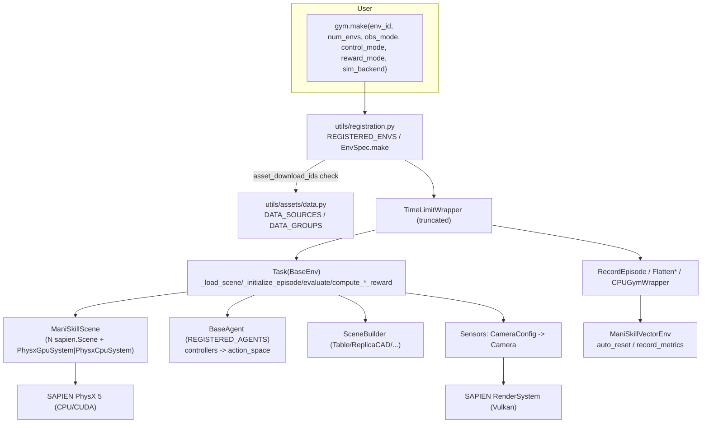

# ManiSkill 3 Source-Level Architecture Study

> Repository: `references/benchmarks/ManiSkill` (mani-skill/ManiSkill @ `62ff3a5`, 2026-08-01, package version `3.0.1`, Apache-2.0)
> Method: static reading only (read / grep / AST); no install, run or asset download.
> Tags: **\[Implemented\]** code exists and can be traced to specific lines · **\[Docs/Interface only\]** only a documentation description or abstract methods · **\[Unverified\]** code exists but we have not run it · **\[Needs model/hardware\]** requires GPU, Vulkan, CUDA or asset downloads
> Citation format: `references/benchmarks/ManiSkill/<path>:<line>`; all paths below start with this prefix.

---

## 1. Positioning and Core Capabilities

ManiSkill 3 is a robot manipulation simulation framework and benchmark built on top of **SAPIEN 3 (PhysX 5 + Vulkan rendering)**. Its core selling point is **GPU-parallel simulation + batched rendering**: within one Python process, a single `PhysxGpuSystem` hosts N sub-scenes, and all data is returned as `torch.Tensor` with a batch dimension equal to `num_envs`.

| Capability | Status | Evidence |
|---|---|---|
| Gymnasium-style `BaseEnv(gym.Env)`, `reset/step/render/close` | \[Implemented\] \[Unverified\] | `references/benchmarks/ManiSkill/mani_skill/envs/sapien_env.py:45`, `:861`, `:1050`, `:1426`, `:1254` |
| GPU-parallel simulation (`physx_cuda` used automatically when `num_envs>1`) | \[Implemented\] \[Needs model/hardware\] | `references/benchmarks/ManiSkill/mani_skill/envs/sapien_env.py:232-236`, `:1195-1219` |
| CPU simulation (single env; vectorization only via multiprocessing) | \[Implemented\] | `references/benchmarks/ManiSkill/mani_skill/envs/sapien_env.py:247-250`, `:1220-1226` |
| 72 `@register_env` tasks (tabletop / mobile / dexterity / humanoid / quadruped / control / digital twins) | \[Implemented\] | `grep -rh "@register_env" mani_skill/envs` counts 72 |
| About 41 `@register_agent` robots (panda, fetch, xarm, so100, widowx, unitree, etc.) | \[Implemented\] | `references/benchmarks/ManiSkill/mani_skill/agents/registration.py:20-45` |
| Multiple obs modes (`state`, `state_dict`, `rgb+depth+segmentation`, `pointcloud`, `sensor_data`, etc.) | \[Implemented\] | `references/benchmarks/ManiSkill/mani_skill/envs/sapien_env.py:124`, `references/benchmarks/ManiSkill/mani_skill/envs/utils/observations/__init__.py:33-37` |
| Multiple control modes (`pd_joint_pos`, `pd_ee_delta_pose`, etc., actions normalized to [-1,1]) | \[Implemented\] | `references/benchmarks/ManiSkill/mani_skill/agents/robots/panda/panda.py:187-216`, `references/benchmarks/ManiSkill/mani_skill/utils/gym_utils.py:104-112` |
| `evaluate()` returns a success/fail dict, from which `terminated` and the sparse reward are derived | \[Implemented\] | `references/benchmarks/ManiSkill/mani_skill/envs/sapien_env.py:1143-1165`, `:1058-1069`, `:673-697` |
| State snapshots `get_state_dict / set_state_dict`, and reset to a specified state | \[Implemented\] \[Unverified\] | `references/benchmarks/ManiSkill/mani_skill/envs/sapien_env.py:1281-1337`, `:942-948` |
| Trajectory recording (h5 + json) and video recording | \[Implemented\] \[Unverified\] | `references/benchmarks/ManiSkill/mani_skill/utils/wrappers/record.py:113`, `:216-236` |
| Trajectory conversion to LeRobot format | \[Implemented\] \[Unverified\] | `references/benchmarks/ManiSkill/mani_skill/trajectory/convert_to_lerobot.py:1-8` |
| Real2Sim VLA evaluation (SIMPLER Bridge digital twin, with language instructions) | \[Implemented\] \[Needs model/hardware\] | `references/benchmarks/ManiSkill/mani_skill/envs/tasks/digital_twins/bridge_dataset_eval/put_on_in_scene.py:70-71` |
| Sim2Real interface (`Sim2RealEnv`, `BaseRealAgent`) | \[Implemented\] \[Unverified\] | `references/benchmarks/ManiSkill/mani_skill/envs/sim2real_env.py:15`, `references/benchmarks/ManiSkill/mani_skill/agents/base_real_agent.py:9` |
| MJCF import (partial feature set) | \[Implemented\] \[Unverified\] | `references/benchmarks/ManiSkill/mani_skill/utils/building/_mjcf_loader.py:1-30` |
| VLA support (Octo / RDT / RT-x) | \[Docs/Interface only\] | `references/benchmarks/ManiSkill/docs/source/user_guide/vision_language_action_models/index.md`; the evaluation code lives in the external SimplerEnv repository |

## 2. Directory Layout and Architecture

```
mani_skill/
├── envs/            sapien_env.py (BaseEnv, 1511 lines), scene.py (ManiSkillScene), template.py, sim2real_env.py
│   ├── tasks/       tabletop/ mobile_manipulation/ dexterity/ humanoid/ quadruped/ control/ digital_twins/ drawing/ fmb/
│   ├── scenes/      envs based on scene datasets (ReplicaCAD/AI2THOR/RoboCasa)
│   └── utils/       observations/, randomization/batched_rng.py, system/backend.py
├── agents/          base_agent.py, registration.py, controllers/ (pd_joint_pos, pd_ee_pose, ...), robots/<41 of them>
├── sensors/         camera.py (CameraConfig), depth_camera.py
├── utils/           registration.py (register_env/make), assets/data.py (DataSource), download_asset.py
│   ├── scene_builder/   table/ replicacad/ ai2thor/ robocasa/ kitchen_counter/ + registration.py
│   ├── wrappers/        record.py, gymnasium.py (CPUGymWrapper), flatten.py, frame_stack.py, cached_reset.py ...
│   ├── building/        actor_builder, articulation_builder, urdf_loader, mjcf_loader
│   └── structs/         Actor/Articulation/Link/Pose (batched GPU view), types.py (SimConfig)
├── vector/wrappers/ gymnasium.py (ManiSkillVectorEnv), sb3.py
├── trajectory/      replay_trajectory.py (control-mode conversion), convert_to_lerobot.py, dataset.py
├── render/          version.py (SAPIEN 3.0 / 3.1 render system detection)
└── assets/          robot URDFs and meshes shipped with the package (panda, so100, koch, g1, etc.)
```



## 3. Core Interfaces and Key Classes

**BaseEnv** (`references/benchmarks/ManiSkill/mani_skill/envs/sapien_env.py:45`)

```python
class BaseEnv(gym.Env):
    SUPPORTED_ROBOTS: Optional[list] = None                                   # :121
    SUPPORTED_OBS_MODES = ("state","state_dict","none","sensor_data","any_textures","pointcloud")  # :124
    SUPPORTED_REWARD_MODES = ("normalized_dense","dense","sparse","none")      # :128
    SUPPORTED_RENDER_MODES = ("human","rgb_array","sensors","all")            # :129
    def __init__(self, num_envs=1, obs_mode=None, reward_mode=None, control_mode=None,
                 render_mode=None, shader_dir=None, enable_shadow=False, sensor_configs={},
                 human_render_camera_configs={}, viewer_camera_configs={}, robot_uids=None,
                 sim_config=SimConfig|dict, reconfiguration_freq=None, sim_backend="auto",
                 render_backend="gpu", parallel_in_single_scene=False,
                 enhanced_determinism=False)                                   # :191-209
    def reset(self, seed: None|int|list[int] = None, options: None|dict = None) -> tuple[obs, info]  # :861
        # options: reconfigure: bool, env_idx: Tensor (partial reset), reset_to_env_states: {env_states, obs}
    def step(self, action: None|np.ndarray|torch.Tensor|dict) -> (obs, reward, terminated, truncated(all False), info)  # :1050
    def evaluate(self) -> dict          # returns {} by default; after a task overrides it, returns {"success","fail",...}  :1143
    def get_info(self) -> dict          # {"elapsed_steps"} | evaluate()            :1155
    def get_obs(self, info=None, unflattened=False)                            # :502
    def get_reward(self, obs, action, info)                                    # :649
    def compute_sparse_reward / compute_dense_reward / compute_normalized_dense_reward  # :673 / :699 / :710
    def get_state_dict() / set_state_dict(state, env_idx=None) / get_state() / set_state()  # :1281-1337
    def render() / render_rgb_array(camera_name=None) / render_sensors() / render_all() / render_human()  # :1426/:1379/:1398/:1410/:1365
    def close()                                                                # :1254
    # hooks for tasks to override
    _load_agent(options, initial_agent_poses)  :389 · _load_scene(options)  :767 · _load_lighting  :849
    _initialize_episode(env_idx, options)  :1026 · _get_obs_extra(info)  :559
    _default_sensor_configs / _default_human_render_camera_configs  :440 / :449 · _default_sim_config  :387
    _before_control_step / _after_control_step / _before_simulation_step / _after_simulation_step  :1167-1177
    single_observation_space / observation_space (cached_property, derived from the obs returned by reset)  :371-380
    single_action_space / action_space (= agent.controller.*)  :333-336
```

**Registry** (`references/benchmarks/ManiSkill/mani_skill/utils/registration.py`)
- `register_env(uid, max_episode_steps=None, override=False, asset_download_ids=[], **kwargs)` is a decorator (`:192-261`). It writes both to `REGISTERED_ENVS` (`:93`) and `gym.register`, and attaches `MSTimeLimit` in `additional_wrappers` (`:242-257`). kwargs must be JSON-serializable (`:213-218`).
- `EnvSpec.make(**kwargs)` checks assets first. When assets are missing it **prompts interactively via `input()`**, and if the user declines it calls `exit()` directly (`:38-79`, `references/benchmarks/ManiSkill/mani_skill/utils/download_asset.py:19-34`).
- `TimeLimitWrapper.step` generates a batched `truncated` from `elapsed_steps >= max_episode_steps` (`:127-168`).

**Agent / Controller**
- `@register_agent(asset_download_ids=[], override=False)` registers using the class attribute `uid` as the key (`references/benchmarks/ManiSkill/mani_skill/agents/registration.py:20-45`).
- `BaseAgent`: class attributes `uid`, `urdf_path | mjcf_path`, `keyframes`; `_controller_configs` and `_sensor_configs` must be overridden; methods include `set_control_mode`, `set_action`, `get_proprioception`, `is_grasping`, `is_static` (`references/benchmarks/ManiSkill/mani_skill/agents/base_agent.py:43-430`). In CPU mode an action containing NaN raises an error (`:327-329`).
- When `normalize_action=True`, `BaseController` changes the action space to `Box(-1,1)` and performs clip and scale in `set_action` (`references/benchmarks/ManiSkill/mani_skill/agents/controllers/base_controller.py:70-72`, `:158-173`). `CombinedController` concatenates arm and gripper into one flat Box (`:316-341`).
- In GPU simulation, EE control only supports the `root_translation` frame (`references/benchmarks/ManiSkill/mani_skill/agents/controllers/pd_ee_pose.py:33-34`).

**Scene / Sensor / RNG**
- `ManiSkillScene` combines N `sapien.Scene` instances into one batched view and provides `get_sim_state / set_sim_state` (`references/benchmarks/ManiSkill/mani_skill/envs/scene.py:42`, `:899`, `:923`).
- `CameraConfig(uid, pose, width, height, fov, near, far, intrinsic, entity_uid, mount, shader_pack="minimal", shader_config)` (`references/benchmarks/ManiSkill/mani_skill/sensors/camera.py:24-48`).
- `SceneBuilder.build / initialize(env_idx)`, together with `register_scene_builder` (`references/benchmarks/ManiSkill/mani_skill/utils/scene_builder/scene_builder.py:19-89`, `references/benchmarks/ManiSkill/mani_skill/utils/scene_builder/registration.py:18`).
- `BatchedRNG.from_seeds(seeds)` maintains one `np.random.RandomState` per env (`references/benchmarks/ManiSkill/mani_skill/envs/utils/randomization/batched_rng.py:13-24`).
- `SimConfig(spacing=5, sim_freq=100, control_freq=20, scene_config, gpu_memory_config, ...)` (`references/benchmarks/ManiSkill/mani_skill/utils/structs/types.py:77-86`).

## 4. Core Execution Flow

```mermaid
sequenceDiagram
  participant U as Caller
  participant V as ManiSkillVectorEnv
  participant T as TimeLimitWrapper
  participant E as Task(BaseEnv)
  participant A as BaseAgent/Controller
  participant S as ManiSkillScene(PhysX)
  U->>E: gym.make(id, num_envs, obs_mode, control_mode, ...)
  Note over E: __init__ first sets main RNG=[2022+i], then calls reset(reconfigure=True)<br/>and derives observation_space from the resulting obs (:319-338)
  U->>V: reset(seed, options)
  V->>E: reset(seed, options)
  E->>E: _set_main_rng(seed) → _set_episode_rng
  alt reconfigure (first time / reconfiguration_freq reached)
    E->>S: _reconfigure: _setup_scene → _load_agent → _load_scene → _load_lighting → scene._setup(gpu) → _setup_sensors (:726-760)
  end
  E->>S: _clear_sim_state (zero velocities)
  E->>A: agent.reset()
  E->>E: _initialize_episode(env_idx, options) runs inside torch.fork_rng(seed)<br/>or set_state_dict(reset_to_env_states)
  E->>S: _gpu_apply_all / gpu_update_articulation_kinematics / _gpu_fetch_all
  E->>A: controller.reset()
  E->>E: info=get_info()=evaluate(); obs=get_obs(info)
  E-->>U: (obs, info)
  loop each control step
    U->>V: step(action)
    V->>T: step
    T->>E: step(action)
    E->>A: _step_action: to_tensor → agent.set_action (clip+scale) → gpu_apply_*target*
    loop sim_freq/control_freq times
      E->>S: before_simulation_step → scene.step() → after
    end
    E->>E: info = {elapsed_steps} ∪ evaluate()
    E->>E: obs = get_obs(info); reward = get_reward(obs, action, info)
    E->>E: terminated = success | fail; truncated = zeros
    E-->>T: 5-tuple
    T-->>V: truncated = elapsed_steps >= max_episode_steps
    V->>V: accumulate success_once/fail_once/return when record_metrics is on
    alt any(done) and auto_reset
      V->>E: reset(options={env_idx: done_idx})  (partial reset)
      V-->>U: obs', info{final_observation, final_info, _final_info}
    end
  end
```

Key points (all tagged \[Implemented\]):
1. **success and terminated are coupled**. `terminated = success ∨ fail` is hard-coded in `BaseEnv.step` (`references/benchmarks/ManiSkill/mani_skill/envs/sapien_env.py:1058-1069`). If evaluation needs "success_at_end" semantics, you must set `ignore_terminations=True` and then read `success_at_end` from the wrapper (`references/benchmarks/ManiSkill/mani_skill/vector/wrappers/gymnasium.py:150-156`).
2. **`evaluate()` is called on every step and reset**, and its result feeds the obs (`_get_obs_extra(info)`), the reward and termination all at once, so in ManiSkill Task and Evaluator are the same method of the same class.
3. Auto-reset only happens when going through `ManiSkillVectorEnv`, and the mode is fixed to SAME_STEP (`references/benchmarks/ManiSkill/mani_skill/vector/wrappers/gymnasium.py:66-68`, `:164-176`).

## 5. Extension Points and Plugin Mechanism

| Extension point | Mechanism | Evidence | Status |
|---|---|---|---|
| New task | Subclass `BaseEnv` and add `@register_env("X-v1", max_episode_steps=N, asset_download_ids=[...])`; override `_load_scene/_initialize_episode/evaluate/_get_obs_extra/compute_dense_reward` | `references/benchmarks/ManiSkill/mani_skill/envs/template.py:43-202`; example `references/benchmarks/ManiSkill/mani_skill/envs/tasks/tabletop/pick_cube.py:33-195` | \[Implemented\] |
| New robot | Subclass `BaseAgent`, set `uid`, `urdf_path/mjcf_path`, `keyframes`, `_controller_configs`, then add `@register_agent()` | `references/benchmarks/ManiSkill/mani_skill/agents/robots/panda/panda.py:16-216`; template `references/benchmarks/ManiSkill/mani_skill/agents/robots/_template` | \[Implemented\] |
| New controller | Subclass `BaseController` and `ControllerConfig`, implement `_initialize_action_space`, `set_action`, `before_simulation_step` | `references/benchmarks/ManiSkill/mani_skill/agents/controllers/base_controller.py:24-190` | \[Implemented\] |
| Reusable scene | Subclass `SceneBuilder`, add `@register_scene_builder(uid)` | `references/benchmarks/ManiSkill/mani_skill/utils/scene_builder/registration.py:18-42` | \[Implemented\] |
| Sensors | Override via `_default_sensor_configs` or the constructor argument `sensor_configs=dict(...)`; can be mounted on a link | `references/benchmarks/ManiSkill/mani_skill/envs/sapien_env.py:440-463`, `references/benchmarks/ManiSkill/mani_skill/sensors/camera.py:42-46` | \[Implemented\] |
| Asset sources | Register in `DATA_SOURCES[id] = DataSource(url|hf_repo_id, checksum, target_path)`; envs or agents declare dependencies via `asset_download_ids` | `references/benchmarks/ManiSkill/mani_skill/utils/assets/data.py:13-38`, `references/benchmarks/ManiSkill/mani_skill/utils/registration.py:113-124` | \[Implemented\] |
| External robot packages | Downloaded from GitHub release zips (UR10e, ANYmalC, WidowX, XLeRobot, etc.) | `references/benchmarks/ManiSkill/mani_skill/utils/assets/data.py:140-195` | \[Implemented\] \[Needs model/hardware\] |
| Wrapper chain | Standard `gym.Wrapper`; after a wrapper changes the obs, `update_obs_space` re-derives the space | `references/benchmarks/ManiSkill/mani_skill/envs/sapien_env.py:345-369` | \[Implemented\] |
| Language instructions | **No unified interface**: only the Bridge digital twin defines `get_language_instruction()` | `references/benchmarks/ManiSkill/mani_skill/envs/tasks/digital_twins/bridge_dataset_eval/put_on_in_scene.py:70` | \[Implemented\], but only locally |

Registration is an **import-time side effect**: `mani_skill/envs/__init__.py:1-2` imports every task module via `from .tasks import *`.

## 6. Dependencies and Runtime Requirements

- Python `>=3.9` (`references/benchmarks/ManiSkill/setup.py:96`). Core dependencies are `sapien>=3.0.3` (Linux), `gymnasium>=0.29.1`, `mplib==0.1.1`, `pytorch_kinematics==0.7.6`, `huggingface_hub`, `h5py`, `trimesh`, `imageio[ffmpeg]` (`references/benchmarks/ManiSkill/setup.py:28-56`). **`torch` does not appear in install_requires**, yet the entire codebase depends on it (it only gets installed indirectly via `pytorch_kinematics`) \[Implemented\].
- **GPU simulation** requires an NVIDIA GPU + CUDA; with `num_envs>1` it switches automatically to `physx_cuda` \[Needs model/hardware\].
- **Rendering** requires a Vulkan driver. The docs say "a GPU with the Vulkan driver installed is required to enable rendering" (`references/benchmarks/ManiSkill/docs/source/user_guide/getting_started/installation.md:19`); the Dockerfile installs `libvulkan1`, `libegl1` and the NVIDIA ICD (`references/benchmarks/ManiSkill/docker/Dockerfile:14-42`) \[Needs model/hardware\]. There is no EGL or OSMesa path in the code. `render_backend="none"` disables rendering, in which case only state obs can be used (`references/benchmarks/ManiSkill/mani_skill/envs/utils/system/backend.py:87-88`, `references/benchmarks/ManiSkill/mani_skill/render/utils.py:7-14`).
- Platform support matrix: Linux/NVIDIA supports all three; Windows does not support GPU sim; WSL does not support rendering; macOS only supports CPU sim (`references/benchmarks/ManiSkill/docs/source/user_guide/getting_started/installation.md:98-104`) \[Docs/Interface only\].
- Ray-tracing shaders cannot open multiple envs in a single process (`references/benchmarks/ManiSkill/mani_skill/envs/sapien_env.py:252-255`).
- SAPIEN 3.0 and 3.1 have different render-system APIs; the code detects the version via try-import and branches accordingly (`references/benchmarks/ManiSkill/mani_skill/render/version.py:1-8`, `references/benchmarks/ManiSkill/mani_skill/envs/scene.py:27`, `:217`, `:402`).
- Environment variables: `MS_ASSET_DIR` (default `~/.maniskill/data`), `MS_SKIP_ASSET_DOWNLOAD_PROMPT=1`, `MS_RENDERER_LOG_LEVEL` (`references/benchmarks/ManiSkill/mani_skill/__init__.py:14-25`, `references/benchmarks/ManiSkill/mani_skill/utils/download_asset.py:20`).

## 7. License and Reuse Constraints

| Item | License | Evidence / notes |
|---|---|---|
| Code | Apache-2.0 | `references/benchmarks/ManiSkill/LICENSE` |
| Third-party code | PyTorch3D BSD-3 (`rotation_conversions.py`) | `references/benchmarks/ManiSkill/LICENSE-3RD-PARTY` (31 lines, this is the only entry), `references/benchmarks/ManiSkill/mani_skill/utils/geometry/rotation_conversions.py:4-5` |
| **Assets overall** | **CC BY-NC 4.0 (non-commercial)** | `references/benchmarks/ManiSkill/README.md:90-94`. The README says "All rigid body environments ... permissive" while "The assets are licensed under CC BY-NC 4.0" |
| Bundled robots so100 / koch / dclaw | Apache-2.0 | `LICENSE` in the corresponding directories |
| allegro | BSD (SimLab) | `references/benchmarks/ManiSkill/mani_skill/assets/robots/allegro/LICENSE` |
| g1_humanoid | BSD-3 (Unitree) | `references/benchmarks/ManiSkill/mani_skill/assets/robots/g1_humanoid/LICENSE.txt` |
| **inspire_hand** | **CC BY-NC-SA 4.0** | `references/benchmarks/ManiSkill/mani_skill/assets/robots/inspire_hand/README.md:3` |
| panda / fetch / xarm7 / trifinger, etc. | No LICENSE file in the directory; per the README they should fall under CC BY-NC 4.0 | \[Unverified\] |
| Downloaded datasets (YCB, PartNet-Mobility, ReplicaCAD, AI2THOR, RoboCasa, OakInk-v2, Bridge real2sim) | Each upstream's own license; the repository has **no** per-item declaration | `references/benchmarks/ManiSkill/mani_skill/utils/assets/data.py:41-200`. URLs come from HF `haosulab/*` and `storage1.ucsd.edu`. PartNet-Mobility generally has research-use terms \[Unverified\] |

**Conclusion**: the code can be freely reused under Apache-2.0. If worldcurrent wants to distribute or commercially use assets, each one must be re-reviewed individually; by default treat ManiSkill assets as NC and use them for research only.

## 8. Strengths, Weaknesses and Risks

**Strengths**
- Fully batched torch API; a single process can run thousands of parallel envs, and rendering is batched too \[Implemented\] \[Needs model/hardware\].
- A Task only needs to override a few hooks (`_load_scene/_initialize_episode/evaluate/compute_dense_reward`), so there is very little boilerplate \[Implemented\].
- The three dimensions obs_mode, control_mode and reward_mode are orthogonal to each other and switched via constructor arguments \[Implemented\].
- Complete state snapshots and `reset_to_env_states`, which can support replay, world-model data and counterfactual evaluation \[Implemented\] \[Unverified\].
- Partial reset (`options["env_idx"]`) and per-env seed lists \[Implemented\].
- Built-in h5 trajectory format, control-mode conversion replay (`references/benchmarks/ManiSkill/mani_skill/trajectory/replay_trajectory.py:43-65`) and LeRobot export \[Implemented\] \[Unverified\].

**Weaknesses / risks**
- **success, termination and reward are coupled inside the Task**. `evaluate()` plays two roles at once, task predicate and obs cache (the docstring at `references/benchmarks/ManiSkill/mani_skill/envs/sapien_env.py:1143-1153` says so explicitly). An external Evaluator has a hard time replacing the success criterion. In addition, some tasks' success carries extra conditions such as `is_robot_static` (`references/benchmarks/ManiSkill/mani_skill/envs/tasks/tabletop/pick_cube.py:147-159`), so the definitions are not uniform.
- **observation_space is derived, not declared**: at construction time a real reset is executed once, and the space is then derived from the obs (`references/benchmarks/ManiSkill/mani_skill/envs/sapien_env.py:325-344`, `:371-380`). So getting the spec requires instantiating the simulation first, and construction is expensive.
- The truncated returned by `BaseEnv.step` is always False; truncation relies entirely on `TimeLimitWrapper`, and this wrapper uses `sys._getframe` to probe the local variables of `gym.make` (`references/benchmarks/ManiSkill/mani_skill/utils/registration.py:131-152`), which is a very fragile implementation.
- When assets are missing, `EnvSpec.make` calls `input()` and `exit()` (`references/benchmarks/ManiSkill/mani_skill/utils/registration.py:70-78`). Headless or CI environments must set `MS_SKIP_ASSET_DOWNLOAD_PROMPT=1` or download the assets in advance.
- Determinism:
  - The main RNG's default seed is `2022+i` (`references/benchmarks/ManiSkill/mani_skill/envs/sapien_env.py:319`).
  - Only when a seed is passed explicitly or `enhanced_determinism` is enabled does `_initialize_episode` re-seed inside `torch.fork_rng` (`:950-955`).
  - Many tasks (e.g. PickCube) use the global `torch.rand` instead of `_batched_episode_rng` (`references/benchmarks/ManiSkill/mani_skill/envs/tasks/tabletop/pick_cube.py:112`, `:124`, `:129`), so **with different `num_envs` or different devices, the same seed may not produce the same initial state** \[Unverified\].
  - PhysX GPU itself has no bitwise determinism guarantee. The comment on `enable_enhanced_determinism` says "is for CPU probably" (`references/benchmarks/ManiSkill/mani_skill/utils/structs/types.py:50`, `:62`).
- The CPU backend cannot open multiple envs in a single process; multiprocessing is only possible via gym `AsyncVectorEnv` (`references/benchmarks/ManiSkill/mani_skill/envs/sapien_env.py:247-250`).
- On GPU, partial reset and reconfiguration conflict with each other: a `TODO` acknowledges this, and assertions in the code forbid it (`references/benchmarks/ManiSkill/mani_skill/envs/sapien_env.py:906-907`, `:924-926`; `references/benchmarks/ManiSkill/mani_skill/vector/wrappers/gymnasium.py:75-78`).
- There is no standard interface for language instructions. The full VLA evaluation pipeline (SimplerEnv) is outside the repository.
- The repository's own CI only does publishing (`.github/workflows/publish-*.yml`); **tests are not wired into CI**. Tests require a GPU and all assets (`references/benchmarks/ManiSkill/tests/run.sh`, `references/benchmarks/ManiSkill/tests/test_gpu_envs.py:29`).

## 9. Components Worth Reusing

1. **The orthogonal three-mode design** (obs_mode / control_mode / reward_mode strings and parsers), which can be borrowed directly for worldcurrent's `EnvConfig`. See `references/benchmarks/ManiSkill/mani_skill/envs/utils/observations/__init__.py:37-100`.
2. **The metrics semantics of `ManiSkillVectorEnv`**: `success_once`, `success_at_end`, `fail_once`, `return`, `episode_len`, plus the `ignore_terminations` switch. These are exactly the definitions the Evaluator needs, and we can copy them as is (`references/benchmarks/ManiSkill/mani_skill/vector/wrappers/gymnasium.py:127-185`).
3. **The options convention of `reset(options={"env_idx", "reset_to_env_states", "reconfigure"})`**, which can be adopted into the standard keys of our `reset(seed, options)`.
4. **Declarative asset dependencies via `DataSource` and `asset_download_ids`** (with sha256 checks). We can borrow its structure, but the interactive prompt should be replaced with fail-fast (`references/benchmarks/ManiSkill/mani_skill/utils/assets/data.py:13-38`, `references/benchmarks/ManiSkill/mani_skill/utils/download_asset.py:37-47`).
5. **RecordEpisode's h5 + json trajectory format**, along with `convert_to_lerobot.py`, can serve as the trajectory sink for the ManiSkill backend.
6. **`BatchedRNG`'s per-env seed list**: a simple idea that can be reused directly.
7. Plug all of ManiSkill in as a **Simulator backend** via an adapter, rather than forking it.

## 10. Capabilities Not Worth Rebuilding

- GPU-parallel PhysX scene management and batched Actor/Articulation views (`ManiSkillScene`, `utils/structs`): a huge amount of engineering; use them directly.
- PD joint and EE controllers and their IK (`pd_ee_pose.py` + `pytorch_kinematics`).
- The scenes, reward shaping and motion-planning demonstrations of the 72 tasks (`mani_skill/examples/motionplanning`).
- The SAPIEN rendering and sensor pipeline (rgb/depth/seg/pointcloud, shader packs).
- The SIMPLER Bridge real2sim greenscreen evaluation scenes (`references/benchmarks/ManiSkill/mani_skill/envs/tasks/digital_twins/bridge_dataset_eval/base_env.py:154-578`).

## 11. Source Index of Key Implementations

| Topic | Location |
|---|---|
| BaseEnv class and mode constants | `references/benchmarks/ManiSkill/mani_skill/envs/sapien_env.py:45-133` |
| Construction: backend selection, initial reset, space derivation | `references/benchmarks/ManiSkill/mani_skill/envs/sapien_env.py:191-344` |
| `get_obs` and obs flattening | `references/benchmarks/ManiSkill/mani_skill/envs/sapien_env.py:502-560` |
| Sensor data collection | `references/benchmarks/ManiSkill/mani_skill/envs/sapien_env.py:579-627` |
| Reward dispatch and default sparse implementation | `references/benchmarks/ManiSkill/mani_skill/envs/sapien_env.py:649-722` |
| `_reconfigure` | `references/benchmarks/ManiSkill/mani_skill/envs/sapien_env.py:726-760` |
| `reset` (seed / partial / reset_to_env_states) | `references/benchmarks/ManiSkill/mani_skill/envs/sapien_env.py:861-982` |
| RNG setup | `references/benchmarks/ManiSkill/mani_skill/envs/sapien_env.py:984-1024` |
| `step` and `_step_action` | `references/benchmarks/ManiSkill/mani_skill/envs/sapien_env.py:1050-1141` |
| `evaluate` and `get_info` | `references/benchmarks/ManiSkill/mani_skill/envs/sapien_env.py:1143-1165` |
| GPU/CPU scene construction | `references/benchmarks/ManiSkill/mani_skill/envs/sapien_env.py:1191-1239` |
| State dict get/set | `references/benchmarks/ManiSkill/mani_skill/envs/sapien_env.py:1281-1337` |
| render family | `references/benchmarks/ManiSkill/mani_skill/envs/sapien_env.py:1365-1452` |
| Registration, make, TimeLimit | `references/benchmarks/ManiSkill/mani_skill/utils/registration.py:22-261` |
| Vector env, auto reset, metrics | `references/benchmarks/ManiSkill/mani_skill/vector/wrappers/gymnasium.py:18-199` |
| CPU single env to numpy | `references/benchmarks/ManiSkill/mani_skill/utils/wrappers/gymnasium.py:10-100` |
| Recording wrapper | `references/benchmarks/ManiSkill/mani_skill/utils/wrappers/record.py:113-826` |
| Agent registration | `references/benchmarks/ManiSkill/mani_skill/agents/registration.py:11-45` |
| BaseAgent | `references/benchmarks/ManiSkill/mani_skill/agents/base_agent.py:34-430` |
| Controller base class and action normalization | `references/benchmarks/ManiSkill/mani_skill/agents/controllers/base_controller.py:24-357` |
| Backend parsing | `references/benchmarks/ManiSkill/mani_skill/envs/utils/system/backend.py:28-90` |
| BatchedRNG | `references/benchmarks/ManiSkill/mani_skill/envs/utils/randomization/batched_rng.py:13-30` |
| Asset sources | `references/benchmarks/ManiSkill/mani_skill/utils/assets/data.py:13-200` |
| Downloader | `references/benchmarks/ManiSkill/mani_skill/utils/download_asset.py:19-130` |
| Task template | `references/benchmarks/ManiSkill/mani_skill/envs/template.py:43-202` |
| Typical task PickCube | `references/benchmarks/ManiSkill/mani_skill/envs/tasks/tabletop/pick_cube.py:33-195` |
| SceneBuilder | `references/benchmarks/ManiSkill/mani_skill/utils/scene_builder/scene_builder.py:19-89` |
| MJCF loader | `references/benchmarks/ManiSkill/mani_skill/utils/building/_mjcf_loader.py:1-922` |
| Sim2Real | `references/benchmarks/ManiSkill/mani_skill/envs/sim2real_env.py:15` |
| Tests (seed reproducibility, state, wrappers) | `references/benchmarks/ManiSkill/tests/test_envs.py:151-186`, `references/benchmarks/ManiSkill/tests/test_sim_state.py`, `references/benchmarks/ManiSkill/tests/test_wrappers.py` |

## 12. Mapping to worldcurrent Environment Interface

| worldcurrent contract | ManiSkill counterpart | Adaptation notes |
|---|---|---|
| `reset(seed, options) -> Observation` | `BaseEnv.reset(seed: int\|list[int], options: dict) -> (obs, info)` (`references/benchmarks/ManiSkill/mani_skill/envs/sapien_env.py:861`) | `seed` can be a list (one per env). Keys in `options` are passed through unchanged: `env_idx`, `reconfigure`, `reset_to_env_states`. The `info` returned on reset already contains fields such as `success`, which should go into `Observation.info` |
| `step(Action) -> StepResult(obs, reward, terminated, truncated, info)` | `TimeLimitWrapper(BaseEnv).step` (`references/benchmarks/ManiSkill/mani_skill/utils/registration.py:160-168`) | Must be wrapped with TimeLimit, otherwise truncated is always False. All return values are batched torch tensors, even with num_envs=1; `CPUGymWrapper` can remove the batch dimension (`references/benchmarks/ManiSkill/mani_skill/utils/wrappers/gymnasium.py:55-98`). **The adapter should expose `success` separately from `terminated`**; terminated must not be used in place of success |
| `observation_spec` | `single_observation_space` and `observation_space` (gym.Space, derived from actual obs) (`references/benchmarks/ManiSkill/mani_skill/envs/sapien_env.py:371-380`) | Requires instantiating the env to obtain; constructing once triggers one reset and reconfigure. We recommend designing worldcurrent's spec to be optional and lazily obtained |
| `action_spec` | `single_action_space` (`references/benchmarks/ManiSkill/mani_skill/envs/sapien_env.py:333-336`), determined by `control_mode`; usually a normalized `Box(-1,1)` space | The spec should carry `control_mode` and the denormalized low/high (`controller._original_single_action_space`, `references/benchmarks/ManiSkill/mani_skill/agents/controllers/base_controller.py:158-168`). Absolute EE poses output by a VLA must be aligned with `pd_ee_pose` or `pd_ee_delta_pose` |
| Task success predicate | `Task.evaluate() -> {"success": BoolTensor[N], "fail"?: BoolTensor[N], ...}` (`references/benchmarks/ManiSkill/mani_skill/envs/sapien_env.py:1143`) | Wrap it in the adapter as `TaskSpec.is_success(info)`. The Evaluator layer maintains `success_once` or `success_at_end` itself, with semantics following `ManiSkillVectorEnv` (`references/benchmarks/ManiSkill/mani_skill/vector/wrappers/gymnasium.py:132-156`), and forcibly sets `ignore_terminations` to control the definition |
| Language instruction (VLA) | No unified interface; only the local API `get_language_instruction()` (`references/benchmarks/ManiSkill/mani_skill/envs/tasks/digital_twins/bridge_dataset_eval/put_on_in_scene.py:70`) | Provided by worldcurrent's Task layer; for other ManiSkill tasks we need to maintain our own instruction mapping table |
| `render(camera)` | `render_rgb_array(camera_name)` (`references/benchmarks/ManiSkill/mani_skill/envs/sapien_env.py:1379`), using human render cameras; sensor images via `get_sensor_images()` (`:568`) | Returns `(N,H,W,3)`; requires Vulkan \[Needs model/hardware\]; unavailable when `render_backend="none"` |
| `close()` | `BaseEnv.close() -> _clear()` (`references/benchmarks/ManiSkill/mani_skill/envs/sapien_env.py:1241-1255`) | Frees GPU memory via `gc.collect()`; watch GPU memory when repeatedly creating GPU envs in the same process |
| state snapshot (memory/self-improvement) | `get_state_dict()` / `set_state_dict(state, env_idx)` (`references/benchmarks/ManiSkill/mani_skill/envs/sapien_env.py:1281-1314`) | Tasks must override it to include task state such as the goal (see `references/benchmarks/ManiSkill/mani_skill/envs/template.py:193-206`); otherwise the snapshot has no goal |
| Benchmark (suite) | Does not exist. There is only the flat dict `REGISTERED_ENVS` | worldcurrent's Benchmark layer should define its own suite = [env_id + kwargs + seeds + episodes + metric definitions] |

**Split recommendation**: Simulator = SAPIEN and `ManiSkillScene` (backend); Environment adapter = `BaseEnv` + TimeLimit; Task = the env subclass with `evaluate()` (in ManiSkill, Task and Environment are the same class and cannot be split apart; the separation can only be logical, at the adapter layer); Evaluator = implemented by us, reusing the metrics definitions of `ManiSkillVectorEnv`; Benchmark = a suite list implemented by us.

---

## Verification Status Summary

| Capability | Tag | Notes |
|---|---|---|
| gym API, reset/step signatures | \[Implemented\] \[Unverified\] | Signatures traceable from source, but not run |
| GPU-parallel simulation | \[Implemented\] \[Needs model/hardware\] | Requires NVIDIA CUDA |
| CPU single-env simulation | \[Implemented\] \[Unverified\] | |
| Rendering (sensor / human camera) | \[Implemented\] \[Needs model/hardware\] | Requires Vulkan |
| success / fail → terminated / sparse reward | \[Implemented\] | `references/benchmarks/ManiSkill/mani_skill/envs/sapien_env.py:673-697`, `:1058-1069` |
| Vector env metrics (success_once / at_end) | \[Implemented\] \[Unverified\] | |
| Seed reproducibility (same env, same device) | \[Implemented\] \[Unverified\] | Tests exist at `references/benchmarks/ManiSkill/tests/test_envs.py:151-186`, but we have not run them |
| Determinism across num_envs / across devices | \[Unverified\] | Tasks use `torch.rand`; risky |
| state snapshot / reset_to_env_states | \[Implemented\] \[Unverified\] | |
| Trajectory recording / LeRobot conversion | \[Implemented\] \[Unverified\] | |
| Asset download (HF / UCSD / GitHub) | \[Implemented\] \[Needs model/hardware\] | Requires network access; has sha256 checks |
| VLA evaluation (Octo / RT / RDT) | \[Docs/Interface only\] | The actual pipeline lives in the external SimplerEnv |
| Bridge real2sim tasks | \[Implemented\] \[Needs model/hardware\] | Requires downloading the `bridge_v2_real2sim` and `widowx250s` assets |
| Sim2Real | \[Implemented\] \[Unverified\] | Requires a real robot |
| MJCF import | \[Implemented\] \[Unverified\] | contact tags not supported; actuators not imported |
| Test CI | \[Docs/Interface only\] | No test workflow; `tests/run.sh` depends on docker and a GPU |
| Asset license | \[Docs/Interface only\] | README declares CC BY-NC 4.0; per-item licenses are incomplete |
