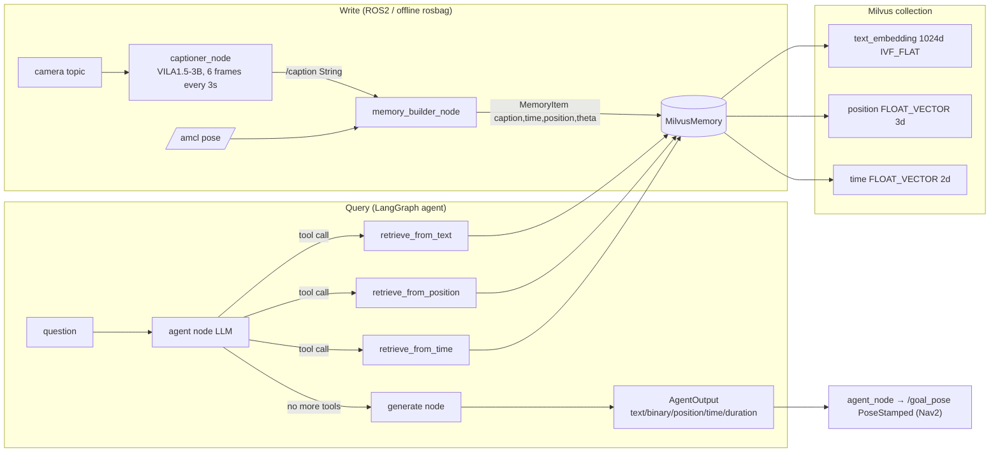
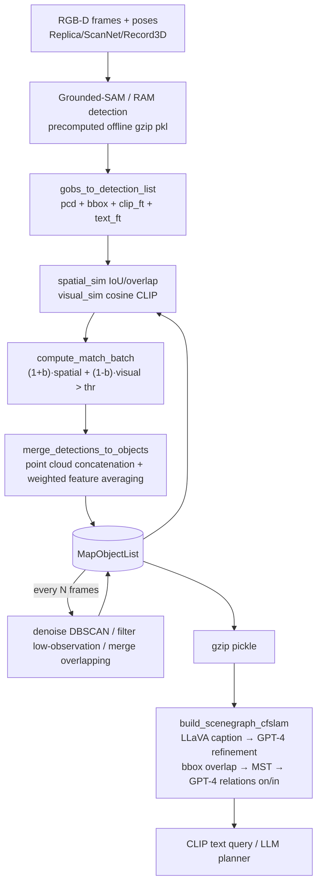
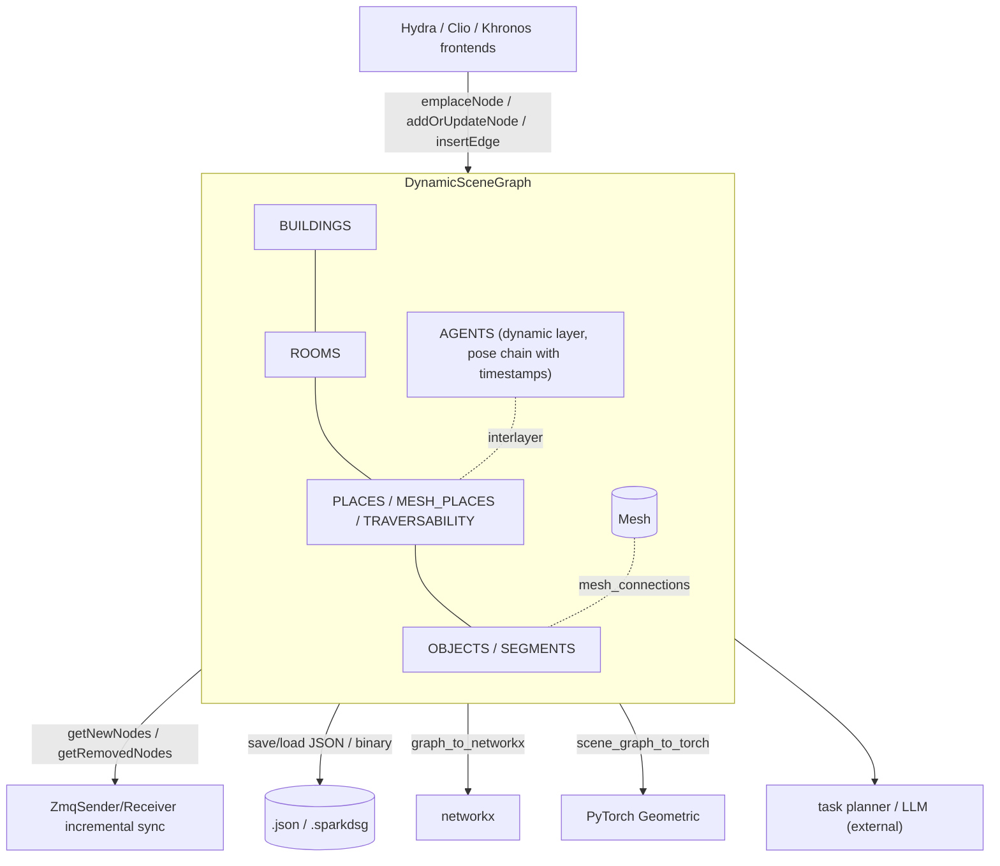
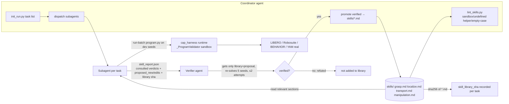
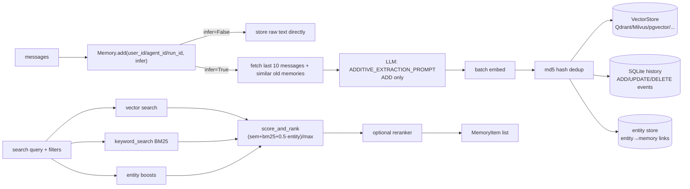
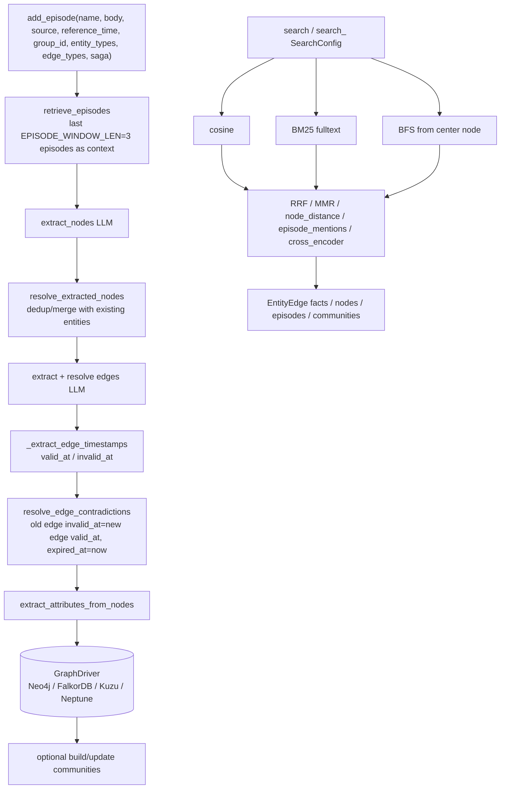

# Survey of Open-Source Physical Memory Implementations (Memory Landscape)

> A survey of reference implementations for the `worldcurrent` Memory Layer (Working / Episodic / Spatial / Skill).
> Survey date: 2026-10-30. All conclusions are based on **static source reading**: no `pip install`, no scripts run, no weights or datasets downloaded, no cloned repositories modified.
>
> Tag conventions:
> - **\[Implemented\]**: the corresponding implementation is seen directly in the source (with `file:line`).
> - **\[Docs/Interface only\]**: appears only in README / docstring / abstract interface / prompt; no complete implementation seen, or the implementation depends on an external process (e.g. manual execution by a human/agent).
> - **\[Unverified\]**: based on API metadata, third-party indexes or inference; not confirmed at the source level, or not run.
> - **\[Needs model/hardware\]**: requires a GPU, specific model weights, an LLM API, ROS or a real robot to run.
>
> Source citation format: `references/memory/<repo>/<path>:<line>`; line numbers correspond to the commit recorded in MANIFEST.

---

## 1. Search Method

1. **Web search** (WebSearch / WebFetch): searched separately by four categories (episodic robot memory, 3D scene memory, skill library, general agent memory), and read two awesome lists still maintained in 2026 to fill in new 2025-2026 work:
   - `Everloom-129/Awesome-Memory-for-Robotics` (provides code links for MemBodied, MEMORA, RoboHarness, RAVEN, PRISM, etc.)
   - `benchflow-ai/awesome-embodied-agents` (provides ASPIRE, CaP-X, PhyAgentOS, RobotUse, DimOS, etc.)
2. **Existence verification**: ran `git ls-remote --symref <url> HEAD` for each candidate (confirming the repository exists and its default branch).
3. **Metadata verification**: GitHub REST API `/repos/{owner}/{repo}` to obtain license SPDX, stars, `pushed_at`, `archived`, size; for `NOASSERTION` repositories, additionally fetched `/license` to read the full text. Additionally checked PyPI for 3 libraries (`spark-dsg 1.1.3`, `mem0ai 2.2.1`, `graphiti-core 0.31.2`).
4. **Owner and paper matching**: e.g. HOV-SG has two repositories; `robot-learning-freiburg/HOV-SG` has only 2★, and its README's clone address points to `hovsg/HOV-SG` (561★), which is the de facto main repository; for Embodied-RAG, the owner of `quanting-xie/Embodied-RAG` has the same name as the first author.
5. **Selection criteria**: 2024-2026, real code, a license that permits reuse, usable as a *pluggable component* rather than merely learned memory inside a policy. Cover at least one in each of the four categories (episodic / spatial / skill / general infra).

> Note: the "last commit" column is, for cloned repositories, the commit date of the default branch HEAD; for uncloned repositories it is the GitHub API `pushed_at` (most recent push to any branch; whether it is the default branch is \[Unverified\]).

---

## 2. Candidate List (verified)

| name | url | category | license | last commit | maturity | decision | reason |
|---|---|---|---|---|---|---|---|
| **ReMEmbR** | https://github.com/NVIDIA-AI-IOT/remembr | episodic (robot, text/time/position) | **NVIDIA License (non-commercial only, research/evaluation)** | 2025-03-02 (HEAD; API push 2026-08-24) | Research library, `setup.py`, no tests, 361★ | **clone** | Benchmark design for robot episodic memory (caption+pose+time, three-way retrieval + LLM agent); license does not permit commercial reuse, **design reference only** |
| MemoryVLA | https://github.com/shihao1895/MemoryVLA | working/episodic (memory bank inside the VLA) | **No LICENSE** (API: None) | 2026-06-13 | ICLR 2026 paper code, default branch `openvla-codebase`, 373★ | reference-only | No license, not reusable; memory is a token bank coupled to the weights, not a pluggable store; filed as a Policy-layer reference |
| SimpleMemVLA | https://github.com/OpenBMB/SimpleMemVLA | working (VLA video memory) | MIT | 2026-10-18 | New paper code, 102★ | reference-only | Memory internal to the policy; evaluate in the Policy layer |
| MemBodied | https://github.com/declare-lab/MemBodied | working (VLA recurrent associative memory) | Apache-2.0 | 2026-09-24 | Very new, 10★, <1 MB | reference-only | Paper code, internal to the policy |
| RoboHarness | https://github.com/LZY-1021/RoboHarness | episodic (memory-augmented policy harness, in-context adaptation) | MIT | 2026-07-07 | 22★ | reference-only | Intersects harness+memory; low maturity; added to follow-up tracking |
| RAVEN | https://github.com/princeton-prism/RAVEN | episodic+spatial (visuo-spatio-temporal memory, navigation) | **NVIDIA License (non-commercial)** | 2026-07-18 | 35★ | reference-only | Same license text as ReMEmbR, non-commercial restriction |
| MEMORA | https://github.com/yuzihaowashu/MEMORA | episodic (egocentric action memory) | MIT | 2026-08-23 | 6★ | reference-only | Early paper code |
| PRISM (memory-visuomotor-policies) | https://github.com/rai-opensource/memory-visuomotor-policies | working (policy short-term memory) | **No LICENSE** | 2026-04-28 | 2★ | reject | No license |
| Embodied-RAG | https://github.com/quanting-xie/Embodied-RAG | episodic+spatial (hierarchical semantic forest) | MIT | 2025-01-18 (only one push) | 0★, code dump | reference-only | The hierarchical summarization idea is valuable, but the code is unmaintained |
| KARMA | — (paper arXiv 2409.14908) | episodic (LTM/STM for embodied planning) | — | — | No official code found | reject | No verifiable code |
| **ConceptGraphs** | https://github.com/concept-graphs/concept-graphs | spatial (open-vocab object-centric 3D scene graph) | MIT | 2025-01-15 (main; the `ali-dev` branch is more active, push 2025-10-16) | Research code, `setup.py`, no tests, 980★ | **clone** | The most frequently cited open-vocab object-level 3D memory; Python implementation; clear data association/merge logic |
| **Spark-DSG** | https://github.com/MIT-SPARK/Spark-DSG | spatial (layered 3D scene graph data structure) | BSD-2-Clause (LICENSE file) / BSD-3-Clause (pyproject, PyPI metadata) | 2026-04-11 (API push 2026-10-17) | **Library**: PyPI `spark-dsg 1.1.3`, C++ gtest + pytest, pybind11, 90★ | **clone** | Data model shared by Hydra/Clio/Khronos; can serve directly as the storage layer of Spatial Memory |
| Hydra | https://github.com/MIT-SPARK/Hydra | spatial (real-time 3DSG construction) | BSD-2-Clause | 2026-10-29 | Mature, 1189★, C++/ROS | reference-only | Heavy ROS + C++ dependencies; consuming its output via Spark-DSG is sufficient |
| Clio | https://github.com/MIT-SPARK/Clio | spatial (task-driven open-set 3DSG) | BSD-2-Clause | 2025-09-01 | 264★, ROS | reference-only | The "cluster by task" idea can be borrowed; heavy ROS dependency |
| Khronos | https://github.com/MIT-SPARK/Khronos | spatial+temporal (spatio-temporal metric-semantic SLAM) | BSD-3-Clause | 2026-10-29 | 554★, C++ | reference-only | Its temporal attributes are already reflected in Spark-DSG `KhronosObjectAttributes` |
| 3D-Mem | https://github.com/UMass-Embodied-AGI/3D-Mem | spatial (snapshot-based 3D memory for EQA/exploration) | MIT | 2025-10-02 | CVPR 2025, 282★, bound to Habitat, 288 MB | reference-only | Heavy on Habitat+GPU; the "memory snapshot" concept is noted |
| HOV-SG | https://github.com/hovsg/HOV-SG | spatial (hierarchical open-vocab 3DSG, floor/room/object) | MIT | 2026-01-19 | RSS 2024, 561★ | reference-only | Overlaps with ConceptGraphs + the rooms/buildings layers of Spark-DSG |
| OpenScene | https://github.com/pengsongyou/openscene | spatial (dense 3D open-vocab features) | Apache-2.0 | 2023-10-27 | Unmaintained | reject | Too old; a dense feature field rather than memory |
| VLMaps | https://github.com/vlmaps/vlmaps | spatial (2D grid open-vocab map) | MIT | 2024-07-09 | Unmaintained, 731★ | reference-only | Can serve as a grid-map baseline |
| **ASPIRE** | https://github.com/NVlabs/ASPIRE | skill (text+code skill library, promotion after validation) | Apache-2.0 | 2026-10-15 | Active, 913★, `pyproject`+`uv.lock`, 58 test files | **clone** | The only robot skill library implementation in 2026 that has all of "skill write gating + usage-feedback scoring + version hashing" |
| Voyager | https://github.com/MineDojo/Voyager | skill (code skill library + embedding retrieval) | MIT | 2024-04-03 | 7.3k★, unmaintained, Minecraft/JS | reference-only | Classic design, but different domain and unmaintained; ASPIRE covers its ideas in the robotics setting |
| CaP-X | https://github.com/capgym/cap-x | skill/reasoning (coding agent manipulation benchmark) | MIT | 2026-05-28 | 894★ | reference-only | Leans toward benchmark/harness; belongs to the Reasoning layer |
| Agent Workflow Memory | https://github.com/zorazrw/agent-workflow-memory | skill (workflow induction) | Apache-2.0 | 2025-12-22 | 480★ | reference-only | Web agent domain |
| PhyAgentOS | https://github.com/PhyAgentOS/PhyAgentOS-core | general+skill (self-evolving robot agent OS) | MIT | 2026-10-30 | 2988★, 402 MB | reference-only | Large and overlaps with the harness; recommend a separate review |
| RobotUse | https://github.com/robotuse-team/RobotUse | skill (lessons playbook) | Apache-2.0 | 2026-10-14 | 8★ | reference-only | Too new |
| DimOS | https://github.com/dimensionalOS/dimos | skill (robot OS, skills via MCP) | NOASSERTION (custom, not read in detail) | 2026-10-30 | 4.7k★ | reference-only | License needs separate review |
| **mem0** | https://github.com/mem0ai/mem0 | general memory infra (vector + BM25 + entity) | Apache-2.0 | 2026-10-26 | **Library**: PyPI `mem0ai 2.2.1`, 68k★, tests | **clone** | Factual memory extraction + multi-backend vector store abstraction; the most widely used |
| **Graphiti** | https://github.com/getzep/graphiti | general memory infra (bi-temporal knowledge graph) | Apache-2.0 | 2026-10-28 | **Library**: PyPI `graphiti-core 0.31.2`, 32k★, tests | **clone** | Dual timelines (valid/invalid + created/expired) and contradiction-invalidation mechanism; closest fit to episodic temporal needs |
| Letta (MemGPT) | https://github.com/letta-ai/letta | general (stateful agent server, core/archival memory) | Apache-2.0 | 2026-10-18 | 25k★, server form factor | reference-only | A complete agent runtime/server, too heavy as a library; the memory block concept can be borrowed |
| LangMem | https://github.com/langchain-ai/langmem | general (memory tools on top of the LangGraph store) | MIT | 2026-10-28 | 1.7k★ | reference-only | LangGraph is already cloned under `references/reasoning/`; LangMem is a thin layer |
| MemOS | https://github.com/MemTensor/MemOS | general (memory OS) | Apache-2.0 | 2026-10-29 | 12k★, main language has shifted to TS | reference-only | Heavyweight |
| A-MEM | https://github.com/agiresearch/A-mem | general (Zettelkasten link evolution) | MIT | 2025-12-12 | 1.2k★ | reference-only | Research code; the link-evolution idea can be borrowed |
| cognee | https://github.com/topoteretes/cognee | general (KG memory pipeline) | Apache-2.0 | 2026-10-29 | 33k★ | reference-only | Functionally overlaps with Graphiti |

**Clone results (6)**: episodic -> ReMEmbR; spatial -> ConceptGraphs, Spark-DSG; skill -> ASPIRE; general infra -> mem0, Graphiti. See `references/MANIFEST.md` for commit/branch/license.

---

## 3. ReMEmbR (`references/memory/remembr`)

### 3.1 Positioning
An ICRA 2025 work from NVIDIA + USC + UT Austin: during long-running operation, the robot captions short video clips into text and writes them, together with pose and timestamp, into a vector database; at query time an LLM agent performs three-way retrieval by text / time / position via tool-calling, and finally outputs a structured answer (including a navigable goal position). It is the simplest, clearest paradigm of **"episodic memory = a caption log with spatio-temporal indexing"**.

### 3.2 Architecture



### 3.3 Core Data Structures and Interfaces
```python
# remembr/memory/memory.py:4-9
@dataclass
class MemoryItem:
    caption: str; time: float; position: list; theta: float

# remembr/memory/memory.py:24-42
class Memory:
    def insert(self, item: MemoryItem)
    def get_working_memory(self) -> list[MemoryItem]
    def search_by_position(self, query: tuple) -> list[MemoryItem]
    def search_by_time(self, hms_time_query: str) -> list[MemoryItem]
    def search_by_text(self, query: str) -> list[MemoryItem]
    def memory_to_string(self, memory_list) -> str

# remembr/agents/agent.py:5-12
@dataclass
class AgentOutput:
    type: str; text: str; binary: str; position: list; orientation: float; duration: float; time: float
```

### 3.4 Write / Retrieval Flow
- **Write policy** \[Implemented\]: writes at a fixed cadence, with no filtering. `captioner_node` runs every `caption_interval=3.0s`, takes `caption_image_count=6` frames, sampling 1 of every 15 frames (`examples/nova_carter_demo/python/captioner_node.py:31-33`); `memory_builder_node.caption_callback` combines each received caption with the latest pose into a `MemoryItem` and inserts it (`examples/nova_carter_demo/python/memory_builder_node.py:49-64`). The offline version segments by `seconds_per_caption` (`remembr/scripts/preprocess_captions.py:45-56`).
- **Storage schema** \[Implemented\]: a single Milvus collection stores `text_embedding` (1024d), `position` (3d FLOAT_VECTOR), `time` (2d FLOAT_VECTOR), `theta`, `caption` together (`remembr/memory/milvus_memory.py:37-45`), with an IVF_FLAT/L2 index on each of the three vector fields (`milvus_memory.py:49-69`).
- **Key trick** \[Implemented\]: position and time are treated as "vectors" for **ANN nearest-neighbor search**, not range queries. Time is stored as a 2-D vector `[t - FIXED_SUBTRACT, 0.0]` (`milvus_memory.py:17`, `milvus_memory.py:130`); search_by_time appends a date to `HH:MM:SS`, converts it to epoch, then does a nearest-neighbor search (`milvus_memory.py:184-214`). This shows that **a general-purpose vector DB can be bent into doing spatio-temporal retrieval, but has no radius / time-window / coordinate-frame semantics**.
- **Text retrieval** \[Implemented\]: `mixedbread-ai/mxbai-embed-large-v1` embeddings (`milvus_memory.py:115`), LangChain retriever `k=5` (`milvus_memory.py:153`).
- **Working memory** \[Implemented\]: retrieval results are accumulated into `self.working_memory` (`milvus_memory.py:177`, `:209`, `:222`), i.e. "context already retrieved during this round of reasoning", with no capacity limit or eviction.
- **Agent consumption** \[Implemented\]: the three retrieval functions are wrapped as LangChain `StructuredTool`s (`remembr/agents/remembr_agent.py:153-206`); a LangGraph `agent ↔ action` loop runs until the LLM stops calling tools, then enters `generate` (`remembr_agent.py:343-384`). The output is parsed into `AgentOutput`, and `agent_node` converts `position` into a `PoseStamped` published to `/goal_pose` (`examples/nova_carter_demo/python/agent_node.py:79-100`).
- **Consolidation / forgetting** [Not implemented]: no deduplication, no summarization, no deletion; `reset(drop_collection=True)` can only wipe the whole database (`milvus_memory.py:139-144`).

### 3.5 Extension Points
- The `Memory` abstract class allows swapping backends (in-memory implementations `TextMemory` and `VideoMemory` already exist: `remembr/memory/text_memory.py:18-34`, `remembr/memory/video_memory.py:22-49`).
- The `Captioner` abstraction (`remembr/captioners/captioner.py:3-5`) allows replacing the VLM.
- LLM backend can be OpenAI / NIM / Ollama (`remembr_agent.py:122-138`) \[Needs model/hardware\].

### 3.6 Dependencies and Runtime Requirements
Milvus server (`pymilvus`), LangChain/LangGraph, HuggingFace embedding, VILA captioner (GPU) \[Needs model/hardware\]; `requirements.txt` pins `pydantic==1.10.18`, `deepspeed==0.9.5`, with a high risk of conflict with the modern LangChain/pydantic v2 ecosystem \[Unverified\]. The core library does not depend on ROS; ROS2 is only in `examples/nova_carter_demo/`.

### 3.7 License
`LICENSE.md` is the **NVIDIA License**; §3.3 states *"only may be used or intended for use non-commercially … research or evaluation purposes only"* (`references/memory/remembr/LICENSE.md:20`). **worldcurrent must not copy its code**; only its design may be borrowed.

### 3.8 Strengths, Weaknesses and Risks
- Strengths: an extremely minimal data model; the combination of three-way spatio-temporal retrieval and LLM tool-calling is clear; "answer -> navigation goal" closes the loop from memory to planner.
- Risks/defects (static findings):
  - `search_by_time` in `tools.py` uses `query` before defining it (`remembr/tools/tools.py:69`), which would trigger an `UnboundLocalError`; the agent actually uses `MilvusMemory.search_by_time`, so that file is dead code [Implemented-defect, not verified by running].
  - `Agent.query_yes_no` compares the method object `str_bool.lower == 'yes'`, which is always False (`remembr/agents/agent.py:38`) [Implemented-defect].
  - `eval()` is used in several places to parse LLM output (`remembr_agent.py:62`, `:317`, `:329`, `:403`): **code injection risk**.
  - `try_except_continue` retries indefinitely on any exception (`remembr_agent.py:82-91`), possibly looping forever.
  - The primary key is `str(time.time())` (`milvus_memory.py:125`), which may collide under high-frequency writes.

### 3.9 Reusable Components (design level only)
- `MemoryItem(caption, time, position, theta)` as the minimal field set for episodic memory;
- the "retrieval tools = the LLM interface of memory" pattern, and the way parameter formats are constrained in tool descriptions;
- the output schema `AgentOutput` (structuring QA answers into position/time/duration/binary).

### 3.10 Source Index
| Topic | Location |
|---|---|
| MemoryItem / Memory abstraction | `references/memory/remembr/remembr/memory/memory.py:4-42` |
| Milvus schema and indexes | `references/memory/remembr/remembr/memory/milvus_memory.py:37-69` |
| insert (time offset, embedding) | `references/memory/remembr/remembr/memory/milvus_memory.py:122-134` |
| Three-way retrieval + working memory accumulation | `references/memory/remembr/remembr/memory/milvus_memory.py:173-227` |
| LLM tool definitions | `references/memory/remembr/remembr/agents/remembr_agent.py:153-206` |
| LangGraph graph | `references/memory/remembr/remembr/agents/remembr_agent.py:343-384` |
| AgentOutput | `references/memory/remembr/remembr/agents/agent.py:5-40` |
| ROS2 write node | `references/memory/remembr/examples/nova_carter_demo/python/memory_builder_node.py:49-64` |
| Answer -> navigation goal | `references/memory/remembr/examples/nova_carter_demo/python/agent_node.py:79-100` |
| License non-commercial clause | `references/memory/remembr/LICENSE.md:20` |

### 3.11 Verification Status
Static reading; did not connect to Milvus, run the agent, or download VILA. The data flow and defects are inferred from source [Unverified by running].

---

## 4. ConceptGraphs (`references/memory/concept-graphs`)

### 4.1 Positioning
An ICRA 2024 open-vocabulary 3D scene graph: RGB-D sequence -> 2D detection/segmentation (Grounded-SAM / RAM) -> each detection is back-projected into a point cloud carrying CLIP visual features & text features -> fused with existing objects in the map via **joint geometric+semantic data association** -> offline, LLaVA/GPT-4 generate object captions and inter-object relation edges. It is representative of **"Spatial memory = a list of object nodes + fusion rules"**.

### 4.2 Architecture



### 4.3 Core Data Structures and Interfaces
An object node is a **dict** (no schema class); its fields are constructed in `gobs_to_detection_list` (`references/memory/concept-graphs/conceptgraph/slam/utils.py:545-564`):
```python
{ 'image_idx': [idx], 'mask_idx': [...], 'color_path': [...], 'class_name': [...], 'class_id': [...],
  'num_detections': 1, 'mask': [...], 'xyxy': [...], 'conf': [...], 'n_points': [...],
  'pixel_area': [...], 'is_background': bool,
  'pcd': o3d.PointCloud, 'bbox': o3d.OrientedBoundingBox,
  'clip_ft': Tensor, 'text_ft': Tensor }
```
```python
# conceptgraph/slam/slam_classes.py:12,102-156
class DetectionList(list): get_values / get_stacked_values_torch / slice_by_mask ...
class MapObjectList(DetectionList):
    def compute_similarities(self, new_clip_ft) -> Tensor   # cosine vs all objects
    def to_serializable(self) / load_serializable(self, s_obj_list)
```

### 4.4 Write / Retrieval Flow
- **Write (data association)** \[Implemented\]: `compute_spatial_similarities` supports iou / giou / overlap, etc. (`conceptgraph/slam/mapping.py:17-44`); `compute_match_batch` takes a `phys_bias`-weighted sum and then does thresholded greedy assignment (`conceptgraph/slam/cfslam_pipeline_batch.py:56-80`).
- **Fusion** \[Implemented\]: `merge_obj2_into_obj1` concatenates list fields, merges point clouds and then denoises with DBSCAN, and **averages CLIP/text features weighted by observation count, then re-normalizes** (`conceptgraph/slam/utils.py:178-222`). This is an "object-level consolidation" rule that can be borrowed directly.
- **Periodic consolidation / forgetting** \[Implemented\]: every `denoise_interval` / `filter_interval` / `merge_interval` frames, it denoises, deletes objects with too few points or observations, and merges overlapping objects (`cfslam_pipeline_batch.py:293-298`; `utils.py:362-394`; merge condition is three thresholds on overlap + visual_sim + text_sim: `utils.py:325-360`). "Forget when observed too few times" is the most naive forgetting strategy.
- **Relation edges** \[Implemented\][Needs model/hardware]: bbox overlap matrix -> minimum spanning tree -> GPT-4 called on MST edges to decide `a on b / a in b / none` (`conceptgraph/scenegraph/build_scenegraph_cfslam.py:621-671`, `:712-724`).
- **Retrieval** [Implemented, script only]: no library-level query API; the example in the visualization script computes cosine between the CLIP text feature and all objects' `clip_ft` (`conceptgraph/scripts/visualize_cfslam_results.py:274-290`).
- **Storage** \[Implemented\]: gzip pickle (`cfslam_pipeline_batch.py:319-320`), no incremental persistence.

### 4.5 Extension Points
Hydra config switches similarity/thresholds; the detector can be swapped (`generate_gsa_results.py`); `MapObjectList` can be read by any planner. The main branch is a batch pipeline; the README points out that the streaming refactor is on the `ali-dev` branch (`references/memory/concept-graphs/README.md:30`) \[Unverified\].

### 4.6 Dependencies and Runtime Requirements
CUDA + PyTorch 2.0.1 + PyTorch3D + gradslam + chamferdist + Grounded-SAM/RAM weights + LLaVA + OpenAI API (`README.md:46-101`) \[Needs model/hardware\]. Dataset adapters are bound to Replica/ScanNet/Record3D/AI2-THOR.

### 4.7 License
MIT (`LICENSE`). Dependencies such as Grounded-SAM and LLaVA have their own licenses \[Unverified\].

### 4.8 Strengths, Weaknesses and Risks
- Strengths: the write/fusion/forgetting rules for object-level memory are complete and simple; dual CLIP+text features make open-vocab queries usable out of the box.
- Weaknesses: untyped dicts; no timestamps (only `image_idx`), so it **cannot answer "when was it seen"**; no handling of dynamic objects; offline batch processing; pickle deserialization carries security risk; no tests.

### 4.9 Reusable Components
The geometric+semantic weighted association of `compute_match_batch`, the weighted feature averaging of `merge_obj2_into_obj1`, the observation-count forgetting of `filter_objects`, and MST+LLM relation-edge generation are all pure functions and can be rewritten under MIT into worldcurrent's `SpatialMemory.upsert_observation()`.

### 4.10 Source Index
| Topic | Location |
|---|---|
| DetectionList / MapObjectList | `references/memory/concept-graphs/conceptgraph/slam/slam_classes.py:12-156` |
| Object node fields | `references/memory/concept-graphs/conceptgraph/slam/utils.py:545-564` |
| Spatial similarity | `references/memory/concept-graphs/conceptgraph/slam/mapping.py:17-44` |
| Association matching | `references/memory/concept-graphs/conceptgraph/slam/cfslam_pipeline_batch.py:56-80` |
| Fusion (weighted feature averaging) | `references/memory/concept-graphs/conceptgraph/slam/utils.py:178-222` |
| Merge/denoise/filter | `references/memory/concept-graphs/conceptgraph/slam/utils.py:325-394` |
| Periodic post-processing in main loop | `references/memory/concept-graphs/conceptgraph/slam/cfslam_pipeline_batch.py:290-298` |
| MST + GPT-4 relations | `references/memory/concept-graphs/conceptgraph/scenegraph/build_scenegraph_cfslam.py:621-724` |
| CLIP text query | `references/memory/concept-graphs/conceptgraph/scripts/visualize_cfslam_results.py:274-290` |

### 4.11 Verification Status
Static reading of the main branch; pipeline not run; the `ali-dev` branch not compared.

---

## 5. Spark-DSG (`references/memory/Spark-DSG`)

### 5.1 Positioning
MIT-SPARK's **Dynamic Scene Graph data structure library** (C++17 + pybind11), the common storage format of Hydra, Clio and Khronos. It does not handle perception; it only handles the nodes/edges/layers/partitions of a "layered 3D scene graph", serialization, incremental sync (ZMQ) and conversion (networkx / PyTorch Geometric). For worldcurrent, it is the closest thing to **"the standard storage layer for spatial memory"**.

### 5.2 Architecture



### 5.3 Core Data Structures and Interfaces
```cpp
// include/spark_dsg/node_attributes.h:94-120
struct NodeAttributes {
  Eigen::Vector3d position;          // every node must have a position
  uint64_t last_update_time_ns;
  bool is_active;                    // whether it is in the active window
  bool is_predicted;                 // observed vs predicted/completed
  Metadata metadata;                 // arbitrary JSON
};
// :158-186  SemanticNodeAttributes: name, color, bounding_box, semantic_label, Eigen::MatrixXf semantic_feature
// :203-220  ObjectNodeAttributes: mesh_connections, registered, world_R_object
// :366-385  AgentNodeAttributes: std::chrono::nanoseconds timestamp, world_R_body, external_key, dbow_ids/values
// :398-423  KhronosObjectAttributes: first_observed_ns[], last_observed_ns[], trajectory_timestamps[], trajectory_positions[]
```
```cpp
// include/spark_dsg/dynamic_scene_graph.h
DynamicSceneGraph(const LayerKeys&, const LayerNames& = {});           // :109
bool emplaceNode(LayerId, NodeId, std::unique_ptr<NodeAttributes>&&);  // :224
bool addOrUpdateNode(...);                                              // :255-266
bool insertEdge(NodeId, NodeId, EdgeAttributes::Ptr = nullptr);        // :334
bool removeNode(NodeId);                                                // :282
bool mergeNodes(NodeId from, NodeId to);                                // :389
bool mergeGraph(const DynamicSceneGraph&, const GraphMergeConfig&, const Eigen::Isometry3d*); // :407
std::vector<NodeId> getNewNodes(bool clear_new=false);                  // :423
std::vector<NodeId> getRemovedNodes(bool clear_removed=false);          // :416
void transform(const Eigen::Isometry3d&);                               // :456
void save(path, bool include_mesh=true) const; static Ptr load(path);   // :464-471
```
Layer name constants `SEGMENTS/OBJECTS/AGENTS/PLACES/MESH_PLACES/TRAVERSABILITY/ROOMS/BUILDINGS` (`include/spark_dsg/scene_graph_types.h:80-96`); `LayerKey{layer, partition}` supports multiple partitions within one layer (e.g. multiple robots) (`scene_graph_types.h:63-70`).

### 5.4 Write / Retrieval Flow
- **Write** \[Implemented\]: an external frontend (Hydra, etc.) calls `emplaceNode/addOrUpdateNode/insertEdge`; this library does not decide "when to write".
- **Change tracking** \[Implemented\]: `getNewNodes/getRemovedNodes/getNewEdges/getRemovedEdges` + `markEdgesAsStale/removeAllStaleEdges` (`dynamic_scene_graph.h:416-450`): a ready-made mechanism for **incremental sync / memory change-feed**.
- **Consolidation** \[Implemented\]: `mergeNodes` (merging duplicate objects after loop closure), `mergeGraph` (multi-robot/multi-session fusion, optionally with a transform), `transform()` applies a rigid-body transform to the whole graph (map frame correction).
- **Time** \[Implemented\]: base nodes have only `last_update_time_ns`; `AgentNodeAttributes.timestamp` records the trajectory; `KhronosObjectAttributes` records multiple `first/last_observed_ns` intervals and dynamic object trajectories (`node_attributes.h:410-421`): the only ready-made schema at the **"spatial + episodic" intersection**.
- **Retrieval** [Implemented, low-level]: by NodeId / layer traversal / parent-child-sibling relations; **no** text or vector retrieval, and no spatial index (KD-tree), which must be added by an upper layer.
- **Extensible attributes** \[Implemented\]: the `REGISTER_NODE_ATTRIBUTES` macro + `AttributeRegistry` make custom attribute types serializable (`node_attributes.h:58-68`; `include/spark_dsg/serialization/attribute_registry.h:160-173`); on the Python side the most convenient extension is `metadata` (JSON).
- **Consumption** \[Implemented\]: `graph_to_networkx` (`python/spark_dsg/networkx.py:64`), `scene_graph_to_torch` (`python/spark_dsg/torch_conversion.py:393`) facilitate GNN or LLM serialization.

### 5.5 Extension Points
Custom node/edge attributes (C++ registration macro), `Metadata` JSON, ZMQ interface (`include/spark_dsg/zmq_interface.h:43-73`), Python viser visualization.

### 5.6 Dependencies and Runtime Requirements
C++17, Eigen3, nlohmann_json, optional ZMQ; the Python package is built via scikit-build-core + pybind11, and `spark-dsg 1.1.3` is published on PyPI (`pyproject.toml:1-16`). **The core library does not depend on ROS** (`package.xml` is used only for ROS build integration) [ROS part Unverified].

### 5.7 License
The `LICENSE` file contains BSD-2-Clause text (no "Neither the name…" clause, `references/memory/Spark-DSG/LICENSE:1-5`), whereas `pyproject.toml:10` and PyPI declare `BSD-3-Clause`. Both are permissive licenses; **before reuse, treat it as the stricter BSD-3 (retain notices + do not use the MIT name for endorsement)**. There is also a US Air Force funding statement (`DISCLAIMER`).

### 5.8 Strengths, Weaknesses and Risks
- Strengths: a mature typed layered schema; C++ and Python unit tests (`tests/utest_*.cpp`, `python/tests/test_*.py`); incremental sync, merging, coordinate transforms; installable from PyPI.
- Risks: the C++ extension needs compilation, and custom attributes require writing C++; no semantic/vector retrieval; `semantic_feature` is an `Eigen::MatrixXf`, so embedding model version metadata must be defined by us.

### 5.9 Reusable Components
Use directly as the backend of worldcurrent's `SpatialMemory` (or write a Python version following its schema): layered layers, the `is_active`/`is_predicted` flags, `mergeNodes`, change-feed, and the observation-interval model of `KhronosObjectAttributes`.

### 5.10 Source Index
| Topic | Location |
|---|---|
| Base node attributes | `references/memory/Spark-DSG/include/spark_dsg/node_attributes.h:94-120` |
| Semantic/Object/Agent/Khronos attributes | `references/memory/Spark-DSG/include/spark_dsg/node_attributes.h:158-423` |
| Attribute registration macro | `references/memory/Spark-DSG/include/spark_dsg/node_attributes.h:58-68` |
| Graph API (nodes/edges/merging) | `references/memory/Spark-DSG/include/spark_dsg/dynamic_scene_graph.h:102-471` |
| Change tracking | `references/memory/Spark-DSG/include/spark_dsg/dynamic_scene_graph.h:416-450` |
| Layer names / LayerKey | `references/memory/Spark-DSG/include/spark_dsg/scene_graph_types.h:63-96` |
| Edge attributes (weight + metadata) | `references/memory/Spark-DSG/include/spark_dsg/edge_attributes.h:64-81` |
| networkx / torch conversion | `references/memory/Spark-DSG/python/spark_dsg/networkx.py:64`, `python/spark_dsg/torch_conversion.py:393` |
| Python usage example | `references/memory/Spark-DSG/examples/python_api.py` |

### 5.11 Verification Status
Static reading of headers and the Python package; not compiled, tests not run.

---

## 6. ASPIRE (`references/memory/ASPIRE`)

### 6.1 Positioning
NVIDIA GEAR's 2026 "Agentic /Skills Discovery for Robotics": it places a coding agent (Claude Code / Codex) inside a Code-as-Policies runtime and iteratively debugs control programs on LIBERO-Pro / Robosuite / BEHAVIOR-1K / a real YAM arm; **the "training artifact" is a skill library (Markdown + code snippets), not weights** (`README.md:7-11`). It is the only robot skill memory implementation in this survey that grounds **skill write gating, usage-feedback scoring, and library version hashing** all in on-disk processes.

### 6.2 Architecture



### 6.3 Core Data Structures and Interfaces
- **Skill entry** [Implemented, Markdown convention]: YAML front-matter `name/description` + a body organized into *trigger → code → evidence* subsections (`.claude/skills/iterative-debugging/skills/grasp.md:1-14`); code snippets may use only the public CaP API, no imports, no NumPy (`.claude/skills/iterative-debugging/skills/README.md:13-14`).
- **Usage feedback / proposal schema** [Docs/Interface only, generated by the agent per the prompt] (`.claude/skills/iterative-debugging/subagent-prompt.md:437-494`):
```json
{ "schema_version": 1, "benchmark": "...", "suite": "...", "task_id": 0,
  "skill_library_sha": "...",
  "consulted":     [{"skill","section","verdict": "useful|misleading|wrong|not-applicable","evidence"}],
  "proposed_edits":[{"skill","section","change","why"}],
  "proposed_new":  [{"skill","title","trigger","code","evidence"}] }
```
  This schema has programmatic validation `validate_skill_report` (`.claude/skills/iterative-debugging/scripts/campaign.py:389`) \[Implemented\].
- **Library version** \[Implemented\]: `skill_library_sha()` computes sha256 over `skills/**/*.md` (excluding README) by sorted path + content, taking the first 16 characters (`campaign.py:115-137`).
- **Execution sandbox** \[Implemented\]: `_ProgramValidator` forbids `ImportFrom/ClassDef/With/Global/...` and private/dunder names and attributes (`src/cap_harness/runtime.py:159-200`): the safety gate before skill code is executed.
- **Fixed program catalog** \[Implemented\]: `CapProgramCatalog` exposes only pre-reviewed programs with an attached `sha256` (`src/cap_harness/agent/program_catalog.py:8-61`), so remote callers cannot inject code.

### 6.4 Write / Retrieval Flow
- **Write policy** (the most valuable part) [Docs/Interface only + partial script implementation]: *"Nothing is written into these files by the agent that discovered it"*; the path is proposer -> verifier (re-solves using only library+proposal, 5 seeds, ≤2 attempts) -> coordinator promote (`skills/README.md:20-34`; `SKILL.md:58-61`). This turns "writing to skill memory" into a **reproducibility test**.
- **Usage-feedback-driven consolidation** \[Docs/Interface only\]: each subagent gives a `useful/misleading/wrong/not-applicable` rating for every section it opened, and the coordinator fixes before dispatching; entries frequently rated `misleading` should have their trigger narrowed rather than warnings appended (`skills/README.md:41-45`).
- **Static quality gate** \[Implemented\]: `lint_skills.py` feeds every ```python fence into the harness's own `_ProgramValidator`, checking for undefined helpers, empty search-result cases, etc. (`scripts/lint_skills.py:1-30`).
- **Replay/re-run** \[Docs/Interface only\]: after the library changes, tasks that scored low under the old library are re-run with the final library (`SKILL.md:62-65`).
- **Retrieval** \[Docs/Interface only\]: no embedding retrieval; the agent reads the `SKILL.md` index and section titles and chooses by itself (LLM-as-retriever, based on trigger text).

### 6.5 Extension Points
New benchmark adapters (`src/cap_harness/libero|robosuite|behavior|yam_real`), provider protocols (SAM3 / cuRobo / Contact-GraspNet / PyRoki, `src/cap_harness/providers/`), new skill directories; `docs/api-reference.md` defines the API surface callable by skill code.

### 6.6 Dependencies and Runtime Requirements
Python 3.10–3.12, torch 2.9.1, open_clip, SAM3, cuRobo, Contact-GraspNet (GPU), LIBERO-PRO/robosuite/BEHAVIOR-1K (submodules, not cloned), frontier LLM coding agents (Claude/GPT) \[Needs model/hardware\].

### 6.7 License
Apache-2.0 (`LICENSE`); `NOTICE` states that the third_party submodules carry their own licenses.

### 6.8 Strengths, Weaknesses and Risks
- Strengths: a closed loop for skill memory of "write gating + feedback rating + content-hash versioning + sandbox + lint"; 58 test files; actively maintained.
- Risks: most of the memory process is a **prompt/Markdown protocol** that relies on the agent's compliance; programmatic enforcement covers only report validation, lint and hashing; skill retrieval relies entirely on LLM reading; high cost (each proposal requires the verifier to re-run simulation).

### 6.9 Reusable Components
The content-addressed versioning of `skill_library_sha`, the `skill_report.json` schema, the `_ProgramValidator` sandbox idea, the retrospective static checks of `lint_skills.py`, and the promotion protocol in which "the verifier re-solves with only the proposal".

### 6.10 Source Index
| Topic | Location |
|---|---|
| Skill library lifecycle description | `references/memory/ASPIRE/.claude/skills/iterative-debugging/skills/README.md:1-45` |
| Skill entry format example | `references/memory/ASPIRE/.claude/skills/iterative-debugging/skills/grasp.md:1-14` |
| Promotion process | `references/memory/ASPIRE/.claude/skills/iterative-debugging/SKILL.md:55-65` |
| skill_report schema and verdicts | `references/memory/ASPIRE/.claude/skills/iterative-debugging/subagent-prompt.md:437-494` |
| Library hash | `references/memory/ASPIRE/.claude/skills/iterative-debugging/scripts/campaign.py:115-137` |
| Report validation | `references/memory/ASPIRE/.claude/skills/iterative-debugging/scripts/campaign.py:389` |
| Skill lint | `references/memory/ASPIRE/.claude/skills/iterative-debugging/scripts/lint_skills.py:1-30` |
| Program sandbox | `references/memory/ASPIRE/src/cap_harness/runtime.py:159-200` |
| Fixed program catalog | `references/memory/ASPIRE/src/cap_harness/agent/program_catalog.py:8-61` |

### 6.11 Verification Status
Static reading; no campaign run, submodules not pulled, no LLM called.

---

## 7. mem0 (`references/memory/mem0`)

### 7.1 Positioning
The most widely used general-purpose agent memory library: it uses an LLM to extract conversations/messages into self-contained factual statements, writes them into a pluggable vector store (Qdrant by default, ~28 supported), and isolates them by a user/agent/run triple scope; retrieval uses **additive hybrid scoring of semantic + BM25 + entity boost**. Suitable as worldcurrent's **semantic/episodic textual fact backend**.

### 7.2 Architecture



### 7.3 Core Data Structures and Interfaces
```python
# mem0/configs/base.py:16-26
class MemoryItem(BaseModel):
    id: str; memory: str; hash: Optional[str]; metadata: Optional[Dict]; score: Optional[float]
    created_at: Optional[str]; updated_at: Optional[str]

# mem0/memory/base.py:4-63  MemoryBase: get / get_all / update / delete / history
# mem0/memory/main.py
def add(self, messages, *, user_id=None, agent_id=None, run_id=None, metadata=None,
        timestamp=None, expiration_date=None, infer=True, memory_type=None, prompt=None)   # :760
def search(self, query, *, top_k=20, filters=None, threshold=0.1, rerank=False,
           explain=False, reference_date=None, show_expired=False, **kwargs)             # :1393
def update(self, memory_id, text=None, metadata=None, expiration_date=_UNSET, data=None)  # :1829
def delete(self, memory_id) / delete_all(...) / history(memory_id)                       # :1883 / :1904 / :1960

# mem0/vector_stores/base.py:6-85  VectorStoreBase:
#   create_col / insert / search / delete / update / get / list / reset / keyword_search / search_batch
```

### 7.4 Write / Retrieval Flow
- **Write** \[Implemented\]: `infer=False` stores the raw text directly (`mem0/memory/main.py:882-911`); otherwise it takes the session's last 10 messages and similar old memories (`main.py:928`) as context and extracts facts in a single LLM call using `ADDITIVE_EXTRACTION_PROMPT` (`main.py:944`; prompt defined at `mem0/configs/prompts.py:468`).
- **Key finding: the current OSS write path is "only ADD"** \[Implemented\]: the prompt states explicitly *"Your sole operation is ADD"* (`prompts.py:472`); deduplication relies only on a text md5 (`main.py:1022`). Classic mem0's ADD/UPDATE/DELETE/NONE conflict-decision prompt `DEFAULT_UPDATE_MEMORY_PROMPT` (`prompts.py:176`) is no longer called anywhere in `mem0/memory/` (referenced only by tests). In other words, **contradictory facts coexist**, and conflict resolution is left to retrieval-time ranking or manual `update/delete` by the caller.
- **Metadata** \[Implemented\]: the payload writes `data/text_lemmatized/hash/created_at/updated_at/attributed_to` + user metadata (`main.py:1030-1041`); every change writes a SQLite history event (`main.py:1079-1088`; table structure at `mem0/memory/storage.py:108`).
- **Retrieval** \[Implemented\]: vector retrieval + `keyword_search` (BM25, `main.py:1661`) + entity boost -> additive fusion in `score_and_rank`, with the semantic score first gated by a threshold (`mem0/utils/scoring.py:60-110`, `ENTITY_BOOST_WEIGHT=0.5` at `scoring.py:57`).
- **Forgetting** \[Implemented\]: items past their `expiration_date` are hidden by default in search/get_all (`main.py:442-451`), a "soft-delete-style TTL"; no access-frequency-based decay.
- **Procedural memory** \[Implemented\]: with `memory_type="procedural_memory"`, an entire agent trajectory is summarized into a single procedural memory (`main.py:2007-2048`), analogous to a "skill summary", but without verification.

### 7.5 Extension Points
`VectorStoreBase`, `LLMBase`, `EmbedderBase` and rerankers are all factory-registered; `custom_instructions`/`prompt` override the extraction rules; metadata filtering supports operators such as `eq/ne/in/...` (`main.py:1415-1430`).

### 7.6 Dependencies and Runtime Requirements
`qdrant-client`, `openai`, `pydantic>=2`, `sqlalchemy`, **`posthog` (telemetry, on by default, disabled via the `MEM0_TELEMETRY` environment variable: `mem0/memory/telemetry.py:14-20`)**. Requires LLM + embedding services \[Needs model/hardware\].

### 7.7 License
Apache-2.0.

### 7.8 Strengths, Weaknesses and Risks
- Strengths: mature (tests, PyPI, multiple backends); the scope triple + metadata filter design maps directly to `robot_id / task_id / episode_id`; transparent hybrid retrieval scoring (`explain=True`).
- Risks: oriented only to textual facts, no pose/time-interval semantics; the OSS write path does not handle contradictions; default telemetry must be disabled; fast version iteration (frequent API changes; `add` already takes keyword-only parameters).

### 7.9 Reusable Components
The `VectorStoreBase` abstraction (including keyword_search), additive fusion in `score_and_rank`, the history event table, soft expiry via `expiration_date`, and the scope filtering convention.

### 7.10 Source Index
| Topic | Location |
|---|---|
| MemoryItem | `references/memory/mem0/mem0/configs/base.py:16-26` |
| MemoryBase abstraction | `references/memory/mem0/mem0/memory/base.py:4-63` |
| add signature and semantics | `references/memory/mem0/mem0/memory/main.py:760-800` |
| Write pipeline (extract -> dedup -> persist -> history -> entity) | `references/memory/mem0/mem0/memory/main.py:881-1110` |
| ADD-only extraction prompt | `references/memory/mem0/mem0/configs/prompts.py:468-472` |
| Uncalled UPDATE prompt | `references/memory/mem0/mem0/configs/prompts.py:176` |
| search / hybrid retrieval | `references/memory/mem0/mem0/memory/main.py:1393`, `:1642-1746` |
| Score fusion | `references/memory/mem0/mem0/utils/scoring.py:57-110` |
| Expiry hiding | `references/memory/mem0/mem0/memory/main.py:442-451` |
| VectorStoreBase | `references/memory/mem0/mem0/vector_stores/base.py:6-85` |
| Telemetry switch | `references/memory/mem0/mem0/memory/telemetry.py:14-20` |

### 7.11 Verification Status
Static reading; not installed, not connected to any vector store or LLM. The "ADD-only" conclusion is based on grep: `get_update_memory_messages` has no callers inside the `mem0/` package [Implemented, statically confirmed].

---

## 8. Graphiti (`references/memory/graphiti`)

### 8.1 Positioning
Zep's open-source **temporal knowledge graph** engine: it takes an *episode* (a chunk of messages/text/JSON) as the unit of writing, uses an LLM to extract entity nodes and fact edges, and **every fact edge carries dual timelines** (event time `valid_at/invalid_at` + system time `created_at/expired_at`); new facts invalidate contradictory old facts rather than deleting them. For worldcurrent's episodic memory, it provides a ready-made paradigm of "**temporal consistency + traceability**".

### 8.2 Architecture



### 8.3 Core Data Structures and Interfaces
```python
# graphiti_core/nodes.py
class Node(BaseModel, ABC):  uuid, name, group_id, labels, created_at                       # :93-98
class EpisodicNode(Node): source: EpisodeType, source_description, content, valid_at,
                          entity_edges, episode_metadata                                     # :318-329
class EntityNode(Node):   name_embedding, summary, attributes                                # :499-502
class CommunityNode(Node), SagaNode(Node)                                                    # :727, :907
# EpisodeType = message | json | text | fact_triple                                          # :54-

# graphiti_core/edges.py:263-290
class EntityEdge(Edge):
    name: str; fact: str; fact_embedding: list[float] | None; episodes: list[str]
    expired_at: datetime | None; valid_at: datetime | None; invalid_at: datetime | None
    reference_time: datetime | None; attributes: dict[str, Any]

# graphiti_core/graphiti.py
async def add_episode(name, episode_body, source_description, reference_time, source=..., group_id=None,
                      entity_types=None, edge_types=None, edge_type_map=None, saga=None, ...)  # :1334
async def search(query, center_node_uuid=None, group_ids=None, num_results=..., search_filter=None) -> list[EntityEdge]  # :1913
async def search_(query, config: SearchConfig, ...)                                          # :1989
async def remove_episode(episode_uuid)                                                       # :2174
```

### 8.4 Write / Retrieval Flow
- **Write** \[Implemented\][Needs model/hardware]: `add_episode` executes in order extract_nodes (`graphiti_core/graphiti.py:1471`) -> resolve -> edge extraction and resolution -> `entity_edges = resolved_edges + invalidated_edges` (`graphiti.py:1507`) -> `_process_episode_data` saves the episode and episodic edges (`graphiti.py:1521`) -> optional community update.
- **Contradiction invalidation (consolidation rather than deletion)** \[Implemented\]: in `resolve_edge_contradictions`, if the time intervals of new and old facts overlap and the old edge took effect first, then `edge.invalid_at = resolved_edge.valid_at`, `expired_at = now` (`graphiti_core/utils/maintenance/edge_operations.py:748-782`). History remains queryable.
- **Retrieval** \[Implemented\]: methods `cosine_similarity / bm25 / breadth_first_search`, rerankers `rrf / node_distance / episode_mentions / mmr / cross_encoder` (`graphiti_core/search/search_config.py:32-58`); `SearchFilters` can filter by `valid_at/invalid_at/created_at/expired_at` date ranges, node label and edge type (`graphiti_core/search/search_filters.py:55-73`) -> supports **"as-of" point-in-time queries**.
- **Custom ontology** \[Implemented\]: `entity_types` / `edge_types` accept Pydantic models, allowing definition of entity types such as `Object`, `Location`, `Skill` and attribute extraction.
- **Forgetting** \[Implemented\]: `remove_episode` rolls back the nodes/edges produced by an episode (`graphiti.py:2174`); no automatic decay.

### 8.5 Extension Points
The `GraphDriver` abstraction (Neo4j / FalkorDB / **Kuzu (embedded, no server needed)** / Neptune, `graphiti_core/driver/driver.py:59-96`); LLM client, embedder, cross-encoder and prompt library are configurable.

### 8.6 Dependencies and Runtime Requirements
`neo4j` driver, `openai`, `pydantic>=2.11`, `posthog` (telemetry, disabled via `GRAPHITI_TELEMETRY_ENABLED`: `graphiti_core/telemetry/telemetry.py:22`); requires a graph database + LLM + embedding \[Needs model/hardware\]. Each episode involves multiple LLM calls, so **write latency/cost is far higher than a vector store**, making it unsuitable for high-frequency sensor streams.

### 8.7 License
Apache-2.0.

### 8.8 Strengths, Weaknesses and Risks
- Strengths: dual timelines + invalidation rather than deletion + episode provenance (`EntityEdge.episodes`) are exactly the semantics episodic memory needs most; typed ontology; unit and integration tests; multiple graph backends.
- Risks: no pose / geometry fields (position can only be stored as text/numeric attributes); writes depend heavily on LLM quality; the async API needs an event loop; graph database operations overhead.

### 8.9 Reusable Components
The bi-temporal field design of `EntityEdge`, the interval invalidation rule of `resolve_edge_contradictions` (a pure function), the date-filter DSL of `SearchFilters`, the multi-way recall + rerank composition of `SearchConfig`, and Kuzu as a local embedded backend.

### 8.10 Source Index
| Topic | Location |
|---|---|
| Node / EpisodicNode / EntityNode | `references/memory/graphiti/graphiti_core/nodes.py:93-98`, `:318-329`, `:499-502` |
| EntityEdge dual timelines | `references/memory/graphiti/graphiti_core/edges.py:263-290` |
| add_episode | `references/memory/graphiti/graphiti_core/graphiti.py:1334-1588` |
| Invalidation rule | `references/memory/graphiti/graphiti_core/utils/maintenance/edge_operations.py:748-782` |
| search / search_ | `references/memory/graphiti/graphiti_core/graphiti.py:1913`, `:1989` |
| Retrieval methods and rerankers | `references/memory/graphiti/graphiti_core/search/search_config.py:32-118` |
| Time filters | `references/memory/graphiti/graphiti_core/search/search_filters.py:55-73` |
| Graph backend abstraction | `references/memory/graphiti/graphiti_core/driver/driver.py:59-96` |
| Episode context window | `references/memory/graphiti/graphiti_core/utils/maintenance/graph_data_operations.py:29` |

### 8.11 Verification Status
Static reading; not connected to a graph database, no LLM called.

---

## 9. Cross-Comparison (four categories of memory needs × reference implementations)

| Dimension | ReMEmbR | ConceptGraphs | Spark-DSG | ASPIRE | mem0 | Graphiti |
|---|---|---|---|---|---|---|
| Memory unit | caption+pose+time | object dict (point cloud/bbox/CLIP) | typed layered nodes | Markdown+code skill entries | textual facts | episode + entities + fact edges |
| Time | single-point timestamp | none (frame index) | `last_update_time_ns`, Khronos observation intervals | library sha + seeds/dates in evidence | created/updated + expiration date | **bi-temporal** |
| Space | position(3)+theta | world-frame point cloud/bbox | position + hierarchy + mesh + transforms | none | none | none |
| Write policy | fixed cadence | per-frame association and fusion | decided by external frontend | **validation-gated promotion** | LLM extraction ADD-only + hash dedup | LLM extraction + dedup + invalidation |
| Retrieval | text/time/pos nearest neighbor | CLIP cosine (script) | ID/layer/topology traversal | LLM reads triggers | semantic+BM25+entity | cosine+BM25+BFS+rerank+time filters |
| Consolidation | none | merge/denoise/filter | mergeNodes/mergeGraph | verdict rating + fixes | none (ADD-only) | contradiction invalidation, communities |
| Forgetting | whole-database reset | delete when observed too few times | removeNode | refuted entries not added | expiration_date soft hiding | remove_episode rollback |
| Consumer | LLM agent → Nav goal | LLM planner/CLIP query | planner/GNN | coding agent | LLM agent | LLM agent |
| Platform coupling | Milvus; demo bound to ROS2/Isaac | Replica/ScanNet/CUDA | none (C++ library) | CaP runtime + simulation | none | graph DB |
| Reusability | design only (non-commercial) | MIT, function level | BSD, library level | Apache, protocol level | Apache, library level | Apache, library level |

---

## 10. Implications for the worldcurrent Memory Layer

### 10.1 Five Core Findings
1. **A general-purpose vector store can be bent into doing spatio-temporal retrieval, but the semantics are wrong**: ReMEmbR treats position and time as FLOAT_VECTOR for L2 nearest neighbor (`references/memory/remembr/remembr/memory/milvus_memory.py:37-69`, `:130`), with no radius / time window / coordinate frame; worldcurrent should make *time intervals* and *pose (including frame_id)* first-class fields, paired with dedicated indexes (R-tree/KD-tree + interval tree), rather than stuffing them into embeddings.
2. **Episodic memory needs dual timelines and "invalidation rather than deletion"**: Graphiti's `valid_at/invalid_at/created_at/expired_at` (`references/memory/graphiti/graphiti_core/edges.py:263-290`) and `resolve_edge_contradictions` (`.../edge_operations.py:748-782`) correspond directly to physical-world state changes such as "the cup was on the table, now it is in the cabinet"; mem0's current OSS is ADD-only (`references/memory/mem0/mem0/configs/prompts.py:472`) and cannot carry state consistency on its own.
3. **The ontology of spatial memory is a graph, not a list**: Spark-DSG's layering (BUILDINGS→ROOMS→PLACES→OBJECTS, with AGENTS as a dynamic layer), `is_active/is_predicted`, `mergeNodes`, change-feed (`references/memory/Spark-DSG/include/spark_dsg/dynamic_scene_graph.h:389-450`) and Khronos's observation intervals (`.../node_attributes.h:410-421`) form a complete schema; ConceptGraphs provides the association/fusion rules for writing perception into that graph (`references/memory/concept-graphs/conceptgraph/slam/cfslam_pipeline_batch.py:56-80`, `.../slam/utils.py:178-222`).
4. **Writes to skill memory must pass a validation gate**: ASPIRE's proposer→verifier→promote protocol (`references/memory/ASPIRE/.claude/skills/iterative-debugging/skills/README.md:20-34`) + usage ratings (`.../subagent-prompt.md:437-494`) + content-hash versioning (`.../scripts/campaign.py:115-137`) + execution sandbox (`references/memory/ASPIRE/src/cap_harness/runtime.py:159-200`) are the interface point between self-improvement and memory.
5. **Memory output must be structured to be consumable by the planner/policy**: ReMEmbR constrains QA results to `AgentOutput(position, time, duration, binary, ...)` (`references/memory/remembr/remembr/agents/agent.py:5-12`) and converts them directly into `/goal_pose` (`.../agent_node.py:79-100`); worldcurrent's `query()` should return structured hits with pose/object ID/confidence, not merely concatenated text.

### 10.2 Proposed General `MemoryItem` Schema

```python
from dataclasses import dataclass, field
from datetime import datetime
from enum import Enum
from typing import Any, Literal

class MemoryKind(str, Enum):
    WORKING = "working"      # context window of the current episode (volatile)
    EPISODIC = "episodic"    # events that happened: caption / observation / action outcome
    SEMANTIC = "semantic"    # extracted facts (mem0/Graphiti style)
    SPATIAL = "spatial"      # scene graph nodes/edges (Spark-DSG style)
    SKILL = "skill"          # executable skills (ASPIRE style)

@dataclass
class Pose:
    frame_id: str                          # "map", "robot_base", "sim:world" -- missing in ReMEmbR
    position: tuple[float, float, float]
    orientation: tuple[float, float, float, float] | None = None  # quaternion xyzw
    covariance: list[float] | None = None

@dataclass
class TimeSpan:
    start: float                           # event start (sim time or epoch ns, unified unit)
    end: float | None = None               # interval events; ReMEmbR's 3s caption window is [t, t+3]
    clock: Literal["sim", "wall", "ros"] = "sim"

@dataclass
class Provenance:
    source: str                            # "captioner:vila1.5-3b", "detector:gsam", "agent:verifier"
    run_id: str; episode_id: str | None = None; step: int | None = None
    env_id: str | None = None; robot_id: str | None = None
    model_versions: dict[str, str] = field(default_factory=dict)  # embedding spaces must carry a version
    evidence: list[str] = field(default_factory=list)             # sensor frame URIs / test seeds

@dataclass
class MemoryItem:
    id: str
    kind: MemoryKind
    content: str                           # human/LLM-readable text (caption, fact, skill summary)
    payload: dict[str, Any] = field(default_factory=dict)  # kind-specific structure (see below)
    embeddings: dict[str, list[float]] = field(default_factory=dict)  # {"text:mxbai-v1": [...], "clip:ViT-H-14": [...]}
    # --- spatio-temporal ---
    event_time: TimeSpan | None = None     # when it happened in the world (Graphiti valid_at)
    valid_from: float | None = None        # when the fact started being true
    valid_to: float | None = None          # when it was contradicted by a new observation (invalid_at)
    recorded_at: float = 0.0               # system write time (created_at)
    expired_at: float | None = None        # system-level invalidation (soft delete)
    pose: Pose | None = None
    extent: dict[str, Any] | None = None   # bbox/OBB/convex hull, for spatial
    # --- associations ---
    scope: dict[str, str] = field(default_factory=dict)   # {"robot_id","task_id","episode_id"}, corresponds to mem0 user/agent/run
    links: list[tuple[str, str]] = field(default_factory=list)  # (relation, target_id): on/in/near/derived_from/uses_skill
    entities: list[str] = field(default_factory=list)
    # --- quality and lifecycle ---
    confidence: float = 1.0
    observations: int = 1                  # ConceptGraphs num_detections, used for forgetting
    access: dict[str, float] = field(default_factory=dict)  # last_access, hit_count, used for decay
    content_hash: str = ""                 # mem0 md5 dedup / ASPIRE sha versioning
    provenance: Provenance | None = None
```

`payload` conventions by kind:
- **episodic**: `{"modalities": {"rgb": uri, "depth": uri}, "action": ..., "outcome": "success|failure", "caption_model": ...}`
- **spatial**: `{"layer": "OBJECTS|PLACES|ROOMS|AGENTS", "node_symbol": "O12", "semantic_label": int, "is_active": bool, "is_predicted": bool, "observed_intervals": [[t0,t1],...], "trajectory": [...]}` (maps to Spark-DSG / Khronos)
- **skill**: `{"language": "python", "code": str, "api_surface": "cap@v1", "trigger": str, "preconditions": [...], "postconditions": [...], "status": "proposed|verified|refuted|deprecated", "verdicts": {"useful": n, "misleading": n, "wrong": n, "not_applicable": n}, "library_version": sha}`

### 10.3 Proposed `Memory` Interface

```python
from typing import Protocol, Iterable, Sequence

@dataclass
class MemoryQuery:
    text: str | None = None
    embedding: tuple[str, list[float]] | None = None   # (space, vector)
    kinds: set[MemoryKind] | None = None
    scope: dict[str, str] | None = None
    time_range: tuple[float, float] | None = None      # intersected with event_time (interval semantics, not nearest neighbor)
    as_of: float | None = None                         # answers "what was believed true at that time" (valid_from<=t<valid_to)
    near: tuple[Pose, float] | None = None             # (pose, radius_m), requires frame transforms
    object_ids: list[str] | None = None                # scene graph node anchors (analogous to Graphiti center_node)
    relation: tuple[str, str] | None = None            # ("on", "O12")
    include_expired: bool = False
    k: int = 10
    rerank: str | None = None                          # "rrf" | "mmr" | "cross_encoder"

@dataclass
class Hit:
    item: MemoryItem
    score: float
    score_details: dict[str, float]                    # mem0 explain style: semantic/bm25/spatial/temporal

@dataclass
class WriteResult:
    events: list[tuple[str, str]]                      # (ADD|UPDATE|MERGE|INVALIDATE|SKIP_DUP, id)

class Memory(Protocol):
    def write(self, items: Sequence[MemoryItem], *, policy: str = "default") -> WriteResult: ...
    def query(self, q: MemoryQuery) -> list[Hit]: ...
    def consolidate(self, *, scope: dict[str, str] | None = None, budget: float | None = None) -> dict: ...
    def forget(self, selector: MemoryQuery, *, mode: Literal["expire", "delete"] = "expire") -> int: ...
    def history(self, item_id: str) -> list[dict]: ...               # mem0 history / Graphiti episodes
    def snapshot(self) -> str: ...                                  # returns a content-hash version (ASPIRE sha)
```

**Layered implementation recommendations** (each backend is just an adapter):
| Memory subtype | Recommended backend | Borrowed from |
|---|---|---|
| `WorkingMemory` | In-process ring buffer, capacity bounded by tokens/frames, flushed to episodic at episode end | ReMEmbR `working_memory` (but with a cap added) |
| `EpisodicMemory` | Vector store (adapting mem0 `VectorStoreBase`, Qdrant/pgvector/local FAISS) + relational table storing `event_time`/`pose`; optionally Graphiti as the fact layer | ReMEmbR data model + Graphiti dual timelines |
| `SpatialMemory` | Spark-DSG (PyPI) or an equivalent Python implementation + KD-tree/R-tree spatial index + multiple embeddings per node | Spark-DSG schema + ConceptGraphs association/fusion |
| `SkillMemory` | Git repository/directory (Markdown+code) + content hash + state machine (proposed→verified→deprecated) + sandboxed validator | ASPIRE protocol |

### 10.4 Spatial and Skill Memory Requirements Beyond a Vector Store

**Spatial memory additionally needs:**
- **Coordinate frames and pose correction**: every entry carries a `frame_id`; after loop closure/relocalization, apply `transform()` to the whole graph or a local correction (Spark-DSG `transform` / `mergeGraph(…, transform)`). A vector store cannot express this.
- **Geometric indexing and range queries**: radius, containment, reachability (PLACES/TRAVERSABILITY layers), requiring an R-tree/KD-tree or voxel index rather than ANN.
- **Data association and object identity**: matching new observations to existing objects (weighted geometric IoU + semantic similarity, ConceptGraphs `compute_match_batch`), plus weighted feature averaging after merging.
- **Hierarchy and relations**: on/in/near, room containment, topological connectivity, requiring a graph structure and traversal.
- **Dynamics**: the `is_active` window, `is_predicted`, multi-interval object observations and trajectories (Khronos); "where was it last seen" requires joint time × space queries.
- **Incremental sync**: change-feed across processes/robots (Spark-DSG `getNewNodes/getRemovedNodes` + ZMQ).

**Skill memory additionally needs:**
- **Executability and sandboxing**: what is stored is code + the version of its callable API surface; before writing/executing it must pass AST-level validation (ASPIRE `_ProgramValidator`) and lint (undefined helpers, empty-set branches).
- **Write gating**: a skill can only be promoted after an independent verifier reproduces it successfully; state machine `proposed / verified / refuted / deprecated`.
- **Evidence and ratings**: every use writes back `useful / misleading / wrong / not-applicable` and seeds, as the basis for consolidation (narrow the trigger, fix, retire).
- **Versioning and reproducibility**: the library's content hash is recorded with every run ("which version of the skill library this run used"), supporting regression re-runs after library changes.
- **Retrieval semantics**: match by trigger/preconditions (scene, object category, failure symptoms) rather than pure semantic similarity; embeddings are only for recall, and the final decision is made by the planner/LLM reading the trigger.
- **Interface with the self-improvement layer**: proposals come from the self-improvement loop, and verification depends on the Simulator/Benchmark layer; skill memory is the module where the most worldcurrent layers converge, so it should be integrated last and have its schema defined first.

### 10.5 License Conclusions
- Can be used directly as dependencies or reused via rewriting: Spark-DSG (BSD), ConceptGraphs (MIT), ASPIRE (Apache-2.0), mem0 (Apache-2.0), Graphiti (Apache-2.0).
- **Design may only be borrowed; code must not be copied**: ReMEmbR, RAVEN (NVIDIA non-commercial license); MemoryVLA, PRISM (no license).
