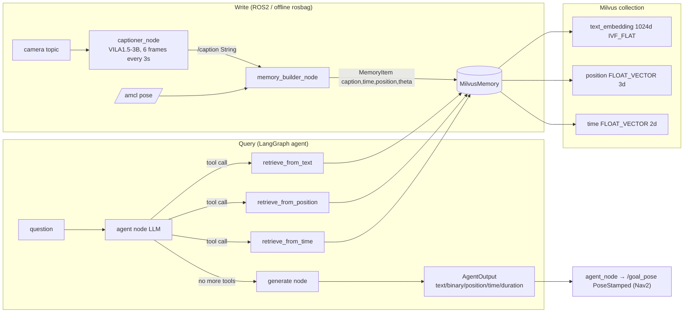
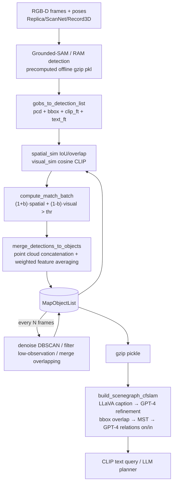
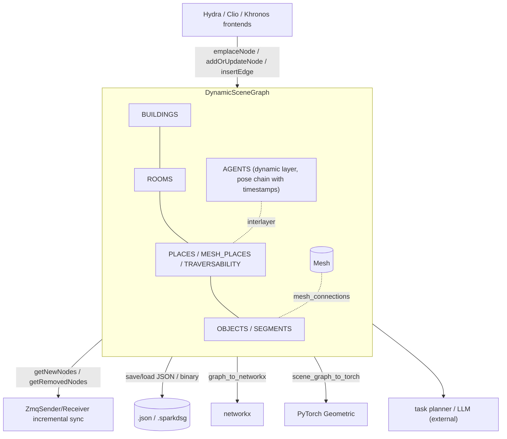
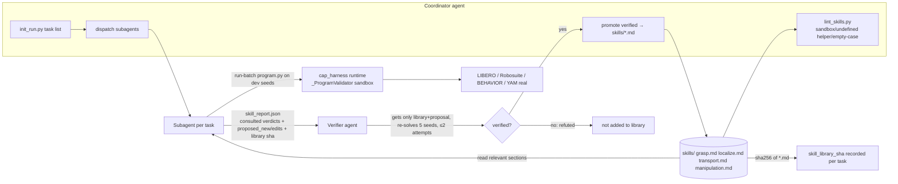
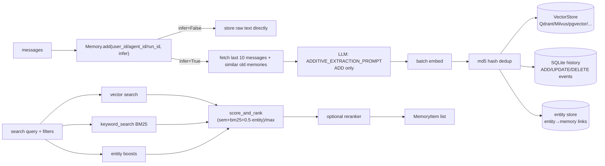
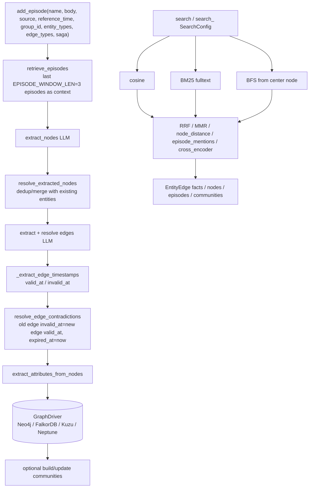

# Survey of Open-Source Physical Memory Implementations (Memory Landscape)

> A survey of reference implementations for the `Hylo` Memory Layer (Working / Episodic / Spatial / Skill).
> Survey date: 2026-10-30; source-study extension: 2026-11-03. The reference study uses **static source reading**: no `pip install`, scripts, weight/dataset downloads or modifications in these reference trees. The separately authorized remote implementation and evaluation are recorded in the [RoboMME pilot](../experiments/2026-11-03-robomme-memory-pilot.md).
>
> Tag conventions:
> - **\[Implemented\]**: the corresponding implementation is seen directly in the source (with `file:line`).
> - **\[Docs/Interface only\]**: appears only in README / docstring / abstract interface / prompt; no complete implementation seen, or the implementation depends on an external process (e.g. manual execution by a human/agent).
> - **\[Unverified\]**: based on API metadata, third-party indexes or inference; not confirmed at the source level, or not run.
> - **\[Needs model/hardware\]**: requires a GPU, specific model weights, an LLM API, ROS or a real robot to run.
>
> Source citation format: `references/memory/<repo>/<path>:<line>`; line numbers correspond to the commit recorded in MANIFEST.

---

## 1. Search Method

1. **Web search** (WebSearch / WebFetch): searched separately by four categories (episodic robot memory, 3D scene memory, skill library, general agent memory), and read two awesome lists still maintained in 2026 to fill in new 2025-2026 work:
   - `Everloom-129/Awesome-Memory-for-Robotics` (provides code links for MemBodied, MEMORA, RoboHarness, RAVEN, PRISM, etc.)
   - `benchflow-ai/awesome-embodied-agents` (provides ASPIRE, CaP-X, PhyAgentOS, RobotUse, DimOS, etc.)
2. **Existence verification**: ran `git ls-remote --symref <url> HEAD` for each candidate (confirming the repository exists and its default branch).
3. **Metadata verification**: GitHub REST API `/repos/{owner}/{repo}` to obtain license SPDX, stars, `pushed_at`, `archived`, size; for `NOASSERTION` repositories, additionally fetched `/license` to read the full text. Additionally checked PyPI for 3 libraries (`spark-dsg 1.1.3`, `mem0ai 2.2.1`, `graphiti-core 0.31.2`).
4. **Owner and paper matching**: e.g. HOV-SG has two repositories; `robot-learning-freiburg/HOV-SG` has only 2★, and its README's clone address points to `hovsg/HOV-SG` (561★), which is the de facto main repository; for Embodied-RAG, the owner of `quanting-xie/Embodied-RAG` has the same name as the first author.
5. **Selection criteria**: 2024-2026, real code, a license that permits reuse, usable as a *pluggable component* rather than merely learned memory inside a policy. Cover at least one in each of the four categories (episodic / spatial / skill / general infra).

> Note: the "last commit" column is, for cloned repositories, the commit date of the default branch HEAD; for uncloned repositories it is the GitHub API `pushed_at` (most recent push to any branch; whether it is the default branch is \[Unverified\]).

---

## 2. Candidate List (verified)

| name | url | category | license | last commit | maturity | decision | reason |
|---|---|---|---|---|---|---|---|
| **ReMEmbR** | https://github.com/NVIDIA-AI-IOT/remembr | episodic (robot, text/time/position) | **NVIDIA License (non-commercial only, research/evaluation)** | 2025-03-02 (HEAD; API push 2026-08-24) | Research library, `setup.py`, no tests, 361★ | **clone** | Benchmark design for robot episodic memory (caption+pose+time, three-way retrieval + LLM agent); license does not permit commercial reuse, **design reference only** |
| MemoryVLA | https://github.com/shihao1895/MemoryVLA | working/episodic (memory bank inside the VLA) | **No LICENSE** (API: None) | 2026-06-13 | ICLR 2026 paper code, default branch `openvla-codebase`, 373★ | reference-only | No license, not reusable; memory is a token bank coupled to the weights, not a pluggable store; filed as a Policy-layer reference |
| SimpleMemVLA | https://github.com/OpenBMB/SimpleMemVLA | working (VLA video memory) | MIT | 2026-10-18 | New paper code, 102★ | reference-only | Memory internal to the policy; evaluate in the Policy layer |
| MemBodied | https://github.com/declare-lab/MemBodied | working (VLA recurrent associative memory) | Apache-2.0 | 2026-09-24 | Very new, 10★, <1 MB | reference-only | Paper code, internal to the policy |
| RoboHarness | https://github.com/LZY-1021/RoboHarness | episodic (memory-augmented policy harness, in-context adaptation) | MIT | 2026-07-07 | 22★ | reference-only | Intersects harness+memory; low maturity; added to follow-up tracking |
| RAVEN | https://github.com/princeton-prism/RAVEN | episodic+spatial (visuo-spatio-temporal memory, navigation) | **NVIDIA License (non-commercial)** | 2026-07-18 | 35★ | reference-only | Same license text as ReMEmbR, non-commercial restriction |
| MEMORA | https://github.com/yuzihaowashu/MEMORA | episodic (egocentric action memory) | MIT | 2026-08-23 | 6★ | reference-only | Early paper code |
| PRISM (memory-visuomotor-policies) | https://github.com/rai-opensource/memory-visuomotor-policies | working (policy short-term memory) | **No LICENSE** | 2026-04-28 | 2★ | reject | No license |
| Embodied-RAG | https://github.com/quanting-xie/Embodied-RAG | episodic+spatial (hierarchical semantic forest) | MIT | 2025-01-18 (only one push) | 0★, code dump | reference-only | The hierarchical summarization idea is valuable, but the code is unmaintained |
| KARMA | — (paper arXiv 2409.14908) | episodic (LTM/STM for embodied planning) | — | — | No official code found | reject | No verifiable code |
| **ConceptGraphs** | https://github.com/concept-graphs/concept-graphs | spatial (open-vocab object-centric 3D scene graph) | MIT | 2025-01-15 (main; the `ali-dev` branch is more active, push 2025-10-16) | Research code, `setup.py`, no tests, 980★ | **clone** | The most frequently cited open-vocab object-level 3D memory; Python implementation; clear data association/merge logic |
| **Spark-DSG** | https://github.com/MIT-SPARK/Spark-DSG | spatial (layered 3D scene graph data structure) | BSD-2-Clause (LICENSE file) / BSD-3-Clause (pyproject, PyPI metadata) | 2026-04-11 (API push 2026-10-17) | **Library**: PyPI `spark-dsg 1.1.3`, C++ gtest + pytest, pybind11, 90★ | **clone** | Data model shared by Hydra/Clio/Khronos; can serve directly as the storage layer of Spatial Memory |
| Hydra | https://github.com/MIT-SPARK/Hydra | spatial (real-time 3DSG construction) | BSD-2-Clause | 2026-10-29 | Mature, 1189★, C++/ROS | reference-only | Heavy ROS + C++ dependencies; consuming its output via Spark-DSG is sufficient |
| Clio | https://github.com/MIT-SPARK/Clio | spatial (task-driven open-set 3DSG) | BSD-2-Clause | 2025-09-01 | 264★, ROS | reference-only | The "cluster by task" idea can be borrowed; heavy ROS dependency |
| Khronos | https://github.com/MIT-SPARK/Khronos | spatial+temporal (spatio-temporal metric-semantic SLAM) | BSD-3-Clause | 2026-10-29 | 554★, C++ | reference-only | Its temporal attributes are already reflected in Spark-DSG `KhronosObjectAttributes` |
| 3D-Mem | https://github.com/UMass-Embodied-AGI/3D-Mem | spatial (snapshot-based 3D memory for EQA/exploration) | MIT | 2025-10-02 | CVPR 2025, 282★, bound to Habitat, 288 MB | reference-only | Heavy on Habitat+GPU; the "memory snapshot" concept is noted |
| HOV-SG | https://github.com/hovsg/HOV-SG | spatial (hierarchical open-vocab 3DSG, floor/room/object) | MIT | 2026-01-19 | RSS 2024, 561★ | reference-only | Overlaps with ConceptGraphs + the rooms/buildings layers of Spark-DSG |
| OpenScene | https://github.com/pengsongyou/openscene | spatial (dense 3D open-vocab features) | Apache-2.0 | 2023-10-27 | Unmaintained | reject | Too old; a dense feature field rather than memory |
| VLMaps | https://github.com/vlmaps/vlmaps | spatial (2D grid open-vocab map) | MIT | 2024-07-09 | Unmaintained, 731★ | reference-only | Can serve as a grid-map baseline |
| **ASPIRE** | https://github.com/NVlabs/ASPIRE | skill (text+code skill library, promotion after validation) | Apache-2.0 | 2026-10-15 | Active, 913★, `pyproject`+`uv.lock`, 58 test files | **clone** | The only robot skill library implementation in 2026 that has all of "skill write gating + usage-feedback scoring + version hashing" |
| Voyager | https://github.com/MineDojo/Voyager | skill (code skill library + embedding retrieval) | MIT | 2024-04-03 | 7.3k★, unmaintained, Minecraft/JS | reference-only | Classic design, but different domain and unmaintained; ASPIRE covers its ideas in the robotics setting |
| CaP-X | https://github.com/capgym/cap-x | skill/reasoning (coding agent manipulation benchmark) | MIT | 2026-05-28 | 894★ | reference-only | Leans toward benchmark/harness; belongs to the Reasoning layer |
| Agent Workflow Memory | https://github.com/zorazrw/agent-workflow-memory | skill (workflow induction) | Apache-2.0 | 2025-12-22 | 480★ | reference-only | Web agent domain |
| PhyAgentOS | https://github.com/PhyAgentOS/PhyAgentOS-core | general+skill (self-evolving robot agent OS) | MIT | 2026-10-30 | 2988★, 402 MB | reference-only | Large and overlaps with the harness; recommend a separate review |
| RobotUse | https://github.com/robotuse-team/RobotUse | skill (lessons playbook) | Apache-2.0 | 2026-10-14 | 8★ | reference-only | Too new |
| DimOS | https://github.com/dimensionalOS/dimos | skill (robot OS, skills via MCP) | NOASSERTION (custom, not read in detail) | 2026-10-30 | 4.7k★ | reference-only | License needs separate review |
| **mem0** | https://github.com/mem0ai/mem0 | general memory infra (vector + BM25 + entity) | Apache-2.0 | 2026-10-26 | **Library**: PyPI `mem0ai 2.2.1`, 68k★, tests | **clone** | Factual memory extraction + multi-backend vector store abstraction; the most widely used |
| **Graphiti** | https://github.com/getzep/graphiti | general memory infra (bi-temporal knowledge graph) | Apache-2.0 | 2026-10-28 | **Library**: PyPI `graphiti-core 0.31.2`, 32k★, tests | **clone** | Dual timelines (valid/invalid + created/expired) and contradiction-invalidation mechanism; closest fit to episodic temporal needs |
| Letta (MemGPT) | https://github.com/letta-ai/letta | general (stateful agent server, core/archival memory) | Apache-2.0 | 2026-10-18 | 25k★, server form factor | reference-only | A complete agent runtime/server, too heavy as a library; the memory block concept can be borrowed |
| LangMem | https://github.com/langchain-ai/langmem | general (memory tools on top of the LangGraph store) | MIT | 2026-10-28 | 1.7k★ | reference-only | LangGraph is already cloned under `references/reasoning/`; LangMem is a thin layer |
| MemOS | https://github.com/MemTensor/MemOS | general (memory OS) | Apache-2.0 | 2026-10-29 | 12k★, main language has shifted to TS | reference-only | Heavyweight |
| A-MEM | https://github.com/agiresearch/A-mem | general (Zettelkasten link evolution) | MIT | 2025-12-12 | 1.2k★ | reference-only | Research code; the link-evolution idea can be borrowed |
| cognee | https://github.com/topoteretes/cognee | general (KG memory pipeline) | Apache-2.0 | 2026-10-29 | 33k★ | reference-only | Functionally overlaps with Graphiti |
| **HarnessPAI** | https://github.com/Darwin-Agent/HarnessPAI | skill and harness evolution | **No LICENSE** | 2026-10-22 | \[Unverified\] Static Git-object study | **clone** | Existing clone retained; design only. Program/skill evolution, unfinished feedback collector: `references/memory/HarnessPAI/harnesspai/feedback/collect.py:47`. |
| **SERA** | https://github.com/StevenKKXS/SERA | episodic lessons and harness evolution | Apache-2.0 | 2026-10-24 | \[Implemented\]\[Unverified\] Typed interventions and paired verifier | **clone** | Frozen-policy harness with disjoint panels and count/rate gates: `references/memory/SERA/scripts/codex_rollout/verify_self_evolve_v5_candidate.py:154`. |
| **eMEM** | https://github.com/automatika-robotics/emem | episodic and spatial backend | MIT | 2026-05-22 | \[Implemented\]\[Unverified\] Embedded library | **clone** | SQL, HNSW and spatial/time query paths: `references/memory/emem/emem/store.py:32`. |
| **RoboMME benchmark** | https://github.com/RoboMME/robomme_benchmark | memory benchmark | Apache-2.0 code; asset terms separate | 2026-10-30 | \[Implemented\]\[Unverified\] Original 16-task suite | **clone** | Explicit task/episode metadata and predicates: `references/memory/robomme_benchmark/src/robomme/env_record_wrapper/episode_config_resolver.py:17`. |
| **RoboMME policy learning** | https://github.com/RoboMME/robomme_policy_learning | policy-internal and symbolic memory | Apache-2.0 code; Gemma terms separate | 2026-10-20 | \[Implemented\]\[Unverified\] 14 variant configs | **clone** | Establish frozen-harness versus modified-VLA boundary: `references/memory/robomme_policy_learning/scripts/eval.sh:1`. |
| **MIKASA-Robo** | https://github.com/CognitiveAISystems/MIKASA-Robo | memory benchmark | MIT code; data/assets separate | 2026-06-30 | \[Implemented\]\[Unverified\] 32 retained RL tasks and 90 VLA tasks | **clone** | Separate original four categories from current ten types: `references/memory/MIKASA-Robo/mikasa_robo_vla_envs.csv:1`; `references/memory/MIKASA-Robo/README.md:45`. |

**Initial clone results (6)**: episodic -> ReMEmbR; spatial -> ConceptGraphs, Spark-DSG; skill -> ASPIRE; general infra -> mem0, Graphiti. See `references/MANIFEST.md` for commit/branch/license.

**Extension (6 repositories, 5 project studies)**: HarnessPAI, SERA, eMEM, RoboMME benchmark and policy learning, and MIKASA-Robo. The findings below record the static study, before the separate remote evaluation. HarnessPAI was already present with an unpopulated worktree; its recorded Git objects were read without restoring it. New reference clones excluded LFS/submodules and no additional datasets or weights were requested for this study. Tracked repository media can still be hydrated by checkout despite the partial-clone filter.

---

## 3. ReMEmbR (`references/memory/remembr`)

### 3.1 Positioning
An ICRA 2025 work from NVIDIA + USC + UT Austin: during long-running operation, the robot captions short video clips into text and writes them, together with pose and timestamp, into a vector database; at query time an LLM agent performs three-way retrieval by text / time / position via tool-calling, and finally outputs a structured answer (including a navigable goal position). It is the simplest, clearest paradigm of **"episodic memory = a caption log with spatio-temporal indexing"**.

### 3.2 Architecture



### 3.3 Core Data Structures and Interfaces
```python
# remembr/memory/memory.py:4-9
@dataclass
class MemoryItem:
    caption: str; time: float; position: list; theta: float

# remembr/memory/memory.py:24-42
class Memory:
    def insert(self, item: MemoryItem)
    def get_working_memory(self) -> list[MemoryItem]
    def search_by_position(self, query: tuple) -> list[MemoryItem]
    def search_by_time(self, hms_time_query: str) -> list[MemoryItem]
    def search_by_text(self, query: str) -> list[MemoryItem]
    def memory_to_string(self, memory_list) -> str

# remembr/agents/agent.py:5-12
@dataclass
class AgentOutput:
    type: str; text: str; binary: str; position: list; orientation: float; duration: float; time: float
```

### 3.4 Write / Retrieval Flow
- **Write policy** \[Implemented\]: writes at a fixed cadence, with no filtering. `captioner_node` runs every `caption_interval=3.0s`, takes `caption_image_count=6` frames, sampling 1 of every 15 frames (`examples/nova_carter_demo/python/captioner_node.py:31-33`); `memory_builder_node.caption_callback` combines each received caption with the latest pose into a `MemoryItem` and inserts it (`examples/nova_carter_demo/python/memory_builder_node.py:49-64`). The offline version segments by `seconds_per_caption` (`remembr/scripts/preprocess_captions.py:45-56`).
- **Storage schema** \[Implemented\]: a single Milvus collection stores `text_embedding` (1024d), `position` (3d FLOAT_VECTOR), `time` (2d FLOAT_VECTOR), `theta`, `caption` together (`remembr/memory/milvus_memory.py:37-45`), with an IVF_FLAT/L2 index on each of the three vector fields (`milvus_memory.py:49-69`).
- **Key trick** \[Implemented\]: position and time are treated as "vectors" for **ANN nearest-neighbor search**, not range queries. Time is stored as a 2-D vector `[t - FIXED_SUBTRACT, 0.0]` (`milvus_memory.py:17`, `milvus_memory.py:130`); search_by_time appends a date to `HH:MM:SS`, converts it to epoch, then does a nearest-neighbor search (`milvus_memory.py:184-214`). This shows that **a general-purpose vector DB can be bent into doing spatio-temporal retrieval, but has no radius / time-window / coordinate-frame semantics**.
- **Text retrieval** \[Implemented\]: `mixedbread-ai/mxbai-embed-large-v1` embeddings (`milvus_memory.py:115`), LangChain retriever `k=5` (`milvus_memory.py:153`).
- **Working memory** \[Implemented\]: retrieval results are accumulated into `self.working_memory` (`milvus_memory.py:177`, `:209`, `:222`), i.e. "context already retrieved during this round of reasoning", with no capacity limit or eviction.
- **Agent consumption** \[Implemented\]: the three retrieval functions are wrapped as LangChain `StructuredTool`s (`remembr/agents/remembr_agent.py:153-206`); a LangGraph `agent ↔ action` loop runs until the LLM stops calling tools, then enters `generate` (`remembr_agent.py:343-384`). The output is parsed into `AgentOutput`, and `agent_node` converts `position` into a `PoseStamped` published to `/goal_pose` (`examples/nova_carter_demo/python/agent_node.py:79-100`).
- **Consolidation / forgetting** [Not implemented]: no deduplication, no summarization, no deletion; `reset(drop_collection=True)` can only wipe the whole database (`milvus_memory.py:139-144`).

### 3.5 Extension Points
- The `Memory` abstract class allows swapping backends (in-memory implementations `TextMemory` and `VideoMemory` already exist: `remembr/memory/text_memory.py:18-34`, `remembr/memory/video_memory.py:22-49`).
- The `Captioner` abstraction (`remembr/captioners/captioner.py:3-5`) allows replacing the VLM.
- LLM backend can be OpenAI / NIM / Ollama (`remembr_agent.py:122-138`) \[Needs model/hardware\].

### 3.6 Dependencies and Runtime Requirements
Milvus server (`pymilvus`), LangChain/LangGraph, HuggingFace embedding, VILA captioner (GPU) \[Needs model/hardware\]; `requirements.txt` pins `pydantic==1.10.18`, `deepspeed==0.9.5`, with a high risk of conflict with the modern LangChain/pydantic v2 ecosystem \[Unverified\]. The core library does not depend on ROS; ROS2 is only in `examples/nova_carter_demo/`.

### 3.7 License
`LICENSE.md` is the **NVIDIA License**; §3.3 states *"only may be used or intended for use non-commercially … research or evaluation purposes only"* (`references/memory/remembr/LICENSE.md:20`). **Hylo must not copy its code**; only its design may be borrowed.

### 3.8 Strengths, Weaknesses and Risks
- Strengths: an extremely minimal data model; the combination of three-way spatio-temporal retrieval and LLM tool-calling is clear; "answer -> navigation goal" closes the loop from memory to planner.
- Risks/defects (static findings):
  - `search_by_time` in `tools.py` uses `query` before defining it (`remembr/tools/tools.py:69`), which would trigger an `UnboundLocalError`; the agent actually uses `MilvusMemory.search_by_time`, so that file is dead code [Implemented-defect, not verified by running].
  - `Agent.query_yes_no` compares the method object `str_bool.lower == 'yes'`, which is always False (`remembr/agents/agent.py:38`) [Implemented-defect].
  - `eval()` is used in several places to parse LLM output (`remembr_agent.py:62`, `:317`, `:329`, `:403`): **code injection risk**.
  - `try_except_continue` retries indefinitely on any exception (`remembr_agent.py:82-91`), possibly looping forever.
  - The primary key is `str(time.time())` (`milvus_memory.py:125`), which may collide under high-frequency writes.

### 3.9 Reusable Components (design level only)
- `MemoryItem(caption, time, position, theta)` as the minimal field set for episodic memory;
- the "retrieval tools = the LLM interface of memory" pattern, and the way parameter formats are constrained in tool descriptions;
- the output schema `AgentOutput` (structuring QA answers into position/time/duration/binary).

### 3.10 Source Index
| Topic | Location |
|---|---|
| MemoryItem / Memory abstraction | `references/memory/remembr/remembr/memory/memory.py:4-42` |
| Milvus schema and indexes | `references/memory/remembr/remembr/memory/milvus_memory.py:37-69` |
| insert (time offset, embedding) | `references/memory/remembr/remembr/memory/milvus_memory.py:122-134` |
| Three-way retrieval + working memory accumulation | `references/memory/remembr/remembr/memory/milvus_memory.py:173-227` |
| LLM tool definitions | `references/memory/remembr/remembr/agents/remembr_agent.py:153-206` |
| LangGraph graph | `references/memory/remembr/remembr/agents/remembr_agent.py:343-384` |
| AgentOutput | `references/memory/remembr/remembr/agents/agent.py:5-40` |
| ROS2 write node | `references/memory/remembr/examples/nova_carter_demo/python/memory_builder_node.py:49-64` |
| Answer -> navigation goal | `references/memory/remembr/examples/nova_carter_demo/python/agent_node.py:79-100` |
| License non-commercial clause | `references/memory/remembr/LICENSE.md:20` |

### 3.11 Verification Status
Static reading; did not connect to Milvus, run the agent, or download VILA. The data flow and defects are inferred from source [Unverified by running].

---

## 4. ConceptGraphs (`references/memory/concept-graphs`)

### 4.1 Positioning
An ICRA 2024 open-vocabulary 3D scene graph: RGB-D sequence -> 2D detection/segmentation (Grounded-SAM / RAM) -> each detection is back-projected into a point cloud carrying CLIP visual features & text features -> fused with existing objects in the map via **joint geometric+semantic data association** -> offline, LLaVA/GPT-4 generate object captions and inter-object relation edges. It is representative of **"Spatial memory = a list of object nodes + fusion rules"**.

### 4.2 Architecture



### 4.3 Core Data Structures and Interfaces
An object node is a **dict** (no schema class); its fields are constructed in `gobs_to_detection_list` (`references/memory/concept-graphs/conceptgraph/slam/utils.py:545-564`):
```python
{ 'image_idx': [idx], 'mask_idx': [...], 'color_path': [...], 'class_name': [...], 'class_id': [...],
  'num_detections': 1, 'mask': [...], 'xyxy': [...], 'conf': [...], 'n_points': [...],
  'pixel_area': [...], 'is_background': bool,
  'pcd': o3d.PointCloud, 'bbox': o3d.OrientedBoundingBox,
  'clip_ft': Tensor, 'text_ft': Tensor }
```
```python
# conceptgraph/slam/slam_classes.py:12,102-156
class DetectionList(list): get_values / get_stacked_values_torch / slice_by_mask ...
class MapObjectList(DetectionList):
    def compute_similarities(self, new_clip_ft) -> Tensor   # cosine vs all objects
    def to_serializable(self) / load_serializable(self, s_obj_list)
```

### 4.4 Write / Retrieval Flow
- **Write (data association)** \[Implemented\]: `compute_spatial_similarities` supports iou / giou / overlap, etc. (`conceptgraph/slam/mapping.py:17-44`); `compute_match_batch` takes a `phys_bias`-weighted sum and then does thresholded greedy assignment (`conceptgraph/slam/cfslam_pipeline_batch.py:56-80`).
- **Fusion** \[Implemented\]: `merge_obj2_into_obj1` concatenates list fields, merges point clouds and then denoises with DBSCAN, and **averages CLIP/text features weighted by observation count, then re-normalizes** (`conceptgraph/slam/utils.py:178-222`). This is an "object-level consolidation" rule that can be borrowed directly.
- **Periodic consolidation / forgetting** \[Implemented\]: every `denoise_interval` / `filter_interval` / `merge_interval` frames, it denoises, deletes objects with too few points or observations, and merges overlapping objects (`cfslam_pipeline_batch.py:293-298`; `utils.py:362-394`; merge condition is three thresholds on overlap + visual_sim + text_sim: `utils.py:325-360`). "Forget when observed too few times" is the most naive forgetting strategy.
- **Relation edges** \[Implemented\]\[Needs model/hardware\]: bbox overlap matrix -> minimum spanning tree -> GPT-4 called on MST edges to decide `a on b / a in b / none` (`conceptgraph/scenegraph/build_scenegraph_cfslam.py:621-671`, `:712-724`).
- **Retrieval** [Implemented, script only]: no library-level query API; the example in the visualization script computes cosine between the CLIP text feature and all objects' `clip_ft` (`conceptgraph/scripts/visualize_cfslam_results.py:274-290`).
- **Storage** \[Implemented\]: gzip pickle (`cfslam_pipeline_batch.py:319-320`), no incremental persistence.

### 4.5 Extension Points
Hydra config switches similarity/thresholds; the detector can be swapped (`generate_gsa_results.py`); `MapObjectList` can be read by any planner. The main branch is a batch pipeline; the README points out that the streaming refactor is on the `ali-dev` branch (`references/memory/concept-graphs/README.md:30`) \[Unverified\].

### 4.6 Dependencies and Runtime Requirements
CUDA + PyTorch 2.0.1 + PyTorch3D + gradslam + chamferdist + Grounded-SAM/RAM weights + LLaVA + OpenAI API (`README.md:46-101`) \[Needs model/hardware\]. Dataset adapters are bound to Replica/ScanNet/Record3D/AI2-THOR.

### 4.7 License
MIT (`LICENSE`). Dependencies such as Grounded-SAM and LLaVA have their own licenses \[Unverified\].

### 4.8 Strengths, Weaknesses and Risks
- Strengths: the write/fusion/forgetting rules for object-level memory are complete and simple; dual CLIP+text features make open-vocab queries usable out of the box.
- Weaknesses: untyped dicts; no timestamps (only `image_idx`), so it **cannot answer "when was it seen"**; no handling of dynamic objects; offline batch processing; pickle deserialization carries security risk; no tests.

### 4.9 Reusable Components
The geometric+semantic weighted association of `compute_match_batch`, the weighted feature averaging of `merge_obj2_into_obj1`, the observation-count forgetting of `filter_objects`, and MST+LLM relation-edge generation are all pure functions and can be rewritten under MIT into Hylo's `SpatialMemory.upsert_observation()`.

### 4.10 Source Index
| Topic | Location |
|---|---|
| DetectionList / MapObjectList | `references/memory/concept-graphs/conceptgraph/slam/slam_classes.py:12-156` |
| Object node fields | `references/memory/concept-graphs/conceptgraph/slam/utils.py:545-564` |
| Spatial similarity | `references/memory/concept-graphs/conceptgraph/slam/mapping.py:17-44` |
| Association matching | `references/memory/concept-graphs/conceptgraph/slam/cfslam_pipeline_batch.py:56-80` |
| Fusion (weighted feature averaging) | `references/memory/concept-graphs/conceptgraph/slam/utils.py:178-222` |
| Merge/denoise/filter | `references/memory/concept-graphs/conceptgraph/slam/utils.py:325-394` |
| Periodic post-processing in main loop | `references/memory/concept-graphs/conceptgraph/slam/cfslam_pipeline_batch.py:290-298` |
| MST + GPT-4 relations | `references/memory/concept-graphs/conceptgraph/scenegraph/build_scenegraph_cfslam.py:621-724` |
| CLIP text query | `references/memory/concept-graphs/conceptgraph/scripts/visualize_cfslam_results.py:274-290` |

### 4.11 Verification Status
Static reading of the main branch; pipeline not run; the `ali-dev` branch not compared.

---

## 5. Spark-DSG (`references/memory/Spark-DSG`)

### 5.1 Positioning
MIT-SPARK's **Dynamic Scene Graph data structure library** (C++17 + pybind11), the common storage format of Hydra, Clio and Khronos. It does not handle perception; it only handles the nodes/edges/layers/partitions of a "layered 3D scene graph", serialization, incremental sync (ZMQ) and conversion (networkx / PyTorch Geometric). For Hylo, it is the closest thing to **"the standard storage layer for spatial memory"**.

### 5.2 Architecture



### 5.3 Core Data Structures and Interfaces
```cpp
// include/spark_dsg/node_attributes.h:94-120
struct NodeAttributes {
  Eigen::Vector3d position;          // every node must have a position
  uint64_t last_update_time_ns;
  bool is_active;                    // whether it is in the active window
  bool is_predicted;                 // observed vs predicted/completed
  Metadata metadata;                 // arbitrary JSON
};
// :158-186  SemanticNodeAttributes: name, color, bounding_box, semantic_label, Eigen::MatrixXf semantic_feature
// :203-220  ObjectNodeAttributes: mesh_connections, registered, world_R_object
// :366-385  AgentNodeAttributes: std::chrono::nanoseconds timestamp, world_R_body, external_key, dbow_ids/values
// :398-423  KhronosObjectAttributes: first_observed_ns[], last_observed_ns[], trajectory_timestamps[], trajectory_positions[]
```
```cpp
// include/spark_dsg/dynamic_scene_graph.h
DynamicSceneGraph(const LayerKeys&, const LayerNames& = {});           // :109
bool emplaceNode(LayerId, NodeId, std::unique_ptr<NodeAttributes>&&);  // :224
bool addOrUpdateNode(...);                                              // :255-266
bool insertEdge(NodeId, NodeId, EdgeAttributes::Ptr = nullptr);        // :334
bool removeNode(NodeId);                                                // :282
bool mergeNodes(NodeId from, NodeId to);                                // :389
bool mergeGraph(const DynamicSceneGraph&, const GraphMergeConfig&, const Eigen::Isometry3d*); // :407
std::vector<NodeId> getNewNodes(bool clear_new=false);                  // :423
std::vector<NodeId> getRemovedNodes(bool clear_removed=false);          // :416
void transform(const Eigen::Isometry3d&);                               // :456
void save(path, bool include_mesh=true) const; static Ptr load(path);   // :464-471
```
Layer name constants `SEGMENTS/OBJECTS/AGENTS/PLACES/MESH_PLACES/TRAVERSABILITY/ROOMS/BUILDINGS` (`include/spark_dsg/scene_graph_types.h:80-96`); `LayerKey{layer, partition}` supports multiple partitions within one layer (e.g. multiple robots) (`scene_graph_types.h:63-70`).

### 5.4 Write / Retrieval Flow
- **Write** \[Implemented\]: an external frontend (Hydra, etc.) calls `emplaceNode/addOrUpdateNode/insertEdge`; this library does not decide "when to write".
- **Change tracking** \[Implemented\]: `getNewNodes/getRemovedNodes/getNewEdges/getRemovedEdges` + `markEdgesAsStale/removeAllStaleEdges` (`dynamic_scene_graph.h:416-450`): a ready-made mechanism for **incremental sync / memory change-feed**.
- **Consolidation** \[Implemented\]: `mergeNodes` (merging duplicate objects after loop closure), `mergeGraph` (multi-robot/multi-session fusion, optionally with a transform), `transform()` applies a rigid-body transform to the whole graph (map frame correction).
- **Time** \[Implemented\]: base nodes have only `last_update_time_ns`; `AgentNodeAttributes.timestamp` records the trajectory; `KhronosObjectAttributes` records multiple `first/last_observed_ns` intervals and dynamic object trajectories (`node_attributes.h:410-421`): the only ready-made schema at the **"spatial + episodic" intersection**.
- **Retrieval** [Implemented, low-level]: by NodeId / layer traversal / parent-child-sibling relations; **no** text or vector retrieval, and no spatial index (KD-tree), which must be added by an upper layer.
- **Extensible attributes** \[Implemented\]: the `REGISTER_NODE_ATTRIBUTES` macro + `AttributeRegistry` make custom attribute types serializable (`node_attributes.h:58-68`; `include/spark_dsg/serialization/attribute_registry.h:160-173`); on the Python side the most convenient extension is `metadata` (JSON).
- **Consumption** \[Implemented\]: `graph_to_networkx` (`python/spark_dsg/networkx.py:64`), `scene_graph_to_torch` (`python/spark_dsg/torch_conversion.py:393`) facilitate GNN or LLM serialization.

### 5.5 Extension Points
Custom node/edge attributes (C++ registration macro), `Metadata` JSON, ZMQ interface (`include/spark_dsg/zmq_interface.h:43-73`), Python viser visualization.

### 5.6 Dependencies and Runtime Requirements
C++17, Eigen3, nlohmann_json, optional ZMQ; the Python package is built via scikit-build-core + pybind11, and `spark-dsg 1.1.3` is published on PyPI (`pyproject.toml:1-16`). **The core library does not depend on ROS** (`package.xml` is used only for ROS build integration) [ROS part Unverified].

### 5.7 License
The `LICENSE` file contains BSD-2-Clause text (no "Neither the name…" clause, `references/memory/Spark-DSG/LICENSE:1-5`), whereas `pyproject.toml:10` and PyPI declare `BSD-3-Clause`. Both are permissive licenses; **before reuse, treat it as the stricter BSD-3 (retain notices + do not use the MIT name for endorsement)**. There is also a US Air Force funding statement (`DISCLAIMER`).

### 5.8 Strengths, Weaknesses and Risks
- Strengths: a mature typed layered schema; C++ and Python unit tests (`tests/utest_*.cpp`, `python/tests/test_*.py`); incremental sync, merging, coordinate transforms; installable from PyPI.
- Risks: the C++ extension needs compilation, and custom attributes require writing C++; no semantic/vector retrieval; `semantic_feature` is an `Eigen::MatrixXf`, so embedding model version metadata must be defined by us.

### 5.9 Reusable Components
Use directly as the backend of Hylo's `SpatialMemory` (or write a Python version following its schema): layered layers, the `is_active`/`is_predicted` flags, `mergeNodes`, change-feed, and the observation-interval model of `KhronosObjectAttributes`.

### 5.10 Source Index
| Topic | Location |
|---|---|
| Base node attributes | `references/memory/Spark-DSG/include/spark_dsg/node_attributes.h:94-120` |
| Semantic/Object/Agent/Khronos attributes | `references/memory/Spark-DSG/include/spark_dsg/node_attributes.h:158-423` |
| Attribute registration macro | `references/memory/Spark-DSG/include/spark_dsg/node_attributes.h:58-68` |
| Graph API (nodes/edges/merging) | `references/memory/Spark-DSG/include/spark_dsg/dynamic_scene_graph.h:102-471` |
| Change tracking | `references/memory/Spark-DSG/include/spark_dsg/dynamic_scene_graph.h:416-450` |
| Layer names / LayerKey | `references/memory/Spark-DSG/include/spark_dsg/scene_graph_types.h:63-96` |
| Edge attributes (weight + metadata) | `references/memory/Spark-DSG/include/spark_dsg/edge_attributes.h:64-81` |
| networkx / torch conversion | `references/memory/Spark-DSG/python/spark_dsg/networkx.py:64`, `python/spark_dsg/torch_conversion.py:393` |
| Python usage example | `references/memory/Spark-DSG/examples/python_api.py` |

### 5.11 Verification Status
Static reading of headers and the Python package; not compiled, tests not run.

---

## 6. ASPIRE (`references/memory/ASPIRE`)

### 6.1 Positioning
NVIDIA GEAR's 2026 "Agentic /Skills Discovery for Robotics": it places a coding agent (Claude Code / Codex) inside a Code-as-Policies runtime and iteratively debugs control programs on LIBERO-Pro / Robosuite / BEHAVIOR-1K / a real YAM arm; **the "training artifact" is a skill library (Markdown + code snippets), not weights** (`README.md:7-11`). It is the only robot skill memory implementation in this survey that grounds **skill write gating, usage-feedback scoring, and library version hashing** all in on-disk processes.

### 6.2 Architecture



### 6.3 Core Data Structures and Interfaces
- **Skill entry** [Implemented, Markdown convention]: YAML front-matter `name/description` + a body organized into *trigger → code → evidence* subsections (`.claude/skills/iterative-debugging/skills/grasp.md:1-14`); code snippets may use only the public CaP API, no imports, no NumPy (`.claude/skills/iterative-debugging/skills/README.md:13-14`).
- **Usage feedback / proposal schema** [Docs/Interface only, generated by the agent per the prompt] (`.claude/skills/iterative-debugging/subagent-prompt.md:437-494`):
```json
{ "schema_version": 1, "benchmark": "...", "suite": "...", "task_id": 0,
  "skill_library_sha": "...",
  "consulted":     [{"skill","section","verdict": "useful|misleading|wrong|not-applicable","evidence"}],
  "proposed_edits":[{"skill","section","change","why"}],
  "proposed_new":  [{"skill","title","trigger","code","evidence"}] }
```
  This schema has programmatic validation `validate_skill_report` (`.claude/skills/iterative-debugging/scripts/campaign.py:389`) \[Implemented\].
- **Library version** \[Implemented\]: `skill_library_sha()` computes sha256 over `skills/**/*.md` (excluding README) by sorted path + content, taking the first 16 characters (`campaign.py:115-137`).
- **Execution sandbox** \[Implemented\]: `_ProgramValidator` forbids `ImportFrom/ClassDef/With/Global/...` and private/dunder names and attributes (`src/cap_harness/runtime.py:159-200`): the safety gate before skill code is executed.
- **Fixed program catalog** \[Implemented\]: `CapProgramCatalog` exposes only pre-reviewed programs with an attached `sha256` (`src/cap_harness/agent/program_catalog.py:8-61`), so remote callers cannot inject code.

### 6.4 Write / Retrieval Flow
- **Write policy** (the most valuable part) [Docs/Interface only + partial script implementation]: *"Nothing is written into these files by the agent that discovered it"*; the path is proposer -> verifier (re-solves using only library+proposal, 5 seeds, ≤2 attempts) -> coordinator promote (`skills/README.md:20-34`; `SKILL.md:58-61`). This turns "writing to skill memory" into a **reproducibility test**.
- **Usage-feedback-driven consolidation** \[Docs/Interface only\]: each subagent gives a `useful/misleading/wrong/not-applicable` rating for every section it opened, and the coordinator fixes before dispatching; entries frequently rated `misleading` should have their trigger narrowed rather than warnings appended (`skills/README.md:41-45`).
- **Static quality gate** \[Implemented\]: `lint_skills.py` feeds every ```python fence into the harness's own `_ProgramValidator`, checking for undefined helpers, empty search-result cases, etc. (`scripts/lint_skills.py:1-30`).
- **Replay/re-run** \[Docs/Interface only\]: after the library changes, tasks that scored low under the old library are re-run with the final library (`SKILL.md:62-65`).
- **Retrieval** \[Docs/Interface only\]: no embedding retrieval; the agent reads the `SKILL.md` index and section titles and chooses by itself (LLM-as-retriever, based on trigger text).

### 6.5 Extension Points
New benchmark adapters (`src/cap_harness/libero|robosuite|behavior|yam_real`), provider protocols (SAM3 / cuRobo / Contact-GraspNet / PyRoki, `src/cap_harness/providers/`), new skill directories; `docs/api-reference.md` defines the API surface callable by skill code.

### 6.6 Dependencies and Runtime Requirements
Python 3.10–3.12, torch 2.9.1, open_clip, SAM3, cuRobo, Contact-GraspNet (GPU), LIBERO-PRO/robosuite/BEHAVIOR-1K (submodules, not cloned), frontier LLM coding agents (Claude/GPT) \[Needs model/hardware\].

### 6.7 License
Apache-2.0 (`LICENSE`); `NOTICE` states that the third_party submodules carry their own licenses.

### 6.8 Strengths, Weaknesses and Risks
- Strengths: a closed loop for skill memory of "write gating + feedback rating + content-hash versioning + sandbox + lint"; 58 test files; actively maintained.
- Risks: most of the memory process is a **prompt/Markdown protocol** that relies on the agent's compliance; programmatic enforcement covers only report validation, lint and hashing; skill retrieval relies entirely on LLM reading; high cost (each proposal requires the verifier to re-run simulation).

### 6.9 Reusable Components
The content-addressed versioning of `skill_library_sha`, the `skill_report.json` schema, the `_ProgramValidator` sandbox idea, the retrospective static checks of `lint_skills.py`, and the promotion protocol in which "the verifier re-solves with only the proposal".

### 6.10 Source Index
| Topic | Location |
|---|---|
| Skill library lifecycle description | `references/memory/ASPIRE/.claude/skills/iterative-debugging/skills/README.md:1-45` |
| Skill entry format example | `references/memory/ASPIRE/.claude/skills/iterative-debugging/skills/grasp.md:1-14` |
| Promotion process | `references/memory/ASPIRE/.claude/skills/iterative-debugging/SKILL.md:55-65` |
| skill_report schema and verdicts | `references/memory/ASPIRE/.claude/skills/iterative-debugging/subagent-prompt.md:437-494` |
| Library hash | `references/memory/ASPIRE/.claude/skills/iterative-debugging/scripts/campaign.py:115-137` |
| Report validation | `references/memory/ASPIRE/.claude/skills/iterative-debugging/scripts/campaign.py:389` |
| Skill lint | `references/memory/ASPIRE/.claude/skills/iterative-debugging/scripts/lint_skills.py:1-30` |
| Program sandbox | `references/memory/ASPIRE/src/cap_harness/runtime.py:159-200` |
| Fixed program catalog | `references/memory/ASPIRE/src/cap_harness/agent/program_catalog.py:8-61` |

### 6.11 Verification Status
Static reading; no campaign run, submodules not pulled, no LLM called.

---

## 7. HarnessPAI

### 7.1 Positioning

\[Implemented\] A code-evolution harness around a fixed action model: it generates task-specific Python, executes it, diagnoses failures, and promotes successful code and repair knowledge. Its evolution unit is an executable program, not a VLA weight update (`references/memory/HarnessPAI/harnesspai/evolution/loop.py:793`). This is close to Hylo's outer-loop architecture, but its unrestricted task programs require a stronger observation boundary before Hylo could adopt the design (`references/memory/HarnessPAI/harnesspai/execution/rollout.py:74`).

### 7.2 Architecture

\[Implemented\] The controller prepares a candidate workspace, invokes Codex with write access, runs episode batches, attaches video diagnosis, and uses a read-only analysis call to formulate the next edit. Success triggers code promotion and a separate skill-summary agent (`references/memory/HarnessPAI/harnesspai/evolution/candidate.py:68`; `references/memory/HarnessPAI/harnesspai/evolution/loop.py:340`; `references/memory/HarnessPAI/harnesspai/evolution/loop.py:793`; `references/memory/HarnessPAI/harnesspai/evolution/loop.py:839`).

\[Docs/Interface only\] The intended runtime architecture is a generated Python package: `planning.py` owns a hard-coded `Planner.run()` state machine; `config.py`, `drivers.py`, entrypoints, and graph-derived phase mixins form the rest. The graph is consumed at code-generation time, not interpreted during rollout. Under `--only-needs-code-phases`, consecutive capable phases become autonomous VLA segments; weak phases use code interventions. This contract is documented in the generation template; the referenced example task packages are not present in this commit's tracked tree (`references/memory/HarnessPAI/harnesspai/code_library/TEMPLATE.md:7`; `references/memory/HarnessPAI/harnesspai/code_library/TEMPLATE.md:20`).

### 7.3 Core Data Structures and Interfaces

| Structure | Meaning and evidence |
|---|---|
| Candidate workspace | Isolated filesystem layout for target modules, with package/path support; this is not a typed action DSL. \[Implemented\] `references/memory/HarnessPAI/harnesspai/evolution/candidate.py:68` |
| Task identity report | Expected task ID, graph/module IDs, instruction, graph files, cross-task imports and validation errors. \[Implemented\] `references/memory/HarnessPAI/harnesspai/evolution/preflight.py:49` |
| Success contract | Graph terminal conditions rendered as an explicit success contract. \[Implemented\] `references/memory/HarnessPAI/harnesspai/evolution/contract.py:31` |
| Skill card and manifest | Markdown problem-to-fix cards indexed by benchmark, action-chain archetype and phase; source task provenance is metadata, not the retrieval key. \[Implemented\] `references/memory/HarnessPAI/harnesspai/memory/skill/writeback.py:308` |
| SkillHit | Phase/name, card path, problem/fix, source tasks and exact-label/exact-verb score. \[Implemented\] `references/memory/HarnessPAI/harnesspai/memory/skill/query.py:44` |

### 7.4 Write / Retrieval Flow

\[Implemented\] Each edit prompt loads relevant graph-derived phase files and skill cards. Cross-task search scans manifests within one benchmark and ranks exact phase labels above shared verbs; it is not vector retrieval (`references/memory/HarnessPAI/harnesspai/evolution/prompts.py:258`; `references/memory/HarnessPAI/harnesspai/memory/skill/query.py:112`).

\[Docs/Interface only\] Within-rollout guidance is expressed by `run_policy_phase(obs, prompt, step_budget, stop_fn)`: infer action chunks, step the environment, and check observation-based handover conditions. The template permits proprioception and grounded perception, and requires task completion or a bounded handover/fallback. This is a generation contract, not a centrally enforced monitor interpreter (`references/memory/HarnessPAI/harnesspai/code_library/TEMPLATE.md:187`; `references/memory/HarnessPAI/harnesspai/code_library/TEMPLATE.md:217`; `references/memory/HarnessPAI/harnesspai/code_library/TEMPLATE.md:439`).

\[Implemented\] The actual rollout driver launches `python -m <task_module>`, reads diagnostics, distinguishes process exit from task success, and requires every batch episode to succeed with consistent episode indices. Evolution then promotes the files and calls `write_skills`; failed runs do not enter that branch. This is a development-rollout gate, not a fresh held-out test of each distilled card (`references/memory/HarnessPAI/harnesspai/execution/rollout.py:120`; `references/memory/HarnessPAI/harnesspai/execution/rollout.py:401`; `references/memory/HarnessPAI/harnesspai/evolution/loop.py:793`).

\[Implemented\] Skill writeback gathers run artifacts, snapshots existing card IDs/content, and asks another Codex call to merge failure modes and fixes into Markdown plus manifests. The post-write shrink guard checks lost IDs/files and manifest/card correspondence. It only returns `ok=False` on failure: it neither restores the snapshot nor runs a new rollout. Thus **write validation is structural and happens after mutation** (`references/memory/HarnessPAI/harnesspai/memory/skill/writeback.py:352`; `references/memory/HarnessPAI/harnesspai/memory/skill/writeback.py:366`; `references/memory/HarnessPAI/harnesspai/memory/skill/writeback.py:389`).

\[Implemented\] Code promotion stages copies and restores replaced files on a copy exception. \[Unverified\] This is filesystem failure recovery, not a persistent registry supporting rollback after a behavioral regression; its temporary backups are deleted. Run diffs/hashes and card provenance provide traceability, but the reviewed path has no immutable skill-version chain or transactional code-and-card release (`references/memory/HarnessPAI/harnesspai/code_library/promote.py:28`; `references/memory/HarnessPAI/harnesspai/evolution/loop.py:803`; `references/memory/HarnessPAI/harnesspai/evolution/loop.py:834`).

\[Docs/Interface only\] The downstream collector is explicitly unfinished: `collect()` raises `NotImplementedError` and describes future HDF5/LeRobot serialization. The README's separate fine-tuning experiment is **author-reported**, not a reproduced or complete public collection-to-training pipeline at this commit (`references/memory/HarnessPAI/harnesspai/feedback/collect.py:36`; `references/memory/HarnessPAI/README.md:117`).

### 7.5 Extension Points

\[Implemented\] Extend benchmark graph/skill roots, candidate target modules, rollout entrypoints and perception clients. \[Docs/Interface only\] Phase signatures and control implementations remain generated per task rather than implementing a uniform safe action ABI (`references/memory/HarnessPAI/harnesspai/memory/skill/query.py:73`; `references/memory/HarnessPAI/harnesspai/execution/rollout.py:48`; `references/memory/HarnessPAI/harnesspai/code_library/TEMPLATE.md:464`).

### 7.6 Dependencies and Runtime Requirements

\[Needs model/hardware\] Evolution needs a coding-model service; video diagnosis uses Gemini; LIBERO rollout needs simulator dependencies, image rendering, and a served action model over an OpenPI-compatible WebSocket. These are separate from pure manifest/card lookup (`references/memory/HarnessPAI/harnesspai/evolution/loop.py:730`; `references/memory/HarnessPAI/harnesspai/memory/skill/writeback.py:370`; `references/memory/HarnessPAI/harnesspai/envs/libero/runtime.py:62`; `references/memory/HarnessPAI/harnesspai/envs/libero/runtime.py:73`).

### 7.7 License

\[Unverified\] No project-level LICENSE exists in the recorded Git tree. Asset-specific notices do not license the harness. **Design reference only; do not copy its code into Hylo.** The evidence for absence is the tree audit recorded in MANIFEST, not an invented LICENSE line; the relevant research artifact is the executable-program design (`references/memory/HarnessPAI/harnesspai/code_library/TEMPLATE.md:7`).

### 7.8 Strengths, Weaknesses and Risks

- \[Implemented\] Failure-to-repair knowledge is phase-scoped and reusable across tasks, making retrieval more targeted than injecting the whole run history (`references/memory/HarnessPAI/harnesspai/evolution/prompts.py:258`).
- \[Implemented\] The capability aggregation path assigns each extracted sub-prompt its parent task's whole-task success rate; the sub-prompts are **not individually rolled out** in this path. This is a proxy signal, not a measured per-phase competence estimate. Hylo should evaluate candidate skills at their actual dispatch boundary before using reliability to decide when to intervene (`references/memory/HarnessPAI/harnesspai/evolution/stages/capability/aggregate.py:1`; `references/memory/HarnessPAI/harnesspai/evolution/stages/capability/aggregate.py:54`; `references/memory/HarnessPAI/harnesspai/evolution/stages/capability/aggregate.py:189`).
- \[Docs/Interface only\] The anti-cheating policy forbids movable-object simulator poses, joint states of articulated objects, ground-truth stage gates and perception-cache refinement; it permits robot proprioception and final evaluation checks. This is clearly written in the template (`references/memory/HarnessPAI/harnesspai/code_library/TEMPLATE.md:532`).
- \[Unverified\] The policy is not a proven isolation boundary. Preflight checks task identity and cross-task imports; rollout executes generated Python directly, and success comes from diagnostics produced by that task. A `workspace-write` coding sandbox does not prove that runtime code cannot inspect simulator internals or fabricate diagnostics (`references/memory/HarnessPAI/harnesspai/evolution/preflight.py:102`; `references/memory/HarnessPAI/harnesspai/execution/rollout.py:89`; `references/memory/HarnessPAI/harnesspai/execution/rollout.py:120`).
- \[Implemented\] Skill validation lacks behavioral replay and restoration on a rejected write; code promotion can return an empty list on failure while the success branch continues. Hylo needs a separate evaluator, immutable candidate artifacts and atomic activation (`references/memory/HarnessPAI/harnesspai/memory/skill/writeback.py:417`; `references/memory/HarnessPAI/harnesspai/code_library/promote.py:47`; `references/memory/HarnessPAI/harnesspai/evolution/loop.py:801`).

### 7.9 Reusable Components

Design only: phase-scoped repair cards, capability-based VLA/code handover, explicit process-versus-task outcomes, and artifacts linking a repair to a failed rollout. Reimplement behind Hylo's frozen tool catalog and evaluator boundary; no source copying (`references/memory/HarnessPAI/harnesspai/memory/skill/query.py:44`; `references/memory/HarnessPAI/harnesspai/code_library/TEMPLATE.md:439`; `references/memory/HarnessPAI/harnesspai/execution/rollout.py:120`).

For Hylo, program evolution complements model-managed episodic memory: models can select
visual evidence and propose executable memory/skill candidates, while development experiments
select which revisions to retain. The relevant distinction is between a manually accumulated
task patch and a versioned candidate with demonstrated transfer, not simply between code and
neural representations. This is a proposed adaptation, not a reproduced upstream result; see
the [program-evolution design](../../rfcs/RFC-0009-benchmark-memory.md#program-evolution)
(`references/memory/HarnessPAI/harnesspai/evolution/loop.py:340`;
`references/memory/HarnessPAI/harnesspai/evolution/loop.py:839`;
`references/memory/HarnessPAI/harnesspai/memory/skill/writeback.py:319`).

### 7.10 Source Index

| Concern | Source |
|---|---|
| Program representation | `references/memory/HarnessPAI/harnesspai/code_library/TEMPLATE.md:20` |
| Candidate editing | `references/memory/HarnessPAI/harnesspai/evolution/loop.py:340` |
| Rollout aggregation | `references/memory/HarnessPAI/harnesspai/execution/rollout.py:401` |
| Promotion and distillation | `references/memory/HarnessPAI/harnesspai/evolution/loop.py:793` |
| Skill write guard | `references/memory/HarnessPAI/harnesspai/memory/skill/writeback.py:389` |
| Copy failure restoration | `references/memory/HarnessPAI/harnesspai/code_library/promote.py:47` |
| Privileged-state policy | `references/memory/HarnessPAI/harnesspai/code_library/TEMPLATE.md:532` |
| Missing feedback collector | `references/memory/HarnessPAI/harnesspai/feedback/collect.py:47` |
| Capability reliability proxy | `references/memory/HarnessPAI/harnesspai/evolution/stages/capability/aggregate.py:189` |
| Cross-task skill organization | `references/memory/HarnessPAI/harnesspai/memory/skill/graph_skill.py:114` |
| Phase-scoped prompt injection | `references/memory/HarnessPAI/harnesspai/evolution/prompts.py:254` |

### 7.11 Verification Status

\[Implemented\]\[Unverified\] Static reading of the fixed `3af7d56` Git objects; the existing working tree was empty and was not restored. Citations identify paths inside that commit, read with `git show HEAD:<path>` into a temporary text-only snapshot. No task code, agent, simulator, collector or tests were run. The feedback gap is directly visible; anti-cheating enforcement and skill generalization remain unverified (`references/memory/HarnessPAI/harnesspai/feedback/collect.py:47`; `references/memory/HarnessPAI/harnesspai/execution/rollout.py:89`).

---

## 8. SERA

### 8.1 Positioning

\[Implemented\] SERA combines observable episode context, a VLM planner, grounded executor-command retrieval and a fixed RoboMME grounded-subgoal policy. Its current evolution unit is a **typed intervention bundle**, including prompt lessons and executable choices among registered harness mechanisms. It is more than prompt rewriting, but not unrestricted online code evolution (`references/memory/SERA/scripts/codex_rollout/interventions/bundle.py:1`; `references/memory/SERA/scripts/codex_rollout/interventions/registry.py:43`).

### 8.2 Architecture

\[Implemented\] The v5 controller discovers failure problems, registers paired development/generalization panels, tracks candidate lineage and retrospectives, and accepts verified interventions into the current working bundle. Runtime compiles bundles into existing planner mechanisms; the planner rejects unregistered Python intervention plugins (`references/memory/SERA/scripts/codex_rollout/self_evolve_v5.py:143`; `references/memory/SERA/scripts/codex_rollout/self_evolve_v5.py:215`; `references/memory/SERA/scripts/codex_rollout/self_evolve_v5.py:809`; `references/memory/SERA/scripts/codex_rollout/text_progress_planner.py:3617`).

### 8.3 Core Data Structures and Interfaces

| Structure | Fields and role |
|---|---|
| Intervention component | ID/type, task scope, priority, state namespace, claims, configuration and hashed artifacts. \[Implemented\] `references/memory/SERA/scripts/codex_rollout/interventions/bundle.py:164` |
| Prompt lesson | Experience ID/revision, condition, lesson, recommended policy, success evidence and forbidden behavior. \[Implemented\] `references/memory/SERA/scripts/codex_rollout/interventions/bundle.py:137` |
| Runtime hooks | Observation, retrieval, prompt construction, proposal canonicalization, transition validation and dispatch. \[Implemented\] `references/memory/SERA/scripts/codex_rollout/interventions/registry.py:9` |
| Paired panel | Role, task/problem identity and registered train/val episode samples with cached baseline outcomes. \[Implemented\] `references/memory/SERA/scripts/codex_rollout/verify_self_evolve_v5_candidate.py:40` |
| Lineage and bundle state | Parent candidate, revisions, behavior hashes, accepted experiences and current working bundle. \[Implemented\] `references/memory/SERA/scripts/codex_rollout/self_evolve_v5.py:315`; `references/memory/SERA/scripts/codex_rollout/self_evolve_v5.py:860` |

### 8.4 Write / Retrieval Flow

\[Implemented\] Experience persistence is JSON, with IDs, revisions, status and validation records. The older updater deduplicates `task:episode`, changes regressing entries to `needs_revision`, promotes entries meeting count thresholds to `validated`, and increments revisions. It is a separate utility, not proof that every v5 runtime follows that older status model (`references/memory/SERA/scripts/codex_rollout/update_experience_memory.py:35`).

\[Implemented\] In v5, acceptance appends the approved candidate to both `accepted_experiences` and `working_bundle`, increments `bundle_revision`, and records a bundle hash. There is no capacity/LRU eviction in this acceptance path. Rejecting a pending candidate leaves the accepted working bundle available; this differs from rolling back an already activated bundle (`references/memory/SERA/scripts/codex_rollout/self_evolve_v5.py:851`; `references/memory/SERA/scripts/codex_rollout/self_evolve_v5.py:923`).

\[Implemented\] Keep three retrieval paths distinct. Executor commands use BM25, character n-gram similarity, status/transition matching and frequency with reciprocal-rank fusion. Cross-episode prompt lessons are selected by task scope, not a vector database. Within-episode lesson context retains bounded successful/promising/do-not-retry examples; this is prompt selection, not deletion from a persistent experience store (`references/memory/SERA/scripts/codex_rollout/skill_retrieval.py:104`; `references/memory/SERA/scripts/codex_rollout/skill_retrieval.py:122`; `references/memory/SERA/scripts/codex_rollout/text_progress_planner.py:5124`).

\[Implemented\] Generalization panels must be disjoint from development and already analyzed samples, and refreshed panels must avoid prior generalization samples for that problem. This provides independent validation **within train/val**, while development samples can be reused during revision. The supplied configuration reserves test for evaluation and disallows historical test experiences (`references/memory/SERA/scripts/codex_rollout/self_evolve_v5.py:250`; `references/memory/SERA/configs/self_evolution.json:6`).

\[Implemented\] Verification requires the exact paired sample identities, matching cached baseline outcomes and stable base/candidate hashes. Development passes with at least two net improvements and zero regressions, **or a perfect panel**; a one-improvement fallback is separately recorded. Generalization requires a 100% candidate success rate and zero regressions under the supplied configuration. These are count/rate gates, not a p-value or McNemar test (`references/memory/SERA/scripts/codex_rollout/verify_self_evolve_v5_candidate.py:104`; `references/memory/SERA/scripts/codex_rollout/verify_self_evolve_v5_candidate.py:154`; `references/memory/SERA/configs/self_evolution.json:156`).

\[Unverified\] Small adaptive panels are vulnerable to selection effects: the supplied development target is six attempts and generalization target four, and a perfect development panel can pass without an improvement. Default `accept` requires a generalization pass, but this is configurable. No automatic demotion/rollback of an accepted bundle was found in the reviewed decision and snapshot paths (`references/memory/SERA/configs/self_evolution.json:130`; `references/memory/SERA/scripts/codex_rollout/verify_self_evolve_v5_candidate.py:152`; `references/memory/SERA/scripts/codex_rollout/self_evolve_v5.py:851`; `references/memory/SERA/scripts/codex_rollout/self_evolve_v5.py:1211`).

### 8.5 Extension Points

\[Implemented\] Registered components cover prompt lessons, criterion overlays, transition gates, counting/event ledgers, retrieval overlays and canonicalization. Artifacts are relative-path checked and hashed; runtime payload validation rejects named episode/seed/privileged fields. \[Unverified\] This denylist is useful hygiene, not a proof that prose contains no leaked information (`references/memory/SERA/scripts/codex_rollout/interventions/registry.py:43`; `references/memory/SERA/scripts/codex_rollout/interventions/bundle.py:28`; `references/memory/SERA/scripts/codex_rollout/interventions/bundle.py:106`).

\[Docs/Interface only\] `python_plugin` and `core_harness_patch` have schemas. A patch records base/materialized commits and touched symbols, and compilation retains that record; it does not apply a patch during rollout. The provided runtime explicitly refuses Python plugin execution. Do not describe the release as an autonomous arbitrary-code deployment system (`references/memory/SERA/scripts/codex_rollout/interventions/bundle.py:401`; `references/memory/SERA/scripts/codex_rollout/interventions/bundle.py:725`; `references/memory/SERA/scripts/codex_rollout/text_progress_planner.py:3617`).

### 8.6 Dependencies and Runtime Requirements

\[Needs model/hardware\] CUDA/Vulkan simulation, a grounded-subgoal π0.5 checkpoint, and an authenticated planner service/CLI are needed for the documented experiment. Policy and simulator use separate environments. SERA pins RoboMME submodule `856bc3a…`, which differs from the separately cloned benchmark HEAD in this study; those versions must not be silently interchanged (`references/memory/SERA/README.md:52`; `references/memory/SERA/README.md:76`; `references/memory/SERA/README.md:85`; `references/memory/SERA/README.md:104`).

### 8.7 License

\[Implemented\] Apache-2.0 for the repository; the separate Gemma terms and upstream model/asset licenses still matter. No model weights were inspected or downloaded (`references/memory/SERA/LICENSE:1`; `references/memory/SERA/LICENSE_GEMMA.txt:1`; `references/memory/SERA/README.md:85`).

### 8.8 Strengths, Weaknesses and Risks

\[Implemented\] SERA provides a closer fit to Hylo's frozen-policy boundary than model-internal memory variants: observable ledgers, bounded gates, artifact hashes and panel isolation are concrete code. Its main limits are task-specific mechanisms, small adaptive validation panels, lack of statistical significance testing and no verified activation rollback (`references/memory/SERA/scripts/codex_rollout/interventions/registry.py:43`; `references/memory/SERA/scripts/codex_rollout/self_evolve_v5.py:250`; `references/memory/SERA/scripts/codex_rollout/verify_self_evolve_v5_candidate.py:154`; `references/memory/SERA/scripts/codex_rollout/self_evolve_v5.py:851`).

| Dimension | SERA at this commit | Zetta-Embodiment at its recorded commit |
|---|---|---|
| Candidate | Typed lessons, ledgers and runtime interventions. `references/memory/SERA/scripts/codex_rollout/interventions/bundle.py:164` | `CandidateBundle`: critic DSL plus frozen recovery-tool sequences; see [Zetta source study](zetta-embodiment.md#appendix-direct-answers-to-harness-questions) and its source index, `references/evolution/Zetta-Embodiment/zetta/evolution/models.py:587`. |
| Validation | Paired development plus disjoint, previously unanalyzed generalization panels. `references/memory/SERA/scripts/codex_rollout/self_evolve_v5.py:250` | Shadow replay, same-seed/regression and held-out gates; `references/evolution/Zetta-Embodiment/zetta/evolution/gating.py:202`. |
| Promotion threshold | Counts/rates; perfect development can pass without net gain. `references/memory/SERA/scripts/codex_rollout/verify_self_evolve_v5_candidate.py:154` | One-sided exact McNemar is implemented, but held-out defaults to report-only and LIBERO regression is skipped by default in the existing study. `references/evolution/Zetta-Embodiment/zetta/evolution/gating.py:12`; `references/evolution/Zetta-Embodiment/zetta/evolution/protocol.py:17`. |
| Version and rollback | Bundle revisions/hashes and rejected-candidate retention; no demonstrated active-bundle rollback. `references/memory/SERA/scripts/codex_rollout/self_evolve_v5.py:860` | Parent/digest lineage and guarded promotion; no demote/rollback API in the existing source study. `references/evolution/Zetta-Embodiment/zetta/evolution/store.py:345`. |

The Zetta column reuses the prior pinned source study, not a new checkout or execution. Hylo should combine SERA's observation-grounded event memory with Zetta's paired statistics, while choosing explicit validation/test roles and implementing activation rollback itself.

### 8.9 Reusable Components

Reuse or adapt the Apache-licensed typed component schema, artifact hashing, episode-identity filtering, panel disjointness checks and event-ledger hooks. Replace task-name special cases with Hylo tool contracts and add a statistically specified gate plus immutable registry (`references/memory/SERA/scripts/codex_rollout/interventions/bundle.py:86`; `references/memory/SERA/scripts/codex_rollout/interventions/registry.py:63`; `references/memory/SERA/scripts/codex_rollout/self_evolve_v5.py:253`).

### 8.10 Source Index

| Concern | Source |
|---|---|
| Bundle schema and artifact validation | `references/memory/SERA/scripts/codex_rollout/interventions/bundle.py:106` |
| Hooks and ledgers | `references/memory/SERA/scripts/codex_rollout/interventions/registry.py:9` |
| Experience revisions | `references/memory/SERA/scripts/codex_rollout/update_experience_memory.py:35` |
| Command retrieval | `references/memory/SERA/scripts/codex_rollout/skill_retrieval.py:122` |
| Lesson selection | `references/memory/SERA/scripts/codex_rollout/text_progress_planner.py:5124` |
| Independent panels | `references/memory/SERA/scripts/codex_rollout/self_evolve_v5.py:215` |
| Paired verifier | `references/memory/SERA/scripts/codex_rollout/verify_self_evolve_v5_candidate.py:104` |
| Activation decision | `references/memory/SERA/scripts/codex_rollout/self_evolve_v5.py:809` |

### 8.11 Verification Status

\[Implemented\]\[Unverified\] Source and JSON configuration were read; no model service, simulator, controller or tests were executed. Runtime mechanisms and gates are traceable, but effectiveness and resistance to leakage were not reproduced. \[Needs model/hardware\] Full validation needs the pinned policy, benchmark and planner (`references/memory/SERA/README.md:41`; `references/memory/SERA/README.md:104`).

---

## 9. eMEM

### 9.1 Positioning

\[Implemented\] An embedded spatiotemporal memory library with an explicit store and retrieval APIs, rather than a trainable VLA memory module. It is a plausible CPU backend for Hylo episodic/spatial memory, subject to frame, retention and crash-consistency changes (`references/memory/emem/emem/memory.py:36`; `references/memory/emem/emem/store.py:32`).

### 9.2 Architecture

\[Implemented\] `SpatioTemporalMemory` composes a bounded working buffer, `MemoryStore`, consolidation engine and tool adapters. SQLite stores graph records and metadata; hnswlib stores dense vectors; an in-memory R-tree is rebuilt from SQL on load; SQLite FTS5 supplies sparse retrieval (`references/memory/emem/emem/memory.py:51`; `references/memory/emem/emem/store.py:46`; `references/memory/emem/emem/store.py:162`; `references/memory/emem/emem/store.py:198`).

### 9.3 Core Data Structures and Interfaces

| Type | Stored meaning |
|---|---|
| ObservationNode | UUID, text, coordinates, timestamp, layer/source, confidence, episode, metadata, tier and optional embedding. `references/memory/emem/emem/types.py:42` |
| EpisodeNode | Name, start/end time, active/completed/abandoned status, gist/embedding and parent episode. `references/memory/emem/emem/types.py:59` |
| GistNode | Summary text, center/radius, time interval, source observation IDs/count and optional layer/episode. `references/memory/emem/emem/types.py:74` |
| EntityNode | Name/type, coordinates, first/last seen, confidence and observation count. `references/memory/emem/emem/types.py:91` |
| Edge | Directed source/target IDs, typed relation and metadata: belongs-to, follows, subtask-of, summarizes, observed-in or cooccurs-with. `references/memory/emem/emem/types.py:9`; `references/memory/emem/emem/types.py:108` |

\[Implemented\] These are position records, **not full poses**: no orientation, covariance, explicit `frame_id`, coordinate-transform service, `valid_from` or `valid_to` fields exist in these dataclasses/schema. `layer_name` denotes a perception layer, not a guaranteed coordinate frame. Hylo must define frame and clock semantics explicitly, preferably outside arbitrary metadata (`references/memory/emem/emem/types.py:42`; `references/memory/emem/emem/store.py:78`; `references/memory/emem/emem/memory.py:126`).

### 9.4 Write / Retrieval Flow

\[Implemented\] `add()` constructs an observation and buffers it; flush batches populate SQL, FTS, spatial and optional HNSW entries, attaching observations to an active episode. Semantic/spatial/temporal convenience calls flush pending records first (`references/memory/emem/emem/memory.py:102`; `references/memory/emem/emem/store.py:352`; `references/memory/emem/emem/memory.py:261`).

| Query | Actual implementation |
|---|---|
| Semantic | Embed query, HNSW cosine candidates, materialize records through integer-ID/UUID mappings and SQL filters; optional BM25 FTS5 results fused using RRF, enabled by default. `references/memory/emem/emem/store.py:1039`; `references/memory/emem/emem/store.py:1183`; `references/memory/emem/emem/config.py:38` |
| Spatial | R-tree radius candidates, exact distance filtering, SQL layer/time/source filtering, distance ordering. `references/memory/emem/emem/spatial.py:49`; `references/memory/emem/emem/store.py:1327` |
| Temporal | Indexed SQL timestamps, absolute range or relative lookback, optional spatial/layer/source filters, chronological order and limit. `references/memory/emem/emem/store.py:95`; `references/memory/emem/emem/store.py:1403` |

\[Implemented\] Episode consolidation splits time chunks; background-style time-window consolidation uses spatial clustering. Both create gists, extract/merge entities and mark observations long-term without immediately dropping text. `maintenance()` archives sufficiently old long-term observations (`references/memory/emem/emem/consolidation.py:225`; `references/memory/emem/emem/consolidation.py:257`; `references/memory/emem/emem/memory.py:359`).

\[Implemented\] Expiry is **lossy archival**, not complete row deletion and not logical fact invalidation: archive changes tier, clears observation text, marks HNSW entries deleted, and removes FTS/spatial entries. SQL identity/coordinates/time and graph provenance remain; the regular queries exclude archived observations. Entities are updated in place, so the entity record is not a versioned history of contradictory facts (`references/memory/emem/emem/consolidation.py:294`; `references/memory/emem/emem/store.py:534`; `references/memory/emem/emem/store.py:654`; `references/memory/emem/emem/store.py:1429`).

### 9.5 Extension Points

\[Implemented\] `EmbeddingProvider` and callable adapters allow local/remote embeddings; `LLMClient` and its fallback control summarization/entity extraction. An injectable clock and tool-registration/dispatch interfaces make the library adaptable to a robot harness. Hylo should use typed store results internally rather than making JSON-formatted tool responses its core data model (`references/memory/emem/emem/embeddings.py:6`; `references/memory/emem/emem/embeddings.py:40`; `references/memory/emem/emem/consolidation.py:19`; `references/memory/emem/emem/memory.py:42`; `references/memory/emem/emem/memory.py:369`).

### 9.6 Dependencies and Runtime Requirements

\[Implemented\] Core dependencies are NumPy, hnswlib, Rtree and scikit-learn, plus standard-library SQLite; **ROS is not a core dependency**, despite ROS/EMOS keywords in package metadata. CPU storage, spatial/time lookup and supplied-vector retrieval do not require a GPU (`references/memory/emem/pyproject.toml:48`; `references/memory/emem/emem/store.py:1`).

\[Needs model/hardware\] Meaningful semantic embeddings and learned summaries need an embedding/LLM provider, but that provider may run locally on CPU or remotely. The default `NullEmbeddingProvider` returns zeros; it is not semantic understanding. Supplying observation embeddings alone does not make text-query embeddings meaningful unless a compatible query provider is configured (`references/memory/emem/emem/store.py:38`; `references/memory/emem/emem/embeddings.py:24`; `references/memory/emem/emem/store.py:1063`).

### 9.7 License

\[Implemented\] MIT; preserve its notice on reuse (`references/memory/emem/LICENSE:1`).

### 9.8 Strengths, Weaknesses and Risks

- \[Implemented\] Embedded, inspectable SQL records with three complementary query paths and summary provenance fit a harness-owned memory layer (`references/memory/emem/emem/store.py:78`; `references/memory/emem/emem/types.py:74`).
- \[Unverified\] SQLite commits and HNSW file persistence are separate. `save()` writes HNSW then commits SQL; ingest can commit SQL before that save. A crash-consistent multi-index recovery protocol is not established by this code (`references/memory/emem/emem/store.py:352`; `references/memory/emem/emem/store.py:1686`).
- \[Implemented\] HNSW oversamples a bounded candidate list before filtering, so selective time/space filters can return too few results even when other valid records exist. This is not a guaranteed exact hybrid intersection (`references/memory/emem/emem/store.py:1183`; `references/memory/emem/emem/store.py:1224`).
- \[Implemented\] `timestamp or clock()` treats zero as missing; temporal relative filtering also uses truthiness. Simulation clocks starting at zero need adaptation. Spatial frames, immutable raw evidence and invalidation must be added for Hylo (`references/memory/emem/emem/memory.py:137`; `references/memory/emem/emem/store.py:1435`; `references/memory/emem/emem/store.py:547`).

### 9.9 Reusable Components

Reuse/adapt the node/edge schema, SQL-plus-index separation, query APIs, callable providers and summary-to-source links. Preserve an append-only Hylo evidence log, add frame/clock/model-version fields, distinguish invalidation from archive, and make index reconstruction recoverable before relying on it as the production backend (`references/memory/emem/emem/types.py:74`; `references/memory/emem/emem/store.py:173`; `references/memory/emem/emem/store.py:534`; `references/memory/emem/emem/store.py:1686`).

### 9.10 Source Index

| Concern | Source |
|---|---|
| Nodes and edges | `references/memory/emem/emem/types.py:9` |
| SQL schema | `references/memory/emem/emem/store.py:76` |
| Buffered ingestion | `references/memory/emem/emem/memory.py:102` |
| Hybrid semantic search | `references/memory/emem/emem/store.py:1039` |
| Spatial query | `references/memory/emem/emem/store.py:1327` |
| Temporal query | `references/memory/emem/emem/store.py:1403` |
| Consolidation and archive | `references/memory/emem/emem/consolidation.py:225` |
| Lossy tier update | `references/memory/emem/emem/store.py:534` |
| Persistence | `references/memory/emem/emem/store.py:1686` |

### 9.11 Verification Status

\[Implemented\]\[Unverified\] Dataclasses, SQL, index operations, consolidation and dependency declarations were statically read. No tests or benchmarks were run; no latency, scale or durability claim is reproduced. CPU backend suitability is an architectural assessment, not a measured result (`references/memory/emem/pyproject.toml:48`; `references/memory/emem/emem/store.py:32`).

---
## 10. RoboMME

### 10.1 Positioning

\[Implemented\] Two repositories serve different roles: `robomme_benchmark` defines history-dependent environments, demonstrations and scorers; `robomme_policy_learning` implements the MME-VLA family. The latter's memory is primarily inside a modified policy, whereas the benchmark can evaluate an outer harness. This study covers the original 16-task `robomme` namespace; the cloned HEAD also contains `robomme_plus`, which must not be mixed into the original protocol (`references/memory/robomme_benchmark/pyproject.toml:4`; `references/memory/robomme_benchmark/src/robomme/env_record_wrapper/episode_config_resolver.py:17`; `references/memory/robomme_policy_learning/src/mme_vla_suite/models/integration/history_pi0.py:247`).

### 10.2 Architecture

\[Implemented\] `BenchmarkEnvBuilder` resolves task/split/episode metadata, constructs a ManiSkill environment, wraps demonstration playback and converts the chosen action representation. The policy side keeps visual history, prepares memory features or subgoal text, and communicates with the simulator over a policy-serving boundary (`references/memory/robomme_benchmark/src/robomme/env_record_wrapper/episode_config_resolver.py:172`; `references/memory/robomme_policy_learning/src/mme_vla_suite/shared/mem_buffer.py:24`; `references/memory/robomme_policy_learning/examples/robomme/subgoal_predictor.py:245`).

### 10.3 Core Data Structures and Interfaces

\[Implemented\]\[Needs model/hardware\] The example stack also contains a **MemER external
planner path**: a Qwen3-VL adapter predicts `current_subtask` and `keyframe_positions`, persists
the selected execution frames, and supplies past keyframes plus recent frames on the next
request. This is a concrete model-directed memory-selection interface outside the VLA;
it is distinct from merely storing every caption or adding a manual event counter. The
adapter is an additional learned artifact, and it has not been loaded or reproduced in the
Hylo pilot. A general VLM implementing this output schema would only reproduce the interface,
not the trained MemER model or its performance
(`references/memory/robomme_policy_learning/examples/robomme/subgoal_prediction/qwenvl/api_memer.py:24`;
`references/memory/robomme_policy_learning/examples/robomme/subgoal_prediction/qwenvl/api_memer.py:28`;
`references/memory/robomme_policy_learning/examples/robomme/subgoal_prediction/qwenvl/api_memer.py:160`;
`references/memory/robomme_policy_learning/examples/robomme/subgoal_prediction/qwenvl/api_memer.py:202`).

\[Implemented\] Tasks contain ordered subgoal dictionaries with a completion predicate, optional failure predicate, demonstration flag and oracle solver. `sequential_task_check()` advances/evaluates these. Environment observations are lists so reset can return a demonstration prefix and macro actions can return intermediate frames. Defaults exclude raw ManiSkill observations and optional depth/calibration fields (`references/memory/robomme_benchmark/src/robomme/robomme_env/utils/subgoal_evaluate_func.py:33`; `references/memory/robomme_benchmark/src/robomme/env_record_wrapper/episode_config_resolver.py:172`; `references/memory/robomme_benchmark/doc/env_format.md:3`).

The following taxonomy follows the authors' suites; predicate summaries are static source findings, **not reproduced success tests**. Every row is \[Implemented\]\[Unverified\]. The common success condition is subgoal completion without a failure predicate, with task-specific additions shown below. Intended task wording is defined in `references/memory/robomme_benchmark/src/robomme/robomme_env/utils/task_goal.py:47`.

| Task | Memory demand | Success implementation |
|---|---|---|
| BinFill | Temporal, count deposited cubes by requested color, then stop | Ordered deposit/button goals with failure tracking. `references/memory/robomme_benchmark/src/robomme/robomme_env/BinFill.py:420` |
| PickXtimes | Temporal, count repeated pick/place cycles | Repeat subgoals followed by stop button; failure propagation. `references/memory/robomme_benchmark/src/robomme/robomme_env/PickXtimes.py:363` |
| SwingXtimes | Temporal, count alternating right/left swings | Swing/placement/button sequence must finish without failure. `references/memory/robomme_benchmark/src/robomme/robomme_env/SwingXtimes.py:441` |
| StopCube | Temporal, stop on the specified visit to the target | Sequence plus `correct_timestep`, target stopping and overshoot failure latch. `references/memory/robomme_benchmark/src/robomme/robomme_env/StopCube.py:309` |
| VideoUnmask | Spatial, remember which container hid a colored cube in a video | Correct cover-lifting sequence and wrong-container failure predicates. `references/memory/robomme_benchmark/src/robomme/robomme_env/VideoUnmask.py:315` |
| VideoUnmaskSwap | Spatial, update hidden-object location after container swaps | Sequence targets the remembered identity at its resulting location. `references/memory/robomme_benchmark/src/robomme/robomme_env/VideoUnmaskSwap.py:423` |
| ButtonUnmask | Spatial, actively reveal and then remember hidden contents | Button/reveal and correct-cover sequence. `references/memory/robomme_benchmark/src/robomme/robomme_env/ButtonUnmask.py:328` |
| ButtonUnmaskSwap | Spatial, active reveal plus remapping after swaps | Button and cover sequence, wrong target/failure checks. `references/memory/robomme_benchmark/src/robomme/robomme_env/ButtonUnmaskSwap.py:510` |
| PickHighlight | Object, retain the set of highlighted cubes after the cue | Counts discrete pickup transitions for each target; all must be picked, with persistent failure checks. `references/memory/robomme_benchmark/src/robomme/robomme_env/PickHighlight.py:332` |
| VideoRepick | Object, identify the previously manipulated cube and repetitions | Correct-object repeat sequence plus stop, with failure propagation. `references/memory/robomme_benchmark/src/robomme/robomme_env/VideoRepick.py:443` |
| VideoPlaceButton | Object/event reference, destination immediately before or after a button event | Place at the event-relative destination encoded in the task sequence. `references/memory/robomme_benchmark/src/robomme/robomme_env/VideoPlaceButton.py:655` |
| VideoPlaceOrder | Object/order reference, destination of a specified previous placement | Sequence checks placement at the selected ordinal target. `references/memory/robomme_benchmark/src/robomme/robomme_env/VideoPlaceOrder.py:520` |
| MoveCube | Procedural, imitate pushing with a peg, pushing with gripper or grasp-and-place | Builds method-specific predicate sequences, not only a final-position test. `references/memory/robomme_benchmark/src/robomme/robomme_env/MoveCube.py:371` |
| InsertPeg | Procedural, remember peg identity, grasped end and insertion side | Correct-end/side insertion predicates; completion also has an `end_steps + 3` branch. `references/memory/robomme_benchmark/src/robomme/robomme_env/InsertPeg.py:387`; `references/memory/robomme_benchmark/src/robomme/robomme_env/InsertPeg.py:419` |
| PatternLock | Procedural, retain a demonstrated contact order | Recent achieved-button labels must match selected labels, in addition to sequence completion. `references/memory/robomme_benchmark/src/robomme/robomme_env/PatternLock.py:361` |
| RouteStick | Procedural, reproduce a demonstrated route around sticks | Sequence and directional checks; evaluator records XY trace and latches failures. A separate historical trace check remains commented out. `references/memory/robomme_benchmark/src/robomme/robomme_env/RouteStick.py:455`; `references/memory/robomme_benchmark/src/robomme/robomme_env/utils/subgoal_evaluate_func.py:548` |

\[Implemented\] Success is a simulator predicate, not proof of remembering. For example insertion uses a distance threshold and relative end/side checks, and task completion may omit fine physical distinctions. Use memory ablations and an oracle-memory control to separate forgetting from control failure (`references/memory/robomme_benchmark/src/robomme/robomme_env/utils/subgoal_evaluate_func.py:448`).

### 10.4 Write / Retrieval Flow

\[Implemented\] Visual history is appended to `MemoryBuffer`. Frame sampling evenly selects historical indices within a token budget; token dropping retains patches scored by pixel changes, with the first frame specially retained. These are history-selection methods, not necessarily semantically chosen keyframes (`references/memory/robomme_policy_learning/src/mme_vla_suite/shared/mem_buffer.py:92`; `references/memory/robomme_policy_learning/src/mme_vla_suite/shared/mem_buffer.py:150`; `references/memory/robomme_policy_learning/src/mme_vla_suite/shared/mem_buffer.py:299`).

\[Implemented\] Recurrent representations use an RMT state or TTT fast-weight state, with explicit reset/update interfaces. Integration places encoded memory into the prefix context, into a separate memory expert, or into action-expert modulation. Modulation attends to memory and applies memory-conditioned normalization (`references/memory/robomme_policy_learning/src/mme_vla_suite/models/representation/recur_mem.py:45`; `references/memory/robomme_policy_learning/src/mme_vla_suite/models/integration/history_pi0.py:293`; `references/memory/robomme_policy_learning/src/mme_vla_suite/models/integration/history_pi0.py:432`; `references/memory/robomme_policy_learning/src/mme_vla_suite/models/integration/history_gemma.py:177`).

Each row below is \[Implemented\]\[Needs model/hardware\]; the config is the evidence for the exact variant. “Policy change” means the released model uses the history-aware VLA path and trained checkpoint; an outer buffer alone does not make it compatible with an arbitrary frozen VLA.

| Variant | Memory representation and placement | Hylo boundary | Configuration source |
|---|---|---|---|
| perceptual-framesamp-context | Evenly sampled frame features, prefix tokens | Policy change; selection/buffering can be external | `references/memory/robomme_policy_learning/src/mme_vla_suite/models/config/robomme/perceptual-framesamp-context.yaml:18` |
| perceptual-framesamp-expert | Evenly sampled frame features, separate memory expert | Policy change; selection/buffering can be external | `references/memory/robomme_policy_learning/src/mme_vla_suite/models/config/robomme/perceptual-framesamp-expert.yaml:18` |
| perceptual-framesamp-modul | Evenly sampled frame features, action-expert modulation | Policy change; selection/buffering can be external | `references/memory/robomme_policy_learning/src/mme_vla_suite/models/config/robomme/perceptual-framesamp-modul.yaml:18` |
| perceptual-tokendrop-context | Selected patch tokens, prefix tokens | Policy change; selection/buffering can be external | `references/memory/robomme_policy_learning/src/mme_vla_suite/models/config/robomme/perceptual-tokendrop-context.yaml:18` |
| perceptual-tokendrop-expert | Selected patch tokens, separate memory expert | Policy change; selection/buffering can be external | `references/memory/robomme_policy_learning/src/mme_vla_suite/models/config/robomme/perceptual-tokendrop-expert.yaml:18` |
| perceptual-tokendrop-modul | Selected patch tokens, action-expert modulation | Policy change; selection/buffering can be external | `references/memory/robomme_policy_learning/src/mme_vla_suite/models/config/robomme/perceptual-tokendrop-modul.yaml:18` |
| recurrent-rmt-context | Recurrent transformer memory tokens, prefix tokens | Policy change; recurrent state belongs to the memory model | `references/memory/robomme_policy_learning/src/mme_vla_suite/models/config/robomme/recurrent-rmt-context.yaml:18` |
| recurrent-rmt-expert | Recurrent transformer memory tokens, separate memory expert | Policy change; recurrent state belongs to the memory model | `references/memory/robomme_policy_learning/src/mme_vla_suite/models/config/robomme/recurrent-rmt-expert.yaml:18` |
| recurrent-rmt-modul | Recurrent transformer memory tokens, action-expert modulation | Policy change; recurrent state belongs to the memory model | `references/memory/robomme_policy_learning/src/mme_vla_suite/models/config/robomme/recurrent-rmt-modul.yaml:18` |
| recurrent-ttt-context | TTT fast-weight memory, prefix tokens | Policy change; recurrent state belongs to the memory model | `references/memory/robomme_policy_learning/src/mme_vla_suite/models/config/robomme/recurrent-ttt-context.yaml:18` |
| recurrent-ttt-expert | TTT fast-weight memory, separate memory expert | Policy change; recurrent state belongs to the memory model | `references/memory/robomme_policy_learning/src/mme_vla_suite/models/config/robomme/recurrent-ttt-expert.yaml:18` |
| recurrent-ttt-modul | TTT fast-weight memory, action-expert modulation | Policy change; recurrent state belongs to the memory model | `references/memory/robomme_policy_learning/src/mme_vla_suite/models/config/robomme/recurrent-ttt-modul.yaml:18` |
| symbolic-simple-subgoal | Natural-language next subgoal, tokenized language prefix | Harness-side predictor is reusable; released executor is a trained symbolic VLA | `references/memory/robomme_policy_learning/src/mme_vla_suite/models/config/robomme/symbolic-simple-subgoal.yaml:18` |
| symbolic-grounded-subgoal | Subgoal with spatial grounding, tokenized language prefix | Harness-side predictor is reusable; released executor is a trained symbolic VLA | `references/memory/robomme_policy_learning/src/mme_vla_suite/models/config/robomme/symbolic-grounded-subgoal.yaml:18` |

\[Implemented\] The two symbolic variants use external Gemini/Qwen/oracle subgoal predictors and tokenize their output into the policy prompt. These are the closest to Hylo's harness boundary, but the published executor is still trained for that interface. The script's oracle variants read environment subgoals and are privileged baselines; they must not be counted as observable-only harness performance (`references/memory/robomme_policy_learning/examples/robomme/subgoal_predictor.py:233`; `references/memory/robomme_policy_learning/src/mme_vla_suite/models/integration/history_pi0.py:468`; `references/memory/robomme_policy_learning/scripts/eval.sh:55`).

\[Implemented\] Static JSON inspection finds **100 train, 50 val and 50 test records for each of 16 tasks**. Episode IDs map to stored seed/difficulty; they are not model RNG seeds. Example VideoUnmask episode zero uses train `6000`, val `1060000`, test `560000` (`references/memory/robomme_benchmark/src/robomme/env_metadata/train/record_dataset_VideoUnmask_metadata.json:1`; `references/memory/robomme_benchmark/src/robomme/env_metadata/val/record_dataset_VideoUnmask_metadata.json:1`; `references/memory/robomme_benchmark/src/robomme/env_metadata/test/record_dataset_VideoUnmask_metadata.json:1`; `references/memory/robomme_benchmark/src/robomme/env_record_wrapper/episode_config_resolver.py:147`).

\[Implemented\] The example evaluator uses model seed 7, with 42 and 0 listed as alternatives, a test split and a 1,300-step budget. It iterates metadata episodes and scores terminal `info.status == "success"`; an error is counted as failure in that example. The policy evaluator has a different default model seed (42), so record the actual invocation rather than claiming one universal seed configuration. The authors report 1,600 training demonstrations; none were downloaded separately or replayed (`references/memory/robomme_benchmark/scripts/evaluation.py:75`; `references/memory/robomme_benchmark/scripts/evaluation.py:100`; `references/memory/robomme_policy_learning/examples/robomme/eval.py:43`; `references/memory/robomme_benchmark/readme.md:75`).

### 10.5 Extension Points

\[Implemented\] Extend a registered task, its seed/difficulty metadata and subgoal predicates; integrate a policy via joint-angle, absolute end-effector pose, waypoint or multi-choice wrappers. Hylo should initially use a continuous action mode with explicit observation filtering; multi-choice/oracle planning changes the motor-control problem (`references/memory/robomme_benchmark/src/robomme/env_record_wrapper/episode_config_resolver.py:172`; `references/memory/robomme_benchmark/doc/env_format.md:8`).

### 10.6 Dependencies and Runtime Requirements

\[Implemented\] The benchmark pins a **ManiSkill fork** to `07be6fbc66350ddca200abfb0a11b692f078f7fd` via uv sources, with Python ≥3.11 and Torch 2.9.1. An ordinary unpinned ManiSkill installation is not the same dependency graph (`references/memory/robomme_benchmark/pyproject.toml:6`; `references/memory/robomme_benchmark/pyproject.toml:18`).

\[Needs model/hardware\] Full visual evaluation requires the simulator/rendering stack, policy weights and GPU inference; symbolic predictors additionally need VLM weights or an API. The authors' training hardware guidance is author-reported, not tested here. Do not interpret the README CPU-rendering suggestion as a verified all-CPU evaluation recipe (`references/memory/robomme_policy_learning/README.md:94`; `references/memory/robomme_benchmark/readme.md:150`; `references/memory/robomme_policy_learning/examples/robomme/subgoal_predictor.py:9`).

### 10.7 License

\[Implemented\] Both repositories have Apache-2.0 code licenses. The policy repository additionally includes Gemma terms. These do not establish a universal license for every simulator asset or checkpoint (`references/memory/robomme_benchmark/LICENSE:1`; `references/memory/robomme_policy_learning/LICENSE:1`; `references/memory/robomme_policy_learning/LICENSE_GEMMA.txt:1`).

\[Implemented\]\[Unverified\] The original task code builds simple procedural objects but also imports Panda and `TableSceneBuilder`, whose assets come from ManiSkill. The pinned upstream builder loads `table.glb`; an asset-by-asset redistribution clearance is not provided by RoboMME's top-level license. Keep this as an **unresolved asset-license dependency**, not “all assets Apache-2.0” or “all assets noncommercial.” Evidence: `references/memory/robomme_benchmark/src/robomme/robomme_env/utils/object_generation.py:39`; `references/memory/robomme_benchmark/src/robomme/robomme_env/BinFill.py:8`; [pinned ManiSkill table builder](https://github.com/YinpeiDai/ManiSkill/blob/07be6fbc66350ddca200abfb0a11b692f078f7fd/mani_skill/utils/scene_builder/table/scene_builder.py#L20). The pinned fork's [third-party notice](https://github.com/YinpeiDai/ManiSkill/blob/07be6fbc66350ddca200abfb0a11b692f078f7fd/LICENSE-3RD-PARTY) covers PyTorch3D BSD terms, not a complete asset manifest.

### 10.8 Strengths, Weaknesses and Risks

- \[Implemented\] A compact set of distinct temporal, spatial, object and procedural demands, with explicit seed tables, is useful for controlled harness ablations (`references/memory/robomme_benchmark/readme.md:64`; `references/memory/robomme_benchmark/src/robomme/env_record_wrapper/episode_config_resolver.py:147`).
- \[Unverified\] Predicate thresholds and sequential state can confound memory and manipulation; binary success alone cannot localize the cause (`references/memory/robomme_benchmark/src/robomme/robomme_env/utils/subgoal_evaluate_func.py:448`).
- \[Implemented\] `FailAwareWrapper` maps exceptions to an error outcome, while the example evaluator counts them as failures. Hylo should retain raw benchmark results and separately report `infra_invalid` according to its own protocol (`references/memory/robomme_benchmark/src/robomme/env_record_wrapper/FailAwareWrapper.py:19`; `references/memory/robomme_benchmark/scripts/evaluation.py:103`).
- \[Unverified\] Current benchmark HEAD, the policy submodule and SERA's pinned submodule are different dependency choices. Architecture comparisons are useful; reproduction requires matching commits, task metadata, action mode and oracle settings (`references/memory/SERA/README.md:104`; `references/memory/robomme_policy_learning/README.md:50`; `references/memory/robomme_benchmark/pyproject.toml:18`).

### 10.9 Reusable Components

Reuse/adapt benchmark metadata resolution, observation-list handling, task predicates and continuous-action adapters under Apache-2.0. Borrow frame retention and symbolic subgoal design, but keep memory outside the VLA for Hylo's initial integration; the twelve perceptual/recurrent variants require a different policy contract (`references/memory/robomme_benchmark/src/robomme/env_record_wrapper/episode_config_resolver.py:172`; `references/memory/robomme_policy_learning/src/mme_vla_suite/shared/mem_buffer.py:299`; `references/memory/robomme_policy_learning/src/mme_vla_suite/models/integration/history_pi0.py:247`).

### 10.10 Source Index

| Concern | Source |
|---|---|
| Task registry and splits | `references/memory/robomme_benchmark/src/robomme/env_record_wrapper/episode_config_resolver.py:17` |
| Shared subgoal evaluator | `references/memory/robomme_benchmark/src/robomme/robomme_env/utils/subgoal_evaluate_func.py:33` |
| Task instructions | `references/memory/robomme_benchmark/src/robomme/robomme_env/utils/task_goal.py:47` |
| Observation contract | `references/memory/robomme_benchmark/doc/env_format.md:34` |
| Example protocol | `references/memory/robomme_benchmark/scripts/evaluation.py:75` |
| Variant inventory | `references/memory/robomme_policy_learning/scripts/eval.sh:1` |
| Feature selection | `references/memory/robomme_policy_learning/src/mme_vla_suite/shared/mem_buffer.py:150` |
| Policy integration | `references/memory/robomme_policy_learning/src/mme_vla_suite/models/integration/history_pi0.py:247` |
| Symbolic oracle boundary | `references/memory/robomme_policy_learning/examples/robomme/subgoal_predictor.py:233` |

### 10.11 Verification Status

\[Implemented\]\[Unverified\] Task definitions, predicates, metadata JSON, model configs and integration paths were statically inspected. All 14 configs exist; existence does not mean all checkpoints or numerical results were reproduced. No simulator, training, test, dataset-generation or evaluation script was run (`references/memory/robomme_policy_learning/scripts/eval.sh:1`; `references/memory/robomme_policy_learning/README.md:194`).

---

## 11. MIKASA-Robo

### 11.1 Positioning

\[Implemented\] **Separate the two releases.** The original RL-oriented task family has 32 registered environments and four broad categories. The current main branch retains it under `rl/` and adds a canonical **90-task VLA manifest with ten memory types**. “32 tasks and ten types” incorrectly combines the two generations. Counts below come from registration decorators and CSV rows; README release/dataset quantities remain author-reported (`references/memory/MIKASA-Robo/mikasa_robo_suite/rl/memory_envs/__init__.py:1`; `references/memory/MIKASA-Robo/mikasa_robo_vla_envs.csv:1`; `references/memory/MIKASA-Robo/README.md:43`).

### 11.2 Architecture

\[Implemented\] ManiSkill/Gym environments implement cue, delay/occlusion and response phases. The canonical VLA wrapper stack normalizes observations and optionally freezes actions during cue phases; the benchmarking module loads the CSV, selects horizon groups, executes seeded episodes and writes per-task/aggregate results (`references/memory/MIKASA-Robo/mikasa_robo_suite/vla/utils/apply_wrappers.py:22`; `references/memory/MIKASA-Robo/mikasa_robo_suite/vla/benchmarking.py:266`; `references/memory/MIKASA-Robo/mikasa_robo_suite/vla/benchmarking.py:620`).

### 11.3 Core Data Structures and Interfaces

The retained RL registrations below enumerate all 32 task IDs by family. Suffix `-v0` is omitted for readability; numbers are difficulty variants, not separate memory mechanisms. \[Implemented\]\[Unverified\] Source counts, with grouping consistent with the original four-category distinction (`references/memory/MIKASA-Robo/README.md:45`).

| Category | Task IDs | Count | Registration source |
|---|---|---:|---|
| Spatial | ShellGameTouch, ShellGamePush, ShellGamePick | 3 | `references/memory/MIKASA-Robo/mikasa_robo_suite/rl/memory_envs/shell_game_touch.py:23`; `references/memory/MIKASA-Robo/mikasa_robo_suite/rl/memory_envs/shell_game_push.py:23`; `references/memory/MIKASA-Robo/mikasa_robo_suite/rl/memory_envs/shell_game_pick.py:23` |
| Spatial | InterceptSlow, InterceptMedium, InterceptFast | 3 | `references/memory/MIKASA-Robo/mikasa_robo_suite/rl/memory_envs/intercept.py:215` |
| Spatial | InterceptGrabSlow, InterceptGrabMedium, InterceptGrabFast | 3 | `references/memory/MIKASA-Robo/mikasa_robo_suite/rl/memory_envs/intercept_grab.py:237` |
| Spatial | RotateLenientPos, RotateLenientPosNeg | 2 | `references/memory/MIKASA-Robo/mikasa_robo_suite/rl/memory_envs/rotate_lenient.py:224` |
| Spatial | RotateStrictPos, RotateStrictPosNeg | 2 | `references/memory/MIKASA-Robo/mikasa_robo_suite/rl/memory_envs/rotate_strict.py:264` |
| Spatial | TakeItBack | 1 | `references/memory/MIKASA-Robo/mikasa_robo_suite/rl/memory_envs/take_it_back.py:21` |
| Object | RememberColor3, RememberColor5, RememberColor9 | 3 | `references/memory/MIKASA-Robo/mikasa_robo_suite/rl/memory_envs/remember_color.py:292` |
| Object | RememberShape3, RememberShape5, RememberShape9 | 3 | `references/memory/MIKASA-Robo/mikasa_robo_suite/rl/memory_envs/remember_shape.py:389` |
| Object | RememberShapeAndColor3x2, RememberShapeAndColor3x3, RememberShapeAndColor5x3 | 3 | `references/memory/MIKASA-Robo/mikasa_robo_suite/rl/memory_envs/remember_shape_and_color.py:382` |
| Capacity | BunchOfColors3, BunchOfColors5, BunchOfColors7 | 3 | `references/memory/MIKASA-Robo/mikasa_robo_suite/rl/memory_envs/bunch_of_colors.py:381` |
| Capacity | SeqOfColors3, SeqOfColors5, SeqOfColors7 | 3 | `references/memory/MIKASA-Robo/mikasa_robo_suite/rl/memory_envs/seq_of_colors.py:360` |
| Sequential | ChainOfColors3, ChainOfColors5, ChainOfColors7 | 3 | `references/memory/MIKASA-Robo/mikasa_robo_suite/rl/memory_envs/chain_of_colors.py:393` |

\[Implemented\] One naming trap: the class `RememberShape6Env` actually registers `RememberShape5-v0` and sets `SHAPES=5`; use the registered ID, not the class name (`references/memory/MIKASA-Robo/mikasa_robo_suite/rl/memory_envs/remember_shape.py:394`).

The current VLA CSV yields the following ten groups and **38 Short, 30 Medium, 22 Long** tasks. Horizon groups are not train/validation/test splits. \[Implemented\] Static CSV count (`references/memory/MIKASA-Robo/mikasa_robo_vla_envs.csv:1`).

| Memory type | VLA count | Representative demand and CSV evidence |
|---|---:|---|
| Spatial | 14 | Hidden location, interception, angle or original position; `references/memory/MIKASA-Robo/mikasa_robo_vla_envs.csv:2` |
| Object | 18 | Match previously seen color/shape, including long delays; `references/memory/MIKASA-Robo/mikasa_robo_vla_envs.csv:15` |
| Capacity | 12 | Retain a set of colored cues; `references/memory/MIKASA-Robo/mikasa_robo_vla_envs.csv:24` |
| Sequential | 6 | Reproduce cue order; `references/memory/MIKASA-Robo/mikasa_robo_vla_envs.csv:30` |
| Tracking | 4 | Track hidden identities through shuffles; `references/memory/MIKASA-Robo/mikasa_robo_vla_envs.csv:33` |
| Negative | 9 | Select the object absent from the earlier set; `references/memory/MIKASA-Robo/mikasa_robo_vla_envs.csv:36` |
| Checklist | 4 | Remember tested batteries and outcomes; `references/memory/MIKASA-Robo/mikasa_robo_vla_envs.csv:45` |
| Temporal | 12 | Count blinks or execute at an elapsed-time target; `references/memory/MIKASA-Robo/mikasa_robo_vla_envs.csv:49`; `references/memory/MIKASA-Robo/mikasa_robo_vla_envs.csv:81` |
| Procedural | 6 | Reproduce a demonstrated shape or shape sequence; `references/memory/MIKASA-Robo/mikasa_robo_vla_envs.csv:75` |
| Prospective | 5 | Remember a brief cue for an action after another task; `references/memory/MIKASA-Robo/mikasa_robo_vla_envs.csv:87` |

\[Implemented\] `BenchmarkTask` stores ID, horizon split, memory type, max steps, instruction and data source. The observation wrapper produces RGB plus proprioception; the documented canonical shapes are `(B,128,128,6)` two-camera RGB and `(B,7)` xyz/rpy/gripper. Actions are normalized seven-dimensional end-effector deltas, unlike RoboMME's absolute action interfaces (`references/memory/MIKASA-Robo/mikasa_robo_suite/vla/benchmarking.py:192`; `references/memory/MIKASA-Robo/mikasa_robo_suite/vla/utils/wrappers.py:83`; `references/memory/MIKASA-Robo/docs/source/evaluation_protocol.rst:43`).

### 11.4 Write / Retrieval Flow

\[Implemented\] This project supplies memory-demanding environments, not a general episodic database. The task state records cues/targets/history for evaluation; agent memory belongs to the submitted policy or external harness. Examples include matching a remembered color, returning an object to its initial location and completing a sequence (`references/memory/MIKASA-Robo/mikasa_robo_suite/rl/memory_envs/remember_color.py:183`; `references/memory/MIKASA-Robo/mikasa_robo_suite/rl/memory_envs/take_it_back.py:191`; `references/memory/MIKASA-Robo/mikasa_robo_suite/rl/memory_envs/chain_of_colors.py:203`).

\[Implemented\] The canonical wrapper order is state-to-dict, optional curriculum no-op, optional rendering overlays, flattened RGB and joint-to-EEF proprioception. Evaluation disables overlays. Oracle fields are stripped by the flattening wrapper, but Rotate tasks can retain `task_cue`; the protocol explicitly forbids VLA access to it, since the same angle should come through language (`references/memory/MIKASA-Robo/mikasa_robo_suite/vla/utils/apply_wrappers.py:22`; `references/memory/MIKASA-Robo/baselines/ppo/ppo_memtasks.py:138`; `references/memory/MIKASA-Robo/docs/source/evaluation_protocol.rst:64`).

\[Implemented\] The VLA evaluator defaults to 50 episodes per task with seeds `4242424242 + i`, resets a FIFO action queue each episode and OR-latches `info.success` into `success_once`. Split and memory-type scores are task-mean success rates, not summed dense reward (`references/memory/MIKASA-Robo/mikasa_robo_suite/vla/benchmarking.py:26`; `references/memory/MIKASA-Robo/mikasa_robo_suite/vla/benchmarking.py:445`; `references/memory/MIKASA-Robo/mikasa_robo_suite/vla/benchmarking.py:570`).

\[Unverified\] Integration gaps matter for a memory harness: the runner discards reset `info`, calls `policy.forward(obs)` and reuses the policy object without an explicit episode-reset hook. Task-start callbacks can supply CSV task context, but dynamic per-episode language must be carried deliberately. Hylo must reset its memory per episode and expose only allowed observations/language; an empty action queue alone does not reset a recurrent agent (`references/memory/MIKASA-Robo/mikasa_robo_suite/vla/benchmarking.py:445`; `references/memory/MIKASA-Robo/mikasa_robo_suite/vla/benchmarking.py:475`; `references/memory/MIKASA-Robo/mikasa_robo_suite/vla/benchmarking.py:529`; `references/memory/MIKASA-Robo/mikasa_robo_suite/vla/benchmarking.py:658`).

\[Implemented\] VLA evaluation code exists (`examples/eval_demo.py` and `vla/benchmarking.py`), as do dataset collection/conversion entrypoints. \[Docs/Interface only\] The authors report 22,500 trajectories in RLDS/LeRobot v3 formats; this release was not downloaded or validated here. The OpenVLA-OFT baseline README says only “Coming soon,” so the existence of the generic VLA evaluator does not establish a completed OpenVLA evaluation adapter (`references/memory/MIKASA-Robo/examples/eval_demo.py:1`; `references/memory/MIKASA-Robo/README.md:48`; `references/memory/MIKASA-Robo/README.md:127`; `references/memory/MIKASA-Robo/baselines/openvla_oft/README.md:1`).

### 11.5 Extension Points

\[Implemented\] New tasks require Gym/ManiSkill registration, a canonical wrapper configuration and a CSV row. A chunk policy and task/episode callbacks provide an evaluation adapter surface. These are suitable for Hylo's environment bridge, with explicit memory-reset and language plumbing added (`references/memory/MIKASA-Robo/mikasa_robo_suite/vla/utils/apply_wrappers.py:7`; `references/memory/MIKASA-Robo/mikasa_robo_suite/vla/benchmarking.py:620`).

### 11.6 Dependencies and Runtime Requirements

\[Implemented\] Python ≥3.9,<3.12, ManiSkill `3.0.0b15`, Gymnasium `0.29.1`, Torch `2.2.1` and NumPy `1.23.5` are pinned. This conflicts with the current RoboMME environment's pins, so use separate environments/processes. \[Needs model/hardware\] The documented quick start uses GPU simulation; VLA inference additionally needs model weights. No real robot is required for these simulation tasks (`references/memory/MIKASA-Robo/pyproject.toml:10`; `references/memory/MIKASA-Robo/pyproject.toml:26`; `references/memory/MIKASA-Robo/README.md:92`; `references/memory/robomme_benchmark/pyproject.toml:7`).

### 11.7 License

\[Implemented\] MIT code license. \[Unverified\] This does not automatically license upstream ManiSkill meshes or external datasets; their individual terms must be checked before redistribution. The dataset download instructions are not themselves a dataset-license grant (`references/memory/MIKASA-Robo/LICENSE:1`; `references/memory/MIKASA-Robo/pyproject.toml:29`; `references/memory/MIKASA-Robo/README.md:127`).

### 11.8 Strengths, Weaknesses and Risks

\[Implemented\] The retained RL tasks allow small controlled tests, while the VLA extension adds negative, prospective, checklist and tracking demands missing from a simple hidden-object task. Separating horizon from memory type supports stratified reporting (`references/memory/MIKASA-Robo/mikasa_robo_vla_envs.csv:33`; `references/memory/MIKASA-Robo/mikasa_robo_vla_envs.csv:36`; `references/memory/MIKASA-Robo/mikasa_robo_vla_envs.csv:45`; `references/memory/MIKASA-Robo/mikasa_robo_vla_envs.csv:87`).

\[Unverified\] Wrapper-dependent cue handling, oracle-field exposure and missing explicit policy reset can invalidate a memory comparison if an adapter simply forwards every field. Success-once also differs from terminal success and must be preserved in reporting (`references/memory/MIKASA-Robo/docs/source/evaluation_protocol.rst:64`; `references/memory/MIKASA-Robo/mikasa_robo_suite/vla/benchmarking.py:451`; `references/memory/MIKASA-Robo/mikasa_robo_suite/vla/benchmarking.py:482`).

\[Unverified\] **No identical registered task IDs** were found between the 32 RL/90 VLA MIKASA tasks and RoboMME's 16 tasks. Exact behavioral equivalence is not established. Under the explicit family-level mapping in the [benchmark comparison](../comparisons/memory-benchmark-comparison.md), **5 of 16 RoboMME tasks have partial or close conceptual analogues in the original RL set; 12 of 16 have analogues in the VLA extension**. These are our design mappings, not author-reported overlap statistics or common test episodes (`references/memory/MIKASA-Robo/mikasa_robo_suite/rl/memory_envs/__init__.py:1`; `references/memory/MIKASA-Robo/mikasa_robo_vla_envs.csv:1`; `references/memory/robomme_benchmark/src/robomme/env_record_wrapper/episode_config_resolver.py:17`).

### 11.9 Reusable Components

Reuse/adapt the MIT-licensed cue/occlusion task patterns, canonical wrapper configuration, task CSV and seeded result schema. For Hylo, take the small ShellGame/RememberColor patterns first and add externally reset memory, explicit frame/clock IDs and observation allowlists (`references/memory/MIKASA-Robo/mikasa_robo_suite/vla/utils/apply_wrappers.py:141`; `references/memory/MIKASA-Robo/mikasa_robo_suite/vla/benchmarking.py:192`; `references/memory/MIKASA-Robo/mikasa_robo_suite/vla/benchmarking.py:543`).

### 11.10 Source Index

| Concern | Source |
|---|---|
| Original RL inventory | `references/memory/MIKASA-Robo/mikasa_robo_suite/rl/memory_envs/__init__.py:1` |
| Current VLA inventory | `references/memory/MIKASA-Robo/mikasa_robo_vla_envs.csv:1` |
| Wrapper contract | `references/memory/MIKASA-Robo/mikasa_robo_suite/vla/utils/apply_wrappers.py:22` |
| Proprioception conversion | `references/memory/MIKASA-Robo/mikasa_robo_suite/vla/utils/wrappers.py:83` |
| Oracle-field stripping | `references/memory/MIKASA-Robo/baselines/ppo/ppo_memtasks.py:138` |
| Seed and episode defaults | `references/memory/MIKASA-Robo/mikasa_robo_suite/vla/benchmarking.py:26` |
| Evaluation loop | `references/memory/MIKASA-Robo/mikasa_robo_suite/vla/benchmarking.py:428` |
| Dataset release description | `references/memory/MIKASA-Robo/README.md:127` |
| Missing OpenVLA baseline | `references/memory/MIKASA-Robo/baselines/openvla_oft/README.md:1` |

### 11.11 Verification Status

\[Implemented\]\[Unverified\] Registration decorators were counted with isolated AST parsing, the CSV was counted without importing the repository, and wrappers/evaluation code were read. No environment, dataset, checkpoint, test or training script was executed. The dataset release remains author-reported and the OpenVLA baseline remains documentation-only at this commit (`references/memory/MIKASA-Robo/README.md:48`; `references/memory/MIKASA-Robo/baselines/openvla_oft/README.md:1`).

---

## 12. mem0 (`references/memory/mem0`)

### 12.1 Positioning
The most widely used general-purpose agent memory library: it uses an LLM to extract conversations/messages into self-contained factual statements, writes them into a pluggable vector store (Qdrant by default, ~28 supported), and isolates them by a user/agent/run triple scope; retrieval uses **additive hybrid scoring of semantic + BM25 + entity boost**. Suitable as Hylo's **semantic/episodic textual fact backend**.

### 12.2 Architecture



### 12.3 Core Data Structures and Interfaces
```python
# mem0/configs/base.py:16-26
class MemoryItem(BaseModel):
    id: str; memory: str; hash: Optional[str]; metadata: Optional[Dict]; score: Optional[float]
    created_at: Optional[str]; updated_at: Optional[str]

# mem0/memory/base.py:4-63  MemoryBase: get / get_all / update / delete / history
# mem0/memory/main.py
def add(self, messages, *, user_id=None, agent_id=None, run_id=None, metadata=None,
        timestamp=None, expiration_date=None, infer=True, memory_type=None, prompt=None)   # :760
def search(self, query, *, top_k=20, filters=None, threshold=0.1, rerank=False,
           explain=False, reference_date=None, show_expired=False, **kwargs)             # :1393
def update(self, memory_id, text=None, metadata=None, expiration_date=_UNSET, data=None)  # :1829
def delete(self, memory_id) / delete_all(...) / history(memory_id)                       # :1883 / :1904 / :1960

# mem0/vector_stores/base.py:6-85  VectorStoreBase:
#   create_col / insert / search / delete / update / get / list / reset / keyword_search / search_batch
```

### 12.4 Write / Retrieval Flow
- **Write** \[Implemented\]: `infer=False` stores the raw text directly (`mem0/memory/main.py:882-911`); otherwise it takes the session's last 10 messages and similar old memories (`main.py:928`) as context and extracts facts in a single LLM call using `ADDITIVE_EXTRACTION_PROMPT` (`main.py:944`; prompt defined at `mem0/configs/prompts.py:468`).
- **Key finding: the current OSS write path is "only ADD"** \[Implemented\]: the prompt states explicitly *"Your sole operation is ADD"* (`prompts.py:472`); deduplication relies only on a text md5 (`main.py:1022`). Classic mem0's ADD/UPDATE/DELETE/NONE conflict-decision prompt `DEFAULT_UPDATE_MEMORY_PROMPT` (`prompts.py:176`) is no longer called anywhere in `mem0/memory/` (referenced only by tests). In other words, **contradictory facts coexist**, and conflict resolution is left to retrieval-time ranking or manual `update/delete` by the caller.
- **Metadata** \[Implemented\]: the payload writes `data/text_lemmatized/hash/created_at/updated_at/attributed_to` + user metadata (`main.py:1030-1041`); every change writes a SQLite history event (`main.py:1079-1088`; table structure at `mem0/memory/storage.py:108`).
- **Retrieval** \[Implemented\]: vector retrieval + `keyword_search` (BM25, `main.py:1661`) + entity boost -> additive fusion in `score_and_rank`, with the semantic score first gated by a threshold (`mem0/utils/scoring.py:60-110`, `ENTITY_BOOST_WEIGHT=0.5` at `scoring.py:57`).
- **Forgetting** \[Implemented\]: items past their `expiration_date` are hidden by default in search/get_all (`main.py:442-451`), a "soft-delete-style TTL"; no access-frequency-based decay.
- **Procedural memory** \[Implemented\]: with `memory_type="procedural_memory"`, an entire agent trajectory is summarized into a single procedural memory (`main.py:2007-2048`), analogous to a "skill summary", but without verification.

### 12.5 Extension Points
`VectorStoreBase`, `LLMBase`, `EmbedderBase` and rerankers are all factory-registered; `custom_instructions`/`prompt` override the extraction rules; metadata filtering supports operators such as `eq/ne/in/...` (`main.py:1415-1430`).

### 12.6 Dependencies and Runtime Requirements
`qdrant-client`, `openai`, `pydantic>=2`, `sqlalchemy`, **`posthog` (telemetry, on by default, disabled via the `MEM0_TELEMETRY` environment variable: `mem0/memory/telemetry.py:14-20`)**. Requires LLM + embedding services \[Needs model/hardware\].

### 12.7 License
Apache-2.0.

### 12.8 Strengths, Weaknesses and Risks
- Strengths: mature (tests, PyPI, multiple backends); the scope triple + metadata filter design maps directly to `robot_id / task_id / episode_id`; transparent hybrid retrieval scoring (`explain=True`).
- Risks: oriented only to textual facts, no pose/time-interval semantics; the OSS write path does not handle contradictions; default telemetry must be disabled; fast version iteration (frequent API changes; `add` already takes keyword-only parameters).

### 12.9 Reusable Components
The `VectorStoreBase` abstraction (including keyword_search), additive fusion in `score_and_rank`, the history event table, soft expiry via `expiration_date`, and the scope filtering convention.

### 12.10 Source Index
| Topic | Location |
|---|---|
| MemoryItem | `references/memory/mem0/mem0/configs/base.py:16-26` |
| MemoryBase abstraction | `references/memory/mem0/mem0/memory/base.py:4-63` |
| add signature and semantics | `references/memory/mem0/mem0/memory/main.py:760-800` |
| Write pipeline (extract -> dedup -> persist -> history -> entity) | `references/memory/mem0/mem0/memory/main.py:881-1110` |
| ADD-only extraction prompt | `references/memory/mem0/mem0/configs/prompts.py:468-472` |
| Uncalled UPDATE prompt | `references/memory/mem0/mem0/configs/prompts.py:176` |
| search / hybrid retrieval | `references/memory/mem0/mem0/memory/main.py:1393`, `:1642-1746` |
| Score fusion | `references/memory/mem0/mem0/utils/scoring.py:57-110` |
| Expiry hiding | `references/memory/mem0/mem0/memory/main.py:442-451` |
| VectorStoreBase | `references/memory/mem0/mem0/vector_stores/base.py:6-85` |
| Telemetry switch | `references/memory/mem0/mem0/memory/telemetry.py:14-20` |

### 12.11 Verification Status
Static reading; not installed, not connected to any vector store or LLM. The "ADD-only" conclusion is based on grep: `get_update_memory_messages` has no callers inside the `mem0/` package [Implemented, statically confirmed].

---

## 13. Graphiti (`references/memory/graphiti`)

### 13.1 Positioning
Zep's open-source **temporal knowledge graph** engine: it takes an *episode* (a chunk of messages/text/JSON) as the unit of writing, uses an LLM to extract entity nodes and fact edges, and **every fact edge carries dual timelines** (event time `valid_at/invalid_at` + system time `created_at/expired_at`); new facts invalidate contradictory old facts rather than deleting them. For Hylo's episodic memory, it provides a ready-made paradigm of "**temporal consistency + traceability**".

### 13.2 Architecture



### 13.3 Core Data Structures and Interfaces
```python
# graphiti_core/nodes.py
class Node(BaseModel, ABC):  uuid, name, group_id, labels, created_at                       # :93-98
class EpisodicNode(Node): source: EpisodeType, source_description, content, valid_at,
                          entity_edges, episode_metadata                                     # :318-329
class EntityNode(Node):   name_embedding, summary, attributes                                # :499-502
class CommunityNode(Node), SagaNode(Node)                                                    # :727, :907
# EpisodeType = message | json | text | fact_triple                                          # :54-

# graphiti_core/edges.py:263-290
class EntityEdge(Edge):
    name: str; fact: str; fact_embedding: list[float] | None; episodes: list[str]
    expired_at: datetime | None; valid_at: datetime | None; invalid_at: datetime | None
    reference_time: datetime | None; attributes: dict[str, Any]

# graphiti_core/graphiti.py
async def add_episode(name, episode_body, source_description, reference_time, source=..., group_id=None,
                      entity_types=None, edge_types=None, edge_type_map=None, saga=None, ...)  # :1334
async def search(query, center_node_uuid=None, group_ids=None, num_results=..., search_filter=None) -> list[EntityEdge]  # :1913
async def search_(query, config: SearchConfig, ...)                                          # :1989
async def remove_episode(episode_uuid)                                                       # :2174
```

### 13.4 Write / Retrieval Flow
- **Write** \[Implemented\]\[Needs model/hardware\]: `add_episode` executes in order extract_nodes (`graphiti_core/graphiti.py:1471`) -> resolve -> edge extraction and resolution -> `entity_edges = resolved_edges + invalidated_edges` (`graphiti.py:1507`) -> `_process_episode_data` saves the episode and episodic edges (`graphiti.py:1521`) -> optional community update.
- **Contradiction invalidation (consolidation rather than deletion)** \[Implemented\]: in `resolve_edge_contradictions`, if the time intervals of new and old facts overlap and the old edge took effect first, then `edge.invalid_at = resolved_edge.valid_at`, `expired_at = now` (`graphiti_core/utils/maintenance/edge_operations.py:748-782`). History remains queryable.
- **Retrieval** \[Implemented\]: methods `cosine_similarity / bm25 / breadth_first_search`, rerankers `rrf / node_distance / episode_mentions / mmr / cross_encoder` (`graphiti_core/search/search_config.py:32-58`); `SearchFilters` can filter by `valid_at/invalid_at/created_at/expired_at` date ranges, node label and edge type (`graphiti_core/search/search_filters.py:55-73`) -> supports **"as-of" point-in-time queries**.
- **Custom ontology** \[Implemented\]: `entity_types` / `edge_types` accept Pydantic models, allowing definition of entity types such as `Object`, `Location`, `Skill` and attribute extraction.
- **Forgetting** \[Implemented\]: `remove_episode` rolls back the nodes/edges produced by an episode (`graphiti.py:2174`); no automatic decay.

### 13.5 Extension Points
The `GraphDriver` abstraction (Neo4j / FalkorDB / **Kuzu (embedded, no server needed)** / Neptune, `graphiti_core/driver/driver.py:59-96`); LLM client, embedder, cross-encoder and prompt library are configurable.

### 13.6 Dependencies and Runtime Requirements
`neo4j` driver, `openai`, `pydantic>=2.11`, `posthog` (telemetry, disabled via `GRAPHITI_TELEMETRY_ENABLED`: `graphiti_core/telemetry/telemetry.py:22`); requires a graph database + LLM + embedding \[Needs model/hardware\]. Each episode involves multiple LLM calls, so **write latency/cost is far higher than a vector store**, making it unsuitable for high-frequency sensor streams.

### 13.7 License
Apache-2.0.

### 13.8 Strengths, Weaknesses and Risks
- Strengths: dual timelines + invalidation rather than deletion + episode provenance (`EntityEdge.episodes`) are exactly the semantics episodic memory needs most; typed ontology; unit and integration tests; multiple graph backends.
- Risks: no pose / geometry fields (position can only be stored as text/numeric attributes); writes depend heavily on LLM quality; the async API needs an event loop; graph database operations overhead.

### 13.9 Reusable Components
The bi-temporal field design of `EntityEdge`, the interval invalidation rule of `resolve_edge_contradictions` (a pure function), the date-filter DSL of `SearchFilters`, the multi-way recall + rerank composition of `SearchConfig`, and Kuzu as a local embedded backend.

### 13.10 Source Index
| Topic | Location |
|---|---|
| Node / EpisodicNode / EntityNode | `references/memory/graphiti/graphiti_core/nodes.py:93-98`, `:318-329`, `:499-502` |
| EntityEdge dual timelines | `references/memory/graphiti/graphiti_core/edges.py:263-290` |
| add_episode | `references/memory/graphiti/graphiti_core/graphiti.py:1334-1588` |
| Invalidation rule | `references/memory/graphiti/graphiti_core/utils/maintenance/edge_operations.py:748-782` |
| search / search_ | `references/memory/graphiti/graphiti_core/graphiti.py:1913`, `:1989` |
| Retrieval methods and rerankers | `references/memory/graphiti/graphiti_core/search/search_config.py:32-118` |
| Time filters | `references/memory/graphiti/graphiti_core/search/search_filters.py:55-73` |
| Graph backend abstraction | `references/memory/graphiti/graphiti_core/driver/driver.py:59-96` |
| Episode context window | `references/memory/graphiti/graphiti_core/utils/maintenance/graph_data_operations.py:29` |

### 13.11 Verification Status
Static reading; not connected to a graph database, no LLM called.

---

## 14. Cross-Comparison (four categories of memory needs × reference implementations)

| Dimension | ReMEmbR | ConceptGraphs | Spark-DSG | ASPIRE | mem0 | Graphiti |
|---|---|---|---|---|---|---|
| Memory unit | caption+pose+time | object dict (point cloud/bbox/CLIP) | typed layered nodes | Markdown+code skill entries | textual facts | episode + entities + fact edges |
| Time | single-point timestamp | none (frame index) | `last_update_time_ns`, Khronos observation intervals | library sha + seeds/dates in evidence | created/updated + expiration date | **bi-temporal** |
| Space | position(3)+theta | world-frame point cloud/bbox | position + hierarchy + mesh + transforms | none | none | none |
| Write policy | fixed cadence | per-frame association and fusion | decided by external frontend | **validation-gated promotion** | LLM extraction ADD-only + hash dedup | LLM extraction + dedup + invalidation |
| Retrieval | text/time/pos nearest neighbor | CLIP cosine (script) | ID/layer/topology traversal | LLM reads triggers | semantic+BM25+entity | cosine+BM25+BFS+rerank+time filters |
| Consolidation | none | merge/denoise/filter | mergeNodes/mergeGraph | verdict rating + fixes | none (ADD-only) | contradiction invalidation, communities |
| Forgetting | whole-database reset | delete when observed too few times | removeNode | refuted entries not added | expiration_date soft hiding | remove_episode rollback |
| Consumer | LLM agent → Nav goal | LLM planner/CLIP query | planner/GNN | coding agent | LLM agent | LLM agent |
| Platform coupling | Milvus; demo bound to ROS2/Isaac | Replica/ScanNet/CUDA | none (C++ library) | CaP runtime + simulation | none | graph DB |
| Reusability | design only (non-commercial) | MIT, function level | BSD, library level | Apache, protocol level | Apache, library level | Apache, library level |

---

## 15. Implications for the Hylo Memory Layer

### 15.1 Five Core Findings
1. **A general-purpose vector store can be bent into doing spatio-temporal retrieval, but the semantics are wrong**: ReMEmbR treats position and time as FLOAT_VECTOR for L2 nearest neighbor (`references/memory/remembr/remembr/memory/milvus_memory.py:37-69`, `:130`), with no radius / time window / coordinate frame; Hylo should make *time intervals* and *pose (including frame_id)* first-class fields, paired with dedicated indexes (R-tree/KD-tree + interval tree), rather than stuffing them into embeddings.
2. **Episodic memory needs dual timelines and "invalidation rather than deletion"**: Graphiti's `valid_at/invalid_at/created_at/expired_at` (`references/memory/graphiti/graphiti_core/edges.py:263-290`) and `resolve_edge_contradictions` (`.../edge_operations.py:748-782`) correspond directly to physical-world state changes such as "the cup was on the table, now it is in the cabinet"; mem0's current OSS is ADD-only (`references/memory/mem0/mem0/configs/prompts.py:472`) and cannot carry state consistency on its own.
3. **The ontology of spatial memory is a graph, not a list**: Spark-DSG's layering (BUILDINGS→ROOMS→PLACES→OBJECTS, with AGENTS as a dynamic layer), `is_active/is_predicted`, `mergeNodes`, change-feed (`references/memory/Spark-DSG/include/spark_dsg/dynamic_scene_graph.h:389-450`) and Khronos's observation intervals (`.../node_attributes.h:410-421`) form a complete schema; ConceptGraphs provides the association/fusion rules for writing perception into that graph (`references/memory/concept-graphs/conceptgraph/slam/cfslam_pipeline_batch.py:56-80`, `.../slam/utils.py:178-222`).
4. **Writes to skill memory must pass a validation gate**: ASPIRE's proposer→verifier→promote protocol (`references/memory/ASPIRE/.claude/skills/iterative-debugging/skills/README.md:20-34`) + usage ratings (`.../subagent-prompt.md:437-494`) + content-hash versioning (`.../scripts/campaign.py:115-137`) + execution sandbox (`references/memory/ASPIRE/src/cap_harness/runtime.py:159-200`) are the interface point between self-improvement and memory.
5. **Memory output must be structured to be consumable by the planner/policy**: ReMEmbR constrains QA results to `AgentOutput(position, time, duration, binary, ...)` (`references/memory/remembr/remembr/agents/agent.py:5-12`) and converts them directly into `/goal_pose` (`.../agent_node.py:79-100`); Hylo's `query()` should return structured hits with pose/object ID/confidence, not merely concatenated text.

### 15.2 Proposed General `MemoryItem` Schema

```python
from dataclasses import dataclass, field
from datetime import datetime
from enum import Enum
from typing import Any, Literal

class MemoryKind(str, Enum):
    WORKING = "working"      # context window of the current episode (volatile)
    EPISODIC = "episodic"    # events that happened: caption / observation / action outcome
    SEMANTIC = "semantic"    # extracted facts (mem0/Graphiti style)
    SPATIAL = "spatial"      # scene graph nodes/edges (Spark-DSG style)
    SKILL = "skill"          # executable skills (ASPIRE style)

@dataclass
class Pose:
    frame_id: str                          # "map", "robot_base", "sim:world" -- missing in ReMEmbR
    position: tuple[float, float, float]
    orientation: tuple[float, float, float, float] | None = None  # quaternion xyzw
    covariance: list[float] | None = None

@dataclass
class TimeSpan:
    start: float                           # event start (sim time or epoch ns, unified unit)
    end: float | None = None               # interval events; ReMEmbR's 3s caption window is [t, t+3]
    clock: Literal["sim", "wall", "ros"] = "sim"

@dataclass
class Provenance:
    source: str                            # "captioner:vila1.5-3b", "detector:gsam", "agent:verifier"
    run_id: str; episode_id: str | None = None; step: int | None = None
    env_id: str | None = None; robot_id: str | None = None
    model_versions: dict[str, str] = field(default_factory=dict)  # embedding spaces must carry a version
    evidence: list[str] = field(default_factory=list)             # sensor frame URIs / test seeds

@dataclass
class MemoryItem:
    id: str
    kind: MemoryKind
    content: str                           # human/LLM-readable text (caption, fact, skill summary)
    payload: dict[str, Any] = field(default_factory=dict)  # kind-specific structure (see below)
    embeddings: dict[str, list[float]] = field(default_factory=dict)  # {"text:mxbai-v1": [...], "clip:ViT-H-14": [...]}
    # --- spatio-temporal ---
    event_time: TimeSpan | None = None     # when it happened in the world (Graphiti valid_at)
    valid_from: float | None = None        # when the fact started being true
    valid_to: float | None = None          # when it was contradicted by a new observation (invalid_at)
    recorded_at: float = 0.0               # system write time (created_at)
    expired_at: float | None = None        # system-level invalidation (soft delete)
    pose: Pose | None = None
    extent: dict[str, Any] | None = None   # bbox/OBB/convex hull, for spatial
    # --- associations ---
    scope: dict[str, str] = field(default_factory=dict)   # {"robot_id","task_id","episode_id"}, corresponds to mem0 user/agent/run
    links: list[tuple[str, str]] = field(default_factory=list)  # (relation, target_id): on/in/near/derived_from/uses_skill
    entities: list[str] = field(default_factory=list)
    # --- quality and lifecycle ---
    confidence: float = 1.0
    observations: int = 1                  # ConceptGraphs num_detections, used for forgetting
    access: dict[str, float] = field(default_factory=dict)  # last_access, hit_count, used for decay
    content_hash: str = ""                 # mem0 md5 dedup / ASPIRE sha versioning
    provenance: Provenance | None = None
```

`payload` conventions by kind:
- **episodic**: `{"modalities": {"rgb": uri, "depth": uri}, "action": ..., "outcome": "success|failure", "caption_model": ...}`
- **spatial**: `{"layer": "OBJECTS|PLACES|ROOMS|AGENTS", "node_symbol": "O12", "semantic_label": int, "is_active": bool, "is_predicted": bool, "observed_intervals": [[t0,t1],...], "trajectory": [...]}` (maps to Spark-DSG / Khronos)
- **skill**: `{"language": "python", "code": str, "api_surface": "cap@v1", "trigger": str, "preconditions": [...], "postconditions": [...], "status": "proposed|verified|refuted|deprecated", "verdicts": {"useful": n, "misleading": n, "wrong": n, "not_applicable": n}, "library_version": sha}`

### 15.3 Proposed `Memory` Interface

```python
from typing import Protocol, Iterable, Sequence

@dataclass
class MemoryQuery:
    text: str | None = None
    embedding: tuple[str, list[float]] | None = None   # (space, vector)
    kinds: set[MemoryKind] | None = None
    scope: dict[str, str] | None = None
    time_range: tuple[float, float] | None = None      # intersected with event_time (interval semantics, not nearest neighbor)
    as_of: float | None = None                         # answers "what was believed true at that time" (valid_from<=t<valid_to)
    near: tuple[Pose, float] | None = None             # (pose, radius_m), requires frame transforms
    object_ids: list[str] | None = None                # scene graph node anchors (analogous to Graphiti center_node)
    relation: tuple[str, str] | None = None            # ("on", "O12")
    include_expired: bool = False
    k: int = 10
    rerank: str | None = None                          # "rrf" | "mmr" | "cross_encoder"

@dataclass
class Hit:
    item: MemoryItem
    score: float
    score_details: dict[str, float]                    # mem0 explain style: semantic/bm25/spatial/temporal

@dataclass
class WriteResult:
    events: list[tuple[str, str]]                      # (ADD|UPDATE|MERGE|INVALIDATE|SKIP_DUP, id)

class Memory(Protocol):
    def write(self, items: Sequence[MemoryItem], *, policy: str = "default") -> WriteResult: ...
    def query(self, q: MemoryQuery) -> list[Hit]: ...
    def consolidate(self, *, scope: dict[str, str] | None = None, budget: float | None = None) -> dict: ...
    def forget(self, selector: MemoryQuery, *, mode: Literal["expire", "delete"] = "expire") -> int: ...
    def history(self, item_id: str) -> list[dict]: ...               # mem0 history / Graphiti episodes
    def snapshot(self) -> str: ...                                  # returns a content-hash version (ASPIRE sha)
```

**Layered implementation recommendations** (each backend is just an adapter):
| Memory subtype | Recommended backend | Borrowed from |
|---|---|---|
| `WorkingMemory` | In-process ring buffer, capacity bounded by tokens/frames, flushed to episodic at episode end | ReMEmbR `working_memory` (but with a cap added) |
| `EpisodicMemory` | Vector store (adapting mem0 `VectorStoreBase`, Qdrant/pgvector/local FAISS) + relational table storing `event_time`/`pose`; optionally Graphiti as the fact layer | ReMEmbR data model + Graphiti dual timelines |
| `SpatialMemory` | Spark-DSG (PyPI) or an equivalent Python implementation + KD-tree/R-tree spatial index + multiple embeddings per node | Spark-DSG schema + ConceptGraphs association/fusion |
| `SkillMemory` | Git repository/directory (Markdown+code) + content hash + state machine (proposed→verified→deprecated) + sandboxed validator | ASPIRE protocol |

### 15.4 Spatial and Skill Memory Requirements Beyond a Vector Store

**Spatial memory additionally needs:**
- **Coordinate frames and pose correction**: every entry carries a `frame_id`; after loop closure/relocalization, apply `transform()` to the whole graph or a local correction (Spark-DSG `transform` / `mergeGraph(…, transform)`). A vector store cannot express this.
- **Geometric indexing and range queries**: radius, containment, reachability (PLACES/TRAVERSABILITY layers), requiring an R-tree/KD-tree or voxel index rather than ANN.
- **Data association and object identity**: matching new observations to existing objects (weighted geometric IoU + semantic similarity, ConceptGraphs `compute_match_batch`), plus weighted feature averaging after merging.
- **Hierarchy and relations**: on/in/near, room containment, topological connectivity, requiring a graph structure and traversal.
- **Dynamics**: the `is_active` window, `is_predicted`, multi-interval object observations and trajectories (Khronos); "where was it last seen" requires joint time × space queries.
- **Incremental sync**: change-feed across processes/robots (Spark-DSG `getNewNodes/getRemovedNodes` + ZMQ).

**Skill memory additionally needs:**
- **Executability and sandboxing**: what is stored is code + the version of its callable API surface; before writing/executing it must pass AST-level validation (ASPIRE `_ProgramValidator`) and lint (undefined helpers, empty-set branches).
- **Write gating**: a skill can only be promoted after an independent verifier reproduces it successfully; state machine `proposed / verified / refuted / deprecated`.
- **Evidence and ratings**: every use writes back `useful / misleading / wrong / not-applicable` and seeds, as the basis for consolidation (narrow the trigger, fix, retire).
- **Versioning and reproducibility**: the library's content hash is recorded with every run ("which version of the skill library this run used"), supporting regression re-runs after library changes.
- **Retrieval semantics**: match by trigger/preconditions (scene, object category, failure symptoms) rather than pure semantic similarity; embeddings are only for recall, and the final decision is made by the planner/LLM reading the trigger.
- **Interface with the self-improvement layer**: proposals come from the self-improvement loop, and verification depends on the Simulator/Benchmark layer; skill memory is the module where the most Hylo layers converge, so it should be integrated last and have its schema defined first.

### 15.5 License Conclusions
- Can be used directly as dependencies or reused via rewriting: Spark-DSG (BSD), ConceptGraphs (MIT), ASPIRE (Apache-2.0), mem0 (Apache-2.0), Graphiti (Apache-2.0).
- **Design may only be borrowed; code must not be copied**: ReMEmbR, RAVEN (NVIDIA non-commercial license); MemoryVLA, PRISM (no license).

---

## 16. Lessons for Hylo

These are proposed Hylo designs, not reproduced upstream results. The governing boundary remains a frozen VLA, with memory, skills, validation and evolution owned by the outer harness. References to ReMEmbR and Zetta below reuse the earlier recorded source studies; those repositories were not re-cloned or re-audited in this extension.

Subsequent Hylo implementation and measurements are recorded separately in the
[memory RFC](../../rfcs/RFC-0009-benchmark-memory.md), [local validation](../experiments/2026-11-03-benchmark-memory.md)
and [RoboMME pilot](../experiments/2026-11-03-robomme-memory-pilot.md). They do not change the
static verification status of the pinned reference trees studied above.

The later [performance review](../comparisons/memory-performance-review.md) compares
stronger configurations and their evaluation boundaries. It motivated a frozen-model
working-memory prototype, which was withdrawn and removed on 2026-11-04 after its
[recorded evaluation](../experiments/2026-11-03-working-memory.md) showed no demonstrated
gain. Its design remains historical context, not the current implementation plan.
[SimpleMemVLA](../experiments/2026-11-04-simplememvla-integration.md) and
[program evolution](../experiments/2026-11-04-harness-program-evolution.md) are separate
implemented options with their own verification limits. MEMI and Astra-Guide are
additional pinned online source reads, not new full clone audits.
Their results motivate hypotheses; no claim of reproduced performance follows.

The three implementation lessons below remain infrastructure choices. They support
the model-directed decision loop rather than replacing it with task-template rules.
Source capture, a strong history baseline and evidence-linked state/read interfaces
come before introducing a new vector backend. The detailed mechanism selection and
all-family experiment sequence are in [RFC-0009](../../rfcs/RFC-0009-benchmark-memory.md#integrated-plan).

### 16.1 Direct Design Adoption

1. **Typed, observable event memory.** Adapt SERA's event/count ledgers and typed intervention hooks so an observation produces a deduplicated event, a bounded state update and an explicit dispatch decision. Persist evidence pointers and episode/task scope; never let an intervention read evaluator state. SERA already provides component schemas, hashed artifacts and runtime hooks, but its denylist is not a complete information-flow guarantee. \[Implemented\]\[Unverified\] Sources: `references/memory/SERA/scripts/codex_rollout/interventions/bundle.py:28`; `references/memory/SERA/scripts/codex_rollout/interventions/bundle.py:106`; `references/memory/SERA/scripts/codex_rollout/interventions/registry.py:9`; `references/memory/SERA/scripts/codex_rollout/interventions/registry.py:63`.
2. **Evidence-preserving spatiotemporal storage.** Use eMEM's separation of SQL records, vector recall and spatial/time indexes as the starting architecture for a CPU episodic backend. Add typed `frame_id`, clock/episode identity, validity intervals, original-observation retention and recoverable derived indexes. Configure compatible query embeddings explicitly. eMEM's current records lack full pose/frame semantics, archival drops text, and HNSW/SQL persistence is separate; it is an adaptable backend, not a complete Hylo memory contract. \[Implemented\]\[Unverified\] Sources: `references/memory/emem/emem/types.py:42`; `references/memory/emem/emem/store.py:1039`; `references/memory/emem/emem/store.py:1327`; `references/memory/emem/emem/store.py:1403`; `references/memory/emem/emem/store.py:534`; `references/memory/emem/emem/store.py:1686`.
3. **Independent validation before immutable activation.** Adopt SERA's exact paired sample identities, disjoint generalization panels and artifact hashes, then add the paired statistical gate described in the [Zetta study](zetta-embodiment.md) and Hylo's own immutable activation/rollback ledger. Keep development, validation and report-only test roles explicit. SERA's count/rate thresholds are not McNemar significance; HarnessPAI's successful development rollout and post-write shrink guard are not independent skill validation. \[Implemented\]\[Unverified\] Sources: `references/memory/SERA/scripts/codex_rollout/self_evolve_v5.py:250`; `references/memory/SERA/scripts/codex_rollout/verify_self_evolve_v5_candidate.py:104`; `references/memory/SERA/scripts/codex_rollout/verify_self_evolve_v5_candidate.py:154`; `references/memory/HarnessPAI/harnesspai/memory/skill/writeback.py:389`. Hylo already specifies paired/regression/safety gates and rollback as requirements (`docs/design/mvp-v0.1.md:26`), not capabilities reproduced in this study.

### 16.2 Reference Boundaries

| Project or mechanism | Adoption decision | Evidence |
|---|---|---|
| HarnessPAI phase repair cards and VLA/code handover | Design only. No project LICENSE in the recorded tree; independently implement the idea. Do not adopt direct unrestricted program execution or claim its unfinished collector supplies VLA training data. | `references/memory/HarnessPAI/harnesspai/code_library/TEMPLATE.md:439`; `references/memory/HarnessPAI/harnesspai/memory/skill/query.py:44`; `references/memory/HarnessPAI/harnesspai/feedback/collect.py:47`; tree audit in MANIFEST. |
| SERA, eMEM, RoboMME and MIKASA code | Reuse/adapt selected components under Apache-2.0 or MIT with attribution. Keep model, dataset and simulator-asset terms separate. | `references/memory/SERA/LICENSE:1`; `references/memory/emem/LICENSE:1`; `references/memory/robomme_benchmark/LICENSE:1`; `references/memory/robomme_policy_learning/LICENSE_GEMMA.txt:1`; `references/memory/MIKASA-Robo/LICENSE:1`. |
| RoboMME model-internal memory | Reference for ablations; do not replace Hylo's frozen VLA with twelve history-aware perceptual/recurrent architectures. Symbolic prediction can live outside the policy, but its released executor still has a trained interface. | `references/memory/robomme_policy_learning/src/mme_vla_suite/models/integration/history_pi0.py:247`; `references/memory/robomme_policy_learning/src/mme_vla_suite/models/representation/recur_mem.py:45`; `references/memory/robomme_policy_learning/examples/robomme/subgoal_predictor.py:245`. |
| ReMEmbR and other noncommercial/no-license references | Design only; no code copying. Apply the same boundary to MEMOBench's noncommercial dataset/annotations and independently author Hylo diagnostic predicates. | `references/memory/remembr/LICENSE.md:1`; [MEMOBench dataset terms](https://huggingface.co/datasets/SunSeaLucky/MEMOBench#license); [license comparison](../comparisons/memory-benchmark-comparison.md#licenses). |

### 16.3 Benchmark Priority

**First external integration: RoboMME**, while retaining `hylo-mj-v0` as the first CPU development/CI task set. RoboMME's 16 original tasks, explicit train/val/test episode metadata and symbolic-subgoal policy boundary exercise memory-guided control without requiring Hylo to train a new VLA. Begin with one task per memory family, consume every demo/intermediate observation frame, and keep evaluator-only predicates/oracles outside the agent process. This recommendation is conditional on an appropriate frozen checkpoint/action contract and the unresolved upstream asset inventory, not a claim of immediate drop-in compatibility (`references/memory/robomme_benchmark/src/robomme/env_record_wrapper/episode_config_resolver.py:17`; `references/memory/robomme_benchmark/src/robomme/env_record_wrapper/episode_config_resolver.py:147`; `references/memory/robomme_benchmark/doc/env_format.md:34`; `references/memory/robomme_policy_learning/examples/robomme/subgoal_predictor.py:233`).

**Second: MIKASA VLA Short**, followed by its negative, checklist and prospective groups. The current branch's 90-task/ten-type manifest offers finer diagnostics than the original 32-task/four-category release, but its runner needs explicit policy-memory reset and permitted language propagation in Hylo's adapter (`references/memory/MIKASA-Robo/mikasa_robo_vla_envs.csv:1`; `references/memory/MIKASA-Robo/mikasa_robo_suite/vla/benchmarking.py:445`; `references/memory/MIKASA-Robo/docs/source/evaluation_protocol.rst:64`). The [benchmark comparison](../comparisons/memory-benchmark-comparison.md) defines the task overlap, paper-only references and proposed `hylo-mj-v0` mappings.
