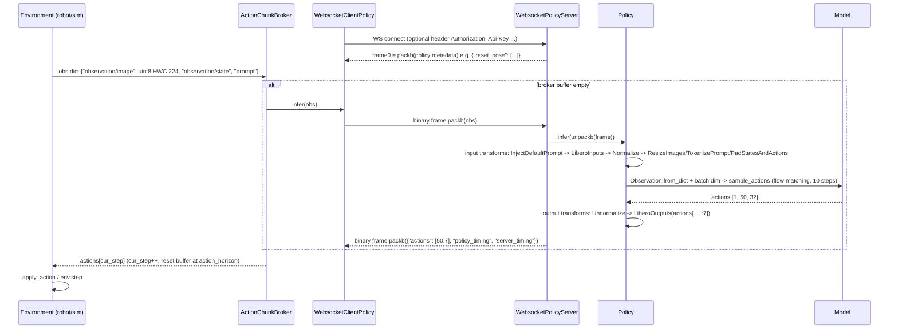

# openpi Source-Level Architecture Study (for `Hylo`)

> Repository: `Physical-Intelligence/openpi` @ `215abfb`; code license Apache-2.0 (`references/policies/openpi/LICENSE`); the repository root additionally ships `LICENSE_GEMMA.txt` (Gemma Terms of Use).
> Method: purely static reading; no dependencies installed, no `gs://openpi-assets` checkpoints downloaded, no tests run.
> Tags: **\[Implemented\]** code exists and is traceable; **\[Docs/Interface only\]** only documentation or an abstract interface; **\[Unverified\]** code exists but was not run in this study; **\[Needs model/hardware\]** requires weights / GPU / a real robot.

---

## 1. Positioning and Core Capabilities

openpi is the **reference implementation + training/inference toolchain** for the π₀ / π₀-FAST / π₀.₅ VLA models released by Physical Intelligence. Its engineering philosophy is "minimal interface + heavy transforms": externally a policy exposes only `infer(obs: dict) -> dict`, and all robot/dataset differences are pushed into a composable chain of `DataTransformFn`s; at deployment the model runs on a GPU server, and the robot side depends only on a very lightweight `openpi-client` (numpy + msgpack + websockets).

| Capability | Status | Evidence |
|---|---|---|
| `Policy.infer(obs) -> {"actions", "state", "policy_timing"}`, dual JAX and PyTorch backends | \[Implemented\][Needs model/hardware] | `references/policies/openpi/src/openpi/policies/policy.py:24-106` |
| Composable transforms: Repack -> Data(robot) -> Normalize -> Model(tokenize/resize/pad); outputs in reverse order | \[Implemented\] | `src/openpi/policies/policy_config.py:75-94`; `src/openpi/transforms.py:39-337` |
| Normalization (z-score / quantile q01-q99), stats shipped with the checkpoint at `assets/<asset_id>/norm_stats.json` | \[Implemented\] | `transforms.py:114-181`; `shared/normalize.py:8-15,136-146`; `training/checkpoints.py:110` |
| Action chunk (default `action_horizon=50`, `action_dim=32` padding), 10-step flow matching | \[Implemented\][Needs model/hardware] | `models/pi0_config.py:25-27`; `models/pi0.py:217-228` |
| Websocket policy server (msgpack-numpy, metadata in the first frame, `/healthz`) | \[Implemented\][Unverified] | `serving/websocket_policy_server.py:15-90` |
| `openpi-client`: `WebsocketClientPolicy`, `ActionChunkBroker`, `Runtime/Agent/Environment/Subscriber` | \[Implemented\][Unverified] | `packages/openpi-client/src/openpi_client/*` |
| Example integrations: LIBERO (sim), ALOHA sim/real, DROID (real Franka), UR5 (docs only) | \[Implemented\][Needs model/hardware] | `examples/libero/main.py:127-153`; `examples/aloha_sim/main.py:29-50`; `examples/droid/main.py:113-149` |
| Training: LeRobot dataset (old API) / RLDS (DROID), JAX FSDP; PyTorch training (no FAST/LoRA/FSDP/EMA) | \[Implemented\][Needs model/hardware] | `training/data_loader.py:130-191`; `README.md:192-198` |

## 2. Directory Layout and Architecture

```
src/openpi/
  models/          JAX (Flax NNX) models: pi0.py, pi0_fast.py, gemma*.py, siglip.py, tokenizer.py, model.py(Observation/BaseModel)
  models_pytorch/  PyTorch pi0/pi05 + transformers_replace (must overwrite site-packages/transformers)
  policies/        policy.py(Policy), policy_config.py(create_trained_policy), libero/aloha/droid_policy.py(robot transforms)
  transforms.py    DataTransformFn / Group / Normalize / Tokenize / Delta/AbsoluteActions ...
  training/        config.py(TrainConfig + all named configs), data_loader.py, checkpoints.py, weight_loaders.py, droid_rlds_dataset.py
  serving/         websocket_policy_server.py
  shared/          normalize.py(NormStats), download.py(gs:// cache), image_tools.py
packages/openpi-client/   robot-side minimal-dependency client (py>=3.7)
scripts/          serve_policy.py, train.py, train_pytorch.py, compute_norm_stats.py
examples/         libero/ aloha_sim/ aloha_real/ droid/ simple_client/ ur5/ convert_jax_model_to_pytorch.py
```

```mermaid
flowchart LR
  subgraph Robot[Robot / Sim host  (openpi-client only)]
    Env[Environment<br/>get_observation/apply_action] --> Agent[PolicyAgent]
    Agent --> Broker[ActionChunkBroker<br/>action_horizon]
    Broker --> WSC[WebsocketClientPolicy]
  end
  WSC <-->|ws:// msgpack-numpy<br/>binary frames| WSS
  subgraph GPU[Policy server  (openpi)]
    WSS[WebsocketPolicyServer] --> Pol[Policy.infer]
    Pol --> IT[input transforms<br/>repack, InjectDefaultPrompt,<br/>RobotInputs, Normalize,<br/>ResizeImages, TokenizePrompt, Pad]
    IT --> M[BaseModel.sample_actions<br/>JAX jit or PyTorch]
    M --> OT[output transforms<br/>Unnormalize, RobotOutputs(crop dim)]
  end
  CK[(checkpoint dir<br/>params/ or model.safetensors<br/>assets/asset_id/norm_stats.json)] --> Pol
  TC[TrainConfig registry<br/>_CONFIGS] --> Pol
  DS[(LeRobot dataset v2.x<br/>or RLDS)] --> Train[scripts/train.py] --> CK
```

## 3. Core Interfaces and Key Classes (signatures)

**Client-side base class** \[Implemented\] — `packages/openpi-client/src/openpi_client/base_policy.py:5-12`
```python
class BasePolicy(abc.ABC):
    @abc.abstractmethod
    def infer(self, obs: Dict) -> Dict: ...
    def reset(self) -> None: pass          # default no-op
```

**Server-side Policy** \[Implemented\] — `src/openpi/policies/policy.py:24-110`
```python
class Policy(BasePolicy):
    def __init__(self, model: BaseModel, *, rng=None, transforms=(), output_transforms=(),
                 sample_kwargs=None, metadata=None, pytorch_device="cpu", is_pytorch=False)
    def infer(self, obs: dict, *, noise: np.ndarray | None = None) -> dict
        # -> {"actions": [action_horizon, A], "state": ..., "policy_timing": {"infer_ms"}} (after output transforms usually only actions remain)
    @property def metadata(self) -> dict
class PolicyRecorder(BasePolicy)   # :113-135 np.save of inputs and outputs at every step
```
`infer` does not implement `reset()` (inherits the no-op): **openpi's π models are stateless and look only at the current observation** (no history, no action queue).

**Factory** \[Implemented\] — `policies/policy_config.py:16-94`
```python
def create_trained_policy(train_config: TrainConfig, checkpoint_dir, *, repack_transforms=None,
                          sample_kwargs=None, default_prompt=None, norm_stats=None, pytorch_device=None) -> Policy
# is_pytorch = exists(checkpoint_dir/"model.safetensors")   (:48-50)
```

**Transforms** \[Implemented\] — `src/openpi/transforms.py`
```python
class DataTransformFn(Protocol): def __call__(self, data: DataDict) -> DataDict      # :23-36 (single sample, no batch dim)
@dataclass(frozen=True) class Group: inputs: Sequence[DataTransformFn]; outputs: ...;  push(inputs, outputs)  # :39-59 outputs are prepended
RepackTransform(structure)            # :79-101 used only for training data
InjectDefaultPrompt(prompt)           # :104-111
Normalize(norm_stats, use_quantiles=False, strict=False)    # :114-145
Unnormalize(norm_stats, use_quantiles=False)                # :148-181 (strict=True)
ResizeImages(h, w) / SubsampleActions(stride)               # :184-200
DeltaActions(mask) / AbsoluteActions(mask)                  # :203-244 delta relative to state (gripper usually excluded)
TokenizePrompt(tokenizer, discrete_state_input=False)       # :247-266 pi05 puts the discretized state into the prompt
TokenizeFASTInputs / ExtractFASTActions                     # :269-306
PromptFromLeRobotTask(tasks) / PadStatesAndActions(model_action_dim)   # :309-337
```

**Model** \[Implemented\] — `src/openpi/models/model.py`
```python
class ModelType(Enum): PI0="pi0"; PI0_FAST="pi0_fast"; PI05="pi05"          # :30-35
IMAGE_KEYS = ("base_0_rgb", "left_wrist_0_rgb", "right_wrist_0_rgb"); IMAGE_RESOLUTION=(224,224)   # :39-47
@struct.dataclass class Observation: images: dict[str, f32[*b,h,w,c] in [-1,1]]; image_masks; state;
    tokenized_prompt; tokenized_prompt_mask; token_ar_mask; token_loss_mask       # :83-137 (uint8 automatically converted to [-1,1])
class BaseModelConfig(ABC): action_dim; action_horizon; max_token_len; model_type; create; load; load_pytorch; inputs_spec  # :212-260
class BaseModel(nnx.Module): compute_loss(rng, obs, actions, *, train) ; sample_actions(rng, obs, **kw) -> Actions[b, ah, ad]  # :263-283
Pi0Config(action_dim=32, action_horizon=50, max_token_len=48|200(pi05), pi05=False, discrete_state_input=pi05)  # pi0_config.py:21-41
Pi0.sample_actions(rng, observation, *, num_steps=10, noise=None)              # pi0.py:217-224
```

**Runtime abstractions (client package)** \[Implemented\] — `packages/openpi-client/src/openpi_client/runtime/`
```python
class Environment(ABC): reset(); is_episode_complete() -> bool; get_observation() -> dict; apply_action(action: dict)   # environment.py:4-32
class Agent(ABC): get_action(observation) -> dict; reset()                    # agent.py:4-17
class PolicyAgent(Agent): get_action = policy.infer; reset = policy.reset     # agents/policy_agent.py:7-18
class Subscriber(ABC): on_episode_start(); on_step(obs, action); on_episode_end()   # subscriber.py:4-20
class Runtime(environment, agent, subscribers, max_hz=0, num_episodes=1, max_episode_steps=0).run()   # runtime.py:10-92
class ActionChunkBroker(BasePolicy)(policy, action_horizon)                   # action_chunk_broker.py:22-50
```

**Training configuration** \[Implemented\] — `src/openpi/training/config.py`
```python
DataConfig(repo_id, asset_id, norm_stats, repack_transforms, data_transforms, model_transforms,
           use_quantile_norm, action_sequence_keys=("actions",), prompt_from_task, rlds_data_dir, ...)   # :64-98
DataConfigFactory.create(assets_dirs, model_config) -> DataConfig                                     # :166-200
TrainConfig(name, exp_name, model, weight_loader, lr_schedule, batch_size=32, num_train_steps=30_000,
            policy_metadata, fsdp_devices, pytorch_weight_path, ...)                                  # :465-558
get_config(name) -> TrainConfig    # :982-989, all configs are listed statically in _CONFIGS (:560-972)
```

## 4. Core Execution Flow



**Three chunk execution styles (all on the client side, all open-loop truncation, no temporal ensembling)**:
- `ActionChunkBroker`: re-runs `infer` only every `action_horizon` steps, slicing all ndarray fields along the first dimension (`action_chunk_broker.py:38-56`). ALOHA sim uses `action_horizon=10`, `max_hz=50` (`examples/aloha_sim/main.py:21,36-47`); ALOHA real uses `action_horizon=25` and resets using the `reset_pose` from the server metadata (`examples/aloha_real/main.py:18,29-37`).
- LIBERO: a hand-written `deque`, `replan_steps=5`, sending dummy actions for the first `num_steps_wait=10` steps (`examples/libero/main.py:29,37,94,104-153`); images must be rotated 180° to match the training preprocessing (`:114-116`).
- DROID: `open_loop_horizon=8`, chunk shape asserted as `(10, 8)`, and the client binarizes the gripper and applies `np.clip(action, -1, 1)` (`examples/droid/main.py:42,113-147`). This is the **only visible action-safety handling** in openpi, and it exists only in an example.

**Training data flow** \[Implemented\][Needs model/hardware]: `LeRobotDataset(repo_id, delta_timestamps={k: [t/fps for t in range(action_horizon)] for k in action_sequence_keys})` (`data_loader.py:130-151`) -> `PromptFromLeRobotTask` -> repack -> data transforms -> `Normalize` -> model transforms (`:172-191`). Norm stats are precomputed by `scripts/compute_norm_stats.py`.

## 5. Extension Points and Plugin Mechanism

openpi **has no plugin registration mechanism**; extension is done by "copy and modify":
1. **New robot/dataset** \[Implemented\]: write a pair of `XxxInputs/XxxOutputs(DataTransformFn)` (template `policies/libero_policy.py:29-100`, whose comments explicitly say "copy this class and modify"), write a `DataConfigFactory` subclass (template `training/config.py:281-356`), then add a `TrainConfig` to the `_CONFIGS` list (`:560-972`). `get_config` only looks up this static dict (`:975,982-989`).
2. **New model** \[Implemented\]: implement `compute_loss` / `sample_actions` for `BaseModelConfig` + `BaseModel(nnx.Module)` (`models/model.py:212-283`); PyTorch additionally requires implementing `load_pytorch` (`:243-247` currently hard-codes `PI0Pytorch`).
3. **New server wrapper** \[Implemented\]: any `BasePolicy` can be plugged into `WebsocketPolicyServer` (it only calls `policy.infer`, `websocket_policy_server.py:61`); `PolicyRecorder` is an example decorator (`policy.py:113-135`).
4. **Client side** \[Implemented\]: the `Environment` / `Agent` / `Subscriber` ABCs can be implemented freely; `Runtime` handles the loop and rate limiting.
5. **sample_kwargs**: e.g. `num_steps`, `noise` are passed through to `sample_actions` (`policy.py:81-94`).

## 6. Dependencies and Runtime Requirements

- Server: Python `>=3.11` (`pyproject.toml:6`), `jax[cuda12]==0.5.3`, `flax==0.10.2`, `torch==2.7.1`, `transformers==4.53.2`, `orbax-checkpoint==0.11.13` (`pyproject.toml:14-38`), plus `lerobot` **pinned to commit `0cf8648`** (`pyproject.toml:70`).
- **Incompatible with current LeRobot** [Implemented, static evidence]: `data_loader.py:10` does `import lerobot.common.datasets.lerobot_dataset`, whereas in lerobot@38b975c only `control_utils.py / train_utils.py / trackio_utils.py` remain under `lerobot/common/`; datasets have moved to `lerobot.datasets` and the format is v3.0; in addition, LeRobot requires py>=3.12 + transformers 5.x. -> They cannot coexist in the same venv, and openpi training can only consume **v2.x** LeRobot datasets.
- The PyTorch backend requires copying `models_pytorch/transformers_replace/*` into `site-packages/transformers` (`README.md:207`), an invasive monkey-patch; it does not support π₀-FAST, mixed precision, FSDP, LoRA or EMA (`README.md:192-198`). \[Docs/Interface only\]
- Client: `openpi-client` needs only `dm-tree, msgpack, numpy<2, pillow, websockets`, py>=3.7 (`packages/openpi-client/pyproject.toml`).
- GPU: inference >8GB, LoRA fine-tuning >22.5GB, full fine-tuning >70GB; tested only on Ubuntu 22.04 (`README.md:26-32`). \[Docs/Interface only\][Needs model/hardware]
- Weights and tokenizer are downloaded from GCS: `gs://openpi-assets/checkpoints/*` (`scripts/serve_policy.py:59-76`), `gs://big_vision/paligemma_tokenizer.model` (`models/tokenizer.py:18,56`), PaliGemma pretrained `gs://vertex-model-garden-paligemma-us/paligemma/pt_224.npz` (`training/weight_loaders.py:58-67`). \[Needs model/hardware\]

## 7. License and Reuse Constraints (code vs weights)

| Object | License | Notes |
|---|---|---|
| openpi code (including openpi-client) | Apache-2.0 | `LICENSE` \[Implemented\] |
| `LICENSE_GEMMA.txt` | Gemma Terms of Use (2024-02-21) | Present at the repository root, but **nothing in the code or README references it** (grep finds nothing), meaning its scope of application is not clearly defined \[Docs/Interface only\] |
| π₀ / π₀-FAST / π₀.₅ checkpoints | **Not explicitly declared in the repository**; because the model backbone is PaliGemma (Gemma 2B + SigLIP), and under Section 1.1(e) of the Gemma ToU "Model Derivatives" include modifications of Gemma or models trained on its weights, they are **very likely subject to the Gemma ToU** (including the Prohibited Use Policy, the requirement to include the terms on redistribution, and "Hosted Service" also counting as Distribution) | Needs legal confirmation \[Docs/Interface only\] |
| PaliGemma tokenizer / `pt_224.npz` | Gemma ToU | Must be downloaded for both training and inference \[Needs model/hardware\] |
| `lerobot/pi0*`/`pi05*` weights ported by LeRobot | LeRobot docs say "Apache 2.0, consistent with OpenPI" (lerobot `docs/source/pi05.mdx:389-391`) | Can only be regarded as a code-level claim; the weights cannot be assumed to be Apache-2.0 on this basis |

Implications for `Hylo`: (1) the code can safely be borrowed/vendored (Apache-2.0); (2) treat the π-series weights as **"restricted-license weights"**: mark them in the registry with `weights_license="gemma-tou(derivative, unconfirmed)"`, and require legal review before offering hosted inference externally (e.g. opening the policy server to third parties), because the Gemma ToU treats a Hosted Service as Distribution; (3) do not bake pi weights into the images we publish.

## 8. Strengths, Weaknesses and Risks

**Strengths**
- Extremely minimal interface: `infer(dict) -> dict`; the client has zero deep-learning dependencies and can be embedded in any robot stack (ROS, vendor SDKs). \[Implemented\]
- The transforms chain means "training and inference share the same data/model transforms" (only repack is training-only), guaranteeing train/serve consistency (`policy_config.py:75-94` vs `data_loader.py:184-190`). \[Implemented\]
- Norm stats are read from the checkpoint's `assets/` rather than the config directory (comment at `policy_config.py:59-64`), avoiding statistics drift. \[Implemented\]
- msgpack-numpy rejects object/void/complex dtypes, avoiding pickle deserialization RCE (`msgpack_numpy.py:21-23`). \[Implemented\]

**Weaknesses / Risks**
- **The protocol has no version number, no schema, no session/request IDs, no reset message, and no authentication check**: the client sends an `Authorization: Api-Key` header (`websocket_client_policy.py:36`), but the server performs no check at all (`websocket_policy_server.py:37-46`); `max_size=None` means no message size limit (`:42`), so exposure to an untrusted network carries DoS risk.
- `WebsocketClientPolicy.reset()` is a no-op (`:56-58`), so the server has no way of knowing episode boundaries; unsuitable for stateful policies.
- Error handling: the server sends a **text frame** (traceback), then closes with 1011 and re-raises (`websocket_policy_server.py:77-83`); the client detects an error by "receiving a str" (`websocket_client_policy.py:51-53`). A single exception drops the connection, with no retry.
- Synchronous and blocking: strictly request->response within one connection; chunk execution is open-loop, with no RTC / temporal ensembling / latency compensation (in openpi itself).
- `unpack_array` constructs arrays via `np.ndarray(buffer=...)`, yielding **read-only** arrays (`msgpack_numpy.py:44-45`), so in-place modification downstream will raise \[Unverified\]; the "copy" in `Policy.infer` is only a shallow copy of the container (`policy.py:69-70`).
- Observation keys are **flat strings defined per robot** (`"observation/image"` vs DROID `"observation/exterior_image_1_left"`), with no schema published by the server; the client must know in advance the training-time keys, image size (224 resize_with_pad) and image orientation.
- Safety guardrails exist only in the examples (DROID clip), not at the framework level.
- Dependencies are pinned (jax 0.5.3, transformers 4.53.2, old lerobot), and the PyTorch backend requires overwriting transformers source code, so upgrade cost is high.

## 9. Components Worth Reusing

1. **The entire `openpi-client` package** (Apache-2.0, ~400 lines): as `Hylo`'s "openpi-compatible" remote policy client, either as a direct dependency or vendored; the `msgpack_numpy` codec can serve as the wire format for the simple protocol.
2. **The `Runtime / Environment / Agent / Subscriber` quartet**: highly consistent with our harness's episode loop abstraction; the semantics can be borrowed directly (`Subscriber` ≈ our recorder / physical memory hook).
3. **The symmetric composition rule of `DataTransformFn` + `Group.push`, "inputs appended, outputs prepended"** (`transforms.py:49-59`), a good model for transforms in our adapter layer.
4. **`DeltaActions/AbsoluteActions` + `make_bool_mask`**: a standardized representation of "delta actions relative to state, excluding the gripper".
5. **The norm_stats.json + asset_id convention** (one checkpoint can carry stats for multiple robots, `docs/norm_stats.md`).

## 10. Capabilities Not Worth Rebuilding

- π₀ / π₀.₅ / π₀-FAST models, the tokenizer (FAST), the flow-matching sampler: call them directly as a server.
- The JAX FSDP training pipeline and checkpoint/orbax handling.
- Observation keys, image orientation and action-space conventions for LIBERO / ALOHA / DROID (copy the conversion code from the examples verbatim; do not derive them yourself).
- JAX->PyTorch weight conversion (`examples/convert_jax_model_to_pytorch.py`).

## 11. Source Index of Key Implementations

| Topic | Location |
|---|---|
| BasePolicy | `references/policies/openpi/packages/openpi-client/src/openpi_client/base_policy.py:5-12` |
| Policy.infer | `references/policies/openpi/src/openpi/policies/policy.py:67-106` |
| PolicyRecorder | `references/policies/openpi/src/openpi/policies/policy.py:113-135` |
| create_trained_policy (transform order) | `references/policies/openpi/src/openpi/policies/policy_config.py:16-94` |
| Websocket server | `references/policies/openpi/src/openpi/serving/websocket_policy_server.py:15-90` |
| Websocket client | `references/policies/openpi/packages/openpi-client/src/openpi_client/websocket_client_policy.py:12-58` |
| msgpack-numpy | `references/policies/openpi/packages/openpi-client/src/openpi_client/msgpack_numpy.py:21-57` |
| ActionChunkBroker | `references/policies/openpi/packages/openpi-client/src/openpi_client/action_chunk_broker.py:22-50` |
| Runtime loop | `references/policies/openpi/packages/openpi-client/src/openpi_client/runtime/runtime.py:10-92` |
| Environment / Agent ABC | `references/policies/openpi/packages/openpi-client/src/openpi_client/runtime/environment.py:4-32`; `agent.py:4-17` |
| image_tools.resize_with_pad | `references/policies/openpi/packages/openpi-client/src/openpi_client/image_tools.py:15-58` |
| serve_policy default checkpoints | `references/policies/openpi/scripts/serve_policy.py:59-117` |
| Transforms | `references/policies/openpi/src/openpi/transforms.py:23-337` |
| Normalize/Unnormalize | `references/policies/openpi/src/openpi/transforms.py:114-181` |
| NormStats | `references/policies/openpi/src/openpi/shared/normalize.py:8-15,120-146` |
| Observation / BaseModel | `references/policies/openpi/src/openpi/models/model.py:30-47,83-137,212-283` |
| Pi0Config | `references/policies/openpi/src/openpi/models/pi0_config.py:21-41` |
| sample_actions | `references/policies/openpi/src/openpi/models/pi0.py:217-228`; `models_pytorch/pi0_pytorch.py:377-403` |
| LIBERO transforms | `references/policies/openpi/src/openpi/policies/libero_policy.py:29-100` |
| DataConfig / ModelTransformFactory | `references/policies/openpi/src/openpi/training/config.py:64-164` |
| Quantile default (non-PI0) | `references/policies/openpi/src/openpi/training/config.py:187` |
| LeRobot LIBERO data config | `references/policies/openpi/src/openpi/training/config.py:281-356` |
| TrainConfig / registry | `references/policies/openpi/src/openpi/training/config.py:465-558,560-989` |
| LeRobot dataset loader | `references/policies/openpi/src/openpi/training/data_loader.py:10,130-191` |
| Weights/tokenizer download sources | `references/policies/openpi/src/openpi/training/weight_loaders.py:58-67`; `models/tokenizer.py:18,56` |
| LIBERO client loop | `references/policies/openpi/examples/libero/main.py:94-153` |
| DROID client loop | `references/policies/openpi/examples/droid/main.py:113-149` |
| ALOHA sim / real | `references/policies/openpi/examples/aloha_sim/main.py:29-50`; `examples/aloha_real/main.py:18-37` |

### Websocket Wire Protocol (precise definition) \[Implemented\][Unverified]

| Item | Specification | Evidence |
|---|---|---|
| Transport | WebSocket (`ws://host:port`, default port 8000), `compression=None`, `max_size=None` | `websocket_policy_server.py:38-45`; `websocket_client_policy.py:19-24,37-39`; `serve_policy.py:50` |
| Health check | HTTP `GET /healthz` -> `200 "OK\n"` (intercepted before the WS handshake) | `websocket_policy_server.py:86-90` |
| Authentication | Client may optionally send the header `Authorization: Api-Key <key>`; **the server does not check it** | `websocket_client_policy.py:36` |
| Frame 0 (server->client) | binary: `msgpack(policy.metadata)`, e.g. `{"reset_pose": [...]}` or `{}` | `websocket_policy_server.py:52`; `config.py:570` |
| Request (client->server) | binary: `msgpack(obs: dict)`, keys are arbitrary strings (usually `"observation/..."`, `"prompt"`) | `websocket_client_policy.py:47-49` |
| Response (server->client) | binary: `msgpack({"actions": ndarray[H, A], ..., "policy_timing": {"infer_ms"}, "server_timing": {"infer_ms", "prev_total_ms"?}})` | `policy.py:103-105`; `websocket_policy_server.py:64-71` |
| ndarray encoding | msgpack map `{b"__ndarray__": True, b"data": <raw C-order bytes>, b"dtype": dtype.str (e.g. "<f4", "|u1"), b"shape": [..]}`; numpy scalars `{b"__npgeneric__": True, b"data": item, b"dtype": str}`; rejects dtype kinds `V/O/c` | `msgpack_numpy.py:21-50` |
| Errors | Server sends a **text** frame (Python traceback string), followed by close code 1011 `"Internal server error..."` | `websocket_policy_server.py:77-83`; for the client side see `websocket_client_policy.py:51-53` |
| Concurrency/ordering | Strictly one request, one response per connection; no request id, no version, no reset/close message | `websocket_policy_server.py:55-72` |

## Verification Status Summary

| Capability | Tag | Notes |
|---|---|---|
| `Policy.infer` + transform chain | \[Implemented\][Needs model/hardware] | Real inference needs a checkpoint + GPU |
| Websocket server/client + msgpack-numpy | \[Implemented\][Unverified] | `msgpack_numpy_test.py` exists, not executed |
| ActionChunkBroker / Runtime | \[Implemented\][Unverified] | |
| Normalization (z-score / quantile) | \[Implemented\] | Formula read; `(x-q01)/(q99-q01+1e-6)*2-1` |
| LIBERO / ALOHA / DROID examples | \[Implemented\][Needs model/hardware] | |
| PyTorch backend | \[Implemented\][Needs model/hardware] | Requires overwriting transformers source code |
| Compatibility with current LeRobot dataset v3 | Incompatible (static evidence) | Old import path at `data_loader.py:10` |
| Weights license | \[Docs/Interface only\] | Not declared; Gemma ToU risk |
| SOTA LIBERO results / GPU requirements in README | \[Docs/Interface only\] | |

## 12. Mapping to Hylo Policy Interface

| Hylo | openpi counterpart | Adaptation notes |
|---|---|---|
| `spec()` | No formal spec; only the `metadata` dict (first frame) + `TrainConfig.model.action_horizon/action_dim` + the dimensions after `XxxOutputs` cropping | `OpenPIRemotePolicy` needs the schema **supplied by configuration on our side** (obs key mapping, image size 224, action_dim, horizon), optionally supplemented by the first-frame metadata (e.g. `reset_pose`) |
| `reset(episode_ctx)` | client `reset()` is a no-op; `ActionChunkBroker.reset()` only clears the local buffer | Clearing the chunk buffer locally in the adapter is sufficient (π models are stateless); `episode_ctx.seed` -> only usable via local `Policy.infer(noise=...)`; the remote protocol **does not support passing noise** |
| `act(observation, instruction)` | `infer({...obs_mapped, "prompt": instruction})["actions"]` | Observation conversion: HWC uint8, `resize_with_pad(224)`, keys and orientation per the training convention (LIBERO rotated 180°); state as raw values (server normalizes); returns `[H, A]` (no batch dim), wrapped as `ActionChunk(actions, dt=1/control_hz, execution_steps=replan_steps)` |
| Execution horizon | client-side `ActionChunkBroker(action_horizon)` / `replan_steps` / `open_loop_horizon` | Handled uniformly by `Hylo`'s `ChunkExecutor`; `execution_steps` as a configurable item of the policy spec rather than a magic number in env code |
| Remote service | websocket + msgpack-numpy, unversioned | Recommendation: `Hylo`'s **simple remote backend is fully compatible with the openpi wire protocol** (so it can connect directly to any openpi server, and to ecosystems such as RoboArena that use the same protocol); at the same time define a **v1 extension**: add a reserved key in the obs dict (e.g. `"__wc__": {"version":1, "request_id", "episode_id", "reset": bool}`), which stays compatible as long as the server ignores unknown keys |
| Local embedding | `create_trained_policy(get_config(name), ckpt_dir)` returns a `BasePolicy` | Process isolation from us: openpi dependencies (jax 0.5.3/py3.11/old lerobot) conflict with LeRobot HEAD, so **always integrate it as a separate process/container + websocket (recommended)** |
| Safety | None (only the DROID example clip) | The SafetyGuard must be implemented on `Hylo`'s robot/sim side |
| Training data | LeRobot v2.x dataset (`delta_timestamps` fetches `action_horizon` frames) or RLDS | Our v3 data must be exported to v2.1 to use openpi native training; or use LeRobot's pi0/pi05 port for training instead |

Minimal adapter sketch:
```python
class OpenPIRemotePolicy(Hylo.Policy):
    def __init__(self, uri, obs_mapper, action_dim, execution_steps):
        self._c = WebsocketClientPolicy(uri)            # first-frame metadata -> self.meta
    def reset(self, ctx): pass                           # stateless; the local executor clears the queue
    def act(self, obs, instruction) -> ActionChunk:
        out = self._c.infer({**self.obs_mapper(obs), "prompt": instruction})
        return ActionChunk(actions=out["actions"][:, :self.action_dim], execution_steps=self.execution_steps,
                           timing={**out.get("policy_timing", {}), **out.get("server_timing", {})})
```
