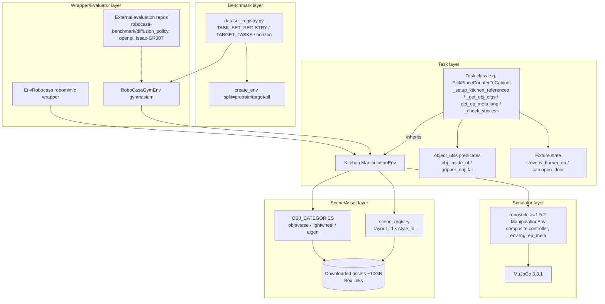

# RoboCasa (RoboCasa365) Source-Level Architecture Study

> Repository: `references/benchmarks/robocasa` (robocasa/robocasa @ `dc73a8c`, MIT, `__version__ = "1.0.1"`)
> Method: static analysis only (read / grep / `python3 -I` + `ast`); nothing installed or run, and no assets or datasets downloaded (the README says the assets are about 10 GB).
> Tags: **\[Implemented\]** code exists and is traceable; **\[Docs/Interface only\]** only documentation or an abstract interface; **\[Unverified\]** code exists but we have not run it; **\[Needs model/hardware\]** requires GPU/EGL/assets/datasets, etc.
> Path prefix: `references/benchmarks/robocasa/` is abbreviated as `R/`; in the comparison table, `references/benchmarks/LIBERO/` is abbreviated as `L/`.

---

## 1. Positioning and Core Capabilities

RoboCasa is UT Austin's **large-scale kitchen-scene simulation framework + benchmark**. v1.0 (RoboCasa365) uses **robosuite ≥1.5.2 + MuJoCo 3.3.1** as its backend, and the default robot is the mobile manipulator `PandaOmron`. Unlike LIBERO's "declarative task files", RoboCasa's tasks are **Python classes**: each task subclasses `Kitchen` and describes in code its fixture references, object sampling configuration, language instruction and `_check_success`.

Core capabilities:
- **Task library**: `environments/kitchen/atomic` (77 classes) and `composite` (301 classes, 61 activity directories); by AST count there are 379 classes in total, 353 of which define their own `_check_success`. \[Implemented\] Of these, 317 tasks (65 atomic + 252 composite) have dataset and horizon records in `dataset_registry.py`, and all of them have a corresponding class (AST cross-check: 0 missing). \[Implemented\] The README claims "365 tasks". \[Docs/Interface only\]
- **Procedural scenes**: 60 layouts × 60 styles (each split into train 50 / test 10); the `pretrain` split = 50×50 = 2500 scenes, the `target` split = 10 paired scenes. \[Implemented\] `R/robocasa/models/scenes/scene_registry.py:85-92,166-170`, `R/robocasa/utils/env_utils.py:86-104`
- **Object/fixture registries**: `OBJ_CATEGORIES` (attributes graspable/washable/cookable/microwavable..., multiple registries objaverse/lightwheel/aigen) and the `FixtureType` enum. \[Implemented\] `R/robocasa/models/objects/kitchen_objects.py:8,2955`, `R/robocasa/models/fixtures/fixture.py:35`
- **Determinism**: all randomness goes through `env.rng` (numpy Generator), and a unit test asserts that the global `random`/`np.random` are not called. \[Implemented\]/\[Unverified\] `R/tests/test_env_determinism.py:35-125`
- **Data**: LeRobot-format datasets + MuJoCo replay extras (model.xml.gz, states.npz, ep_meta.json). \[Docs/Interface only\] `R/docs/datasets/using_datasets.md:40-76`

## 2. Directory Layout and Architecture

```
R/robocasa/
  __init__.py                  # imports all task classes (triggers metaclass registration); hard version asserts on mujoco/numpy/robosuite
  environments/kitchen/
    kitchen.py                 # Kitchen(ManipulationEnv) base class + REGISTERED_KITCHEN_ENVS + KitchenEnvMeta
    atomic/*.py                # atomic tasks (PickPlace*/OpenDrawer/TurnOnStove/NavigateKitchen...)
    composite/<activity>/*.py  # composite tasks (boiling/brewing/washing_dishes...)
  models/
    scenes/                    # KitchenArena, scene_registry (LayoutType/StyleType)
    fixtures/                  # Fixture base class and state logic for cabinet/stove/sink/microwave...
    objects/                   # OBJ_CATEGORIES / OBJ_GROUPS / sample_kitchen_object
    assets/                    # only 3.5 MB in-repo: layout/style yaml, box_links json, fixture_registry yaml
  utils/
    env_utils.py               # create_env(split=...), robot placement, placement initializer
    object_utils.py            # geometric predicate library for success checks (obj_inside_of, gripper_obj_far...)
    dataset_registry*.py       # task sets / dataset soups / horizon registration
    robomimic/                 # EnvRobocasa: robomimic-style env wrapper (reset_to/get_state)
    groot_utils/ lerobot_utils.py  # data loading
    subtask_labeling/          # per-frame subtask labelers for 300 composite tasks
    eval_utils.py              # legacy (v0.x) random rollout, obsolete
  wrappers/gym_wrapper.py      # gymnasium RoboCasaGymEnv + auto-registration of "robocasa/<Env>"
  scripts/                     # download_kitchen_assets / download_datasets / collect_demos / dataset_scripts
R/tests/                       # 10 tests: determinism, task validity, fixtures, layouts, datasets, etc.
```



## 3. Core Interfaces and Key Classes (Signatures)

**Task registration** \[Implemented\]
```python
# R/robocasa/environments/kitchen/kitchen.py:47-74
REGISTERED_KITCHEN_ENVS = {}
def register_kitchen_env(target_class)          # registers by class name (case-sensitive)
class KitchenEnvMeta(EnvMeta):                   # inherits robosuite EnvMeta → also enters robosuite REGISTERED_ENVS
    # excludes "MG_Robocasa_Env","PickPlace","ManipulateDoor","OpenDoor","CloseDoor"
# R/robocasa/environments/__init__.py:1-3   ALL_KITCHEN_ENVIRONMENTS = REGISTERED_KITCHEN_ENVS.keys()
```

**Kitchen base class** \[Implemented\]
```python
# R/robocasa/environments/kitchen/kitchen.py:362-412
class Kitchen(ManipulationEnv, metaclass=KitchenEnvMeta):
    EXCLUDE_LAYOUTS = []; EXCLUDE_STYLES = []                       # :212-214 task-level scene filtering
    def __init__(self, robots, controller_configs=None, base_types="default",
                 use_camera_obs=True, render_camera="robot0_agentview_center",
                 control_freq=20, horizon=1000, ignore_done=True,
                 camera_names="agentview", camera_heights=256, camera_widths=256,
                 renderer="mjviewer", seed=None,
                 layout_and_style_ids=None, layout_ids=None, style_ids=None,
                 enable_fixtures=None, generative_textures=None,
                 obj_registries=("objaverse","lightwheel"), obj_instance_split=None,
                 use_distractors=False, translucent_robot=False, randomize_cameras=False,
                 robot_spawn_deviation_pos_x=0.15, robot_spawn_deviation_pos_y=0.05,
                 robot_spawn_deviation_rot=0.0, clutter_mode=0, update_fxtr_cfg_dict=None,
                 use_cotraining_cameras=False, use_novel_instructions=False)
    # subclass hooks
    def _setup_kitchen_references(self)          # registers fixture references (register_fixture_ref :1747-1769)
    def _get_obj_cfgs(self) -> list[dict]        # :1155-1165 object sampling + placement config
    def _setup_scene(self)                       # :1152-1153 sets fixture state on reset (open doors, etc.)
    def get_ep_meta(self) -> dict                # :1167-1214 serializes the scene; subclasses fill ep_meta["lang"]
    def _check_success(self) -> bool             # :1542-1551 base class returns False
    def reward(self, action=None) -> float       # :1530-1540 float(_check_success())
    # utilities
    def sample_object(self, groups, exclude_groups=None, graspable=None, ..., split=None,
                      obj_registries=None, max_size=(None,None,None), ...)   # :1553-1569
    def get_fixture(self, id, ref=None, size=(0.2,0.2), ...)                   # :1628
```
`super().__init__` is passed `lite_physics=True, hard_reset=True, load_model_on_init=False, seed=seed` (`kitchen.py:503-530`): these parameters only exist in robosuite ≥1.5.x.

**Task examples** \[Implemented\]
```python
# R/robocasa/environments/kitchen/atomic/kitchen_pick_place.py:127-137
def _check_success(self):   # PickPlaceCounterToCabinet
    obj_inside_cab = OU.obj_inside_of(self, "obj", self.cab)
    gripper_obj_far = OU.gripper_obj_far(self)
    return obj_inside_cab and gripper_obj_far
# R/robocasa/environments/kitchen/composite/boiling/boil_pot.py:61-70
def _check_success(self):   # BoilPot
    loc = self.stove.get_obj_location_on_stove(self, "pot")
    return self.stove.is_burner_on(env=self, burner_loc=loc) if loc is not None else False
```
Success predicate library (`R/robocasa/utils/object_utils.py`): `obj_inside_of` (the 8 bbox corners projected into the fixture's interior site box, threshold 0.05, `:14-66`), `check_obj_in_receptacle` (`:587`), `check_obj_upright` (`:604`), `check_obj_fixture_contact` (`:623`), `gripper_obj_far` (default 0.25 m, `:645`), `check_obj_grasped` (`:665`), `check_obj_scrubbed` (`:389`), `object_contact_with_liquid` (`:416`), etc. On the fixture side there are additional state methods such as `is_burner_on` and `is_open` (`R/robocasa/models/fixtures/*.py`).

**Gymnasium wrapper** \[Implemented\]
```python
# R/robocasa/wrappers/gym_wrapper.py:143-153
class RoboCasaGymEnv(gym.Env):
    def __init__(self, env_name=None, camera_names=None, camera_widths=None,
                 camera_heights=None, enable_render=True, split="test", **kwargs)
    def reset(self, seed=None, options=None) -> (obs: dict, info: {"success": False})   # :342-353
    def step(self, action_dict) -> (obs, reward, terminated, truncated=False, info{"success"})  # :355-385
# :400-424 registers gym id "robocasa/<Name>" for every env in robosuite REGISTERED_ENVS
```
Note: the default value of `split` in the wrapper is `"test"` (`:151`), but `create_env` only accepts `{None,"all","pretrain","target"}` (`env_utils.py:86-104`), so `gym.make` raises `ValueError` when split is not passed. [Unverified, static inference]

**robomimic wrapper** (for data replay/policy evaluation) \[Implemented\]
```python
# R/robocasa/utils/robomimic/robomimic_env_wrapper.py
class EnvRobocasa:                                     # :14
    def reset(self, unset_ep_meta=True) -> obs         # :119-147
    def reset_to(self, state: {"model": xml, "states": np.ndarray, "ep_meta": json}) -> obs  # :153-221
    def get_state(self) -> {"model","states","ep_meta"}  # :297-307
    def is_success(self) -> {"task": bool}             # :335-345
    def is_done(self) -> False                         # :327-333 fixed-horizon rollout
```

## 4. Core Execution Flow

```mermaid
sequenceDiagram
  participant U as Caller/Evaluator
  participant G as RoboCasaGymEnv
  participant CE as env_utils.create_env
  participant K as Task(Kitchen)
  participant RS as robosuite ManipulationEnv
  U->>G: gym.make("robocasa/PickPlaceCounterToCabinet", split="target", seed=s)
  G->>CE: create_env(split) → layout/style/obj_instance_split
  CE->>RS: robosuite.make(env_name, robots="PandaOmron", composite controller, seed)
  G->>K: reset() (called once already during construction, gym_wrapper.py:178)
  U->>G: reset(seed=s2)
  G->>K: env.rng = default_rng(s2); env.reset()
  K->>K: hard_reset → _load_model: rng.choice(layout,style) → KitchenArena → fixture placement
  K->>K: _setup_kitchen_references → _get_obj_cfgs → placement initializer.sample (reload on failure, ≤50 times)
  K->>K: _reset_internal: _setup_scene, place objects, place robot, 10 zero-action control steps to settle
  K-->>G: raw obs; get_ep_meta()["lang"] → language
  loop t < horizon (300 to several thousand in the registry)
    U->>G: step(action_dict)
    G->>RS: concatenate into 12-D vector → env.step
    RS->>K: _post_action → fixtures.update_state
    G->>K: _check_success()
    G-->>U: obs, reward∈{0,1}, terminated=robosuite done, truncated=False, info.success
  end
```

Source: `create_env` `R/robocasa/utils/env_utils.py:57-139`; scene sampling `kitchen.py:590-597`; model retries `kitchen.py:647-650,775-830`; `_reset_internal` `kitchen.py:1095-1150`; wrapper step `gym_wrapper.py:355-385`.

**Determinism and "init state"**: RoboCasa has no LIBERO-style init-state files; an episode is fully determined by `ep_meta` (layout_id, style_id, object_cfgs including the chosen mjcf paths, fixture_refs, init_robot_base_pos/ori, cam_configs, gen_textures, `kitchen.py:1167-1214`) + `model.xml` + flattened `states`. There are two ways to reproduce: (a) rebuild with a fixed `seed` (relies on `env.rng` being deterministic along the entire path; tests in `R/tests/test_env_determinism.py:42-125`); (b) exact replay via `EnvRobocasa.reset_to({"model","states","ep_meta"})` (`robomimic_env_wrapper.py:153-221`), with `set_ep_meta/unset_ep_meta` provided by the robosuite base class. \[Implemented\]/\[Unverified\]

**Action space** (PandaOmron + HybridMobileBase composite controller): the native robosuite vector is 12-D, ordered by `body_part_ordering = ["right","right_gripper","base","torso"]` (`kitchen.py:483-491`) + a trailing `base_mode`: `[eef_pos 3, eef_rot 3, gripper 1, base 3, torso 1, base_mode 1]`, all in [-1,1]. The gym wrapper exposes a dict: `action.end_effector_position(3)/end_effector_rotation(3)/gripper_close(1)/base_motion(4)/control_mode(1)` (`gym_wrapper.py:83-102,121-140`). ⚠ The flat order in the LeRobot dataset's `modality.json` is `base_motion 0:4, control_mode 4:5, eef_pos 5:8, eef_rot 8:11, gripper 11:12` (`R/robocasa/models/assets/groot_dataset_assets/PandaOmron_modality.json`), whereas `env_utils.convert_action` assumes `eef 0:3, rot 3:6, gripper 6:7, base 7:11, mode 11:12` (`env_utils.py:142-154`): **three different flat orderings coexist**, so the adaptation layer must map by key, not by position. \[Implemented\]

**Observation space**: raw robosuite obs include `robot0_base_pos/quat`, `robot0_base_to_eef_pos/quat`, `robot0_gripper_qpos`, cameras `robot0_agentview_left/right_image`, `robot0_eye_in_hand_image`, plus for each object `{obj}_pos/_quat/_to_robot0_eef_pos/_quat` (`kitchen.py:1405-1474`). The gym wrapper remaps them to `state.base_position(3)/base_rotation(4)/end_effector_position_relative(3)/end_effector_rotation_relative(4)/gripper_qpos(2)`, `video.robot0_agentview_left|right|eye_in_hand` (H×W×3 uint8, already flipped vertically, `gym_wrapper.py:272-273`) and `annotation.human.task_description` (`:265-267,303-328`). Camera resolution: `create_env` defaults to 128, the gym wrapper defaults to 256 (`gym_wrapper.py:46`). \[Implemented\]

**Evaluation protocol**: there is **no** official evaluation script in the repository; the docs specify randomly sampling 50 scenes per task for rollouts and reporting the mean binary success rate (`R/docs/benchmarking/benchmarking_overview.md:31-33`), with target tasks evaluated in target scenes; the actual evaluation code lives in external repositories (`R/docs/benchmarking/policy_learning_algorithms.md:21,61,109`). The horizon comes from `get_task_horizon(task)` (`R/robocasa/utils/dataset_registry_utils.py:240-253`). \[Docs/Interface only\] `R/robocasa/utils/eval_utils.py` still uses `from robosuite import load_controller_config` (`:5`) and `obj_instance_split="B"` (`:28`): this is a v0.x leftover that will very likely fail to import under robosuite 1.5. \[Unverified\]

## 5. Extension Points and Plugin Mechanism

| Extension point | Mechanism | Location | Status |
|---|---|---|---|
| New task | Subclass `Kitchen`; the metaclass auto-registers it in `REGISTERED_KITCHEN_ENVS` and robosuite's `REGISTERED_ENVS`; implement the 4 hooks | `kitchen.py:57-77,1152-1165,1542` | \[Implemented\] |
| Task scene constraints | Class attributes `EXCLUDE_LAYOUTS/EXCLUDE_STYLES` (e.g. microwave tasks exclude layout 9) | `kitchen.py:212-214`, `kitchen_pick_place.py:486` | \[Implemented\] |
| New object | `OBJ_CATEGORIES` entry + asset directory (`objaverse/`, `lightwheel/`, `aigen_objs/`); asset toolchain `scripts/asset_scripts/` (glb→mjcf, VHACD/CoACD) | `kitchen_objects.py:8`, `R/robocasa/scripts/asset_scripts/` | \[Implemented\]/\[Needs model/hardware\] |
| New fixture | `Fixture` subclass + `FixtureType` enum + `fixture_registry/*.yaml` | `R/robocasa/models/fixtures/fixture.py:35`, `R/robocasa/models/assets/fixtures/fixture_registry/` | \[Implemented\] |
| New scene | layout/style yaml (`kitchen_layouts/{train,test}`, `kitchen_styles/{train,test}`) + enums | `scene_registry.py:173-236` | \[Implemented\] |
| Task sets | `TASK_SET_REGISTRY` / `DATASET_SOUP_REGISTRY` | `R/robocasa/utils/dataset_registry.py:2937,2963` | \[Implemented\] |
| New robot | robosuite robot + `CamUtils.get_robot_cam_configs`; but `Kitchen` asserts a single robot (`kitchen.py:464`), and the gym wrapper hard-codes `PandaOmronKeyConverter` (`gym_wrapper.py:154`) | — | \[Implemented\], extension limited |
| Language rewriting | `use_novel_instructions` reads CSV variants | `kitchen.py:532-558` | \[Implemented\] |
| Subtask labeling | `utils/subtask_labeling/<activity>/*.py` | `R/robocasa/utils/subtask_labeling/__init__.py` | \[Implemented\]/\[Unverified\] |

## 6. Dependencies and Runtime Requirements

- **Python**: the README recommends `python=3.11` (`R/README.md:41`); `setup.py` specifies `python_requires=">=3"`. \[Docs/Interface only\]
- **Hard pins in install_requires** (`R/setup.py:17-36`): `numpy==2.2.5`, `numba==0.61.2`, `scipy==1.15.3`, `mujoco==3.3.1`, `tianshou==0.4.10`, `lerobot==0.3.3`, `gymnasium` (not pinned). lerobot pulls in heavy dependencies such as torch.
- **robosuite is not in install_requires**: the README asks you to clone and install from the GitHub **master branch** (no tag/commit pin).
- **Hard asserts at import time** (`R/robocasa/__init__.py:1003-1027`): `mujoco.__version__ == "3.3.1"`, `numpy.__version__ in ["2.2.5"]`, `robosuite >= 1.5.2`; if any one is not satisfied it raises `AssertionError` immediately. Optional `mimicgen` (`:985-990`).
- **Rendering**: default `renderer="mjviewer"` (`kitchen.py:388`); offscreen rendering goes through robosuite/MuJoCo EGL/OSMesa. \[Needs model/hardware\]
- **Assets**: `python -m robocasa.scripts.download_kitchen_assets` (about 10 GB); the source is utexas Box shared links in `box_links_assets.json`, converted into `shared/static/<id>.zip` direct links (`R/robocasa/scripts/download_kitchen_assets.py:15-72`), with no checksums. Datasets work the same way (`download_datasets.py`, `box_links_ds.json`, tarballs). Only 3.5 MB of yaml/json is in-repo. \[Needs model/hardware\]
- **Private macros**: `robocasa/macros_private.py` (generated by `setup_macros`); if missing, only a warning is emitted (`R/robocasa/macros.py`).
- **Performance note**: `hard_reset=True` is fixed (`kitchen.py:521`), so every reset re-samples the scene and recompiles the MJCF; on placement failure `_load_model` retries recursively up to 50 times (`:647-650`). Reset is expensive. \[Unverified\]

### ⚠ LIBERO ↔ RoboCasa Version Conflicts (determines whether they can share a process)

| Dependency | LIBERO | RoboCasa | Can coexist? |
|---|---|---|---|
| Python | 3.8.13 (`L/README.md:51`) | 3.11 (`R/README.md:41`) | ✗ numpy 1.22.4 does not support 3.11; numpy 2.2.5 does not support 3.8 |
| numpy | `==1.22.4` (requirements.txt:2) | `==2.2.5` (setup.py:18, and asserted on import) | ✗ |
| robosuite | `==1.4.0` (requirements.txt:10), uses `SingleArmEnv`/`load_controller_config` | `>=1.5.2` master (`__init__.py:1015-1027`), uses `ManipulationEnv`/composite controller | ✗ APIs incompatible |
| MuJoCo | Determined indirectly by robosuite 1.4 (not pinned) | `==3.3.1` (asserted) | Possible, but locked out by the two items above |
| gym | `gym==0.25.2` | `gymnasium` | Can coexist but interfaces differ |
| robomimic | `==0.2.0` | Built-in fork (`utils/robomimic/`) | — |

**Conclusion: the two cannot run in the same Python process (and almost certainly not in the same venv).** Hylo's Environment layer must use an architecture of "one separate venv per benchmark + subprocess/RPC env server" (similar to what `vla-evaluation-harness` does), with the host process depending only on our own lightweight protocol.

## 7. License and Reuse Constraints

- Code: MIT (`R/LICENSE`, Copyright 2026 the RoboCasa Team).
- Assets and datasets: the README states "Assets and Datasets: CC BY 4.0" (License section of `R/README.md`). \[Docs/Interface only\]
- Asset sources: Objaverse 1.0, LightWheel AI, Luma.ai-generated (`R/docs/assets/objects.md:3`). **Each Objaverse 1.0 object keeps the original Sketchfab author's license (mostly CC-BY, with some CC-BY-NC/SA, etc.)**, and neither the repository nor the download packages contain a per-object attribution list (`find assets -iname '*licen*'` is empty); LightWheel assets come from a commercial vendor. Whether the README's blanket CC BY 4.0 statement overrides the upstream terms cannot be verified from the code. \[Unverified\]
- Reuse recommendation: the code can be reused freely (keep the MIT notice); **do not redistribute/mirror** the assets, and have users download them in an isolated environment via the official scripts; before publication/commercial use, do a per-item license audit of the Objaverse subset; CC BY requires attribution in our reports/products.

## 8. Strengths, Weaknesses and Risks

**Strengths**
- Extremely high scene and object diversity (2500 pretrain scenes + 3200+ objects), with explicit pretrain/target splits of scenes and object instances (`kitchen_object_utils.py:450-458`), well suited for out-of-distribution generalization evaluation.
- Unified `env.rng` determinism + unit-test protection; `ep_meta` makes episodes fully serializable and replayable.
- Success predicates are implemented as a reusable Python function library (`object_utils.py` + fixture state), and composite tasks directly compose atomic predicates.
- gymnasium interface, LeRobot data format, and external evaluation integrations with openpi/GR00T/DP make ecosystem integration cheap.

**Weaknesses / code defects (static findings, all \[Unverified\])**
- Tasks are imperative Python classes, with **no declarative TaskSpec**: success conditions, instructions and initial configuration are scattered across 4 hooks and cannot be enumerated/validated without instantiating the env.
- The `Kitchen.__init__` docstring says `layout_ids=-1` means all and `-2` means no island (`kitchen.py:183-185`), while the actual code uses `-1=test, -2=train, -3=all` (`scene_registry.py:85-92`): the docs are stale. The object split docs say "the last 4", while the code uses `max(len-5, ceil(len/2))` (`kitchen_object_utils.py:452-454`).
- gym wrapper: the default `split="test"` is incompatible with `create_env` (see §3); `truncated` is always False; `terminated` comes from robosuite `done` (always False when `ignore_done=True`), so **success does not terminate the episode** and the evaluator must early-stop on its own; `reset(seed)` only replaces `env.rng` (`gym_wrapper.py:343-344`), and a reset has already happened once during construction.
- The gym wrapper registers gym ids for **all** envs in robosuite's `REGISTERED_ENVS` (including robosuite's own Lift, etc.), and the observation/action conversion is hard-coded for PandaOmron.
- `eval_utils.py` is v0.x legacy code.
- Three flat orderings of the action vector (§4).
- `KitchenEnvMeta` relies on "import robocasa imports all ~380 task modules" to complete registration (`__init__.py:4-983`), so import is expensive, and task names are case-sensitive.

**Risks**
- robosuite points at the master branch with no pin, so upstream changes may break things at any time; the version assert only checks a lower bound.
- Assets are hosted on Box shared links with no checksums; once a link dies, reproducibility is lost; downloads on the order of 10 GB need a caching strategy.
- Every reset rebuilds the MJCF, so throughput for large-scale evaluation (50 rollouts × 50 tasks) is limited. \[Unverified\]

## 9. Components Worth Reusing

1. **The task classes themselves (as black boxes)**: instantiate them in an isolated process via `robosuite.make(env_name=...)`; we only consume `get_ep_meta()["lang"]`, `_check_success()`, and obs/action.
2. **Task sets and horizons from `dataset_registry.py`**: `TARGET_TASKS` (atomic_seen 18 / composite_seen 16 / composite_unseen 16 = target50), `PRETRAINING_TASKS`, `LIFELONG_LEARNING_TASKS` serve directly as the data source for the BenchmarkSpec manifest; `get_task_horizon` serves as `max_steps`.
3. **The `ep_meta` + `reset_to` replay protocol**: as a reference for Hylo's `init_state` serialization format (the "scene parameters + model xml + qpos/qvel" triple is more robust than LIBERO's pure state vector).
4. **The `object_utils.py` predicate library**: as an API reference for Hylo's "physical predicates/memory" module (inside_of, upright, grasped, far, contact, liquid contact).
5. **The determinism testing pattern** (mock the global RNG and assert it is not called, `test_env_determinism.py:35-125`): borrow it directly for our Environment consistency tests.
6. **The key conventions of PandaOmronKeyConverter** (`state.*`/`video.*`/`action.*`/`annotation.*`): aligned with the GR00T/LeRobot ecosystem, usable as a naming reference for our obs/action specs.

## 10. Capabilities Not Worth Rebuilding

- Procedural kitchen scene generation, fixture joint/state logic, the object library and the asset conversion toolchain: enormous in scale; use them directly.
- MimicGen data augmentation and the subtask labeling pipeline: just use them as data tools; do not fold them into the Environment abstraction.
- Do not reuse `eval_utils.py` and `run_random_rollouts` as the evaluator (obsolete / smoke test only).
- Do not reuse the built-in robomimic fork and groot_utils as Hylo's data layer; the data layer should uniformly use the LeRobot format.

## 11. Source Index of Key Implementations

| Topic | File:line | Tag |
|---|---|---|
| Hard version asserts | `R/robocasa/__init__.py:1003-1027` | \[Implemented\] |
| install_requires pins | `R/setup.py:17-36` | \[Implemented\] |
| Task registry / metaclass | `R/robocasa/environments/kitchen/kitchen.py:47-74` | \[Implemented\] |
| Kitchen parameters (split/seed/layout) | `R/robocasa/environments/kitchen/kitchen.py:179-209,362-412` | \[Implemented\] |
| Controller refactor / body_part_ordering | `R/robocasa/environments/kitchen/kitchen.py:477-491` | \[Implemented\] |
| robosuite 1.5 constructor arguments | `R/robocasa/environments/kitchen/kitchen.py:503-530` | \[Implemented\] |
| Scene sampling (env.rng) | `R/robocasa/environments/kitchen/kitchen.py:590-618` | \[Implemented\] |
| Model loading and placement retries | `R/robocasa/environments/kitchen/kitchen.py:643-660,775-833` | \[Implemented\] |
| _reset_internal | `R/robocasa/environments/kitchen/kitchen.py:1095-1150` | \[Implemented\] |
| get_ep_meta | `R/robocasa/environments/kitchen/kitchen.py:1167-1214` | \[Implemented\] |
| Object observation sensors | `R/robocasa/environments/kitchen/kitchen.py:1355-1474` | \[Implemented\] |
| reward / _check_success base class | `R/robocasa/environments/kitchen/kitchen.py:1530-1551` | \[Implemented\] |
| fixture ref | `R/robocasa/environments/kitchen/kitchen.py:1628,1747-1769` | \[Implemented\] |
| Atomic task example | `R/robocasa/environments/kitchen/atomic/kitchen_pick_place.py:24-137` | \[Implemented\] |
| Composite task example | `R/robocasa/environments/kitchen/composite/boiling/boil_pot.py:4-70` | \[Implemented\] |
| Success predicate library | `R/robocasa/utils/object_utils.py:14-66,587-687` | \[Implemented\] |
| create_env / split | `R/robocasa/utils/env_utils.py:57-139` | \[Implemented\] |
| Scene ID groups | `R/robocasa/models/scenes/scene_registry.py:85-92,166-276` | \[Implemented\] |
| Object split | `R/robocasa/models/objects/kitchen_object_utils.py:440-468` | \[Implemented\] |
| gym wrapper | `R/robocasa/wrappers/gym_wrapper.py:33-140,143-424` | \[Implemented\]/\[Unverified\] |
| robomimic wrapper / reset_to | `R/robocasa/utils/robomimic/robomimic_env_wrapper.py:101-221,297-345` | \[Implemented\] |
| Task sets / horizon | `R/robocasa/utils/dataset_registry.py:8,558,2130,2802,2861,2937,2963`; `dataset_registry_utils.py:240-253` | \[Implemented\] |
| Asset download | `R/robocasa/scripts/download_kitchen_assets.py:15-72` | \[Needs model/hardware\] |
| Obsolete evaluation tools | `R/robocasa/utils/eval_utils.py:1-101` | \[Unverified\] |
| Determinism tests | `R/tests/test_env_determinism.py:35-199` | \[Unverified\]/\[Needs model/hardware\] |
| Task validity tests | `R/tests/test_tasks_validity.py:9-40` | \[Unverified\]/\[Needs model/hardware\] |
| Evaluation protocol docs | `R/docs/benchmarking/benchmarking_overview.md:16-33` | \[Docs/Interface only\] |
| Dataset format docs | `R/docs/datasets/using_datasets.md:40-76` | \[Docs/Interface only\] |

## Verification Status Summary

| Capability | Status | Basis |
|---|---|---|
| Task class registration (~379 classes, 353 with `_check_success`) | \[Implemented\] | AST count |
| 317 tasks have dataset and horizon records | \[Implemented\] | AST cross-check |
| "365 tasks" | \[Docs/Interface only\] | README |
| 2500 pretrain / 10 target scenes | \[Implemented\] (ID logic) / \[Needs model/hardware\] (assets) | scene_registry + env_utils |
| Seed determinism | \[Implemented\]/\[Unverified\] | test_env_determinism |
| ep_meta replay | \[Implemented\]/\[Unverified\] | robomimic wrapper |
| gymnasium interface | \[Implemented\]/\[Unverified\] (default split is a suspected bug) | gym_wrapper |
| Official evaluation script | \[Docs/Interface only\] (external repositories) | docs/benchmarking |
| Rendering | \[Needs model/hardware\] | EGL + assets |
| LeRobot datasets | \[Docs/Interface only\]/\[Needs model/hardware\] | docs + download_datasets |
| Same process as LIBERO | ✗ Not feasible | §6 conflict table |

## 12. Mapping to Hylo Environment/Task/Evaluator Interfaces

| Hylo concept | RoboCasa counterpart | Adaptation points |
|---|---|---|
| `Benchmark` | `TASK_SET_REGISTRY[task_set]` × `split` | `BenchmarkSpec(id="robocasa/target50", tasks=..., split="target", episodes_per_task=50)` |
| `TaskSpec.id` | Task class name (e.g. `PickPlaceCounterToCabinet`) | `f"robocasa/{split}/{ClassName}"`; class names are case-sensitive |
| `TaskSpec.instruction` | `env.get_ep_meta()["lang"]` | **Generated dynamically per episode** (includes the sampled object names), not a static field: TaskSpec stores the template/description, and the actual instruction goes into `info["instruction"]` of `reset()` |
| `TaskSpec.init_state` | `seed` or `{ep_meta, model_xml, states}` | Define `InitState = SeedInit(seed) | SnapshotInit(ep_meta, xml, qpos/qvel)`; the evaluation set uses a fixed seed list to implement the "50 scenarios", and caches the first-generated snapshot as a replayable file (making up for RoboCasa's lack of official init files) |
| `TaskSpec.success` | `_check_success()` (imperative) | `SuccessPredicate(kind="callable", ref="robocasa:<Class>._check_success")`; optionally extract some atomic tasks from `object_utils` as declarative predicates |
| `Simulator` | robosuite ≥1.5.2 + MuJoCo 3.3.1 | Separate Python 3.11 venv + subprocess env server |
| `Environment.reset(seed, options)` | `env.rng = default_rng(seed); env.reset()`, or `EnvRobocasa.reset_to(snapshot)` | `options={"split","layout_and_style_ids","obj_instance_split","snapshot"}`; returns `(obs, info{"instruction","ep_meta"})` |
| `Environment.step(action) -> StepResult` | robosuite `step(12-D)` + `_check_success()` | `StepResult(obs, reward=float(success), terminated=success, truncated=t>=horizon, info{"success"})`: add the termination/truncation semantics in our wrapper |
| `observation_spec` | Raw robosuite keys or converter keys | Normalize to `rgb/agentview_left|right|wrist` (H,W,3 uint8, already flipped), `proprio/base_pos(3)/base_quat(4)/eef_pos_rel(3)/eef_quat_rel(4)/gripper_qpos(2)` |
| `action_spec` | 12-D composite (by key) | `ActionSpec` must be **named components** (`ee_delta_pos 3, ee_delta_rot 3, gripper 1, base 3, torso 1, base_mode 1`); relying on flat ordering is forbidden |
| `Evaluator` | External eval scripts + documented protocol | `RoboCasaEvaluator(episodes=50, horizon=get_task_horizon(task), early_stop_on_success=True, split)`, recording ep_meta for later review |

Conclusion: RoboCasa is Hylo's representative of "**Task = code class, Init = seed/snapshot, instructions generated dynamically**", forming exactly the opposite pole from LIBERO's "Task = declarative file + fixed init states". Hylo's `TaskSpec` should support both forms of `init_state` (*file index* and *seed/snapshot*) and both forms of `success` (*declarative* and *callable reference*), and treat the instruction as an output of `reset` rather than only a static field.
