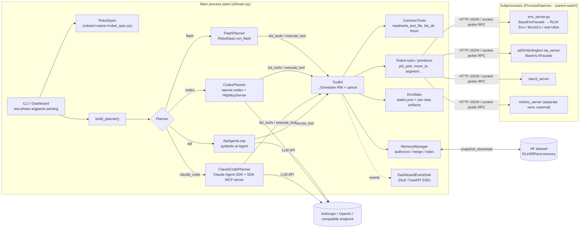

# RPent Source-Level Architecture Study

> Subject: `references/harness/RPent` (RLinf/RPent @ `0e406bb`, Apache-2.0)
> Method: purely static analysis (read / grep / line-number checks); nothing was installed or run, and no weights or assets were downloaded.
> Size: `rpent/` 16.5k lines of Python (83 files), `robots/` 34.8k lines (136 files), `tests/` 27.7k lines (104 files, about 749 `def test_`).
> Tags: **\[Implemented\]** code exists and is traceable; **\[Docs/Interface only\]** only docs or abstract stubs; **\[Unverified\]** code exists but depends on external SDKs/binaries, behavior not verified by us; **\[Needs model/hardware\]** requires weights, GPU, simulation assets or a real robot. All README metrics (e.g. LIBERO-PRO 92.63%) are treated as unverified.

---

## 1. Positioning and Core Capabilities

**One-line positioning**: RPent is an **LLM/coding-agent-driven embodied agent harness** - it wraps frozen VLAs (Pi0.5, RLDX-1, LingBot-VLA), scripted motion primitives and perception models (SAM3, Molmo) as typed tools, and hands them via MCP / pydantic-ai toolsets to Claude Code, Codex or general API models for planning and invocation (the paper title is *Harness VLA: Steering Frozen VLAs into Reliable Manipulation Primitives via Memory-Guided Agents*).

**Relationship to RLinf (confirmed from code, not the README)**:

- RLinf is the same organization's RL training infrastructure; RPent is **not** a submodule of RLinf and **does no RL training at all** (grep across the whole repo finds no optimizer / backward / loss).
- RPent uses RLinf as an **env + model library**: simulation env wrapper classes (`rlinf.envs.sim.libero.libero_env.LiberoEnv`, `references/harness/RPent/robots/libero/env_server.py:111-132`), Pi0.5 model loading (`rlinf.models.embodiment.openpi.get_model`, `references/harness/RPent/rpent/robots/components/pi05_vla_server.py:208-227`), real-robot envs and the Ray-based `rlinf.scheduler.Worker/Cluster` (Franka family only, `references/harness/RPent/robots/franka/env_server.py:81-105,403-420`).
- Dependency mode: optional extra `rlinf @ git+...RLinf.git@release/v0.4` (`references/harness/RPent/pyproject.toml:74-76`); subprocesses inject the RLinf checkout via `PYTHONPATH` (`references/harness/RPent/rpent/utils/daemon.py:118-123`, `references/harness/RPent/rpent/utils/config.py:58-63`).
- AGENTS.md states explicitly "Prefer RLinf's supported Env/VLA implementations with thin RPent adapters".

**Core capability list**:

| Capability | Description | Tag |
|---|---|---|
| Planner abstraction + 4 backends | `api` (pydantic-ai Agent), `claude_code` (Claude Agent SDK), `codex` (openai-codex SDK), `flash` (no LLM, replays a recorded plan) | \[Implemented\] / SDK behavior \[Unverified\] |
| Unified Tool contract | The `@tool` decorator generates JSON Schema and a pydantic validation model from the function signature + Google docstring | \[Implemented\] |
| Toolkit scheduling | Read-write-lock-style scheduling (readonly can run concurrently, writes serialized FIFO), cooperative cancellation, automatic observation capture after state changes | \[Implemented\] |
| Process isolation of Env/VLA/perception services | Each component is a separate subprocess RPC server (HTTP-JSON or pickle-socket); remote endpoints can be attached | \[Implemented\], runtime \[Needs model/hardware\] |
| 7 robot/benchmark integrations | libero(+PRO/plus), robocasa, robotwin, robodojo (simulation); franka, dual_franka, yam (real robots) | \[Needs model/hardware\] |
| Exploration + layered memory | Multi-attempt / multi-session handoff, inbox → global/task-family/task-specific merge, confidence raised by evidence count | Mechanism \[Implemented\], effect \[Unverified\] |
| Flash mode | Generate a plan from successful trajectories; on replay only re-localize anchors with Molmo/GroundingAgent | \[Needs model/hardware\] |
| Flywheel data export | Evaluation episodes → LeRobot dataset (for external SFT; no training in the repo) | \[Implemented\] (export), training \[Docs/Interface only\] |
| Dashboard / TUI | FastAPI + SSE live observation, human interjection, interruption, direct primitive execution | \[Implemented\] |
| WAM (DreamZero, Cosmos Policy), SO-101 | Listed in README, no code in the repo; `so101.rst` only has "Content coming soon." | \[Docs/Interface only\] |

---

## 2. Directory Layout and Architecture

```text
RPent/
  rpent/                    # robot-agnostic harness core
    cli/                    # main.py (single-cell runner), dashboard.py, tui.py, memory.py, check_llm.py
    planner/                # base.py (Planner ABC + factory), api_loop.py, claude_code.py, codex.py, flash.py, check.py
      utils/http_mcp_server.py   # in-process streamable-HTTP MCP server (used by Codex)
    tools/                  # base.py (@tool, Tool, ToolResult), toolkit.py (Toolkit scheduler), common.py, direct_action.py, human_in_the_loop.py
    session/base.py         # EnvState / StepRecord: per-step trace + artifact storage
    memory/                 # MemoryManager (permissions, merge, index, HF sync)
    robots/                 # registry, RobotSpec/RunConfig/PromptBundle, runtime helpers, components/ (Env/VLA/SAM3/Molmo base classes and services)
    utils/rpc/              # RpcFacade (server), RpcClient, HTTP/socket transport, main-thread dispatch mixin
    utils/daemon.py         # ProcessDaemon: subprocess lifecycle + parent-death watch
    dashboard/              # FastAPI server, SSE, event sink, planner interjection control
    evaluation/result.py    # RunFinalizationContext + atomic JSON write
    flywheel/               # EpisodeWriter, validate, LeRobot export
  robots/<name>/            # per robot: robot_spec.py, toolkit.py, tools.py/primitives.py, env_server.py, env_client.py, prompts/, memory.py, flash/
  tests/unit_tests/         # offline CPU unit tests (CI runs 3.10/3.11/3.12)
  tests/e2e_tests/          # GPU/simulation e2e, including OfflinePlannerServer (scripted OpenAI-compatible service)
  calibration_tools/        # real-robot hand-eye calibration
```



---

## 3. Core Interfaces and Key Classes (signatures)

**Planner contract** — `references/harness/RPent/rpent/planner/base.py:98-164`

```python
class PlannerResult:  # __slots__ = (finish_result, messages, stats, error)
    finish_result: dict | None   # {"status": "success"/"failure"/"stuck", "summary": ...}
class Planner(ABC):
    @abstractmethod
    def solve(self, *, system_prompt: str, user_message: str, toolkit: Toolkit,
              max_turns: int, input_queue: queue.Queue[str | None] | None = None,
              dashboard_interaction: DashboardInteractionPort | None = None) -> PlannerResult
def build_planner(planner_type: str, *, output_dir, recipe_tag, robot_name, base_url=None,
                  model=None, memory_dir=None, max_tokens=8192, planner_timeout_s=None,
                  reasoning_effort="none", claude_code_max_budget_usd=None,
                  dashboard_events, no_images=False, interactive=False) -> Planner   # :220-305, hard-coded if/elif, no plugin registration
```

**Tool contract** — `references/harness/RPent/rpent/tools/base.py:38-62,110-147,149-188`

```python
@dataclass
class ToolResult:
    data: dict[str, Any]; images: list[bytes]      # errors go in data["error"], is_error is derived from it
    def to_text(self) -> str                        # JSON, truncated beyond MAX_TOOL_TEXT_BYTES=60000
@dataclass(frozen=True)
class Tool(Generic[ParamsT]):
    name: str; description: str; args_schema: type[BaseModel]; handler: Callable[ParamsT, ToolResult]
    _input_schema: dict; readonly: bool = False
    def with_handler(self, handler) -> Tool          # bind resources or an execution guard
def tool(function=None, /, *, name=None, readonly=False, exclude=(), json_schema_extra=None)
def iter_tools(*owners) -> Iterator[Tool]            # :276-291 collected in definition order
```

**Toolkit** — `references/harness/RPent/rpent/tools/toolkit.py:131-370`

```python
class Toolkit:
    def __init__(self, *, dashboard_events: DashboardEventSink, state: Any = None, memory: MemoryManager)
    def add_tool(self, tool: Tool, *, replace: bool = False) -> None
    def list_tools(self) -> tuple[Tool, ...]
    def execute_tool(self, name: str, input_dict: dict) -> ToolResult     # :215-311
    def get_env_state(self, *, command, result, elapsed_s) -> ToolResult   # abstract: observation after a non-readonly tool
    def cancel_active_and_wait(self) / resume_calls(self) / raise_if_cancelled(self) / close(self)
    def solved(self) -> bool                         # environment-grounded success check (:359-366)
    def write_recipe(self, recipe_tag: str) -> str | None
    def exploration_continuation(self, *, explicit=False) -> str | None
```

**Robot extension descriptor** — `references/harness/RPent/rpent/robots/robot_spec.py:44-92`

```python
@dataclass(frozen=True)
class RunConfig:  recipe_tag: str; output_dir: Path; prompt_vars: dict; task_desc: dict; enable_direct_action: bool = False
@dataclass(frozen=True)
class RobotSpec:
    name: str; prompts: PromptBundle
    add_cli_args: Callable[[ArgumentParser, bool], None]
    parse_config: Callable[[Namespace], RunConfig]
    init_runtime: Callable[[Namespace, Path, DashboardEventSink, set[str] | None],
                           tuple[list[ProcessDaemon], dict[str, Any]]]
    dashboard: DashboardSpec | None = None; is_real_robot: bool = False
    supports_exploration: bool = False; supports_human_interactive_exploration: bool = False
    memory_repo_id: str = "RLinf/RPent-memory"
    validate_args / prepare_memory / finalize_run: RunFinalizer / run_flash: Callable | None = None
# each robots/<name>/__init__.py exposes get_robot_spec() and get_toolkit(**kwargs)
```

**Observation / Action / Policy (no unified typed schema; all dict / ndarray conventions)**

```python
class BaseEnvFacade(RpcFacade):   # server side, rpent/robots/components/env_facade_base.py:22-112
    # RPC: env.get_env_meta / get_action_spec / reset / step / chunk_step / get_task_language / get_camera_meta / render_camera
class BaseEnvClient:              # client side, env_client_base.py:27-138; step returns gym 5-tuple, client caches last_obs
    _TIMEOUT_S = {"default": 30, "env.reset": 120, "env.step": 60, "env.chunk_step": 120, "env.render_camera": 120}
class BaseVLAFacade(RpcFacade):   # vla_facade_base.py:23-60, only abstract method predict(*args, **kwargs)
class BaseVLAClient:              # vla_client_base.py:20-40, predict(obs, options) -> actions (action chunk)
def box_action_spec(low, high, description) -> dict;  def validate_action(values, spec) -> np.ndarray   # action_spec.py:24-47
def direct_action_tool(specs, handler) -> Tool   # exposes the native action space as an execute_action tool, direct_action.py:28-53
```

**RPC layer** — `RpcFacade` (`references/harness/RPent/rpent/utils/rpc/rpc_facade.py:67-324`): `_rpc: dict[str, Callable]` registry, `_readonly_methods` take the read lock, built-in `healthz`/`shutdown`, optional sessions (`session.register/close` + idle sweep). `RpcClient.call(method, args, kwargs, *, timeout_s)` (`rpc_client.py:38-84`), response envelope `{"ok", "result" | "error", "traceback"}`.

**Trace** — `EnvState.record_step(...)` context manager + `save(name, value, step=-1)`; on exception, rolls back that step and its artifacts (`references/harness/RPent/rpent/session/base.py:325-382`); `StepRecord(step_idx, state, terminated, truncated, artifacts, command, result, elapsed_s, extras)` (`:63-93`).

---

## 4. Core Execution Flow

**Who owns the loop**: the outer "cell-level" loop belongs to the RPent runner (`cli/main.py`); the inner "turn-level" agent loop is **entirely outsourced to SDKs**: pydantic-ai `Agent` (`api_loop.py:163-185`), Claude Agent SDK `query()`/`ClaudeSDKClient` (`claude_code.py:215-228`), Codex app-server (`codex.py:277-377`). RPent constrains it only through Toolkit callbacks, usage limits, timeouts and finish detection.

```mermaid
sequenceDiagram
  autonumber
  participant U as CLI main()
  participant S as RobotSpec
  participant M as MemoryManager
  participant D as ProcessDaemon×N
  participant P as Planner(SDK loop)
  participant L as LLM
  participant T as Toolkit
  participant E as env/vla/sam3 server
  U->>S: get_robot_spec + add_cli_args (two-phase argparse)
  U->>S: parse_config(args) → RunConfig
  U->>M: prepare_run_memory (HF snapshot or local)
  U->>P: build_planner(...); PromptBundle.render(system/user)
  U->>S: init_runtime → spawn subprocesses + wait_for_ready(300s)
  S->>D: Popen(stdin=PIPE, --parent-watch)
  loop session 1..explore_sessions (=1 for evaluation)
    U->>S: get_toolkit(runtime_kwargs, mode)
    U->>P: solve(system, user/handoff msg, toolkit, max_turns)
    loop until finish / request_limit / timeout / budget
      P->>L: model request (tools = toolkit.list_tools())
      L-->>P: tool_calls
      P->>T: execute_tool(name, args) (asyncio.to_thread + shield)
      T->>T: pydantic strict validation → _Scheduler.acquire
      T->>E: primitive → VLA predict / env.chunk_step (RPC)
      E-->>T: obs, reward, terminated
      T->>T: non-readonly: get_env_state → EnvState.record_step + screenshot
      T-->>P: ToolResult(data, images) (exceptions also become data.error)
    end
    P-->>U: PlannerResult(finish_result, messages, stats, error)
    U->>T: solved() (environment-grounded); write_recipe(); close()
    alt solved or operator abort
      U-->>U: break
    else recoverable error (timeout/truncated) and explore
      U-->>U: continue → new planner + handoff message
    end
  end
  U->>D: stop() (close stdin → terminate → kill)
  U->>U: transcript_<tag>.json; finalize_run; merge_memory (explore + auto_merge)
```

**Key points on termination / timeouts / retries / failure handling**:

- `finish` is just a readonly tool returning `{"_finish": True, ...}` (`references/harness/RPent/rpent/tools/common.py:86-94`); the API backend registers it as a `ToolOutput` with `end_strategy="early"` (`api_loop.py:168-172,322-341`); the Claude backend `break`s as soon as it sees the finish result in the stream (`claude_code.py:215-224`). **Success is decided by `toolkit.solved()` reading the environment**, not trusting the agent's self-report (`toolkit.py:359-366`, `main.py:649-666`). Under exploration, `finish` is wrapped by a guard that refuses to end while the attempt budget is not exhausted and the task is unsolved (`robots/libero/toolkit.py:100-127`).
- Budgets: `max_turns` → pydantic-ai `UsageLimits(request_limit)` (`api_loop.py:481,524-535`) / Claude `max_turns` + `max_budget_usd` (default $10, `base.py:263-265`); wall-clock `CELL_TIMEOUT_S` defaults to 1200s (`base.py:245-247,260-262`); Codex uses a separate thread with `join(timeout)` (`codex.py:199-217`).
- Retries: model-side argument errors → `ModelRetry` (`api_loop.py:398-400`); finish rejected → `ModelRetry` (`:331-333`, `retries={"output": max_turns}`); tool exceptions are **not retried** and are returned to the LLM as `{"error","traceback"}` for it to decide (`toolkit.py:264-268`); session-level retry happens only when the error contains "timed out"/"truncated" and in exploration (`base.py:122-125`, `main.py:675-687`).
- Cancellation: `execute_tool` uses `asyncio.shield` to protect the worker thread; on cancellation, `cancel_active_and_wait` waits for the physical action to stop at a safe boundary (`base.py:76-95`); primitives call `check_cancelled` before each env step (`robots/libero/tools.py:136-144,161-170`).
- Resource cleanup: subprocesses use the stdin pipe for parent-death detection (`daemon.py:37-83,137-178`); on spawn/wait failure, all owned daemons are stopped in reverse order (`rpent/robots/runtime.py:37-93`).

---

## 5. Extension Points and Plugin Mechanism

| Extension point | Mechanism | Location | Assessment |
|---|---|---|---|
| New robot/simulation/benchmark | **Convention-based discovery**: any subpackage under `robots/` not starting with `_`, `importlib.import_module("robots.<name>")`, required to expose `get_robot_spec()` / `get_toolkit()` | `rpent/robots/base.py:44-74` | No entry_points, no versioned interface; `robots/` must live at the repo root (`sys.path.insert`, `:39-41`) |
| New tool / primitive | Write `@tool` methods on a class, collected by `iter_tools(owner)`, `Toolkit.add_tool()`; `with_handler` injects resources or guards | `rpent/tools/base.py:149-291`, `robots/libero/toolkit.py:89-105` | Very clean; schema and validation share one source |
| New VLA / perception service | Subclass `BaseVLAFacade`/`RpcFacade`, register methods in `_register_rpc`; client subclasses `BaseVLAClient` | `rpent/robots/components/vla_facade_base.py:23-60` | Only a `predict` convention; obs/action format is decided by each client's `encode_obs` |
| New Env | Subclass `BaseEnvFacade`; mix in `MainThreadServeMixin` when single-threaded EGL is required | `env_facade_base.py:22-112`, `rpent/utils/rpc/main_thread_serve.py` | gym style + `chunk_step` |
| New Planner | Implement `Planner.solve`, but requires modifying the `build_planner` if chain and the CLI `choices` | `planner/base.py:220-305`, `cli/main.py:133-141` | Not pluggable |
| Prompt | `PromptBundle(system, user)` are Python factory functions returning a `PromptNode` tree, with `{{var}}` template substitution | `rpent/robots/prompt_bundle.py:32-47`, `rpent/prompt/utils.py` | Prompts are first-class code, not YAML |
| Runtime components | `init_runtime` returns `(daemons, runtime_kwargs)`; each component can attach an existing service via `--*-endpoint` | `robots/libero/robot_spec.py:385-580` | Makes it easy to put the VLA on a remote GPU |
| Results/evaluation | `RobotSpec.finalize_run(RunFinalizationContext)` | `rpent/evaluation/result.py:27-63` | Schema defined per robot |
| Dashboard | `DashboardSpec` (TypedDict) declares task commands, cameras, component `shared/unique` scopes | `rpent/dashboard/spec.py:22-60` | Shared components (VLA/SAM3) are reused across tasks |

The repo also ships skills for coding agents: `.agents/skills/add-robot/SKILL.md` (`.claude/skills` is a symlink to it), indicating that RPent's own development is also agent-first.

---

## 6. Dependencies and Runtime Requirements

- Python `>=3.10,<3.13` (`pyproject.toml:11`). Core dependencies pin exactly `pydantic-ai-slim==2.53.0`, `pydantic-ai-harness==0.53.0`, with an `anthropic<2` workaround (`pyproject.toml:29-52`); it also depends on `claude-agent-sdk>=0.1.60`, `openai-codex>=0.1.0b3`, `mcp>=1.23,<2`, FastAPI/uvicorn.
- Each robot extra pulls in a set of **mutually conflicting** VLA runtimes (different torch/transformers versions), with 15 mutually exclusive groups declared via `[tool.uv] conflicts` (`pyproject.toml:192-253`); Molmo needs a separate venv, connected via RPC (`pyproject.toml:85-93`, `robots/libero/robot_spec.py:492-502`). Several git dependencies point to RLinf's own forks (openpi, LIBERO, robosuite, robocasa@`rpent` branch), and `mujoco==3.3.0` is pinned to guarantee the LIBERO success rate.
- Runtime needs: LLM credentials (`ANTHROPIC_API_KEY` / `CODEX_API_KEY` etc.), VLA checkpoint (`PI05_CHECKPOINT_PATH`), SAM3 checkpoint, simulation asset downloads, CUDA GPU + EGL; real robots need a TTY for operator confirmation (`cli/main.py:389-404`). **\[Needs model/hardware\]**
- **No Ray on the core path**: there is no `import ray` anywhere in the repo; only the Franka real-robot env_server indirectly uses RLinf's Ray-based `Cluster/Worker` (`robots/franka/env_server.py:403-420`). Distribution = "multiple local/remote RPC subprocesses", not cluster scheduling.
- Testing: CI only runs offline unit tests (`.github/workflows/unittest.yml`, 3.10-3.12 matrix); GPU e2e runs on a self-hosted `embodied` runner (`.github/workflows/embodied-gpu-e2e-run.yml:24`).

---

## 7. License and Reuse Constraints

- RPent itself: Apache-2.0 (`LICENSE`); source files all carry Apache headers; can be copied/modified directly, keeping LICENSE and source-file copyright headers (there is no separate NOTICE file in the repo).
- Constraints from transitive dependencies must be reviewed separately: Claude Agent SDK / Codex SDK terms of service; SAM3 (Meta license), Pi0.5/openpi, LIBERO/RoboCasa/robosuite forks, LingBot-VLA, curobo (NVIDIA license), the franky wheel, etc. are all outside Apache coverage.
- The licenses of the HF memory dataset `RLinf/RPent-memory` and the checkpoints are not declared in the repo - must be confirmed separately before reuse.

---

## 8. Strengths, Weaknesses and Risks

**Strengths**

1. **Solid Tool contract design**: one decorator produces both the LLM-visible schema and strict pydantic runtime validation, with `exclude=` isolating internal resource parameters (`tools/base.py:191-273`); the same `Toolkit` adapts seamlessly to three transports - pydantic-ai, Claude SDK MCP, Codex HTTP MCP (`api_loop.py:292-351`, `claude_code.py:822-848`, `planner/utils/http_mcp_server.py:83-106`).
2. **Scheduling with strong physical-safety awareness**: readonly tools run concurrently, write tools are serialized FIFO, cancel/pause/drain (`toolkit.py:53-124`); on interruption it waits for the physical action to reach a safe boundary rather than killing the thread outright.
3. **Environment as ground truth**: `solved()` reads the env's `terminated` and does not trust the LLM's self-reported success (`robots/libero/toolkit.py:168,235-237`).
4. **Process isolation solves dependency hell**: each model/simulation is a subprocess, and `get_env_meta` validation prevents connecting to a stale server (`env_client_base.py:38-50`); remote endpoints can be attached.
5. **Observability**: every state-changing step → `states.json` manifest + per-step png/npy/mp4 (atomic writes, `session/base.py:142-154,189-263`); raw Claude/Codex streams are written to `.stream.jsonl`; the Dashboard is decoupled from the core through a Protocol-based event sink (`dashboard/events.py:73-95`).
6. **Good testing culture**: about 749 offline unit tests, named `*_contracts / *_loopback / *_lifecycle`; `OfflinePlannerServer` uses scripted OpenAI-compatible responses for deterministic CLI→tools→VLA→sim e2e (`tests/e2e_tests/offline_planner_server.py:22-60`).

**Weaknesses**

1. **No typed contract for Obs/Action**: observations are arbitrary dicts, and the VLA input format is encoded by each client itself; the observation the LLM sees is the JSON + images from `view_env_state`, completely non-uniform across robots.
2. **Weak configuration system**: pure argparse + environment variables (`CELL_TIMEOUT_S`, `MAX_BUDGET_USD`, `PI05_CHECKPOINT_PATH`, `LIBERO_TYPE`...), no config file, no run manifest recording the fully resolved configuration (only the log line `physical agent cmd`, `main.py:472`).
3. **Single-cell runner**: one process runs one suite/task/seed; there is no sweep/parallel evaluation scheduler in the repo (batch evaluation relies on external scripts + after-the-fact validation with `validate_target50.py`).
4. **Planner registration is hard-coded** (if chain), with a large amount of SDK glue code (`codex.py` 1181 lines, `claude_code.py` 916 lines), tightly bound to SDK versions.
5. **"Self-improvement" lives entirely in prompts**: the rules for archiving attempts, writing wip notes and distilling three-layer memory are hundreds of lines of natural-language instructions (`robots/libero/prompts/explore.py:56-100,221-300`); Python only handles permissions and merging.

**Risks**

1. **Coding-agent permissions are too broad**: the Claude backend opens `Bash Read Write Glob Grep` by default, with `cwd=repo_root` (`claude_code.py:80,351-382`); Codex uses `Sandbox.full_access` + `ApprovalMode.deny_all` (`codex.py:118-123`). The LLM can execute arbitrary shell commands on the host, which is especially dangerous in real-robot scenarios.
2. **Write-permission hole in file tools**: `MemoryManager._authorize` **lets through** paths outside the memory root and not under `<repo>/memory`, for both read and write (`memory/manager.py:183-191`), so `write_text_file` can write to arbitrary paths.
3. **pickle socket RPC**: `socket_rpc.py:60-71` reads frames with `pickle.loads`; it binds to 127.0.0.1 by default, but `--*-endpoint` supports remote endpoints, and when exposed it is equivalent to RCE.
4. **Evaluation protocol leakage**: the evaluation prompt instructs reading the `task-specific` success audit + recipe from seed-0 of the same task (`robots/libero/prompts/evaluate.py:44-45,418-427`), and the memory itself comes from exploration on the same benchmark cell - leaderboard numbers are essentially "same-task few-shot transfer to new initial states", not directly comparable with zero-shot VLAs.
5. **Reproducibility**: LLMs are non-deterministic; HF memory follows the branch HEAD by default (the README itself says "without a fixed data revision"; LIBERO has a versioned `sync_version` + receipt, `robots/libero/memory.py:173-320`, other robots do not).

---

## 9. Components Worth Reusing

| Component | Mode | Rationale |
|---|---|---|
| `@tool` / `Tool` / `ToolResult` / `iter_tools` (`rpent/tools/base.py`) | **Port directly** (about 290 lines, depends only on pydantic + pydantic_ai.Tool for schema generation, replaceable) | Single-source schema + validation + resource exclusion; a ready-made implementation of the worldcurrent Tool contract |
| `Toolkit._Scheduler` + `execute_tool` + `planner/base.py:execute_tool/cancel_and_wait` | **Port directly** | Read/write separation, FIFO, cooperative cancellation, "errors as data", automatic observation capture after non-readonly actions - exactly the semantics physical tools need |
| `RpcFacade` / `RpcClient` / HTTP transport / `ProcessDaemon` + parent-watch | **Port the HTTP version, drop the pickle socket** | Lightweight "one process per model" isolation with healthz, sessions, read-write locks, meta validation; suitable as worldcurrent's default serving layer when not using Ray |
| `EnvState` / `StepRecord` (`rpent/session/base.py`) | **Rewrite after reference** (add schema version, run manifest) | Trace storage with atomic writes, per-step artifacts and rollback on exception is very practical |
| `MemoryManager.merge_memory`'s frontmatter + evidence merging, confidence promotion rules | **Reference the design** | A simple, auditable "evidence count → single-shot/probable/verified" promotion (`manager.py:99-122`); the inbox→review→publish flow suits physical memory |
| `DashboardEventSink` Protocol + `NullDashboardEventSink` | **Borrow the pattern** | Minimal interface decoupling core logic from UI |
| `HttpMcpServer` | **Reuse the idea directly** | Expose any toolkit to external agent CLIs as streamable-HTTP MCP |
| `OfflinePlannerServer` | **Reuse the idea directly** | LLM-free, deterministic policy-chain e2e tests |
| `box_action_spec` / `validate_action` / `direct_action_tool` | **Port directly** | Automatically generate bounded LLM tools from the env action space |

---

## 10. Capabilities Not Worth Rebuilding

- **The inner agent loop itself**: RPent has already shown that handing turn loops, parallel tools, compaction and retries to a mature SDK (pydantic-ai Agent + `SlidingWindowCompaction(max_messages=80, keep=40)`, `api_loop.py:176-184`) is viable; worldcurrent should not write its own tool-calling loop, only define a Planner adapter layer.
- **Per-benchmark env wrappers**: use RLinf (or RPent's `robots/<name>/env_server.py`) directly as the source of env adapters, rather than wrapping LIBERO/RoboCasa/RoboTwin ourselves.
- **Claude Code / Codex SDK glue**: 2000+ lines tightly coupled to SDK versions; if needed, depend directly on RPent's implementation or wait for upstream SDKs to stabilize - not worth forking and maintaining.
- **Dashboard frontend**: 1300+ lines of JS, product-layer; early worldcurrent can make do with an event sink + an off-the-shelf trace viewer.
- **Flash replay / hand-eye calibration / real-robot Franka stack**: highly robot-specific; reference as needed.
- **Should be ignored**: the prompt-driven "self-evolution" narrative - no weight updates, no automatic reward learning; Flywheel only exports LeRobot data (`rpent/flywheel/export.py:66`), training happens outside the repo.

---

## 11. Source Index of Key Implementations

| concern | file:line | note |
|---|---|---|
| CLI entry / outer cell loop | `references/harness/RPent/rpent/cli/main.py:351-775` | Two-phase argparse, session handoff, finalize, merge |
| Exploration handoff message | `references/harness/RPent/rpent/cli/main.py:265-348` | New agent reads archives of previous attempts |
| Recoverable error check | `references/harness/RPent/rpent/planner/base.py:122-125` | Only timeout / truncated |
| Planner ABC | `references/harness/RPent/rpent/planner/base.py:128-164` | `solve()` is the only abstract method |
| Planner factory | `references/harness/RPent/rpent/planner/base.py:220-305` | if chain, env defaults |
| Cancellation shielding for tool calls | `references/harness/RPent/rpent/planner/base.py:63-95` | `asyncio.shield` + drain |
| API planner (pydantic-ai) | `references/harness/RPent/rpent/planner/api_loop.py:95-228` | Agent construction, timeout, usage stats |
| finish as output tool | `references/harness/RPent/rpent/planner/api_loop.py:320-341` | finish rejected → ModelRetry |
| Request budget | `references/harness/RPent/rpent/planner/api_loop.py:524-535` | `UsageLimits.check_before_request` |
| Claude Agent SDK options | `references/harness/RPent/rpent/planner/claude_code.py:351-382` | Bash/Write open, `setting_sources=[]` |
| Toolkit → SDK MCP server | `references/harness/RPent/rpent/planner/claude_code.py:822-848` | |
| Codex thread options | `references/harness/RPent/rpent/planner/codex.py:118-129` | `Sandbox.full_access` |
| In-process HTTP MCP server | `references/harness/RPent/rpent/planner/utils/http_mcp_server.py:83-140` | stateless streamable HTTP |
| Flash (no-LLM) planner | `references/harness/RPent/rpent/planner/flash.py:40-100` | Delegates to `RobotSpec.run_flash` |
| `@tool` declaration | `references/harness/RPent/rpent/tools/base.py:149-273` | docstring → schema, strict model |
| ToolResult | `references/harness/RPent/rpent/tools/base.py:38-62` | Errors go in data, 60KB truncation |
| Scheduler | `references/harness/RPent/rpent/tools/toolkit.py:53-124` | Read/write + FIFO + cancel/pause |
| execute_tool | `references/harness/RPent/rpent/tools/toolkit.py:215-311` | Validate → execute → observe → publish |
| Common tools + finish | `references/harness/RPent/rpent/tools/common.py:29-94` | |
| Direct action tool | `references/harness/RPent/rpent/tools/direct_action.py:28-53` | |
| HIL operator input | `references/harness/RPent/rpent/tools/human_in_the_loop.py:31-60` | /done /success /abort |
| Step trace | `references/harness/RPent/rpent/session/base.py:96-392` | manifest, rollback |
| Robot discovery | `references/harness/RPent/rpent/robots/base.py:44-74` | Dynamic import of `robots.<name>` |
| RobotSpec / RunConfig | `references/harness/RPent/rpent/robots/robot_spec.py:44-92` | |
| Runtime spawn/wait | `references/harness/RPent/rpent/robots/runtime.py:37-93` | Reverse-order reclaim on failure |
| Env server/client base classes | `references/harness/RPent/rpent/robots/components/env_facade_base.py:22-112`; `env_client_base.py:27-138` | Stateless server, client-side caching |
| VLA base classes | `references/harness/RPent/rpent/robots/components/vla_facade_base.py:23-60`; `vla_client_base.py:20-40` | |
| Pi0.5 service (RLinf model) | `references/harness/RPent/rpent/robots/components/pi05_vla_server.py:179-275` | `get_model(...).cuda().eval()` |
| RPC facade | `references/harness/RPent/rpent/utils/rpc/rpc_facade.py:67-324` | Registry, RWLock, session sweep |
| pickle socket framing | `references/harness/RPent/rpent/utils/rpc/socket_rpc.py:60-71` | Security risk |
| Subprocess daemon | `references/harness/RPent/rpent/utils/daemon.py:37-178` | stdin EOF parent watch |
| Memory permissions | `references/harness/RPent/rpent/memory/manager.py:167-210` | Paths outside the root are let through |
| Memory merge / promotion | `references/harness/RPent/rpent/memory/manager.py:99-122,212-315` | flock, conflict archiving |
| HF memory sync | `references/harness/RPent/rpent/memory/manager.py:400-450`; `source.py:53-100` | |
| LIBERO versioned memory | `references/harness/RPent/robots/libero/memory.py:57-80,173-320` | Model → corpus version mapping, receipt |
| LIBERO spec + runtime | `references/harness/RPent/robots/libero/robot_spec.py:118-169,385-580` | Four components: env/vla/sam3/molmo |
| LIBERO toolkit / explore guard | `references/harness/RPent/robots/libero/toolkit.py:43-243` | reset, finish guard, solved |
| VLA closed-loop primitive | `references/harness/RPent/robots/libero/tools.py:161-290` | `pi0_pick`: chunk budget + heuristic success detection |
| Scripted EEF primitive | `references/harness/RPent/robots/libero/tools.py:329-358` | OSC servo |
| LIBERO env server (RLinf) | `references/harness/RPent/robots/libero/env_server.py:54-132` | |
| Exploration prompt (reflection/distillation) | `references/harness/RPent/robots/libero/prompts/explore.py:56-100,221-300` | |
| Evaluation reads seed-0 recipe | `references/harness/RPent/robots/libero/prompts/evaluate.py:44-50,418-427` | Evaluation-protocol caveat |
| Franka Ray worker | `references/harness/RPent/robots/franka/env_server.py:81-110,403-420` | The only use of the RLinf scheduler |
| Flywheel episode / export | `references/harness/RPent/rpent/flywheel/episode.py:55-218`; `export.py:66` | LeRobot |
| Evaluation result contract | `references/harness/RPent/rpent/evaluation/result.py:27-63` | |
| Dashboard events | `references/harness/RPent/rpent/dashboard/events.py:26-95` | |
| Dashboard API | `references/harness/RPent/rpent/dashboard/server.py:108-330` | SSE `/api/session/stream` |
| Offline scripted planner | `references/harness/RPent/tests/e2e_tests/offline_planner_server.py:22-60` | |
| Dependency conflict matrix | `references/harness/RPent/pyproject.toml:192-254` | |

---

## Verification Status Summary

| Capability / Claim | Tag | Evidence |
|---|---|---|
| Tool declaration, schema generation, strict validation | \[Implemented\] | `tools/base.py`; `tests/unit_tests/rpent/tools/test_toolkit_contracts.py` etc. (not run) |
| Toolkit read/write scheduling and cancellation | \[Implemented\] | `toolkit.py:53-348` (not run) |
| RPC facade / HTTP & socket transport / daemon lifecycle | \[Implemented\] | `utils/rpc/*`, `utils/daemon.py`; loopback / lifecycle unit tests exist (not run) |
| EnvState trace and artifact rollback | \[Implemented\] | `session/base.py` |
| Memory permissions, merge, index, validate | \[Implemented\] | `memory/manager.py`, `cli/memory.py` |
| Memory write-permission isolation is complete | \[Unverified\] (and a hole was found) | `manager.py:183-191` lets through paths outside the root |
| API planner (pydantic-ai) loop behavior | \[Unverified\] | Depends on internal semantics of `pydantic-ai==2.53.0` |
| Claude Code / Codex planners | \[Unverified\] | Depend on external SDK binaries and credentials |
| Exploration multi-session handoff | \[Implemented\] (mechanism) / \[Unverified\] (effect) | `main.py:561-688` |
| "Self-evolution" / reflection / distillation | \[Implemented\] (prompts + file merging only) / \[Unverified\] | `explore.py`; no weight updates |
| RL fine-tuning / training | \[Docs/Interface only\] | No training code in the repo; Flywheel only exports data |
| Flywheel LeRobot export | \[Implemented\] | `flywheel/export.py` (needs the `lerobot` extra) |
| LIBERO / RoboCasa / RoboTwin / RoboDojo integration | \[Needs model/hardware\] | Needs assets, GPU/EGL, VLA weights |
| Pi0.5 / RLDX-1 / LingBot-VLA / SAM3 / Molmo services | \[Needs model/hardware\] | checkpoint + CUDA |
| Franka / Dual Franka / YAM real robots | \[Needs model/hardware\] | Real robot + RealSense + RLinf Ray worker |
| Flash replay | \[Needs model/hardware\] | Needs Molmo or GroundingAgent + simulation |
| Dashboard / TUI | \[Implemented\] | FastAPI + SSE; contract unit tests exist (not run) |
| Leaderboard results (e.g. LIBERO-PRO 92.63%) | \[Unverified\] | README only; evaluation reads same-task seed-0 recipe |
| WAM (DreamZero, Cosmos Policy), SO-101 | \[Docs/Interface only\] | No code; `so101.rst` only says "coming soon" |
| Ray distributed execution | \[Docs/Interface only\] (as far as the RPent core is concerned) | Only Franka uses it indirectly via RLinf `Cluster` |
