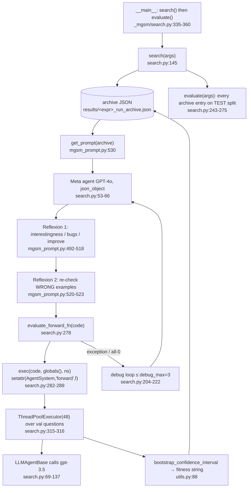

# ADAS (Meta Agent Search) Source-Level Study, with an AFlow note, for worldcurrent RSI

- Repository: `references/evolution/ADAS` (ShengranHu/ADAS @ `2702bee`, 2025-01-27, Apache-2.0). The official repo for "Automated Design of Agentic Systems", ICLR 2025, arXiv 2408.08435 (`references/evolution/ADAS/README.md:8`). Repo and license were checked on the GitHub API (Apache-2.0, not a fork) before cloning.
- AFlow appears only in the appendix and is labelled **\[Docs/Interface only\]**: its README and abstract were read, no code.
- Method: static reading only. Nothing was installed or run. `results/*.json` were parsed with `python3 -I` as data. Tags: **\[Implemented\]** · **\[Docs/Interface only\]** · **\[Unverified\]** · **\[Needs model/hardware\]**.
- Shape of the repo: research scripts, not a library. There are five self-contained near-copies of the same loop (`_arc`, `_drop`, `_gpqa`, `_mgsm`, `_mmlu`; ~360–450 lines each) plus `_transfer_math` evaluators. This study cites `_mgsm` as canonical and `_arc` where it differs.

---

## 1. Positioning

ADAS is the opposite end of the design space from GEPA:
- **Unit of improvement:** a whole agent as **Python source code**, a `forward(self, taskInfo)` function that composes LLM calls (`LLMAgentBase`).
- **Proposer:** a "meta agent" (GPT-4o) that sees the **entire archive** of previously discovered agents with their validation fitness and writes the next one. It is told to be "interestingly new" and to "THINK OUTSIDE THE BOX" (`references/evolution/ADAS/_mgsm/mgsm_prompt.py:484-490`).
- **Search policy:** none beyond "append everything and let the LLM read it". There is no parent selection, no population pruning, no acceptance test and no crossover operator. \[Implemented\]

For worldcurrent the code is a **cautionary reference implementation**. The *ideas* (archive-as-context, self-critique before evaluation, a seed archive of hand-designed baselines, an error → debug retry loop) transfer. The *mechanism* (exec of LLM-written code inside the evaluator process) does not.

## 2. Architecture



## 3. Core data structures & interfaces (signatures)

```python
# references/evolution/ADAS/_mgsm/search.py:20
Info = namedtuple('Info', ['name', 'author', 'content', 'iteration_idx'])   # the only message type between sub-agents

# references/evolution/ADAS/_mgsm/search.py:69-137  — the "building block" exposed to generated code
class LLMAgentBase:
    def __init__(self, output_fields: list, agent_name: str, role='helpful assistant',
                 model='gpt-3.5-turbo-0125', temperature=0.5) -> None
    def generate_prompt(self, input_infos, instruction) -> tuple[str, str]   # system = role + JSON format inst
    def query(self, input_infos: list, instruction, iteration_idx=-1) -> list[Info]   # pads/drops fields on error
    def __call__(self, input_infos: list, instruction, iteration_idx=-1) -> list[Info]

class AgentSystem:                       # _mgsm/search.py:140-142; forward() is monkey-patched in per candidate
    def forward(self, taskInfo: Info) -> Info | str      # injected via setattr at search.py:289
# _arc/search.py:156-234 adds evaluator tools callable from generated code:
#   run_examples_and_get_feedback(code) -> (Info feedback, correct_examples, wrong_examples)   :161
#   get_test_output_from_code(code) -> Info                                                     :208

# Archive entry (JSON dict) — references/evolution/ADAS/_mgsm/mgsm_prompt.py:3-10 and search.py:227-235
{"thought": str, "name": str, "code": "def forward(self, taskInfo): ...",
 "generation": int | "initial", "fitness": "95% Bootstrap Confidence Interval: (lo%, hi%), Median: m%"}
# evaluate() later writes a copy with "test_fitness" to <expr>_run_archive_evaluate.json  (search.py:243-275)

# Fitness  references/evolution/ADAS/_mgsm/utils.py:88
def bootstrap_confidence_interval(data, num_bootstrap_samples=100000, confidence_level=0.95) -> str
```

**Representation and versioning** \[Implemented\]:
- The archive is a flat JSON list, rewritten in full after every generation (`references/evolution/ADAS/_mgsm/search.py:237-240`).
- It resumes from the last `generation` (`:146-156`).
- There are no parent links, no hashes and no promote/rollback.
- The "version" of an agent is its list index plus its generation number.
- The fitness is stored as a **formatted string**, not numbers. The meta agent parses it by reading; post-hoc analysis needs regexes.

## 4. The improvement loop

```mermaid
sequenceDiagram
    participant L as search() loop (search.py:179)
    participant M as Meta agent (gpt-4o, T=0.8)
    participant E as evaluate_forward_fn (search.py:278)
    participant A as Archive JSON
    L->>E: evaluate each seed agent (CoT, CoT-SC, Reflexion, Debate, Step-back, QD, Role) (search.py:158-177)
    E-->>A: fitness strings
    loop n in range(start, n_generation=30)
        L->>M: system + base prompt with [ARCHIVE] = json.dumps(all entries) (mgsm_prompt.py:530-536)
        M-->>L: {"thought","name","code"}
        L->>M: Reflexion_prompt_1 (+ previous agent) → revised JSON (search.py:189-193)
        L->>M: Reflexion_prompt_2 → revised JSON (search.py:194-197)
        loop up to debug_max=3
            L->>E: exec(code); run on val[:128] in 48 threads
            alt exception or mean acc < 0.01
                L->>M: "Error during evaluation: {e} … debug" (search.py:211-217)
            end
        end
        L->>A: append {thought,name,code,fitness,generation} unconditionally (search.py:227-240)
    end
    L->>E: evaluate(): every archive entry on test split (search.py:243-275)
```

## 5. Candidate generation

- **Meta-prompt contents** \[Implemented\] (`references/evolution/ADAS/_mgsm/mgsm_prompt.py:226-490`):
  - the domain description and one example question;
  - the **full utility source** of the framework the agent will run in (`:235-410`);
  - the entire archive as JSON, including each agent's code and fitness string (`:411-416`);
  - the output schema (`thought` / `name` / `code`);
  - four "WRONG implementation" anti-patterns (`:431-482`);
  - the instruction to maximise fitness with novel designs (`:484-490`).
- **Feedback used** \[Implemented\]:
  - **Only the aggregate validation fitness string** per archive entry. No per-example failures, no traces and no outputs reach the meta agent.
  - The one exception is runtime errors: the exception text from a failed evaluation goes into the debug turn (`references/evolution/ADAS/_mgsm/search.py:215`).
  - In ARC, generated agents can call `run_examples_and_get_feedback` *at inference time* (`references/evolution/ADAS/_arc/search.py:161-206`). That is task-level feedback inside the agent, not meta-level feedback.
- **Self-critique before spending evaluation budget** \[Implemented\]:
  - Two extra meta-agent turns check "Interestingness", "Implementation Mistakes" and "Improvement" against the archive and the anti-pattern list (`references/evolution/ADAS/_mgsm/mgsm_prompt.py:492-523`).
  - This costs LLM tokens only, with no evaluation runs. It is the cheapest transferable idea in the repo.
- **Minibatching**: none. Every candidate runs on the full validation slice (128 MGSM questions; ARC uses the val pickle × `n_repreat=5`) (`references/evolution/ADAS/_mgsm/search.py:296-299`, `references/evolution/ADAS/_arc/search.py:425`).
- **Seed archive**: 5–7 hand-written classic agents (`references/evolution/ADAS/_mgsm/mgsm_prompt.py:526-527`, `references/evolution/ADAS/_arc/arc_prompt.py:663-664`).
- **Context growth** \[Implemented\]: the archive is dumped into the prompt verbatim every generation (`references/evolution/ADAS/_mgsm/mgsm_prompt.py:531-533`), so prompt length grows linearly with generations. A "context too long" error during the inner agent run is turned into an assertion so the meta agent is told to shorten its design (`references/evolution/ADAS/_mgsm/search.py:118-119`).

## 6. Selection

- **No selection operator.** Every evaluated candidate is appended, including ones worse than all seeds (`references/evolution/ADAS/_mgsm/search.py:235`). "Selection" is implicit, through the meta agent reading the fitness strings. \[Implemented\]
- **No merge or crossover operator.** Recombination happens only if the LLM chooses to combine archive entries.
- **Budget accounting** \[Implemented\]:
  - The only budget is `n_generation` (30 MGSM, 25 ARC) and `debug_max=3`. There is no token or cost counter; the cost line is commented out (`references/evolution/ADAS/_mgsm/search.py:47`).
  - **Bug:** on failure the loop runs `n -= 1; continue` inside `for n in range(...)` (`references/evolution/ADAS/_mgsm/search.py:201`, `:224`). Python rebinds `n` on the next iteration, so failed generations are silently dropped rather than retried. The actual number of archive additions can be below `n_generation`. \[Implemented\]
  - `--reflect_max` is parsed but never used (`references/evolution/ADAS/_arc/search.py:432`).

## 7. Evaluation & gating

- **Splits** \[Implemented\]:
  - MGSM / DROP / MMLU: a deterministic shuffle with `shuffle_seed=0`, then `[:valid_size]` for search and `[valid_size:valid_size+test_size]` for test (`references/evolution/ADAS/_mgsm/search.py:291-299`).
  - ARC: separate val/test pickles (`references/evolution/ADAS/_arc/search.py:383-388`).
  - The mode switch is a **module global**, `SEARCHING_MODE` (`references/evolution/ADAS/_mgsm/search.py:27`, `:355-360`).
- **Gating**: none. The fitness is a 95% bootstrap CI string over per-question 0/1 accuracy (`references/evolution/ADAS/_mgsm/utils.py:88-130`). It is reported but never used to reject anything.
- **Test-set hygiene**:
  - `test_fitness` is written to a separate file and never fed back into the meta prompt. That is good.
  - However, `evaluate()` scores **every** archive agent on test (`references/evolution/ADAS/_mgsm/search.py:253-275`), so which one is reported is a manual post-hoc choice. That opens test-set selection. [Implemented; reporting practice Unverified]
- **Bug in DROP fitness** \[Implemented\]: `np.percentile(bootstrap_means, lower_percentile)` passes 0.025 / 0.975 to a 0–100 percentile API (`references/evolution/ADAS/_drop/utils.py:282-285`). The resulting "CI" is the ~0.03rd–1st percentile, so shipped DROP CIs sit below their own medians. Example: CoT "(50.2%, 54.3%), Median: 63.3%" in `references/evolution/ADAS/results/drop_gpt3.5_results.json`.
- **Evidence of validation overfitting** in ADAS's own shipped results. I computed this by parsing `references/evolution/ADAS/results/*_gpt3.5_results.json`, which carry both `fitness` (val) and `test_fitness` [Implemented data; analysis ours]:

| Domain | n agents | best-by-val: val → test median | best-by-test | Spearman(val, test) |
|---|---|---|---|---|
| MGSM | 36 | 54.7 → 53.4 | same agent | 0.81 |
| DROP (F1) | 35 | 73.5 → 70.7 | gen 30: 70.2 → 79.4 | 0.86 |
| ARC | 27 | 13.0 → 10.7 | gen 14: 12.0 → 13.7 | 0.70 |
| MMLU | 35 | 78.9 → 69.1 | gen 9: 74.2 → 69.6 | 0.14 |
| GPQA | 31 | 38.8 → 32.3 | gen 13: 29.4 → 34.6 | 0.06 |

  - On GPQA and MMLU the val ranking almost does not predict the test ranking.
  - The best-by-val agent loses 6–10 points on test.
  - Overlapping bootstrap CIs (for example MGSM CoT val (22.7%, 38.3%)) mean most archive orderings are noise.
  - This is the strongest argument in either repo for our paired McNemar gate and the held-out-only report.
- **Noise control**: `n_repreat` duplicates questions (ARC/GPQA default 5) to average LLM sampling noise (`references/evolution/ADAS/_arc/search.py:397`, `:425`). It does not pair candidate and parent.

## 8. Safety & isolation

- **None.**
  - `exec(forward_str, globals(), namespace)` runs LLM-written code **in the search process with the module's globals**, which include `client = openai.OpenAI()`, `os`, `json` and `openai` (`references/evolution/ADAS/_mgsm/search.py:16`, `:282`).
  - It then monkey-patches the class (`:289`) and runs it in 48 threads that share the process (`:315-316`).
  - There is no timeout, no subprocess, no rlimit, no network or filesystem restriction, and no static check. \[Implemented\]
- ARC additionally:
  - `exec`s code written by the *inner* agents with empty globals (`references/evolution/ADAS/_arc/search.py:177`, `:221`). Empty globals are not a sandbox, since `__builtins__` is auto-inserted.
  - `eval(res)`s the agent's string answer (`:407`).
  - `pickle.load`s the dataset (`:388`).
- The README acknowledges this: "involves executing untrusted model-generated code … may still act destructively" (`references/evolution/ADAS/README.md:65-67`).
- Implication for us: generated agent code could call the OpenAI client with arbitrary prompts or touch files. In a robotics harness it could also import the env, bypass the kernel loop, or monkey-patch the SafetyShield. Code-level candidates must stay forbidden until we have an out-of-process jail. Our current `check_protected_scope` already rejects `kind != "config_patch"` (wc-evolve `worldcurrent/evolve/candidate.py`).

## 9. Dependencies, cost, license

- `references/evolution/ADAS/requirements.txt`: numpy, tqdm, pandas, openai, backoff, scipy, blobfile. Hard-wired to the OpenAI Chat Completions API with `response_format=json_object` (`references/evolution/ADAS/_mgsm/search.py:37-44`). \[Needs model/hardware\]
- Cost per generation (paper-scale defaults):
  - 3 meta-agent calls, plus up to 3 debug calls;
  - one full validation run (128 questions × every `LLMAgentBase` call in the agent; debate or ensemble agents make 5–15 calls per question);
  - repeated `debug_max` times on failure.
  - No accounting exists in code.
- License: Apache-2.0 (`references/evolution/ADAS/LICENSE`). Datasets under `dataset/` carry their own terms (MGSM, DROP, ASDiv, ARC pickles); we do not use them.

## 10. Strengths / weaknesses / risks

**Strengths**
1. The most expressive search space of the three: control flow, ensembling, debate, verification, tool use.
2. Archive-as-context gives the proposer "stepping stones": it can see what was tried and avoid repeats.
3. Self-reflection before evaluation is free in rollouts.
4. Seeding with strong known baselines makes the archive's floor meaningful.
5. Simple enough to read in an hour; a good demonstration of the meta-agent idea.

**Weaknesses / risks**
1. Unsandboxed exec in-process with live API credentials in scope (§8).
2. No feedback richer than one fitness number. The meta agent cannot tell *why* an agent failed.
3. No selection, gating, or statistics. Shipped results show val/test rank decorrelation (§7).
4. Unbounded context growth, five copy-pasted loops, and global-flag mode switching. Also `n -= 1` (`references/evolution/ADAS/_mgsm/search.py:201`) and the DROP percentile bug (`references/evolution/ADAS/_drop/utils.py:284-285`).
5. Inactive since January 2025 (last commit). Model names are pinned to 2024 OpenAI models (`references/evolution/ADAS/_mgsm/search.py:348-351`).

## 11. What worldcurrent should adopt (concrete)

1. **Archive-as-context for our LLM `CandidateGenerator`.** When proposing recovery-rule or reasoner-prompt text, include a compact table of prior candidates from the registry ledger: id, patch digest, short rationale, gate verdict with McNemar p, held-out delta, and *rejection reason*. Unlike ADAS, include rejected candidates and per-bucket failure counts from `diagnose()`, and cap the table (top-k by validation, plus the last k rejected) to bound context.
2. **Two-turn self-critique before any rollout**, reusing ADAS's three checks:
   - (a) novelty versus the archive;
   - (b) a "WRONG examples" list that is ours: references to protected scope, episode-specific constants, instructions to disable or relax the shield, unknown config paths;
   - (c) refinement.
   Follow it with a deterministic linter. Both cost zero simulator time.
3. **Seed archive.** Register hand-written baseline recovery strategies (retry-same, re-plan-subgoal, back-off-and-regrasp, abort) as `generation: initial` candidates. Every generated candidate is then compared against strong priors, not just the current active version.
4. **Error → debug loop, scoped to text.** If a candidate fails schema validation or the protected-scope check, feed the exception text back for up to 2 retries (ADAS `debug_max`, `references/evolution/ADAS/_mgsm/search.py:204-222`). Count these retries in the budget, and do not repeat ADAS's `n -= 1` silent drop.
5. **Keep code candidates out.** ADAS's code-level `forward()` search maps to "LLM writes the agent/reasoner policy". It must wait for an out-of-process runner with no network, no secrets, a read-only filesystem, a CPU/time rlimit, and a kernel-mediated action API, so the SafetyShield stays outside the candidate. Even then, generated code may only emit *plans or rule text to the kernel*, never call the env or VLA directly.
6. **Keep and cite our gate.** The ADAS val→test table (§7) is the empirical justification for paired McNemar on a validation split that the *proposer never saw scores from*, plus held-out reporting with `used_for_selection: False` (already in wc-evolve `worldcurrent/evolve/loop.py`). Report fitness as numbers, not strings.

**What transfers to physical RSI with a frozen VLA on LIBERO**

| ADAS mechanism | Transfer? | Note |
|---|---|---|
| Meta agent reads the archive and proposes the next design | Yes (for text) | Use the qwen reasoner as meta agent over reasoner-prompt / recovery-rule text, with our ledger as the archive |
| Self-critique turns before evaluation | Yes | Saves CPU rollouts, which are the scarcest resource here |
| Aggregate fitness only | No, improve on it | Rollout traces give buckets, distances, shield events and keyframes; use GEPA-style records |
| Full-val evaluation per candidate | Partially | Too costly per candidate on CPU SmolVLA. Use a GEPA-style minibatch screen, then the full gate split for the top-k only |
| Generated `forward()` code with exec | No (until isolated) | Would sit between the kernel and the VLA; unacceptable without a jail and shield-outside design |
| Optimising the VLA's instruction string | Risky | Same OOD-paraphrase concern as for GEPA (frozen policy trained on fixed templates) \[Unverified\] |

## 12. Source index

| Topic | Location | Tag |
|---|---|---|
| Search loop | `references/evolution/ADAS/_mgsm/search.py:145-240` | \[Implemented\] |
| Meta-agent JSON calls | `references/evolution/ADAS/_mgsm/search.py:30-66` | \[Implemented\][Needs model/hardware] |
| LLMAgentBase / Info | `references/evolution/ADAS/_mgsm/search.py:20`, `:69-137` | \[Implemented\] |
| exec + monkey-patch forward | `references/evolution/ADAS/_mgsm/search.py:278-289` | \[Implemented\] |
| Val/test split, SEARCHING_MODE | `references/evolution/ADAS/_mgsm/search.py:27`, `:291-299`, `:355-360` | \[Implemented\] |
| Debug loop | `references/evolution/ADAS/_mgsm/search.py:204-225` | \[Implemented\] |
| `n -= 1` no-op bug | `references/evolution/ADAS/_mgsm/search.py:201`, `:224` | \[Implemented\] |
| Test evaluation of whole archive | `references/evolution/ADAS/_mgsm/search.py:243-275` | \[Implemented\] |
| Meta prompt (base, archive, WRONG examples, task) | `references/evolution/ADAS/_mgsm/mgsm_prompt.py:226-490` | \[Implemented\] |
| Reflexion prompts 1/2 | `references/evolution/ADAS/_mgsm/mgsm_prompt.py:492-523`, `:539-542` | \[Implemented\] |
| Seed archive | `references/evolution/ADAS/_mgsm/mgsm_prompt.py:526-527`; `references/evolution/ADAS/_arc/arc_prompt.py:663-664` | \[Implemented\] |
| Bootstrap CI fitness | `references/evolution/ADAS/_mgsm/utils.py:88-130` | \[Implemented\] |
| DROP percentile bug | `references/evolution/ADAS/_drop/utils.py:282-285` | \[Implemented\] |
| ARC evaluator tools / inner exec / eval / pickle | `references/evolution/ADAS/_arc/search.py:161-234`, `:388`, `:407` | \[Implemented\] |
| Unused `--reflect_max` | `references/evolution/ADAS/_arc/search.py:432` | \[Implemented\] |
| Safety warning | `references/evolution/ADAS/README.md:65-67` | \[Docs/Interface only\] |
| Shipped results (val + test) | `references/evolution/ADAS/results/*_gpt3.5_results.json` | \[Implemented\] data |

## Verification status

| Capability | Tag | Note |
|---|---|---|
| Meta Agent Search loop | \[Implemented\][Needs model/hardware] | Read; not run (needs OpenAI) |
| Archive persistence / resume | \[Implemented\] | JSON list |
| Isolation of generated code | Absent | In-process `exec` with module globals |
| Statistical gating | Absent | CI reported only |
| Val→test decorrelation | \[Implemented\] data, analysis ours | Computed from shipped JSON; no rerun |
| DROP CI bug, `n -= 1` bug | \[Implemented\] | Read from source; effect on DROP visible in shipped JSON |
| Robotics applicability | \[Docs/Interface only\] | Our mapping in §11 |

---

## Appendix: AFlow (FoundationAgents/AFlow) \[Docs/Interface only\]

- Identity: github.com/FoundationAgents/AFlow (MIT per the GitHub API; last push 2025-12-25). The paper is "AFlow: Automating Agentic Workflow Generation", arXiv 2410.10762 (Zhang et al.; the README presents it as ICLR 2025 Oral). The README warns that "Some Operators may have bugs during the migration from MetaGPT to this repository", and paths still reference `metagpt/ext/aflow/...`. The original lives in FoundationAgents/MetaGPT (MIT). **Not cloned; no code read.**
- What it optimizes: workflows represented **as code**. Nodes are LLM calls; edges are code-level control flow. The search composes predefined **Operators** (Generate, Format, Review, Revise, Ensemble, Test, Programmer).
- Search: per the README, "a Monte Carlo Tree Search variant" in which an LLM optimizer iteratively selects, expands (LLM edits the parent workflow code), evaluates on validation data (`--validation_rounds`, default 5), and updates the tree with experience. Selection, back-propagation and experience details are given in the paper but were not verified in code. \[Unverified\]
- Relative to ADAS:
  - it has a tree with explicit parent selection instead of a flat archive;
  - its operator vocabulary is constrained, which narrows the search space;
  - it evaluates each candidate several times on validation.
  These are the same structural fixes our design already makes: a declarative candidate space, repeated paired evaluation, and lineage in the registry.
- Takeaway for worldcurrent: an **operator vocabulary** is the useful idea. If we ever allow structured (non-free-code) recovery programs, define them as compositions of a fixed set of kernel-approved operators: retry, re-plan, re-perceive, back-off, abort. Have the LLM edit the composition, not arbitrary Python. That keeps the protected-scope and SafetyShield guarantees checkable statically.
