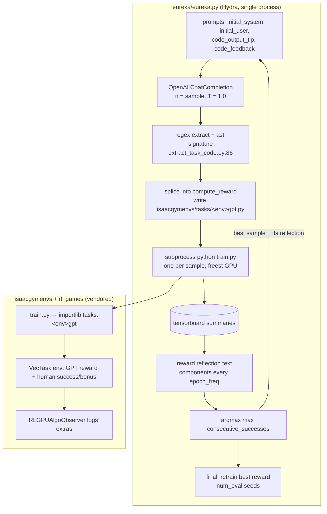

# Eureka (+ DrEureka): Source-Level Study for Physical RSI

> Subjects: `references/evolution/Eureka` (eureka-research/Eureka @ `9eee428`, 2024-05-03, MIT) and `references/evolution/DrEureka` (eureka-research/DrEureka @ `1d4e007`, 2024-08-26, MIT). DrEureka is skimmed in §5–§8 and §11 for its sim-to-real and safety additions.
> Method: static reading only. Nothing was installed. No Isaac Gym, GPU training or OpenAI call was run. Shallow clones.
> Note: checkout materialised some in-tree checkpoints (`Eureka/isaacgymenvs/isaacgymenvs/checkpoints/EurekaPenSpinning.pth`, 6.4 MB; DrEureka `*/runs/*/dr_eureka_best/checkpoints/*.pt|.jit`). They were not opened or used.
> Tags: **\[Implemented\]** · **\[Docs/Interface only\]** · **\[Unverified\]** · **\[Needs model/hardware\]**

---

## 1. Positioning

Eureka is **in-context evolutionary search over reward-function code**. GPT-4 is shown the environment's observation code and a task sentence. It writes N reward functions. Each one is spliced into an Isaac Gym task and used to train a PPO policy from scratch. The best sample by the **environment's ground-truth task metric** is fed back to the LLM with per-component training statistics ("reward reflection"), and the process repeats (`eureka/eureka.py:74-340`).

The unit of improvement is a **reward function (Python/TorchScript source)**. Policies are retrained from scratch for every candidate. Nothing accumulates across tasks: there is no library, curriculum or memory beyond a 4-message chat (`eureka.py:330-336`).

The core is tiny. The search loop is a single 397-line Hydra script plus ~150 lines of utils. The rest of the 354 MB repo is vendored `isaacgymenvs` (BSD-3, NVIDIA) and `rl_games` (MIT), patched to log `gt_reward`, `gpt_reward` and `consecutive_successes`.

What the code shows:
1. **The judge is not an LLM.** Fitness is `max(consecutive_successes)` over the training curve, which is a **human-written, privileged success metric per env** (`eureka.py:255-256`, `:289`; e.g. `eureka/envs/isaac/shadow_hand.py:377-385`). The LLM only proposes. Ground truth decides.
2. **Selection and the "final evaluation" use the same metric on the same task.** The final step retrains the best reward with `seed=0..num_eval-1` and reports max-over-training again (`eureka.py:342-393`). There is no held-out task, held-out initial-state distribution or test-time rollout.
3. **Some "LLM rewards" still contain a human success bonus.** In ShadowHand-family envs the injected GPT reward is followed by `compute_bonus`, which adds `reachGoalBonus=250` on success (`shadow_hand.py:369-376`, `:737-756`; `isaacgymenvs/isaacgymenvs/cfg/task/ShadowHand.yaml:44`).
4. **Generated code is imported as a normal Python module** in the training subprocess (`isaacgymenvs/isaacgymenvs/utils/rlgames_utils.py:112-117`). `@torch.jit.script` is the only incidental restriction (`eureka.py:176-177`).

## 2. Architecture



## 3. Core data structures & interfaces

| Item | Shape | Location | Tag |
|---|---|---|---|
| Task spec | Hydra YAML `{task, env_name, description}` | `eureka/cfg/env/shadow_hand.yaml:1-3` | \[Implemented\] |
| LLM context | `<env>_obs.py`: the env class with **only** `compute_observations` (reward and success code stripped) | `eureka/envs/isaac/shadow_hand_obs.py:1-30`; generator `eureka/utils/prune_env*.py` | \[Implemented\] |
| Reward contract | `@torch.jit.script def compute_reward(<self.* attrs>) -> Tuple[Tensor, Dict[str, Tensor]]` | `eureka/utils/prompts/reward_signature.txt:1-4`; `code_output_tip.txt:1-10` | \[Implemented\] |
| Splice | first `def` in the reply becomes `self.rew_buf[:], self.rew_dict = f(self.a, self.b, ...)`. Components go to `extras` | `eureka.py:141-167`; `utils/extract_task_code.py:86-105` | \[Implemented\] |
| Ground-truth hooks | env writes `extras['gt_reward']`, `extras['consecutive_successes']` | `shadow_hand.py:384-385`; logged by `rlgames_utils.py:183-189`, `:214-215` | \[Implemented\] |
| Candidate artifacts | `env_iter{i}_response{j}.py`, `..._rewardonly.py`, `.txt` stdout, `summary.npz`, `messages.json` in the Hydra run dir | `eureka.py:180-184`, `:328`, `:339-340` | \[Implemented\] |
| "Version store" | none. The best path is kept in memory (`max_reward_code_path`) and copied over the task file at the end | `eureka.py:297-300`, `:349` | \[Implemented\] |

Fitness per env is whatever the env author called `consecutive_successes`. For ShadowHand it is an averaged count of consecutive goal hits (`shadow_hand.py:690-735`). For Humanoid and Ant it is the **mean forward-progress reward** (`eureka/envs/isaac/humanoid.py:368`, `eureka/envs/isaac/ant.py:354`). So "task score" is not a uniform success rate.

## 4. The improvement loop

```mermaid
sequenceDiagram
  participant E as eureka.py
  participant G as GPT-4 (T=1.0)
  participant T as train.py subprocess ×N
  participant B as tensorboard logs
  E->>G: system(signature + tips) + user(obs code + task)
  loop iter in range(cfg.iteration)
    G-->>E: N completions (chunks of 4; up to 1000 API retries)
    loop each sample j
      E->>E: extract code, parse signature (skip on failure)
      E->>T: write tasks/<env>gpt.py; Popen train.py max_iterations
      E->>E: block_until_training (busy-wait for "fps step:" or "Traceback")
    end
    E->>T: communicate() all
    T-->>B: summaries
    E->>B: load scalars → task_score, components, gt/gpt correlation
    E->>E: best = argmax(max consecutive_successes); update global best
    E->>G: messages[-2:] = (best reply, best reflection + code_feedback)
  end
  E->>T: retrain global-best reward with seed = 0..num_eval-1
  T-->>E: max consecutive_successes per seed → mean / std
```

Budgets: `iteration: 1`, `sample: 3`, `max_iterations: 3000` PPO epochs, `num_eval: 5`, `model: gpt-4-0314`, `temperature: 1.0` (`eureka/cfg/config.yaml:12-20`). The README says the default is 5 iterations (`README.md:61`), which contradicts the config. The paper-scale settings appear only in README examples (`README.md:66-69`). When every sample fails, the iteration is repeated **without advancing the context** and still counts toward `cfg.iteration` (`eureka.py:279-286`). \[Implemented\]

## 5. Candidate generation

- **Initial prompt**: role "reward engineer", the signature example, TorchScript constraints, plus output tips. The tips ask for normalisation, a named temperature per transformed component, and **"input variables must contain only attributes of the provided environment class ... Under no circumstance can you introduce new input variables"** (`eureka/utils/prompts/initial_system.txt:1-7`; `code_output_tip.txt:6-10`). That last rule is enforced only indirectly: an unknown `self.x` raises an AttributeError at training time. \[Implemented\]
- **Sampling**: `n=chunk_size` completions per API call (4 for GPT-4). Chunks halve after 10 failed attempts (`eureka.py:82-107`). \[Implemented\][Needs model]
- **Extraction**: the first match of ```` ```python ````, ```` ``` ````, triple or double quotes. Everything before the last line starting with `def ` is dropped. The first `FunctionDef` gives the signature (`eureka.py:127-152`). \[Implemented\]
- **Feedback fed back** (only for the *best* sample of the iteration):
  - success path: `policy_feedback.txt` header, then for each scalar without `/`, ~10 subsampled values plus max/mean/min of every reward component, `task_score` (=GT success) and episode length, then `code_feedback.txt` (`eureka.py:229-269`; `eureka/utils/prompts/policy_feedback.txt:1`). The feedback tips are heuristic: if success is near zero, rewrite; if a component is flat, rescale, rewrite or drop it; if one component dominates, rescale (`code_feedback.txt:1-8`).
  - error path: the filtered Python traceback (`eureka.py:270-274`; `eureka/utils/misc.py:21-31`).
  - **The GT reward-correlation is computed but not shown to the LLM**. It is only logged (`eureka.py:243-247`, `:307`).
- **Context is one step deep**: the conversation is always `[system, user, best_reply, best_feedback]`. Earlier iterations are forgotten, and the best-so-far is not elitist in context. A worse iteration-k best replaces a better iteration-(k-1) best in the prompt (`eureka.py:330-336`). \[Implemented\]
- **RLHF variant**: the README mentions "gradient-free RLHF" (`README.md:21`). No human-feedback path exists in `eureka.py`. \[Docs/Interface only\]

**DrEureka additions** (`references/evolution/DrEureka`):
- **Safety goes into the task text and output tips**, not into checks: "prioritize safety, robustness, and feasibility over performance ... penalize jittery or fast actions that may burn out the motors" (`DrEureka/eureka/cfg/env/globe_walking.yaml:3`; similar `forward_locomotion.yaml:3`). Sign conventions and clamping of `exp` are tips too (`DrEureka/eureka/prompts/code_output_tip_temp.txt:6-12`). \[Docs/Interface only\]
- **Domain-randomisation (DR) generation**: one-shot (no iteration loop). 16 samples write `param = [lo, hi]` lines that are spliced **as Python source** into `legged_robot_config.py` (`DrEureka/dr_eureka/dr_eureka.py:105-153`; `dr_eureka/cfg/config.yaml:16`). \[Implemented\][Needs model/hardware]
- **RAPP (Reward-Aware Physics Priors)**: before asking the LLM, the policy trained with the Eureka reward is run with each DR parameter fixed at each grid value. A hand-written success predicate decides each run (`DrEureka/dr_eureka/rapp.py:20-48`). The min and max successful values become the bounds in the LLM prompt (`rapp.py:84-117`, `:174-193`). The bounds are min and max successful indices, so failing values between them are still included. \[Implemented\]

## 6. Verification & selection

| Aspect | Eureka | Tag |
|---|---|---|
| Who judges | The environment's human-written `consecutive_successes` / `gt_reward` (`shadow_hand.py:377-385`) | \[Implemented\] |
| Evidence | Tensorboard scalars from a full PPO run per candidate (`eureka.py:231-237`; `utils/file_utils.py:13-23`) | \[Implemented\][Needs model/hardware] |
| Per-candidate score | `max` over the training curve, not the final or a held-out rollout (`eureka.py:253-256`) | \[Implemented\] |
| Within-iteration selection | `np.argmax(successes)` (`eureka.py:289`) | \[Implemented\] |
| Across iterations | Global best by the same max score (`eureka.py:297-300`). The context does not keep the global best (§5) | \[Implemented\] |
| Execute rate | `#(success ≥ 0)/sample`, using −10000 as the failure sentinel (`eureka.py:65`, `:294`) | \[Implemented\] |
| Final report | Retrain the best reward with 5 seeds and report mean/std of max-over-training success, plus correlation with the human reward (`eureka.py:342-393`) | \[Implemented\][Unverified] |

**Index-alignment hazards** [Unverified, by reading]:
- A sample whose signature fails to parse is skipped before `code_runs.append` (`eureka.py:148-154`). Training log names use the original `response_id` (`:190`), but the gather loop re-enumerates `zip(code_runs, rl_runs)` (`:210-213`). After a skip, feedback, success and code-path indices can refer to the wrong sample, and `responses[best_sample_idx]` (`:309`, `:331`) can be the wrong reply.
- `reward_correlations` is appended only when both GT and GPT logs exist (`:243-247`), so `reward_correlations[best_sample_idx]` (`:293`) can misalign.
- `block_until_training` busy-waits with no sleep and no timeout. A child that dies without printing "Traceback" hangs the search (`eureka/utils/misc.py:33-42`).

**DrEureka selection**:
- Reward stage: the same argmax. The final multi-seed evaluation is removed; it writes the best reward to `go1_gym/rewards/eureka_reward.py` and prints the run directory (`DrEureka/eureka/eureka.py:312-325`).
- DR stage: argmax of simulated success (`dr_eureka.py:222`). The README says these metrics give "a general idea ... not used for iterative feedback" (`DrEureka/README.md:150`). The real selection is human deployment on a Go1 (`README.md:95-127`). \[Docs/Interface only\][Needs model/hardware]
- `construct_run_log` sets `gpt_reward` and `gt_reward` to **the same sum**, so the logged correlation is trivially 1 (`DrEureka/eureka/utils/misc.py:60-68`). \[Implemented\]
- Fitness is a template method `compute_success` (velocity tracking). It sits **below** the LLM insertion point in the same class, so a generated method of the same name would be overridden by it (`DrEureka/forward_locomotion/go1_gym/rewards/eureka_reward_template.py:13-19`). This protects the metric only by accident of ordering. \[Implemented\]

## 7. Evaluation hygiene

| Question | Finding | Tag |
|---|---|---|
| Generation vs evaluation separated? | Partially. The LLM never sees the GT reward code, and fitness comes from the env. But the GT **task score is shown** in the reflection (`eureka.py:259-263`), so the LLM optimises against the selection metric directly | \[Implemented\] |
| Held-out tasks / states? | None. The same task and distribution are used for search and the final report. Final seeds 0–4 differ from the training default `seed: 42` (`isaacgymenvs/isaacgymenvs/cfg/config.yaml:21`), which gives seed independence only | \[Implemented\] |
| Optimistic bias | Max-over-training plus best-of-N over N×iterations samples, with no correction. The reported number is a selected maximum | \[Implemented\] |
| Reward hacking | The reward can read only declared `self.*` attributes, and success is computed separately. But a human success bonus is mixed into the GPT reward in 4 hand envs (`shadow_hand.py:370`, `:754`; `grep compute_bonus` → `allegro_hand.py`, `shadow_hand_spin.py`, `shadow_hand_upside_down.py`). That confounds "LLM reward vs human reward" comparisons. In DrEureka the reward gets `env = self.env` (the whole env object), so it could mutate state (`DrEureka/eureka/prompts/reward_signatures/forward_locomotion.txt:3-5`) | \[Implemented\] / effect \[Unverified\] |
| Correlation diagnostic | Pearson correlation of the GPT reward with the human reward is logged (`eureka.py:243-247`, `:385-389`). It is useful as a novelty measure, not a gate | \[Implemented\] |

## 8. Safety & isolation

- **Execution**: generated code is written to `isaacgymenvs/isaacgymenvs/tasks/<env>gpt.py`, overwriting one shared file per sample (`eureka.py:45`, `:170-178`). It is then imported with `importlib.import_module` inside `train.py` (`rlgames_utils.py:112-117`) with full user privileges, GPU access and the inherited environment (including `OPENAI_API_KEY`). \[Implemented\]
- **Process isolation**: one `subprocess.Popen` per candidate. stdout/stderr go to a file. There is no resource limit, timeout, container or network restriction (`eureka.py:192-199`). `set_freest_gpu` mutates `CUDA_VISIBLE_DEVICES` in the parent (`misc.py:8-19`). \[Implemented\]
- **Incidental restriction**: `@torch.jit.script` is prepended if missing (`eureka.py:176-177`). TorchScript rejects most arbitrary Python inside the decorated function, but any module-level statements after the function still run at import. DrEureka drops TorchScript entirely (reward methods are plain Python on `self.env`). \[Unverified\]
- **Policy-side safety (DrEureka hardware)**: action clipping (`DrEureka/forward_locomotion/go1_gym_deploy/envs/lcm_agent.py:250-252`) and a "bad orientation emergency stop" that re-calibrates to a low pose when |roll| or |pitch| > 1.6 rad (`DrEureka/forward_locomotion/go1_gym_deploy/utils/deployment_runner.py:182-184`). There is also a manual controller procedure (`README.md:99-127`). There is no runtime shield tied to the LLM-generated artifacts. \[Implemented\][Needs model/hardware]
- **The DR config is code**: LLM output is spliced verbatim into a Python config module (`dr_eureka.py:123-132`). Nothing validates that it only assigns ranges. \[Implemented\]

## 9. Dependencies, cost, license

- Eureka: Python 3.8, `torch<=2.0.0`, `numpy==1.20.0`, `gym==0.23.1`, `hydra-core`, `openai` (pre-1.0 `ChatCompletion` API), `tensorboard` (`setup.py:4-21`). It needs **NVIDIA Isaac Gym Preview 4** (proprietary, CUDA only), `gpustat`, and GPT-4. On our AMD/CPU stack it cannot run. \[Needs model/hardware\]
- Cost scale: each candidate is a full RL run (default 3000 PPO epochs), and the default config already trains 3 + 5 policies. The paper-scale run (16 samples × 5 iterations) is 80 RL runs per task. Token cost is minor next to GPU-hours.
- DrEureka: torch 1.10 + cu113, Isaac Gym, a Unitree Go1 with an NX companion computer, and Docker/LCM for deployment (`DrEureka/README.md:37-68`, `:95-127`).
- Licenses: Eureka and DrEureka top level MIT. Vendored `isaacgymenvs` is BSD-3-Clause (NVIDIA, `isaacgymenvs/LICENSE.txt`) and `rl_games` is MIT. DrEureka bundles `legged_gym` / `rsl_rl` licences (BSD-3, ETH/NVIDIA; `forward_locomotion/LICENSES/`). Isaac Gym itself is under the NVIDIA Software License and is not redistributable. For us: ideas only, no code import.

## 10. Strengths / weaknesses / risks

**Strengths**
- A clean division of labour: the **LLM proposes and ground truth disposes**. The selection signal is never the LLM's own opinion.
- Reward reflection is structured, per-component, numeric feedback: what moved, what stayed flat, what dominated. It is a reusable template for any "LLM edits a scoring function" loop.
- Candidates are fully independent (fresh training per sample), so comparisons are clean within an iteration.
- A cheap pre-filter: execution errors return a traceback without wasting an LLM judgement.

**Weaknesses**
- No held-out evaluation. The reported score is a max of maxes, with no multiple-comparison correction.
- A one-step-deep context with no elitism. Experience is not accumulated across tasks.
- Brittle bookkeeping (index alignment, busy-wait, shared output file) and no artifact versioning.
- Hidden human shaping (success bonus) in several envs muddies the "human-level" claim.

**Risks for us**
- "Reward search with RL in the loop" assumes we can afford a training run per candidate. We have a **frozen** VLA on CPU, so the direct transfer is near zero.
- Showing the selection metric to the generator invites overfitting to the validation split. Our gate must keep a split the generator never sees.
- Prompt-only safety (DrEureka) is not a control.

## 11. What Hylo should adopt (concrete)

Our object of improvement is **not a reward**: the VLA is frozen and there is no RL. Eureka's transferable ideas are in the search and reflection protocol. They apply to our scoring-like artifacts: runtime **critics** (failure detectors), recovery-trigger thresholds, and config patches.

1. **"LLM proposes, ground truth disposes", as a hard rule.** `hylo-evolve` already gates on BDDL success via McNemar (`packages/hylo-evolve/src/hylo/evolve/loop.py:93-120`). Keep the LLM (qwen3.5) strictly upstream of the gate. Never let an LLM judgement substitute for `scores.success`.
2. **Critic reflection, the analogue of reward reflection.** When `critic_rule` candidates are enabled (Zetta-style DSL `feature/operator/threshold/dwell`), feed back a per-rule table computed by shadow replay over the parent's traces. It shows firing rate on successful episodes (false-alarm rate), firing rate on failed episodes (recall), median lead time before the failure step, and a flat or never-firing flag. These fill the same role as Eureka's "component is flat / dominates" statistics (`code_feedback.txt:1-8`). Compute them only on the **train** split.
3. **Never show the validation metric to the generator.** Eureka shows `task_score` (`eureka.py:259-263`). We show train-split diagnostics only. Validation is used only by the gate, and held-out only for the report. The trace should record which split each number came from.
4. **Correct for best-of-N.** Eureka picks argmax over N×iterations without correction. Our cycle gates each candidate at α=0.05 and then takes the best passer (`loop.py:143-158`). Use Holm/Bonferroni (α/N) across the candidates in a cycle, or a confirmatory re-test of the single winner on fresh validation seeds. Log N in the `CycleReport`.
5. **Score on final behaviour, not the best moment.** Never use max-over-run. Score a fixed seed list of complete episodes with the frozen agent. This is already our practice; record it as a gate invariant.
6. **Execute-rate and novelty as health metrics.** Track per cycle the fraction of candidates that pass schema and protected-scope checks (Eureka's `execute_rate`). Also track correlation or overlap of a new critic with the parent's critics (Eureka's GT correlation, `eureka.py:243-247`). This tells us whether the generator is exploring or rewording.
7. **Elitist context.** If we keep a multi-turn generator, carry the **global best plus its reflection**, not the last iteration's best (fixing `eureka.py:330-336`). Better still, carry a short table of all gated candidates with their verdicts, as Zetta's ledger does.
8. **RAPP-style admissible-range probing for config patches** (from DrEureka). Before asking the LLM for numeric patches (gains, chunk length, critic thresholds), sweep each parameter alone on a few train seeds. Record the range where the parent still succeeds and the `SafetyShield` intervention count does not rise. Pass the range to the prompt **and** enforce it as a schema bound. That makes the range a check instead of a hint. Fix DrEureka's min/max-index bug by keeping the contiguous successful interval.
9. **Typed values, never spliced source.** DR ranges and rewards spliced as Python (`dr_eureka.py:123-132`, `eureka.py:170-178`) are the anti-pattern. RFC-0001 D5's declarative candidates already avoid it. Keep `kind="code"` disabled.
10. **Do not adopt**: per-candidate RL retraining, privileged success bonuses mixed into the optimised signal, or safety as prompt prose.

## 12. Source index

| Topic | Location |
|---|---|
| Search loop | `references/evolution/Eureka/eureka/eureka.py:74-340` |
| Final multi-seed evaluation | `references/evolution/Eureka/eureka/eureka.py:342-393` |
| Config defaults | `references/evolution/Eureka/eureka/cfg/config.yaml:12-20` |
| Prompts | `references/evolution/Eureka/eureka/utils/prompts/{initial_system,initial_user,code_output_tip,code_feedback,policy_feedback,execution_error_feedback,reward_signature}.txt` |
| Signature parsing | `references/evolution/Eureka/eureka/utils/extract_task_code.py:86-105` |
| GPU pick / traceback filter / busy-wait | `references/evolution/Eureka/eureka/utils/misc.py:8-42` |
| Env skeleton with GT success + bonus | `references/evolution/Eureka/eureka/envs/isaac/shadow_hand.py:369-385`, `:690-756` |
| Dynamic import of generated task | `references/evolution/Eureka/isaacgymenvs/isaacgymenvs/utils/rlgames_utils.py:112-119` |
| Logging of env extras | `references/evolution/Eureka/isaacgymenvs/isaacgymenvs/utils/rlgames_utils.py:183-189`, `:214-215` |
| DrEureka reward loop | `references/evolution/DrEureka/eureka/eureka.py:67-325` |
| DrEureka run-log parser (gt = gpt) | `references/evolution/DrEureka/eureka/utils/misc.py:43-68` |
| RAPP | `references/evolution/DrEureka/dr_eureka/rapp.py:20-193` |
| DR generation | `references/evolution/DrEureka/dr_eureka/dr_eureka.py:60-255` |
| Safety prompt text | `references/evolution/DrEureka/eureka/cfg/env/globe_walking.yaml:3` |
| Hardware e-stop / action clip | `references/evolution/DrEureka/forward_locomotion/go1_gym_deploy/utils/deployment_runner.py:182-184`; `.../envs/lcm_agent.py:250-252` |

## Verification status

| Claim | Status | Evidence |
|---|---|---|
| Unit of improvement = reward function source; policies retrained per candidate | \[Implemented\] | `eureka.py:155-199` |
| Fitness = human GT `consecutive_successes`, max over training | \[Implemented\] | `eureka.py:253-256`, `:289` |
| Reward reflection = per-component subsampled curves + max/mean/min + task score | \[Implemented\] | `eureka.py:229-269` |
| Only the best sample of the latest iteration is kept in context | \[Implemented\] | `eureka.py:330-336` |
| Final report re-trains best reward with 5 seeds, same task | \[Implemented\][Needs model/hardware] | `eureka.py:342-393` |
| Human success bonus added to GPT reward in hand envs | \[Implemented\] | `shadow_hand.py:370`, `:754`; `ShadowHand.yaml:44` |
| Generated code imported unsandboxed in training process | \[Implemented\] | `rlgames_utils.py:112-117` |
| Index misalignment after a skipped sample; busy-wait hang | \[Unverified\] (by reading) | `eureka.py:148-154`, `:190`, `:210-213`; `misc.py:33-42` |
| "Human-level, 83% of tasks" results | \[Docs/Interface only\][Needs model/hardware] | `README.md:21` |
| RLHF variant | \[Docs/Interface only\] | `README.md:21`; absent from `eureka.py` |
| DrEureka safety via prompt text only | \[Docs/Interface only\] | `globe_walking.yaml:3`; `code_output_tip_temp.txt:6-12` |
| DrEureka RAPP bounds from per-parameter sweeps | \[Implemented\][Needs model/hardware] | `rapp.py:84-193` |
| DrEureka logged reward correlation is trivially 1 | \[Implemented\] | `DrEureka/eureka/utils/misc.py:60-68` |
| DrEureka hardware e-stop on orientation | \[Implemented\][Needs model/hardware] | `deployment_runner.py:182-184` |
