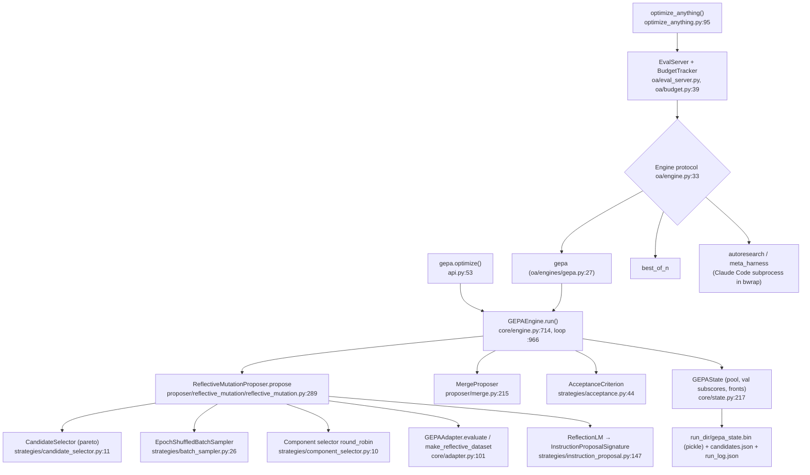

# GEPA (standalone) Source-Level Study: Reflective Pareto Evolution of Text Components for Hylo RSI

- Repository: `references/evolution/gepa` (gepa-ai/gepa @ `02ea415`, 2026-10-30, MIT). `pyproject.toml` still reads `version="0.1.4"`, but that is a placeholder the publish workflow rewrites. HEAD is **newer than 0.1.4**: `optimize_anything` describes the 0.1.4 behaviour as "legacy" (`references/evolution/gepa/src/gepa/optimize_anything.py:160-163`). DSPy pins `gepa[dspy]==0.1.4` (see `research/projects/dspy.md` §6), so the HEAD-only features below (eval server, sealed `test_set`, `oa` engines, ComBEE) **are not available through DSPy's pin**.
- Paper: arXiv 2507.19457 (README:12). Official repo and license were checked on the GitHub API (MIT, not a fork, 7.2k stars) before cloning.
- Method: static reading only. Nothing was installed or run, and no LLM was called. Tags: **\[Implemented\]** traceable code · **\[Docs/Interface only\]** docs or protocol only · **\[Unverified\]** code exists but was not run · **\[Needs model/hardware\]** needs an LLM or simulator.
- Scope: the DSPy wrapper (`dspy.GEPA`, `DspyAdapter`) is already covered in `research/projects/dspy.md`. This study covers the **engine itself**: the adapter protocol, proposer, Pareto state, merge, acceptance, budgets and the newer `optimize_anything` surface.

---

## 1. Positioning

GEPA is a **black-box optimizer over a dict of named text components** (`Candidate = dict[str, str]`, `references/evolution/gepa/src/gepa/core/adapter.py:12`). Each iteration:

1. pick a parent from a per-example Pareto frontier,
2. run it on a small train minibatch (default 3) while capturing traces,
3. turn the traces into a "reflective dataset",
4. ask a reflection LM to rewrite one component,
5. keep the child only if its minibatch score sum beats the parent's,
6. score accepted children on the full valset, where they join the pool and frontier.

GEPA has no dependency on DSPy and no runtime dependencies at all (`dependencies = []`, `references/evolution/gepa/pyproject.toml`). Everything domain-specific sits behind one protocol, `GEPAAdapter`.

How it differs from our current loop (hylo-evolve `hylo/evolve/loop.py`):
- Our loop: one deterministic diagnosis → N declarative patches → McNemar gate → held-out check.
- GEPA: many cheap noisy minibatch tests → a growing population → Pareto-weighted parent sampling. **GEPA has no statistical test anywhere.** A grep over `src/gepa` finds no McNemar, binomial or p-value code. \[Implemented\]

## 2. Architecture



## 3. Core data structures & interfaces (signatures)

```python
# references/evolution/gepa/src/gepa/core/adapter.py:12-35
Candidate = dict[str, str]
@dataclass
class EvaluationBatch(Generic[Trajectory, RolloutOutput]):
    outputs: list[RolloutOutput]
    scores: list[float]                                   # higher is better; minibatch uses sum, valset uses mean
    trajectories: list[Trajectory] | None = None          # required when capture_traces=True
    objective_scores: list[dict[str, float]] | None = None
    num_metric_calls: int | None = None                   # override budget accounting (e.g. k rollouts per item)

# references/evolution/gepa/src/gepa/core/adapter.py:101-237  — THE integration point
class GEPAAdapter(Protocol[DataInst, Trajectory, RolloutOutput]):
    def evaluate(self, batch: list[DataInst], candidate: dict[str, str],
                 capture_traces: bool = False) -> EvaluationBatch[Trajectory, RolloutOutput]: ...
    def make_reflective_dataset(self, candidate: dict[str, str],
                 eval_batch: EvaluationBatch[Trajectory, RolloutOutput],
                 components_to_update: list[str]) -> Mapping[str, Sequence[Mapping[str, Any]]]: ...
    propose_new_texts: ProposalFn | None = None
    # optional (duck-typed): batch_evaluate(items, *, capture_traces=True), get_adapter_state(), set_adapter_state(state)

# references/evolution/gepa/src/gepa/core/adapter.py:49-57
class ProposalFn(Protocol):
    def __call__(self, candidate: dict[str, str], reflective_dataset: Mapping[str, Sequence[Mapping[str, Any]]],
                 components_to_update: list[str], *, metadata: Mapping[str, Any] | None = None) -> dict[str, str]: ...

# references/evolution/gepa/src/gepa/proposer/reflective_mutation/base.py:27-28
class LanguageModel(Protocol):
    def __call__(self, prompt: str | list[dict[str, Any]]) -> str: ...

# references/evolution/gepa/src/gepa/core/data_loader.py:27-39
class DataLoader(Protocol[DataId, DataInst]):
    def all_ids(self) -> Sequence[DataId]; def fetch(self, ids) -> list[DataInst]; def __len__(self) -> int

# references/evolution/gepa/src/gepa/proposer/base.py:31-43
class CandidateProposal(Generic[DataId]):
    candidate: dict[str, str]; parent_program_ids: list[int]; subsample_indices; subsample_scores_before;
    subsample_scores_after; eval_before; eval_after; tag: str; metadata: dict

# references/evolution/gepa/src/gepa/api.py:53-114 (abridged; defaults are load-bearing)
def optimize(seed_candidate, trainset, valset=None, adapter=None, task_lm=None, evaluator=None,
             reflection_lm: LanguageModel | str | None = None, candidate_selection_strategy="pareto",
             frontier_type: Literal["instance","objective","hybrid","cartesian"] = "instance",
             skip_perfect_score=True, batch_sampler="epoch_shuffled", reflection_minibatch_size=None,  # → 3 (api.py:382)
             perfect_score=1.0, reflection_prompt_template=None, custom_candidate_proposer=None,
             module_selector="round_robin", use_merge=False, max_merge_invocations=5, merge_val_overlap_floor=5,
             max_metric_calls=None, max_reflection_cost=None, stop_callbacks=None, run_dir=None, callbacks=None,
             cache_evaluation=False, seed=0, raise_on_exception=True, val_evaluation_policy=None,
             acceptance_criterion="strict_improvement", sampling_strategy=None, selection_strategy=None,
             reflection_strategy=None, *, reflective_dataset_enricher=None) -> GEPAResult

# references/evolution/gepa/src/gepa/optimize_anything.py:95-106 (HEAD-only high-level API)
def optimize_anything(seed_candidate: str | Candidate | None = None, *, evaluator=None, batch_evaluator=None,
                      dataset=None, valset=None, objective=None, background=None, test_set=None, config=None) -> GEPAResult
# evaluator: (candidate[, example]) -> float | (float, SideInfo)   references/evolution/gepa/src/gepa/gepa_launcher.py:399-401
# SideInfo = dict[str, Any]; "scores" → objectives; "<component>_specific_info" → per-component feedback  (gepa_launcher.py:185-246)
```

**Versioning** \[Implemented\]:
- Candidates are plain `dict[str,str]` held in `GEPAState.program_candidates`. Lineage is `parent_program_for_candidate` and per-example val scores are `prog_candidate_val_subscores` (`references/evolution/gepa/src/gepa/core/state.py:232-235`).
- Each iteration pickles the state to `gepa_state.bin` and also writes `candidates.json` / `run_log.json` (`references/evolution/gepa/src/gepa/core/state.py:405-456`). If `run_dir` already holds a state file, the run resumes from it.
- There is no promote/rollback concept: the result is just `best_idx` by valset mean.

## 4. The improvement loop

```mermaid
sequenceDiagram
    participant E as GEPAEngine.run (engine.py:966)
    participant S as GEPAState
    participant P as ReflectiveMutationProposer (reflective_mutation.py:289)
    participant A as Adapter.evaluate
    participant R as Reflection LM
    participant M as MergeProposer (merge.py:296)
    E->>A: seed on FULL valset → S.init frontier (engine.py:813-818)
    loop until stop_callback (max_metric_calls / cost / file / no-improvement)
        E->>S: save gepa_state.bin (engine.py:978)
        opt merge scheduled & last iter found new program
            E->>M: pick (i,j,common ancestor); combine components; eval on ≤5 VAL ids
            M-->>E: accept iff sum(new) ≥ max(sum(parent_i), sum(parent_j)) (engine.py:1031)
        end
        E->>P: propose(state) (engine.py:1096)
        P->>S: parent = Pareto-weighted sample (candidate_selector.py:18-24)
        P->>A: evaluate(parent, train minibatch[3], capture_traces=True) (:353)
        P->>P: skip if all minibatch scores ≥ perfect_score (:451-469)
        P->>A: make_reflective_dataset(parent, eval, [component]) (:476)
        P->>R: InstructionProposalSignature(curr text, records) → new text in ``` (:536)
        P->>A: evaluate(child, SAME minibatch) (:628)
        P-->>E: CandidateProposal(before, after)
        E->>E: acceptance: sum(after) > sum(before) (acceptance.py:50-53)
        E->>A: accepted → evaluate child on FULL valset (engine.py:662)
        E->>S: append to pool, update per-example fronts (state.py:922-946)
    end
    E-->>E: best = argmax mean val score (eval_policy.py:43-53)
```

## 5. Candidate generation

- **What is shown to the reflection LM** \[Implemented\]. The default template (`references/evolution/gepa/src/gepa/strategies/instruction_proposal.py:148-164`) gives it:
  - the current text,
  - the adapter's records rendered as markdown (`# Example i / ## key`, `:182-231`),
  - the instruction to "identify all niche and domain specific factual information … include it in the instruction" and to answer inside a fenced block.
- `optimize_anything` uses a richer template with Goal / Domain Context / Failure patterns / Success patterns / Root causes / "drop-in replacement" sections (`references/evolution/gepa/src/gepa/gepa_launcher.py:539-635`). \[Implemented\]
- **Feedback channels** \[Implemented\]:
  - The only feedback used is whatever `make_reflective_dataset` puts into records. The recommended schema is `{"Inputs", "Generated Outputs", "Feedback"}` (`references/evolution/gepa/src/gepa/core/adapter.py:224-230`).
  - In `optimize_anything`, SideInfo keys are copied into records. `scores` is renamed "Scores (Higher is Better)", and `<comp>_specific_info` is merged only into that component's records (`references/evolution/gepa/src/gepa/adapters/optimize_anything_adapter/optimize_anything_adapter.py:876-905`).
  - **Images**: a `gepa.Image` value anywhere in the records becomes an inline vision content part, so a VLM reflection LM can see rendered frames (`references/evolution/gepa/src/gepa/image.py:30-60`, `references/evolution/gepa/src/gepa/strategies/instruction_proposal.py:200-203`). \[Implemented\][Needs model/hardware]
- **Robustness of reflection output** \[Implemented\]:
  - Outputs truncated by `finish_reason=length` or by an unclosed `<think>` block are rejected rather than salvaged (`references/evolution/gepa/src/gepa/strategies/instruction_proposal.py:66-78`).
  - This matters for qwen-style thinking models served through Ollama.
- **Minibatching** \[Implemented\]:
  - `EpochShuffledBatchSampler` with default size 3 (`references/evolution/gepa/src/gepa/api.py:382`) reshuffles the train ids each epoch and pads to a multiple of the minibatch size (`references/evolution/gepa/src/gepa/strategies/batch_sampler.py:50-103`).
  - Parent and child are evaluated on the **same** minibatch ids, so the comparison is paired but n=3.
- **Component selection** \[Implemented\]: `round_robin` mutates one component per iteration per parent (`references/evolution/gepa/src/gepa/strategies/component_selector.py:10-24`); `all` mutates every component at once.
- **The component set is fixed by the seed** \[Implemented\]:
  - `assert name in new_candidate` (`references/evolution/gepa/src/gepa/proposer/reflective_mutation/reflective_mutation.py:595-598`) means the proposer can never invent new keys.
  - This is a structural scope limit: protected config paths are safe if they are never in the seed.
- **Pluggable proposal**: there are three hooks, in priority order: `adapter.propose_new_texts`, then `custom_candidate_proposer`, then `ReflectionLM.reflect` (`references/evolution/gepa/src/gepa/proposer/reflective_mutation/reflective_mutation.py:162-193`). ComBEE aggregates reflection over large minibatches (`references/evolution/gepa/src/gepa/proposer/reflective_mutation/combee.py:4-29`). \[Implemented\][Unverified]

## 6. Selection

- **Per-instance Pareto front** \[Implemented\]:
  - For every val id, the state keeps the best score seen and the set of programs that achieve it (`references/evolution/gepa/src/gepa/core/state.py:922-946`).
  - `frontier_type` can also be `objective`, `hybrid` or `cartesian` (example × objective). These require `objective_scores` (`references/evolution/gepa/src/gepa/core/state.py:24`, `:298-321`).
- **Parent sampling** \[Implemented\]:
  - `remove_dominated_programs` drops programs whose every front has another survivor (lowest aggregate score first).
  - A parent is then sampled with probability ∝ the number of val instances on whose front it sits (`references/evolution/gepa/src/gepa/gepa_utils.py:54-93`, `:108-135`).
  - This keeps "specialists" alive: a prompt that alone solves a task variant still gets sampled. Alternatives are `current_best`, `epsilon_greedy` (ε=0.1) and `top_k_pareto` (k=5) (`references/evolution/gepa/src/gepa/api.py:339-342`).
- **Pool is non-elitist** \[Implemented\]:
  - Any child that passes the minibatch test is added after a full val eval, even if its val mean is below its parent's (`references/evolution/gepa/src/gepa/core/engine.py:385-418`, `:662`).
  - Pruning happens only through Pareto sampling weights.
- **Merge (system-aware crossover)** \[Implemented\]:
  - Find two candidates i, j with a common ancestor that both outscore it.
  - For each component: if one descendant kept the ancestor text, take the other's changed text; if both changed it, take the text from the higher-scoring descendant (`references/evolution/gepa/src/gepa/proposer/merge.py:157-193`).
  - The merge is evaluated on ≤5 **valset** ids chosen to cover "i wins / j wins / tie" buckets (`references/evolution/gepa/src/gepa/proposer/merge.py:264-294`, `:354-372`). It is accepted if `new_sum ≥ max(parent sums)` (`references/evolution/gepa/src/gepa/core/engine.py:1031`).
  - Off by default (`use_merge=False`). Useful only with ≥2 components.
- **Budget accounting** \[Implemented\]:
  - `state.total_num_evals` is incremented by `num_metric_calls`, or by `len(batch)` when that is unset (`references/evolution/gepa/src/gepa/proposer/reflective_mutation/reflective_mutation.py:375-379`).
  - `MaxMetricCallsStopper` is checked **between** iterations (`references/evolution/gepa/src/gepa/api.py:286-289`, `references/evolution/gepa/src/gepa/core/engine.py:1273-1279`), so a full val eval can overshoot the cap.
  - `MaxReflectionCostStopper` reads `lm.total_cost` and silently reports 0 for custom callables (`references/evolution/gepa/src/gepa/utils/stop_condition.py:176-184`).
  - The HEAD eval server enforces the cap server-side instead (`BudgetTracker` with a lock, `references/evolution/gepa/src/gepa/oa/budget.py:39-56`).
  - Approximate cost per iteration: 2×minibatch (parent + child), plus |val| when the child is accepted.

## 7. Evaluation & gating

- **Splits** \[Implemented\]:
  - trainset feeds minibatches and reflection; valset feeds the Pareto fronts, merge acceptance and final `best_idx`.
  - **If `valset=None`, the trainset is reused as the valset** (`references/evolution/gepa/src/gepa/api.py:242`). This is the default overfitting trap.
  - The evaluation cache is namespaced so held-out scores cannot be served from train rollouts (`references/evolution/gepa/src/gepa/core/engine.py:116-120`, `:182-186`).
- **Held-out test** (HEAD only) \[Implemented\]:
  - `optimize_anything(test_set=…)` scores the seed and the final best outside the budget. The test set "never enters the eval server" (`references/evolution/gepa/src/gepa/optimize_anything.py:487-491`, `:540-571`).
  - The `autoresearch` engine also hides val from the agent and seals test at the HTTP layer (`references/evolution/gepa/src/gepa/oa/engines/autoresearch.py:10-15`).
  - Caveat: exceptions while scoring the test set become a silent `0.0` (`references/evolution/gepa/src/gepa/optimize_anything.py:557-564`), so infra errors and task failures look the same.
- **Overfitting control in practice**:
  - The only guard is that the val selection signal differs from the train reflection signal. `best_idx` is still argmax over many candidates on the same valset (`references/evolution/gepa/src/gepa/strategies/eval_policy.py:43-53`), which is a winner's-curse estimate.
  - No significance test, no confidence interval, no repeat count (`AcceptanceCriterion` is a pluggable protocol, `references/evolution/gepa/src/gepa/strategies/acceptance.py:11-34`). \[Implemented\]
- **Noise**:
  - With binary success and n=3, `StrictImprovementAcceptance` (`sum(after) > sum(before)`) accepts any +1 rollout flip.
  - With p≈0.5 success and independent rollouts, a **no-op** child still passes ≈34% of the time (`P(X>Y)` for two Binomial(3, 0.5) draws = (1 − 20/64)/2). The rate is lower, but not zero, when parent and child share fixed seeds in a stochastic simulator. [Unverified estimate, arithmetic only]
  - `skip_perfect_score=True` also skips reflection when all 3 minibatch rollouts succeed (`references/evolution/gepa/src/gepa/proposer/reflective_mutation/reflective_mutation.py:451-469`).
- **Per-example error contract**: never raise for a single example; return a fallback score and put the error in the trajectory. Systemic errors may raise (`references/evolution/gepa/src/gepa/core/adapter.py:154-160`). [Docs/Interface only — enforced by convention]

## 8. Safety & isolation

- **Core GEPA executes nothing.** It only calls the adapter, so isolation is entirely the adapter's job. \[Implemented\]
- `utils/code_execution.execute_code` for code-evolution tasks defaults to **`ExecutionMode.IN_PROCESS` → `exec(code, context)`**, protected only by a SIGALRM timeout (`references/evolution/gepa/src/gepa/utils/code_execution.py:135-138`, `:269-316`). The `SUBPROCESS` mode runs a temp script with `sys.executable` or `./.venv/bin/python` (`:512-520`). Neither uses a jail, network block or rlimits. \[Implemented\]
- **The `oa` agentic engines** (meta_harness, autoresearch) run `claude --print` inside a bubblewrap jail. The jail has a read-only `/usr`, a minimal `/etc`, and a writable work dir only, but **shares the host network** (`references/evolution/gepa/src/gepa/oa/sandbox.py:1-31`, `:101-147`). Web tools are denied at the tool layer. \[Implemented\][Unverified]
- **State persistence uses pickle/cloudpickle** (`references/evolution/gepa/src/gepa/core/state.py:415-439`). A `gepa_state.bin` from an untrusted source means arbitrary code execution. Our registry must store only `candidates.json`-style text. \[Implemented\]

## 9. Dependencies, cost, license

- Core install has zero dependencies. `[full]` pulls litellm (with an exclusion list), datasets, mlflow, wandb, cloudpickle and tqdm (`references/evolution/gepa/pyproject.toml`). A string `reflection_lm` is wrapped as `gepa.lm.LM`, which imports litellm lazily (`references/evolution/gepa/src/gepa/api.py:262-266`, `references/evolution/gepa/src/gepa/lm.py:115-116`). A plain callable avoids litellm entirely, for example an Ollama HTTP call. \[Implemented\]
- Cost model: rollouts dominate. Example: valset 30, 20 accepted children and 60 iterations comes to ≥ 30×21 + 6×60 ≈ 990 rollouts. The README claims "100–500 evaluations vs. 5,000–25,000+ for GRPO" (`references/evolution/gepa/README.md:42`). \[Docs/Interface only\]
- License: MIT, © 2025 Lakshya A Agrawal (`references/evolution/gepa/LICENSE:1`). `examples/blackbox/evalset/LICENSE` is a separate sub-license; we do not use it. Code may be vendored with attribution.

## 10. Strengths / weaknesses / risks

**Strengths**
1. A tiny, well-documented integration surface: two methods plus optional proposal and batch hooks (`references/evolution/gepa/src/gepa/core/adapter.py:163-247`).
2. Feedback is first-class:
   - text, per-component feedback and images reach the reflection LM;
   - multi-objective fronts are built in;
   - `num_metric_calls` lets one example cost k rollouts.
3. The Pareto-over-instances parent sampling keeps diversity across task variants. For LIBERO, the same mechanism would keep per-task specialists.
4. Engineering for long runs: resume from `run_dir`, file-based stop, atomic writes, evaluation cache, callbacks for every event (`references/evolution/gepa/src/gepa/core/engine.py:966-1094`).

**Weaknesses / risks**
1. No statistics: the accept decision rests on minibatch sums and selection on val argmax (§7). Rollout noise would be read as improvement.
2. The valset is used both for selection and as the reported score. The `valset=None` → trainset default makes this worse.
3. The default reflection template asks the LM to embed "niche … factual information" from the examples. This invites memorising specific episodes (per-instance answer leakage into the prompt), which works against generalisation to held-out init states.
4. The API is churning fast. HEAD differs substantially from the 0.1.4 that DSPy pins, and there are two parallel APIs (`optimize`, `optimize_anything`) plus legacy `GEPAConfig`.
5. Pickled state and in-process `exec` are unsafe defaults for anything evolving code.

## 11. What Hylo should adopt (concrete)

1. **Map candidates 1:1.** A GEPA `Candidate` (`dict[str,str]`) equals our `Candidate.patch` restricted to string-valued, non-protected dotted paths. Examples: `reasoner.prompt.system`, `reasoner.recovery_rules`, `agent.instruction_template`.
   - Only these keys go in the seed. Because GEPA cannot add keys (`references/evolution/gepa/src/gepa/proposer/reflective_mutation/reflective_mutation.py:597`), the protected scope holds structurally.
   - Still call `check_protected_scope` inside `evaluate` as defense in depth.
2. **Write a `LiberoGepaAdapter`** (a sketch; \[Docs/Interface only\] until built):
   ```python
   @dataclass(frozen=True)
   class LiberoInst: suite: str; task_id: int; init_state: int; seed: int        # DataInst; ids fixed per split
   class LiberoGepaAdapter:                                                     # GEPAAdapter[LiberoInst, TraceRef, EpisodeResult]
       propose_new_texts = None                                                # default reflection via our qwen LanguageModel
       def evaluate(self, batch, candidate, capture_traces=False) -> EvaluationBatch:
           cfg = self.parent_cfg.with_overrides(dict(candidate)); check_protected_scope(...)
           res = self.sim_pool.run(cfg, batch)          # process pool; kernel loop + SafetyShield unchanged
           if any(r.status in ("error", "infra_invalid") for r in res): raise InfraError  # systemic, not a 0.0 score
           return EvaluationBatch(outputs=res, scores=[float(r.status == "success") for r in res],
                  trajectories=[r.episode_id for r in res] if capture_traces else None,
                  objective_scores=[{"success": float(r.status == "success"), "safety": -r.safety_interventions} for r in res])
       def make_reflective_dataset(self, candidate, eval_batch, components_to_update):
           # from TraceStore: instruction, reasoner outputs (plans/subgoals/recovery fired), diagnose() bucket,
           # final distance, shield interventions, optional 2-4 keyframes as gepa.Image for a VLM reflector
           return {c: [self._record(ep) for ep in eval_batch.trajectories] for c in components_to_update}
   ```
3. **Use a four-way split.**
   - `gepa_train`: minibatches and reflection.
   - `gepa_val`: Pareto fronts and pool.
   - our existing `validation`: McNemar gate between parent and GEPA's top-k.
   - `heldout`: report only.
   - Passing our gate split as GEPA's valset would make the McNemar test post-selection and biased.
4. **Replace the acceptance rule.** Plug a custom `AcceptanceCriterion`, for example "≥2 paired wins and 0 losses", and raise `reflection_minibatch_size` to 6–10 fixed (task, init_state, seed) triples. Treat GEPA's default `sum > sum` as a candidate filter only, never as promotion.
5. **Adopt the per-instance Pareto parent sampler, the merge rule and the reflective-record schema** as ideas inside our `CandidateGenerator`. Keep our registry and gate authoritative: GEPA returns its Pareto set, and we gate the top-k against the active version.
6. **Reflection LM.** Wrap Ollama qwen as a `LanguageModel` callable (`str | messages → str`), which needs no litellm. Rely on the truncated-`<think>` rejection. Use `max_metric_calls` with `num_metric_calls` set per rollout.
7. **Replace the template's "include niche factual information" line.** Tell the LM to write general rules and forbid episode-specific constants. The ids it sees (init states, seeds) must never appear in candidate text; check this in the protected-scope linter.
8. **Do not adopt:** pickled `gepa_state.bin` as the registry artifact, `execute_code` IN_PROCESS for any code candidate, or the `test_set` 0.0-on-exception scoring.

**What transfers to physical RSI with a frozen VLA on LIBERO**

| Target text | Transfers? | Why |
|---|---|---|
| VLM reasoner system prompt / subgoal decomposition prompt | Yes, best fit | Pure text. Rollout feedback (bucket, distance, shield events) is rich ASI. Multi-component candidates enable merge. |
| Recovery-rule text (when to retry / re-plan / abort) | Yes | Declarative text. Safety stays in the kernel and shield, outside the candidate scope. `objective_scores` can penalise shield interventions. |
| Instruction string fed to the frozen VLA | Weak / risky | SmolVLA was trained on LIBERO's fixed templates, so paraphrases are probably out-of-distribution. GEPA would search for policy-specific "magic strings" that overfit val init states. [Unverified hypothesis] Gate it with held-out init states, or don't use it at all. |
| VLA weights / action head | No | GEPA optimises text only. README places RL/fine-tuning after GEPA (`references/evolution/gepa/README.md:368`). |
| Per-rollout minibatch acceptance on 3 episodes | Not as-is | Binary, noisy and expensive. Needs paired seeds and a stronger criterion (above). |

## 12. Source index

| Topic | Location | Tag |
|---|---|---|
| Candidate / EvaluationBatch | `references/evolution/gepa/src/gepa/core/adapter.py:12`, `:16-35` | \[Implemented\] |
| GEPAAdapter protocol | `references/evolution/gepa/src/gepa/core/adapter.py:101-247` | \[Docs/Interface only\] |
| ProposalFn / enricher | `references/evolution/gepa/src/gepa/core/adapter.py:49-98` | \[Docs/Interface only\] |
| optimize() signature & wiring | `references/evolution/gepa/src/gepa/api.py:53-114`, `:242`, `:286-289`, `:334-406` | \[Implemented\] |
| Engine main loop | `references/evolution/gepa/src/gepa/core/engine.py:714`, `:966-1105` | \[Implemented\] |
| Reflective batch acceptance → full val | `references/evolution/gepa/src/gepa/core/engine.py:571-712` | \[Implemented\] |
| Reflective mutation propose() | `references/evolution/gepa/src/gepa/proposer/reflective_mutation/reflective_mutation.py:289-724` | \[Implemented\] |
| Default reflection prompt | `references/evolution/gepa/src/gepa/strategies/instruction_proposal.py:148-164` | \[Implemented\] |
| OA reflection prompt builder | `references/evolution/gepa/src/gepa/gepa_launcher.py:539-635` | \[Implemented\] |
| SideInfo / Evaluator protocol | `references/evolution/gepa/src/gepa/gepa_launcher.py:185-246`, `:399-456` | \[Docs/Interface only\] |
| OA reflective dataset | `references/evolution/gepa/src/gepa/adapters/optimize_anything_adapter/optimize_anything_adapter.py:876-905` | \[Implemented\] |
| Image for VLM reflection | `references/evolution/gepa/src/gepa/image.py:30` | \[Implemented\][Needs model/hardware] |
| Pareto selection | `references/evolution/gepa/src/gepa/gepa_utils.py:54-135`; `references/evolution/gepa/src/gepa/strategies/candidate_selector.py:11-82` | \[Implemented\] |
| Pareto state & update | `references/evolution/gepa/src/gepa/core/state.py:217-272`, `:910-946`, `:963` | \[Implemented\] |
| Acceptance criteria | `references/evolution/gepa/src/gepa/strategies/acceptance.py:11-66` | \[Implemented\] |
| Batch sampler | `references/evolution/gepa/src/gepa/strategies/batch_sampler.py:26-103` | \[Implemented\] |
| Eval policy / best program | `references/evolution/gepa/src/gepa/strategies/eval_policy.py:34-56` | \[Implemented\] |
| Merge | `references/evolution/gepa/src/gepa/proposer/merge.py:69-210`, `:264-406` | \[Implemented\] |
| Stoppers | `references/evolution/gepa/src/gepa/utils/stop_condition.py:14-193` | \[Implemented\] |
| optimize_anything + sealed test | `references/evolution/gepa/src/gepa/optimize_anything.py:95-225`, `:479-571` | \[Implemented\][Unverified] |
| Code execution util | `references/evolution/gepa/src/gepa/utils/code_execution.py:135-316`, `:379-520` | \[Implemented\] |
| bwrap sandbox for agentic engines | `references/evolution/gepa/src/gepa/oa/sandbox.py:1-31`, `:101-160` | \[Implemented\][Unverified] |
| State pickle save | `references/evolution/gepa/src/gepa/core/state.py:405-456` | \[Implemented\] |
| ComBEE reflector | `references/evolution/gepa/src/gepa/proposer/reflective_mutation/combee.py:4-29` | \[Implemented\][Unverified] |

## Verification status

| Capability | Tag | Note |
|---|---|---|
| Adapter protocol, EvaluationBatch | \[Implemented\] | Read in full |
| Reflective mutation loop, Pareto sampling, merge | \[Implemented\][Unverified] | Read; not executed |
| Minibatch acceptance semantics (sum > sum) | \[Implemented\] | `references/evolution/gepa/src/gepa/strategies/acceptance.py:50-53` |
| Any statistical significance test | Absent | grep over `src/gepa` |
| Image/VLM reflection | \[Implemented\][Needs model/hardware] | Requires a vision reflection LM |
| optimize_anything eval server, sealed test_set | \[Implemented\][Unverified] | HEAD-only, not in DSPy's 0.1.4 pin |
| Agentic engines (Claude Code in bwrap) | \[Implemented\][Unverified] | Shares host network |
| Robotics / LIBERO adapter | \[Docs/Interface only\] | Our sketch in §11; nothing upstream |
| Benchmark claims (35× vs RL) | \[Docs/Interface only\] | README:42 |
