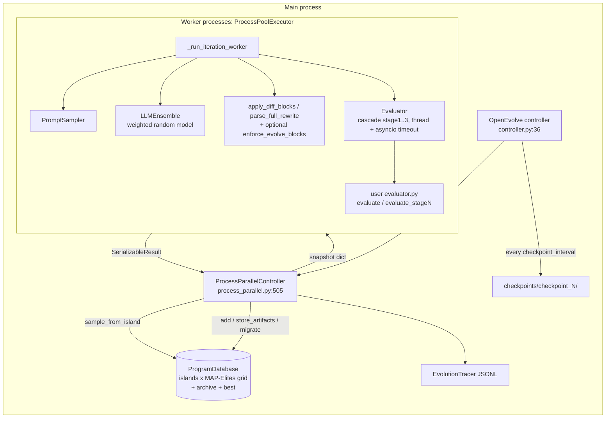

# OpenEvolve Source-Level Study (RSI series)

> Subject: `references/evolution/openevolve` (algorithmicsuperintelligence/openevolve @ `bffd8c0`, 2026-10-30, package `0.4.0`, Apache-2.0). `codelion/openevolve` now returns HTTP 301 to this org repo (GitHub API repository id 984096689), so this is the official repo.
> Method: static reading only (read / grep). Nothing was installed or run, and no LLM was called.
> Audience: the `wc-evolve` improvement loop (`packages/wc-evolve/src/worldcurrent/evolve/{candidate,loop}.py`) and the RSI-on-LIBERO design.
> Tags: **\[Implemented\]** traceable in code · **\[Docs/Interface only\]** config field or docs claim with no consuming code · **\[Unverified\]** code exists, but this study did not run it · **\[Needs model/hardware\]** needs LLM API or GPU

---

## 1. Positioning

OpenEvolve is the most widely used open re-implementation of DeepMind's AlphaEvolve (about 7.7k stars at clone time). It evolves source files with an LLM: it samples a parent from an island-partitioned MAP-Elites database, builds a prompt with top and diverse programs plus evaluator artifacts, asks the LLM for SEARCH/REPLACE diffs or a full rewrite, evaluates the child with a user `evaluate(program_path)` (optionally as a 3-stage cascade), and inserts it back into the grid. The package is about 13.6k lines of Python. `database.py` (2,832 lines) and `process_parallel.py` (1,146 lines) hold the core.

Beyond the AlphaEvolve core, it adds the following:
- pluggable `PopulationStrategy` / `IslandSelector` hooks **\[Implemented\]**
- per-island seed programs and system messages **\[Implemented\]**
- an "evolution trace" JSONL for RL/distillation data **\[Implemented\]**
- co-evolution against frozen opponent cohorts (`coevolution.py:90`) **\[Implemented\]** **\[Unverified\]**
- an adapter layer for Google Cloud AlphaEvolve evaluators (`compat/alphaevolve*.py`) **\[Implemented\]**
- Claude Code, Codex and Copilot CLIs as LLM back-ends (`llm/claude_code.py`, `llm/codex_app_server.py`, `llm/copilot_cli.py`) **\[Needs model/hardware\]**

**What AlphaEvolve describes vs. what OpenEvolve reproduces.** Sources: the white paper arXiv:2506.13131 §2.1–2.6 and §4 (fetched 2026-10-30), and the DeepMind blog of 2025-05-14.

| AlphaEvolve element (paper section) | OpenEvolve status |
|---|---|
| `EVOLVE-BLOCK-START/END` markers and a user `evaluate` returning a dict of scalars (§2.1) | Reproduced. Markers are **advisory by default**: `enforce_evolve_blocks: bool = False` (`references/evolution/openevolve/openevolve/config.py:480`) |
| SEARCH/REPLACE diffs or a full rewrite (§2.3) | Reproduced (`references/evolution/openevolve/openevolve/process_parallel.py:267-369`) |
| Gemini Flash + Pro ensemble (§2.3) | Generalised to a weighted random choice over any OpenAI-compatible models (`references/evolution/openevolve/openevolve/llm/ensemble.py:114-119`). No per-model credit assignment |
| Stochastic prompt formatting and rendered evaluation results (§2.2) | Reproduced (`references/evolution/openevolve/openevolve/prompt/sampler.py:153-154`, `:148-150`) |
| **Meta-prompt evolution** in a separate database (§2.2; ablated in §4) | **Not reproduced.** `use_meta_prompting` / `meta_prompt_weight` exist (`references/evolution/openevolve/openevolve/config.py:291-292`), but grep finds no consumer **\[Docs/Interface only\]** |
| Evaluation cascade of increasing difficulty (§2.4) | Reproduced as up to three hard-coded stages with score thresholds (`references/evolution/openevolve/openevolve/evaluator.py:466-647`) |
| LLM-generated feedback that grades hard-to-code properties (§2.4) | Reproduced, but with a hard-coded 0.7/0.3 blend into `combined_score` (`references/evolution/openevolve/openevolve/evaluator.py:309-316`) |
| Asynchronous evaluation cluster with jobs of about 100 compute-hours (§2.4, §2.6) | Partly reproduced: a local `ProcessPoolExecutor` only. `distributed: bool` is never read **\[Docs/Interface only\]** (`references/evolution/openevolve/openevolve/config.py:424`) |
| MAP-Elites + island model (§2.5) | Reproduced (§6 below) |
| Results: Borg heuristic recovering 0.7% of compute, 23% Gemini kernel speedup, 48-multiplication 4×4 complex matmul | Not claimed by OpenEvolve. The examples reproduce circle packing and similar toy or benchmark tasks |

## 2. Architecture



The database lives only in the main process. Each submitted iteration receives a full serialised snapshot of all programs (`references/evolution/openevolve/openevolve/process_parallel.py:624-652`), so a child's context is whatever the database held when the iteration was submitted.

## 3. Core data structures & interfaces (signatures)

```python
# references/evolution/openevolve/openevolve/database.py:64-100
@dataclass
class Program:
    id: str; code: str; changes_description: str = ""; language: str = "python"
    parent_id: Optional[str] = None; generation: int = 0; timestamp: float; iteration_found: int = 0
    metrics: Dict[str, float]            # free-form; "combined_score" preferred
    complexity: float = 0.0; diversity: float = 0.0
    metadata: Dict[str, Any]             # island, changes, parent_metrics, token_usage
    prompts: Optional[Dict]; artifacts_json: Optional[str]; artifact_dir: Optional[str]
    embedding: Optional[List[float]]     # for novelty rejection

# references/evolution/openevolve/openevolve/evaluation_result.py:10-28
@dataclass
class EvaluationResult:
    metrics: Dict[str, float]
    artifacts: Dict[str, Union[str, bytes]] = {}   # stderr, traces, per-case results -> fed back into prompt

# User evaluator contract (loaded with importlib: evaluator.py:80-113)
def evaluate(program_path: str, **evaluator_args) -> dict | EvaluationResult
def evaluate_stage1(program_path) / evaluate_stage2(...) / evaluate_stage3(...)   # optional cascade

# Hooks: references/evolution/openevolve/openevolve/population.py, selection.py
PopulationStrategy(admit, replace_cell, archive, evict, migration_due, migrate)   # pure decision fns over frozen snapshots
IslandSelector = Callable[[IslandSelectionContext], int]
```

Fitness everywhere is `get_fitness_score`: `combined_score` if present, otherwise the mean of numeric metrics excluding MAP-Elites feature dimensions (`references/evolution/openevolve/openevolve/utils/metrics_utils.py:72-112`) **\[Implemented\]**.

## 4. The improvement loop

```mermaid
sequenceDiagram
  participant M as Main (run_evolution)
  participant DB as ProgramDatabase
  participant W as Worker
  participant L as LLM ensemble
  participant E as Evaluator (user code)
  M->>DB: sample_from_island(island) -> parent, inspirations
  M->>W: submit(iteration, snapshot, parent.id, inspiration ids)
  W->>W: build_prompt(parent, top-k + diverse of island, artifacts)
  W->>L: generate_with_context(system, user)
  L-->>W: SEARCH/REPLACE blocks or full code
  W->>W: apply diffs; reject if 0 applied / unchanged / too long; optional EVOLVE-BLOCK revert
  W->>E: evaluate_stage1 -> threshold -> stage2 -> threshold -> stage3 (each under timeout)
  E-->>W: metrics + artifacts
  W-->>M: SerializableResult(child, prompt, response, artifacts, tokens)
  M->>DB: add(child): admit? novelty? MAP-Elites cell compare; archive; best
  M->>DB: increment generation; migrate if due
  M->>M: checkpoint if due; target_score / early stopping
  M->>W: submit one new iteration (keep per-island balance)
```

Key code: the main loop is `references/evolution/openevolve/openevolve/process_parallel.py:690-1109`, the worker is `:181-447`, and submission is `:1111-1146`.

## 5. Candidate generation

- **Unit of improvement**: one source file (any language). The LLM edits the parent's whole text. EVOLVE-BLOCK regions are respected only if `enforce_evolve_blocks` is on. In that case edits outside the blocks are **reverted, not rejected**, and a child that becomes identical to its parent is discarded (`references/evolution/openevolve/openevolve/process_parallel.py:371-391`; `references/evolution/openevolve/openevolve/utils/code_utils.py:96-133`) **\[Implemented\]**. A child is versioned by a UUID plus `parent_id` and `generation` (`references/evolution/openevolve/openevolve/process_parallel.py:404-426`).
- **Diff application**: regex-extracted SEARCH/REPLACE blocks (`config.py:481`) are applied line-wise. The child is rejected in three cases: no block matched, the code is unchanged, or the code exceeds `max_code_length` (10,000 chars by default) (`references/evolution/openevolve/openevolve/process_parallel.py:323-399`) **\[Implemented\]**. The rejection reasons are logged but are **not fed back** to the LLM. A failed iteration simply consumes a slot.
- **Optional "changes description" co-evolution**: the LLM must also diff a natural-language description of the program, or the child is discarded (`references/evolution/openevolve/openevolve/process_parallel.py:288-321`) **\[Implemented\]**.
- **Prompt content** (`references/evolution/openevolve/openevolve/process_parallel.py:199-243`, `references/evolution/openevolve/openevolve/prompt/sampler.py:51-186`):
  - the parent code and metrics
  - "areas for improvement"
  - evolution history, which is the island's top `num_top_programs` (3) plus `num_diverse_programs` (2), sorted by fitness
  - inspirations, which are the island best plus the island top programs (`references/evolution/openevolve/openevolve/database.py:1734-1800`)
  - the parent's evaluator **artifacts** (stderr, failure stage), truncated to 20 KB and passed through a regex redaction filter (`references/evolution/openevolve/openevolve/prompt/sampler.py:717-746`)
  - feature coordinates
  - an optional per-island system message (`:109-112`)
- **LLM ensemble**: a weighted random choice per call, reseeded per iteration as `seed:iteration` so that the model pick does not depend on worker history (`references/evolution/openevolve/openevolve/llm/ensemble.py:107-119`) **\[Implemented\]**. There is no bandit and no per-model credit.
- **Novelty rejection**: this check is optional and off unless `embedding_model` is set. It compares the embedding cosine similarity against the island; if the similarity reaches `similarity_threshold` (0.99), an LLM judge asks "NOVEL / NOT NOVEL" (`references/evolution/openevolve/openevolve/database.py:1141-1249`) **\[Implemented\]** **\[Needs model/hardware\]**. It runs **after** evaluation, inside `add()` (`:390-395`), so non-novel children still pay full evaluation cost. An unparseable judge reply counts as novel.

## 6. Selection & database

- **Structure**: `num_islands` (5) islands. Each island has its own MAP-Elites `feature_map` keyed by binned coordinates (`references/evolution/openevolve/openevolve/database.py:397-482`). The default dimensions are `complexity` (code length) and `diversity` (edit distance to a reference set), with 10 bins each. Any evaluator metric can be used as a dimension; it is min-max scaled online (`:984-1050`) **\[Implemented\]**. On top of the islands sit a global `archive` (100), `best_program_id` and per-island bests.
- **Cell replacement**: strictly greater fitness on a single number (`references/evolution/openevolve/openevolve/database.py:1251-1279`). Ties are not replaced, and the comparison has no confidence margin.
- **Parent sampling** (`references/evolution/openevolve/openevolve/database.py:545-604`):
  - with probability `exploration_ratio` (0.2), a uniform pick from the island
  - with probability `exploitation_ratio` (0.7), a pick from archive elites on the island
  - otherwise, a fitness-proportional pick (`:1607-1662`)

  These ratios are the main explore/exploit knobs **\[Implemented\]**.
- **Migration**: ring topology. Every `migration_interval` (50) island-generations, the top `migration_rate` (10%) of each island is copied to both neighbours (`references/evolution/openevolve/openevolve/database.py:2034-2117`) **\[Implemented\]**. The `PopulationStrategy` hooks can replace admit, cell-replace, archive, evict and migrate decisions without touching database internals (`references/evolution/openevolve/openevolve/population.py`) **\[Implemented\]**.
- **Island scheduling**: by default the controller keeps `2*workers/num_islands` in-flight iterations per island and refills one per completion (`references/evolution/openevolve/openevolve/process_parallel.py:711-736`, `:1044-1071`). A user `IslandSelector` can override this.

## 7. Evaluation & gating

- **Interface**: `evaluate(program_path)` imported in-process. Extra kwargs come from `evaluator_args` and are validated against the signature at start-up (`references/evolution/openevolve/openevolve/evaluator.py:115-201`) **\[Implemented\]**.
- **Cascade**: `evaluate_stage1` runs first. If its `combined_score` (or the mean metric) is below `cascade_thresholds[0]`, its stage-1 metrics are returned as final; otherwise stage 2 runs, then stage 3 (`references/evolution/openevolve/openevolve/evaluator.py:531-647`) **\[Implemented\]**. **Caveat**: the database then ranks early-exit and fully evaluated programs on the same `combined_score`. Stage scores must therefore be on a commensurate scale, or a stage-1 score can outrank a full evaluation.
- **Timeouts**: `asyncio.wait_for(run_in_executor(thread))` with `timeout` (300 s) applies **per stage** (`references/evolution/openevolve/openevolve/evaluator.py:451-460`). A timeout returns `{"error":0.0,"timeout":True}` and is not retried; other exceptions are retried up to `max_retries` (3) (`:257-398`). The thread is **not killed** on timeout. The per-worker thread pool has only `parallel_evaluations` slots (`:66-70`), so a few non-terminating candidates can starve a worker **\[Unverified\]**. The main loop calls `future.result(timeout=…)` only on futures already `done()` (`references/evolution/openevolve/openevolve/process_parallel.py:776-791`), so it adds no extra protection.
- **Multi-objective**: arbitrary metrics are allowed, but selection uses a scalar `combined_score`. Extra metrics serve as MAP-Elites axes (behaviour descriptors), not Pareto objectives.
- **Noise handling**: **none in the framework**. There is one evaluation per child, no re-evaluation of elites, no confidence interval, and strict `>` cell replacement. Seeds and repeats are entirely up to the user evaluator. Early stopping compares each child's score against a running best with `convergence_threshold` (`references/evolution/openevolve/openevolve/process_parallel.py:938-1012`).
- **Overfitting to the evaluator**: there is no train/validation/held-out separation, and the best program is selected on the same evaluator that guides search (`references/evolution/openevolve/openevolve/controller.py:442-468`). The only anti-gaming measure is in an example: it recomputes the objective rather than trusting the candidate-reported value (`references/evolution/openevolve/examples/function_minimization/evaluator.py:45-56`, issue #514).

## 8. Safety & isolation

- **There is no sandbox.** Candidate code is written to a temporary file and executed by the user evaluator inside a worker process. In the examples this happens via `importlib` into the same interpreter (`references/evolution/openevolve/examples/function_minimization/evaluator.py:75-114`).
- Workers inherit the **full parent environment**, including API keys (`references/evolution/openevolve/openevolve/process_parallel.py:586-592`).
- `memory_limit_mb` and `cpu_limit` are declared but never read **\[Docs/Interface only\]** (`references/evolution/openevolve/openevolve/config.py:414-415`).
- The project's own bundle docs say it "executes trusted evaluator and candidate code with the current process's privileges. It is not a sandbox or a timeout wrapper" (`references/evolution/openevolve/openevolve/compat/alphaevolve_bundle.py:112-114`).
- Mitigations that do exist:
  - EVOLVE-BLOCK revert, when enabled
  - `max_code_length`
  - artifact redaction before artifacts re-enter prompts
  - `max_tasks_per_child` worker recycling on Python ≥3.11 (`references/evolution/openevolve/openevolve/process_parallel.py:592-603`)

## 9. Dependencies, cost, license

- **Dependencies**: `openai`, `pyyaml`, `numpy`, `tqdm`, `flask`, `dacite`, `cloudpickle` (`references/evolution/openevolve/pyproject.toml:13-21`). This is light, and nothing robotics-specific is pulled in. Python ≥3.10.
- **Cost controls**:
  - prompt and completion tokens are accumulated and logged per run (`references/evolution/openevolve/openevolve/process_parallel.py:793-802`, `:1102-1107`)
  - `max_iterations`, `target_score` and early stopping bound the run
  - there is **no run-level dollar budget**; `max_budget_usd` is a per-call flag of the Claude Code CLI back-end (`references/evolution/openevolve/openevolve/llm/claude_code.py:79-80`)
  - the README gives cost estimates per iteration
- **Checkpointing**: every `checkpoint_interval` (100) iterations, it writes `programs/*.json`, `metadata.json` (islands, feature maps, archive, bests, generations, feature stats) and the best program (`references/evolution/openevolve/openevolve/database.py:726-776`, `references/evolution/openevolve/openevolve/controller.py:499-554`). Resume restores this state and continues from `last_iteration+1` (`references/evolution/openevolve/openevolve/controller.py:326-333`) **\[Implemented\]**.
- **Reproducibility**: the README claims "Fully deterministic" (`references/evolution/openevolve/README.md:56`). In the code, seeds go to `random`, `numpy` and the LLM configs (`references/evolution/openevolve/openevolve/controller.py:76-104`). However:
  - Python/NumPy RNG state is not checkpointed (grep finds no `getstate`)
  - with more than one worker, results are added in completion order (`references/evolution/openevolve/openevolve/process_parallel.py:776-779`), so later snapshots depend on timing
  - LLM APIs are not bit-deterministic

  The claim therefore holds at best for one worker with a deterministic local model **\[Unverified\]**.
- **Lineage**: each program records `parent_id`, `generation`, `iteration_found`, the diff summary and `parent_metrics`. Inspiration ids are **not** recorded. Prompts are logged per program (`log_prompts`). The optional `EvolutionTracer` writes parent, child, prompt, response, artifacts and deltas as JSONL (`references/evolution/openevolve/openevolve/evolution_trace.py:133-143`).
- **License**: Apache-2.0 (top-level only; no sub-licenses found). Reuse with attribution is fine.

## 10. Strengths / weaknesses / risks

| Strengths | Weaknesses / risks |
|---|---|
| Small, readable, close to the AlphaEvolve paper. The evaluator contract is one function | No execution isolation, unused resource-limit fields, and leaked eval threads on timeout |
| Artifacts channel (stderr, failure stage) feeds failure evidence back into the next prompt | Novelty check runs after the expensive evaluation |
| Cascade evaluation saves compute on obviously bad candidates | Scores from cascade early exits are mixed with full-evaluation scores on one scalar |
| Clean `PopulationStrategy` / `IslandSelector` hooks that use frozen snapshots | Single noisy evaluation and strict `>`: elites are winners of the noise lottery under stochastic evaluators |
| Island seeds and per-island system prompts make it easy to run several hypotheses in parallel | Search and selection use the same evaluator, with no held-out split |
| JSONL evolution trace, which is useful as RSI training data | Meta-prompt evolution, `distributed`, memory and CPU limits are config-only |
| Pure-Python dependencies; Apache-2.0 | The determinism claim is overstated with multiple workers |

## 11. What worldcurrent should adopt (concrete)

The context is the frozen SmolVLA policy on LIBERO. The evolvable surface is **critic/recovery rules or controller wrapper code**, never the SafetyShield, scorers or trace (these already sit under `PROTECTED_PREFIXES`, `packages/wc-evolve/src/worldcurrent/evolve/candidate.py:24`).

1. **Adopt the cascade, but as sequential statistics, not fixed thresholds.**
   - Stage 1 is a smoke rollout: one seed on 2–3 train tasks. It checks that the code imports, that the SafetyShield sees no new intervention types, and that the run finishes within the step budget.
   - Stage 2 is a small paired batch on the train split.
   - Stage 3 is the existing McNemar gate on the validation split.

   Score a candidate only on the stage it fully completed, and store `stage_reached` as a separate field. Do not reuse one `combined_score` the way OpenEvolve does (`evaluator.py:531-647`). The `gate()` at `packages/wc-evolve/src/worldcurrent/evolve/loop.py:93` stays the final stage.
2. **Adopt the artifacts channel as the "diagnosis → prompt" bridge.** Our `FailureReport` and trace excerpts (failure step, shield intervention, task id) play the role of `EvaluationResult.artifacts`. Cap and redact them as OpenEvolve does (`prompt/sampler.py:657-746`).
3. **Adopt EVOLVE-BLOCK with rejection rather than silent revert.** For `kind="critic_rule"/"recovery_rule"/"code"`, the editable region is a marked function in a template module. A candidate touching anything outside the region fails the protected-scope check. This is stricter than OpenEvolve's default-off revert (`process_parallel.py:371-391`).
4. **Adopt islands + MAP-Elites only with physical behaviour descriptors.** Useful axes are failure-mode class, mean episode length and shield-intervention rate, rather than code length. Keep `PopulationStrategy`-style pure hooks over frozen snapshots so that the kernel owns every mutation of the archive.
5. **Do NOT adopt** in-process `importlib` execution, timeouts that leave threads running, or the single-evaluation `>` replacement. Generated code must run in a separate process (later a container) that the kernel kills on timeout, without API keys in its environment. Archive replacement on noisy success rates needs the paired gate or a confidence margin.
6. **Search–gate split**: OpenEvolve optimises the same evaluator it reports. In our loop, evolutionary fitness should come only from the **train** split. The validation McNemar gate should be applied to at most k finalists, Bonferroni-corrected for k. Held-out stays report-only, as `loop.py:162-166` already does.
7. **Record inspiration ids and the RNG state** in the registry ledger. OpenEvolve does neither, and both are needed for replay.

## 12. Source index

| Concern | file:line | Note |
|---|---|---|
| Controller, seeds | `references/evolution/openevolve/openevolve/controller.py:36`, `:76-104` | Seed fan-out to LLM configs |
| Resume | `references/evolution/openevolve/openevolve/controller.py:326-333` | `last_iteration+1` |
| Checkpoint | `references/evolution/openevolve/openevolve/controller.py:499-554` | DB + best program |
| Worker iteration | `references/evolution/openevolve/openevolve/process_parallel.py:181-447` | Prompt → LLM → diff → eval |
| Diff/rewrite rejection rules | `references/evolution/openevolve/openevolve/process_parallel.py:267-399` | No feedback to LLM |
| EVOLVE-BLOCK enforcement | `references/evolution/openevolve/openevolve/utils/code_utils.py:96-133` | Revert outside blocks |
| Main loop | `references/evolution/openevolve/openevolve/process_parallel.py:690-1109` | Completion-order adds |
| Snapshot to workers | `references/evolution/openevolve/openevolve/process_parallel.py:624-652` | Full program dict |
| Worker env inheritance | `references/evolution/openevolve/openevolve/process_parallel.py:586-592` | API keys leak to evaluator |
| Program dataclass | `references/evolution/openevolve/openevolve/database.py:64-100` | |
| add() / MAP-Elites cell | `references/evolution/openevolve/openevolve/database.py:334-510` | admit → novelty → cell |
| Feature coordinates | `references/evolution/openevolve/openevolve/database.py:984-1050` | Custom metric axes |
| Novelty + LLM judge | `references/evolution/openevolve/openevolve/database.py:1141-1249` | Post-evaluation |
| Parent sampling | `references/evolution/openevolve/openevolve/database.py:545-604`, `:1607-1662` | explore / exploit / weighted |
| Inspirations | `references/evolution/openevolve/openevolve/database.py:1734-1800` | Island best + top |
| Migration | `references/evolution/openevolve/openevolve/database.py:2034-2117` | Ring, top 10% |
| DB save | `references/evolution/openevolve/openevolve/database.py:726-776` | No RNG state |
| Strategy hooks | `references/evolution/openevolve/openevolve/population.py`, `references/evolution/openevolve/openevolve/selection.py` | Frozen snapshots |
| Evaluator load / kwargs | `references/evolution/openevolve/openevolve/evaluator.py:80-201` | importlib |
| Retries / timeout result | `references/evolution/openevolve/openevolve/evaluator.py:257-398` | Timeout not retried |
| Direct eval timeout | `references/evolution/openevolve/openevolve/evaluator.py:451-460` | Thread not killed |
| Cascade | `references/evolution/openevolve/openevolve/evaluator.py:466-647` | 3 fixed stages |
| LLM feedback blend | `references/evolution/openevolve/openevolve/evaluator.py:309-316` | Hard-coded 0.7/0.3 |
| Prompt build | `references/evolution/openevolve/openevolve/prompt/sampler.py:51-186` | |
| Artifact redaction | `references/evolution/openevolve/openevolve/prompt/sampler.py:717-746` | Regex |
| Diff template | `references/evolution/openevolve/openevolve/prompt/templates.py:23-67` | SEARCH/REPLACE |
| LLM ensemble | `references/evolution/openevolve/openevolve/llm/ensemble.py:51-119` | Weighted random |
| Config defaults | `references/evolution/openevolve/openevolve/config.py:323-489` | Includes unused fields |
| Anti-gaming example | `references/evolution/openevolve/examples/function_minimization/evaluator.py:45-56` | Recompute objective |
| Not-a-sandbox statement | `references/evolution/openevolve/openevolve/compat/alphaevolve_bundle.py:112-114` | |

## Verification status

| Claim | Status | Evidence |
|---|---|---|
| Repo is official and moved from codelion | Verified (GitHub API 301 → repository id 984096689 = algorithmicsuperintelligence/openevolve) | API responses 2026-10-30 |
| Island MAP-Elites, migration, archive | \[Implemented\] | `database.py:334-510`, `:2034-2117` |
| Cascade evaluation | \[Implemented\] | `evaluator.py:466-647` |
| Artifacts fed back into prompts | \[Implemented\] | `process_parallel.py:197`, `sampler.py:148-150` |
| EVOLVE-BLOCK enforcement | \[Implemented\], off by default | `config.py:480` |
| Novelty rejection sampling | \[Implemented\] \[Needs model/hardware\] | `database.py:1210-1249` |
| Meta-prompt evolution | \[Docs/Interface only\] | `config.py:291-292`, no consumer |
| `memory_limit_mb`, `cpu_limit`, `distributed` | \[Docs/Interface only\] | `config.py:414-424`, no consumer |
| Thread starvation after timeouts | \[Unverified\] (inferred from code) | `evaluator.py:66-70`, `:451-460` |
| "Fully deterministic" | \[Unverified\], likely false with >1 worker | `README.md:56` vs `process_parallel.py:776-779` |
| Co-evolution against frozen cohorts | \[Implemented\] \[Unverified\] | `coevolution.py:90` |
| End-to-end runs and quality results | \[Needs model/hardware\] | Not run |
