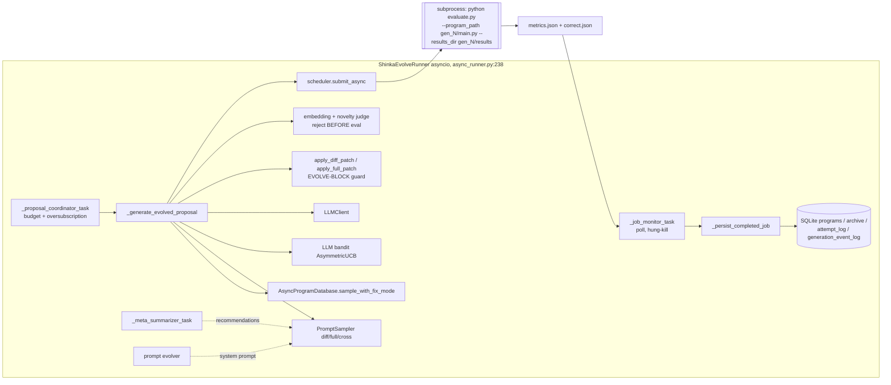

# ShinkaEvolve Source-Level Study (RSI series)

> Subject: `references/evolution/ShinkaEvolve` (SakanaAI/ShinkaEvolve @ `8adc053`, 2026-10-05, package `0.0.7`, Apache-2.0). This is the official Sakana AI repo (about 1.5k stars, not a fork). Paper: Lange, Imajuku, Cetin, "ShinkaEvolve: Towards Open-Ended And Sample-Efficient Program Evolution", arXiv:2509.19349 (cited in `references/evolution/ShinkaEvolve/README.md:575-578`).
> Method: static reading only (read / grep). Nothing was installed or run, and no LLM was called.
> Audience: the `wc-evolve` improvement loop and the RSI-on-LIBERO design. This is a companion to `rsi-openevolve.md`.
> Tags: **\[Implemented\]** · **\[Docs/Interface only\]** · **\[Unverified\]** · **\[Needs model/hardware\]**

---

## 1. Positioning

ShinkaEvolve is Sakana AI's AlphaEvolve-style program evolver. Its focus is **sample efficiency**: making each LLM call and each evaluation count. Relative to OpenEvolve, it adds five things:
- **novelty rejection before evaluation**
- a **"fix mode"** that repairs incorrect programs when no correct ones exist
- a **cost-aware UCB bandit** over LLMs
- a **meta-summarizer** that turns recent results into recommendations
- optional **system-prompt co-evolution**

It also adds an explicit `correct` flag and a `public` vs `private` metric split. Evaluation runs in a **separate process per candidate** (`evaluate.py --program_path … --results_dir …`) through a local, SLURM-Conda or SLURM-Docker scheduler, and the state lives in **SQLite**.

The package is about 41.8k lines of Python. Much of this is plotting, the web UI, pricing and W&B. The runner `shinka/core/async_runner.py` alone is 6,254 lines.

**Relation to AlphaEvolve** (arXiv:2506.13131 §2): it uses the same EVOLVE-BLOCK markers, diff and full-rewrite edits, an island database and a user evaluator. It reproduces meta-prompt evolution, which OpenEvolve lacks (`evolve_prompts`, `references/evolution/ShinkaEvolve/shinka/core/config.py:74-86`) **\[Implemented\]** **\[Unverified\]**. It has **no multi-stage evaluation cascade**. Its substitutes are a `correct` gate and per-run sequential early stopping inside `run_shinka_eval`. It also has no MAP-Elites grid; diversity comes from islands, embedding novelty and crowding-based archive replacement.

## 2. Architecture



## 3. Core data structures & interfaces (signatures)

```python
# references/evolution/ShinkaEvolve/shinka/database/dbase.py:148-195
@dataclass
class Program:
    id: str; code: str; language: str = "python"
    parent_id: Optional[str]; archive_inspiration_ids: List[str]; top_k_inspiration_ids: List[str]   # full lineage incl. inspirations
    island_idx: Optional[int]; generation: int; timestamp: float; code_diff: Optional[str]
    combined_score: float = 0.0
    public_metrics: Dict[str, Any]      # shown to the LLM
    private_metrics: Dict[str, Any]     # never rendered into prompts
    text_feedback: Union[str, List[str]]
    correct: bool = False               # hard validity gate for parents/archive
    children_count: int; complexity: float; embedding: List[float]; migration_history: List[Dict]
    metadata: Dict[str, Any]; in_archive: bool; system_prompt_id: Optional[str]

# Evaluator contract: a CLI program; results read back from files (shinka/utils/general.py:72-88)
#   python evaluate.py --program_path gen_N/main.py --results_dir gen_N/results
#   -> metrics.json {"combined_score", "public": {...}, "private": {...}, "text_feedback": str}
#   -> correct.json {"correct": bool, "error": str|None}
# Helper (references/evolution/ShinkaEvolve/shinka/core/wrap_eval.py:106-126):
def run_shinka_eval(program_path, results_dir, experiment_fn_name, num_runs,
                    get_experiment_kwargs=None, aggregate_metrics_fn=None, validate_fn=None,
                    early_stop_method=None, early_stop_threshold=None, run_workers=1, ...) -> (metrics, correct, err)
```

The main configuration types are listed below; all are dataclasses passed to `ShinkaEvolveRunner`.

| Config type | Location | Holds |
|---|---|---|
| `EvolutionConfig` | `references/evolution/ShinkaEvolve/shinka/core/config.py:20-86` | patch types, LLMs, bandit, novelty, meta settings, `max_api_costs`, prompt evolution |
| `DatabaseConfig` | `references/evolution/ShinkaEvolve/shinka/database/dbase.py:53-104` | islands, archive, parent strategy, `archive_criteria` |
| `JobConfig` family | `references/evolution/ShinkaEvolve/shinka/launch/scheduler.py:58-114` | evaluator path, time limit, conda, Docker image and flags |

## 4. The improvement loop

```mermaid
sequenceDiagram
  participant PC as Proposal coordinator
  participant DB as SQLite DB
  participant L as LLM (bandit-chosen)
  participant NJ as Novelty judge
  participant SCH as Scheduler (subprocess / SLURM)
  participant JM as Job monitor
  PC->>PC: committed_cost < max_api_costs ? keep pipeline full
  loop novelty attempts (3) x resamples (3)
    PC->>DB: sample_with_fix_mode -> parent, archive insp., top-k insp., needs_fix
    PC->>L: diff | full | cross prompt (+meta recommendation, +evolved sys prompt)
    L-->>PC: patch; apply with EVOLVE-BLOCK guard (retry with error msg if max_patch_attempts>1)
    PC->>NJ: embed child; if max cos-sim > 0.99 -> LLM "novel?"; reject -> resample
  end
  PC->>SCH: submit evaluate.py on gen_N/main.py
  JM->>SCH: poll; kill if runtime > limit (explicit or 5x EWMA + 60s)
  SCH-->>JM: metrics.json, correct.json
  JM->>DB: insert Program; island = parent's; archive update (correct only); best
  JM->>L: bandit.update(reward = child score, baseline = parent score)
  JM->>PC: meta-summarizer / prompt fitness / migration / dynamic island spawn
```

Key code: the proposal is built at `references/evolution/ShinkaEvolve/shinka/core/async_runner.py:2702-3048`, patching happens at `:3622-3862`, and the budget gate is at `:2460-2481`.

## 5. Candidate generation

- **Unit of improvement**: one file, `gen_N/main.<ext>`, with EVOLVE-BLOCK regions. In diff mode, a SEARCH match outside the mutable ranges raises `PatchError` (`references/evolution/ShinkaEvolve/shinka/edit/apply_diff.py:667-670`). Marker integrity is validated after assembly (`references/evolution/ShinkaEvolve/shinka/edit/marker_validation.py:13`, called at `references/evolution/ShinkaEvolve/shinka/edit/apply_diff.py:783`). Full and crossover rewrites are spliced back into the block regions only (`references/evolution/ShinkaEvolve/shinka/edit/apply_full.py:83-215`) **\[Implemented\]**. This is stricter than OpenEvolve's default.
- **Versioning**: each generation gets a directory `results_*/gen_N/` holding `main.py`, the original, the patch and a git-style diff, plus `results/`. A `.generation_lock` file prevents double proposals (`references/evolution/ShinkaEvolve/shinka/core/async_runner.py:2605-2620`). In addition, every patch attempt is saved (`:3050`) **\[Implemented\]**.
- **Three mutation operators**: `diff` (0.6), `full` (0.3) and `cross` (0.1). `cross` is a crossover with inspirations and is disabled when there are no inspirations (`references/evolution/ShinkaEvolve/shinka/defaults.py:13-18`, `references/evolution/ShinkaEvolve/shinka/core/sampler.py:90-115`) **\[Implemented\]**.
- **Prompt content** (`references/evolution/ShinkaEvolve/shinka/core/sampler.py:77-209`):
  - the task system message, or an evolved system prompt
  - one sampled meta-recommendation (`:118-124`)
  - an evaluation history of archive and top-k inspirations, sorted (`:148-159`)
  - the parent code with `combined_score` + **public** metrics only (`references/evolution/ShinkaEvolve/shinka/prompts/prompts_base.py:13-20`)
  - optional `text_feedback` (`use_text_feedback=False` by default, `references/evolution/ShinkaEvolve/shinka/core/config.py:62`)
- **Fix mode**: if an island has no correct program, the parent is a random incorrect program and the inspirations are its ancestors. The prompt asks for a repair (`references/evolution/ShinkaEvolve/shinka/database/parents.py:747-771`; `references/evolution/ShinkaEvolve/shinka/core/async_runner.py:2768-2784`) **\[Implemented\]**.
- **Error-driven retry**: a failed patch application re-prompts with "The previous edit was not successful. Error: …" and the message history (`references/evolution/ShinkaEvolve/shinka/core/async_runner.py:3819-3824`). The default `max_patch_attempts=1` disables this (`references/evolution/ShinkaEvolve/shinka/core/config.py:26`).
- **LLM ensemble as a bandit**: `AsymmetricUCB` uses ε=0.2, auto-decay 0.95 and `cost_aware_coef` 0.5 (`references/evolution/ShinkaEvolve/shinka/llm/prioritization.py:295-330`, `references/evolution/ShinkaEvolve/shinka/defaults.py:30-31`). The reward is `max(child_score − max(parent_score, baseline), 0)`, and an incorrect child counts as the worst reward (`references/evolution/ShinkaEvolve/shinka/llm/prioritization.py:470-509`; update call `references/evolution/ShinkaEvolve/shinka/core/async_runner.py:4493-4498`). Bandit state is pickled for resume (`:615-643`) **\[Implemented\]** **\[Needs model/hardware\]**.
- **Novelty rejection BEFORE evaluation**:
  1. The child code is embedded and compared with the parent's island.
  2. If max similarity ≤ `code_embed_sim_threshold` (0.99), the child is accepted.
  3. Otherwise an LLM judge decides; on error the child is rejected.
  4. A rejected child triggers a new sample, up to `max_novelty_attempts` (3) × `max_patch_resamples` (3) (`references/evolution/ShinkaEvolve/shinka/core/async_novelty_judge.py:62-185`, loop at `references/evolution/ShinkaEvolve/shinka/core/async_runner.py:2739-2912`) **\[Implemented\]** **\[Needs model/hardware\]**.

  This saves evaluation compute, which matters most when an evaluation is a simulator rollout batch.
- **Meta-summarizer**: every `meta_rec_interval` (10) programs, it runs three LLM steps: per-program summaries, global insights, then recommendations. One recommendation is sampled into each prompt (`references/evolution/ShinkaEvolve/shinka/core/summarizer.py:232-417`) **\[Implemented\]** **\[Needs model/hardware\]**.
- **Syntax pre-check**: `validate_code_async` (py_compile / rustfmt / gcc `-fsyntax-only`) exists in `references/evolution/ShinkaEvolve/shinka/edit/async_apply.py:127`, but it has **no call site** in the runner **\[Docs/Interface only\]**.

## 6. Selection & database

- **Storage**: SQLite tables `programs`, `archive`, `metadata_store`, `generation_event_log` and `attempt_log` (`references/evolution/ShinkaEvolve/shinka/database/dbase.py:405-530`). Every evaluated program is stored, correct or not. The **archive** (`archive_size` 40) holds correct programs only (`:2321-2362`).
- **Islands**: `num_islands` (2). Children inherit their parent's island; initial correct programs are spread one per island (`references/evolution/ShinkaEvolve/shinka/database/islands.py:66-111`). Elitist migration runs every `migration_interval` (10) generations, but the default `migration_rate=0.0` turns it **off** (`references/evolution/ShinkaEvolve/shinka/database/dbase.py:67-69`; `references/evolution/ShinkaEvolve/shinka/database/islands.py:216-225`). Island choice can be uniform, equal, proportional or weighted (`references/evolution/ShinkaEvolve/shinka/database/island_sampler.py:93-219`). With `enable_dynamic_islands`, stagnation spawns a new island seeded from the initial program, the best program or a random archive member (`references/evolution/ShinkaEvolve/shinka/database/dbase.py:2563-2612`, `references/evolution/ShinkaEvolve/shinka/database/islands.py:945`) **\[Implemented\]**.
- **Parent selection** (default `weighted`): weights are computed over correct archive members of the island (`references/evolution/ShinkaEvolve/shinka/database/parents.py:367-397`) as follows:

  ```text
  w_i = sigmoid(λ · (score_i − median) / MAD) · 1 / (1 + children_i)
  ```

  This is a performance term times a **visit-count novelty bonus**. λ is `parent_selection_lambda` (10). Alternatives are `power_law` (rank^−α with an archive `exploitation_ratio`, `:102-235`), `beam_search`, best-of-N and sequential.
- **Inspirations**: archive and top-k selectors restricted to the island when `enforce_island_separation` is set (`references/evolution/ShinkaEvolve/shinka/database/inspirations.py:36-326`).
- **Archive replacement and multi-objective ranking**:
  - `archive_selection_strategy` is `fitness` (replace the global worst) or `crowding` (replace the most similar program if better) (`references/evolution/ShinkaEvolve/shinka/database/dbase.py:2364-2463`).
  - `archive_criteria` takes signed weights over several metrics (for example `combined_score: 1.0, loc: -0.3`). They are combined by **percentile rank**, which makes them scale-invariant (`:2128-2172`).
  - `_is_better` always puts `correct` first (`:2247-2319`) **\[Implemented\]**.
- **Explore/exploit knobs**:
  - `parent_selection_lambda`
  - the children-count bonus
  - `exploitation_alpha` and `exploitation_ratio`
  - the patch-type probabilities
  - the LLM temperature list `[0.0, 0.5, 1.0]` (`references/evolution/ShinkaEvolve/shinka/defaults.py:34-38`)
  - the bandit's ε

## 7. Evaluation & gating

- **Interface**: the user's `evaluate.py` runs as a **subprocess** and writes `metrics.json` and `correct.json`. The runner reads them back (`references/evolution/ShinkaEvolve/shinka/core/async_runner.py:4125-4130`) and builds the `Program` at `:4163`. If results are missing, the program is recorded as incorrect with score 0 and explanatory `text_feedback`.
- **`run_shinka_eval` helper** (`references/evolution/ShinkaEvolve/shinka/core/wrap_eval.py:106-470`):
  - runs `num_runs` repeats with per-run kwargs (default `{"seed": i+1}`, `:257-261`, `:336-340`)
  - optionally runs the repeats in a `ProcessPoolExecutor` (`:251`)
  - calls a `validate_fn` on each run; any invalid run makes the program incorrect (`:310-323`)
  - aggregates with a user function
  - marks NaN or inf scores incorrect (`:433-442`)
  - falls back to default metrics on an exception (`:444-460`)
- **Noise-aware early stopping across repeats**:
  - `bayesian` uses a Normal posterior: it stops when P(μ>threshold) < 0.05 or > 0.95 (`references/evolution/ShinkaEvolve/shinka/utils/eval_stop.py:82-168`).
  - `ci` and `hybrid` are the other options (`:170-364`). They are sequential-only (`references/evolution/ShinkaEvolve/shinka/core/wrap_eval.py:210-214`) **\[Implemented\]**.
  - The test compares against a fixed **threshold**, not paired against the parent. It uses a Normal approximation even for Bernoulli successes.
  - With `min_trials=2`, two identical outcomes stop immediately with confidence 1.0 (`references/evolution/ShinkaEvolve/shinka/utils/eval_stop.py:126-147`). Before reuse on success/failure rollouts, this needs a Beta-Binomial replacement.
- **No cascade**: Shinka has no stage1/stage2/stage3 and no score threshold for promotion to costlier tests. Correctness and early stopping are the only cheap filters.
- **Timeouts**:
  - Local and SLURM jobs get `JobConfig.time`. For local jobs it defaults to `None`, in which case the runner uses an adaptive limit of `max(60, 5·EWMA(eval_seconds) + 60)` (`references/evolution/ShinkaEvolve/shinka/core/async_runner.py:5131-5141`).
  - Hung jobs are cancelled with process kill or `scancel` (`:2108-2123`; `references/evolution/ShinkaEvolve/shinka/launch/scheduler.py:439-465`) **\[Implemented\]**.
  - The process gets a real kill, unlike OpenEvolve's thread timeout.
- **Overfitting controls**: `private_metrics` are stored but never rendered into prompts (`perf_str` uses `public_metrics` only, `references/evolution/ShinkaEvolve/shinka/core/sampler.py:172-173`). This is a "hidden test" channel. However, selection still uses `combined_score` only. There is no held-out re-evaluation of the final best, and the shipped stochastic example evaluates **one** run (`references/evolution/ShinkaEvolve/examples/game_2048/evaluate.py:126`).

## 8. Safety & isolation

- **Local jobs**: `subprocess.Popen` with `env = os.environ.copy()`. API keys and every other variable are inherited (`references/evolution/ShinkaEvolve/shinka/launch/local.py:98-112`). There are no resource limits beyond optional numeric-thread caps (`references/evolution/ShinkaEvolve/shinka/launch/scheduler.py:33`, `:205-216`).
- **Process boundary**: inside the evaluator, the candidate is loaded with `importlib` into the evaluator's own process (`references/evolution/ShinkaEvolve/shinka/core/wrap_eval.py:26-37`). A candidate could therefore tamper with `metrics.json`, since it runs with the evaluator's privileges.
- **SLURM-Docker**: candidates run under `docker run --rm` with user-provided `docker_flags` (`references/evolution/ShinkaEvolve/shinka/launch/slurm.py:152-154`). By default this gives no network restriction or read-only root; whatever isolation exists depends on the flags **\[Implemented\]** **\[Unverified\]**.
- **Mitigations that exist**:
  - the EVOLVE-BLOCK guard
  - per-job directories
  - a real process kill on timeout
  - a metadata redaction boundary for telemetry (`references/evolution/ShinkaEvolve/shinka/telemetry_safety.py`)

## 9. Dependencies, cost, license

- **Dependencies**: heavy (`references/evolution/ShinkaEvolve/pyproject.toml:24-51`). They include `openai`, `anthropic`, `google-genai`, `boto3`, `instructor`, `hydra-core==1.3.2`, `pandas`, `scikit-learn`, `matplotlib`, `seaborn`, `moviepy`, `networkx`, `radon`, `unidiff` and `dill`. They are not needed for the core ideas, so do not import this package into the kernel.
- **Cost controls (the strongest of the frameworks studied)**:
  - `max_api_costs` is a run budget enforced on **committed cost**, which is actual cost plus active proposals × average proposal cost, so in-flight work is counted before new proposals are admitted (`references/evolution/ShinkaEvolve/shinka/core/async_runner.py:863-886`, `:2460-2481`)
  - LLM, embedding and novelty costs are tracked per proposal (`:2969-2971`)
  - a pricing catalogue with refreshes from models.dev
  - the bandit's cost term
  - controlled oversubscription of proposals versus evaluation slots (`references/evolution/ShinkaEvolve/shinka/core/config.py:65-71`)
- **Resume**: if `programs.sqlite` exists with `last_iteration>0`, the runner reloads cost totals and bandit state and restores progress, and it does not reseed (`references/evolution/ShinkaEvolve/shinka/core/async_runner.py:1223-1243`). The SQLite operations are wrapped in retry with backoff (`references/evolution/ShinkaEvolve/shinka/database/dbase.py:107-145`) **\[Implemented\]**.
- **Lineage**: each `Program` records its parent and **inspiration ids**, the `code_diff`, migration history and `system_prompt_id`. On top of that, `attempt_log` and `generation_event_log` record every attempt and failure stage. This is a better audit trail than OpenEvolve's.
- **Reproducibility**: **none by design**. There is no seed configuration; sampling uses the global `np.random` (`references/evolution/ShinkaEvolve/shinka/database/parents.py:42`, `references/evolution/ShinkaEvolve/shinka/core/sampler.py:110-115`) and asynchronous completion order. Only the evaluator's per-run seeds are fixed.
- **License**: Apache-2.0 (`references/evolution/ShinkaEvolve/pyproject.toml:13`; no sub-licenses found).

## 10. Strengths / weaknesses / risks

| Strengths | Weaknesses / risks |
|---|---|
| Novelty rejection before evaluation: the right order when evaluation is expensive | No seeds at all; runs are not replayable |
| Separate evaluator process with a real kill and adaptive timeouts | Candidate code still shares a process with the evaluator; full environment inherited; Docker only on SLURM |
| `correct` gate plus fix mode avoids dead populations | No cascade; the threshold-based early stopping uses a Normal approximation that is wrong for small Bernoulli samples |
| Committed-cost budget, per-proposal cost accounting, cost-aware LLM bandit | 6k-line runner and heavy dependency set; large surface for bugs |
| Public/private metrics split as a hidden-test channel | Selection ignores private metrics; no held-out confirmation of the final best |
| Rich lineage: inspirations, attempt and failure logs, per-generation directories | Migration off by default (`migration_rate=0.0`); 2 islands by default |
| Rank-normalised multi-criteria archive and crowding replacement | Syntax validator implemented but not wired in |

## 11. What worldcurrent should adopt (concrete)

The target is RSI on LIBERO with a frozen SmolVLA. The evolvable artefacts are `critic_rule`, `recovery_rule` or wrapper `code`. These kinds are already declared but not enabled (`packages/wc-evolve/src/worldcurrent/evolve/candidate.py:27-31`).

1. **Novelty and dedup before rollouts.** First reject candidates whose canonicalised source digest matches an existing one; `Candidate.digest()` already exists. Then apply an embedding or AST similarity check. Only after that should a candidate reach the simulator, where each evaluation costs CPU-minutes per episode (`async_runner.py:2739-2912`).
2. **A `correct` flag distinct from score.** It is set by the kernel, not by the candidate. A candidate is incorrect if it raises, exceeds the step or time budget, emits actions the SafetyShield must clip beyond a quota, or touches a protected scope. Only correct candidates may become parents or enter the archive (`dbase.py:2247-2362`). Fix mode is worth copying for repairing the rules of a broken recovery candidate.
3. **A subprocess evaluator contract.** The candidate file and `results_dir` go in; `metrics.json` and `correct.json` come out. The kernel launches it, scrubs the environment and kills it on timeout using the 5×EWMA+60 s rule (`async_runner.py:5131-5141`). Unlike Shinka, put the candidate in a different process from the scorer, so a candidate cannot write its own metrics. Our trace is the source of truth.
4. **Public vs private metrics.** Prompts may only see train-split metrics and redacted failure traces. Validation and held-out results go into `private` and never into prompts (`sampler.py:172-173`). Unlike Shinka, use the private channel for the promotion gate. The McNemar gate in `packages/wc-evolve/src/worldcurrent/evolve/loop.py:93` is that gate.
5. **Sequential evaluation, made correct for Bernoulli outcomes.** Take the idea of `eval_stop.py`: stop rollouts early when the outcome is decided. Implement it as a paired, Beta-Binomial or SPRT-style test against the **parent** on the same seeds. This becomes the bridge between cascade stage 2 and the full validation McNemar test.
6. **The committed-cost budget** (`async_runner.py:863-886`) should cover both LLM dollars and simulator CPU-seconds, and the bandit cost term should be reused for choosing among proposer models.
7. **Visit-count-penalised parent selection** (`parents.py:367-397`) is cheap and robust to score scale. Use it over registry versions, so that the same parent is not hammered repeatedly. This replaces "always mutate the active version".
8. **Do NOT adopt**: unseeded global RNG, `env=os.environ.copy()`, the Normal-approximation early stop at `min_trials=2`, or system-prompt evolution, at least until the basic loop is stable.

## 12. Source index

| Concern | file:line | Note |
|---|---|---|
| EvolutionConfig | `references/evolution/ShinkaEvolve/shinka/core/config.py:20-86` | Budget, novelty, prompt evolution |
| Defaults | `references/evolution/ShinkaEvolve/shinka/defaults.py:13-50` | Patch probabilities, models, bandit |
| DatabaseConfig | `references/evolution/ShinkaEvolve/shinka/database/dbase.py:53-104` | Islands, archive, parents |
| Program | `references/evolution/ShinkaEvolve/shinka/database/dbase.py:148-195` | public/private, correct |
| SQLite schema | `references/evolution/ShinkaEvolve/shinka/database/dbase.py:405-530` | Event and attempt logs |
| Archive rank scoring | `references/evolution/ShinkaEvolve/shinka/database/dbase.py:2128-2172` | Multi-criteria |
| `_is_better` | `references/evolution/ShinkaEvolve/shinka/database/dbase.py:2247-2319` | Correct first |
| Archive update | `references/evolution/ShinkaEvolve/shinka/database/dbase.py:2321-2463` | fitness / crowding |
| Stagnation → island spawn | `references/evolution/ShinkaEvolve/shinka/database/dbase.py:2563-2612` | |
| Weighted parent | `references/evolution/ShinkaEvolve/shinka/database/parents.py:237-434` | sigmoid × 1/(1+children) |
| Fix mode | `references/evolution/ShinkaEvolve/shinka/database/parents.py:694-771` | |
| Island assignment / migration | `references/evolution/ShinkaEvolve/shinka/database/islands.py:66-111`, `:216-290` | |
| Inspirations | `references/evolution/ShinkaEvolve/shinka/database/inspirations.py:36-326` | |
| Proposal pipeline | `references/evolution/ShinkaEvolve/shinka/core/async_runner.py:2702-3048` | Novelty before eval |
| Patch + retry | `references/evolution/ShinkaEvolve/shinka/core/async_runner.py:3622-3862` | |
| Committed cost | `references/evolution/ShinkaEvolve/shinka/core/async_runner.py:863-886`, `:2460-2481` | |
| Result ingestion | `references/evolution/ShinkaEvolve/shinka/core/async_runner.py:4125-4163` | metrics/correct JSON |
| Bandit update | `references/evolution/ShinkaEvolve/shinka/core/async_runner.py:4493-4498` | Parent baseline |
| Hung-job kill / runtime limit | `references/evolution/ShinkaEvolve/shinka/core/async_runner.py:2108-2123`, `:5131-5155` | |
| Resume | `references/evolution/ShinkaEvolve/shinka/core/async_runner.py:1223-1243` | |
| Prompt sampler | `references/evolution/ShinkaEvolve/shinka/core/sampler.py:77-209` | diff/full/cross |
| Novelty judge | `references/evolution/ShinkaEvolve/shinka/core/async_novelty_judge.py:62-185` | |
| Meta-summarizer | `references/evolution/ShinkaEvolve/shinka/core/summarizer.py:232-417` | 3-step |
| Eval wrapper | `references/evolution/ShinkaEvolve/shinka/core/wrap_eval.py:106-470` | Repeats, validate |
| Early stop | `references/evolution/ShinkaEvolve/shinka/utils/eval_stop.py:82-364` | Bayesian / CI / hybrid |
| Diff EVOLVE guard | `references/evolution/ShinkaEvolve/shinka/edit/apply_diff.py:667-670` | |
| Local launcher | `references/evolution/ShinkaEvolve/shinka/launch/local.py:98-112`, `:145-177` | Env copy, kill |
| Job configs | `references/evolution/ShinkaEvolve/shinka/launch/scheduler.py:58-114` | |
| UCB bandit | `references/evolution/ShinkaEvolve/shinka/llm/prioritization.py:295-509` | Cost-aware |

## Verification status

| Claim | Status | Evidence |
|---|---|---|
| Official repo, Apache-2.0 | Verified (GitHub API, LICENSE, pyproject) | `pyproject.toml:13` |
| Novelty rejection before evaluation | \[Implemented\] \[Needs model/hardware\] | `async_runner.py:2831-2908` |
| EVOLVE-BLOCK enforcement on diffs | \[Implemented\] | `apply_diff.py:667-670` |
| Fix mode | \[Implemented\] | `parents.py:747-771` |
| Cost-aware UCB LLM bandit | \[Implemented\] \[Needs model/hardware\] | `prioritization.py:295-509` |
| Committed-cost budget | \[Implemented\] \[Unverified\] | `async_runner.py:2460-2481` |
| Meta-summarizer / prompt evolution | \[Implemented\] \[Unverified\] | `summarizer.py:232-417`, `config.py:74-86` |
| Multi-stage evaluation cascade | Not present | No stage API; only `correct` + early stop |
| Syntax pre-validation | \[Docs/Interface only\] | `async_apply.py:127`, no caller |
| Sandboxed execution | Not present locally; Docker only via SLURM \[Unverified\] | `local.py:98`, `slurm.py:152` |
| Reproducible runs | Not supported | No seed configuration; global `np.random` |
| End-to-end runs and quality results | \[Needs model/hardware\] | Not run |
