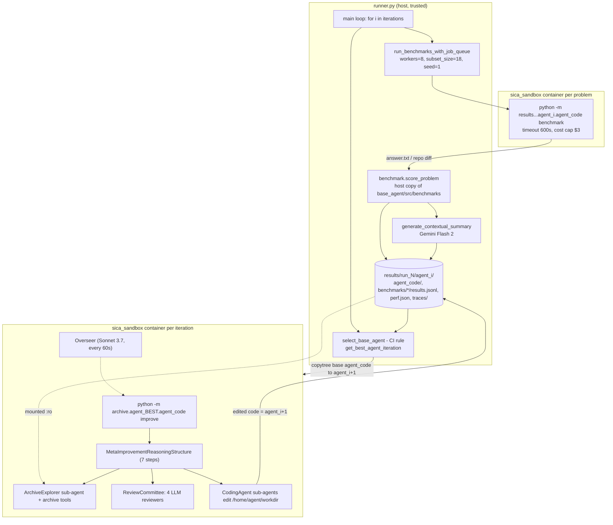

# Self-Improving Coding Agent (SICA): Source-Level RSI Study

> Subject: `references/evolution/self_improving_coding_agent` (MaximeRobeyns/self_improving_coding_agent @ `ed8275d`, 2025-04-24, MIT). This is the official code linked from arXiv:2504.15228 (Robeyns, Szummer, Aitchison; ICLR 2025 SSI-FM workshop).
> Method: static reading only. Nothing was installed or run, and the `sica_sandbox` image was not built.
> Audience: the `Hylo` offline improvement loop (diagnose -> declarative candidates -> protected-scope check -> paired McNemar on validation -> held-out report -> registry promote/rollback).
> Tags: **\[Implemented\]** traceable in code · **\[Docs/Interface only\]** only in README, prompts or commented-out code · **\[Unverified\]** paper claim or code path not checked end to end · **\[Needs model/hardware\]** needs paid LLM APIs or Docker

---

## 1. Positioning

SICA is a **single-lineage, self-referential** improvement loop. The agent that solves benchmark problems is also the agent that edits the next version of itself: no separate meta-agent exists. Each iteration does two things:

1. **benchmark**: the current agent `agent_i` runs on a fixed problem set inside Docker, and every answer is scored and summarised by a cheap LLM;
2. **improve**: the best-scoring agent so far runs in "improve" mode. It edits a copy of a base agent picked by a confidence-interval rule, and the edited copy becomes `agent_{i+1}`.

Each iteration produces exactly one candidate. No population or tournament is involved, and no gate decides admission: every new version is benchmarked next round. Selection pressure enters only through the choice of the *base* to copy and the *meta-agent* to run.

What is distinctive compared with DGM:
- the **meta-improvement procedure lives inside the agent's own code** (prompt, reasoning structure, review committee, archive tools), so the agent can rewrite how it improves itself;
- the agent keeps a persistent **change log** of hypotheses and their observed outcomes;
- an **LLM review committee** critiques each proposed feature before implementation;
- an **asynchronous LLM overseer** watches running agents and can cancel them.

## 2. Architecture



## 3. Core data structures & interfaces

| Concept | Representation | Cite |
|---|---|---|
| Candidate | A full **copy of the agent package** at `results/run_N/agent_{i}/agent_code/`. It is a directory snapshot, not a diff | `references/evolution/self_improving_coding_agent/runner.py:775-777`, `:992-995` |
| Version metadata | `description.txt` (what changed) and `agent_change_log.md` (table of `Iteration / Change Name / Was Successful? pending/yes/no`, plus hypothesis and outcome sections) inside the agent code | `references/evolution/self_improving_coding_agent/base_agent/agent_change_log.md:1-20`, `references/evolution/self_improving_coding_agent/base_agent/__main__.py:191-196` |
| Run state | `results/run_N/metadata.json`: `agent_iteration`, `git_commit`, `benchmark_progress` (resume) | `references/evolution/self_improving_coding_agent/runner.py:198-232` |
| Per-problem result | `ProblemResult` lines in `benchmarks/<name>/results.jsonl`: score, tokens, cost, wall_time, timed_out, cost_threshold_exceeded | `references/evolution/self_improving_coding_agent/runner.py:542-552`, `references/evolution/self_improving_coding_agent/base_agent/src/benchmarks/base.py:26-80` |
| Per-problem trace | `traces/<pid>/{answer.txt, trace.txt, execution_tree.txt, summary.txt, score.txt}` | `references/evolution/self_improving_coding_agent/runner.py:539-584` |
| Benchmark aggregate | `perf.json = {avg_score, tokens, num_cached_tokens, cost, time}` | `references/evolution/self_improving_coding_agent/runner.py:605-641` |

Key signatures:

```python
# references/evolution/self_improving_coding_agent/base_agent/src/benchmarks/base.py:83-142
class BaseBenchmark:
    name: ClassVar[str]
    def __init__(self, seed: int | None = None, subset_size: int | None = None)
    @property
    def problems(self) -> list[Problem]
    async def score_problem(self, problem, agent_workdir: str, agent_answer_dir: str, container_name: str) -> tuple[float, str | None, str | None]
    async def setup_problem(self, problem, problem_data_dir: Path, container_name: str) -> None
# references/evolution/self_improving_coding_agent/runner.py:88
def select_base_agent(analyzer: ArchiveAnalyzer, current_iteration: int, score_type: ScoreType = "mean_score") -> int
# references/evolution/self_improving_coding_agent/base_agent/src/utils/archive_analysis.py:780
def compute_statistics(scores_df, summaries_df, score_type="mean_score") -> pd.DataFrame  # target_score, std, ci_lower/upper
# references/evolution/self_improving_coding_agent/base_agent/agent.py:243
async def Agent.exec(prompt, timeout: int | None = None, cost_threshold: float | None = None) -> (tokens, cached, cost, duration)
```

## 4. The improvement loop

```mermaid
sequenceDiagram
  participant R as runner.py (host)
  participant B as Benchmark container (agent_i)
  participant G as Gemini Flash 2 summariser
  participant M as Meta container (agent_best)
  participant C as ReviewCommittee (4 LLMs)
  loop i = start .. iterations-1 (default 20)
    R->>B: for each of 18 fixed problems (8 workers): docker run, mount exp_dir rw
    B-->>R: stdout "tokens|cached|cost|time" + answer.txt
    R->>R: score_problem (host) -> results.jsonl
    R->>G: problem + answer + trace + score + answer_discussion
    G-->>R: summary.txt (critical analysis)
    R->>R: base = select_base_agent(CI rule); best = argmax mean score
    R->>R: copytree(agent_base/agent_code -> agent_i+1/agent_code); copy latest change log
    R->>M: docker run, archive :ro, workdir = agent_i+1 :rw; python -m archive.agent_best.agent_code improve
    M->>M: step 1-2 ArchiveExplorer: what is not working / what works
    M->>C: step 3 proposed feature (iterate until no major concerns)
    C-->>M: pragmatist / taste_maker / utility_optimizer / testing_manager reviews
    M->>M: step 4-5 CodingAgent implements + pytest + end-to-end smoke test
    M->>M: step 6-7 update description.txt and agent_change_log.md
    R->>R: rebuild sica_sandbox image (requirements may have changed)
    R->>R: metadata.agent_iteration = i+1; reset benchmark_progress
  end
```

Evidence: main loop `references/evolution/self_improving_coding_agent/runner.py:1024-1046`; job queue `:645-748`; problem container `:404-441`; meta step `:751-974`; reasoning-structure steps `references/evolution/self_improving_coding_agent/base_agent/src/tools/reasoning_structures/meta_improvement.py:27-77`. **\[Implemented\][Needs model/hardware]**

## 5. Candidate generation

- **Who proposes.** The best-scoring past agent (`best_iter = get_best_agent_iteration()`) is launched as the meta-agent from the read-only archive: `python -m archive.agent_{best_iter}.agent_code improve` (`references/evolution/self_improving_coding_agent/runner.py:779-782,860-870`). Default models: main `SONNET_37`, reasoning `O3_MINI`, overseer `SONNET_37` (`references/evolution/self_improving_coding_agent/base_agent/src/config.py:17-19`). The proposer is self-referential: improving the agent also improves the improver. **\[Implemented\]**
- **The meta prompt is part of the mutable agent.** The "It is meta-improvement time…" prompt is hard-coded in `base_agent/__main__.py` (`references/evolution/self_improving_coding_agent/base_agent/__main__.py:150-197`). It lists target areas (editing tools, dev tools such as ripgrep/tree-sitter, reasoning structures, speed, removing dead features), points to the archive layout, and mandates `pytest` plus an end-to-end smoke run (`:115-127`). Later generations can rewrite this prompt. **\[Implemented\]**
- **Scripted procedure** (`references/evolution/self_improving_coding_agent/base_agent/src/tools/reasoning_structures/meta_improvement.py:27-77`), seven steps:
  1. the archive explorer identifies features that are **not working** and may need removal;
  2. it identifies features that work or show promise;
  3. the agent proposes **one** concrete improvement and **must** iterate with `meta_improvement_review_committee` until no significant concerns remain (optionally after web research);
  4. a software-engineer sub-agent implements it;
  5. the agent runs the testing strategy (pytest for mechanisms, an e2e run for prompts or sub-agents);
  6. it updates `description.txt`;
  7. it updates `agent_change_log.md`, flipping earlier "pending" features to yes/no **based on benchmark evidence**.
- **Diagnosis inputs** (archive tools, `references/evolution/self_improving_coding_agent/base_agent/src/tools/archive_tools.py:26-230`):
  - `analyze_run`: per-iteration score, cost, time and utility;
  - `worst_problems` and `best_problems` per iteration (`references/evolution/self_improving_coding_agent/base_agent/src/utils/archive_analysis.py:352-541`);
  - `compare_agent_iterations`;
  - direct file reading of `trace.txt`, `execution_tree.txt` and `summary.txt`.

  Per-problem diagnosis is done **at benchmark time** by Gemini Flash 2. It writes a 1-2 paragraph critique ("where did the agent's reasoning fail… what specific improvements…"), given the problem, answer, trace, score, parse errors and the benchmark's `answer_discussion` (`references/evolution/self_improving_coding_agent/runner.py:275-342,570-584`). **\[Implemented\]**
- **Gold-solution leakage.** For GSM8K, `answer_discussion` is the reference solution steps (`references/evolution/self_improving_coding_agent/base_agent/src/benchmarks/gsm8k.py:86-89`). These flow into `summary.txt`, which the next meta-agent reads, and the same problems are re-used for evaluation next iteration (§7).
- **Pre-implementation review.** `ReviewCommittee` runs 4 personas in parallel through `asyncio.gather` (`references/evolution/self_improving_coding_agent/base_agent/src/tools/committee_design.py:114-137`):
  - *Pragmatist*: complexity hierarchy, one feature at a time;
  - *Taste-Maker*: explicitly flags "Goodharting/gaming the benchmark metrics" and over-specialisation;
  - *Utility Optimizer*: score, time and cost;
  - *Testing Manager*: requires unit and e2e tests with temp dirs.

  These are defined at `references/evolution/self_improving_coding_agent/base_agent/src/tools/committee_design.py:22-91`. The review is advisory: the tool description says "refrain from calling it more than 3 or so times" (`:100`). **\[Implemented\]**
- **Unit of improvement.** Anything in the agent package: tools, sub-agents, reasoning structures, prompts, LLM provider code, the overseer, and even its own copy of `benchmarks/` (which the runner ignores, see §8).

## 6. Selection & archive

- **Archive.** Linear and append-only: `agent_0 … agent_N`, each with code plus benchmark results. Every iteration creates exactly one child (`references/evolution/self_improving_coding_agent/runner.py:1024-1043`). There is no admission gate: a broken child is still benchmarked and stays in the archive. **\[Implemented\]**
- **Base selection (CI rule)** in `select_base_agent` (`references/evolution/self_improving_coding_agent/runner.py:88-147`):
  1. compute each iteration's mean score and a normal-approximation 95% CI, `mean ± 1.96·std/√n` (`references/evolution/self_improving_coding_agent/base_agent/src/utils/archive_analysis.py:832-842`);
  2. take the best iteration's **lower bound**;
  3. walk back from the current iteration and return the **most recent** agent whose mean ≥ that bound; if the walk passes the best index, return the best.

  This means "stay on the latest lineage unless it is significantly worse than the best". It is a recency-biased, noise-tolerant rollback rule, called with `score_type="mean_score"` (`references/evolution/self_improving_coding_agent/runner.py:771`). **\[Implemented\]**
- **Meta-agent selection.** `best_iter = argmax mean benchmark score`, with no CI (`references/evolution/self_improving_coding_agent/base_agent/src/utils/archive_analysis.py:291-307`). The base (code being edited) and the meta-agent (code doing the editing) can therefore differ. The prompt still tells the meta-agent that the workdir "is the best performing… iteration {best_iter}" (`references/evolution/self_improving_coding_agent/base_agent/__main__.py:164`), which is inaccurate whenever base ≠ best.
- **Lineage tracking.** No explicit parent pointer is stored. The parent is only inferable from runner logs, and the change log is copied from the *current* (latest) agent rather than the base (`references/evolution/self_improving_coding_agent/runner.py:798-805`). This is deliberate (the change log is "history"), but it breaks a strict tree lineage.

## 7. Evaluation & gating

| Aspect | What the code does | Cite / tag |
|---|---|---|
| Active benchmark | Only **GSM8K** is enabled in the registry; 17 others (SWE-bench Verified, LiveCodeBench, file editing, symbol location, AIME, GPQA, ARC-AGI, AIQ …) are commented out | `references/evolution/self_improving_coding_agent/base_agent/src/benchmarks/__init__.py:32-52` \[Implemented\] |
| Problem set | `benchmark_cls(seed=1, subset_size=18)`: the **same 18 problems every iteration** | `references/evolution/self_improving_coding_agent/runner.py:669`, `references/evolution/self_improving_coding_agent/base_agent/src/benchmarks/gsm8k.py:91-94` |
| Splits | None. The archive the meta-agent studies (including gold steps in summaries) is the set later used to score it. **No held-out set** | — |
| Scoring | Host-side `score_problem` from `answer.txt` (GSM8K exact match within 1e-7) or the swebench harness run on the repo diff (SWE) | `references/evolution/self_improving_coding_agent/base_agent/src/benchmarks/gsm8k.py:100-118`, `references/evolution/self_improving_coding_agent/base_agent/src/benchmarks/swebench_verified.py:314-376` |
| Budgets | 600 s and USD 3 per problem, enforced inside the agent; a host backstop of `asyncio.timeout(600+10)` | `references/evolution/self_improving_coding_agent/runner.py:367-368,481-492` |
| Utility | `utility()` returns `avg_score` if cost ≤ $3, time ≤ 300 s and not timed out, else 0 (a constraint gate, not the paper's weighted sum). It is computed but **selection uses `mean_score`** | `references/evolution/self_improving_coding_agent/base_agent/src/utils/archive_analysis.py:63-85`, `references/evolution/self_improving_coding_agent/runner.py:771` |
| Noise handling | One run per problem, an unpaired normal CI over problems, and the CI used only for base selection. No repeated seeds, no paired test against the parent | `references/evolution/self_improving_coding_agent/base_agent/src/utils/archive_analysis.py:780-844` |
| Staged eval | None. All benchmarks run fully every iteration. The only cheap filter before benchmarking is the meta-agent's own pytest and e2e smoke run (prompt-mandated) | `references/evolution/self_improving_coding_agent/base_agent/__main__.py:115-127` \[Docs/Interface only\] |
| Regression checks | The agent's own `pytest` suite (`base_agent/tests/`), run by the meta-agent on itself, not by the host | — |
| Self-reported metrics | Tokens, cost and time are parsed from the **agent's stdout** (`tokens|cached|cost|time`). A modified agent could misreport them | `references/evolution/self_improving_coding_agent/runner.py:509-526` |

## 8. Safety & isolation

- **Evaluator protection.** The runner imports benchmarks from the **host's pristine `base_agent/src/benchmarks`** (`references/evolution/self_improving_coding_agent/runner.py:24`) and scores on the host. The evolved copy's `benchmarks/` is never used for scoring. **\[Implemented\]**
- **Archive mounts.**
  - *Meta-improvement:* the archive is mounted read-only and only the new agent dir is writable (`references/evolution/self_improving_coding_agent/runner.py:831-849`).
  - *Benchmarking:* the **whole experiment dir is mounted read-write** into each problem container (`references/evolution/self_improving_coding_agent/runner.py:423-427`). A self-modified agent could therefore rewrite other iterations' `results.jsonl`, `perf.json` or `summary.txt`, or its own code, which the selector later reads. This is a reward-hacking surface. **\[Implemented\]** (the risk is inferred, not observed)
- **Container privileges.**
  - The `agent` user has passwordless sudo (`references/evolution/self_improving_coding_agent/sandbox/Dockerfile:15-18`).
  - The network is unrestricted.
  - No CPU or memory limits are set (`references/evolution/self_improving_coding_agent/runner.py:414-433`).
  - All provider API keys are **baked into the image as ENV** through build args (`references/evolution/self_improving_coding_agent/sandbox/Dockerfile:139-151`), and the image is rebuilt with keys after every iteration (`references/evolution/self_improving_coding_agent/runner.py:940-969`).
- **Budget enforcement.**
  - Cost and time monitors live in the agent's own code (`references/evolution/self_improving_coding_agent/base_agent/agent.py:40-170,316-328`), so they are self-modifiable. The host only enforces wall time.
  - The meta-improvement run has **no timeout and no cost cap**: `agent.exec(prompt)` is called without either (`references/evolution/self_improving_coding_agent/base_agent/__main__.py:208-210`), and the host `docker exec` is not wrapped in a timeout (`references/evolution/self_improving_coding_agent/runner.py:868-870`).
- **Oversight.** An LLM `Overseer` polls the execution graph every 60 s. It can notify agents or force-cancel them, and it must notify at least once before cancelling (`references/evolution/self_improving_coding_agent/base_agent/src/oversight/overseer.py:160-185,212-260,395-398`). It is started inside `Agent.exec` (`references/evolution/self_improving_coding_agent/base_agent/agent.py:269`). The overseer is **part of the mutable agent**, so it is not an independent safety layer. A web UI on port 8080 exposes the live event bus to a human (`references/evolution/self_improving_coding_agent/base_agent/src/web_server/server.py`). It is watch-only, with no approve or reject hook. **\[Implemented\]**
- **Anti-Goodhart.** The only mechanism is the Taste-Maker reviewer prompt (`references/evolution/self_improving_coding_agent/base_agent/src/tools/committee_design.py:40-53`). It is advisory, and also mutable.
- **README warning.** "always run the agent in the provided Docker container" (`references/evolution/self_improving_coding_agent/README.md:19`). **\[Docs/Interface only\]**

## 9. Dependencies, cost, license; promotion / rollback / reproducibility

- **License:** MIT (top-level `LICENSE`, © 2025 Maxime Robeyns).
- **Runtime:** Python 3.12 Fedora image with multiple toolchains and LSPs (`references/evolution/self_improving_coding_agent/sandbox/Dockerfile:1-157`); providers Anthropic, OpenAI, Gemini, Vertex, Fireworks and DeepSeek (`references/evolution/self_improving_coding_agent/base_agent/src/llm/providers/`); `swebench` on the host for SWE scoring. **\[Needs model/hardware\]**
- **Promotion.** There is no explicit promotion. `best_iter` (argmax) acts as the deployed meta-agent, and the CI rule picks the next base. **Rollback** is implicit: if the latest agent falls below the best's CI lower bound, the next child is copied from an earlier agent (`references/evolution/self_improving_coding_agent/runner.py:126-144`). **\[Implemented\]**
- **Reproducibility.**
  - Problem subsets are seeded (`seed=1`) and the run records `git_commit` and the Python version (`references/evolution/self_improving_coding_agent/runner.py:198-220`).
  - LLM sampling is not seeded, and the sandbox image is rebuilt from `latest` Miniconda, rustup and pnpm installers (`references/evolution/self_improving_coding_agent/sandbox/Dockerfile:39,94,102`), so environments drift.
  - Resume works through `--experiment-id` and `benchmark_progress` (`references/evolution/self_improving_coding_agent/runner.py:1018-1021`).
  - The README itself lists "reduce the variance of self-improvement runs (early features often influence subsequent features)" as open work (`references/evolution/self_improving_coding_agent/README.md:112`).
- **Compute (from code).** The default is 20 iterations × 18 problems × ≤ USD 3 each, i.e. ≤ USD 54 per benchmark sweep per iteration. On top of that come Gemini Flash summaries and an **uncapped** meta-improvement run each iteration. Paper-level totals are not in code. **\[Unverified\]**

## 10. Strengths / weaknesses / risks

**Strengths**
- The **hypothesis ledger** (`agent_change_log.md`, pending → yes/no from evidence) is a cheap, auditable memory across iterations (`references/evolution/self_improving_coding_agent/base_agent/src/tools/reasoning_structures/meta_improvement.py:72-76`).
- The **CI-based base selection** avoids chasing noisy maxima while still allowing rollback (`references/evolution/self_improving_coding_agent/runner.py:88-147`).
- **Pre-implementation critique** by diverse personas, including an explicit anti-Goodhart reviewer, cuts wasted benchmark runs (`references/evolution/self_improving_coding_agent/base_agent/src/tools/committee_design.py:22-91`).
- **Per-episode LLM summaries** turn long traces into a diagnosable archive (`references/evolution/self_improving_coding_agent/runner.py:275-342`).
- Host-side scoring uses a pristine benchmark copy (`references/evolution/self_improving_coding_agent/runner.py:24`).

**Weaknesses / risks**
- Train = test: 18 fixed GSM8K problems, with gold steps fed to the improver. Overfitting is invisible by construction.
- Single lineage with one candidate per iteration, and no gate before admission. A bad child costs a full benchmark sweep.
- The safety and budget machinery (overseer, cost and time monitors, meta prompt) is all **inside the mutable artifact**.
- The read-write experiment mount during benchmarking, sudo, network and baked-in API keys make for weak isolation.
- Self-reported cost and time feed the utility metric.
- Minor bugs:
  - `async with asyncio.Lock()` creates a fresh lock on each call, so nothing is locked (`references/evolution/self_improving_coding_agent/runner.py:242`);
  - port `808{worker_id}` breaks for ≥ 10 workers (`references/evolution/self_improving_coding_agent/runner.py:422`);
  - the meta prompt says `/home/sandbox/workdir`, but the mount is `/home/agent/workdir` (`references/evolution/self_improving_coding_agent/base_agent/__main__.py:151` vs `:166`).

## 11. What Hylo should adopt (concrete)

| SICA mechanism | Hylo adaptation (frozen SmolVLA, LIBERO) |
|---|---|
| `agent_change_log.md` hypothesis ledger | Add a registry-owned **hypothesis record** per candidate: motivation, unit type, expected effect on named failure classes, and later a verdict (`confirmed / refuted / inconclusive`) filled in from the McNemar and held-out reports. Feed the last K verdicts into the proposer context. Keep it **outside** the candidate payload so proposers cannot rewrite history. |
| CI-based base selection | When choosing which registry version to branch from, take the most recent promoted version whose validation success rate is within the best's lower bound. Use a Wilson or exact binomial interval, not a normal approximation, because LIBERO task counts are small. Promotion stays on our paired McNemar. |
| Review committee before eval | Add a cheap **pre-sim LLM review stage** (stage 0) with personas mapped to physical concerns: *Safety reviewer* (could it increase shield interventions or contact forces?), *Goodhart reviewer* (does it key on task IDs, seeds, camera artefacts?), *Pragmatist* (smallest unit type that addresses the failure), *Test planner* (which replayed traces and predicates should change). Advisory only. The protected-scope check remains the hard gate. |
| Per-episode LLM summary | Generate a short critique per failed LIBERO episode from our replayable event trace (shield vetoes, predicate timeline, action-chunk stats). Store it next to the trace and expose `worst_episodes`, `best_episodes` and `compare_versions` as read-only tools for the proposer. |
| Utility as constraint gate | Count an episode as a success only if the predicate holds **and** it is within the step budget **and** there are zero new shield interventions. This matches SICA's "score only if within budget" (`references/evolution/self_improving_coding_agent/base_agent/src/utils/archive_analysis.py:79-85`). |
| Overseer pattern | Run it only at the *offline improvement-agent* level (cancel looping proposer runs). Never in the control loop: the kernel and SafetyShield own runtime safety, and an LLM poll every 60 s is irrelevant at control rates. |

**Do not transfer.**
- Self-referential meta-agents whose improvement prompt, overseer and budget monitors are editable. Our improver, gate and shield must sit outside the candidate scope.
- Fixed-seed train = test evaluation and gold-answer leakage into the improver's context.
- Admission without a gate.
- Read-write archive mounts, sudo, and secrets baked into images.
- Self-reported cost and time. Our kernel measures steps and time itself.

## 12. Source index

| Concern | file:line | Note |
|---|---|---|
| Main loop | `references/evolution/self_improving_coding_agent/runner.py:977-1046` | iterate benchmark → improve |
| Base selection (CI) | `references/evolution/self_improving_coding_agent/runner.py:88-147` | recent agent ≥ best lower bound |
| Problem execution | `references/evolution/self_improving_coding_agent/runner.py:360-602` | per-problem container |
| rw experiment mount | `references/evolution/self_improving_coding_agent/runner.py:423-427` | tamper surface |
| Self-reported metrics | `references/evolution/self_improving_coding_agent/runner.py:509-526` | stdout parse |
| Trace summariser | `references/evolution/self_improving_coding_agent/runner.py:275-342` | Gemini Flash 2 |
| Fixed subset | `references/evolution/self_improving_coding_agent/runner.py:669` | seed=1, 18 problems |
| Meta-improvement step | `references/evolution/self_improving_coding_agent/runner.py:751-974` | archive ro, rebuild image |
| Meta prompt | `references/evolution/self_improving_coding_agent/base_agent/__main__.py:113-214` | mutable, no budget |
| 7-step reasoning structure | `references/evolution/self_improving_coding_agent/base_agent/src/tools/reasoning_structures/meta_improvement.py:18-77` | scripted procedure |
| Review committee | `references/evolution/self_improving_coding_agent/base_agent/src/tools/committee_design.py:22-137` | 4 personas |
| Archive tools | `references/evolution/self_improving_coding_agent/base_agent/src/tools/archive_tools.py:26-230` | worst/best/compare |
| Utility / CI stats | `references/evolution/self_improving_coding_agent/base_agent/src/utils/archive_analysis.py:63-85,291-307,780-844` | constraint gate, normal CI |
| Benchmark interface | `references/evolution/self_improving_coding_agent/base_agent/src/benchmarks/base.py:83-142` | score_problem contract |
| Active benchmarks | `references/evolution/self_improving_coding_agent/base_agent/src/benchmarks/__init__.py:32-52` | GSM8K only |
| GSM8K gold steps | `references/evolution/self_improving_coding_agent/base_agent/src/benchmarks/gsm8k.py:86-89` | answer_discussion |
| Overseer | `references/evolution/self_improving_coding_agent/base_agent/src/oversight/overseer.py:160-444` | notify / cancel |
| In-agent budgets | `references/evolution/self_improving_coding_agent/base_agent/agent.py:40-170,243-330` | mutable |
| Sandbox image | `references/evolution/self_improving_coding_agent/sandbox/Dockerfile:15-18,139-151` | sudo, keys in ENV |
| Model config | `references/evolution/self_improving_coding_agent/base_agent/src/config.py:17-19` | Sonnet 3.7 / o3-mini |

## Verification status

| Claim | Status |
|---|---|
| Benchmark → improve loop, one child per iteration | \[Implemented\][Needs model/hardware] |
| CI-based base selection | \[Implemented\][Unverified]: read, not run |
| Meta-agent = best past agent, self-referential | \[Implemented\] |
| Review committee + archive explorer + 7-step structure | \[Implemented\][Needs model/hardware] |
| Utility weighting score/cost/time (paper) | Code differs: constraint gate only, and unused for selection |
| Held-out evaluation | Absent |
| Overseer can cancel agents | \[Implemented\][Unverified] |
| SWE-bench / LiveCodeBench etc. in the loop | \[Docs/Interface only\] by default (commented out of the registry) |
| 17% → 53% on SWE-bench Verified subset | \[Unverified\]: paper only |
