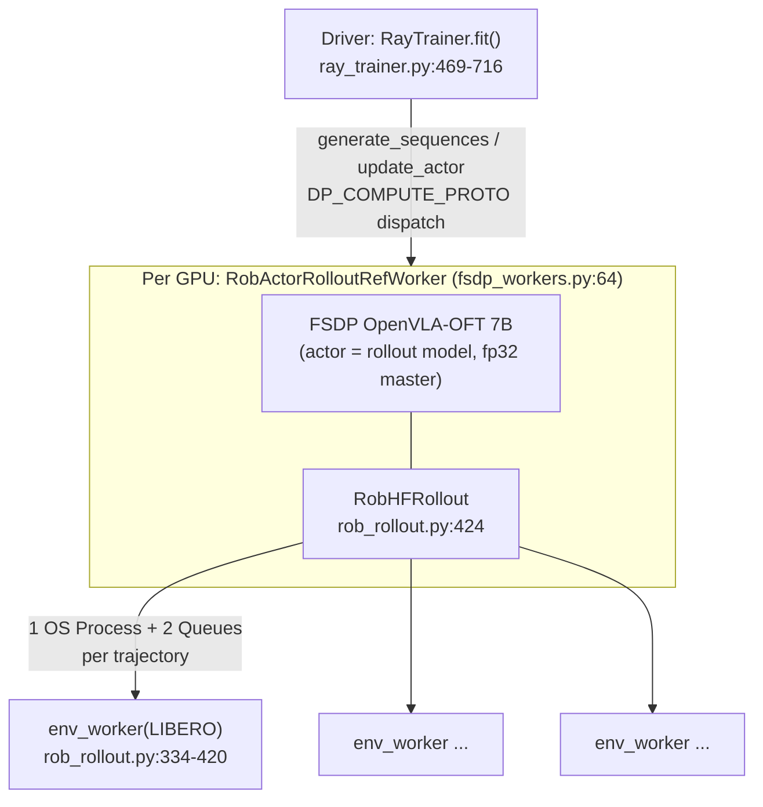

# SimpleVLA-RL: Source-Level Study for Weight-Level RSI (+ survey of RECAP, VLA-RL, RIPT-VLA)

> Subject: `references/evolution/SimpleVLA-RL` (PRIME-RL/SimpleVLA-RL @ `7c51662`, 2026-01-06, MIT)
> Method: static analysis only. Nothing installed or run; no SFT checkpoints downloaded.
> Size: ~50k lines of Python in 230 files. Most of it is a vendored **veRL v0.2-era** fork (`verl/`) plus vendored OpenVLA/OpenVLA-OFT modeling code. The VLA-specific delta is roughly 4k lines in 7 files (listed in README "Key Implementations").
> Tags: **\[Implemented\]** / **\[Docs/Interface only\]** / **\[Unverified\]** / **\[Needs model/hardware\]**, with the same meaning as in `rsi-rlinf.md`. All success rates are **reported, not verified**.

---

## 1. Positioning

SimpleVLA-RL is a **minimal GRPO recipe for autoregressive (token) VLAs**: OpenVLA and OpenVLA-OFT with discrete action bins, on LIBERO and RoboTwin. It is built by bolting a robot rollout onto veRL's single-controller PPO trainer. Its value to worldcurrent is as a **reference recipe**, not as a framework:

- Binary outcome reward (`complete` flag from the simulator).
- GRPO with n=8 samples per initial state.
- Dynamic sampling: keep only groups with 0.1 ≤ success ≤ 0.9.
- DAPO-style asymmetric clip (0.2 / 0.28).
- No KL, no entropy bonus, rollout temperature 1.6.

It has **no flow-matching / diffusion support**. pi0/pi0.5 and SmolVLA are listed as roadmap items only (`README.md` "Roadmap"). \[Docs/Interface only\] For our SmolVLA/pi0.5 stack, the **algorithmic recipe transfers but the code does not**.

## 2. Architecture

veRL single controller: one Ray driver task (`main_ppo.py:105-116`) creates a `RayTrainer`. All roles (`ActorRollout`, `RefPolicy`, `Critic`) map to **one global resource pool** (`main_ppo.py:155-169`) and are fused into one colocated worker per GPU via `create_colocated_worker_cls` (`ray_trainer.py:443-451`). Only the "hybrid engine" mode is supported (`ray_trainer.py:264-265`). \[Implemented\]



- **Rollout = actor weights.** Rollout uses the FSDP actor module directly via `FSDP.summon_full_params` (`rob_rollout.py:936-937`; `_build_rollout` uses `BaseShardingManager`, `fsdp_workers.py:325-331`). There is no weight sync and no separate inference engine. The vLLM path is commented out (`fsdp_workers.py:332-348`).
- **Env vectorization.** One `multiprocessing.Process` per trajectory, **spawned fresh for every rollout micro-batch** (`rob_rollout.py:789-802`). Each child builds a LIBERO env, sets init state `trial_id`, waits 10 no-op steps (`:360-367`), then loops `action = input_queue.get()` → executes the whole chunk → `output_queue.put(obs…)` (`:388-420`). Full observation dicts are pickled through `Queue`s. RoboTwin uses a 16-thread pool instead (`:461-463`).
- Per GPU, a micro-batch is 1 initial state × `n_samples`=8, so only 8 concurrent envs per GPU and 64 in total on 8 GPUs (`rollout.micro_batch_size=1` at script line 61; `generate_sequences` chunking at `rob_rollout.py:490-502`).
- The policy forward runs on the **whole micro-batch including already-finished envs**. Inactive envs simply get no action (`:826-862`). Finished episodes are masked later via `finish_step`.

## 3. Core data structures & interfaces

| Structure | Location | Content | Tag |
|---|---|---|---|
| `DataProto` (veRL) | `verl/protocol.py` | `batch` (TensorDict) + `non_tensor_batch` + `meta_info`; methods `union`, `chunk`, `concat`, `select` | \[Implemented\] |
| Prompt row | `rob_dataset.py:92-97` | `{task_suite_name, task_id, trial_id, trial_seed}`. A "prompt" is a (task, init-state) pair. | \[Implemented\] |
| Rollout output | `rob_rollout.py:888-913` | `responses [B, T_chunks, 7·8]`, `input_ids`, `attention_mask`, `pixel_values [B, T, …]`, `complete [B]`, `finish_step [B]` | \[Implemented\] |
| `old_log_probs` | `fsdp_workers.py:515-524` | recomputed by the actor right after rollout (hybrid engine) | \[Implemented\] |
| Reward tensor | `main_ppo.py:58-99` | zeros, with `complete` (0/1) placed at the last valid token `finish_step·action_token_len − 1` (`:69-79`) | \[Implemented\] |
| Checkpoint | `fsdp_workers.py:567-640` | HF `save_pretrained` (full state dict, rank 0) or LoRA adapter + merged model; **no optimizer state** ("TODO: support DCP", `:625`) | \[Implemented\] |

## 4. Training loop

```mermaid
sequenceDiagram
  participant T as RayTrainer.fit
  participant W as Actor/Rollout workers (8 GPUs)
  participant E as LIBERO processes
  T->>W: _validate() before training (greedy) [:488-496]
  loop until batch_size x n_samples valid rollouts [:513-597]
    T->>W: generate_sequences(64 prompts, n_samples=8) [:549]
    W->>E: spawn 8 procs per prompt, step chunks of 8 actions up to 512 steps
    E-->>W: obs / complete / finish_step
    W->>W: recompute old_log_probs [fsdp_workers.py:515-524]
    T->>T: verify (acc = complete) [:560]; filter groups 0.1<=acc<=0.9 [:573-578, 755-816]
  end
  T->>T: reward_fn -> token-level scores; apply_kl_penalty (beta=0) [:631-647]
  T->>T: compute_advantage(grpo) [:650-654]
  T->>W: update_actor (single pass, minibatches) [:662-666]
  T->>W: compute_entropy (logging) [:666]
  alt every test_freq=4 steps
    T->>W: _validate() [:673-679]
  end
  alt every save_freq=25 steps
    T->>W: save_checkpoint(actor/global_step_N) [:690-695]
  end
```

## 5. Algorithms & log-probs

**Policy parameterization (OpenVLA-OFT, discrete).** SimpleVLA-RL does **not** use OFT's L1-regression head. It uses the LM head's last 256 vocabulary entries as action bins. Prediction is **parallel** (a single forward pass over 7 × 8 = 56 masked action positions): `_verl_discrete_prediction` (`modeling_prismatic.py:1595-1720`).
- Greedy: argmax over `logits[..., -256-64:-64]` (`:1693-1701`).
- Sampling: temperature softmax (`:1706-1720`).
- `NUM_ACTIONS_CHUNK=8`, `ACTION_DIM=7` for LIBERO (`constants.py:27-32`), selected through the `ROBOT_PLATFORM` env var (`constants.py:112-127`). It is a **global** constant set at import time.

**Log-probs.** `_forward_micro_batch` re-runs the model on stored `(input_ids, pixel_values)` for every chunk step. It slices the same 256-bin window, divides by temperature and takes `logprobs_from_logits` (`dp_rob.py:146-172`). The trajectory mask comes from `finish_step` (`:168-169`). Each action dimension of each chunk step is one "token", and log-probs are per-token: an exact likelihood, because the policy is categorical. This is the main reason the recipe is simple. It **does not carry over to flow-matching policies** (see §11 for the RLinf-style substitute).

**Advantage (GRPO, outcome only).** `compute_grpo_outcome_advantage` (`core_algos.py:173-216`) sums the token rewards to a scalar per trajectory, z-normalizes within the `uid` group, and broadcasts over all valid tokens. `uid` is assigned per prompt row (`ray_trainer.py:537-541`), so a group = 8 rollouts from the **same task and init state**. RLOO, GAE, REINFORCE++ and ReMax are also wired (`ray_trainer.py:136-203`). GAE requires a critic, which is not implemented for VLAs.

**Loss.** PPO clipped surrogate with asymmetric clip `[1−0.2, 1+0.28]` (`core_algos.py:271-302`; script lines 49-50). `update_policy` (`dp_rob.py:401-531`) does a **single pass** with no epoch loop, uses `ppo_micro_batch_size == 1` trajectory (asserted, `:412`), and splits each trajectory into windows of 16 chunk steps for memory (`:480-515`). Loss is normalized by the number of valid tokens.

**Reward.** Sparse binary success only (`main_ppo.py:38-56`: `acc = complete`). `format_correctness` is a constant 1.

**KL / entropy.** The script sets `kl_coef=0.00` (script line 75), so **no reference model is even instantiated** (`ray_trainer.py:272`). `entropy_coeff=0` (script line 55). Exploration comes from rollout temperature 1.6 (script line 59) and dynamic sampling.

**Dynamic sampling.** The fit loop keeps drawing prompts until it has `train_batch_size × n_samples` rollouts from groups with mixed outcomes (`ray_trainer.py:513-597`). Extra groups go to a buffer (`:596-597, 818-829`). **Rollout cost per update is therefore variable and grows as the policy saturates.**

## 6. Data path & throughput

- **Per update (LIBERO script).** 64 init states × 8 samples = **512 trajectories**, each up to **512 env steps** (`rob_rollout.py:429-434`) in 64 chunk decisions. Worst case ≈ 262k env steps per update, plus resampling for filtered groups. `ppo_mini_batch_size=128` is normalized per GPU to 16 (`fsdp_workers.py:103-105`), so there are 4 optimizer steps per update on 8 GPUs. `lr 5e-6` constant; `total_epochs 100` over 500 prompts (Long suite: 10 tasks × 50 trials).
- **Memory.** The actor is created in fp32 (`fsdp_workers.py:158-164`), with gradient and optimizer offload on (script lines 46-47). The full 7B model is trained; LoRA is optional.
- **Throughput.** Not reported in code, README or paper (the paper gives hyperparameters only). Tested on **8 × A800 80 GB** (`README.md:131-133`). \[Unverified\]
- **On our EnvServer** (~150 ms/step): the worst-case 262k steps at 64 parallel envs ≈ 10 min of env time per update. The 7B OFT forward on CPU per chunk would dominate. This recipe is GPU-only in practice.

## 7. Evaluation & reported gains

Reported (paper arXiv 2509.09674; README `figs/main.png`). [Unverified; Needs model/hardware]

| Setting | Spatial | Object | Goal | Long | Avg |
|---|---|---|---|---|---|
| OFT full-traj SFT → +RL | 91.6 → 99.4 | 95.3 → 99.1 | 90.6 → 99.2 | 86.5 → 98.5 | 91.0 → 99.1 |
| OFT one-traj SFT → +RL | 63.6 → 98.2 | 54.9 → 98.7 | 59.6 → 98.8 | 17.3 → 91.7 | 48.9 → 96.9 |

RoboTwin 1.0: 39.8 → 70.4. RoboTwin 2.0: 38.3 → 68.8. The paper also reports an unseen-task study (9 train tasks / 1 held-out per suite), with mixed gains of +5 to +36 points.

**Protocol caveats (from code):**
- `LIBERO_Dataset` builds **train and valid from identical trial ranges** (`range(0, num_trials_per_task)` for both, `rob_dataset.py:85-88`). Validation therefore replays the **same 50 init states per task used for RL training**. The paper's "50 held-out test scenarios per task" are the standard LIBERO init states, but they are *not* held out from RL training here.
- Validation is greedy (`do_sample=False`, `ray_trainer.py:347`), on `val_batch_size=496` states sampled with `shuffle=True, drop_last=True` (`:317-321`). A small number of states may be skipped per validation pass.
- There are no paired statistics and no seeds/CI in code. The paper states 3 runs.

## 8. Hardware / CPU / ROCm feasibility

- NCCL plus a `cuda` device mesh are hard-coded (`fsdp_workers.py:75,81`). There are `torch.autocast('cuda')` calls (`dp_rob.py:126,205`; `rob_rollout.py:940`), flash-attn 2 (`SETUP.md:47`), and `torch==2.4.0+cu124` with veRL v0.2.x (`SETUP.md:21-24`). No ROCm or HIP code paths exist in `verl/` outside the vendored vLLM. [Implemented as CUDA-only]
- PyTorch-ROCm presents itself as `cuda`, so the code *might* run on a ROCm GPU. However, the stack (old veRL, flash-attn, 7B fp32 actor with offload) assumes 80 GB parts. **2 × R9700 (32 GB) cannot hold a full-parameter 7B fp32 FSDP actor.** LoRA would be required. \[Unverified\]
- CPU: only the LIBERO env processes. \[Implemented\]

## 9. Dependencies, cost, license

MIT (top-level). The vendored veRL is Apache-2.0 (file headers, e.g. `main_ppo.py:1-13`). The OpenVLA/OFT modeling code is MIT. RoboTwin modified code is under `modified_codes/`. Dependencies: Ray, Hydra, transformers, `codetiming`, `tensorflow` (OFT preprocessing, `rob_rollout.py:477-480`), WandB (online mode in the script). Cost: 8 × A800 for the published runs; GPU-hours not reported.

## 10. Strengths / weaknesses / risks

Strengths
- The smallest end-to-end VLA GRPO you can read in an afternoon. The reward/advantage/filter recipe is clear and empirically strong on LIBERO.
- Dynamic sampling + clip-higher + high temperature is a well-motivated exploration package for sparse 0/1 reward.

Weaknesses / risks
- Token-VLA only. The vendored veRL fork is old (v0.2), so upstream fixes don't reach it.
- One process per trajectory, re-spawned per micro-batch. The policy runs on finished envs. Configuration lives in global import-time constants (`ROBOT_PLATFORM`).
- **No held-out init states.** No optimizer checkpointing (no exact resume). WandB API key in `align.json`.
- `kl_coef=0`: unconstrained drift from SFT. Fine for a benchmark, risky for a promote/rollback loop that guards other tasks.

## 11. What worldcurrent should adopt (concrete)

**Adopt as recipe (algorithmic protocol):** GRPO on (task, init-state) groups of 8; binary success reward; dynamic sampling [0.1, 0.9]; asymmetric clip 0.2/0.28; small constant LR; greedy evaluation.
**Adopt as pattern:** "prompt = (task_id, init_state_id)" as the unit of grouping and of dataset splitting. Our EnvServer already resets by task, so we add `init_state_id`.
**Avoid:** veRL fork; per-trajectory process spawning (our EnvServer pool is better); train = eval init states; zero KL.

### 11.1 Minimal weight-level RSI on worldcurrent (SmolVLA, 3 LIBERO tasks)

Combine **SimpleVLA-RL's recipe** with **RLinf's flow-SDE log-prob** (`rsi-rlinf.md` §5).
1. **Splits.** Per task, the 50 LIBERO init states become 30 train / 10 validation / 10 held-out ids, frozen in a manifest whose digest goes into candidate `evidence`. Pick 3 tasks where SFT SmolVLA succeeds 20–80% on the train ids (measure first with our harness).
2. **Policy wrapper.** `SmolVLAPolicyRL` around LeRobot SmolVLA. In `mode=train`, run `embed_prefix` + KV once (`modeling_smolvla.py:797-809`). Then run the 10 Euler steps, with **one random step stochastic** via `sample_mean_var(noise_method="flow_sde", noise_level≈0.5)`, and return actions, the chunk-level Gaussian log-prob over executed chunk × 7 dims, and `forward_inputs = {chain, idx, obs refs}`. Freeze the VLM and train only the action expert (SmolVLA default `train_expert_only=True`, `configuration_smolvla.py:69-70`).
3. **Rollout.** EnvServer pool of 64 CPU workers. 3 tasks × 6 train init states × group 8 = **144 episodes per iteration**. Execute 10 actions per chunk, render only at chunk boundaries (RLinf `skip_intermediate_renders`), max ~300 steps. Write every episode as a replayable trace that includes `forward_inputs`.
4. **Learner.** GRPO advantage per group, drop all-0/all-1 groups, PPO clip 0.2/0.28, 2 epochs. Add a **KL term to the frozen SFT expert** at the same denoise step (closed form between two Gaussians with equal σ). It costs one extra suffix forward and limits drift on non-target tasks.
5. **Candidate.** Every N iterations, export safetensors → `Candidate(kind="policy_ref", patch={"agent.policy.ref": "<digest>"})`. Then run the existing gate: validation ids, paired McNemar, per-task regression including a few *non-trained* LIBERO tasks as a regression suite, and safety-intervention delta. Then held-out confirmation, then promote or roll back. Needs `policy_ref` added to `ENABLED_KINDS` (`packages/wc-evolve/src/worldcurrent/evolve/candidate.py:31`).
6. **Statistics.** With 10 validation states × 3 tasks = 30 pairs, McNemar can only detect large effects. Evaluate each state with several seeds (stochastic SDE sampling or env noise), or add LIBERO-Plus perturbations of the validation states to get ≥150 pairs.

**Compute estimate on this machine.** All figures are estimates; nothing has been measured. Run a 1-iteration timing spike first.

| Phase | Work / iteration | CPU-only (128 cores) | 1 × R9700 if ROCm works |
|---|---|---|---|
| Env stepping | 144 eps × ~200 steps ≈ 29k steps; 64 workers × 150 ms (less with render skipping) | ~1–1.5 min | same (env is CPU) |
| Rollout inference | ~2.9k chunk decisions; prefix + 10 denoise steps, batched 64 | ~2–5 min | ~0.3 min |
| Learner | ~2.9k samples × 2 epochs; prefix fwd (no grad) + 1 expert step fwd/bwd (~100M trainable) | ~5–15 min | ~0.5–1 min |
| **Iteration** | | **~10–20 min** | **~2–3 min (env-bound)** |
| 60–100 iterations + gates | | **~1–1.5 days** | **~3–5 h** |

SimpleVLA-RL reports convergence in roughly tens to ~100 steps at 8 × larger batches. Whether 144 episodes per iteration is enough signal for SmolVLA is **the key unknown**. pi0.5 (3B) RL on this machine is not realistic without working ROCm: RLinf itself documents ≥4 × H100 with offload.

## 12. Survey: related methods (README/paper level) \[Docs/Interface only\]

| Method | Official source (verified) | License | Policy type | Core idea | Relevance |
|---|---|---|---|---|---|
| **pi*0.6 / RECAP** (Physical Intelligence) | Paper arXiv 2511.14759; blog pi.website/blog/pistar06. **No official code**; openpi has no RECAP. RLinf implements a RECAP pipeline (`rsi-rlinf.md`). | n/a (paper) | flow VLA (pi0.6) | Value model → binarized advantage indicator as a **conditioning input**; offline/iterated on autonomous + corrected experience; avoids PPO on flow likelihoods | **High.** It fits our offline loop and traces; no online log-prob is needed. |
| **VLA-RL** (Lu et al.) | github.com/GuanxingLu/vlarl (HEAD `212379e`, pushed 2025-11-08, Apache-2.0); arXiv 2505.18719 | Apache-2.0 | OpenVLA-7B tokens | PPO with a learned robotic process-reward model; Ray + vLLM + LoRA + FSDP | Medium. Dense PRM reward is an alternative to sparse success. |
| **RIPT-VLA** (Tan et al., UT Austin) | github.com/Ariostgx/ript-vla (HEAD `440990e`, pushed 2025-06-04); arXiv 2505.17016 | **No LICENSE file** (GitHub API: `license: null`), so we must not reuse its code | QueST; OpenVLA-OFT + learned Laplace "scale head" for continuous log-probs | RLOO (K=8) + dynamic rollout sampling + PPO epochs; 1-demo → 97% claims; 1–6 GPUs | Medium. Its scale-head trick (a Gaussian/Laplace head on a regression VLA) is another route to log-probs. |

We did not clone VLA-RL or RIPT-VLA (README-level scope; RIPT-VLA is unlicensed).

## 13. Source index

| Topic | File:line |
|---|---|
| Launch script / hyper-parameters | `examples/run_openvla_oft_rl_libero.sh:18,26-33,39-61,75,82-86` |
| Entry, Ray init, roles, reward manager | `verl/trainer/main_ppo.py:30-99,105-116,155-169,193-208` |
| Trainer: KL, advantage, init, fit, filter | `verl/trainer/ppo/ray_trainer.py:85-120,123-204,264-272,292-321,336-391,469-716,755-829` |
| GRPO / policy loss | `verl/trainer/ppo/core_algos.py:173-216,271-302` |
| Actor log-probs / update | `verl/workers/actor/dp_rob.py:105-200,401-531` |
| FSDP worker: rollout, old logprob, ckpt | `verl/workers/fsdp_workers.py:75-109,158-164,325-350,484-536,567-640` |
| LIBERO rollout | `verl/workers/rollout/rob_rollout.py:334-420,429-456,490-502,772-913,925-978` |
| Dataset (train = valid trials) | `verl/utils/dataset/rob_dataset.py:65-109` |
| Discrete action head | `verl/utils/vla_utils/openvla_oft/modeling_prismatic.py:1595-1720,1870-2010`; `constants.py:27-32,112-127` |
| Setup / hardware | `SETUP.md:21-47`; `README.md:131-133` |

## Verification status

| Claim | Status |
|---|---|
| Colocated veRL hybrid engine, rollout uses actor weights | \[Implemented\] |
| One process per trajectory, re-spawned per micro-batch | \[Implemented\] |
| Discrete 256-bin parallel decoding, exact token log-probs | \[Implemented\] |
| GRPO outcome advantage, dynamic sampling, clip 0.2/0.28, KL=0, T=1.6 | \[Implemented\] (code + script) |
| Train and validation use the same LIBERO init states | \[Implemented\] (code traced) |
| No optimizer state in checkpoints | \[Implemented\] (`fsdp_workers.py:625` TODO) |
| LIBERO 91.0→99.1 and 48.9→96.9; RoboTwin gains | \[Unverified\] (paper) |
| ROCm / AMD support | Absent in code; \[Unverified\] |
| pi0/SmolVLA support | \[Docs/Interface only\] (roadmap) |
| RECAP / VLA-RL / RIPT-VLA descriptions | \[Docs/Interface only\] (paper/README; links verified via `git ls-remote` and the GitHub API) |
| Compute estimates for SmolVLA RSI | Estimates; not measured |
