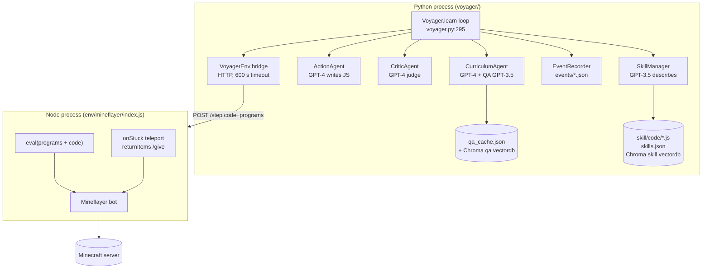
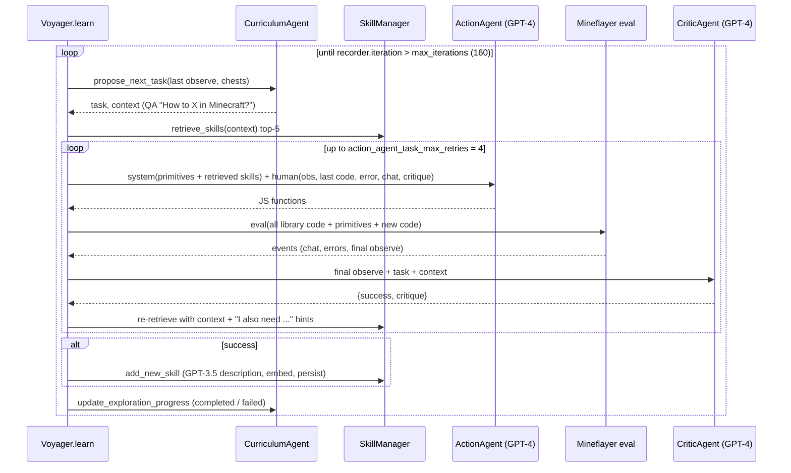

# Voyager: Source-Level Study for Physical RSI

> Subject: `references/evolution/Voyager` (MineDojo/Voyager @ `55e45a8`, 2023-07-27, MIT, `setup.py` version `0.1`)
> Method: static reading only (read / grep / `python3 -I` JSON counting). Nothing was installed, no Minecraft server, Node process or LLM was started. Clone is shallow, so the commit count is not visible.
> Audience: the Evolution (RSI) layer of `Hylo`, read alongside `zetta-embodiment.md` and `memory-landscape.md` §6 (ASPIRE)
> Tags: **\[Implemented\]** traceable in code · **\[Docs/Interface only\]** only docs/prompt text · **\[Unverified\]** code exists but we did not run it · **\[Needs model/hardware\]** needs GPT-4, Minecraft, GPU or a robot

---

## 1. Positioning

Voyager is an LLM-driven lifelong-learning agent for Minecraft. The repository has three LLM roles plus a skill store around a Mineflayer (Node.js) bot (`voyager/voyager.py:52-57`):

| Paper concept | Class | What it really is |
|---|---|---|
| Automatic curriculum | `CurriculumAgent` | GPT-4 proposes the next one-phrase task from a text dump of the agent state (`voyager/agents/curriculum.py:240-309`) |
| Iterative prompting | `ActionAgent` + `Voyager.step` | GPT-4 writes a JavaScript `async function f(bot)`; it is `eval`'d in the bot process; errors, chat log and critique are fed into the next prompt, up to 4 rounds (`voyager/voyager.py:203-285`) |
| Self-verification | `CriticAgent` | GPT-4 judges success from the **final** state text and writes a critique (`voyager/agents/critic.py:116-138`) |
| Skill library | `SkillManager` | dict `program_name -> {code, description}` plus a Chroma vector index over LLM-written descriptions (`voyager/agents/skill.py:13-127`) |

The unit of improvement is **executable code** (a named JS function), not weights or config. Improvement accumulates only in two places: the skill library and the completed/failed task lists that steer the curriculum. Code size is small: ~2.8k LOC of Python in `voyager/` and ~2.0k LOC of JS outside `skill_library/`. There are no tests (the only workflow is an issue template). The last push was 2024-04-03. The repo is a research artifact and is no longer under development.

What the code shows, before reading the paper's claims:
1. **Success is judged only by the LLM critic** (or a human in `manual` mode). There is no programmatic success check, even though Minecraft inventory makes one trivial (`voyager/agents/critic.py:116-138`).
2. **Admission to the library is "critic said success once"**. There is no re-run, no second seed, and no independent verifier (`voyager/voyager.py:353-354`).
3. **The environment helps the agent behind the critic's back.** The server teleports a stuck bot, gives placed crafting tables and furnaces back, and `/give`s chests (`voyager/env/mineflayer/index.js:263-336`).
4. **LLM code runs through raw `eval` inside the Node server process** (`voyager/env/mineflayer/index.js:253-261`).

## 2. Architecture

## 3. Core data structures and interfaces

| Structure | Definition | Storage / versioning | Tag |
|---|---|---|---|
| Skill entry | `{"code": str, "description": str}` keyed by main function name (`voyager/agents/skill.py:85-88`) | `skill/skills.json` + `skill/code/<name>.js` + `skill/description/<name>.txt` (`skill.py:92-100`) | \[Implemented\] |
| Skill "version" | On a name collision the dict entry and vector **are overwritten**. Only the on-disk file gets a `V2`, `V3` suffix (`skill.py:71-79`). The active library keeps one version per name, with no comparison between old and new | filesystem only | \[Implemented\] |
| Skill description | LLM summary wrapped as a stub `async function name(bot) { // ... }` (`skill.py:102-112`; prompt `voyager/prompts/skill.txt:1-7`) | embedded with `OpenAIEmbeddings` into Chroma (`skill.py:40-44`) | \[Implemented\][Needs model] |
| Program parse result | `{"program_code", "program_name", "exec_code"}`. Babel parses the reply; the **last async function** taking exactly `bot` becomes the main function (`voyager/agents/action.py:201-256`) | in memory | \[Implemented\] |
| Event stream | list of `(event_type, payload)`, last must be `observe` (`action.py:109-128`) | `ckpt/events/<task>_<timestamp>` (`voyager/utils/record_utils.py:27-46`) | \[Implemented\] |
| Curriculum state | `completed_tasks`, `failed_tasks` (strings), `qa_cache` (`curriculum.py:46-56`) | JSON + Chroma (`curriculum.py:363-367`) | \[Implemented\] |
| Shipped libraries | `skill_library/trial{1,2,3}` = 51 / 52 / 55 skills in `skills.json`, 57 / 57 / 58 `.js` files. trial1 holds 6 `V2` files | in repo | \[Implemented\] |

Integrity checks are minimal. An assert keeps the vector-DB count equal to the `skills.json` count (`skill.py:45-50`, `:89-91`). There is no content hash, parent link or rollback.

## 4. The improvement loop

Loop facts with citations:
- Outer budget: `max_iterations=160` counts **action-agent rounds** (`recorder.iteration` is incremented on every `record`), not tasks (`voyager/voyager.py:26`, `:219`, `:262`, `:316`; `record_utils.py:32`). \[Implemented\]
- Inner budget: `action_agent_task_max_retries=4` rounds per task (`voyager.py:29`, `:266-269`). \[Implemented\]
- An exception during a rollout does a hard reset, then restores inventory, equipment and position from the last observation (`voyager.py:333-351`). The server does this with `/clear`, `/give` and `/tp` (`index.js:56-87`). \[Implemented\][Unverified]
- Fixed curriculum overrides: the first task is always "Mine 1 wood log" (`curriculum.py:241-244`). When the inventory is 33 or more slots full, a hard-coded deposit/craft-chest task is used (`curriculum.py:246-276`). Difficulty moves from `peaceful` to `easy` after 15 completed tasks (`voyager.py:176-183`). \[Implemented\]

## 5. Candidate generation

**Prompt content.** The system prompt gets the hand-written primitive *context* files plus the top-k retrieved skill code (`action.py:75-100`). With non-GPT-3.5 models it also gets `useChest` and Mineflayer API docs (`action.py:86-90`). Each round the human message carries this feedback (`action.py:102-199`):
- the last round's code ("Code from the last round") and the **execution error** text (`action.py:132-142`)
- the **chat log**: primitives report soft failures via `bot.chat`, e.g. "No X nearby, please explore first" (`voyager/control_primitives/mineBlock.js:18-26`)
- the full status (biome, time, nearby blocks and entities, health, hunger, position, equipment, inventory, chests)
- the task, the context, and the critic's **critique** (`action.py:194-197`)

**Coding rules are only prompt text** \[Docs/Interface only\]. Examples: "Do not write infinite loops", "Do not use `bot.on`", "`maxDistance` should always be 32 ... Do not cheat" (`voyager/prompts/action_template.txt:37-45`). Nothing enforces them.

**Structural validation** \[Implemented\]. Babel must parse the code. There must be an async main function with a single `bot` parameter (`action.py:208-244`). A parse failure is retried 3 times, then that round is lost (`action.py:204-256`; `voyager.py:260-263`).

**Error localisation** \[Implemented\]. `handleError` maps the stack trace back to a line of the generated code. Because the whole skill library is prepended to the eval string, it subtracts the program length to do this (`index.js:338-398`). Feeding back errors at the right location is a cheap trick worth copying.

**Primitive-level fail counters** \[Implemented\]. Primitives count soft failures and throw after more than 10 (`mineBlock.js:20-25`; same pattern in `craftItem.js:36-38`, `killMob.js:30-32`, `placeItem.js:44-46`). This turns silent no-progress into an error the LLM can see.

**Curriculum candidates.** The curriculum prompt requires the next task to be novel but feasible. It also says (`voyager/prompts/curriculum.txt:33`): *"Tasks that require information beyond the player's status to verify should be avoided ... All the placing, building, planting, and trading tasks should be avoided."* So the task generator is **constrained to tasks the text-only critic can verify**. This is a design choice with a direct physical analogue (§11). Observation fields are phased in by a warm-up schedule, and once warmed up each one is included with probability 0.8 (`curriculum.py:91-109`, `:228-235`). The context comes from a 2-step self-QA, cached in a vector DB and matched by embedding distance < 0.05 (`curriculum.py:384-415`). \[Implemented\][Needs model]

## 6. Verification & selection

**Self-verification critic** (`voyager/agents/critic.py`):
- Evidence = **only the final `observe` event**: biome, time, voxels, health, hunger, position, equipment, inventory, plus chest memory, task and context (`critic.py:23-77`). It never sees the code, the action trajectory or the start-of-task inventory. \[Implemented\]
- **Hard fail on any execution error**: if any `onError` event exists, the critic returns `None` and success is `False`, with no LLM call (`critic.py:39-42`, `:98-99`). \[Implemented\]
- The judge is the same model family as the actor (`gpt-4`, temperature 0; `voyager.py:41-42`). Output is JSON `{reasoning, success, critique}`, parsed up to 5 times; on parse failure it returns `False` (`critic.py:91-114`; `voyager/prompts/critic.txt:19-24`). \[Implemented\][Needs model]
- **State, not delta.** The few-shot example in the prompt counts "Mine 3 wood logs" as success with 4 logs in the inventory (`critic.txt:28-38`), with no baseline from before the task. In a persistent world where the inventory carries across tasks, inventory that was already there can satisfy a task. \[Implemented\] (prompt) / effect \[Unverified\]
- `manual` mode substitutes a human y/n plus critique (`critic.py:79-89`). \[Implemented\]

**Library admission.** Admission is `if info["success"]: add_new_skill(info)` (`voyager.py:353-354`). That means one critic-approved run, in one world state. Deposit tasks are excluded (`skill.py:62-64`). A same-named skill **replaces** the old one in the active set (`skill.py:71-73`). There is no regression check that the new version is better. \[Implemented\]

**Retrieval.** The query is the task context, plus after the first round the missing-items hints from the chat log (`voyager.py:184`, `:245-249`; `action.py:258-280`). The top `k=5` matches by Chroma similarity over the descriptions are returned as **code** (`skill.py:114-127`). Retrieval only controls the *prompt*. At execution time **every** skill plus every primitive is concatenated into the eval string (`skill.py:52-59`; `voyager.py:215-218`). So a skill that was overwritten, or is broken but still referenced, stays callable. \[Implemented\]

**Curriculum progression.** Completed tasks are deduplicated. Failed tasks stay in the list (with repeats) until completed, and are shown to the curriculum LLM as "Failed tasks that are too hard" (`curriculum.py:329-367`; `curriculum.txt:23`). No numeric success rate or frontier estimate exists. \[Implemented\]

## 7. Evaluation hygiene

| Question | Finding | Tag |
|---|---|---|
| Is evaluation separate from generation? | No. The same critic decides success during learning and is the only success signal. `learn()` returns task lists and skills, not a metric (`voyager.py:364-368`) | \[Implemented\] |
| Held-out tasks? | `inference()` reuses a library on a new task after LLM decomposition into sub-goals (`voyager.py:370-411`; `README.md:120-143`). That is the paper's zero-shot generalisation claim (`README.md:35-36`). No held-out split, seed list or scorer is in the repo | \[Docs/Interface only\] |
| Independence of episodes | One persistent world: `learn()` hard-resets once, then soft-resets per task (`voyager.py:296-313`, `:169-175`). Tasks are causally coupled through inventory | \[Implemented\] |
| Reward hacking / cheating | The prompt warns "Do not cheat" (`action_template.txt:42`). The environment itself teleports a stuck bot (`index.js:263-298`) and returns crafting tables and furnaces through `/setblock ... air` + `/give` after every step (`index.js:300-336`). The critic cannot see this. The optional `reset_placed_if_failed` undoes placements (`voyager.py:229-244`) | \[Implemented\] |
| Possible non-termination | `inference()` loops `while progress < len(sub_goals)`. A failed sub-goal does not advance `progress`, so it is retried with no cap (`voyager.py:394-405`) | \[Unverified\] |
| Run-to-run variance | Three shipped libraries (51–55 skills) are the only replication evidence in the repo | \[Implemented\] |

## 8. Safety & isolation

- **Execution**: `eval("(async () => {" + programs + "\n" + code + "})()")` runs in the Express server's own Node process (`index.js:253-261`). It has full access to `require`, `fs` and `process`, and the same scope as the bot. There is no VM context, no allow-list and no AST filter. \[Implemented\]
- **Containment is only process-level**: a Python-side HTTP timeout of 600 s (`voyager/env/bridge.py:118-120`; `voyager.py:25`), a global `uncaughtException` handler that turns crashes into an observation (`index.js:155-166`), and a supervisor that restarts Mineflayer (`bridge.py:73-90`; `voyager/env/process_monitor.py`). \[Implemented\][Unverified]
- **Behavioural guards are prompt-only**: "no infinite loops / no event listeners" (`action_template.txt:43-44`). \[Docs/Interface only\]
- **Bot-level damage is not a stop condition**. `damage_messages` are collected and then ignored (`action.py:107-108`, `:115-116`). Health is only shown to the LLM. \[Implemented\]
- **No action shield.** Minecraft deaths are cheap, and the design depends on that.

## 9. Dependencies, cost, license

- Python ≥ 3.9. `langchain` (pre-0.1 API: `langchain.chat_models.ChatOpenAI`), `openai`, `chromadb==0.3.29`, `javascript` (Python↔Node bridge), `minecraft_launcher_lib` (`requirements.txt`). Node: `mineflayer ^4.8.1`, `mineflayer-pathfinder`, `prismarine-*`, `express` (`voyager/env/mineflayer/package.json`). Most of these are unpinned and from 2023. Expect bit-rot. \[Unverified\]
- It needs a licensed Minecraft Java client/server (Azure login recommended, `README.md:75-104`) and OpenAI GPT-4, GPT-3.5 and embeddings. \[Needs model/hardware\]
- Cost: "approximately 160 iterations using GPT-4 will cost you around 50 USD" (`FAQ.md:54`). GPT-3.5 is discouraged (`FAQ.md:50`).
- License: MIT (`LICENSE`, `README.md:38`). Minecraft itself is under the Mojang/Microsoft EULA, and `package.json` declares ISC. Nothing is reused as code by us, so there is no copyleft concern.

## 10. Strengths / weaknesses / risks

**Strengths**
- The minimal, clear loop of *propose task → write code → execute → critique → admit* is still the reference design for skill-as-code RSI.
- The feedback channel to the generator is rich and cheap: localised execution errors (`index.js:338-398`), primitive "soft failure" chat messages, and the critique.
- Primitive fail counters turn silent no-progress into an explicit error (`mineBlock.js:20-25`).
- The curriculum is explicitly constrained to verifiable tasks (`curriculum.txt:33`). This honestly admits the critic's limits.
- Skills compose: library code is in scope, so new skills call old ones (`skill.py:52-59`).

**Weaknesses**
- The admission gate is a single LLM judgement on final state, with no baseline delta and no repetition.
- Versioning is destructive (overwrite by name). There is no rollback, hash, lineage or regression test.
- All library code runs in every eval, so one broken skill can poison later programs.
- No metric, no held-out set, no seeds. Success is not measured independently of the agent.

**Risks for us**
- Copying the "LLM critic = admission gate" pattern would let a self-congratulating critic grow a library of skills that only worked once. This is worse under VLA stochasticity.
- Raw `eval` of LLM code next to a robot driver is unacceptable. Voyager gets away with it because a Minecraft death costs nothing.
- Environment "helpers" (teleport, `/give`) hide failure modes. Our equivalents are privileged resets and privileged state in LIBERO, which `zetta-embodiment.md` §0 already flags.

## 11. What Hylo should adopt (concrete)

Context: frozen SmolVLA on LIBERO (CPU), a kernel-owned loop, `SafetyShield`, and the offline loop in `packages/hylo-evolve/src/hylo/evolve/loop.py`. `ENABLED_KINDS={"config_patch"}` (`candidate.py:31`); `kind="skill"` exists but is disabled (RFC-0001 D5).

1. **Skill = declarative composition over a frozen primitive catalog, not free code.** Use Voyager's shape (named, described, retrievable, composable units), but make the body a typed `SkillPlan` (a sequence of `{primitive, args, precondition, postcondition, timeout}` steps). Primitives are `vla_chunk(instruction)`, `move_to(pose)`, `gripper(open|close)`, `retreat`, and so on, all running through the kernel and `SafetyShield`. This enables `kind="skill"` without the isolation runtime D5 requires. It is the same stance as Zetta's bundles and ASPIRE's `_ProgramValidator`.
2. **Primitive soft-failure counters and structured error text.** Every primitive returns `{ok, reason, progress_delta}`. A per-episode counter (Voyager's `>10` throw) becomes a typed `NoProgress` event in the trace. The generator prompt then gets "error at step k of plan: reason". This is a cheap copy of `index.js:338-398`.
3. **Critic = feedback, gate = ground truth.** Keep an LLM/VLM critic (qwen3.5) that returns `{success, critique}` **only as a text signal to the generator**. Never use it to admit. Admission stays the paired McNemar gate on BDDL success. Add a **critic calibration report**: precision and recall of the VLM critic against BDDL success on held-out episodes. Store it with the critic prompt version. That way the gap Voyager leaves open becomes something we measure.
4. **Delta-based success evidence.** Whatever critic we use gets the *initial and final* state (object poses or predicates before and after) plus key frames, not just the final observation. This avoids the critic.txt "already had 4 logs" failure.
5. **Admission requires reproducibility.** A skill enters the registry only if it (a) passes on ≥ N seeded resets of the source task, (b) passes the validation gate against the parent library, and (c) does not regress per-task success (`loop.py:106-117`). This is ASPIRE's proposer→verifier rule, with our statistics.
6. **Non-destructive versioning.** Skills are content-hashed registry entries with parent links. A name collision creates a new version that must beat its parent in a paired test. It never overwrites. `CandidateRegistry` already gives us promote and rollback.
7. **Scope execution to retrieved skills.** Only the skills a plan references (and their transitive closure) are loaded for an episode. Each episode trace records `skill_library_sha` plus the exact skill digests used. This fixes Voyager's "all library code always in scope".
8. **Verifiable-task curriculum.** Our curriculum does not invent tasks. It picks LIBERO tasks, initial-state seeds and perturbations whose success predicate is checkable, prioritising the frontier (parent success between 0.2 and 0.8). This is the `curriculum.txt:33` constraint made explicit.
9. **Do not adopt**: in-episode multi-round code rewriting on hardware (it maps to repeated physical attempts), persistent-world learning without resets, environment helpers that the trace does not record, or embedding retrieval as a correctness mechanism.

## 12. Source index

| Topic | Location |
|---|---|
| Main loop, budgets, admission | `references/evolution/Voyager/voyager/voyager.py:17-153`, `:203-285`, `:295-368` |
| Inference / decomposition | `references/evolution/Voyager/voyager/voyager.py:370-411` |
| Action agent prompt rendering and parse | `references/evolution/Voyager/voyager/agents/action.py:75-256` |
| Critic | `references/evolution/Voyager/voyager/agents/critic.py:23-138` |
| Curriculum, warm-up, QA cache | `references/evolution/Voyager/voyager/agents/curriculum.py:91-109`, `:240-367`, `:384-434` |
| Skill library | `references/evolution/Voyager/voyager/agents/skill.py:13-127` |
| Code execution (`eval`) and error mapping | `references/evolution/Voyager/voyager/env/mineflayer/index.js:152-261`, `:338-398` |
| Environment helpers (teleport, `/give`) | `references/evolution/Voyager/voyager/env/mineflayer/index.js:56-87`, `:263-336` |
| Bridge timeouts / restart | `references/evolution/Voyager/voyager/env/bridge.py:73-124` |
| Prompts | `references/evolution/Voyager/voyager/prompts/{action_template,critic,curriculum,skill}.txt` |
| Primitive fail counters | `references/evolution/Voyager/voyager/control_primitives/mineBlock.js:18-26` |
| Shipped libraries | `references/evolution/Voyager/skill_library/trial{1,2,3}/skill/` |
| Cost | `references/evolution/Voyager/FAQ.md:52-54` |

## Verification status

| Claim | Status | Evidence |
|---|---|---|
| Skills are JS functions stored as code + LLM description + Chroma embedding | \[Implemented\] | `skill.py:61-100` |
| Admission = one critic-approved success; same-name overwrite | \[Implemented\] | `voyager.py:353-354`; `skill.py:71-88` |
| Critic sees final state only; any execution error ⇒ fail | \[Implemented\] | `critic.py:23-42`, `:98-99` |
| Critic judgement accuracy | \[Unverified\][Needs model] | none in repo |
| Iterative prompting ≤ 4 rounds with error/chat/critique feedback | \[Implemented\] | `voyager.py:29`, `:245-269`; `action.py:102-199` |
| Curriculum excludes tasks needing visual verification | \[Docs/Interface only\] (prompt) | `curriculum.txt:33` |
| Raw `eval` in server process, no sandbox | \[Implemented\] | `index.js:253-261` |
| Env-side teleport / item return | \[Implemented\][Unverified] | `index.js:263-336` |
| Zero-shot generalisation to new worlds | \[Docs/Interface only\][Needs model/hardware] | `README.md:35-36`, `:120-143` |
| `inference()` may loop forever on a failing sub-goal | \[Unverified\] (by reading) | `voyager.py:394-405` |
| 160 iterations ≈ 50 USD GPT-4 | \[Docs/Interface only\] | `FAQ.md:54` |
