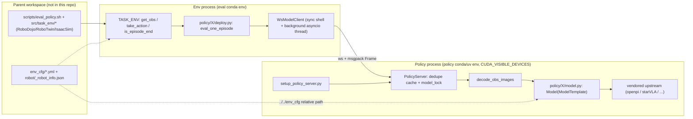

# XPolicyLab Source-Level Architecture Study

> Subject: `references/harness/XPolicyLab` (XPolicyLab/XPolicyLab @ `128e626`, root LICENSE is Apache-2.0)
> Method: purely static analysis (read / grep / `python3 -I` AST scans); no dependencies were installed, no weights downloaded, and no simulator or policy server was started.
> Tag meanings: **\[Implemented\]** code exists and the call chain can be traced; **\[Docs/Interface only\]** appears only in docs, or is just an abstract stub or unwired parameter; **\[Unverified\]** code exists but we have not run it; **\[Needs model/hardware\]** requires weights, GPU, simulation assets or a real robot.
> Citation format: `P/<path>:<line>`, where `P = references/harness/XPolicyLab`.

---

## 1. Positioning and Core Capabilities

XPolicyLab describes itself as "the shared layer between policy code and evaluation environments" (`P/README.md:26`), aiming to reduce the wiring cost of N policies × M benchmarks from O(N×M) to O(N+M). After taking the source apart, the conclusion is: **it is "a policy-side adapter specification + a process-isolated RPC transport layer + a large policy zoo", not a complete eval harness.**

Size comparison (static counts):

| Part | Contents | Size |
| --- | --- | --- |
| Project-owned framework | `client_server/`, `utils/`, `setup_policy_server.py`, `model_template.py`, `scripts/` | About 6.5k lines of Python (ws/tcp transport 2.3k, utils 1.8k, LeRobot converter 2.1k), plus about 1.4k lines of shell |
| Policy zoo | 76 directories under `policy/` (the README says 69 policies plus `demo_policy`, `P/README.md:26`), most of which vendor upstream source | About 1.6 million lines in `policy/**/*.py`, 6481 .py files |

Core capabilities (tagged item by item):

- **Unified policy interface `ModelTemplate`**: `update_obs / get_action / *_batch / reset` plus two optional hooks. \[Implemented\] (`P/model_template.py:1-104`)
- **WebSocket + msgpack policy server/client**: achieves exactly-once replay, server instance pinning, keepalive and cold-start retries. \[Implemented\][Unverified] (`P/client_server/ws/model_server.py:70-95`, `P/client_server/ws/protocol/client.py:235-340`)
- **Process isolation / dependency isolation**: policy and env run in their own conda or uv environments, orchestrated by shell scripts. \[Implemented\][Needs model/hardware] (`P/policy/demo_policy/eval.sh:23-68`)
- **Standard observation / trajectory data format**, plus RGB-marker JPEG encoding/decoding. \[Implemented\] (`P/utils/process_data.py:296-748`)
- **Checkpoint path convention resolver**. \[Implemented\] (`P/utils/checkpoint_resolver.py:93-183`)
- **Debug closed loop**: a fake environment that needs no simulator, used to check IO, shapes and action keys. \[Implemented\][Unverified] (`P/utils/debug_env_client.py:19-365`)
- **Actual simulator environments, task definitions, success checks, success-rate statistics, multi-GPU sharding**: all **outside this repo**, in the parent workspace (RoboDojo/RoboTwin's `scripts/eval_policy.sh`, `src/task_env/`, `env_cfg/`). This repo only has the invocation entry points. \[Docs/Interface only\] (`P/utils/run_sim_env_client.sh:26-38`, `P/utils/run_real_env_client.sh:54`, `P/scripts/run_robodojo_sim_eval.sh:73-79`)
- **Real-robot evaluation**: the scripts directly warn "not supported in the open-source release". \[Docs/Interface only\] (`P/utils/setup_env_client.sh:85`, `P/utils/run_real_env_client.sh:32`)

## 2. Directory Layout and Architecture

```text
XPolicyLab/                       # must be used as a subpackage of the parent workspace (AGENTS.md)
├── XPolicyLab.py                 # disguises the repo root as a package: __path__ = [dirname]
├── model_template.py             # ModelTemplate unified interface
├── setup_policy_server.py        # policy process entry: read deploy.yml, import Model, start server
├── client_server/
│   ├── ws/                       # default transport: PolicyServer / PolicyEvalClient / WsModelClient
│   │   └── protocol/             # Frame schema(pydantic), MessageType, codec(msgpack), ErrorCode
│   └── tcp/                      # legacy_tcp: length-prefixed JSON + base64 numpy
├── utils/                        # process_data(encode/decode, state packing), checkpoint_resolver, live_frames,
│                                 # debug_env_client, various run_*_env_client.sh / wait_for_*.sh
├── scripts/                      # LeRobot v2.1/v3.0 converter, RoboDojo download and sim launch wrappers
├── policy/<POLICY>/              # one adapter + vendored upstream per policy
│   ├── model.py / deploy.py / deploy.yml / eval.sh / setup_eval_{policy_server,env_client}.sh
│   └── <upstream>/               # vendored third-party source (licenses vary, see section 7)
└── .agents/skills/               # two SKILL.md files for coding agents (integration, audit)
```

Runtime architecture (only the middle two blocks are in this repo):



Several key design points:

- Two kinds of loop ownership coexist. The **policy side** is a passive RPC service; the **control loop (loop owner)** is a `deploy.py` function provided by the policy itself, running in the env process. These functions are loaded by the env process via `__import__('XPolicyLab.policy.<name>.deploy')` (`P/utils/debug_env_client.py:168-180`). So the env process must also be able to import the package `XPolicyLab.policy.<name>`.
- Coupling to the parent workspace is hard-coded. `get_robot_action_dim_info` locates configuration via `os.path.dirname(__file__)/../../env_cfg` (`P/utils/process_data.py:252-257`); the repo cannot run standalone when taken out on its own.

## 3. Core Interfaces and Key Classes

### 3.1 Policy interface: `ModelTemplate` (`P/model_template.py:1-104`)

```python
class ModelTemplate:
    def __init__(self): self.model = None                      # :27
    def update_obs(self, obs): raise NotImplementedError       # :42
    def update_obs_batch(self, obs_list): raise NotImplementedError   # :55
    def get_action(self): raise NotImplementedError            # :67  -> list[dict] (one chunk)
    def get_action_batch(self, env_idx_list=None): raise NotImplementedError  # :76
    def reset(self): pass                                      # :85  no arguments
    def prepare_case(self, case_meta=None): pass               # :92  optional hook
    def on_trial_end(self, result=None): pass                  # :99  optional hook
```

- This is a **stateful two-phase interface**: first `update_obs` stores the observation in the object, then the argument-less `get_action` is called. There is no typing, and no ABC or Protocol; concrete constraints are defined by a table in CONTRIBUTING (`P/CONTRIBUTING.md:48-58`).
- Actual conformance (AST scan of 76 `model.py` files): 73 directly subclass `ModelTemplate`. The remaining 3: `HWM_CogWAM` directly re-exports an upstream class (`P/policy/HWM_CogWAM/model.py:36`), `Liber_0_preview` subclasses another adapter, and `GPT_6_Astra_Direct_EEF` subclasses a no-op Model (`P/policy/GPT_6_Astra_Direct_EEF/model.py:6`).
- The server dispatches dynamically with `getattr`, so **any public method not starting with `_` can be called remotely** (`P/client_server/ws/model_server.py:460-473`). Mem_0's `begin_episode/step`, VPP2's `reset_client` and OpenDM's `reset_evaluation` are all private RPCs exposed through this mechanism. In other words, the interface is in practice open.

### 3.2 Observation contract (runtime)

The schema is only written in the docs (`P/README.md:348-390`); there is no schema validation at the code level:

```text
obs = {
  "instruction": str | list[str], "env_idx": int?, "data_format_version": "v1.0"?,
  "additional_info": {"frequency": int?},
  "vision": {<cam>: {"color": HxWx3 RGB uint8 (already decoded by server), "depth"?, "intrinsic_matrix"?(3x3),
                     "extrinsics_matrix"?(4x4), "shape"?}},
  "state": {"left_arm_joint_state"(DOF,), "left_ee_joint_state"(EEF,), "left_ee_pose"(7,),
            "left_tcp_pose"(7,), "left_delta_ee_pose"(7,), "right_*"..., single-arm drops the prefix,
            "mobile": {"base_pose"(7,), "base_twist"(6,)}}
}
```

- Poses uniformly use `[x,y,z,qw,qx,qy,qz]` (`P/utils/process_data.py:56-58`).
- Image decoding is centralized on the server side: `decode_obs_images` only handles `vision/<cam>/{color,colors,rgb,image}` and does not touch depth (`P/utils/process_data.py:536`, `:553-600`), and it runs inside `asyncio.to_thread` to avoid blocking the event loop (`P/client_server/ws/model_server.py:479-495`). \[Implemented\]
- Known naming inconsistencies: the runtime field is called `extrinsics_matrix` while the trajectory field is called `extrinsic_matrix`, which the README itself admits. In addition, **single-arm joint state keys are inconsistent**: the README and the debug env use `arm_joint_state` (`P/README.md:379`, `P/utils/debug_env_client.py:142`, `:256`), while `pack_robot_state/unpack_robot_state` use `joint_state` (`P/utils/process_data.py:90`). According to the debug env's `validate_robot_state_dict` (`:291-294`), single-arm joint output would be judged as "Unexpected state keys". All 6 robots registered in `utils/robot/_robot_info.json` are dual-arm (`P/utils/robot/_robot_info.json:1-26`), so the single-arm path is effectively not covered. \[Unverified\]

### 3.3 Action contract and action chunking

- `get_action()` returns **one chunk** of type `list[dict[str, np.ndarray]]`; the dict keys share names with state keys, e.g. `left_arm_joint_state`, `left_ee_joint_state`, and `left_ee_pose` in ee mode (`P/policy/demo_policy/model.py:40-85`). `get_action_batch` returns `list[chunk]`, which must align with `env_idx_list` (`:87-93`).
- Source of dimensions: `get_robot_action_dim_info(env_cfg_type) -> {"arm_dim":[..], "ee_dim":[..]}` (`P/utils/process_data.py:252-257`). The vector packing order is `[arm_0, ee_0, arm_1, ee_1]` (`:124-178`, `:181-250`).
- **Chunk execution semantics are decided by the env-side `deploy.py`, not by the framework**. The reference implementation executes the whole chunk step by step, calling `update_obs` once per step (but without re-inferring), and calls `get_action` again after the chunk is used up (`P/policy/demo_policy/deploy.py:5-17`). The framework has no temporal ensembling, no receding-horizon parameter, and no chunk metadata (timestamps, executed step count). Mem_0 takes a different route: it maintains its own chunk queue on the server side, and `step(obs)` returns only one action or `None` each time (`P/policy/Mem_0/model.py:338-371`).
- **Normalization is handled entirely by each adapter**; the framework provides nothing. For example, Pi_05 loads openpi's `norm_stats` (`P/policy/Pi_05/model.py:102-112`), and Dexora_1B uses `clip_normalized_actions` (`P/policy/Dexora_1B/deploy.yml:33`).

### 3.4 Transport-layer contract

```python
class Frame(BaseModel):                     # P/client_server/ws/protocol/schemas.py:31-56, extra="forbid"
    message_type: MessageType; request_id: str; evaluation_id: str
    action_case_id: str|None; trial_id: str|None; repeat_index: int|None
    step: int = 0                           # counts inference calls, not control steps (ws/model_client.py:25-27)
    sent_at: str; payload: dict[str, Any]
class MessageType(str, Enum):               # messages.py:8-24
    HELLO PREPARE_CASE RESET CALL INFER TRIAL_END HEARTBEAT CLOSE ERROR (+ *_ACK/_RESULT)
class ErrorCode(str, Enum):                 # exceptions.py:7-14
    INVALID_FRAME UNKNOWN_MESSAGE_TYPE TIMEOUT CALL_FAILED INFER_FAILED RESET_FAILED INTERNAL
@dataclass class PolicyServer:              # model_server.py:70-95
    model; config: PolicyServerConfig; _model_lock; _instance_id; _response_cache(LRU 256); _inflight
@dataclass class PolicyEvalClientConfig:    # protocol/client.py:86-147
    url; evaluation_id; connect_timeout_s=30; request_timeout_s=120; handshake_timeout_s=60
    max_connect_attempts=180; connect_retry_delay_s=5; max_connect_seconds=900; close_timeout_s=10
class WsModelClient:                        # ws/model_client.py:13-219
    def call(self, func_name, obs=None) -> Any   # returns only payload["result"]
```

Codec-layer details: msgpack plus msgpack_numpy; torch.Tensor is first `detach().cpu()`'d, and bf16 is first converted to float (`P/client_server/ws/protocol/codec.py:17-34`); int-typed dict keys are converted to str, for compatibility with the old JSON protocol (`:53-72`).

## 4. Core Execution Flow

```mermaid
sequenceDiagram
  participant SH as eval.sh
  participant PSrv as setup_policy_server.py + PolicyServer
  participant M as Model(ModelTemplate)
  participant Ext as parent workspace eval_policy.sh / TASK_ENV
  participant D as deploy.py (env process)
  participant C as WsModelClient
  SH->>SH: get_free_port.sh
  SH->>PSrv: setup_eval_policy_server.sh & (conda/uv activate, CUDA_VISIBLE_DEVICES)
  PSrv->>M: import XPolicyLab.policy.X.model; Model(deploy_cfg) (load weights first)
  PSrv->>PSrv: serve() (port opened only after model loads)
  SH->>SH: wait_for_policy_server.sh (/proc/net/tcp LISTEN detection + pid liveness check)
  SH->>Ext: setup_eval_env_client.sh → setup_env_client.sh → run_sim_env_client.sh
  Ext->>C: WsModelClient(url, evaluation_id, trial_id), connect retries up to 180 times / 900s
  C->>PSrv: HELLO → HELLO_ACK(server_instance_id), client remembers instance id
  loop each episode (loop driven by external env)
    Ext->>C: call("reset") → RESET → Model.reset()
    Ext->>D: eval_one_episode(TASK_ENV, model_client)
    loop until TASK_ENV.is_episode_end()
      D->>Ext: get_obs()
      D->>C: call("update_obs", obs)
      C->>PSrv: CALL{func_name, obs}
      PSrv->>PSrv: dedupe(request_id) → to_thread(decode_obs_images) → model_lock
      PSrv->>M: update_obs(obs)
      D->>C: call("get_action")
      PSrv->>M: get_action() → chunk list[dict]
      PSrv-->>C: CALL_RESULT{result, latency_ms}
      loop for action in chunk
        D->>Ext: take_action(action); if not ended, get_obs + update_obs
      end
    end
  end
  SH->>PSrv: trap EXIT → kill SERVER_PID
```

Lifecycle and failure handling, item by item:

- **Ownership of reset/step**: `reset` on the policy side takes no arguments (`P/client_server/ws/model_server.py:445-458`). The real env reset and step both happen in the external TASK_ENV; in debug mode they are `TestEnv.reset/take_action` (`P/utils/debug_env_client.py:196-210`).
- **Termination**: decided only by `TASK_ENV.is_episode_end()`. The debug env hard-codes a 20-step limit (`P/utils/debug_env_client.py:24`, `:212-217`). The policy has no channel to tell the env "done" or "abstain". Mem_0's approach is to return `None` and then `continue` in deploy (`P/policy/Mem_0/deploy.py:18-20`).
- **Failure handling (ws)**:
  1. Model exceptions are wrapped as `CALL_FAILED/INFER_FAILED/RESET_FAILED`; only `str(exc)` is returned to the client, and the traceback is only recorded in the server-side log (`model_server.py:334-354`).
  2. When a return value cannot be serialized (e.g. object dtype), an ERROR is proactively sent rather than not replying (`:165-182`).
  3. After a disconnect, the client reconnects and retries once with **the same request_id**; the server replays the result from the LRU cache or the in-flight task, which guarantees a stateful policy is not executed twice (`model_server.py:294-332`, `protocol/client.py:474-478`, `:504-519`).
  4. **Timeouts are fatal** and not retried, because the server may still be executing (`protocol/client.py:520-530`).
  5. If the instance id has changed after reconnecting, `ServerRestartedError` is raised to fail the whole evaluation (`protocol/client.py:342-359`).
  6. On shutdown, `asyncio.shield` protects in-progress model calls, waiting up to 30 seconds (`model_server.py:115-135`, `:330-332`).

  All of the above are \[Implemented\][Unverified].
- **Failure handling (legacy_tcp)**: on error, the server replies `{"error", "traceback"}` and then **drops the connection** (`P/client_server/tcp/model_server.py:115-122`); if the client does not get `"res"` it **silently returns `None`** (`P/client_server/tcp/model_client.py:142-144`). Errors are swallowed this way.
- **Concurrency model**: one server process has only one Model instance, plus a global `_model_lock` (`model_server.py:75`, `:398-400`); multiple connections **share the same model state**. VPP2 therefore stuffs its own `_vpp2_client_id` into obs to distinguish clients (`P/policy/VPP2/deploy.py:10-16`, `:20-35`).
- **Unused protocol surface**:
  - `INFER` (atomic merge of `update_obs+get_action`) is already implemented on the server (`model_server.py:510-573`), and `PolicyEvalClient.infer` exists too (`protocol/client.py:633-649`), but the packaged synchronous `WsModelClient` only sends `CALL`.
  - The `evaluation_plan` in HELLO is echoed by the client, but the server does not read it at all (`model_server.py:403-412`).
  - `--relay-url` is described as "future relay mode" (`P/setup_policy_server.py:107`).

  All of the above are classified as \[Docs/Interface only\].

## 5. Extension Points and Plugin Mechanism

| Extension dimension | Mechanism | Evidence | Tag |
| --- | --- | --- | --- |
| New policy family | Convention-based plugin: `cp -r policy/demo_policy policy/<NAME>`, then implement `Model` and `deploy.py`; `deploy.yml.policy_name` must match the directory name. There is no registry and no entry point; `importlib.import_module(f"XPolicyLab.policy.{policy_name}.model")` is the entire discovery mechanism | `P/scripts/create_policy.sh:1-3`, `P/setup_policy_server.py:17-32`, `P/client_server/ws/model_server.py:608-613` | \[Implemented\] |
| Custom control loop | Each policy ships its own `deploy.py: eval_one_episode / eval_one_episode_batch`, executed in the env process. Statistics: of the 76, 29 are nearly identical to the demo (similarity >0.95), and the rest have each been modified | `P/policy/demo_policy/deploy.py:1-42`, `P/policy/physicalRSI/runtime/PhysicalRSI_baselines/robodojo/evaluation.py:32-86` | \[Implemented\] |
| Custom RPC | The server can `getattr` any public method, and decodes first for every CALL carrying obs | `P/client_server/ws/model_server.py:460-508` | \[Implemented\] |
| Episode / case hooks | `prepare_case(case_meta)`, `on_trial_end(result)`. Only Evo_1, WorldLA, WorldScape and physicalRSI implement them; the caller is the external env (RoboTwin) | `P/model_template.py:92-104`, `P/policy/Evo_1/model.py:203-214` | \[Implemented\]/\[Unverified\] |
| New simulator / benchmark | **There is no abstraction at all in this repo**. TASK_ENV is duck-typed, requiring `get_obs/get_obs_batch/take_action/take_action_batch/is_episode_end/get_running_env_idx_list/finish_episode`; the only reference implementation is the debug `TestEnv`. Real environments live in the parent workspace, selected by `EVAL_ENV_TYPE ∈ {sim, debug, real}` | `P/utils/debug_env_client.py:19-224`, `P/utils/setup_env_client.sh:80-90`, `P/utils/resolve_eval_env_type.sh` | \[Docs/Interface only\] |
| New robot | Must be registered once in each of two `_robot_info.json` files: the parent workspace's `env_cfg/robot/` indexed by robot name, and the in-repo `utils/robot/` used by `train.sh` | `P/AGENTS.md`, `P/utils/get_action_dim.sh:6-17` | \[Implemented\] |
| Two-hop / external server | An adapter's `Model` can itself be a client of another server (HWM_CogWAM first starts a GPU backend, then starts the standard server) | `P/policy/HWM_CogWAM/model.py:1-38`, `P/policy/HWM_CogWAM/setup_eval_policy_server.sh:4-7` | \[Implemented\][Needs model/hardware] |
| Agent/LLM policy | `GPT_6_Astra_Direct_EEF`: the policy server side is a no-op; the LLM agent and Cartesian planner run directly in the env process and directly access `TASK_ENV.robot_manager.planner` | `P/policy/GPT_6_Astra_Direct_EEF/inspect/model.py:16-41`, `P/policy/GPT_6_Astra_Direct_EEF/deploy.py:25-45`, `inspect/deploy.py:530` | \[Implemented\][Needs model/hardware] |
| Coding-agent integration | `.agents/skills/xpolicylab-{model-integration,adapter-check}/SKILL.md`, together with standing rules in AGENTS.md | `P/.agents/skills/xpolicylab-adapter-check/SKILL.md:1-40` | \[Docs/Interface only\] |

The Agent/LLM policy category is the most noteworthy: it shows that **an "obs→action RPC protocol" cannot accommodate reasoning/agent-type policies**. Such policies need access to the env's planner and robot handle, so the only option was to move the policy logic to the env side, losing process isolation in the process.

## 6. Dependencies and Runtime Requirements

- **The framework itself**: `numpy, pyyaml, opencv-python-headless, h5py, websockets>=14, msgpack, msgpack-numpy, pydantic>=2.5`, Python ≥3.10. `pip install -e .` only packages `client_server*` and `utils*`; `policy*` is excluded (`P/pyproject.toml:1-25`). The env side also needs XPolicyLab installed, because `deploy.py` and `utils.process_data` must be imported in the env process.
- **How dependency conflicts are handled: one separate environment per policy, plus process isolation**. Results of an AST scan of `install.sh`: 33 conda, 13 uv (Pi_0 series, GR00T, Spirit, physicalRSI, etc.), 22 pip-only, 2 with no install.sh (Dexora_1B, X_WAM); 9 `git clone` upstream at install time, of which KinRT, VPP2, WorldLA, LingBot_VLA's lerobot and Evo_1 are pinned to a commit SHA, while Hy_Embodied is unpinned (`P/policy/Hy_Embodied_05_VLA/install.sh:23`). Apart from EgoVLA's install.sh mentioning docker, **there are no Dockerfiles and no lockfile system**. Pi_05 example: `uv sync` inside the vendored openpi directory, then `pip install -e` XPolicyLab into the same venv (`P/policy/Pi_05/install.sh:16-21`). \[Implemented\][Unverified]
- **Orchestration is entirely bash**: `eval.sh` picks a free port, starts the server in the background, does LISTEN probing, then runs the client, killing the server on `trap EXIT` (`P/policy/demo_policy/eval.sh:23-68`, `P/utils/wait_for_policy_server.sh:58-182`). `setup_eval_policy_server.sh` activates the environment with `conda activate`, selects the GPU with `CUDA_VISIBLE_DEVICES`, then runs `setup_policy_server.py --overrides k=v...` (`P/policy/demo_policy/setup_eval_policy_server.sh:24-41`).
- **Configuration**: `deploy.yml` is parsed into a dict and then merged with `--overrides`; override values go through `ast.literal_eval`, so `ckpt_name=0` becomes an int (`P/setup_policy_server.py:115-140`). There is no schema validation; only host and port are checked to be non-empty (`:153-164`). Per-run parameters are passed into the shell as 10 positional arguments, and `additional_info` is a string in `k=v,k=v` format (`P/policy/demo_policy/eval.sh:26`).
- **Hardware**: real evaluation needs RoboDojo Isaac Sim. `robodojo_sim_env.sh` **writes files into `/usr/share/vulkan/icd.d` with `sudo tee`** to fix the NVIDIA ICD, and also has to deal with CUDA forward-compat driver issues (`P/scripts/robodojo_sim_env.sh:62-77`). \[Needs model/hardware\]
- **Reproducibility**: the checkpoint naming convention is `{bench}-{ckpt}-{env_cfg}-{action}-{seed}` (`P/utils/checkpoint_resolver.py:68-83`). `seed` is only passed through as configuration; the framework itself sets no random seeds; only 9 of the 76 `model.py` files call `manual_seed/np.random.seed` themselves. There is no config snapshot and no run metadata recording (git sha, environment hash). physicalRSI is the exception, doing sha256 verification of its asset manifest (`P/policy/physicalRSI/README.md`).
- **Testing / CI**: **the framework code has no tests at all and no CI**; `.github/` only contains a PR template. The quality bar is the grep checks in CONTRIBUTING plus the debug closed loop (`P/CONTRIBUTING.md:126-159`). A few adapters ship tests, e.g. Evo_1 starts a real `PolicyServer(port=0)` for a round-trip test (`P/policy/Evo_1/tests/test_adapter.py:201-232`).

## 7. License and Reuse Constraints

**Root License: Apache-2.0** (`P/LICENSE`). It only covers project-owned code and does not automatically cover vendored subdirectories. The framework layer (`client_server/`, `utils/`, `model_template.py`, `setup_policy_server.py`) does not depend on any vendored code itself, and **can be extracted and used on its own under Apache-2.0**.

Vendored subprojects and their licenses (based on LICENSE/NOTICE files actually present in the subdirectories):

| License category | Policy → vendored directory |
| --- | --- |
| **Apache-2.0** | Being_H05/Being-H, DreamZero/dreamzero, EWAM/EWAM, GR00T_N17/gr00t_n17, LingBot_VA, LingBot_VLA, MachEmbodied-U0, OpenDM/opendm, OpenWAM (including Wan backbone), Rex_M1_preview/rex_m1 (NOTICE mentions Qwen), UniWAM/uniwam, X_VLA/xvla, X_WAM/X-WAM, Xiaomi_Robotics_0, Xiaomi_Robotics_1, ACT/detr, TinyVLA/policy_heads, EgoVLA/VILA, Abot_M0/…/lerobot, Liber_0_lite/vendor (both Apache and MIT files) |
| **Apache-2.0 + Gemma Terms of Use** (code is Apache, PaliGemma-related weights are subject to the Gemma terms) | Pi_0/openpi, Pi_05/openpi, Pi_0_Fast/openpi, Spatial_Forcing/open_sf, ME_Brain_1/source |
| **MIT** | ACT, AHA_WAM/AHAWAM, Dexbotic_DM0/dexbotic, EgoVLA/EgoVLA_Release, EventVLA, Evo_1 (LICENSE.upstream), FastWAM, GO_3_Nano_preview, HWM_CogWAM/CogWAM, InternW0_delta/wam_runtime, Meituan_Robotics_0, OpenVLA_OFT, PatchWAM, PICA_WAM, PrismWAM, RDT_1B/rdt, SimpleMemVLA, Spark_0, Spirit_v15, StarVLA, TinyVLA, Phoenix_MWA, Abot_M0/…/any4lerobot, DP/…/mingpt |
| **MPL-2.0 (file-level copyleft)** | **H_RDT/H_RDT** (our classification script misreported it as AGPL/LGPL; manual check confirmed MPL-2.0) |
| **Non-commercial (NC)** | **InternVLA_A1_5** (CC BY-NC-SA 4.0), **LDA_1B/LDA-1B** (CC BY-NC 4.0), **G05/G05** (G0.5 Community License, non-commercial; the Qwen3.5 part is Apache, the G0 part is Apache), **GalaxeaVLA** (G0-Plus Community License, non-commercial), **PatchWAM/vendor/flux2/model_licenses** (FLUX weights non-commercial, code part Apache) |
| **Custom / restricted** | Phoenix_MWA/…/dinov3 (Meta DINOv3 License) |
| **No LICENSE file (README only links upstream, or some files carry SPDX headers)** | A1, Abot_M0 main body (partly SPDX Apache-2.0), Awomo05 (partly SPDX Apache-2.0), **CloudRobo_WM** (NOTICE explicitly says "do not supply a LICENSE file"), DP/diffusion_policy (upstream is MIT, but there is no LICENSE in the tree), GigaWorldPolicy, GO1/AgiBot-World, InternVLA_A1 (partly SPDX Apache), KinRT, Mem_0, MM_ABC, MoPA, RISE, Simate_beta, WorldScape_Policy_2, ME_Dex_1_0, physicalRSI/runtime (only skills/LICENSE.openpi and LICENSE.xpolicylab), GPT_6_Astra_Direct_EEF, and several thin adapters that clone at install time: Dexora_1B, Hy_Embodied_05_VLA, SmolVLA, ViGAR, VPP2, WorldLA, MolmoAct2, Discrete_Forcing |

Reuse risks:

1. **Do not vendor the whole repo**. The repo mixes NC, MPL and unlicensed code; redistributing it as a whole would bring the non-commercial terms along.
2. When reusing only framework code such as `client_server/`, `utils/process_data.py` and `checkpoint_resolver.py`, keeping the Apache-2.0 NOTICE and attribution is enough.
3. Unlicensed directories (25+ in total) **default to all rights reserved** and must not be copied.
4. Weight licenses are another layer of constraint (Gemma, FLUX, G0.5, etc.), outside the scope of this source scan, marked \[Needs model/hardware\].

## 8. Strengths, Weaknesses and Risks

**Strengths**

- The transport layer's engineering quality is high, rare among comparable projects. Exactly-once replay, in-flight dedupe (`asyncio.shield`), instance-id pinning, cold-start budget, moving blocking decode out of the event loop, bounded drain on shutdown - each has comments explaining the rationale (`P/client_server/ws/model_server.py:30-44`, `:294-354`). \[Implemented\][Unverified]
- The dependency isolation approach is pragmatic: one environment and one server process per policy, with RPC instead of import. So the 69 policies can be completely mutually incompatible at the dependency level. \[Implemented\]
- The historical RGB/BGR baggage of images is handled rigorously: an `XPL-RGB1` marker is written into the JPEG COM segment so that each buffer is self-describing, and grep rules keep hand-written decoding out (`P/utils/process_data.py:272-296`, `:428-447`). \[Implemented\]
- Low integration barrier: `ModelTemplate` has only 5 methods, the reference adapter is under 100 lines, and together with the debug closed loop and coding-agent skills, large-scale integration of third-party policies has already worked in practice (76 directories).

**Weaknesses**

- The framework is thin. Env, task, success, metrics, result format and sharding all live in the external RoboDojo; this repo has no benchmark abstraction (section 5).
- Weakly typed interfaces: obs and action are both arbitrary dicts with no schema validation, and single-arm keys are already inconsistent (section 3.2). `get_action` is a stateful two-phase call, and the batch and single-sample method sets are duplicated.
- Loop logic is scattered across 76 `deploy.py` files, 47 of which differ from the reference implementation; chunk execution semantics cannot be controlled uniformly.
- High observation overhead: the reference loop sends a full multi-camera `update_obs` round trip at every step of the chunk (`P/policy/demo_policy/deploy.py:16-17`), even when inference does not use it.
- Weak observability: the server computes `latency_ms` every time, but `WsModelClient.call` only returns `result`, so latency is thrown away (`P/client_server/ws/model_client.py:192-194`). Logging is just print plus logging, with no structured trace (GPT_6's transcript and the `index.jsonl` of `live_frames` are local exceptions, `P/utils/live_frames.py:355-389`).
- A single Model plus a global lock, with multiple connections sharing state, means one server cannot serve multiple envs at once (VPP2 had to patch around it).

**Risks**

- Hard-coded parent-workspace paths (`../../env_cfg`), together with package disguise (`XPolicyLab.py` uses `__path__` to masquerade as a package), are very sensitive to sys.path and directory layout; AGENTS.md even devotes space to explaining the difference between `parents[2]` and `parents[3]`.
- legacy_tcp silently returning `None` masks errors, and `run_robodojo_sim_eval.sh` still references policy names that no longer exist (`P/scripts/run_robodojo_sim_eval.sh:43-60`).
- No tests and no CI; the correctness of the transport layer can only be ensured by comments and manual review.
- Ops scripts contain `sudo` operations that modify system configuration (section 6).
- Mixed licenses (section 7).

## 9. Components Worth Reusing

| Component | Reuse mode | Rationale |
| --- | --- | --- |
| `client_server/ws/protocol/*` plus the dedupe/shield/instance-pin mechanism of `model_server.py` | **Reuse directly or lightly rewrite** (Apache-2.0) | Exactly-once and restart detection are where remote inference of stateful VLAs most easily goes wrong, and a mature implementation already exists here. Changes needed: add a typed schema to the payload, and replace the global lock with per-session Models |
| `Frame` envelope fields (`evaluation_id/action_case_id/trial_id/repeat_index/step`) | **Reuse the design** | A natural fit as correlation keys for our tracing and result archiving |
| The marker scheme of `decode_image_bit/encode_image_bit` | **Reuse the idea**, adopt as-is at the data layer | Solves the RGB/BGR ambiguity of legacy data. Must be used if ingesting RoboDojo data |
| The priority chain of `checkpoint_resolver` | **Reuse directly** | Simple rules; 51 of the 76 model.py files use it |
| The LISTEN probe + pid liveness check of `wait_for_policy_server.sh` | **Reuse the idea**, rewrite in Python | Avoids false positives from the ws handshake, and fails early when the server exits prematurely |
| The `ModelTemplate` hook set (`prepare_case/on_trial_end`) | **Reuse the semantics** | Provides case-level and trial-level callbacks for memory and RSI-type policies; physicalRSI uses them |
| Adapter directory convention, debug closed loop, AGENTS/SKILL docs | **Reuse the process** | The process for large-scale integration of third-party policies has already been validated |
| physicalRSI's `SelfHarness/Proposer/Evaluator` Protocol | **Reference the design only** (no license file, code cannot be copied) | Highly relevant to our recursive self-improvement module (`P/policy/physicalRSI/runtime/PhysicalRSI_core/self_harness/__init__.py:27-46`) \[Unverified\] |

## 10. Capabilities Not Worth Rebuilding

- **The policy zoo itself**. The 69 adapters have already wired the inference entry points of upstreams such as openpi, starVLA, GR00T and RDT into the unified `ModelTemplate`. `worldcurrent` should write an **XPolicyLab bridge**, i.e. a ws client implementing our Policy interface, calling these servers as a submodule or external service, rather than re-wiring them ourselves. The prerequisite is choosing license-clean adapters (section 7). \[Implemented\][Needs model/hardware]
- **Per-policy environment install scripts** (the uv/conda recipes in `install.sh`), and the checkpoint naming convention.
- **LeRobot v2.1/v3.0 converter** (`P/scripts/transform_lerobot_v{21,30}_format.py`): used to convert RoboDojo trajectories into LeRobot data. \[Implemented\][Unverified]

Parts we **must design ourselves and cannot copy**:

- Simulator/benchmark abstraction: this repo has none.
- A unified control loop owner: chunk execution strategy should be brought under framework management, no longer left to each policy's deploy.py.
- Typed Observation/Action schemas and a normalization layer.
- Result format and metric aggregation.
- Structured tracing.
- A safe channel for agent/reasoning policies to access env tools (planner, robot handle): GPT_6's approach breaks process isolation and needs to be replaced.

## 11. Source Index of Key Implementations

| Concern | file:line | Note |
| --- | --- | --- |
| Policy unified interface | `P/model_template.py:1-104` | 5 required methods plus 2 optional hooks, no type constraints |
| Server entry and plugin loading | `P/setup_policy_server.py:17-32` | `importlib` loads `Model` by directory name, no registry |
| Config merging | `P/setup_policy_server.py:100-164` | yaml plus `--overrides` (literal_eval), only host and port validated |
| ws server body | `P/client_server/ws/model_server.py:70-95` | Global `_model_lock`, instance_id, LRU 256 |
| Exactly-once replay | `P/client_server/ws/model_server.py:294-332` | cache plus in-flight, with shield |
| Generic RPC dispatch | `P/client_server/ws/model_server.py:460-508` | Any public method callable, decodes first when obs present, returns latency_ms |
| INFER atomic inference | `P/client_server/ws/model_server.py:510-573` | Executes update_obs+get_action in the same thread; not used by the sync client |
| Frame schema | `P/client_server/ws/protocol/schemas.py:31-93` | pydantic, extra=forbid |
| Message types / error codes | `P/client_server/ws/protocol/messages.py:8-35`, `exceptions.py:7-33` | Request/response pairing table |
| msgpack codec | `P/client_server/ws/protocol/codec.py:17-125` | torch→numpy, int keys to str |
| Client reconnect / timeout semantics | `P/client_server/ws/protocol/client.py:235-359`, `:441-563` | 180 times / 900s; timeout fatal; ServerRestartedError |
| Sync env-side client | `P/client_server/ws/model_client.py:13-219` | Background loop thread; discards latency |
| legacy TCP | `P/client_server/tcp/model_server.py:61-122`, `model_client.py:128-144` | Disconnects after error; client silently returns None |
| Image encoding/decoding | `P/utils/process_data.py:296-748` | XPL-RGB1 COM marker |
| obs image decoding | `P/utils/process_data.py:553-600` | Executed uniformly on the server side |
| State packing / dimensions | `P/utils/process_data.py:6-270` | `../../env_cfg` hard-coded; single-arm key inconsistency (`:90`) |
| Checkpoint resolution | `P/utils/checkpoint_resolver.py:93-183` | 4-level priority |
| Reference control loop | `P/policy/demo_policy/deploy.py:1-42` | Chunk execution, update_obs every step |
| Reference adapter | `P/policy/demo_policy/model.py:6-98` | Outputs a chunk of zero actions, length 2 |
| Single-machine orchestration | `P/policy/demo_policy/eval.sh:23-68` | Free port, background server, wait, client, trap |
| Env backend routing | `P/utils/setup_env_client.sh:29-90` | `EVAL_ENV_TYPE` takes sim/debug/real |
| External sim entry | `P/utils/run_sim_env_client.sh:26-38` | Calls the parent workspace's `scripts/eval_policy.sh` |
| Debug fake environment | `P/utils/debug_env_client.py:19-365` | Reference implementation of TASK_ENV duck-typing |
| Server readiness probe | `P/utils/wait_for_policy_server.sh:58-182` | /proc/net/tcp LISTEN detection |
| Live frame recording | `P/utils/live_frames.py:332-413` | Write JPEG first then append index.jsonl, no locking needed |
| Stateful memory policy | `P/policy/Mem_0/deploy.py:10-29`, `model.py:313-371` | Custom RPC `begin_episode/step` |
| RSI runtime | `P/policy/physicalRSI/model.py:12-39`, `runtime/PhysicalRSI_core/self_harness/__init__.py:27-46` | Delegates to owned runtime; Proposer/Evaluator protocol |
| LLM agent policy | `P/policy/GPT_6_Astra_Direct_EEF/deploy.py:25-73`, `inspect/model.py:16-41` | Server side no-op, agent runs in the env process |
| Two-hop server | `P/policy/HWM_CogWAM/model.py:1-38` | The Model itself is a client of another server |
| openpi adapter | `P/policy/Pi_05/model.py:38-151` | ckpt resolution, norm_stats, per-sample infer then unpack |
| System-level side effects | `P/scripts/robodojo_sim_env.sh:62-77` | Writes Vulkan ICD with `sudo tee` |
| Packaging boundary | `P/pyproject.toml:1-25` | Only packages client_server and utils |

### Verification Status Summary

| Capability | Tag | Evidence |
| --- | --- | --- |
| ModelTemplate unified interface, 73/76 conform | \[Implemented\] | AST scan; `P/model_template.py:1-104` |
| ws transport: exactly-once, restart detection, keepalive, cold-start retry | \[Implemented\][Unverified] | `P/client_server/ws/model_server.py:294-354`, `protocol/client.py:235-359` |
| Server-side unified image decoding and RGB marker | \[Implemented\][Unverified] | `P/utils/process_data.py:428-600` |
| Per-policy conda/uv environments + process isolation | \[Implemented\][Needs model/hardware] | `P/policy/*/install.sh`, `setup_eval_policy_server.sh` |
| Single-machine / cross-machine orchestration (eval.sh, split-machine) | \[Implemented\][Unverified] | `P/policy/demo_policy/eval.sh:23-68` |
| Debug closed loop (no sim) | \[Implemented\][Unverified] | `P/utils/debug_env_client.py` |
| RoboDojo/RoboTwin simulation evaluation, success rate, leaderboard | \[Docs/Interface only\][Needs model/hardware] | This repo only calls the external `scripts/eval_policy.sh` |
| Real-robot evaluation | \[Docs/Interface only\] | `P/utils/run_real_env_client.sh:32` has a warning |
| INFER atomic inference used by the env side | \[Docs/Interface only\] | Implemented on the server, not used by the sync client |
| relay mode / evaluation_plan | \[Docs/Interface only\] | `P/setup_policy_server.py:107`; server does not read it |
| Simulator/benchmark plugin abstraction | \[Docs/Interface only\] | Only the duck-typed TASK_ENV |
| Single-arm robot state/action key consistency | \[Unverified\] (conflicting on static inspection) | `P/utils/process_data.py:90` vs `P/README.md:379` |
| 69 policies can run inference end to end | \[Needs model/hardware\][Unverified] | Needs weights and GPU; README claims not treated as verified |
| LeRobot converter | \[Implemented\][Unverified] | `P/scripts/transform_lerobot_v30_format.py` |
| physicalRSI Self-Harness (RSI loop) | \[Implemented\][Unverified]\[Needs model/hardware\] | Needs API keys, weights and sim |
| Framework unit tests / CI | None | No tests/ and no workflows at the repo root |
