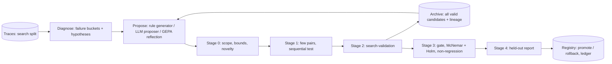

# RFC-0002: Physical RSI on LIBERO (frozen VLA first, weights second)

| Field | Value |
|---|---|
| Status | **Implemented** (cascade, sequential gate, held-out report, campaigns: 2026-10-30/31); weight-level units (L4) unverified |
| Date | 2026-10-30 |
| Basis | `research/comparisons/rsi-frameworks-deep-dive.md`; SmolVLA LIBERO results and failure diagnosis (`envs/libero/README.md`); CPU latency of pi0.5 measured at 1.4 s per 50-action chunk (bf16, 32 threads, torch.compile off) |

## 1. Goal

Make a VLA-driven agent measurably better on LIBERO through an automated, gated improvement loop, starting with the
policy weights frozen and moving to weight-level updates once the loop is trustworthy. Every improvement must be
validated on init states the proposer never saw and must be reversible.

## 2. Starting evidence

- SmolVLA (CPU, 5 init states per task): spatial 0.70, object 0.66, goal 0.78, libero_10 0.42; matches LeRobot's own evaluator.
- Failure modes from traces: 51/72 failures have three or more grasp attempts; 23/72 contain a stall of 30+ steps; only 2/128 successes stall.
- SmolVLA and pi0.5 accept injected noise (B, 50, 32), so rollouts can be made replayable and the policy can be steered without touching weights.

## 3. Improvement units (ladder by risk and cost)

| Level | Unit | Candidate kind | Example | Cost per candidate |
|---|---|---|---|---|
| L0 | steering and runtime parameters | `config_patch` | N samples, noise scale, selector, execution steps, trigger thresholds | rollouts only |
| L1 | declarative runtime critics + recovery rules | `critic_rule`, `recovery_rule` | "if still ≥ 25 steps: back off 5 cm, resample with noise scale 1.5" | rollouts only |
| L2 | reasoner / VLM prompt text | `prompt` | VLM sub-goal prompt for long-horizon libero_10 tasks | rollouts + LLM tokens |
| L3 | learned small components | `policy_ref` (component) | chunk value critic trained on traces; DSRL-SAC noise policy | training on CPU + rollouts |
| L4 | VLA weights | `policy_ref` | GRPO on SmolVLA action expert with a KL anchor; RECAP offline fine-tuning | hours of CPU (or GPU once ROCm works) |
| — | model-written code | `code` | — | **disabled** (no adequate sandbox anywhere in the studied frameworks) |

## 4. Evaluation protocol

- **Splits per task (LIBERO's 50 init states):** search 0–19 (diagnosis and proposer feedback), search-validation 20–29 (candidate selection), gate 30–39 (confirmatory paired test), held-out 40–49 (report only, sealed from the proposer and from selection).
- **Common random numbers:** each chunk's policy noise is seeded from (init state, chunk index, replicate), so parent and candidate face identical randomness; `k` replicates per init state increase the number of pairs.
- **Cascade:** stage 0 static checks (protected scope, schema bounds, novelty against the archive, optional advisory critique); stage 1 a few pairs with a sequential test to drop clear losers; stage 2 full search-validation; stage 3 gate with one-sided exact McNemar and Holm correction across the cycle's candidates; stage 4 held-out report.
- **Non-regression:** per-task success may not drop beyond tolerance; SafetyShield interventions may not rise beyond tolerance; latency budget enforced.
- **Visibility:** the proposer sees search-split metrics and traces only (public), never search-validation, gate or held-out results (private).

## 5. Loop structure

The archive keeps every candidate that completed stage 2 (with its hypothesis, metrics and lineage) and supplies
parents with exploration-weighted sampling; only stage 3 can promote. Budgets are tracked per cycle in simulator
CPU-seconds and LLM tokens.

## 6. Plan

| Step | Content | Exit criterion |
|---|---|---|
| 1 | Seeded noise in `LeRobotAgent` (replayable rollouts); `SampleSelectAgent` wrapper (N chunks, gripper vote, medoid; skip when samples agree); runtime triggers (stall, grasp attempts, sample disagreement) with resample-and-back-off recovery | Same init state + same noise seed reproduces the episode; latency and success measured on the weakest tasks |
| 2 | Evaluation protocol of §4 in `wc-evolve` (splits, CRN replicates, cascade, Holm, archive) | One full cycle on libero_spatial or libero_10 with L0/L1 candidates, held-out reported |
| 3 | LLM proposer (local qwen3.5) for L1 rules and GEPA-style reflection for L2 prompts, with hypothesis ledger | Proposed candidates beat rule-generated ones at equal budget, or not (both are results) |
| 4 | L3: chunk value critic from traces; DSRL-SAC noise policy for 2–3 tasks | Gate passed on held-out-clean protocol |
| 5 | L4: GRPO on SmolVLA action expert with KL; RECAP offline; pi0.5 once the PaliGemma tokenizer is authorised | One `policy_ref` candidate through the same gate |

## 7. Open questions

1. Which suite to target first: libero_10 (most headroom, 0.42) or libero_spatial (fastest, 0.70)?
2. Replicates per init state (k) vs wall time: with 10 workers, one 50-episode pass takes 2.5–6 minutes on CPU.
3. GPU: enabling ROCm on the R9700s would speed L4 by roughly an order of magnitude; needs root.
