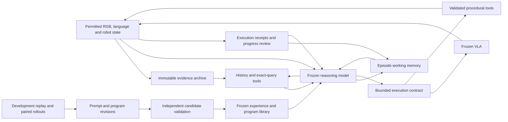

# RFC-0009: Benchmark Memory

> Historical design: implementation and roadmap claims below record the proposal before removal. The model-managed Working Memory runtime is no longer a supported implementation. See the [archived evaluation](../research/experiments/2026-11-03-working-memory.md) for retained results and source-archive location.

| | |
|---|---|
| Status | Working Memory runtime and dedicated prompt gate withdrawn and removed (2026-11-04). Historical design and 64-attempt panel retained; no demonstrated memory gain. Earlier event-memory primitives remain implemented. SimpleMemVLA and the independent program-evolution strategy are separate options. |
| Scope | `hylo-core`, `hylo-memory`, `hylo-agents`, CPU diagnostics and the external memory-benchmark evaluation protocol |
| Builds on | RFC-0003 (experience memory), RFC-0005 (measurement), RFC-0007 (observable tools and evidence) |
| Evidence | [Source studies](../research/projects/memory-landscape.md), [performance review](../research/comparisons/memory-performance-review.md), [benchmark comparison](../research/comparisons/memory-benchmark-comparison.md), [local validation](../research/experiments/2026-11-03-benchmark-memory.md) |

## Motivation

A frozen VLA cannot reconstruct a vanished cue from the current image alone. An action-prior bank also does not
solve event counting, ordinal retrieval, hidden identity tracking or a delayed intention. Hylo's earlier LIBERO
experiment found that action priors from unseen layouts could reduce success; they are therefore an optional
scene-recall mechanism, not the default memory solution. That result is historical experimental evidence, not a
new reproduction ([LIBERO experiment](../research/experiments/2026-10-30-experience-memory-libero10.md)).

The current source inspection exposed concrete storage defects: content deduplication omitted scope/frame/time,
key replacement crossed episode boundaries, pose orientation and clock type were lost on SQLite round-trip,
`forget()` ignored scope/entity/exact-radius filters, and the snapshot omitted important temporal state. These
are fixed in this revision; regression tests cover the old failure modes (`harness/packages/hylo-core/src/hylo/core/memory.py:71`;
`harness/packages/hylo-memory/src/hylo/memory/sqlite.py:66`; `harness/packages/hylo-memory/tests/test_sqlite_semantics.py:15`).

The design objective is **broad improvement across the target benchmarks and their memory families**,
including transfer to unseen scenes and tasks. Controlled memory experiments retain the same frozen
executor; a separately reported full-harness track may add validated execution skills. Weak families
remain in scope and determine which capability to improve next. Exceeding strong reproducible baselines
is the research target, not a result established by the current pilot.

## Memory Architecture

The primary design is a **frozen reasoning model with evidence-linked working memory,
queryable visual history and bounded execution**, improved through development-time prompt
and program search. The VLA, reasoning model and any perception/embedding models remain
frozen. Existing released checkpoints can have upstream training; the commitment is no
new Hylo weight updates. Training a selector, completion model or joint planner is not a
prerequisite, milestone or default response to a failure.

This supersedes the trained-reranker/joint-adapter direction considered in the
[earlier review](../research/experiments/2026-11-03-memory-design-review.md).
The [performance review](../research/comparisons/memory-performance-review.md) motivates
three choices: retain a strong sampled-full-history baseline; improve working-memory
content and its use together through prompt search; and make execution review part of the
system. It does not establish that these mechanisms alone reproduce a leaderboard score.



These boxes are responsibilities, not separate learned models. Start with one reasoning
model for interpretation, memory update and planning. Generic code handles evidence IDs,
queries, transactions, budgets and action interfaces. Add a separate frozen perception
service only when measured errors justify its latency and complexity.

There are three lifetimes:

| Lifetime | Contents | Write rule | Reset rule |
|---|---|---|---|
| Episode | Original observations, fallible interpretations, identities, events, intentions and current procedure | Causal evidence-backed updates; failure observations are useful too | New episode partition; clear model conversation, action queue and working state |
| Development | Memory schemas, prompt revisions, repair lessons and executable procedures | Candidate lineage plus independent evaluation | Freeze artifact digest before held-out validation/test |
| Evaluator | Hidden targets, reward/success predicates and diagnostic labels | Evaluation process only | Never passed to the runtime memory/planner |

This preserves RFC-0003's distinction between recording episode evidence and promoting
reusable skills. In the main evaluation, one test episode cannot improve the experience
library used by another. A separately declared online-adaptation experiment can study
that behavior, but its score and episode ordering remain separate.

### Reference Mechanisms

These source mechanisms motivate the revision; they are not claims that the complete upstream
systems have been reproduced. In particular, SERA is not a rule-free neural memory system,
and eMEM is a storage/indexing library rather than a learned policy.

| Reference | Concrete mechanism | Hylo adoption and boundary |
|---|---|---|
| MEMI | Jointly revises memory-annotation and policy prompts with fixed model weights. | Main reference for development-time memory-schema/update/read improvement; add self-carried causal replay and independent closed-loop gates. Its Plan score uses oracle perception/control; Act uses direct waypoints. [Pinned loop](https://github.com/memi-robot/memi/blob/bb6c37ce6c14bd1a204c86a91cc0cb36f565a1f0/memi/act/loop/iteration.py#L20). |
| Astra-Guide | Finite VLA delegation, robot-state review triggers and experience-guided recovery. | Adopt bounded execution contracts; keep experience frozen for Hylo's main held-out score. Its reported protocol updates experience across scored episodes. [Pinned scheduler](https://github.com/Legend717/astra-guide-vla/blob/dc3074cc234945dfaad1ffd5e48d5da490f7e736/scripts/robomme_agent/scheduling.py#L94), [protocol](https://github.com/Legend717/astra-guide-vla/blob/dc3074cc234945dfaad1ffd5e48d5da490f7e736/docs/results.md#training-and-evaluation-details). |
| RoboMME MemER path | A Qwen3-VL adapter predicts both `current_subtask` and `keyframe_positions`; selected past frames are fed back with recent observations. | First reproduce the model-directed frame-selection interface outside the VLA. A cached general VLM without the released/trained adapter is only a structural baseline, not MemER reproduction. `references/memory/robomme_policy_learning/examples/robomme/subgoal_prediction/qwenvl/api_memer.py:24`; `references/memory/robomme_policy_learning/examples/robomme/subgoal_prediction/qwenvl/api_memer.py:28`; `references/memory/robomme_policy_learning/examples/robomme/subgoal_prediction/qwenvl/api_memer.py:160`; `references/memory/robomme_policy_learning/examples/robomme/subgoal_prediction/qwenvl/api_memer.py:202`. |
| RoboMME visual memory | Image pixels, multiscale visual features, temporal positions and proprioception are stored together. | Retain visual evidence instead of reducing all history to captions. Its policy-internal variants require architecture/training changes and cannot simply be injected into the current frozen symbolic executor. `references/memory/robomme_policy_learning/src/mme_vla_suite/shared/mem_buffer.py:24`; `references/memory/robomme_policy_learning/src/mme_vla_suite/shared/mem_buffer.py:102`; `references/memory/robomme_policy_learning/src/mme_vla_suite/models/integration/history_pi0.py:247`. |
| SERA | Hybrid executor-command retrieval, typed experiences, candidate lineage and disjoint generalization panels. | Compare an experience-retrieval component under the same planner/executor, then optimize memory policies using development failures. Do not imitate task-name special cases or call a different planner an exact reproduction. `references/memory/SERA/scripts/codex_rollout/skill_retrieval.py:108`; `references/memory/SERA/scripts/codex_rollout/skill_retrieval.py:115`; `references/memory/SERA/scripts/codex_rollout/self_evolve_v5.py:250`; `references/memory/SERA/scripts/codex_rollout/self_evolve_v5.py:851`. |
| eMEM | Embedded records with separate semantic, spatial and temporal retrieval paths. | Backend design and optional implementation reuse, with explicit frame/clock semantics and retained evidence. A vector index alone does not solve memory selection or reasoning. `references/memory/emem/emem/types.py:42`; `references/memory/emem/emem/store.py:32`; `references/memory/emem/emem/store.py:1039`. |
| HarnessPAI | Evolving outer programs and reusable failure-repair skills. | Design reference for development-time improvement only; no source copying without a license. Avoid accumulating handwritten benchmark handlers as the general memory solution. `references/memory/HarnessPAI/harnesspai/code_library/TEMPLATE.md:439`; `references/memory/HarnessPAI/harnesspai/memory/skill/writeback.py:389`. |
| MIKASA | Distinct identity, capacity, order, tracking, negative, checklist, temporal and prospective demands. | Use these as transfer tests and failure diagnostics, not as names that select handcrafted agent policies. `references/memory/MIKASA-Robo/mikasa_robo_vla_envs.csv:1`. |

### Model Responsibilities

\[Docs/Interface only\] The proposed runtime has four responsibilities:

1. **Evidence capture and access.** Archive every permitted reset/demo/intermediate frame,
   action receipt and robot state with episode, camera/frame, observation time, availability
   time and content digest. Keep a recent contiguous window and selected historical clips
   in model context. Source clips remain reopenable at native resolution; summaries are
   replaceable views. Storage completeness does not imply that the model saw every cue.
2. **Decision state.** The frozen model maintains the information needed for the next
   decision: entity bindings, changing spatial beliefs, ordered events, pending intentions,
   current subgoal and demonstrated procedures. Each claim cites evidence and records
   uncertainty and revision lineage. Instruction-driven schemas can vary by problem;
   benchmark/task IDs do not dispatch handwritten solvers.
3. **Evidence-directed reasoning.** The model requests history by question, time interval,
   entity hypothesis or event anchor, then uses ordered returned evidence to update state
   and choose an action. Generic count/order/set/time tools compute over supplied records.
   An exact count of accepted records is not guaranteed physical-event truth. Unknown,
   disputed and incompletely observed states remain expressible.
4. **Execution and review.** Translate the decision to the executor's documented command
   interface. Attach a bounded step budget, current evidence/state revision and observable
   progress checks. A command receipt means an action was attempted; completion requires
   subsequent observation. Replan on progress, ambiguity, failure or expiry. Applicable
   program skills can perform stable geometric/control operations in the full-harness
   track, while the controlled memory comparison retains the original execution tools.

The model controls semantic interpretation and procedural choice. Deterministic code
controls storage and execution semantics. Neither a database nor a collection of color,
count and task-template rules supplies the general reasoning policy.

For example, a reveal followed by an object swap should produce a referenced identity
binding, an association update and a current-location hypothesis. The next decision
can reopen the swap clip and re-ground the target in the current view. A count task
uses the same loop with transition records and a completion check; it does not select
a separate controller from the benchmark ID. A delayed intention remains pending until
its trigger and completion evidence are observed, even if it has not been read recently.

### Program Evolution

HarnessPAI remains an important reference for **procedural memory and development-time
program improvement**. Model-managed visual memory and executable skills are complementary:
the former supplies evidence about what happened; the latter records a reusable way to act.
The design choice is not determined by whether an artifact contains Python or explicit logic.
What matters is its provenance, development process, observation boundary and measured transfer.

\[Implemented\] The HarnessPAI controller gives a coding model an isolated candidate workspace,
executes rollout batches, supplies diagnostics and asks for the next revision. Its success
branch promotes code and invokes a separate skill-distillation call. \[Docs/Interface only\]
The template instructs generation of a fixed Python phase sequence; it does not describe a
learned neural runtime planner or a graph interpreter. These are separate evidence levels:
the evolution loop is present, while the example generated task packages cited by the
template are absent from the pinned tree
(`references/memory/HarnessPAI/harnesspai/evolution/candidate.py:68`;
`references/memory/HarnessPAI/harnesspai/evolution/loop.py:340`;
`references/memory/HarnessPAI/harnesspai/evolution/loop.py:793`;
`references/memory/HarnessPAI/harnesspai/code_library/TEMPLATE.md:20`).

The proposed Hylo adaptation is an original implementation, not copied HarnessPAI code:

1. **Candidate memory programs.** A development agent may propose changes to memory writing,
   evidence selection, retrieval composition and reusable skill workflows through Hylo's
   declared interfaces. Keep code and prompts versioned together. A model-generated benchmark
   special case is still a special case; generation alone does not establish generality.
2. **Failure-grounded revision.** Supply observations, retrieved evidence, action traces and
   evaluator diagnostics to the development process. Runtime skills receive only permitted
   observations. Compare the revised candidate with its parent on paired development episodes,
   then freeze it for fresh validation. HarnessPAI's video-diagnosis and read-only synthesis
   stages motivate this loop, not a guarantee of causal diagnosis
   (`references/memory/HarnessPAI/harnesspai/evolution/loop.py:727`;
   `references/memory/HarnessPAI/harnesspai/evolution/loop.py:839`).
3. **Reusable repair memory.** Store the failure context, proposed repair, applicability,
   counterexamples and validation evidence. Retrieve by operation and failure context, not
   solely by benchmark/task ID. HarnessPAI shares cards by action-chain archetype and phase;
   task names are provenance, and retrieval currently uses exact phase/verb matches. Semantic
   retrieval and counterexample-aware ranking are Hylo proposals, not upstream capabilities
   (`references/memory/HarnessPAI/harnesspai/memory/skill/graph_skill.py:114`;
   `references/memory/HarnessPAI/harnesspai/memory/skill/query.py:112`;
   `references/memory/HarnessPAI/harnesspai/memory/skill/writeback.py:319`).
4. **Measured dispatch and promotion.** Measure the reliability of an actual skill or phase
   on its own applicable scenarios. Do not label a phase reliable merely because its parent
   task succeeded. The reviewed aggregate path explicitly copies whole-task success rates
   onto sub-prompts without individual rollouts. Independently validate distilled skills,
   then activate immutable versions with rollback; HarnessPAI's post-write structural check
   does not provide these behavioral guarantees
   (`references/memory/HarnessPAI/harnesspai/evolution/stages/capability/aggregate.py:1`;
   `references/memory/HarnessPAI/harnesspai/evolution/stages/capability/aggregate.py:189`;
   `references/memory/HarnessPAI/harnesspai/memory/skill/writeback.py:389`).

This adds a program-evolution route alongside model-directed memory selection. It does not
reinstate the withdrawn handwritten count-and-stop controller, imply that generated programs
are automatically transferable, or require VLA fine-tuning. No HarnessPAI code is copied or run.

### Comparative Evaluation

Start with the same frozen reasoner, VLA, grounding, action tools and episode panel:
recent-window only; uniformly sampled causal history; sampled full history within the
model limit; model-maintained state plus source-frame references; then queryable history
and development-evolved prompts. Compare simpler states as well as richer ones. A memory
system is useful if it improves success or achieves comparable success with less cost,
not merely because it stores more records.

Model capability is a separate axis. Compare the cached local planner with an available
strong frozen multimodal model on identical development evidence and action contracts.
A local-model failure does not establish that external memory is ineffective. Conversely,
a stronger model's gain must not be attributed to the memory algorithm. A CLI used for
textual design review is not automatically a validated image-policy service.

Execution tools and cross-episode adaptation are separate axes too. Direct waypoint
control, VLA/code handover and test-time experience updates belong to explicitly named
full-harness or adaptation comparisons. Keep author-reported results separate from our
reproductions and label any upstream model/interface substitutions.

The historical four-task pilot evaluated a heuristic bundle with unequal context cost.
It does not validate this redesigned system, isolate which memory component helped, or
establish the performance of a stronger frozen reasoner.

## Implemented Foundation

### Scoped Storage

`SQLiteMemoryStore` replaces a fact only within the same `(kind, key, exact scope, clock)` and preserves event time,
frame and quaternion. Event time zero is valid; absent `valid_from` defaults to the event timestamp when present.
`MemoryQuery.clock` separates simulation and wall-clock queries. `as_of` selects fact validity among nonexpired records, not a full
transaction-time reconstruction. Queries with invalid radii or reversed/nonfinite time intervals are rejected.

`forget` soft-expires every exact match; `k` limits returned hits, not expiration. Both operations apply the same
scope/entity/radius predicates. Snapshots now include full stored provenance, validity intervals, pose and expiry.
Backdated keyed replacements fail the entire transaction; late evidence can be appended as an unkeyed event
instead of silently creating reversed intervals (`harness/packages/hylo-memory/src/hylo/memory/sqlite.py:33`).

**Migration:** opening a legacy store adds orientation/clock columns and recomputes hashes once. Previously lost
orientations cannot be recovered; old event clocks retain the earlier `sim` interpretation. Historical validity
values remain unchanged: a legacy implicit wall-time `valid_from` is not retrospectively inferred to be simulation
time. Use a fresh benchmark store, or an explicitly reviewed migration for such legacy fact streams. Existing
snapshot identifiers change; old run manifests remain historical evidence, not equivalent new snapshots. No user
run database was migrated during this implementation.

### Event Journal

`MemoryEvent` carries stable ID, `(step, order)`, observation time, kind, subject, value, evidence references,
extractor version and confidence. `EventMemory` persists these in SQLite under an episode namespace. Repeated
identical IDs are idempotent; conflicting IDs, out-of-order events and capacity overflow reject the batch
atomically. Event order and repeated values are retained: “red, blue, red” must not collapse to a set.

A fresh reset refuses an already populated episode ID; replay continuation requires explicit `resume=True`.
The snapshot is an incremental evidence digest, reconstructed on resume. Neither a prompt summary nor query
truncation deletes journal evidence. The default event cap is 10,000; overflow is a visible failure, not silent
loss of an early cue. This is a bounded reference implementation, not an unbounded production archive
(`harness/packages/hylo-core/src/hylo/core/episode_memory.py:17`;
`harness/packages/hylo-memory/src/hylo/memory/episode.py:30`).

### Exact Recall

| Operator | Result | Required evidence |
|---|---|---|
| `latest`, `first` | Last/first observed value for a kind and optional subject | Known identity and adequate confidence |
| `count` | Number of deduplicated observed events | `complete=True` for an exact count; otherwise a lower bound |
| `sequence` | Ordered values, including repetitions | Complete coverage for a complete sequence; overflow is partial |
| `nth` | Zero-based ordinal value | Ordered, sufficiently confident prefix without gaps |
| `before`, `after` | Exclusive event-ID bounds on another operator | Anchors must exist and be causally available |
| `unseen` | Universe minus observed subjects | Explicit universe and complete observation; never infer absence from occlusion |
| `pending` | Intentions not followed by matching observed completion | `kind` and `kind.done` paired by intention subject |
| `elapsed` | Current observation time minus the latest matching timer event | Causal clock and unambiguous anchor; not number of VLA calls |

Results carry `known`, `partial` or `unknown`, evidence references and a reason. A `_gap` marks missing coverage;
a low-confidence latest observation does not silently fall back to an older confident location. Closed-world
flags are adapter assertions, not proofs: a visual adapter must justify them. Spatial trajectories and procedures
can be represented as ordered typed values; this release does not automatically execute those trajectories
(`harness/packages/hylo-memory/src/hylo/memory/episode.py:93`).

### Observation Ingestion

`SignalExtractor` is a reference extractor for **declared observable signals**, with change, rising-edge and
falling-edge modes. A held-high signal is not counted on every frame; an initially active or hidden edge stream
is marked uncertain. Hidden spatial observations do not overwrite a last-seen location. Extractor state resets
per episode. This supports controlled CPU experiments; it is **not a visual detector** and must not be pointed at
simulator-only fields on an RGB benchmark (`harness/packages/hylo-memory/src/hylo/memory/signals.py:27`).

`EventMemoryAgent` wraps an existing agent without changing its weights. The extractor receives only
`Observation` and a step index, never `StepResult.info`, reward, success, seeds or simulator handles. It observes
every kernel `on_step`, including transient cues inside action chunks; the subsequent `act` does not ingest the
same step twice. Exact recall becomes bounded JSON evidence in the instruction. Whole query results are omitted
and traced when the context budget is exhausted; JSON is not cut mid-record. The inner agent must understand
this context interface—arbitrary VLA compatibility is not implied. For a short-prompt VLA, the intended path is
evidence to a planner, then a concise native subgoal to the frozen executor; appending a large JSON history
directly to a policy trained on short commands is not the proposed performance recipe. Character budgeting in
this reference wrapper does not replace the target model's token/context budget.

The default execution cap is one control step; increase it only after validating missed-deadline and latency
tradeoffs. Ingestion during a chunk does not cancel an already executing action. Observation allowlists and
process isolation still belong in benchmark adapters; this Python interface alone is not a sandbox
(`harness/packages/hylo-agents/src/hylo/agents/event_memory.py:17`).

## Python Composition

The new path currently uses Python composition, as demonstrated by the runnable examples; it does not register
an untested CLI plugin or require a dependency change. The inner agent remains the same object/interface.

```python
from hylo.agents.event_memory import EventMemoryAgent
from hylo.core.episode_memory import RecallQuery
from hylo.memory.episode import EventMemory
from hylo.memory.signals import Signal, SignalExtractor

# frozen_agent is an existing Agent. This binding is valid only if these are allowed observations.
agent = EventMemoryAgent(
    inner=frozen_agent,
    memory=EventMemory(),
    extractor=SignalExtractor([
        Signal(kind="press", subject="button", value_key="visible_button_pressed", mode="rising"),
    ]),
    queries=[RecallQuery(name="observed_presses", op="count", kind="press", complete=True)],
    max_execution_steps=1,
)
```

For a visual benchmark, replace `SignalExtractor` with a calibrated observation-only extractor and justify
`complete=True`; do not obtain `visible_button_pressed` from a hidden task counter. The store is single-owner:
create one backend per worker, retain it across that worker's episode resets, and close it when the worker ends.

## Benchmark Coverage

These are capability-to-task mappings, not performance claims. All 16 original RoboMME tasks are covered in the
plan. Its predicate implementations are enumerated in the [source study](../research/projects/memory-landscape.md#103-core-data-structures-and-interfaces).

| RoboMME tasks | Memory specialization | Implemented foundation | Still needed for end-to-end VLA performance |
|---|---|---|---|
| BinFill, PickXtimes, SwingXtimes | Counts keyed by color/object/action; completed-transition ledger | Stable event IDs, edge extraction, exact counts | RGB transition detection, grasp/place-cycle validation, debounce/hysteresis calibration |
| StopCube | Target-visit count and timing | Count, event anchors, elapsed clock | Visual target-crossing detector, stopping latency and action cancellation/short chunks |
| VideoUnmask, ButtonUnmask | Identity-to-container evidence across occlusion | Latest value, episode isolation, evidence provenance | Retain reset demonstration frames; RGB grounding and active reveal planning |
| VideoUnmaskSwap, ButtonUnmaskSwap | Update identity/location association through swaps | Ordered updates and ambiguous-result handling | Multi-object correspondence and occlusion hypotheses; abstain on identity ambiguity |
| PickHighlight, VideoRepick | Target set or target identity plus repetitions | Sequence, subject filter, count | Flash/highlight and pickup detectors; separate set membership from repeat count |
| VideoPlaceOrder, VideoPlaceButton | Ordinal or before/after-event destination | `nth`, event-relative bounds, preserved history | Parse public query instruction; visual placement/button event extraction |
| MoveCube, InsertPeg | Demonstrated manipulation method, orientation/end/side | Full pose round-trip, ordered structured values | Procedure compiler, object-relative frames and compatible frozen executor; final XYZ alone is insufficient |
| PatternLock, RouteStick | Ordered contacts or object-relative route | Ordered sequence, repetitions, frame-tagged values | Contact/route perception, route tolerances and physically feasible subgoal execution |

RoboMME source anchors: task registry and metadata
`references/memory/robomme_benchmark/src/robomme/env_record_wrapper/episode_config_resolver.py:17`;
task instructions `references/memory/robomme_benchmark/src/robomme/robomme_env/utils/task_goal.py:47`;
shared predicates `references/memory/robomme_benchmark/src/robomme/robomme_env/utils/subgoal_evaluate_func.py:33`.

| MIKASA VLA memory type | Planned specialization beyond the common journal |
|---|---|
| Spatial | Last-seen pose with frame, cue time and freshness; controlled reacquisition |
| Object | Appearance/identity cue retained through delay; confidence-aware matching |
| Capacity | Complete cue-set reconstruction, with no early-cue FIFO eviction |
| Sequential | Ordered recall with duplicate events preserved |
| Tracking | Multiple association hypotheses through swaps, not nearest-position identity assignment |
| Negative | Closed-world observed set and candidate universe; partial visibility is unknown |
| Checklist | Per-object test outcome and tested/untested state; commanded insertion is not an observed result |
| Temporal | Edge counting and elapsed-time scheduling from observation time, independent of policy-call frequency |
| Procedural | Demonstrated route/shape sequence with object-relative coordinates and orientation |
| Prospective | Persistent intention triggered by an observed condition; remove only after completion evidence |

The current VLA inventory has 90 tasks and ten types, distinct from the retained 32-task RL release
(`references/memory/MIKASA-Robo/mikasa_robo_vla_envs.csv:1`). The local diagnostics exercise event operations for
these demands; they do not implement all visual specializations above.

RMBench contributes the fixed-size versus growing-history stress axis; MEMOBench contributes separate storage,
update and compression diagnostics. Both remain paper-only references here; independently author the diagnostic
predicates and do not copy MEMOBench's noncommercial annotations. See the [protocol and license comparison](../research/comparisons/memory-benchmark-comparison.md).

## Integrated Plan

\[Docs/Interface only\] The objective is broad memory-guided manipulation with fixed
model weights. Improvements change memory representations, prompts, retrieval choices,
execution contracts and reusable programs. The plan is selected from current performance
and source evidence, not from a preference for adding modules. Full task coverage remains
an objective; implementation order follows runnable interfaces and observed bottlenecks.

### Shared Capabilities

| Memory demand | Representation and runtime behavior | Benchmark examples | Diagnostic |
|---|---|---|---|
| Identity and hidden location | Evidence-backed object bindings, anchor views, last-seen state, uncertain association alternatives; reopen the reveal/swap clip | RoboMME unmask/swap; MIKASA object/spatial/tracking | Cue recall, identity switches, stale-target use |
| Sets and exclusion | Referenced item set, observation coverage and tested/untested states; absent is not automatically unseen | PickHighlight; MIKASA capacity/negative/checklist; RMBench Battery Try | Omitted items, repeated tests, unsupported absence |
| Counts and order | Ordered transition evidence with stable event IDs; generic queries over confirmed/provisional entries | PickXtimes, VideoPlaceOrder, VideoPlaceButton; MIKASA sequential/temporal | Missed/double events, ordering and before/after errors |
| Motion and timing | Contiguous clips, timestamped position histories and deadlines, separate simulated and wall clocks | StopCube, SwingXtimes; MIKASA Intercept/TimedTransfer | Tracking error, observation gaps, decision latency |
| Procedures and geometry | Demonstrated sequence/path with reference frame, orientation and completion conditions; memory-grounded subgoals and optional validated tools | PatternLock, InsertPeg, RouteStick; MIKASA procedural; RMBench bimanual tasks | Correct evidence but wrong path/pose/contact, premature completion |
| Prospective and long history | Pending goal plus trigger evidence, persistent anchors, checkpointed working state and source retrieval | MIKASA prospective; RMBench M(n); independent MEMOBench-style diagnostics | Forgotten goals, stale updates, compression omissions |

Task definitions and pinned citations are in **Benchmark Coverage** and the
[benchmark mapping](../research/comparisons/memory-benchmark-comparison.md#task-overlap).
These are shared mechanisms, not task-name-specific controllers. A large scene graph,
vector database or trained tracker is not required for the first implementation.

### Runtime Coordination

Use a synchronous, inspectable baseline first. Archive observations continuously through
existing adapter hooks, including frames produced inside a macro action. The reasoning
model runs at decisions and requested reviews. A cheap monitor may detect robot-state
changes or budget expiry without certifying task completion. Dynamic tasks may justify
shorter action chunks, dense observation processing or later asynchronous perception;
choose these using actual timing failures and account for their computation.

Each reasoning turn consumes the current views, a recent clip, working-state revision,
retrieved historical evidence and applicable frozen experience. It returns one coherent
transaction: state patch with citations, optional evidence request, grounded subgoal,
execution budget and requested progress checks. Validate citations and action-interface
compatibility before applying a patch or executing a command. Additional history reads
consume a declared budget and may return insufficient evidence.

| Contract | Required contents |
|---|---|
| `EvidenceRef` | Episode, source/camera/frame, observed-at time and clock, available-at step, blob digest |
| `MemoryPatch` | Prior revision, typed claims/entities/events/goals, evidence IDs, uncertainty, superseded claims; explicit unknown and disputed values |
| `EvidenceRequest` | Question/subgoal, optional interval/entity hypotheses, requested clip/resolution and remaining frame/token/call budget |
| `EvidenceBundle` | Chronologically ordered source IDs, coverage/omissions, availability, crop/frame mapping and consumed budget |
| `ExecutionContract` | Native command, action frame/units, state revision, evidence, bounded steps, permitted checks and expiry |
| `ExecutionReceipt` | Actual actions/steps, resulting observation IDs, review reason, observed progress and unresolved claims |

Store original evidence separately from its interpretations. Append late interpretations
at availability time, preserve their original event interval, and record which revision
an action actually consumed. Reinterpreting a report cannot silently increment a physical
counter. Spatial records need explicit frames; a remembered image coordinate must be
regrounded in the current image before it becomes a target for a moved object.

The existing `MemoryEvent` journal is a synchronous foundation, not this complete
revision system (`harness/packages/hylo-core/src/hylo/core/episode_memory.py:24`).
The first implementation needs causal `EvidenceRef`, query/reopen and revision snapshots;
full association graphs are added only with an actual use case.

Support two execution configurations. **Memory-only** fixes the native GroundSG executor
and tools. **Full harness** may additionally use validated geometric/EEF tools and
procedural programs under the benchmark's action rules. The latter is necessary to test
whether remembered paths/orientations can be acted upon, but its gains combine memory
and control. Both keep model weights fixed. Robot-state guards request review; they do
not read hidden object poses or declare simulator success.

### Learning and Evolution

Here learning means **experience-driven prompt and program improvement**, without
optimizer steps on model weights. The mutable artifact contains memory-schema instructions,
update/read prompts, retrieval recipes, execution-review recipes and reusable skill
programs with applicability and counterexamples. One strong frozen model can serve the
runtime and development roles; separate roles do not require separate model deployments.

MEMI motivates a development objective: retain information sufficient for the next
valid decision, reconstruct it from the permitted past, and remove fields that do not
help. Its inspected loop revises prompts, while its offline policy evaluation carries
annotated previous memory. Hylo must also replay with its **own predicted memory** to
expose accumulated errors. Its reported `used_fields` is an optimization signal, not a
causal certificate. [Pinned iteration](https://github.com/memi-robot/memi/blob/bb6c37ce6c14bd1a204c86a91cc0cb36f565a1f0/memi/act/loop/iteration.py#L20);
[pinned policy](https://github.com/memi-robot/memi/blob/bb6c37ce6c14bd1a204c86a91cc0cb36f565a1f0/memi/act/loop/policy.py#L28).

1. Collect authorized development observations, actions and failures. A retrospective
   annotator proposes which evidence would have supported the decision; its hindsight
   remains offline and may not leak into runtime state.
2. Replay causal prefixes with the candidate's own preceding state. Check cue/identity,
   ordered evidence, unknown handling, supported command and later closed-loop outcome.
   Alternative valid actions must not be penalized solely for differing from one demo.
3. Diagnose missing evidence, faulty update, irrelevant retrieval, reasoning, grounding
   and control separately. Propose a bounded prompt/schema or reusable-program change.
4. Test field removal and valid alternate-cue episodes to measure evidence dependence.
   Protect unresolved intentions and rare cues; low read frequency alone does not justify
   deleting information that may matter later. Retain source evidence after compression.
5. Compare parent/candidate on development and separate selection episodes, then validate
   a frozen candidate on fresh data. Promote an immutable digest and retain the previous
   version for rollback. No writes to the shared library during main held-out scoring.

Use shared operation/failure-context retrieval as the default. If a task-specific prompt
is evaluated to match an upstream method, label that condition and separately test
held-out-family transfer. Program generation alone does not make a skill general.
HarnessPAI's independently implemented program-evolution route complements prompt search;
SERA's typed bundles and lineage inform packaging. New demonstration downloads are not
implied by this plan: start with authorized generated development trajectories.

### Coverage and Milestones

| Stage | Deliverable | Coverage and advancement evidence |
|---|---|---|
| 0. Reference and interface check | Freeze benchmark/action/model contracts and a performance/protocol ledger; instrument complete allowed observation capture | RoboMME all-task inventory; validate reset streams, source hashes and executor feasibility. MIKASA/RMBench bridge investigations proceed independently, not as blockers |
| 1. Strong frozen baseline | Same reasoner with recent, uniform and sampled-full-history contexts; native grounding and bounded execution | Development panel spans every RoboMME memory family. Measure model capability, cue use, action errors and total cost |
| 2. Working memory | Evidence-linked state updates, source re-opening, query-conditioned clips and exact tools | Compare against the strongest same-model history baseline; missing-cue, swap, count/order and longer-delay diagnostics |
| 3. Experience improvement | Prompt/schema search, self-carried causal replay and immutable candidate activation | Transfer beyond edited episodes; show whether memory/update/read prompts actually improve paired outcomes |
| 4. Procedural integration | Independently implemented reusable programs, progress review and optional geometric execution tools | Include routes, orientation, contact and dynamic timing; separate memory-only from full-harness effects |
| 5. Full evaluation and transfer | Frozen complete candidate, component ablations, per-family/horizon scores and success/cost curves | All eligible suites with their own protocols, no dropped hard families; finite validation and candidate-search accounting |

For RoboMME, start development on a predeclared panel across all four families, not only
the previous four tasks. Already inspected val IDs 0 and 3 remain development evidence.
Use train partitions for search/selection and reserve unused val episodes for frozen
candidates. All 16 original tasks remain the final evaluation target. Distribution-shift
sets such as RoboMME-Plus require a separate audited protocol and must not be mixed into
original-suite scores.

For MIKASA, validate a compatible frozen executor and the canonical RGB/proprioception/
EEF-delta bridge. Cover all ten memory types in the development inventory, then execute
Short and longer horizons as readiness permits. The old five-task published scores are
a separate comparison, not a substitute for current 90-task coverage. A trained model
whose interface accepts images but no usable memory-conditioned commands is not an
assumed drop-in executor.

For RMBench, establish the bimanual action/geometry contract and an eligible existing
frozen policy or declared procedural tool. Keep the original nine-task average separate
from extended tasks. For MEMOBench, use its diagnostic questions through independently
authored Hylo tests; official evaluation remains conditional on permitted artifacts.
No benchmark is dropped because its motor or licensing prerequisites are unresolved.

Implementation stays within existing Hylo boundaries:

| Location | Next change | Current status |
|---|---|---|
| `hylo-core` episode-memory contracts | Evidence requests/bundles, revision and execution-contract records | Implemented in `working_memory.py`; CPU contract tests pass |
| `hylo-memory` frame/report stores | Blob-backed evidence, query/reopen, typed working-state patches and self-carried replay | Implemented temporal reader and revision semantics in `working.py`; semantic/association retrieval remains future work |
| RoboMME example adapter | One frozen reasoning loop, native grounded commands, bounded delegation and receipt review | Implemented in `run_working.py`; 64-attempt validation complete: history 4/32, working memory 2/32; no demonstrated gain |
| `hylo-evolve` candidate workflow | Prompt/schema/program candidates, replay plus closed-loop selection, immutable activation | Prompt-candidate registration, finite paired gate and rollback tested; automatic proposer/program synthesis remains pending |
| Benchmark adapters and reports | MIKASA/RMBench action bridges, complete observation ingestion and protocol manifests | Separate readiness work; no score claimed before execution |

### Comparison Tracks

| Track | Frozen or varied factors | Claim it supports |
|---|---|---|
| Memory-only | Same model, VLA, grounding, action tools and declared budgets; vary state/read/update strategy | Contribution of external memory under that stack |
| Full harness | Add declared programs, progress checks or EEF tools with fixed model weights | Entire system performance, including control |
| Online adaptation | Explicit episode order, initial artifact and permitted cross-episode updates | Adaptation performance; not a frozen-library test score |
| Upstream references | Exact released configuration where feasible; otherwise label adaptation and differences | Reproduction or qualified reference comparison |

Primary comparison: the best development-selected history baseline versus Hylo working
memory under the same frozen reasoner. Report the recent/uniform baselines too. Then
ablate prompt evolution, retrieval, execution review and program skills separately.
Model choice and context budgets are declared; equal returned frame count does not
mean equal total cost if a selector reads the whole archive. Report image/text tokens,
model calls, latency, execution steps, GPU/API expense and development search cost.

Measure task-mean success and every family/horizon, plus cue coverage, evidence-grounded
answers, event errors, stale beliefs, unknown handling and execution failure despite
correct recall. MEMOBench's published type-macro score is not interchangeable with a
task macro; preserve each suite's official aggregate and label additional Hylo metrics.

### Review Decisions

The earlier multi-agent review exposed useful gaps in causal revisions, query interfaces
and failure attribution. Its proposal to train a reranker or joint outer adapter is
**superseded for the primary route** by the user's preference and this performance review.
Those remain optional future research, requiring a separate decision rather than
appearing as default milestones. The review record remains unchanged as historical evidence.

Keep its two bottleneck probes alongside implementation: same-budget **permitted-evidence
rescue** through the existing reader, and separately validated reference commands through
the supported executor interface. Neither is a theoretical upper bound or official score.
A failed rescue can reflect interpretation or control; it does not prove memory cannot help.

Paired analysis now counts candidate-caused parsing/model/budget failures as failures.
Infrastructure and incomplete pairs are separately reported; all attempts remain in the
per-attempt denominator. The completed earlier pilot had no such invalid pairs, so its
numbers are unchanged (`harness/examples/memory/robomme/summarize.py:10`). Also predeclare the
main comparator, practical effect target, family regression tolerance, fixed sample
allocation or valid sequential rule, and campaign-level repeated-candidate policy.

Reserve finite validation data and log each consumed panel. Hold out entire task families
from outer prompt/program development for transfer tests, including their derived lessons.
Call this outer-harness transfer unless the frozen models' training exclusions are known.
An interval spanning zero is inconclusive, not proof of failure; a useful-effect stopping
claim requires the interval's upper bound below a predeclared minimum gain. Engineering
budget decisions may use exploratory evidence but must be labeled accordingly.

## Visual Memory Roadmap

The next implementation is **the frozen-model evidence/state/control loop**, with perception and grounding measured alongside memory. A new vector database or weight-training pipeline is not required.

1. **Lossless observation capture.** Consume every RoboMME reset/demo/intermediate frame in order. Capture each
   MIKASA control observation and permitted episode language. Use adapter timestamps plus frame indices;
   never derive elapsed time from model-call count. These contracts differ
   (`references/memory/robomme_benchmark/doc/env_format.md:34`;
   `references/memory/MIKASA-Robo/docs/source/evaluation_protocol.rst:64`).
2. **Cue-aware visual evidence.** Store raw images in the existing trace blob store. A bounded context retains the
   initial cue, event-boundary frames, unresolved identity evidence and a recent tail. Retrieval can evict a frame
   from model context, but not the raw evidence. Pixel-change frame selection is a baseline, not a semantic
   guarantee (`references/memory/robomme_policy_learning/src/mme_vla_suite/shared/mem_buffer.py:150`).
3. **Measured extraction.** A cheap change/visibility detector proposes candidates; a frozen VLM confirms events
   and grounding. Calibrate false positives, missed events and identity switches on development data. Do not run
   an expensive full-history VLM call on every control step. Asynchronous extraction must record both event time
   and availability time; only delivered evidence can influence an action. This asynchronous path is not yet
   implemented by the synchronous `EventExtractor` protocol.
4. **Model-directed procedure reasoning.** Let the planner interpret public instructions and request relevant
   evidence, generic exact queries and bounded subgoals. Count/order tools compute over their supplied evidence;
   do not encode each benchmark's instruction template as a separate action controller. The planner may request
   more evidence or abstain on unknown results; it must not turn a guess into a confident ledger entry.
   Start with RoboMME's grounded symbolic executor
   interface, whose released policy was trained for that interface, while keeping its weights fixed
   (`references/memory/robomme_policy_learning/examples/robomme/subgoal_predictor.py:245`).
5. **Optional retrieval.** Add semantic retrieval for selecting evidence/skills once exact operations and identity
   are correct. Reuse eMEM's separation of SQL records, vector recall and spatial/time indexes, but preserve raw
   evidence and add explicit frame/clock semantics. Its default zero embeddings and lossy archive are unsuitable
   defaults for this use (`references/memory/emem/emem/embeddings.py:24`;
   `references/memory/emem/emem/store.py:534`; `references/memory/emem/emem/store.py:1039`).

## Promotion Protocol

The performance target is **paired improvement without family-level collapse**, not a promised leaderboard rank.
Keep the same frozen policy checksum, observation permissions, action interface and execution budget for every
memory ablation; separately report any higher-compute configuration.

| Stage | Data and decision | Required output |
|---|---|---|
| Contract checks | Deterministic CPU tests and adversarial event streams | Episode isolation, causal ordering, no double counting, no silent truncation, invalidation and reset correctness |
| Local control | MuJoCo with the same fixed controller, memory on/off; hidden and always-visible controls | Per-task paired outcomes and exact McNemar; clearly label structured sensing and controller type |
| RoboMME development | Train search/selection partitions across all four families; inspected pilot val episodes remain development evidence | Classify perception, memory, planning and control errors; freeze before fresh validation and test |
| MIKASA development | Separately declared noncanonical development seeds | Cue/identity/delay generalization, negative/checklist/prospective diagnostics; no tuning on canonical evaluation episodes |
| Validation gate | Pre-registered disjoint paired episodes, existing RSI budget/alpha policy | Positive effect with uncertainty, no material regression beyond a predeclared tolerance, fixed memory artifact digest |
| Final test | RoboMME test metadata; canonical MIKASA 50 seeds/task | Report-only scores with all attempted episodes and infrastructure failures; do not use these results for promotion |

RoboMME metadata has 100/50/50 train/val/test records per original task; MIKASA defaults to 50 episodes with seeds
`4242424242+i`, and Short/Medium/Long are horizon groups, not development/test splits
(`references/memory/robomme_benchmark/src/robomme/env_record_wrapper/episode_config_resolver.py:147`;
`references/memory/MIKASA-Robo/mikasa_robo_suite/vla/benchmarking.py:26`).

A 50-episode task panel may be underpowered for a small gain. Do not promise significance, increase samples after
looking at p-values without the existing sequential-test policy, or pool different seeds/configurations as if they
were paired. Use exact task/episode/policy-RNG identity; summarize per-task and memory-family effects, then a
macro average with uncertainty. Reserve fresh validation panels for materially revised candidates and account
for multiple candidates/families. Report official scoring separately from Hylo's `infra_invalid` accounting.

Minimum ablations:

- unchanged policy with no memory;
- recent-frame/history context with a matched context/compute budget;
- full event memory;
- event memory without identity updates, without exact counters/order, and without protected cue retention;
- evaluator-only oracle event extraction to measure the memory/executor ceiling, clearly excluded from official
  observable-only scores;
- action-prior steering separately enabled, never bundled into the default memory gain.

Report success, safety, steps, wall time, model calls/tokens, observation coverage, event precision/recall,
identity switches, count error, ordinal accuracy, stale-fact use, unknown-result rate and context omissions.
Evaluator labels must stay outside the agent even when used to compute these diagnostics. Memory overflow,
parser errors and an unsuccessful response to unknown evidence are agent failures; they must not be relabeled
as infrastructure failures to improve the score.

## Reuse Boundaries

| Reference | Adoption | Limit |
|---|---|---|
| SERA | Typed interventions, observed event ledgers, paired sample identities and independent generalization panels | Its count/rate gate is not a statistical significance test; retain Hylo's RSI gate and rollback. `references/memory/SERA/scripts/codex_rollout/interventions/registry.py:63`; `references/memory/SERA/scripts/codex_rollout/verify_self_evolve_v5_candidate.py:154`. |
| eMEM | Embedded SQL evidence with dedicated query/index paths | Keep full pose/frame/clock fields and original evidence; do not inherit lossy expiry. `references/memory/emem/emem/types.py:42`; `references/memory/emem/emem/store.py:534`. |
| RoboMME | Task predicates, metadata resolution, public observation contract and symbolic policy boundary | Code Apache-2.0; upstream assets/model terms separate. Twelve perceptual/recurrent variants change the policy architecture and are comparison baselines. `references/memory/robomme_benchmark/LICENSE:1`; `references/memory/robomme_policy_learning/src/mme_vla_suite/models/integration/history_pi0.py:247`. |
| MIKASA | Cue/delay diagnostics and canonical wrapper/protocol ideas | MIT code; explicitly reset policy memory and carry permitted language; ignore oracle/task-cue fields. `references/memory/MIKASA-Robo/LICENSE:1`; `references/memory/MIKASA-Robo/docs/source/evaluation_protocol.rst:64`. |
| HarnessPAI | Phase-specific repair cards and bounded VLA/code handover design | No project license: independent design only, no source copying. Its collector is unfinished. `references/memory/HarnessPAI/harnesspai/code_library/TEMPLATE.md:439`; `references/memory/HarnessPAI/harnesspai/feedback/collect.py:47`. |

The implementation in this change is original Hylo code. The local reference repositories remain unchanged. A separately pinned remote SERA/RoboMME checkout is used
for the authorized GPU pilot; the initial CPU checks did not execute third-party references. ReMEmbR and noncommercial/no-license artifacts remain design references only.

## Visual Pilot

The redesigned frozen-model runtime, CPU verification and completed GPU validation are
recorded in the [working-memory evaluation](../research/experiments/2026-11-03-working-memory.md).
Its Qwen3.6-27B planner differs from the earlier pilot; cross-pilot deltas do not isolate memory.

The remote pilot adds an evidence-linked `VisualReportMemory` and an RGB-only RoboMME planning
adapter. Reports retain model uncertainty and frame citations; they do not become verified physical
events or successful skills. A separate current-view grounding call translates a chosen semantic
stage into the frozen executor's native command format. This also prevents using contact-sheet or
wrist-view coordinates as front-view targets. Calibration and actual evaluation status are recorded
in the [RoboMME pilot report](../research/experiments/2026-11-03-robomme-memory-pilot.md).

## Runtime Requirements

The present workspace has Python/NumPy/Pydantic/pytest and MuJoCo. Inspection found no installed PyTorch,
ManiSkill or SAPIEN and no visible NVIDIA device. The initial local checks installed no dependencies and downloaded no weights. The user subsequently authorized
separate remote policy/simulator environments and the frozen grounded-subgoal pi0.5 checkpoint, and removed
the initial runtime cap. GPU 1 remains the sole authorized GPU. No training dataset is downloaded.
The four-task exploratory RoboMME panel has completed; its results are in the pilot report.
Full external scores remain pending; setup and calibration are not benchmark success rates.

A reproducible external run requires:

- a GPU/Vulkan simulator worker with the exact benchmark dependency pins, separated for RoboMME and MIKASA;
- a frozen checkpoint or inference endpoint with documented model/license/checksum, image layout, normalization,
  action frame, rotation/gripper conventions and reset semantics;
- a fixed perception/planner model and budget, with its own hashes and permitted input fields;
- benchmark assets under verified terms, canonical episode metadata, and durable trace/result storage.

These are readiness conditions, not a request to train the VLA. The completed external pilot covered a four-task RoboMME
slice. The redesigned candidate targets all 16 tasks and then MIKASA Short. RMBench/MEMOBench remain design/measurement references until
their source, artifact-license and runtime prerequisites are established.
